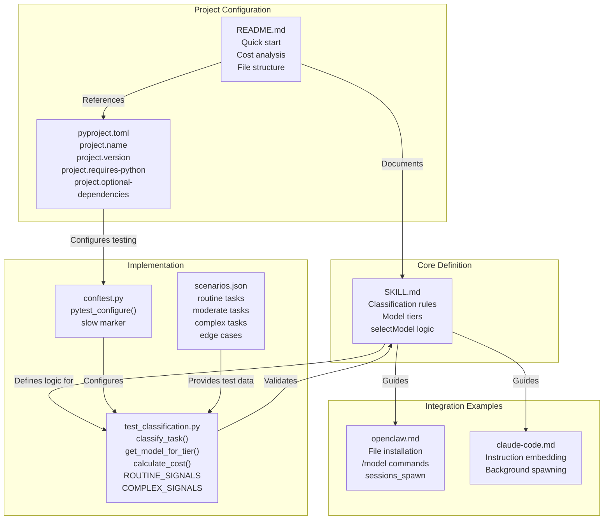
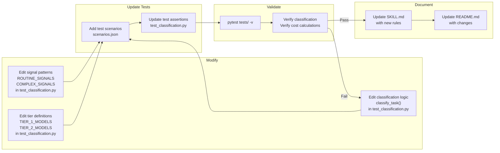
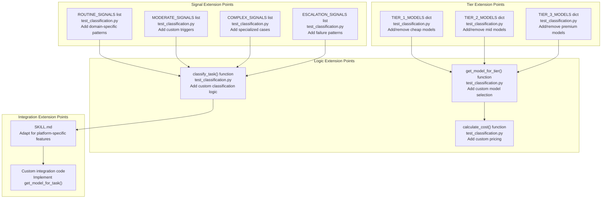

<!-- source: DeepWiki mcp.deepwiki.com · repo zscole/model-hierarchy-skill · page 7 Development Guide · fetched 2026-10-27 -->

# Development Guide

<details>
<summary>Relevant source files</summary>

The following files were used as context for generating this wiki page:

- [README.md](README.md)
- [pyproject.toml](pyproject.toml)

</details>


## Purpose and Scope

This guide provides information for developers who want to contribute to, extend, or customize the model-hierarchy-skill. It covers development environment setup, repository organization, testing workflows, and extension points for adapting the skill to specific use cases.

For information about integrating the skill into agent platforms, see [Integration Guides](#5). For details on running the test suite, see [Testing & Validation](#6).

---

## Development Environment Setup

The model-hierarchy-skill is a Python project with minimal dependencies, designed for easy setup and modification.

### Requirements

The project requires Python 3.9 or higher, as specified in [pyproject.toml:8](). This ensures compatibility with modern type hints and standard library features used throughout the codebase.

### Dependencies

The core skill has **no runtime dependencies** - it is pure Python using only standard library modules. This design choice ensures:
- Easy integration into existing agent systems
- No version conflicts with host platforms
- Minimal installation footprint

Testing requires pytest 7.0.0 or higher, defined as an optional dependency in [pyproject.toml:11]().

### Installation for Development

```bash
# Clone the repository
git clone https://github.com/zscole/model-hierarchy-skill.git
cd model-hierarchy-skill

# Install with test dependencies
pip install -e ".[test]"

# Verify installation
pytest tests/ -v
```

The `-e` flag installs in editable mode, allowing you to modify the code and immediately see changes reflected without reinstalling.

**Sources:** [pyproject.toml:1-21](), [README.md:64-70]()

---

## Repository Structure

The repository follows a simple, flat structure optimized for both human understanding and platform integration.

### Directory Layout

```
model-hierarchy-skill/
├── SKILL.md                    # Core skill specification
├── README.md                   # Project documentation
├── pyproject.toml              # Project metadata and configuration
├── tests/
│   ├── conftest.py            # Pytest configuration
│   ├── test_classification.py # Implementation and tests
│   └── scenarios.json         # Test case definitions
└── examples/
    ├── openclaw.md            # OpenClaw integration guide
    └── claude-code.md         # Claude Code integration guide
```

### File Relationships



**Key Files:**

| File | Purpose | Key Contents |
|------|---------|--------------|
| `SKILL.md` | Platform-agnostic skill definition | Classification rules, model tiers, decision algorithm |
| `test_classification.py` | Implementation and validation | `classify_task()`, signal patterns, cost functions |
| `scenarios.json` | Test data ground truth | 35 categorized test cases |
| `pyproject.toml` | Project metadata | Dependencies, pytest config, version info |
| `conftest.py` | Test configuration | Pytest markers, test setup hooks |

**Sources:** [README.md:72-84]()

---

## Development Workflow

The typical development workflow involves modifying classification logic, updating tests, and validating behavior.



### Common Development Tasks

**Adding a New Signal Pattern:**
1. Edit the signal list in [test_classification.py]() (e.g., `ROUTINE_SIGNALS`, `COMPLEX_SIGNALS`)
2. Add corresponding test scenarios to [scenarios.json]()
3. Run `pytest tests/ -v` to validate
4. Update [SKILL.md]() with the new signal documentation

**Adjusting Tier Definitions:**
1. Modify `TIER_1_MODELS`, `TIER_2_MODELS`, or `TIER_3_MODELS` in [test_classification.py]()
2. Update cost calculations if pricing changes
3. Run cost validation tests with `pytest tests/test_classification.py::TestCostCalculations -v`
4. Update [README.md:52-60]() cost table

**Changing Classification Logic:**
1. Modify `classify_task()` function in [test_classification.py]()
2. Run full test suite: `pytest tests/ -v`
3. Verify all 35 scenarios still pass
4. Update [SKILL.md]() `selectModel` pseudocode if algorithm changes

**Sources:** [README.md:64-70](), [pyproject.toml:13-17]()

---

## Extension Points

The skill is designed with clear extension points for customization without modifying core logic.



### Adding Domain-Specific Signals

Signals are simple string patterns matched against task descriptions. To add domain-specific signals:

**Example: Adding Database Signals**
```python
# In test_classification.py, add to ROUTINE_SIGNALS:
ROUTINE_SIGNALS = [
    "read", "fetch", "get", "list", "check", "show", "display",
    # Add database read operations:
    "select", "query", "lookup", "search_db", "find_record"
]

# Add to COMPLEX_SIGNALS:
COMPLEX_SIGNALS = [
    "debug", "fix", "troubleshoot", "investigate",
    # Add database operations requiring expertise:
    "optimize_query", "index_analysis", "transaction_deadlock"
]
```

After adding signals, create test scenarios in [scenarios.json]() to validate the new patterns.

### Customizing Model Tiers

Model tier definitions map tier numbers to specific models and their pricing. To update for new models or pricing:

**Example: Adding a New Model**
```python
# In test_classification.py:
TIER_1_MODELS = {
    "deepseek-chat": {"input": 0.14, "output": 0.28},
    "claude-3-haiku": {"input": 0.25, "output": 1.25},
    # Add new cheap model:
    "new-cheap-model": {"input": 0.10, "output": 0.20}
}
```

Update cost calculation tests to validate the new pricing.

### Implementing Custom Classification Logic

For specialized use cases, extend the `classify_task()` function:

**Example: Adding Complexity Tracking**
```python
def classify_task(description: str) -> Tuple[str, int]:
    """
    Classify task and return (tier, complexity_score)
    """
    description_lower = description.lower()
    
    # Check escalation signals (highest priority)
    if any(signal in description_lower for signal in ESCALATION_SIGNALS):
        return ("COMPLEX", 3)
    
    # Add custom logic: track keyword density
    complexity_score = sum(1 for signal in COMPLEX_SIGNALS 
                          if signal in description_lower)
    
    if complexity_score > 2:
        return ("COMPLEX", 3)
    elif complexity_score > 0:
        return ("MODERATE", 2)
    
    # Continue with standard logic...
```

**Sources:** [README.md:49-50]()

---

## Testing and Validation

### Running Tests

The project uses pytest for all testing. Configuration is defined in [pyproject.toml:13-17]().

```bash
# Run all tests with verbose output
pytest tests/ -v

# Run specific test class
pytest tests/test_classification.py::TestTaskClassification -v

# Run tests marked as slow
pytest -m slow

# Run with coverage (if pytest-cov installed)
pytest tests/ --cov=tests --cov-report=term-missing
```

### Test Structure

Tests are organized into classes in [test_classification.py]():
- `TestTaskClassification` - Validates signal detection and tier assignment
- `TestCostCalculations` - Validates cost calculation functions
- `TestModelSelection` - Validates model tier mappings
- `TestRealWorldScenarios` - Validates against 35 scenarios from [scenarios.json]()

For detailed testing documentation, see [Testing & Validation](#6).

**Sources:** [README.md:64-70](), [pyproject.toml:13-17]()

---

## Contributing and License

### License

The project is licensed under the MIT License, as specified in [pyproject.toml:6](). This permissive license allows:
- Commercial use
- Modification
- Distribution
- Private use

With the only requirement being preservation of copyright and license notices.

### Contributing Guidelines

**Before Contributing:**
1. Check existing issues and pull requests
2. Ensure your changes align with the project's goals (cost optimization through intelligent routing)
3. Maintain the zero-dependency design for core functionality

**Contribution Process:**
1. Fork the repository
2. Create a feature branch
3. Make your changes with clear, descriptive commits
4. Add or update tests in [scenarios.json]() for new behavior
5. Ensure all tests pass: `pytest tests/ -v`
6. Update [SKILL.md]() if classification rules change
7. Update [README.md]() if user-facing behavior changes
8. Submit a pull request with a clear description

**Code Quality Expectations:**
- Maintain simple, readable code
- Preserve the documentation-through-tests pattern
- Keep signal patterns intuitive and self-documenting
- Avoid external dependencies unless absolutely necessary

### Project Metadata

Key project information from [pyproject.toml:1-8]():
- **Name:** `model-hierarchy-skill`
- **Version:** `0.1.0`
- **Author:** Zak Cole (zak@numbergroup.xyz)
- **Python Requirement:** >= 3.9
- **Repository:** https://github.com/zscole/model-hierarchy-skill

**Sources:** [pyproject.toml:1-21](), [README.md:86-88]()

---

## Next Steps

After setting up your development environment:
- Review [The Skill Definition](#3) to understand classification rules
- Examine [Implementation Reference](#4) for code-level details
- Explore [Integration Guides](#5) for platform-specific adaptations
- Study [scenarios.json]() for examples of task classification

For questions or discussions about extending the skill, open an issue on the GitHub repository.

---

