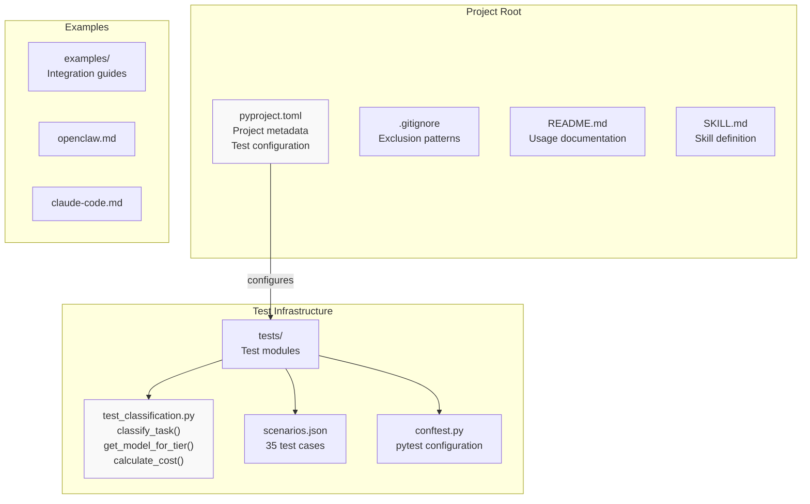
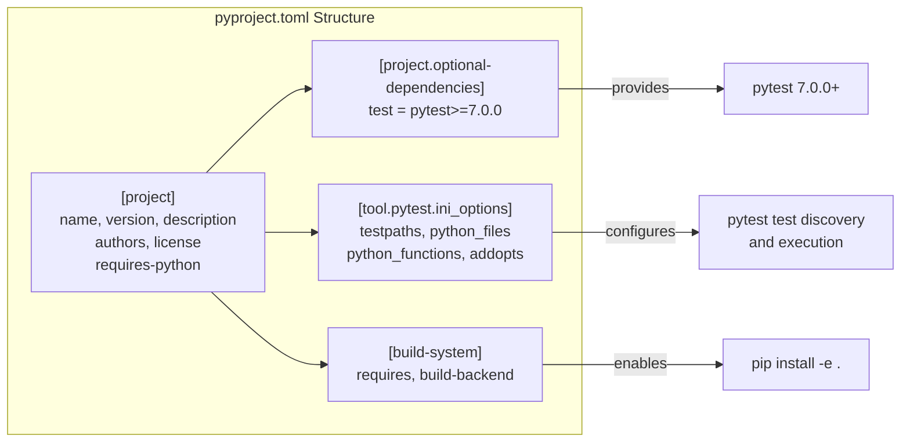
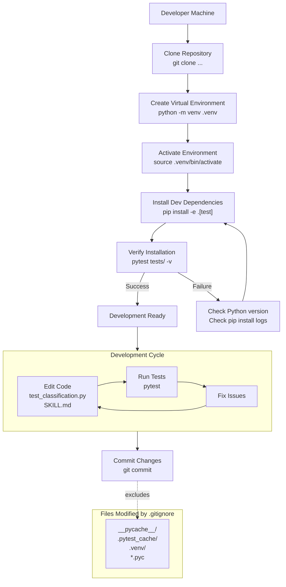

<!-- source: DeepWiki mcp.deepwiki.com · repo zscole/model-hierarchy-skill · page 7.1 Project Setup · fetched 2026-10-27 -->

# Project Setup

<details>
<summary>Relevant source files</summary>

The following files were used as context for generating this wiki page:

- [.gitignore](.gitignore)
- [README.md](README.md)
- [pyproject.toml](pyproject.toml)

</details>


## Purpose and Scope

This page covers setting up a development environment for the model-hierarchy-skill project. It documents the Python requirements, dependency installation, project configuration, and verification steps needed to begin developing or testing the skill.

For information about the repository structure and file organization, see [Repository Structure](#7.2). For guidance on running the test suite after setup, see [Running Tests](#6.3).

---

## Prerequisites

The project requires Python 3.9 or later, as specified in [pyproject.toml:8](). This version requirement ensures compatibility with modern Python features while maintaining broad accessibility across development environments.

| Requirement | Specification | Source |
|-------------|---------------|--------|
| Python Version | `>=3.9` | [pyproject.toml:8]() |
| Package Manager | pip (bundled with Python) | Standard |
| Build System | setuptools 61.0+ | [pyproject.toml:20]() |

**Sources:** [pyproject.toml:8]()

---

## Project Structure

The repository is a minimal Python project with no runtime dependencies. The skill itself is defined in markdown ([SKILL.md]()), while the implementation and tests are pure Python standard library code.



**Sources:** [README.md:74-84](), [pyproject.toml:1-22]()

---

## Installation Steps

### 1. Clone or Download the Repository

```bash
git clone https://github.com/zscole/model-hierarchy-skill.git
cd model-hierarchy-skill
```

### 2. Create a Virtual Environment (Recommended)

The [.gitignore:23-27]() file excludes common virtual environment directory names. Any of these will be ignored by version control:

```bash
# Create virtual environment
python -m venv .venv

# Activate (Unix/macOS)
source .venv/bin/activate

# Activate (Windows)
.venv\Scripts\activate
```

### 3. Install Development Dependencies

The project has no runtime dependencies, but testing requires pytest:

```bash
# Install test dependencies
pip install -e ".[test]"
```

This installs the project in editable mode with the `test` optional dependencies defined in [pyproject.toml:10-11]().

**Sources:** [pyproject.toml:10-11](), [.gitignore:23-27]()

---

## Project Configuration Anatomy

The [pyproject.toml]() file defines all project metadata and tooling configuration using modern Python packaging standards (PEP 621):



### Core Project Metadata

[pyproject.toml:1-8]() defines the package identity:

| Field | Value | Purpose |
|-------|-------|---------|
| `name` | `"model-hierarchy-skill"` | Package identifier |
| `version` | `"0.1.0"` | Semantic version |
| `description` | Cost-optimized model routing | One-line summary |
| `requires-python` | `">=3.9"` | Minimum Python version |
| `license` | MIT | Open source license |

### Optional Dependencies

[pyproject.toml:10-11]() defines test dependencies installable via `pip install -e ".[test]"`:

- `pytest>=7.0.0` - Test framework

### Pytest Configuration

[pyproject.toml:13-17]() configures pytest behavior:

| Option | Value | Effect |
|--------|-------|--------|
| `testpaths` | `["tests"]` | Only search tests/ directory |
| `python_files` | `["test_*.py"]` | Match test_*.py files |
| `python_functions` | `["test_*"]` | Match test_* functions |
| `addopts` | `"-v"` | Always run with verbose output |

### Build System

[pyproject.toml:19-21]() specifies the build backend:

- Uses `setuptools>=61.0` for building distributions
- Enables PEP 517 compliant builds

**Sources:** [pyproject.toml:1-22]()

---

## Verifying the Installation

### Run the Test Suite

After installation, verify everything works by running the tests:

```bash
# Run all tests with verbose output
pytest

# Explicitly specify test directory
pytest tests/ -v

# Run specific test file
python tests/test_classification.py
```

The pytest configuration in [pyproject.toml:13-17]() automatically sets `-v` (verbose) and discovers tests in the `tests/` directory.

### Expected Test Output

A successful installation should execute tests for:
- `TestTaskClassification` - Classification logic validation
- `TestCostCalculations` - Cost calculation accuracy
- `TestModelSelection` - Tier-to-model mapping
- `TestRealWorldScenarios` - Scenario-based validation

See [Test Suite Structure](#6.2) for detailed test organization.

**Sources:** [README.md:64-70](), [pyproject.toml:13-17]()

---

## Development Environment Files

### Git Ignore Patterns

The [.gitignore]() file excludes common Python development artifacts:

| Category | Patterns | Examples |
|----------|----------|----------|
| Python bytecode | `__pycache__/`, `*.pyc`, `*.pyo` | Compiled files |
| Build artifacts | `build/`, `dist/`, `*.egg-info/` | Package builds |
| Virtual environments | `venv/`, `.venv/`, `env/` | Local Python envs |
| Test artifacts | `.pytest_cache/`, `.coverage` | Test run data |
| IDE files | `.idea/`, `.vscode/`, `*.swp` | Editor configs |
| OS files | `.DS_Store`, `Thumbs.db` | System metadata |

### IDE Considerations

The project has no mandatory IDE configuration. However, [.gitignore:36-41]() excludes common IDE directories:
- `.idea/` - JetBrains IDEs (PyCharm)
- `.vscode/` - Visual Studio Code
- `*.swp`, `*.swo` - Vim swap files

Developers may configure their IDE to:
1. Recognize `tests/` as the test root
2. Use the virtual environment Python interpreter
3. Run pytest as the test framework

**Sources:** [.gitignore:1-46]()

---

## Development Workflow Diagram



**Sources:** [README.md:64-70](), [pyproject.toml:1-22](), [.gitignore:1-46]()

---

## Minimal Dependencies Philosophy

The model-hierarchy-skill is intentionally dependency-free for runtime usage. The skill definition ([SKILL.md]()) is pure markdown, and the reference implementation in [tests/test_classification.py]() uses only Python standard library features.

### Why No Runtime Dependencies?

| Reason | Benefit |
|--------|---------|
| Portability | Works in any Python 3.9+ environment |
| Simplicity | No dependency conflicts or version mismatches |
| Integration-friendly | Easy to embed in existing agent systems |
| Low maintenance | No need to track upstream dependency updates |

### Test-Only Dependencies

Testing requires pytest ([pyproject.toml:11]()), but this is isolated to the `[project.optional-dependencies]` section. Users integrating the skill don't need to install test dependencies.

**Sources:** [pyproject.toml:10-11]()

---

## Next Steps

After completing project setup:

1. **Explore the skill definition** - Read [SKILL.md]() to understand the classification logic
2. **Review test scenarios** - Examine [scenarios.json]() for examples of task classification (see [Test Scenarios](#6.1))
3. **Run the tests** - Execute pytest to see the implementation in action (see [Running Tests](#6.3))
4. **Try integration examples** - Follow platform-specific guides in the examples/ directory (see [Integration Guides](#5))

For information about the complete repository structure, see [Repository Structure](#7.2). For guidance on extending the skill with custom signals or tier definitions, see [Extending the Skill](#7.3).

**Sources:** [README.md:1-89](), [pyproject.toml:1-22]()

---

