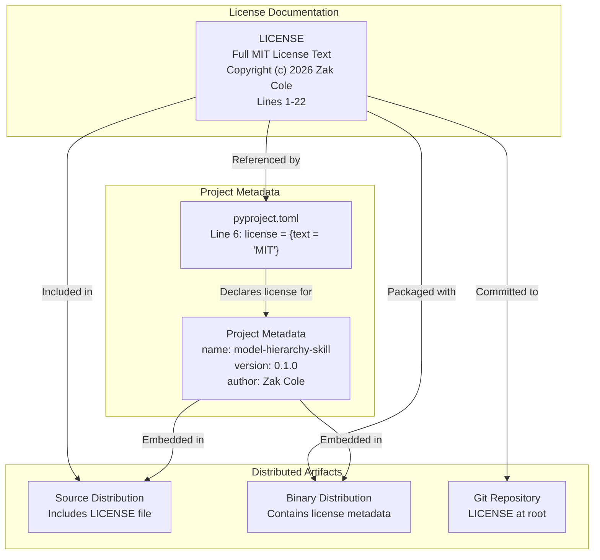
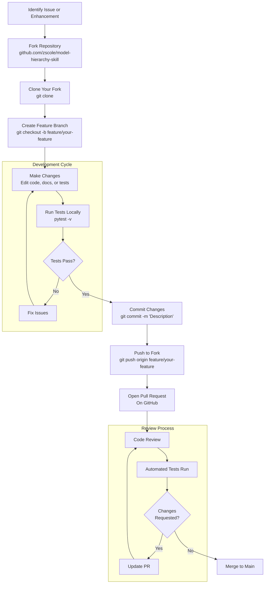
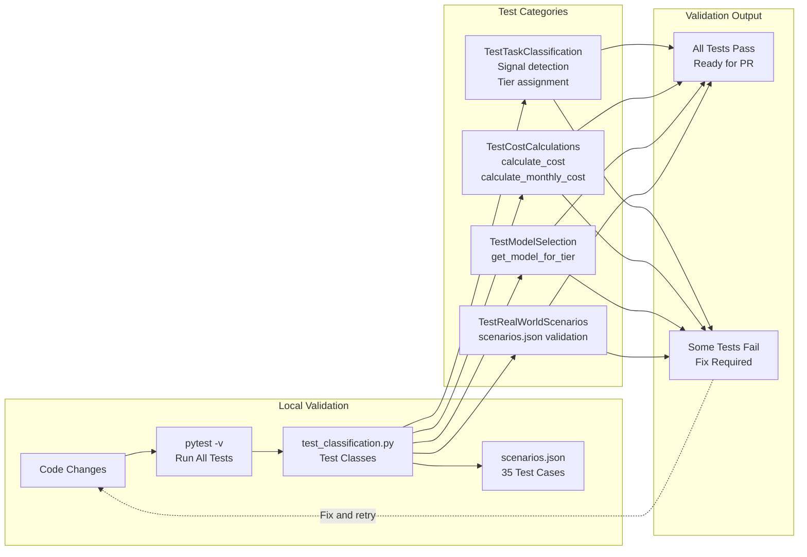
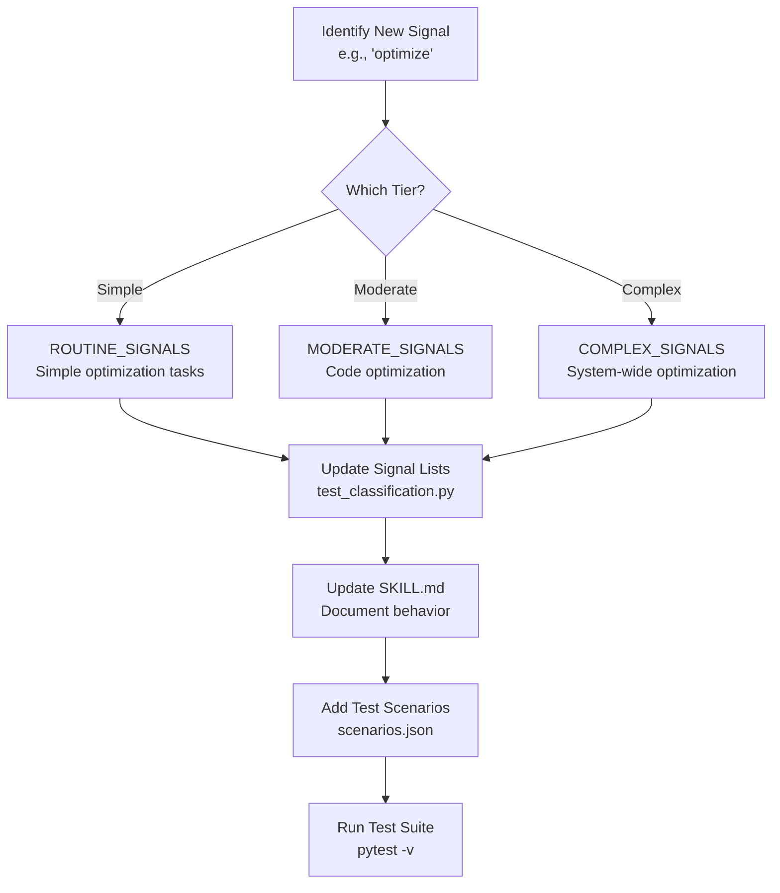

<!-- source: DeepWiki mcp.deepwiki.com · repo zscole/model-hierarchy-skill · page 7.4 License and Contributing · fetched 2026-10-27 -->

# License and Contributing

<details>
<summary>Relevant source files</summary>

The following files were used as context for generating this wiki page:

- [LICENSE](LICENSE)
- [pyproject.toml](pyproject.toml)

</details>


This page documents the licensing terms for the model-hierarchy-skill project and provides guidelines for contributing code, documentation, or other improvements to the repository. It covers the MIT License terms, contribution workflow, testing requirements, and standards for submissions.

For information about setting up a development environment, see [Project Setup](#7.1). For understanding the repository layout, see [Repository Structure](#7.2). For guidance on customizing the skill, see [Extending the Skill](#7.3).

---

## License Terms

The model-hierarchy-skill project is released under the **MIT License**, a permissive open-source license that allows free use, modification, and distribution of the software with minimal restrictions.

### License Details

| Attribute | Value |
|-----------|-------|
| **License Type** | MIT License |
| **Copyright Holder** | Zak Cole |
| **Copyright Year** | 2026 |
| **License File** | [LICENSE:1-22]() |

### Permissions

The MIT License grants the following permissions:

- **Use**: Run the software for any purpose, including commercial use
- **Modify**: Create derivative works and customize the skill
- **Distribute**: Share copies of the original or modified software
- **Sublicense**: Include the software in larger projects with different licenses
- **Sell**: Distribute copies commercially

### Conditions

The license requires only:

1. **License Inclusion**: The copyright notice and license text must be included in all copies or substantial portions of the software
2. **Attribution**: Credit must be given to the original author (Zak Cole)

### Warranty Disclaimer

The software is provided "AS IS" without warranty of any kind. The authors are not liable for any claims, damages, or issues arising from use of the software, as stated in [LICENSE:15-21]().

**License Declaration in Project Metadata**: The MIT License is also declared in the project configuration at [pyproject.toml:6](), ensuring package managers and distribution tools correctly identify the licensing terms.

**Sources**: [LICENSE:1-22](), [pyproject.toml:6]()

---

## License Declaration Architecture

The following diagram shows how license information is declared across the codebase:



**Diagram: License Information Flow** - Shows how the MIT License is declared in both the LICENSE file and project metadata, and how it flows into distributed artifacts.

**Sources**: [LICENSE:1-22](), [pyproject.toml:1-8]()

---

## Contributing Guidelines

Contributions to the model-hierarchy-skill project are welcome and encouraged. This includes bug fixes, new features, documentation improvements, test coverage enhancements, and integration examples.

### Types of Contributions

| Contribution Type | Examples | Key Files to Modify |
|-------------------|----------|---------------------|
| **Bug Fixes** | Fixing classification errors, correcting cost calculations | [test_classification.py](), [SKILL.md]() |
| **Feature Additions** | New signal patterns, additional model tiers, budget tracking | [test_classification.py](), [SKILL.md]() |
| **Documentation** | Wiki improvements, integration guides, examples | [README.md](), [examples/]() |
| **Test Coverage** | New scenarios, edge cases, validation tests | [scenarios.json](), [test_classification.py]() |
| **Integration Examples** | Platform-specific guides | [examples/]() directory |

### Prerequisites for Contributors

Before contributing, ensure you have:

1. **Development Environment**: Python >=3.9 installed ([pyproject.toml:8]())
2. **Testing Framework**: pytest >=7.0.0 for running tests ([pyproject.toml:11]())
3. **Repository Access**: Forked copy of https://github.com/zscole/model-hierarchy-skill
4. **Git Configuration**: Name and email configured for commits

See [Project Setup](#7.1) for detailed environment setup instructions.

**Sources**: [pyproject.toml:8-11]()

---

## Contribution Workflow

The standard contribution workflow follows the fork-and-pull-request model:



**Diagram: Standard Contribution Flow** - Shows the complete process from identifying an issue to merging a pull request, including local testing and review cycles.

**Sources**: [pyproject.toml:13-17]() (pytest configuration)

---

## Testing Requirements

All contributions must pass the existing test suite and include tests for new functionality.

### Running Tests Before Submission

Execute the full test suite using:

```bash
pytest -v
```

This command runs all tests defined in [test_classification.py]() with verbose output, as configured in [pyproject.toml:13-17]().

### Test Coverage Expectations

| Change Type | Test Requirements |
|-------------|-------------------|
| **Bug Fix** | Test reproducing the bug + verification that fix works |
| **New Signal Pattern** | Scenarios in [scenarios.json]() + classification tests |
| **Model Tier Addition** | Model selection tests + cost calculation tests |
| **New Feature** | Comprehensive test coverage for all code paths |

### Test Validation Workflow



**Diagram: Test Validation Process for Contributors** - Shows how code changes must pass through local testing before submission, including the specific test classes that validate different aspects of the skill.

**Sources**: [pyproject.toml:13-17](), [test_classification.py](), [scenarios.json]()

For detailed information about the test suite structure, see [Testing & Validation](#6).

---

## Code Standards

### Python Code Style

Contributions should follow these conventions:

- **Python Version**: Compatible with Python >=3.9 ([pyproject.toml:8]())
- **Function Naming**: Lowercase with underscores (e.g., `classify_task`, `get_model_for_tier`)
- **Type Hints**: Include type hints for function parameters and return values where practical
- **Documentation**: Docstrings for new functions explaining purpose, parameters, and return values

### Documentation Standards

- **Clarity**: Technical but accessible to developers of varying experience
- **Examples**: Include concrete examples for new features
- **Accuracy**: Ensure code citations reference actual line numbers
- **Completeness**: Document all parameters, return values, and edge cases

### Commit Message Guidelines

- **Format**: `<type>: <description>` (e.g., "fix: correct Tier 3 cost calculation")
- **Types**: `feat`, `fix`, `docs`, `test`, `refactor`, `style`, `chore`
- **Description**: Clear, concise summary of changes
- **Body**: Optional detailed explanation for complex changes

---

## Signal Pattern Contributions

When contributing new signal patterns for task classification:

### Signal Addition Checklist

1. **Identify Pattern**: Document the keywords/phrases that indicate task complexity
2. **Categorize Tier**: Determine if signal maps to ROUTINE, MODERATE, COMPLEX, or ESCALATION
3. **Add to Code**: Update signal lists in [test_classification.py]()
4. **Update Documentation**: Reflect changes in [SKILL.md]()
5. **Create Test Scenarios**: Add examples to [scenarios.json]()
6. **Validate**: Ensure all existing tests still pass

### Example Signal Addition Structure



**Diagram: Signal Pattern Contribution Process** - Shows the workflow for adding new classification signals, from identification through validation.

**Sources**: [test_classification.py](), [SKILL.md](), [scenarios.json]()

For guidance on customizing signals, see [Extending the Skill](#7.3).

---

## Integration Example Contributions

New integration examples for additional agent platforms are particularly valuable.

### Integration Example Requirements

When contributing a platform integration guide:

| Requirement | Description |
|-------------|-------------|
| **Platform Identification** | Name and version of the target platform |
| **Installation Steps** | Clear, numbered steps for integrating the skill |
| **Configuration** | Required settings, file locations, environment variables |
| **Usage Examples** | Concrete examples showing model switching in action |
| **Limitations** | Known constraints or platform-specific considerations |

### Structure for New Examples

New integration guides should be added to the `examples/` directory following this structure:

1. **Introduction**: Brief description of the target platform
2. **Prerequisites**: Platform version, access requirements
3. **Installation**: Step-by-step integration instructions
4. **Configuration**: Settings and customization options
5. **Usage**: Practical examples of the skill in action
6. **Verification**: How to confirm the skill is working correctly

See [examples/openclaw.md]() and [examples/claude-code.md]() as reference templates.

**Sources**: [examples/openclaw.md](), [examples/claude-code.md]()

For more details on integration patterns, see [Integration Guides](#5).

---

## Contact and Support

### Project Maintainer

| Role | Name | Contact |
|------|------|---------|
| **Author** | Zak Cole | zak@numbergroup.xyz |
| **Copyright** | Zak Cole | As stated in [LICENSE:3]() |

### Communication Channels

- **Bug Reports**: Open an issue on GitHub repository
- **Feature Requests**: Open an issue with "enhancement" label
- **Questions**: Use GitHub Discussions or email the maintainer
- **Pull Requests**: Submit via GitHub following the contribution workflow

### Response Expectations

- **Critical Bugs**: Acknowledged within 48 hours
- **Feature Requests**: Reviewed within 1 week
- **Pull Requests**: Initial review within 3-5 business days
- **Questions**: Best-effort response within 1 week

---

## Contributor License Agreement

By submitting contributions to this project, you agree that:

1. **License Grant**: Your contributions will be licensed under the MIT License
2. **Rights**: You have the right to submit the contribution
3. **Originality**: The contribution is your original work or properly attributed
4. **Warranty**: You provide contributions "as-is" without warranties

This implicit agreement ensures all project code remains under consistent licensing terms as specified in [LICENSE:1-22]().

**Sources**: [LICENSE:1-22](), [pyproject.toml:6]()

---

## Acknowledgments

Contributions from the community help improve the model-hierarchy-skill for all users. Whether you're fixing a typo, adding a test case, or building a new integration, your contributions are valued and appreciated.

Thank you for contributing to cost-efficient AI agent systems!

**Sources**: [LICENSE:1-22](), [pyproject.toml:1-8]()