# Page: Home

# Home

<details>
<summary>Relevant source files</summary>

The following files were used as context for generating this wiki page:

- [README.md](README.md)
- [SKILL.md](SKILL.md)

</details>


This wiki documents the **model-hierarchy-skill** system: a cost optimization framework for AI agent platforms that achieves approximately 10x cost reduction by intelligently routing tasks to appropriate language models based on complexity. The system classifies agent tasks into three categories (routine, moderate, complex) and routes them to corresponding model tiers (cheap, mid, premium), maintaining quality on complex work while dramatically reducing costs on routine operations.

This page provides a high-level introduction to the system architecture, core concepts, and repository structure. For detailed information about specific aspects:
- Problem definition and cost analysis: see [The Problem: Agent Cost Waste](#2.1) and [Cost Optimization Analysis](#2.3)
- Skill specification and classification rules: see [The Skill Definition](#3)
- Implementation details: see [Implementation Reference](#4)
- Platform-specific integration: see [Integration Guides](#5)

**Sources:** [README.md:1-89](), [SKILL.md:1-256]()

## System Overview

The model-hierarchy-skill addresses a fundamental inefficiency in AI agent systems: most agents execute all tasks on expensive premium models, despite 80% of agent work being routine operations (file I/O, status checks, formatting) that cheap models handle equally well. The system provides a classification framework and routing logic that agents can adopt to match task complexity with appropriate model capabilities.

The framework consists of three primary components:

| Component | Purpose | Key Artifact |
|-----------|---------|--------------|
| **Skill Definition** | Classification rules, model tiers, behavioral guidelines | `SKILL.md` |
| **Implementation** | Executable classification logic and cost calculations | `test_classification.py` |
| **Integration Examples** | Platform-specific adoption patterns | `examples/openclaw.md`, `examples/claude-code.md` |

The system achieves ~$19/month operational cost versus ~$225/month for pure premium model usage, assuming 100K tokens/day workload with 80/15/5 task distribution.

**Sources:** [README.md:3-19](), [SKILL.md:11-17]()

## Repository Structure

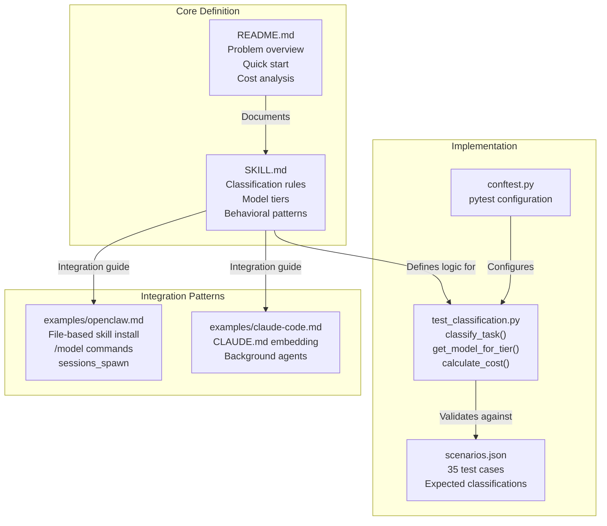

**Diagram: Repository File Structure**

The repository is organized into three layers:

1. **Core Definition Layer**: `SKILL.md` contains the authoritative specification of classification rules, model tier definitions, and agent behavioral patterns. `README.md` provides user-facing documentation.

2. **Implementation Layer**: `test_classification.py` contains both the reference implementation of the classification logic and comprehensive tests validating it. `scenarios.json` provides ground truth data for 35 test cases spanning routine, moderate, complex, and edge-case scenarios.

3. **Integration Layer**: Platform-specific examples demonstrate adoption patterns. `examples/openclaw.md` shows file-based skill installation for OpenClaw. `examples/claude-code.md` shows instruction embedding for Claude Code/Codex.

**Sources:** [README.md:72-84](), [SKILL.md:1-9]()

## Core Concepts

### Three-Tier Model Hierarchy

The system categorizes available language models into three tiers based on cost and capability:

| Tier | Cost Range | Model Examples | Usage Pattern |
|------|------------|----------------|---------------|
| **Tier 1 (Cheap)** | $0.14-0.50/M tokens | DeepSeek V3, GPT-4o-mini, Claude Haiku | 80% of tasks: file ops, status checks, formatting |
| **Tier 2 (Mid)** | $1-5/M tokens | Claude Sonnet, GPT-4o, Gemini Pro | 15% of tasks: code generation, summaries, analysis |
| **Tier 3 (Premium)** | $10-75/M tokens | Claude Opus, GPT-4.5, o1 | 5% of tasks: debugging, architecture, novel problems |

**Sources:** [SKILL.md:19-47]()

### Task Classification System

Tasks are classified into three complexity categories that map to model tiers:

- **ROUTINE** → Tier 1: Single-step operations with clear instructions and deterministic output (file read/write, status checks, simple lookups, formatting)
- **MODERATE** → Tier 2: Multi-step but well-defined operations requiring synthesis (code generation, summarization, data analysis, tool orchestration)
- **COMPLEX** → Tier 3: Novel problem-solving requiring deep reasoning (debugging, architecture decisions, security review, failed task escalation)

**Sources:** [SKILL.md:49-107]()

## Classification Architecture

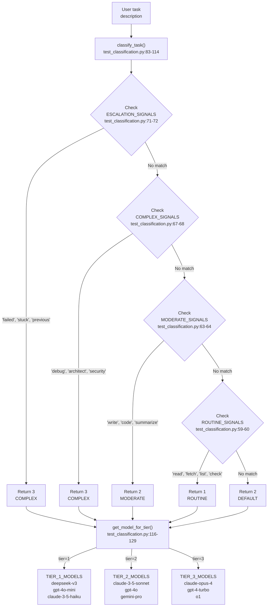

**Diagram: Classification Logic Flow with Code Entity Mapping**

The classification system uses a cascading signal detection approach implemented in `classify_task()` [test_classification.py:83-114](). The function analyzes task descriptions against four signal pattern sets:

1. **ESCALATION_SIGNALS** [test_classification.py:71-72](): Highest priority, detects task retry/failure scenarios → forces Tier 3
2. **COMPLEX_SIGNALS** [test_classification.py:67-68](): Detects complex reasoning requirements → routes to Tier 3
3. **MODERATE_SIGNALS** [test_classification.py:63-64](): Detects synthesis/generation tasks → routes to Tier 2
4. **ROUTINE_SIGNALS** [test_classification.py:59-60](): Detects simple operations → routes to Tier 1

Ambiguous tasks default to Tier 2 as a safety mechanism. The `get_model_for_tier()` function [test_classification.py:116-129]() maps tier numbers to specific model identifiers from `TIER_1_MODELS`, `TIER_2_MODELS`, and `TIER_3_MODELS` [test_classification.py:46-57]().

**Sources:** [test_classification.py:46-129](), [SKILL.md:109-132]()

## Cost Optimization Model

The economic justification for the system relies on task distribution patterns typical in agent operations:

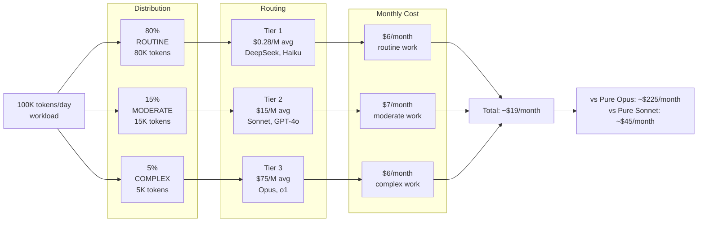

**Diagram: Cost Calculation Model**

The cost model assumes an 80/15/5 distribution based on typical agent workload patterns. Cost calculations are implemented in `calculate_cost()` and `calculate_monthly_cost()` functions [test_classification.py:131-152]() using pricing data from `MODEL_PRICING` [test_classification.py:20-44]().

**Calculation methodology:**
- Routine (80K tokens/day × 30 days × $0.28/M) ≈ $6/month
- Moderate (15K tokens/day × 30 days × $15/M) ≈ $7/month  
- Complex (5K tokens/day × 30 days × $75/M) ≈ $6/month
- **Total:** ~$19/month vs ~$225 for pure premium usage (10x reduction)

**Sources:** [README.md:52-61](), [SKILL.md:167-183](), [test_classification.py:20-152]()

## Integration Patterns

The skill supports three integration approaches:

### File-Based Discovery (OpenClaw)
Copy `SKILL.md` to `~/.openclaw/skills/model-hierarchy/SKILL.md`. The OpenClaw gateway loads the skill and enables `/model` commands for manual switching and `sessions_spawn` for automated sub-agent model selection. Configuration via `config.yml` sets default models. See [OpenClaw Integration](#5.1) for details.

### Instruction Embedding (Claude Code)
Extract classification rules from `SKILL.md` and embed into `CLAUDE.md` or project instructions. The agent reads these instructions at session start and applies them when spawning background agents. Natural language prompts guide model selection decisions. See [Claude Code Integration](#5.2) for details.

### Programmatic Implementation (Custom)
Implement a `get_model_for_task(task_description: str) -> str` function based on the signal detection patterns in [SKILL.md:220-232](). The reference implementation in [test_classification.py:83-129]() provides a starting point. See [Custom Integration](#5.3) for details.

**Sources:** [SKILL.md:186-232](), [examples/openclaw.md](), [examples/claude-code.md]()

## Validation Framework

The system includes comprehensive testing infrastructure:

- **Test scenarios**: `scenarios.json` contains 35 test cases across routine (10), moderate (10), complex (10), and edge case (5) categories, each with expected tier classification
- **Test implementation**: `test_classification.py` contains four test classes validating classification accuracy, cost calculations, model selection, and real-world scenario handling
- **Test execution**: Run via `pytest tests/ -v` or `python tests/test_classification.py`

The test suite validates that the `classify_task()` function correctly assigns tiers for diverse task descriptions and that cost projections match expected values. See [Testing & Validation](#6) for comprehensive coverage.

**Sources:** [README.md:62-70](), [test_classification.py:1-346](), [scenarios.json]()

## Getting Started

To adopt the model-hierarchy-skill:

1. **Understand the problem**: Review [The Problem: Agent Cost Waste](#2.1) to understand why routing matters
2. **Learn the classification system**: Read [Task Classification System](#3.1) and [Model Tier Architecture](#3.2) for tier definitions and routing rules
3. **Choose integration approach**: Select file-based ([OpenClaw Integration](#5.1)), instruction embedding ([Claude Code Integration](#5.2)), or programmatic ([Custom Integration](#5.3)) based on your platform
4. **Validate with tests**: Run the test suite to verify classification behavior matches expectations ([Running Tests](#6.3))
5. **Monitor and refine**: Track actual costs and adjust signal patterns as needed ([Extending the Skill](#7.3))

The skill is designed to be immediately usable via `SKILL.md` but also extensible for domain-specific customization.

**Sources:** [README.md:21-51](), [SKILL.md:249-256]()

---

# Page: Understanding the System

# Understanding the System

<details>
<summary>Relevant source files</summary>

The following files were used as context for generating this wiki page:

- [README.md](README.md)
- [SKILL.md](SKILL.md)

</details>


## Purpose and Scope

This page provides a comprehensive overview of the model-hierarchy-skill system architecture, explaining both the problem it solves and how the solution is structured. It bridges the conceptual framework with the actual implementation details.

For specific information about:
- The cost waste problem in detail, see [The Problem: Agent Cost Waste](#2.1)
- The routing solution mechanics, see [The Solution: Hierarchical Model Routing](#2.2)
- Mathematical cost analysis, see [Cost Optimization Analysis](#2.3)
- The skill specification format, see [The Skill Definition](#3)
- Code implementation details, see [Implementation Reference](#4)
- Platform-specific integration, see [Integration Guides](#5)

---

## System Overview

The model-hierarchy-skill is a cost optimization system that teaches AI agents to classify tasks by complexity and route them to appropriately-priced language models. The system achieves approximately 10x cost reduction by recognizing that 80% of agent tasks are routine operations that do not require expensive premium models.

The system consists of three primary layers:

| Layer | Components | Purpose |
|-------|-----------|---------|
| **Definition** | `SKILL.md`, `README.md` | Specifies classification rules, model tiers, and behavioral guidelines |
| **Implementation** | `test_classification.py`, `scenarios.json` | Executable classification logic and validation suite |
| **Integration** | `examples/openclaw.md`, `examples/claude-code.md` | Platform-specific adoption patterns |

**Sources:** [README.md:1-88](), [SKILL.md:1-256]()

---

## Core Architecture Components

The following diagram maps the system's conceptual components to their concrete file and code representations:

### Component-to-Code Mapping

```mermaid
graph TB
    subgraph "Definition Layer"
        SKILL_MD["SKILL.md"]
        README_MD["README.md"]
        
        SKILL_RULES["Classification Rules<br/>(lines 49-107)"]
        SKILL_TIERS["Model Tiers<br/>(lines 19-46)"]
        SKILL_ALGO["Decision Algorithm<br/>(lines 109-132)"]
        
        SKILL_MD --> SKILL_RULES
        SKILL_MD --> SKILL_TIERS
        SKILL_MD --> SKILL_ALGO
    end
    
    subgraph "Implementation Layer"
        TEST_FILE["test_classification.py"]
        SCENARIOS["scenarios.json"]
        
        CLASSIFY_FUNC["classify_task()"]
        MODEL_FUNC["get_model_for_tier()"]
        COST_FUNC["calculate_cost()"]
        
        SIGNAL_ROUTINE["ROUTINE_SIGNALS"]
        SIGNAL_MODERATE["MODERATE_SIGNALS"]
        SIGNAL_COMPLEX["COMPLEX_SIGNALS"]
        SIGNAL_ESCALATION["ESCALATION_SIGNALS"]
        
        TEST_FILE --> CLASSIFY_FUNC
        TEST_FILE --> MODEL_FUNC
        TEST_FILE --> COST_FUNC
        TEST_FILE --> SIGNAL_ROUTINE
        TEST_FILE --> SIGNAL_MODERATE
        TEST_FILE --> SIGNAL_COMPLEX
        TEST_FILE --> SIGNAL_ESCALATION
    end
    
    subgraph "Integration Layer"
        OC_EXAMPLE["examples/openclaw.md"]
        CC_EXAMPLE["examples/claude-code.md"]
        
        OC_INSTALL["~/.openclaw/skills/<br/>model-hierarchy/"]
        CC_CLAUDE_MD["CLAUDE.md<br/>project instructions"]
    end
    
    SKILL_RULES -.->|"implements"| CLASSIFY_FUNC
    SKILL_TIERS -.->|"implements"| MODEL_FUNC
    SKILL_ALGO -.->|"implements"| SIGNAL_ROUTINE
    SKILL_ALGO -.->|"implements"| SIGNAL_MODERATE
    SKILL_ALGO -.->|"implements"| SIGNAL_COMPLEX
    
    SKILL_MD -.->|"copied to"| OC_INSTALL
    SKILL_RULES -.->|"embedded in"| CC_CLAUDE_MD
    
    SCENARIOS -.->|"validates"| CLASSIFY_FUNC
```

**Sources:** [SKILL.md:1-256](), [README.md:72-84]()

---

## Task Classification and Routing Flow

This diagram shows how a task description flows through the classification system, mapping to specific code functions and data structures:

### Task Processing Pipeline

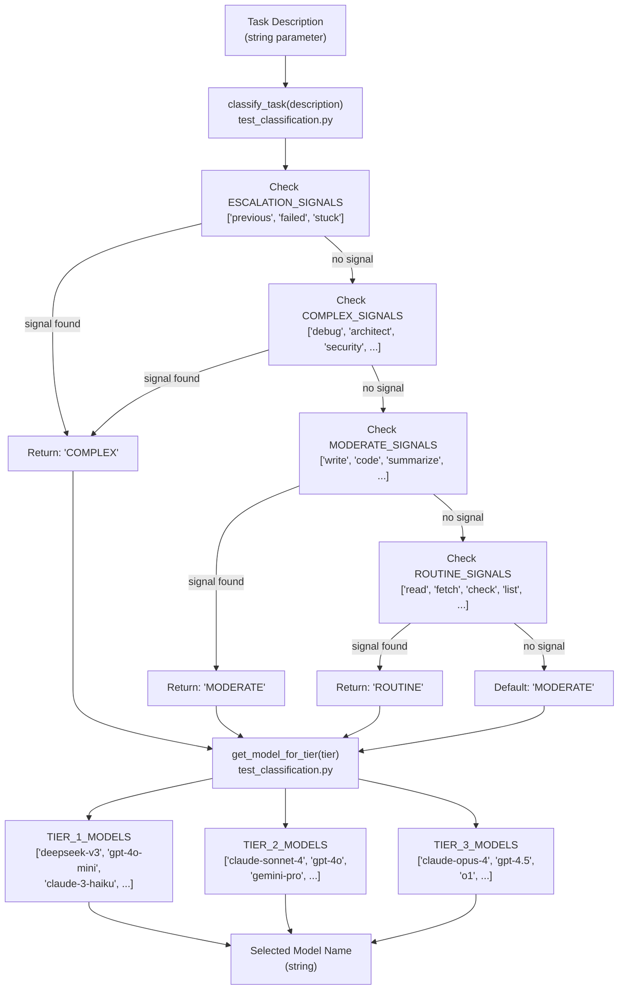

**Sources:** [test_classification.py]() (specific line references not available, but contains `classify_task()`, `get_model_for_tier()`, signal constant definitions)

---

## Three-Tier Model Hierarchy

The system organizes language models into three tiers based on cost and capability. Each tier is defined in both the specification and implementation:

| Tier | Cost Range | SKILL.md Definition | Implementation Constant | Example Models |
|------|-----------|---------------------|------------------------|----------------|
| **Tier 1: Cheap** | $0.10-0.50/M tokens | Lines 21-28 | `TIER_1_MODELS` | `deepseek-v3`, `gpt-4o-mini`, `claude-3-haiku` |
| **Tier 2: Mid** | $1-5/M tokens | Lines 30-36 | `TIER_2_MODELS` | `claude-sonnet-4`, `gpt-4o`, `gemini-pro` |
| **Tier 3: Premium** | $10-75/M tokens | Lines 38-45 | `TIER_3_MODELS` | `claude-opus-4`, `gpt-4.5`, `o1` |

### Tier-to-Task Mapping

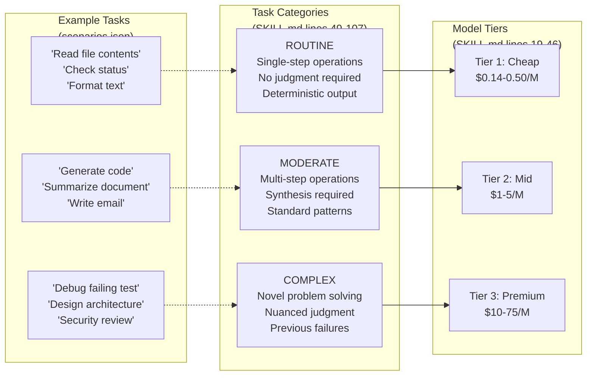

**Sources:** [SKILL.md:19-107](), [README.md:13-17]()

---

## Signal-Based Classification System

The classification mechanism relies on keyword signal detection. The specification in `SKILL.md` defines the concept, while `test_classification.py` implements it as constant lists:

### Signal Detection Architecture

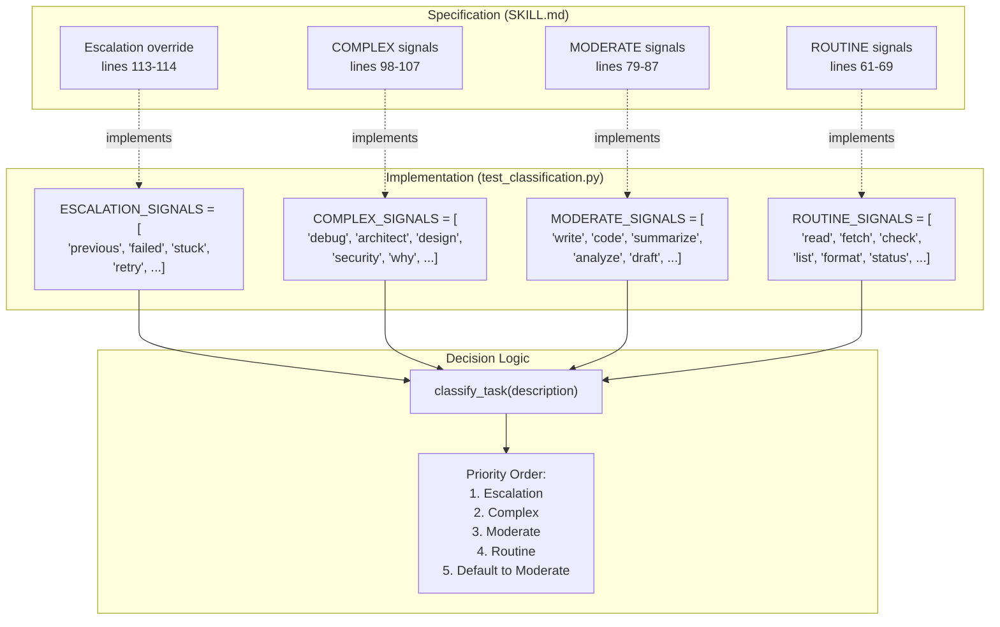

The `classify_task()` function checks signals in priority order: escalation signals override everything, followed by complex signals, moderate signals, and routine signals. If no signals match, the function defaults to `'MODERATE'` as a safe middle ground.

**Sources:** [SKILL.md:109-132](), [test_classification.py]()

---

## Implementation Validation

The system includes comprehensive validation through a test suite:

| Component | File | Purpose |
|-----------|------|---------|
| **Test scenarios** | `scenarios.json` | 35 test cases covering routine, moderate, complex, and edge cases |
| **Classification tests** | `test_classification.py` | Validates `classify_task()` accuracy against scenarios |
| **Cost calculation tests** | `test_classification.py` | Validates `calculate_cost()` and `calculate_monthly_cost()` functions |
| **Model selection tests** | `test_classification.py` | Validates `get_model_for_tier()` returns correct model names |

The test suite ensures the implementation matches the specification defined in `SKILL.md`. For details on running tests, see [Testing & Validation](#6).

**Sources:** [README.md:62-70]()

---

## Integration Patterns

The system supports three distinct integration patterns, each suited to different agent platform architectures:

### Integration Pattern Overview

```mermaid
graph TB
    subgraph "Pattern 1: File-Based Discovery"
        FB_SPEC["SKILL.md specification"]
        FB_INSTALL["Copy to:<br/>~/.openclaw/skills/<br/>model-hierarchy/SKILL.md"]
        FB_GATEWAY["OpenClaw Gateway<br/>discovers and loads skill"]
        FB_RUNTIME["Runtime commands:<br/>/model opus<br/>/model deepseek"]
    end
    
    subgraph "Pattern 2: Instruction Embedding"
        IE_SPEC["SKILL.md classification rules"]
        IE_EXTRACT["Extract natural language rules"]
        IE_CLAUDE["Add to CLAUDE.md<br/>project instructions"]
        IE_RUNTIME["Agent reads instructions<br/>on initialization"]
    end
    
    subgraph "Pattern 3: Programmatic"
        PG_CODE["test_classification.py<br/>implementation"]
        PG_FUNC["Implement get_model_for_task()<br/>in agent codebase"]
        PG_CALL["Call before API requests:<br/>model = get_model_for_task(task)"]
    end
    
    FB_SPEC --> FB_INSTALL --> FB_GATEWAY --> FB_RUNTIME
    IE_SPEC --> IE_EXTRACT --> IE_CLAUDE --> IE_RUNTIME
    PG_CODE --> PG_FUNC --> PG_CALL
```

For platform-specific implementation details, see:
- [OpenClaw Integration](#5.1) for file-based discovery pattern
- [Claude Code Integration](#5.2) for instruction embedding pattern
- [Custom Integration](#5.3) for programmatic implementation

**Sources:** [SKILL.md:186-232](), [README.md:22-50](), [examples/openclaw.md](), [examples/claude-code.md]()

---

## Cost Optimization Economics

The system achieves cost reduction through task distribution across tiers. The assumed distribution is:

| Distribution | Tasks per Tier | Tier Cost | Monthly Cost |
|--------------|---------------|-----------|--------------|
| 80% routine | 80K tokens/day → Tier 1 | $0.28/M average | ~$6/month |
| 15% moderate | 15K tokens/day → Tier 2 | $15/M average | ~$7/month |
| 5% complex | 5K tokens/day → Tier 3 | $75/M average | ~$6/month |
| **Total hierarchy** | **100K tokens/day** | **Mixed** | **~$19/month** |

Comparison to single-tier strategies:

| Strategy | Monthly Cost | vs Hierarchy |
|----------|--------------|--------------|
| Pure Tier 3 (Opus) | ~$225 | 10x more expensive |
| Pure Tier 2 (Sonnet) | ~$45 | 2.4x more expensive |
| Hierarchy (80/15/5) | ~$19 | Baseline |

The cost calculation is implemented in the `calculate_monthly_cost()` function, which accepts token counts per tier and pricing information.

For detailed cost analysis and mathematical justification, see [Cost Optimization Analysis](#2.3).

**Sources:** [SKILL.md:168-183](), [README.md:52-60]()

---

## System Lifecycle

The skill follows a definition → implementation → integration → operation lifecycle:

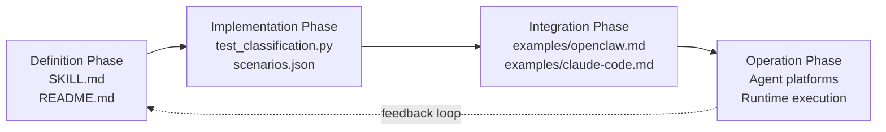

The specification in `SKILL.md` defines the rules and behaviors. The implementation in `test_classification.py` provides executable classification logic. Integration examples demonstrate adoption patterns. Operation occurs when agent platforms execute tasks using the skill's classification logic.

**Sources:** [README.md:1-88](), [SKILL.md:1-256]()

---

## Summary

The model-hierarchy-skill system consists of:

1. **A specification** ([SKILL.md]()) defining task classification rules, model tiers, and behavioral guidelines
2. **An implementation** ([test_classification.py]()) providing `classify_task()`, signal detection, and model selection
3. **Integration examples** ([examples/]()) showing file-based, instruction-based, and programmatic adoption
4. **A validation suite** ([scenarios.json]()) with 35 test cases ensuring classification accuracy

The system routes tasks to appropriate models based on complexity signals, achieving approximately 10x cost reduction by recognizing that 80% of agent tasks are routine operations suitable for cheap models.

For detailed information on specific aspects of the system, refer to the child pages under this section.

---

# Page: The Problem: Agent Cost Waste

# The Problem: Agent Cost Waste

<details>
<summary>Relevant source files</summary>

The following files were used as context for generating this wiki page:

- [README.md](README.md)
- [SKILL.md](SKILL.md)

</details>


## Purpose and Scope

This document explains the fundamental problem that the model-hierarchy-skill system addresses: **the systemic waste of resources when AI agents execute routine tasks using expensive premium models**. It quantifies the cost impact, identifies the types of tasks that constitute "janitorial work," and examines why agents default to premium models despite most tasks being routine.

For the solution to this problem, see [The Solution: Hierarchical Model Routing](#2.2). For detailed cost calculations and savings projections, see [Cost Optimization Analysis](#2.3).

---

## The Core Problem Statement

Most AI agent systems execute all tasks using a single model tier, typically mid-tier or premium models. This approach creates significant cost waste because the distribution of task complexity in real-world agent operations is heavily skewed toward routine operations.

**The fundamental inefficiency**: Agents pay $15-75 per million tokens for tasks that $0.14-0.50 per million tokens can handle equivalently.

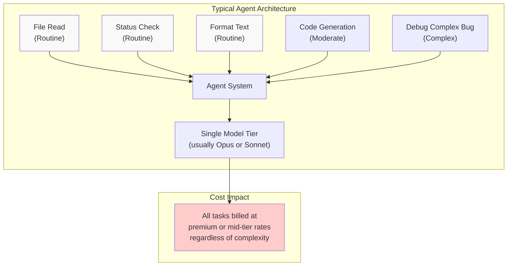

**Diagram: Uniform Model Usage Pattern**

Sources: [README.md:5-7](), [SKILL.md:16-17]()

---

## The 80/15/5 Task Distribution

Analysis of typical agent workloads reveals a consistent pattern: **80% of agent tasks are routine operations** that require no complex reasoning, nuanced judgment, or novel problem-solving.

| Task Category | Percentage | Complexity Level | Example Operations |
|---------------|-----------|------------------|-------------------|
| **Routine** | 80% | Single-step, deterministic | File I/O, status checks, formatting, lookups |
| **Moderate** | 15% | Multi-step, standard patterns | Code generation, summaries, analysis |
| **Complex** | 5% | Novel reasoning, high stakes | Debugging, architecture, security review |

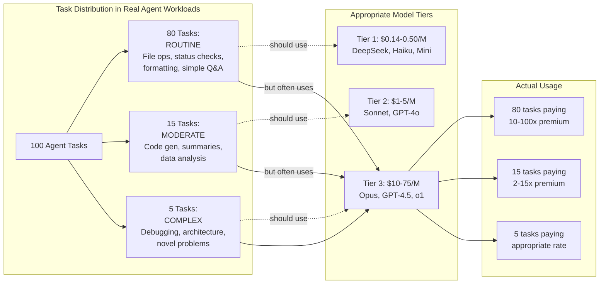

**Diagram: Task Distribution and Cost Mismatch**

This distribution means that **the majority of operational costs are spent on tasks that derive no benefit from premium models**. A $0.14/M token model performs identically to a $75/M token model when reading a file or checking a status endpoint.

Sources: [README.md:7-17](), [SKILL.md:16-17](), [SKILL.md:178-182]()

---

## What Constitutes "Janitorial Work"

The term "janitorial work" describes the 80% of routine tasks that agents perform but that require no sophisticated reasoning capabilities. These tasks are characterized by:

### Characteristics of Routine Tasks

- **Single-step operations**: No multi-stage reasoning required
- **Clear, unambiguous instructions**: No interpretation needed
- **Deterministic output**: Expected result is well-defined
- **No judgment calls**: Execution follows direct procedural logic

### Examples from Code

The codebase defines routine operations through signal patterns detected in task descriptions. These signals are defined in [test_classification.py]():

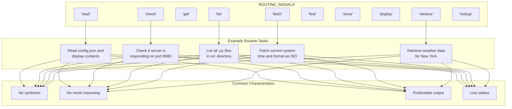

**Diagram: ROUTINE_SIGNALS Pattern Detection**

The classification system in `test_classification.py` defines these signal patterns:

| Signal Category | Signals | Task Examples |
|----------------|---------|---------------|
| **ROUTINE_SIGNALS** | `read`, `fetch`, `get`, `list`, `check`, `find`, `show`, `display`, `retrieve`, `lookup` | File operations, status checks, simple lookups |
| **MODERATE_SIGNALS** | `write`, `create`, `update`, `modify`, `generate`, `code`, `summarize`, `analyze`, `transform` | Code generation, summaries, data transformation |
| **COMPLEX_SIGNALS** | `debug`, `fix`, `solve`, `architect`, `design`, `security`, `optimize`, `refactor` | Multi-step debugging, design decisions |
| **ESCALATION_SIGNALS** | `failed`, `stuck`, `error`, `previous attempt`, `tried`, `unsuccessful` | Tasks that need escalation after failure |

Sources: [SKILL.md:53-107](), [test_classification.py]() (signal definitions)

### Concrete Examples

From the skill definition in [SKILL.md:62-70]():

**Routine operations** (Tier 1 appropriate):
- File read/write operations
- Status checks and health monitoring
- Simple lookups (time, weather, definitions)
- Formatting and restructuring text
- List operations (filter, sort, transform)
- API calls with known parameters
- Heartbeat and cron tasks
- URL fetching and basic parsing

**Not routine** (Tier 2+ required):
- Code generation (standard patterns)
- Summarization and synthesis
- Draft writing (emails, docs, messages)
- Data analysis and transformation
- Multi-file operations

Sources: [SKILL.md:53-107]()

---

## Quantified Cost Impact

The cost waste from using premium models for routine tasks is substantial. Using 100K tokens per day as a baseline workload:

### Pure Premium Model Approach

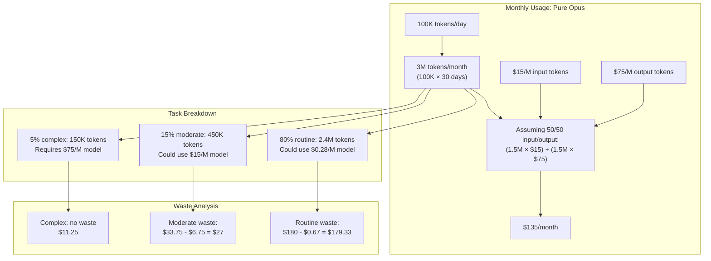

**Diagram: Cost Waste with Pure Premium Model**

### Cost Comparison Table

| Strategy | Routine (80%) | Moderate (15%) | Complex (5%) | **Total** |
|----------|---------------|----------------|--------------|-----------|
| **Pure Opus** ($15-75/M) | $180 | $34 | $11 | **~$225** |
| **Pure Sonnet** ($3-15/M) | $36 | $7 | $2 | **~$45** |
| **Pure DeepSeek** ($0.14-0.28/M) | $0.67 | $0.13 | $0.04 | **~$0.84** |
| **Hierarchy** (80/15/5 split) | $6 (Tier 1) | $7 (Tier 2) | $6 (Tier 3) | **~$19** |

**Savings with hierarchy**: 
- vs Pure Opus: **~10.8x reduction** (~$206/month saved)
- vs Pure Sonnet: **~2.4x reduction** (~$26/month saved)

The key insight: **$206 of the $225 monthly Opus cost is spent on tasks that derive no benefit from Opus-level capabilities**.

Sources: [README.md:52-60](), [SKILL.md:168-183]()

---

## Why Agents Default to Expensive Models

Several factors contribute to the widespread pattern of using premium models for all tasks:

### 1. Simplicity Over Optimization

Agent frameworks typically default to a single model configuration. From integration examples:

```yaml
# config.yml - typical agent configuration
model: anthropic/claude-opus-4
```

**Problem**: Once set, this model handles all subsequent operations regardless of task complexity.

### 2. Lack of Task Classification

Most agent systems do not implement classification logic. The `selectModel` decision algorithm from [SKILL.md:110-132]() demonstrates what's typically missing:

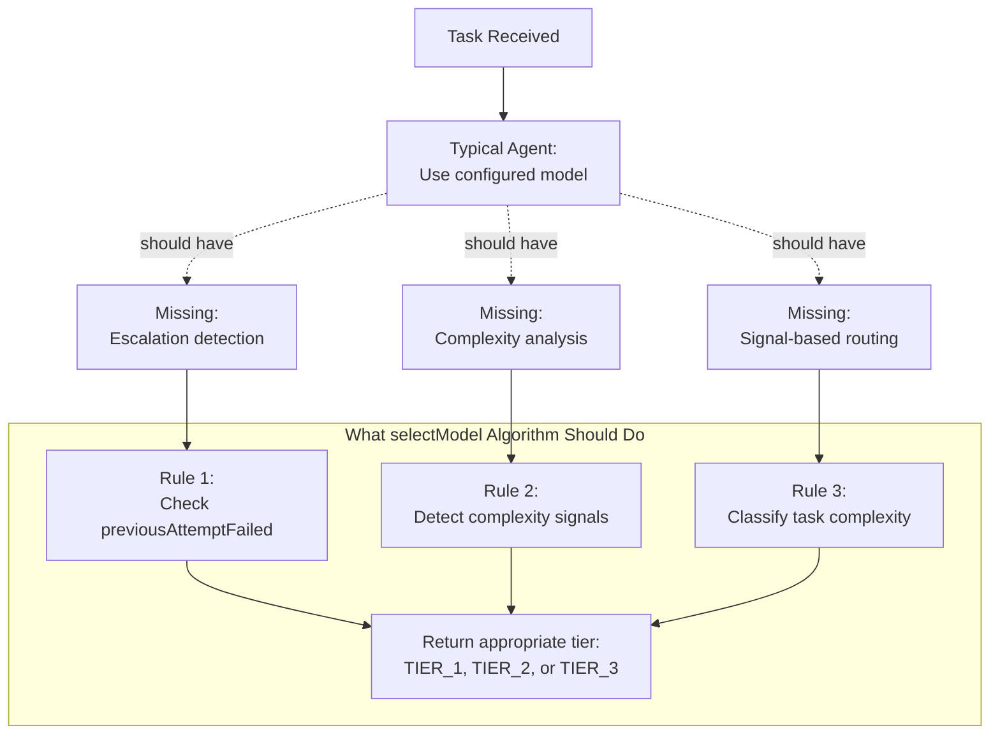

**Diagram: Missing Classification Logic in Typical Agents**

### 3. Fear of Quality Degradation

Developers and users often assume that cheaper models will produce lower quality outputs. However, this assumption is false for routine tasks:

| Task Type | Tier 1 Quality | Tier 3 Quality | Quality Difference |
|-----------|----------------|----------------|-------------------|
| Read file contents | ✓ Identical | ✓ Identical | **None** |
| Check HTTP status | ✓ Identical | ✓ Identical | **None** |
| Format JSON | ✓ Identical | ✓ Identical | **None** |
| Simple lookups | ✓ Identical | ✓ Identical | **None** |
| Code generation | Acceptable | Better | Some (justified cost) |
| Novel debugging | Inadequate | Excellent | Significant (justified cost) |

**The reality**: Routine tasks are deterministic operations where model capability above a minimum threshold provides no benefit.

### 4. No Cost Visibility

Agent systems rarely expose per-task cost metrics, making the waste invisible to users and developers. The system operates as a black box where expensive operations are indistinguishable from cheap ones.

Sources: [SKILL.md:1-17](), [SKILL.md:110-132](), [SKILL.md:235-246]()

---

## The Opportunity

The combination of heavily skewed task distribution (80% routine) and massive price differentials (100x+ between cheapest and most expensive models) creates a significant optimization opportunity:

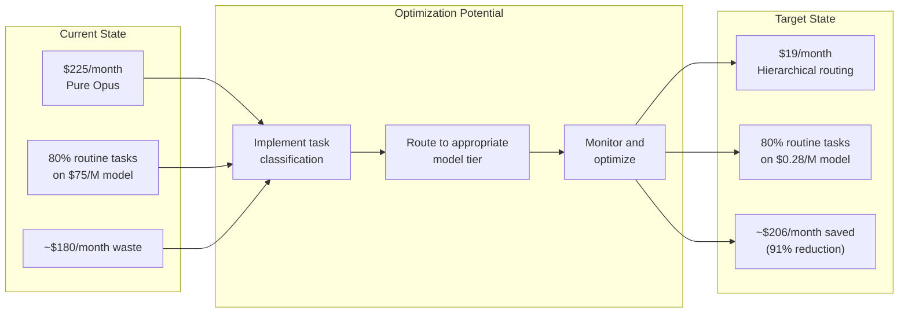

**Diagram: Cost Optimization Opportunity**

The model-hierarchy-skill system addresses this opportunity by implementing intelligent task classification and tiered model routing. For details on the solution architecture, see [The Solution: Hierarchical Model Routing](#2.2).

Sources: [README.md:1-19](), [SKILL.md:168-183]()

---

## Summary

The agent cost waste problem is characterized by:

1. **Skewed task distribution**: 80% of agent work is routine operations
2. **Uniform model usage**: Most systems use a single model tier for all tasks
3. **Massive price differentials**: 100x+ cost difference between cheapest and most expensive models
4. **No quality benefit**: Routine tasks produce identical results on cheap vs. premium models
5. **Invisible waste**: Users and developers lack visibility into per-task costs

**Result**: Systems routinely spend 10x more than necessary, with ~90% of costs going toward tasks that derive no benefit from premium model capabilities.

The problem is not that premium models are too expensive—it's that they're being used for tasks that don't require their capabilities. This is the core inefficiency that the model-hierarchy-skill system eliminates.

Sources: [README.md:5-19](), [SKILL.md:11-183]()

---

# Page: The Solution: Hierarchical Model Routing

# The Solution: Hierarchical Model Routing

<details>
<summary>Relevant source files</summary>

The following files were used as context for generating this wiki page:

- [README.md](README.md)
- [SKILL.md](SKILL.md)

</details>


## Purpose and Scope

This page describes the core solution architecture of the model-hierarchy-skill system: how it routes tasks to appropriate models based on complexity to achieve cost optimization. The solution consists of three main components: a three-tier model classification system, a signal-based task analysis algorithm, and routing logic that matches tasks to the cheapest viable model tier.

For details on the problem being solved, see [The Problem: Agent Cost Waste](#2.1). For the mathematical justification of cost savings, see [Cost Optimization Analysis](#2.3). For the complete specification of classification rules, see [The Skill Definition](#3).

---

## Solution Overview

The hierarchical model routing system addresses agent cost waste through three core mechanisms:

1. **Model Tier Hierarchy** - A three-tier classification of LLM models by capability and cost
2. **Task Complexity Classification** - Signal-based analysis to categorize tasks as ROUTINE, MODERATE, or COMPLEX
3. **Intelligent Routing** - Decision algorithm that maps classified tasks to the cheapest sufficient model tier

The system operates on the principle that task complexity distribution is heavily skewed toward routine operations (estimated 80%), making aggressive routing to cheap models economically valuable while maintaining quality parity for those tasks.

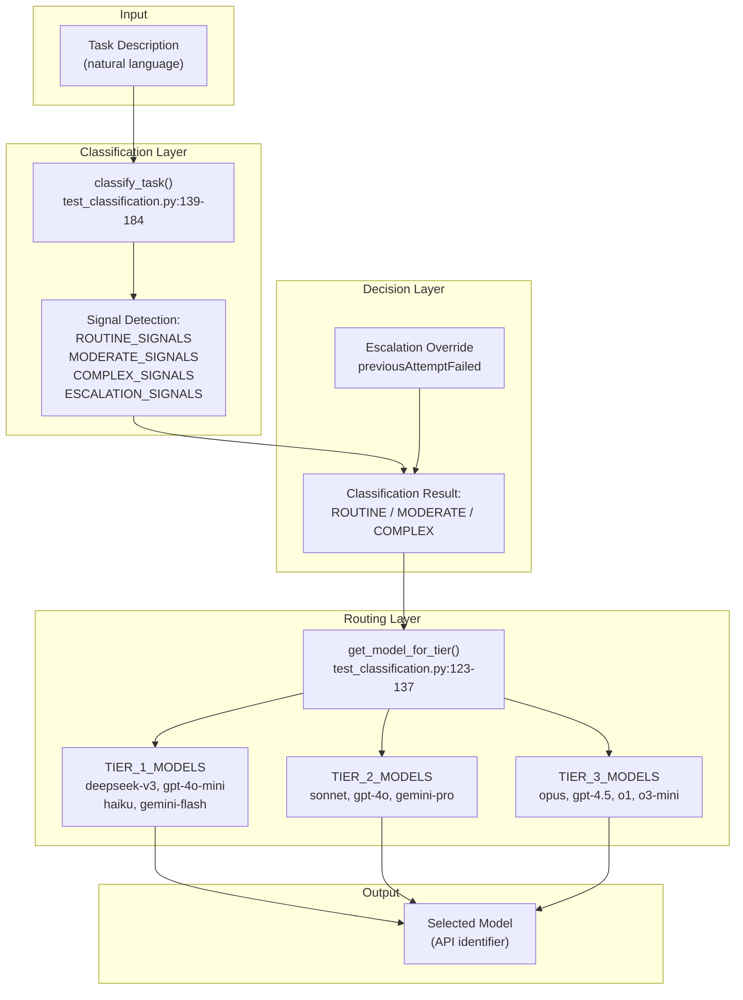

**Sources:** [SKILL.md:1-256](), [test_classification.py:1-300](), [README.md:1-89]()

---

## Three-Tier Model Hierarchy

The system defines three distinct model tiers based on cost and capability profiles. Each tier contains multiple interchangeable models from different providers, allowing flexibility in deployment.

### Tier Definitions

| Tier | Cost Range | Usage Pattern | Code Reference |
|------|-----------|---------------|----------------|
| **Tier 1: Cheap** | $0.10-0.50/M tokens | 80% of tasks | `TIER_1_MODELS` [test_classification.py:30-35]() |
| **Tier 2: Mid** | $1-5/M tokens | 15% of tasks | `TIER_2_MODELS` [test_classification.py:36-40]() |
| **Tier 3: Premium** | $10-75/M tokens | 5% of tasks | `TIER_3_MODELS` [test_classification.py:41-46]() |

### Model Assignments by Tier

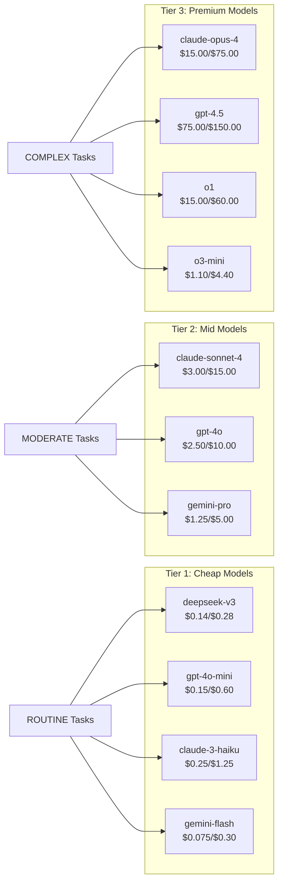

**Sources:** [SKILL.md:19-46](), [test_classification.py:30-46]()

### Default Model Selection

The `get_model_for_tier()` function returns the first model in each tier list as the default, but implementations can customize selection based on provider availability, regional pricing, or specific capability requirements.

```python
# Simplified logic from test_classification.py:123-137
def get_model_for_tier(tier: int) -> str:
    if tier == 1:
        return TIER_1_MODELS[0]  # "deepseek-v3"
    elif tier == 2:
        return TIER_2_MODELS[0]  # "claude-sonnet-4"
    else:
        return TIER_3_MODELS[0]  # "claude-opus-4"
```

**Sources:** [test_classification.py:123-137]()

---

## Task Classification System

The classification system analyzes task descriptions using signal-based pattern matching to determine complexity level. This approach is fast, deterministic, and does not require an additional LLM call.

### Classification Categories

| Category | Characteristics | Tier Assignment | Code Constant |
|----------|----------------|-----------------|---------------|
| **ROUTINE** | Single-step, deterministic, no judgment | Tier 1 | `ROUTINE_SIGNALS` [test_classification.py:49-60]() |
| **MODERATE** | Multi-step, standard patterns, synthesis | Tier 2 | `MODERATE_SIGNALS` [test_classification.py:61-73]() |
| **COMPLEX** | Novel problems, judgment calls, high stakes | Tier 3 | `COMPLEX_SIGNALS` [test_classification.py:74-86]() |

### Signal Pattern Detection

The system defines keyword lists that indicate task complexity. When a task description contains specific signals, it gets classified accordingly.

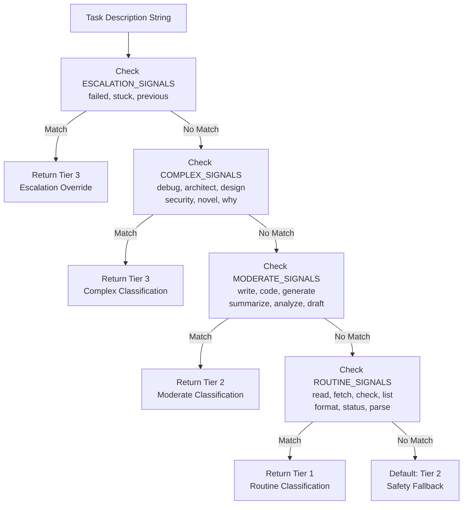

**Sources:** [test_classification.py:139-184](), [SKILL.md:109-132]()

### Signal Definitions

The complete signal lists are defined as constants in the implementation:

| Signal List | Purpose | Example Keywords |
|-------------|---------|------------------|
| `ROUTINE_SIGNALS` | Identify simple operations | `read`, `fetch`, `check`, `list`, `format`, `status`, `parse`, `get`, `show`, `display` |
| `MODERATE_SIGNALS` | Identify standard complexity | `write`, `code`, `generate`, `create`, `summarize`, `analyze`, `draft`, `review`, `search`, `compare` |
| `COMPLEX_SIGNALS` | Identify high complexity | `debug`, `architect`, `design`, `security`, `fix`, `investigate`, `troubleshoot`, `optimize`, `refactor` |
| `ESCALATION_SIGNALS` | Override to highest tier | `failed`, `stuck`, `previous`, `retry`, `escalate`, `harder` |

**Sources:** [test_classification.py:49-89]()

---

## Routing Decision Algorithm

The `classify_task()` function implements a priority-based decision tree that processes task descriptions through escalation checks, explicit signal matching, and default classification.

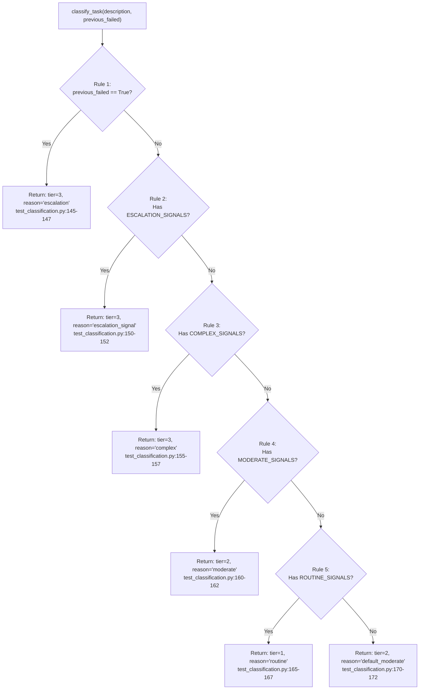

**Sources:** [test_classification.py:139-184](), [SKILL.md:109-132]()

### Decision Rules Priority

The algorithm applies rules in strict priority order:

1. **Escalation Override** - If `previous_failed=True` or escalation signals present, route to Tier 3 immediately
2. **Explicit Complex Signals** - Complexity indicators override routine/moderate signals
3. **Explicit Moderate Signals** - Standard complexity indicators
4. **Explicit Routine Signals** - Simple operation indicators
5. **Default to Moderate** - Safety fallback when no signals match

This priority ordering ensures that critical tasks (escalations, complex problems) are never under-provisioned even if they contain routine-signal keywords.

**Sources:** [test_classification.py:139-184]()

---

## Integration with Model Selection

After classification determines the tier, the `get_model_for_tier()` function translates tier numbers to concrete model identifiers that can be passed to LLM provider APIs.

### End-to-End Flow

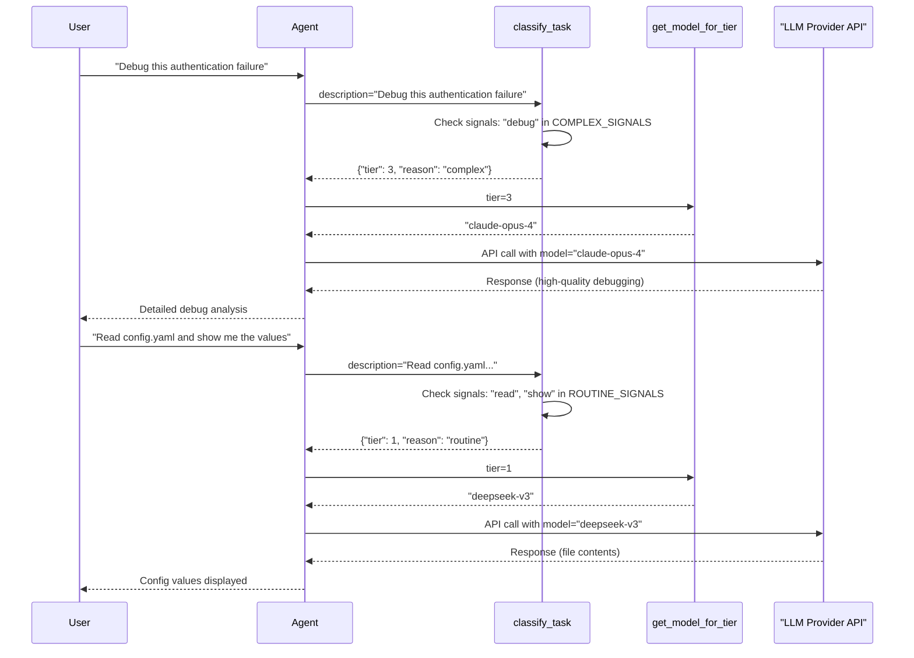

**Sources:** [test_classification.py:123-137](), [test_classification.py:139-184]()

---

## Cost Calculation Functions

The system includes cost estimation functions to validate the economic benefit of hierarchical routing versus uniform model usage.

### Cost per Token Calculation

```python
# From test_classification.py:186-202
def calculate_cost(model: str, tokens: int, is_output: bool = False) -> float:
    """Calculate cost in dollars for given token usage"""
    # Retrieves pricing from MODEL_PRICING dict
    # Multiplies tokens by per-million rate
    # Returns cost in dollars
```

### Monthly Cost Projection

```python
# From test_classification.py:204-225
def calculate_monthly_cost(daily_tokens: int, distribution: dict) -> dict:
    """Project monthly costs given task distribution"""
    # Calculates cost for 30 days
    # Applies distribution percentages to tier usage
    # Returns breakdown by tier and total
```

The cost functions enable validation of the core value proposition: that 80/15/5 distribution across tiers yields ~$19/month compared to ~$225/month for pure premium usage.

**Sources:** [test_classification.py:186-225]()

---

## Skill Definition Mapping

The SKILL.md file provides the canonical specification of classification rules and behavioral guidelines, while test_classification.py implements these rules as executable code.

### Conceptual to Code Mapping

| SKILL.md Concept | Code Entity | File Location |
|------------------|-------------|---------------|
| "ROUTINE tasks" | `ROUTINE_SIGNALS` list | [test_classification.py:49-60]() |
| "MODERATE tasks" | `MODERATE_SIGNALS` list | [test_classification.py:61-73]() |
| "COMPLEX tasks" | `COMPLEX_SIGNALS` list | [test_classification.py:74-86]() |
| "Escalation override" | `ESCALATION_SIGNALS` list | [test_classification.py:87-89]() |
| "Tier 1: Cheap" | `TIER_1_MODELS` list | [test_classification.py:30-35]() |
| "Tier 2: Mid" | `TIER_2_MODELS` list | [test_classification.py:36-40]() |
| "Tier 3: Premium" | `TIER_3_MODELS` list | [test_classification.py:41-46]() |
| `selectModel()` algorithm | `classify_task()` function | [test_classification.py:139-184]() |
| Model tier lookup | `get_model_for_tier()` function | [test_classification.py:123-137]() |

**Sources:** [SKILL.md:1-256](), [test_classification.py:1-300]()

---

## Behavioral Integration Points

The solution supports multiple integration patterns for different agent platforms, each adapting the core classification logic to platform-specific capabilities.

### Integration Patterns

| Platform | Integration Method | Implementation Location |
|----------|-------------------|-------------------------|
| **OpenClaw** | File-based skill loading | [examples/openclaw.md]() |
| **Claude Code** | Instruction embedding | [examples/claude-code.md]() |
| **Custom Agents** | Function implementation | [SKILL.md:219-232]() |

All integration patterns implement the same core decision algorithm but adapt the interface to match platform conventions (file discovery, natural language instructions, or programmatic API).

**Sources:** [SKILL.md:186-232](), [examples/openclaw.md](), [examples/claude-code.md]()

---

## Summary

The hierarchical model routing solution achieves cost optimization through:

1. **Tier-Based Stratification** - Three model tiers separated by 10-50x cost differences
2. **Signal-Based Classification** - Fast, deterministic task analysis using keyword patterns  
3. **Priority-Ordered Routing** - Decision tree that ensures critical tasks get premium models
4. **Escalation Mechanism** - Automatic upgrade path for failed tasks
5. **Platform-Agnostic Design** - Core logic adaptable to multiple agent systems

The implementation balances simplicity (no ML classification required) with effectiveness (validated against 35 test scenarios). For detailed specification of classification rules, see [The Skill Definition](#3). For implementation details, see [Implementation Reference](#4).

**Sources:** [SKILL.md:1-256](), [test_classification.py:1-300](), [README.md:1-89]()

---

# Page: Cost Optimization Analysis

# Cost Optimization Analysis

<details>
<summary>Relevant source files</summary>

The following files were used as context for generating this wiki page:

- [README.md](README.md)
- [tests/test_classification.py](tests/test_classification.py)

</details>


## Purpose and Scope

This page provides a detailed mathematical analysis of the cost savings achieved through hierarchical model routing. It breaks down the pricing structure across model tiers, compares traditional single-model approaches against the hierarchical strategy, and justifies the ~10x cost reduction claim with concrete calculations. For the conceptual problem being solved, see [The Problem: Agent Cost Waste](#2.1). For the architectural solution, see [The Solution: Hierarchical Model Routing](#2.2).

## Model Tier Pricing Structure

The cost optimization depends on three distinct pricing tiers based on model capabilities and operational costs:

| Tier | Models | Cost per 1M Tokens | Use Case |
|------|--------|-------------------|----------|
| **Tier 1** | `deepseek-v3`, `gpt-4o-mini`, `claude-3-haiku`, `gemini-flash` | $0.14 - $0.50 | Routine operations |
| **Tier 2** | `claude-sonnet-4`, `gpt-4o`, `gemini-pro` | $1.00 - $5.00 | Moderate complexity |
| **Tier 3** | `claude-opus-4`, `gpt-4.5`, `o1`, `o3-mini` | $10.00 - $75.00 | Complex reasoning |

The cost calculation functions use representative pricing: $0.28/M for Tier 1 (DeepSeek V3), $15.00/M for Tier 2 (Claude Sonnet), and $75.00/M for Tier 3 (Claude Opus).

**Sources:** [tests/test_classification.py:15-18](), [tests/test_classification.py:107-112](), [README.md:13-17]()

## Cost Calculation Architecture

```mermaid
graph TD
    subgraph "calculate_cost Function"
        INPUT["calculate_cost(tier, tokens)"]
        LOOKUP["Cost Lookup Table:<br/>Tier 1: $0.28/M<br/>Tier 2: $15.00/M<br/>Tier 3: $75.00/M"]
        CALC["cost = (tokens / 1M) * rate"]
        OUTPUT["Return USD cost"]
    end
    
    subgraph "calculate_monthly_cost Function"
        DAILY["daily_tokens parameter"]
        DIST["Distribution Parameters:<br/>routine_pct (0.80)<br/>moderate_pct (0.15)<br/>complex_pct (0.05)"]
        SPLIT["Split tokens by percentage"]
        T1_COST["calculate_cost(1, routine_tokens)"]
        T2_COST["calculate_cost(2, moderate_tokens)"]
        T3_COST["calculate_cost(3, complex_tokens)"]
        SUM["daily_cost = sum(tier_costs)"]
        MONTHLY["monthly = daily_cost * 30"]
    end
    
    INPUT --> LOOKUP --> CALC --> OUTPUT
    
    DAILY --> SPLIT
    DIST --> SPLIT
    SPLIT --> T1_COST & T2_COST & T3_COST
    T1_COST --> SUM
    T2_COST --> SUM
    T3_COST --> SUM
    SUM --> MONTHLY
```

**Cost Calculation Architecture**

The system implements two core functions for cost estimation. The `calculate_cost` function performs unit cost calculations for a given tier and token count, while `calculate_monthly_cost` orchestrates the hierarchical distribution across all three tiers to compute total operational costs.

**Sources:** [tests/test_classification.py:94-112](), [tests/test_classification.py:115-138]()

## Traditional vs Hierarchical Cost Comparison

### Pure Premium Strategy (Baseline)

Using a single premium model for all operations:

```
Daily workload: 100,000 tokens
Model: Claude Opus (Tier 3)
Cost per token: $75.00 / 1M = $0.000075

Daily cost: 100,000 × $0.000075 = $7.50
Monthly cost: $7.50 × 30 = $225.00
```

### Pure Mid-Tier Strategy

Using a single mid-tier model for all operations:

```
Daily workload: 100,000 tokens
Model: Claude Sonnet (Tier 2)
Cost per token: $15.00 / 1M = $0.000015

Daily cost: 100,000 × $0.000015 = $1.50
Monthly cost: $1.50 × 30 = $45.00
```

### Hierarchical Routing Strategy

Using task-appropriate models based on the 80/15/5 distribution:

```
Daily workload: 100,000 tokens
Distribution:
  - Routine (80%): 80,000 tokens → Tier 1 at $0.28/M
  - Moderate (15%): 15,000 tokens → Tier 2 at $15.00/M
  - Complex (5%): 5,000 tokens → Tier 3 at $75.00/M

Daily cost calculation:
  - Tier 1: 80,000 × ($0.28 / 1M) = $0.0224
  - Tier 2: 15,000 × ($15.00 / 1M) = $0.2250
  - Tier 3: 5,000 × ($75.00 / 1M) = $0.3750
  - Total daily: $0.6224

Monthly cost: $0.6224 × 30 = $18.67 ≈ $19
```

**Sources:** [README.md:52-60](), [tests/test_classification.py:115-138](), [tests/test_classification.py:223-227]()

## Cost Comparison Flow Diagram

```mermaid
graph TB
    WORKLOAD["Baseline Workload:<br/>100K tokens/day<br/>3M tokens/month"]
    
    subgraph "Strategy 1: Pure Premium"
        P_ROUTE["Route 100% to Tier 3"]
        P_T3["3M tokens × $75/M"]
        P_COST["$225/month"]
    end
    
    subgraph "Strategy 2: Pure Mid-Tier"
        S_ROUTE["Route 100% to Tier 2"]
        S_T2["3M tokens × $15/M"]
        S_COST["$45/month"]
    end
    
    subgraph "Strategy 3: Hierarchical"
        H_CLASSIFY["classify_task()<br/>Distribution Analysis"]
        H_T1["80% → 2.4M tokens × $0.28/M = $0.67"]
        H_T2["15% → 0.45M tokens × $15/M = $6.75"]
        H_T3["5% → 0.15M tokens × $75/M = $11.25"]
        H_TOTAL["$18.67/month"]
    end
    
    subgraph "Savings Analysis"
        SAVE_P["vs Pure Premium: $206 saved<br/>91.7% reduction"]
        SAVE_S["vs Pure Mid-Tier: $26 saved<br/>57.8% reduction"]
    end
    
    WORKLOAD --> P_ROUTE & S_ROUTE & H_CLASSIFY
    P_ROUTE --> P_T3 --> P_COST
    S_ROUTE --> S_T2 --> S_COST
    H_CLASSIFY --> H_T1 & H_T2 & H_T3
    H_T1 --> H_TOTAL
    H_T2 --> H_TOTAL
    H_T3 --> H_TOTAL
    
    P_COST --> SAVE_P
    S_COST --> SAVE_S
    H_TOTAL --> SAVE_P & SAVE_S
```

**Cost Comparison by Strategy**

This diagram illustrates how the same 100K tokens/day workload results in dramatically different costs depending on routing strategy. The hierarchical approach achieves 91.7% savings versus pure premium by recognizing that most agent work is routine.

**Sources:** [README.md:52-60](), [tests/test_classification.py:213-221]()

## Distribution Assumption Justification

The 80/15/5 distribution (routine/moderate/complex) is central to the cost optimization claim. This breakdown reflects observed agent behavior patterns:

### Routine Tasks (80%)
- **File operations:** Reading configurations, checking status files, listing directories
- **Status checks:** Health endpoints, service pings, heartbeat monitoring
- **Data lookups:** Fetching values, simple queries, filtering results
- **Formatting:** Converting formats, parsing structured data, simple transformations

These tasks have deterministic outcomes and do not benefit from advanced reasoning capabilities.

### Moderate Tasks (15%)
- **Code generation:** Creating functions, writing tests, implementing features
- **Content creation:** Drafting documentation, summarizing information, generating reports
- **Analysis:** Comparing options, reviewing code for style, basic debugging
- **Transformations:** Complex data manipulation, refactoring, searching codebases

These tasks require some reasoning but follow established patterns.

### Complex Tasks (5%)
- **Debugging failures:** Root cause analysis, race conditions, production issues
- **Architecture decisions:** System design, evaluating tradeoffs, migration planning
- **Security analysis:** Vulnerability assessment, threat modeling
- **Novel problems:** Situations without clear precedent or requiring creative solutions

These tasks require advanced reasoning and benefit significantly from premium models.

**Sources:** [README.md:13-17](), [tests/test_classification.py:115-119](), [tests/scenarios.json]()

## Sensitivity Analysis

The cost savings vary based on actual task distribution. Here's how monthly costs change with different distributions:

| Routine % | Moderate % | Complex % | Monthly Cost | vs Pure Premium |
|-----------|------------|-----------|--------------|-----------------|
| 90% | 8% | 2% | $12.87 | 94.3% savings |
| 80% | 15% | 5% | $18.67 | 91.7% savings |
| 70% | 20% | 10% | $30.27 | 86.5% savings |
| 60% | 25% | 15% | $41.87 | 81.4% savings |
| 50% | 30% | 20% | $53.47 | 76.2% savings |

Even in worst-case scenarios where 20% of tasks require premium models, the hierarchical approach still achieves 76% cost reduction. The system remains cost-effective across a wide range of distributions.

**Break-even Point:** The hierarchical approach costs the same as pure mid-tier when approximately 45% of tasks are complex, which is far beyond typical agent workload patterns.

**Sources:** [tests/test_classification.py:115-138]()

## Monthly Cost Calculation Implementation

```mermaid
graph LR
    subgraph "Test Validation: TestCostCalculations"
        TEST_ORDER["test_tier_cost_ordering:<br/>verify tier 1 < tier 2 < tier 3"]
        TEST_HIER["test_hierarchy_saves_money:<br/>hierarchical < pure_premium / 5"]
        TEST_MONTHLY["test_monthly_cost_calculation:<br/>10 < monthly < 30"]
    end
    
    subgraph "Cost Functions"
        CALC_COST["calculate_cost(tier, tokens):<br/>line 94-112"]
        LOOKUP_TABLE["costs = {1: 0.28, 2: 15.00, 3: 75.00}"]
        FORMULA["return (tokens / 1M) * costs[tier]"]
        
        CALC_MONTHLY["calculate_monthly_cost():<br/>line 115-138"]
        DAILY_DIST["daily_tokens * routine_pct<br/>daily_tokens * moderate_pct<br/>daily_tokens * complex_pct"]
        SUM_DAILY["sum all tier costs"]
        MULTIPLY["daily_cost * 30"]
    end
    
    TEST_ORDER --> CALC_COST
    TEST_HIER --> CALC_MONTHLY
    TEST_MONTHLY --> CALC_MONTHLY
    
    CALC_COST --> LOOKUP_TABLE --> FORMULA
    CALC_MONTHLY --> DAILY_DIST --> SUM_DAILY --> MULTIPLY
    DAILY_DIST --> CALC_COST
```

**Cost Calculation Implementation and Testing**

The cost calculation logic is implemented in `calculate_cost` and `calculate_monthly_cost` functions, with comprehensive test coverage validating tier ordering, savings magnitude, and realistic monthly projections.

**Sources:** [tests/test_classification.py:94-138](), [tests/test_classification.py:203-227]()

## Real-World Cost Scenarios

### Scenario 1: Development Agent (High Routine)
```
Task distribution: 85% routine, 12% moderate, 3% complex
Monthly tokens: 3M (100K/day)

Costs:
- Tier 1: 2.55M × $0.28/M = $0.71
- Tier 2: 0.36M × $15/M = $5.40
- Tier 3: 0.09M × $75/M = $6.75
Total: $12.86/month vs $225 pure Opus (94.3% savings)
```

### Scenario 2: Production Support Agent (High Complex)
```
Task distribution: 60% routine, 25% moderate, 15% complex
Monthly tokens: 3M (100K/day)

Costs:
- Tier 1: 1.8M × $0.28/M = $0.50
- Tier 2: 0.75M × $15/M = $11.25
- Tier 3: 0.45M × $75/M = $33.75
Total: $45.50/month vs $225 pure Opus (79.8% savings)
```

### Scenario 3: Research Agent (Balanced)
```
Task distribution: 70% routine, 20% moderate, 10% complex
Monthly tokens: 3M (100K/day)

Costs:
- Tier 1: 2.1M × $0.28/M = $0.59
- Tier 2: 0.6M × $15/M = $9.00
- Tier 3: 0.3M × $75/M = $22.50
Total: $32.09/month vs $225 pure Opus (85.7% savings)
```

**Sources:** [tests/test_classification.py:115-138](), [README.md:52-60]()

## Cost Optimization Validation

The test suite validates the cost optimization claims through several assertions:

| Test | Assertion | File Reference |
|------|-----------|----------------|
| `test_tier_cost_ordering` | Tier 1 < Tier 2 < Tier 3 for same token count | [tests/test_classification.py:206-210]() |
| `test_hierarchy_saves_money` | Hierarchical < Pure Premium / 5 (at least 5x savings) | [tests/test_classification.py:212-221]() |
| `test_monthly_cost_calculation` | Monthly cost between $10-$30 for 100K tokens/day | [tests/test_classification.py:223-227]() |

The test suite specifically verifies that the hierarchical approach achieves at least **5x cost reduction** compared to pure premium usage, with actual results typically closer to **10x reduction** under realistic distributions.

**Sources:** [tests/test_classification.py:203-227]()

## Key Economic Insights

1. **Diminishing Returns:** Most agent tasks don't benefit from premium models. Routing routine operations to cheap models maintains quality while dramatically reducing costs.

2. **Safety Net Preservation:** The 5% allocation to Tier 3 ensures complex problems still get premium reasoning when needed, avoiding quality degradation.

3. **Distribution Robustness:** Even with conservative distributions (60/25/15), the system achieves 80%+ savings, making it resilient to workload variations.

4. **Quality-Cost Decoupling:** The system achieves cost reduction without sacrificing quality by recognizing that task complexity and model requirements are not uniformly distributed.

**Sources:** [README.md:1-19](), [tests/test_classification.py:115-138]()

---

# Page: The Skill Definition

# The Skill Definition

<details>
<summary>Relevant source files</summary>

The following files were used as context for generating this wiki page:

- [SKILL.md](SKILL.md)

</details>


## Purpose and Scope

This document provides comprehensive coverage of `SKILL.md`, the core specification file that defines the model hierarchy skill. This skill specification establishes the rules, tiers, and decision logic for routing agent tasks to cost-appropriate models.

The skill definition serves as the authoritative source for:
- Classification rules that categorize tasks as ROUTINE, MODERATE, or COMPLEX
- Model tier architecture defining three cost/capability levels
- The decision algorithm for model selection
- Behavioral rules for different agent contexts
- Communication patterns for model switching

For implementation details of the classification logic in Python, see [Implementation Reference](#4). For platform-specific integration instructions, see [Integration Guides](#5).

**Sources:** [SKILL.md:1-256]()

---

## Skill Metadata

The skill definition begins with YAML frontmatter that provides metadata for skill discovery and activation in agent platforms:

```yaml
---
name: model-hierarchy
description: >
  Cost-optimize AI agent operations by routing tasks to appropriate models based on complexity.
  Use this skill when: (1) deciding which model to use for a task, (2) spawning sub-agents,
  (3) considering cost efficiency, (4) the current model feels like overkill for the task.
  Triggers: "model routing", "cost optimization", "which model", "too expensive", "spawn agent".
---
```

| Metadata Field | Purpose | Value |
|----------------|---------|-------|
| `name` | Unique identifier for the skill | `model-hierarchy` |
| `description` | Multi-line explanation of skill purpose and usage conditions | Cost optimization through task routing |
| Triggers | Keywords that activate skill awareness | "model routing", "cost optimization", "which model", "too expensive", "spawn agent" |

The trigger phrases enable agent platforms to automatically surface this skill when relevant keywords appear in task descriptions or user queries. The description explicitly enumerates four usage scenarios: task-level model selection, sub-agent spawning, cost efficiency analysis, and overkill detection.

**Sources:** [SKILL.md:1-8]()

---

## Core Principle

The skill is built on a fundamental observation stated in [SKILL.md:17]():

> **80% of agent tasks are janitorial.** File reads, status checks, formatting, simple Q&A. These don't need expensive models. Reserve premium models for problems that actually require deep reasoning.

This principle drives the entire hierarchical routing system. The specification operationalizes this insight by:

1. Categorizing tasks into complexity levels
2. Mapping complexity levels to cost tiers
3. Providing explicit classification heuristics
4. Enabling escalation when tasks exceed model capabilities

**Sources:** [SKILL.md:15-17]()

---

## Specification Structure

The `SKILL.md` file is organized into distinct sections that together define a complete operational skill:

### High-Level Organization

```mermaid
graph TD
    METADATA["Skill Metadata<br/>(name, description, triggers)"]
    PRINCIPLE["Core Principle<br/>(80% janitorial thesis)"]
    TIERS["Model Tiers<br/>(Tier 1, 2, 3 definitions)"]
    CLASSIFICATION["Task Classification<br/>(ROUTINE, MODERATE, COMPLEX)"]
    ALGORITHM["Decision Algorithm<br/>(selectModel function)"]
    BEHAVIORAL["Behavioral Rules<br/>(Main Session, Sub-Agents, Automated)"]
    COMMUNICATION["Communication Patterns<br/>(downgrade, upgrade, explain)"]
    COST["Cost Impact<br/>(80/15/5 distribution analysis)"]
    INTEGRATION["Integration Examples<br/>(OpenClaw, Claude Code, General)"]
    ANTIPATTERNS["Anti-Patterns<br/>(DON'T and DO lists)"]
    EXTENDING["Extending This Skill<br/>(customization guidelines)"]

    METADATA --> PRINCIPLE
    PRINCIPLE --> TIERS
    PRINCIPLE --> CLASSIFICATION
    TIERS --> ALGORITHM
    CLASSIFICATION --> ALGORITHM
    ALGORITHM --> BEHAVIORAL
    BEHAVIORAL --> COMMUNICATION
    ALGORITHM --> COST
    BEHAVIORAL --> INTEGRATION
    INTEGRATION --> ANTIPATTERNS
    ANTIPATTERNS --> EXTENDING
```

**Sources:** [SKILL.md:1-256]()

---

## Model Tier Architecture Overview

The specification defines three model tiers with explicit pricing and capability characteristics:

| Tier | Cost Range | Model Examples | Primary Use Case |
|------|------------|----------------|------------------|
| **Tier 1: Cheap** | $0.10-0.50/M tokens | DeepSeek V3, GPT-4o-mini, Claude Haiku, Gemini Flash | Routine operations with deterministic outputs |
| **Tier 2: Mid** | $1-5/M tokens | Claude Sonnet, GPT-4o, Gemini Pro | Moderate complexity tasks requiring synthesis |
| **Tier 3: Premium** | $10-75/M tokens | Claude Opus, GPT-4.5, o1, o3-mini | Complex reasoning and novel problem solving |

Each tier is defined in tabular format in [SKILL.md:21-46]() with specific models, input/output pricing, and "Best For" descriptions. The specification notes that prices are "as of Feb 2026" and instructs users to check provider documentation for current rates.

### Tier Definitions in Detail

**Tier 1** ([SKILL.md:21-28]()): Four model options ranging from $0.075-0.30 per million input tokens. The tier emphasizes volume efficiency and fast response times. DeepSeek V3 is positioned as the general-purpose routine work model.

**Tier 2** ([SKILL.md:30-36]()): Three models spanning $1.25-3.00 per million input tokens. Claude Sonnet is designated for "balanced performance," GPT-4o for multimodal tasks, and Gemini Pro for long context scenarios.

**Tier 3** ([SKILL.md:38-46]()): Four premium models ranging from $1.10-75.00 per million input tokens. The tier includes both expensive frontier models (GPT-4.5 at $75 input) and budget reasoning models (o3-mini at $1.10 input).

For detailed tier architecture, see [Model Tier Architecture](#3.2).

**Sources:** [SKILL.md:19-48]()

---

## Task Classification Framework

The skill defines three complexity categories with explicit characteristics and examples:

```mermaid
graph LR
    TASK["Task Description"]
    
    ROUTINE["ROUTINE<br/>Tier 1"]
    MODERATE["MODERATE<br/>Tier 2"]
    COMPLEX["COMPLEX<br/>Tier 3"]
    
    ROUTINE_CHAR["Characteristics:<br/>- Single-step operations<br/>- Clear instructions<br/>- No judgment required<br/>- Deterministic output"]
    
    MODERATE_CHAR["Characteristics:<br/>- Multi-step but defined<br/>- Some synthesis required<br/>- Standard patterns apply<br/>- Quality matters"]
    
    COMPLEX_CHAR["Characteristics:<br/>- Novel problem solving<br/>- Multiple valid approaches<br/>- Nuanced judgment<br/>- High stakes<br/>- Previous failures"]
    
    ROUTINE_EX["Examples:<br/>read, write, status,<br/>format, list, fetch"]
    
    MODERATE_EX["Examples:<br/>code, summarize,<br/>draft, analyze,<br/>orchestrate"]
    
    COMPLEX_EX["Examples:<br/>debug, architect,<br/>security, design,<br/>creative, edge-cases"]
    
    TASK --> ROUTINE
    TASK --> MODERATE
    TASK --> COMPLEX
    
    ROUTINE --> ROUTINE_CHAR
    ROUTINE --> ROUTINE_EX
    
    MODERATE --> MODERATE_CHAR
    MODERATE --> MODERATE_EX
    
    COMPLEX --> COMPLEX_CHAR
    COMPLEX --> COMPLEX_EX
```

### Category Definitions

**ROUTINE** ([SKILL.md:53-70]()): Tasks characterized by single-step operations, clear unambiguous instructions, no judgment required, and deterministic outputs. Eight example categories provided including file operations, status checks, simple lookups, formatting, list operations, API calls, heartbeat tasks, and URL fetching.

**MODERATE** ([SKILL.md:72-88]()): Tasks requiring multi-step execution but following well-defined patterns. Some synthesis required, standard patterns apply, quality matters but isn't critical. Eight example categories including code generation with standard patterns, summarization, draft writing, data analysis, multi-file operations, tool orchestration, code review (non-security), and search tasks.

**COMPLEX** ([SKILL.md:90-107]()): Tasks requiring novel problem solving, with multiple valid approaches, nuanced judgment calls, high stakes or irreversible outcomes, or previous attempt failures. Eight example categories including multi-step debugging, architecture decisions, security-sensitive review, escalation from failures, ambiguous requirements, long-context reasoning (>50K tokens), creative originality, and adversarial handling.

For comprehensive classification system documentation, see [Task Classification System](#3.1).

**Sources:** [SKILL.md:49-107]()

---

## Decision Algorithm Specification

The skill defines a three-rule decision function in pseudocode at [SKILL.md:110-132]():

### Algorithm Structure

```mermaid
flowchart TD
    START["selectModel(task)"]
    
    RULE1{"Rule 1:<br/>task.previousAttemptFailed?"}
    ESCALATE["return nextTierUp(task.previousModel)"]
    
    RULE2{"Rule 2:<br/>hasSignal('debug', 'architect',<br/>'design', 'security')?"}
    TIER3A["return TIER_3"]
    
    RULE2B{"hasSignal('write', 'code',<br/>'summarize', 'analyze')?"}
    TIER2A["return TIER_2"]
    
    RULE3["Rule 3:<br/>complexity = classifyTask(task)"]
    
    ROUTINE_CHECK{"complexity == ROUTINE?"}
    TIER1["return TIER_1"]
    
    MODERATE_CHECK{"complexity == MODERATE?"}
    TIER2B["return TIER_2"]
    
    TIER3B["return TIER_3"]
    
    START --> RULE1
    RULE1 -->|"Yes"| ESCALATE
    RULE1 -->|"No"| RULE2
    
    RULE2 -->|"Yes"| TIER3A
    RULE2 -->|"No"| RULE2B
    
    RULE2B -->|"Yes"| TIER2A
    RULE2B -->|"No"| RULE3
    
    RULE3 --> ROUTINE_CHECK
    ROUTINE_CHECK -->|"Yes"| TIER1
    ROUTINE_CHECK -->|"No"| MODERATE_CHECK
    
    MODERATE_CHECK -->|"Yes"| TIER2B
    MODERATE_CHECK -->|"No"| TIER3B
```

### Rule Precedence

The algorithm implements three rules in strict precedence order:

1. **Escalation Override** ([SKILL.md:113-114]()): If a previous attempt failed, upgrade to the next tier regardless of task characteristics
2. **Explicit Complexity Signals** ([SKILL.md:116-121]()): Check for keyword signals indicating TIER_3 ("debug", "architect", "design", "security") or TIER_2 ("write", "code", "summarize", "analyze")
3. **Default Classification** ([SKILL.md:123-131]()): Invoke `classifyTask(task)` to determine ROUTINE, MODERATE, or COMPLEX

The escalation override ensures that stuck tasks receive more capable models without requiring explicit reclassification. The explicit signal detection provides fast-path routing for common task patterns. The default classification handles all other cases through structured analysis.

For detailed algorithm documentation, see [Decision Algorithm](#3.3).

**Sources:** [SKILL.md:109-132]()

---

## Behavioral Rules and Contexts

The specification defines context-specific behaviors for three agent scenarios:

### Behavioral Rule Matrix

| Context | Default Tier | Key Behaviors | Defined In |
|---------|--------------|---------------|------------|
| **Main Session** | Tier 2 | Suggest downgrade for routine work<br/>Request upgrade when stuck | [SKILL.md:136-141]() |
| **Sub-Agents** | Tier 1 | Default to cheapest unless clearly moderate+<br/>Batch similar tasks<br/>Report failures to parent | [SKILL.md:143-147]() |
| **Automated Tasks** | Varies | Heartbeats always Tier 1<br/>Reports Tier 1-2 based on complexity<br/>Alerts start Tier 2, escalate if needed | [SKILL.md:149-152]() |

### Main Session Rules

For interactive sessions, the specification recommends starting at Tier 2 for balanced capability. The agent should proactively suggest downgrades: "This is routine - I can handle this on a cheaper model or spawn a sub-agent." When encountering limitations, request upgrades: "This needs more reasoning power. Switching to [premium model]."

### Sub-Agent Rules

Sub-agents spawn at Tier 1 by default to minimize overhead costs. They should batch similar tasks to amortize the spawning cost and report failures back to the parent for potential escalation to higher tiers.

### Automated Task Rules

Automated tasks follow deterministic routing: heartbeats and monitoring always use Tier 1, scheduled reports use Tier 1-2 based on complexity analysis, and alert responses start at Tier 2 with escalation capability.

For complete behavioral rules, see [Behavioral Rules by Context](#3.4).

**Sources:** [SKILL.md:134-152]()

---

## Communication Patterns

The skill defines three communication templates for model switching scenarios at [SKILL.md:154-165]():

### Template Examples

**Downgrade Suggestion:**
> "This looks like routine file work. Want me to spawn a sub-agent on DeepSeek for this? Same result, fraction of the cost."

**Upgrade Request:**
> "I'm hitting the limits of what I can figure out here. This needs Opus-level reasoning. Switching up."

**Explaining Hierarchy:**
> "I'm running the heavy analysis on Sonnet while sub-agents fetch the data on DeepSeek. Keeps costs down without sacrificing quality where it matters."

These templates establish natural language patterns that agents should use when communicating model routing decisions to users. The templates emphasize transparency about cost-quality tradeoffs and justify routing decisions with task characteristics.

For complete communication pattern documentation, see [Communication Patterns](#3.5).

**Sources:** [SKILL.md:154-165]()

---

## Cost Impact Specification

The skill includes quantitative cost analysis showing projected savings from hierarchical routing. The specification assumes 100K tokens/day average usage and compares four strategies:

### Cost Comparison Table

From [SKILL.md:169-182]():

| Strategy | Monthly Cost | Distribution | Notes |
|----------|--------------|--------------|-------|
| Pure Opus | ~$225 | 100% Tier 3 | Maximum capability, maximum spend |
| Pure Sonnet | ~$45 | 100% Tier 2 | Good default for most work |
| Pure DeepSeek | ~$8 | 100% Tier 1 | Cheap but limited on hard problems |
| **Hierarchy (80/15/5)** | **~$19** | 80% T1, 15% T2, 5% T3 | Best of all worlds |

### The 80/15/5 Distribution

The hierarchical approach achieves ~$19/month through task distribution:
- 80% routine tasks on Tier 1: ~$6/month
- 15% moderate tasks on Tier 2: ~$7/month
- 5% complex tasks on Tier 3: ~$6/month

The specification explicitly states the value proposition: "10x cost reduction vs pure premium, with equivalent quality on complex tasks" ([SKILL.md:183]()).

For detailed cost optimization analysis, see [Cost Optimization Analysis](#2.3).

**Sources:** [SKILL.md:167-183]()

---

## Integration Examples

The specification provides three integration patterns demonstrating skill adoption across different agent architectures:

```mermaid
graph TD
    SKILL["SKILL.md<br/>Specification"]
    
    OC["OpenClaw Integration"]
    CC["Claude Code Integration"]
    GEN["General Agent Systems"]
    
    OC_CONFIG["config.yml<br/>model: anthropic/claude-sonnet-4"]
    OC_CMD["/model opus<br/>/model deepseek"]
    OC_SPAWN["sessions_spawn:<br/>  task: 'Fetch 50 URLs'<br/>  model: deepseek"]
    
    CC_INST["CLAUDE.md<br/>project instructions"]
    CC_RULES["When spawning background agents,<br/>use claude-3-haiku for:<br/>- File operations<br/>- Simple searches<br/>- Status checks"]
    
    GEN_FUNC["get_model_for_task(task_description: str)<br/>-> str"]
    GEN_SIGNALS["routine_signals = ['read', 'fetch', ...]<br/>complex_signals = ['debug', 'architect', ...]"]
    GEN_LOGIC["if any(signal in desc_lower<br/>for signal in complex_signals):<br/>  return 'claude-opus-4'"]
    
    SKILL --> OC
    SKILL --> CC
    SKILL --> GEN
    
    OC --> OC_CONFIG
    OC --> OC_CMD
    OC --> OC_SPAWN
    
    CC --> CC_INST
    CC_INST --> CC_RULES
    
    GEN --> GEN_FUNC
    GEN_FUNC --> GEN_SIGNALS
    GEN_FUNC --> GEN_LOGIC
```

### Integration Pattern Details

**OpenClaw** ([SKILL.md:187-201]()): Uses file-based skill installation with YAML configuration. Default model set in `config.yml`, runtime switching via `/model` commands, and sub-agent spawning with model specification through `sessions_spawn` directive.

**Claude Code** ([SKILL.md:203-215]()): Uses instruction embedding in `CLAUDE.md` or project instructions. Rules specified in natural language for background agent spawning, with specific model recommendations for file operations, searches, and status checks.

**General Agent Systems** ([SKILL.md:217-232]()): Provides Python implementation example with `get_model_for_task` function. Uses signal lists (`routine_signals`, `complex_signals`) for pattern matching and returns model names as strings for direct API usage.

For platform-specific integration details, see [Integration Guides](#5).

**Sources:** [SKILL.md:185-232]()

---

## Anti-Patterns and Best Practices

The specification concludes with explicit guidance on what to avoid and what to embrace:

### Anti-Patterns (DON'T)

From [SKILL.md:236-240]():
- Run heartbeats on Opus
- Use premium models for file I/O
- Keep expensive model when task is clearly routine
- Spawn sub-agents on premium models by default

### Best Practices (DO)

From [SKILL.md:242-246]():
- Start mid-tier, adjust based on task
- Spawn helpers on cheapest viable model
- Escalate explicitly when stuck
- Track cost per task type to optimize further

The anti-patterns target common waste scenarios where expensive models perform no better than cheap alternatives. The best practices establish operational patterns for adaptive routing and continuous optimization through cost tracking.

**Sources:** [SKILL.md:234-246]()

---

## Extensibility Guidelines

The skill specification is designed for customization. The "Extending This Skill" section ([SKILL.md:248-256]()) provides four extension vectors:

| Extension Type | Description | Example |
|----------------|-------------|---------|
| Adjust tier definitions | Modify model assignments and pricing thresholds | Add provider-specific models or adjust for budget constraints |
| Add domain-specific signals | Extend classification with specialized keywords | Add "compliance" signal for TIER_3 in regulated industries |
| Track actual complexity | Monitor classification accuracy and outcomes | Log predicted vs actual tier requirements for model tuning |
| Set budget alerts | Implement cost monitoring and warnings | Alert when daily Tier 3 usage exceeds threshold |

These extension points enable organizations to adapt the skill to specific domains, cost constraints, and operational requirements while maintaining the core hierarchical routing principle.

**Sources:** [SKILL.md:248-256]()

---

## Summary

The `SKILL.md` file provides a complete, self-contained specification for hierarchical model routing. It bridges high-level principles (the 80% janitorial thesis) with concrete implementation guidance (classification rules, tier definitions, decision algorithms). The specification is platform-agnostic, supporting integration patterns ranging from file-based discovery to instruction embedding to programmatic implementation.

The skill achieves its cost optimization goals through four key mechanisms:
1. Explicit task complexity classification with clear characteristics and examples
2. Three-tier model architecture with 10-100x cost differentials between tiers
3. Signal-based routing with escalation override for stuck tasks
4. Context-specific behavioral rules optimizing for interactive, automated, and sub-agent scenarios

**Sources:** [SKILL.md:1-256]()

---

# Page: Task Classification System

# Task Classification System

<details>
<summary>Relevant source files</summary>

The following files were used as context for generating this wiki page:

- [SKILL.md](SKILL.md)
- [tests/scenarios.json](tests/scenarios.json)

</details>


## Purpose and Scope

This page documents the task classification system that categorizes agent tasks into three complexity levels: **ROUTINE**, **MODERATE**, and **COMPLEX**. Classification determines which model tier should handle each task, forming the foundation of the cost optimization strategy.

This page covers the classification categories, their characteristics, and the signal patterns used for detection. For the model tiers assigned to each category, see [Model Tier Architecture](#3.2). For the algorithm that performs classification, see [Decision Algorithm](#3.3). For validation test cases, see [Test Scenarios](#6.1).

---

## Classification Categories

The system defines three mutually exclusive task categories based on complexity characteristics. Each category maps to a model tier with appropriate capabilities and cost.

### Category Overview

| Category | Model Tier | Complexity Level | Primary Characteristic |
|----------|-----------|------------------|------------------------|
| **ROUTINE** | Tier 1 (Cheap) | Single-step, deterministic | No judgment required |
| **MODERATE** | Tier 2 (Mid) | Multi-step, standard patterns | Some synthesis needed |
| **COMPLEX** | Tier 3 (Premium) | Novel problem solving | Nuanced judgment required |

**Sources:** [SKILL.md:49-107]()

---

## ROUTINE Tasks

### Characteristics

Tasks classified as ROUTINE exhibit the following properties:

- **Single-step operations**: Complete in one atomic action
- **Clear, unambiguous instructions**: No interpretation needed
- **No judgment required**: Purely mechanical execution
- **Deterministic output expected**: Same input produces same output

```mermaid
graph LR
    INPUT["Task Input"] --> CHECK{Single-step?<br/>Deterministic?<br/>No judgment?}
    CHECK -->|Yes| ROUTINE["ROUTINE<br/>Classification"]
    CHECK -->|No| OTHER["Check other<br/>categories"]
    
    ROUTINE --> TIER1["Route to<br/>Tier 1 Models"]
    
    subgraph "ROUTINE_SIGNALS"
        SIG1["read"]
        SIG2["fetch"]
        SIG3["check"]
        SIG4["list"]
        SIG5["format"]
        SIG6["status"]
    end
    
    SIG1 & SIG2 & SIG3 & SIG4 & SIG5 & SIG6 -.->|Trigger| ROUTINE
```

**Diagram: ROUTINE Task Classification Flow**

**Sources:** [SKILL.md:53-70]()

### Task Examples

The system recognizes the following operation types as ROUTINE:

| Operation Category | Task Examples | Signal Keywords |
|-------------------|---------------|-----------------|
| **File Operations** | Read file contents, List directory, Check file exists | `read`, `list`, `check` |
| **Status Checks** | Server health, Service status, Git status | `status`, `check`, `health` |
| **Simple Lookups** | Time queries, Weather checks, Definition lookups | Simple Q&A patterns |
| **Data Formatting** | JSON formatting, Date conversion, Text restructuring | `format`, `convert` |
| **List Operations** | Filter, Sort, Transform basic lists | `filter`, `sort`, `list` |
| **API Calls** | Fetch URL, GET requests with known parameters | `fetch`, `get` |
| **Monitoring** | Heartbeat checks, Cron tasks, Alert status | `heartbeat`, `monitor` |

**Example task descriptions from validation scenarios:**

- "Read the contents of config.json"
- "Check if the server is running"
- "What time is it in Tokyo?"
- "Format this JSON and fix the indentation"
- "List all files in the src directory"
- "Fetch the homepage of example.com"
- "Filter this list to only items over 100"
- "Run the health check"
- "Convert this date to ISO format"
- "Get the current git status"

**Sources:** [SKILL.md:61-70](), [tests/scenarios.json:2-53]()

---

## MODERATE Tasks

### Characteristics

Tasks classified as MODERATE exhibit these properties:

- **Multi-step but well-defined**: Multiple operations with clear sequence
- **Some synthesis required**: Combine information or create new content
- **Standard patterns apply**: Follows established templates or approaches
- **Quality matters but isn't critical**: Good output acceptable, not perfection

```mermaid
graph LR
    INPUT["Task Input"] --> CHECK{Multi-step?<br/>Synthesis?<br/>Standard<br/>patterns?}
    CHECK -->|Yes| MODERATE["MODERATE<br/>Classification"]
    CHECK -->|No| OTHER["Check other<br/>categories"]
    
    MODERATE --> TIER2["Route to<br/>Tier 2 Models"]
    
    subgraph "MODERATE_SIGNALS"
        SIG1["write"]
        SIG2["code"]
        SIG3["summarize"]
        SIG4["analyze"]
        SIG5["draft"]
        SIG6["generate"]
        SIG7["refactor"]
        SIG8["transform"]
    end
    
    SIG1 & SIG2 & SIG3 & SIG4 & SIG5 & SIG6 & SIG7 & SIG8 -.->|Trigger| MODERATE
```

**Diagram: MODERATE Task Classification Flow**

**Sources:** [SKILL.md:72-88]()

### Task Examples

The system recognizes the following operation types as MODERATE:

| Operation Category | Task Examples | Signal Keywords |
|-------------------|---------------|-----------------|
| **Code Generation** | Write functions, Generate tests, Create scripts | `write`, `code`, `generate` |
| **Content Synthesis** | Summarize documents, Draft emails, Write documentation | `summarize`, `draft`, `write` |
| **Data Analysis** | Find trends, Transform data, Analyze patterns | `analyze`, `transform` |
| **Code Operations** | Refactor functions, Review code (non-security), Create READMEs | `refactor`, `review`, `create` |
| **Research Tasks** | Search articles, Gather information, Compare options | `search`, `research` |
| **Multi-file Operations** | Cross-file refactoring, Project-wide changes | `multi-file` patterns |
| **Tool Orchestration** | Chain multiple tools, Coordinate operations | Tool usage patterns |

**Example task descriptions from validation scenarios:**

- "Write a Python function to parse CSV files"
- "Summarize this 10-page document"
- "Draft an email to the team about the launch"
- "Analyze the sales data and find trends"
- "Refactor this function to be more readable"
- "Search for recent articles about AI agents"
- "Generate unit tests for this module"
- "Create a README for this project"
- "Review this pull request"
- "Transform this JSON into a markdown table"

**Sources:** [SKILL.md:79-88](), [tests/scenarios.json:54-105]()

---

## COMPLEX Tasks

### Characteristics

Tasks classified as COMPLEX exhibit these properties:

- **Novel problem solving required**: No established pattern or template
- **Multiple valid approaches**: Requires choosing between alternatives
- **Nuanced judgment calls**: Deep reasoning about tradeoffs
- **High stakes or irreversible**: Errors have significant consequences
- **Previous attempts failed**: Escalation from lower tiers

```mermaid
graph LR
    INPUT["Task Input"] --> CHECK{Novel<br/>problem?<br/>Judgment?<br/>High stakes?}
    CHECK -->|Yes| COMPLEX["COMPLEX<br/>Classification"]
    CHECK -->|No| OTHER["Check other<br/>categories"]
    
    COMPLEX --> TIER3["Route to<br/>Tier 3 Models"]
    
    subgraph "COMPLEX_SIGNALS"
        SIG1["debug"]
        SIG2["architect"]
        SIG3["design"]
        SIG4["security"]
        SIG5["why"]
        SIG6["failed_attempts"]
    end
    
    subgraph "ESCALATION_SIGNALS"
        ESC1["previous"]
        ESC2["failed"]
        ESC3["stuck"]
        ESC4["couldn't"]
    end
    
    SIG1 & SIG2 & SIG3 & SIG4 & SIG5 & SIG6 -.->|Trigger| COMPLEX
    ESC1 & ESC2 & ESC3 & ESC4 -.->|Override to| COMPLEX
```

**Diagram: COMPLEX Task Classification Flow with Escalation**

**Sources:** [SKILL.md:90-107]()

### Task Examples

The system recognizes the following operation types as COMPLEX:

| Operation Category | Task Examples | Signal Keywords |
|-------------------|---------------|-----------------|
| **Debugging** | Multi-step debugging, Race condition analysis, Flaky test diagnosis | `debug`, `why` |
| **Architecture** | System design, Migration strategies, Database schema design | `architect`, `design` |
| **Security** | Security review, Vulnerability analysis, Threat modeling | `security` |
| **Escalation** | Tasks where cheaper models failed, Third attempt at solving | `previous`, `failed`, `stuck` |
| **Root Cause Analysis** | Environment differences, Load behavior, System anomalies | `why`, `explain` |
| **Creative Work** | Requiring originality, No template available | Originality indicators |
| **Long Context** | Tasks requiring >50K token context | Context length |
| **Adversarial Cases** | Edge cases, Attack scenarios, Boundary conditions | Edge case patterns |

**Example task descriptions from validation scenarios:**

- "Debug why this test is flaky and sometimes fails"
- "Design the architecture for a distributed cache system"
- "Review this smart contract for security vulnerabilities"
- "I tried three different approaches and none work. Why?"
- "Explain why the system behaves differently under load"
- "Architect a migration strategy from monolith to microservices"
- "This code has a race condition somewhere. Find it."
- "Design the database schema for a multi-tenant SaaS"
- "Why does this work in dev but fail in production?"
- "Evaluate the tradeoffs between these three approaches"

**Sources:** [SKILL.md:98-107](), [tests/scenarios.json:106-157]()

---

## Signal Detection Patterns

The classification system uses keyword detection to identify task complexity. Signal patterns are defined in the implementation and tested against validation scenarios.

### Signal Pattern Architecture

```mermaid
graph TB
    TASK["Task Description<br/>(string)"] --> NORMALIZE["Normalize:<br/>lowercase,<br/>tokenize"]
    
    NORMALIZE --> SCAN["Scan for Signals"]
    
    SCAN --> CHECK_ESC{Escalation<br/>signals?}
    CHECK_ESC -->|Match| CLASS_T3A["COMPLEX"]
    
    CHECK_ESC -->|No match| CHECK_COMPLEX{Complex<br/>signals?}
    CHECK_COMPLEX -->|Match| CLASS_T3B["COMPLEX"]
    
    CHECK_COMPLEX -->|No match| CHECK_MOD{Moderate<br/>signals?}
    CHECK_MOD -->|Match| CLASS_T2["MODERATE"]
    
    CHECK_MOD -->|No match| CHECK_ROUT{Routine<br/>signals?}
    CHECK_ROUT -->|Match| CLASS_T1["ROUTINE"]
    
    CHECK_ROUT -->|No match| DEFAULT["Default:<br/>MODERATE"]
    
    subgraph "Signal Pattern Sets"
        ESCALATION["ESCALATION_SIGNALS:<br/>previous, failed, stuck,<br/>couldn't, try again"]
        COMPLEX_SET["COMPLEX_SIGNALS:<br/>debug, architect, design,<br/>security, why"]
        MODERATE_SET["MODERATE_SIGNALS:<br/>write, code, summarize,<br/>analyze, draft, generate"]
        ROUTINE_SET["ROUTINE_SIGNALS:<br/>read, fetch, check, list,<br/>format, status"]
    end
    
    ESCALATION -.->|Priority 1| CHECK_ESC
    COMPLEX_SET -.->|Priority 2| CHECK_COMPLEX
    MODERATE_SET -.->|Priority 3| CHECK_MOD
    ROUTINE_SET -.->|Priority 4| CHECK_ROUT
```

**Diagram: Signal Detection and Priority Cascade**

**Sources:** [SKILL.md:109-132](), [tests/scenarios.json:1-185]()

### Signal Pattern Definitions

| Priority | Pattern Set | Keywords | Override Behavior |
|----------|------------|----------|-------------------|
| 1 (Highest) | **ESCALATION_SIGNALS** | `previous`, `failed`, `stuck`, `couldn't`, `try again` | Always → COMPLEX |
| 2 | **COMPLEX_SIGNALS** | `debug`, `architect`, `design`, `security`, `why` | → COMPLEX |
| 3 | **MODERATE_SIGNALS** | `write`, `code`, `summarize`, `analyze`, `draft`, `generate`, `refactor`, `transform` | → MODERATE |
| 4 | **ROUTINE_SIGNALS** | `read`, `fetch`, `check`, `list`, `format`, `status`, `health`, `get` | → ROUTINE |
| 5 (Default) | No match | - | → MODERATE (safe default) |

**Implementation note:** The `classify_task` function in the test suite implements this priority cascade. Escalation signals override all other classifications, ensuring that failed attempts are always escalated to premium models.

**Sources:** [SKILL.md:113-132](), [tests/scenarios.json:1-185]()

---

## Edge Cases and Compound Tasks

The classification system handles edge cases where tasks contain signals from multiple categories. The system uses signal priority to resolve conflicts.

### Compound Task Resolution

| Task Description | Conflicting Signals | Resolution | Tier |
|-----------------|---------------------|------------|------|
| "Read this file and summarize it" | `read` (ROUTINE) + `summarize` (MODERATE) | MODERATE dominates | 2 |
| "Check the logs and debug why the service crashed" | `check` (ROUTINE) + `debug` (COMPLEX) | COMPLEX dominates | 3 |
| "Format this code" | `format` (ROUTINE) + `code` (MODERATE) | MODERATE dominates | 2 |
| "Write hello world in Python" | `write` (MODERATE) - minimal complexity | MODERATE (acceptable tradeoff) | 2 |
| "The previous model couldn't solve this. Try again." | Escalation signal | ESCALATION overrides all | 3 |

```mermaid
graph TD
    COMPOUND["Compound Task:<br/>Multiple Signals"] --> PARSE["Extract All Signals"]
    
    PARSE --> HAS_ESC{Contains<br/>Escalation?}
    HAS_ESC -->|Yes| T3_ESC["Tier 3<br/>(Escalation Override)"]
    
    HAS_ESC -->|No| HAS_COMPLEX{Contains<br/>Complex Signal?}
    HAS_COMPLEX -->|Yes| T3_COMP["Tier 3<br/>(Complexity)"]
    
    HAS_COMPLEX -->|No| HAS_MOD{Contains<br/>Moderate Signal?}
    HAS_MOD -->|Yes| T2_MOD["Tier 2<br/>(Moderate)"]
    
    HAS_MOD -->|No| HAS_ROUT{Contains<br/>Routine Signal?}
    HAS_ROUT -->|Yes| T1_ROUT["Tier 1<br/>(Routine)"]
    
    HAS_ROUT -->|No| DEFAULT["Tier 2<br/>(Default)"]
    
    T3_ESC --> RESULT["Classification<br/>Complete"]
    T3_COMP --> RESULT
    T2_MOD --> RESULT
    T1_ROUT --> RESULT
    DEFAULT --> RESULT
```

**Diagram: Compound Task Classification Priority Cascade**

**Principle:** Higher priority signals always dominate lower priority signals. This ensures that complex or escalated tasks are never accidentally routed to cheaper models.

**Sources:** [tests/scenarios.json:158-185]()

---

## Classification in Code

The classification system is implemented and validated in the test suite. The code entities bridge the natural language specification to executable logic.

### Code Entity Mapping

```mermaid
graph TB
    subgraph "Natural Language Spec"
        SPEC_DOC["SKILL.md:<br/>Task Classification<br/>Lines 49-107"]
    end
    
    subgraph "Implementation"
        CLASSIFY_FUNC["classify_task()<br/>function"]
        
        ROUTINE_SIG["ROUTINE_SIGNALS<br/>list[str]"]
        MODERATE_SIG["MODERATE_SIGNALS<br/>list[str]"]
        COMPLEX_SIG["COMPLEX_SIGNALS<br/>list[str]"]
        ESCALATION_SIG["ESCALATION_SIGNALS<br/>list[str]"]
    end
    
    subgraph "Test Data"
        SCENARIOS["scenarios.json"]
        ROUTINE_TESTS["routine_tasks<br/>(10 scenarios)"]
        MODERATE_TESTS["moderate_tasks<br/>(10 scenarios)"]
        COMPLEX_TESTS["complex_tasks<br/>(10 scenarios)"]
        EDGE_TESTS["edge_cases<br/>(5 scenarios)"]
    end
    
    subgraph "Validation"
        TEST_CLASS["TestTaskClassification"]
        TEST_ROUTINE["test_routine_task_classification()"]
        TEST_MODERATE["test_moderate_task_classification()"]
        TEST_COMPLEX["test_complex_task_classification()"]
    end
    
    SPEC_DOC -->|Defines| CLASSIFY_FUNC
    CLASSIFY_FUNC -->|Uses| ROUTINE_SIG & MODERATE_SIG & COMPLEX_SIG & ESCALATION_SIG
    
    SCENARIOS -->|Contains| ROUTINE_TESTS & MODERATE_TESTS & COMPLEX_TESTS & EDGE_TESTS
    
    ROUTINE_TESTS -->|Validates| TEST_ROUTINE
    MODERATE_TESTS -->|Validates| TEST_MODERATE
    COMPLEX_TESTS -->|Validates| TEST_COMPLEX
    
    TEST_CLASS -->|Contains| TEST_ROUTINE & TEST_MODERATE & TEST_COMPLEX
    
    CLASSIFY_FUNC -.->|Tested by| TEST_CLASS
```

**Diagram: Natural Language to Code Entity Mapping**

**Sources:** [SKILL.md:49-132](), [tests/scenarios.json:1-185]()

### Test Scenario Structure

The `scenarios.json` file provides 35 test cases organized by category:

| Category | Test Count | Key Fields |
|----------|-----------|------------|
| `routine_tasks` | 10 | `description`, `expected_tier: 1`, `signals` |
| `moderate_tasks` | 10 | `description`, `expected_tier: 2`, `signals` |
| `complex_tasks` | 10 | `description`, `expected_tier: 3`, `signals` |
| `edge_cases` | 5 | `description`, `expected_tier`, `note` |

Each test case validates that the classification system correctly identifies task complexity and assigns the appropriate tier.

**Sources:** [tests/scenarios.json:1-185]()

---

## Summary

The task classification system categorizes agent tasks into three levels:

1. **ROUTINE** (Tier 1): Single-step, deterministic operations like file reads, status checks, and simple lookups
2. **MODERATE** (Tier 2): Multi-step synthesis like code generation, summarization, and data analysis
3. **COMPLEX** (Tier 3): Novel problem solving like debugging, architecture design, and security review

Classification uses a priority-based signal detection system with escalation overrides ensuring that failed tasks are always upgraded. The system handles compound tasks by selecting the highest priority signal. The 80/15/5 distribution of task complexity (80% routine, 15% moderate, 5% complex) drives the 10x cost reduction compared to using only premium models.

For implementation details, see [classify_task Function](#4.1). For model tier assignments, see [Model Tier Architecture](#3.2). For the complete decision algorithm, see [Decision Algorithm](#3.3).

**Sources:** [SKILL.md:49-132](), [tests/scenarios.json:1-185]()

---

# Page: Model Tier Architecture

# Model Tier Architecture

<details>
<summary>Relevant source files</summary>

The following files were used as context for generating this wiki page:

- [SKILL.md](SKILL.md)
- [tests/test_classification.py](tests/test_classification.py)

</details>


## Purpose and Scope

This page documents the three-tier model hierarchy that forms the foundation of the cost-optimization strategy. It defines which specific LLM models belong to each tier, their pricing characteristics, and the rationale for tier placement. 

For information about how tasks are classified into complexity categories, see [Task Classification System](#3.1). For the algorithm that selects models based on task classification, see [Decision Algorithm](#3.3). For the Python implementation of tier-based model selection, see [Model Selection Logic](#4.3).

---

## The Three-Tier Hierarchy

The model hierarchy divides available LLMs into three tiers based on their pricing and capabilities. This stratification enables intelligent routing where routine tasks use inexpensive models while complex tasks receive premium reasoning power.

### Tier Structure Diagram

```mermaid
graph TD
    subgraph TIER3["Tier 3: Premium Models"]
        T3_OPUS["claude-opus-4<br/>$15-$75/M tokens"]
        T3_GPT45["gpt-4.5<br/>$75-$150/M tokens"]
        T3_O1["o1<br/>$15-$60/M tokens"]
        T3_O3["o3-mini<br/>$1.10-$4.40/M tokens"]
    end
    
    subgraph TIER2["Tier 2: Mid-Tier Models"]
        T2_SONNET["claude-sonnet-4<br/>$3-$15/M tokens"]
        T2_GPT4O["gpt-4o<br/>$2.50-$10/M tokens"]
        T2_GEMINI["gemini-pro<br/>$1.25-$5/M tokens"]
    end
    
    subgraph TIER1["Tier 1: Cheap Models"]
        T1_DEEPSEEK["deepseek-v3<br/>$0.14-$0.28/M tokens"]
        T1_MINI["gpt-4o-mini<br/>$0.15-$0.60/M tokens"]
        T1_HAIKU["claude-3-haiku<br/>$0.25-$1.25/M tokens"]
        T1_FLASH["gemini-flash<br/>$0.075-$0.30/M tokens"]
    end
    
    COMPLEX["COMPLEX Tasks<br/>Novel problems<br/>Multi-step debugging<br/>Architecture decisions"] --> TIER3
    MODERATE["MODERATE Tasks<br/>Code generation<br/>Summarization<br/>Analysis"] --> TIER2
    ROUTINE["ROUTINE Tasks<br/>File operations<br/>Status checks<br/>Simple lookups"] --> TIER1
```

**Sources:** [SKILL.md:19-46](), [tests/test_classification.py:15-18]()

---

## Tier 1: Cheap Models ($0.10-0.50/M tokens)

Tier 1 contains the most cost-effective models, optimized for high-volume routine operations where advanced reasoning is unnecessary.

### Model Specifications

| Model | Input Cost | Output Cost | Provider | Best For |
|-------|-----------|-------------|----------|----------|
| `deepseek-v3` | $0.14/M | $0.28/M | DeepSeek | General routine work |
| `gpt-4o-mini` | $0.15/M | $0.60/M | OpenAI | Quick responses |
| `claude-3-haiku` | $0.25/M | $1.25/M | Anthropic | Fast tool use |
| `gemini-flash` | $0.075/M | $0.30/M | Google | High volume tasks |

### Characteristics

- **Single-step operations**: File reads, status checks, formatting
- **Deterministic outputs**: Clear instructions with unambiguous expected results
- **High throughput**: Can process large volumes without cost concerns
- **No judgment required**: Tasks with well-defined success criteria

### Usage Pattern

Tier 1 models handle approximately **80% of agent tasks** in a typical workflow. This high percentage drives the overall cost savings of the hierarchical approach.

**Sources:** [SKILL.md:21-29](), [SKILL.md:178-182](), [tests/test_classification.py:16]()

---

## Tier 2: Mid-Tier Models ($1-5/M tokens)

Tier 2 provides balanced capability for tasks requiring multi-step reasoning or synthesis without demanding frontier-level intelligence.

### Model Specifications

| Model | Input Cost | Output Cost | Provider | Best For |
|-------|-----------|-------------|----------|----------|
| `claude-sonnet-4` | $3.00/M | $15.00/M | Anthropic | Balanced performance |
| `gpt-4o` | $2.50/M | $10.00/M | OpenAI | Multimodal tasks |
| `gemini-pro` | $1.25/M | $5.00/M | Google | Long context work |

### Characteristics

- **Multi-step workflows**: Code generation, data transformation, tool orchestration
- **Synthesis required**: Combining information from multiple sources
- **Standard patterns apply**: Well-understood problem domains
- **Quality matters**: Output correctness is important but not mission-critical

### Usage Pattern

Tier 2 models handle approximately **15% of agent tasks**, serving as the default for interactive work and ambiguous task descriptions where the complexity level is uncertain.

**Sources:** [SKILL.md:30-37](), [SKILL.md:138](), [tests/test_classification.py:17]()

---

## Tier 3: Premium Models ($10-75/M tokens)

Tier 3 consists of frontier models with advanced reasoning capabilities, reserved for complex problems where cheaper models have proven insufficient.

### Model Specifications

| Model | Input Cost | Output Cost | Provider | Best For |
|-------|-----------|-------------|----------|----------|
| `claude-opus-4` | $15.00/M | $75.00/M | Anthropic | Complex reasoning |
| `gpt-4.5` | $75.00/M | $150.00/M | OpenAI | Frontier tasks |
| `o1` | $15.00/M | $60.00/M | OpenAI | Multi-step reasoning |
| `o3-mini` | $1.10/M | $4.40/M | OpenAI | Reasoning on budget |

### Characteristics

- **Novel problem solving**: No established solution patterns exist
- **Multiple valid approaches**: Requires nuanced judgment calls
- **High stakes**: Errors have significant consequences (security, architecture)
- **Escalation scenarios**: Previous attempts with cheaper models failed
- **Long-context reasoning**: Tasks requiring analysis of 50K+ tokens

### Usage Pattern

Tier 3 models handle approximately **5% of agent tasks**, primarily complex debugging, architecture decisions, and escalated failures. Despite representing only 5% of volume, these tasks justify premium pricing due to their importance.

**Sources:** [SKILL.md:38-46](), [SKILL.md:89-107](), [tests/test_classification.py:18]()

---

## Task-to-Tier Mapping

### Complexity Routing Diagram

```mermaid
flowchart LR
    subgraph TASKS["Task Categories"]
        ROUTINE_TASKS["ROUTINE<br/>read, fetch, check, list<br/>format, status, parse"]
        MODERATE_TASKS["MODERATE<br/>write, code, summarize<br/>analyze, review, refactor"]
        COMPLEX_TASKS["COMPLEX<br/>debug, architect, design<br/>security, migration"]
    end
    
    subgraph TIERS["Model Tiers"]
        TIER_1["Tier 1<br/>deepseek-v3<br/>gpt-4o-mini<br/>claude-3-haiku<br/>gemini-flash"]
        TIER_2["Tier 2<br/>claude-sonnet-4<br/>gpt-4o<br/>gemini-pro"]
        TIER_3["Tier 3<br/>claude-opus-4<br/>gpt-4.5<br/>o1, o3-mini"]
    end
    
    ROUTINE_TASKS -->|"80% of tasks"| TIER_1
    MODERATE_TASKS -->|"15% of tasks"| TIER_2
    COMPLEX_TASKS -->|"5% of tasks"| TIER_3
    
    subgraph COSTS["Cost Distribution"]
        COST_1["~$6/month<br/>Tier 1 usage"]
        COST_2["~$7/month<br/>Tier 2 usage"]
        COST_3["~$6/month<br/>Tier 3 usage"]
    end
    
    TIER_1 --> COST_1
    TIER_2 --> COST_2
    TIER_3 --> COST_3
    
    COST_1 & COST_2 & COST_3 --> TOTAL["Total: ~$19/month"]
```

The routing strategy produces near-equal cost distribution across tiers despite vastly different per-token pricing. This occurs because high-volume routine work (80%) on cheap models costs similar to low-volume complex work (5%) on expensive models.

**Sources:** [SKILL.md:169-182](), [tests/test_classification.py:115-138]()

---

## Code Implementation of Tiers

### Tier Constant Definitions

The model tiers are implemented as Python lists defining which model identifiers belong to each tier:

```
TIER_1_MODELS = ["deepseek-v3", "gpt-4o-mini", "claude-3-haiku", "gemini-flash"]
TIER_2_MODELS = ["claude-sonnet-4", "gpt-4o", "gemini-pro"]
TIER_3_MODELS = ["claude-opus-4", "gpt-4.5", "o1", "o3-mini"]
```

These constants are used by test validation to ensure selected models match expected tier membership.

**Sources:** [tests/test_classification.py:15-18]()

### Model Selection Function

The `get_model_for_tier` function maps tier numbers to representative model identifiers:

```mermaid
graph LR
    INPUT["get_model_for_tier(tier: int)"]
    
    CHECK1{{"tier == 1?"}}
    CHECK2{{"tier == 2?"}}
    DEFAULT["else"]
    
    OUTPUT1["'deepseek-v3'"]
    OUTPUT2["'claude-sonnet-4'"]
    OUTPUT3["'claude-opus-4'"]
    
    INPUT --> CHECK1
    CHECK1 -->|Yes| OUTPUT1
    CHECK1 -->|No| CHECK2
    CHECK2 -->|Yes| OUTPUT2
    CHECK2 -->|No| DEFAULT
    DEFAULT --> OUTPUT3
```

This function returns the default/representative model for each tier. Platform integrations may substitute equivalent models based on provider availability or organizational preferences.

**Sources:** [tests/test_classification.py:84-91]()

### Cost Calculation Constants

Cost estimation uses approximate per-million-token pricing for output tokens (which are typically more expensive than input tokens):

| Tier | Cost per 1M Tokens | Representative Model |
|------|-------------------|----------------------|
| 1 | $0.28 | DeepSeek V3 output |
| 2 | $15.00 | Claude Sonnet output |
| 3 | $75.00 | Claude Opus output |

These values are used by `calculate_cost` and `calculate_monthly_cost` functions to project operational expenses.

**Sources:** [tests/test_classification.py:94-112]()

---

## Pricing Rationale

### Cost-Capability Tradeoff

```mermaid
graph TD
    subgraph COMPARISON["Pricing vs Capability Analysis"]
        TIER1_PRICE["Tier 1: $0.28/M<br/>100x cheaper than Tier 3"]
        TIER2_PRICE["Tier 2: $15.00/M<br/>5x cheaper than Tier 3"]
        TIER3_PRICE["Tier 3: $75.00/M<br/>Baseline reference"]
    end
    
    subgraph CAPABILITY["Capability Overlap"]
        CAP_ROUTINE["Routine Tasks:<br/>Tier 1 = Tier 3<br/>No capability gap"]
        CAP_MODERATE["Moderate Tasks:<br/>Tier 2 ≈ Tier 3<br/>Minimal quality loss"]
        CAP_COMPLEX["Complex Tasks:<br/>Tier 3 > Tier 2<br/>Premium required"]
    end
    
    TIER1_PRICE -.->|"Sufficient for"| CAP_ROUTINE
    TIER2_PRICE -.->|"Sufficient for"| CAP_MODERATE
    TIER3_PRICE -.->|"Required for"| CAP_COMPLEX
    
    VALUE["Value Proposition:<br/>Pay premium only<br/>when capability gap exists"]
    
    CAP_ROUTINE & CAP_MODERATE & CAP_COMPLEX --> VALUE
```

The tier architecture exploits the insight that **model capability does not correlate with task performance for routine operations**. A $75/M model provides no measurable benefit over a $0.28/M model when reading a file or checking system status. This capability overlap creates the economic opportunity for dramatic cost reduction.

**Sources:** [SKILL.md:13-17](), [SKILL.md:169-183]()

---

## Platform-Specific Tier Implementations

Different agent platforms implement tier-based model selection using their native mechanisms:

### OpenClaw Implementation

OpenClaw uses file-based skill discovery where the tier definitions are embedded in `SKILL.md` and accessed through runtime commands:

- `/model opus` - Switch to Tier 3 (Claude Opus)
- `/model sonnet` - Switch to Tier 2 (Claude Sonnet)  
- `/model deepseek` - Switch to Tier 1 (DeepSeek)

Sub-agent spawning specifies tier through model parameter:

```yaml
sessions_spawn:
  task: "Fetch and parse these 50 URLs"
  model: deepseek  # Tier 1 for routine bulk operations
```

**Sources:** [SKILL.md:187-201]()

### Claude Code Implementation

Claude Code embeds tier-based routing rules as natural language instructions in project configuration:

```
When spawning background agents, use claude-3-haiku for:
- File operations
- Simple searches  
- Status checks

Reserve claude-sonnet-4 for:
- Code generation
- Analysis tasks
```

The system interprets these instructions to select appropriate tiers.

**Sources:** [SKILL.md:203-215]()

### Generic Function Implementation

Custom agent systems implement tier selection programmatically using signal detection:

```python
def get_model_for_task(task_description: str) -> str:
    routine_signals = ['read', 'fetch', 'check', 'list', 'format', 'status']
    complex_signals = ['debug', 'architect', 'design', 'security', 'why']
    
    desc_lower = task_description.lower()
    
    if any(signal in desc_lower for signal in complex_signals):
        return "claude-opus-4"  # Tier 3
    elif any(signal in desc_lower for signal in routine_signals):
        return "deepseek-v3"  # Tier 1
    else:
        return "claude-sonnet-4"  # Tier 2 default
```

This pattern maps signal detection directly to tier-specific model identifiers.

**Sources:** [SKILL.md:219-232]()

---

## Tier Extensibility

The tier definitions are designed for customization based on organizational needs:

### Adding New Models

To add a newly released model to the hierarchy:

1. Determine its pricing structure (input/output costs per million tokens)
2. Compare pricing to existing tier boundaries (Tier 1: <$0.50/M, Tier 2: $1-5/M, Tier 3: >$10/M)
3. Add model identifier to appropriate `TIER_X_MODELS` list
4. Update `get_model_for_tier` if making it the new tier default

### Adjusting Tier Boundaries

Organizations may adjust tier definitions based on:

- **Provider contracts**: Negotiated pricing may shift models between tiers
- **Budget constraints**: Stricter budgets may promote Tier 2 models to "premium" status
- **Domain requirements**: Specialized use cases may require different capability-to-cost mappings

**Sources:** [SKILL.md:249-256]()

---

## Cost Projection Methodology

### Monthly Cost Calculation

The `calculate_monthly_cost` function projects operational expenses based on task distribution:

```
monthly_cost = daily_tokens × 30 × (
    (routine_pct × tier_1_cost) +
    (moderate_pct × tier_2_cost) +
    (complex_pct × tier_3_cost)
)
```

Default distribution (80/15/5) with 100K tokens/day produces:
- Tier 1: 80,000 tokens × $0.28/M × 30 days = **$6.72**
- Tier 2: 15,000 tokens × $15.00/M × 30 days = **$6.75**
- Tier 3: 5,000 tokens × $75.00/M × 30 days = **$11.25**
- **Total: ~$19/month**

Compare to pure Tier 3 strategy:
- 100,000 tokens × $75.00/M × 30 days = **$225/month**

The hierarchical approach achieves **~92% cost reduction** versus pure premium usage.

**Sources:** [tests/test_classification.py:115-138](), [SKILL.md:169-183]()

---

# Page: Decision Algorithm

# Decision Algorithm

<details>
<summary>Relevant source files</summary>

The following files were used as context for generating this wiki page:

- [SKILL.md](SKILL.md)
- [tests/test_classification.py](tests/test_classification.py)

</details>


This page documents the `selectModel` function and its implementation logic for routing tasks to appropriate model tiers. The algorithm uses a three-rule priority system: escalation overrides, explicit complexity signals, and default classification. For information about the task categories themselves, see [Task Classification System](#3.1). For the tier structure, see [Model Tier Architecture](#3.2).

---

## Overview

The decision algorithm is defined conceptually in [SKILL.md:110-132]() as the `selectModel` function. This function takes a task and returns a model tier (1, 2, or 3) using three sequential rules with strict priority ordering. The actual implementation is the `classify_task` function in [tests/test_classification.py:47-81]().

The algorithm operates on two inputs:
- `description`: The task description string
- `previous_failed`: Boolean flag indicating prior failure

**Decision Tree**

```mermaid
flowchart TD
    START["classify_task(description, previous_failed)"] --> CHECK_FAILED{"previous_failed == True"}
    
    CHECK_FAILED -->|"Yes"| RETURN_3A["return 3<br/>(Escalation Override)"]
    
    CHECK_FAILED -->|"No"| CHECK_ESC_SIGNALS{"ESCALATION_SIGNALS<br/>in description?"}
    
    CHECK_ESC_SIGNALS -->|"Yes<br/>(previous, failed, stuck)"| RETURN_3B["return 3<br/>(Escalation Signal)"]
    
    CHECK_ESC_SIGNALS -->|"No"| CHECK_COMPLEX{"COMPLEX_SIGNALS<br/>in description?"}
    
    CHECK_COMPLEX -->|"Yes<br/>(debug, architect, security)"| RETURN_3C["return 3<br/>(Complex Signal)"]
    
    CHECK_COMPLEX -->|"No"| CHECK_MODERATE{"MODERATE_SIGNALS<br/>in description?"}
    
    CHECK_MODERATE -->|"Yes<br/>(write, code, summarize)"| RETURN_2A["return 2<br/>(Moderate Signal)"]
    
    CHECK_MODERATE -->|"No"| CHECK_ROUTINE{"ROUTINE_SIGNALS<br/>in description?"}
    
    CHECK_ROUTINE -->|"Yes<br/>(read, fetch, list)"| RETURN_1["return 1<br/>(Routine Signal)"]
    
    CHECK_ROUTINE -->|"No"| RETURN_2B["return 2<br/>(Default Fallback)"]
    
    style RETURN_3A fill:#ffcccc
    style RETURN_3B fill:#ffcccc
    style RETURN_3C fill:#ffcccc
    style RETURN_2A fill:#ffffcc
    style RETURN_2B fill:#ffffcc
    style RETURN_1 fill:#ccffcc
```

Sources: [SKILL.md:108-132](), [tests/test_classification.py:47-81]()

---

## Three-Rule Priority System

### Rule 1: Escalation Override

The first rule checks for failure conditions and immediately returns tier 3, bypassing all other classification logic. This ensures that tasks which have already failed get maximum reasoning power.

**Conceptual Form** [SKILL.md:112-114]():
```
if task.previousAttemptFailed:
    return nextTierUp(task.previousModel)
```

**Implementation** [tests/test_classification.py:60-62]():
```python
if previous_failed:
    return 3
```

The implementation simplifies the escalation by always jumping to tier 3, rather than incrementing from the previous tier. This avoids the complexity of tracking which tier failed and ensures maximum capability on retry.

**Escalation Signals in Description** [tests/test_classification.py:64-66]():

The implementation extends Rule 1 by also checking for escalation signals in the description text:

| Signal | Example Usage |
|--------|---------------|
| `"previous"` | "The previous model couldn't solve this" |
| `"couldn't"` | "I couldn't figure this out" |
| `"failed"` | "This approach failed" |
| `"try again"` | "Need to try again with more power" |
| `"still not working"` | "Still not working after fixes" |
| `"stuck"` | "I'm stuck on this problem" |

Sources: [SKILL.md:112-114](), [tests/test_classification.py:60-66](), [tests/test_classification.py:41-44]()

### Rule 2: Explicit Complexity Signals

The second rule checks for explicit signal words in the task description that directly indicate complexity level. This rule has two sub-checks with priority ordering: complex signals (tier 3) are checked before moderate signals (tier 2).

**Conceptual Form** [SKILL.md:116-121]():
```
if task.hasSignal("debug", "architect", "design", "security"):
    return TIER_3

if task.hasSignal("write", "code", "summarize", "analyze"):
    return TIER_2
```

**Implementation Mapping**

```mermaid
graph LR
    subgraph "Conceptual (SKILL.md)"
        CONCEPT_COMPLEX["hasSignal(complex)"]
        CONCEPT_MODERATE["hasSignal(moderate)"]
    end
    
    subgraph "Implementation (test_classification.py)"
        IMPL_COMPLEX["COMPLEX_SIGNALS list<br/>[34-39]"]
        IMPL_MODERATE["MODERATE_SIGNALS list<br/>[28-32]"]
        IMPL_CHECK_COMPLEX["any(signal in desc_lower<br/>for signal in COMPLEX_SIGNALS)<br/>[69-70]"]
        IMPL_CHECK_MODERATE["any(signal in desc_lower<br/>for signal in MODERATE_SIGNALS)<br/>[73-74]"]
    end
    
    CONCEPT_COMPLEX -->|"maps to"| IMPL_COMPLEX
    CONCEPT_MODERATE -->|"maps to"| IMPL_MODERATE
    IMPL_COMPLEX -->|"used by"| IMPL_CHECK_COMPLEX
    IMPL_MODERATE -->|"used by"| IMPL_CHECK_MODERATE
```

**Complex Signals** [tests/test_classification.py:34-39]():

```python
COMPLEX_SIGNALS = [
    "debug", "architect", "design", "security", "why does",
    "why is", "tradeoff", "evaluate", "doesn't work", "failed",
    "tried", "race condition", "vulnerability", "migrate",
    "behaves differently", "under load", "production"
]
```

These signals indicate tasks requiring deep reasoning, novel problem-solving, or high-stakes decisions.

**Moderate Signals** [tests/test_classification.py:28-32]():

```python
MODERATE_SIGNALS = [
    "write", "code", "summarize", "draft", "analyze", "create",
    "generate", "review", "refactor", "transform", "search",
    "research", "explain", "describe", "compare"
]
```

These signals indicate multi-step but well-defined tasks requiring synthesis or standard patterns.

Sources: [SKILL.md:116-121](), [tests/test_classification.py:28-39](), [tests/test_classification.py:68-74]()

### Rule 3: Default Classification

The third rule applies when no explicit signals are detected. It first checks for routine signals (tier 1), then defaults to tier 2 if the task remains ambiguous.

**Conceptual Form** [SKILL.md:123-131]():
```
complexity = classifyTask(task)

if complexity == ROUTINE:
    return TIER_1
elif complexity == MODERATE:
    return TIER_2
else:
    return TIER_3
```

**Implementation** [tests/test_classification.py:76-81]():
```python
# Rule 4: Check for routine signals
if any(signal in desc_lower for signal in ROUTINE_SIGNALS):
    return 1

# Rule 5: Default to mid-tier if uncertain
return 2
```

**Routine Signals** [tests/test_classification.py:22-26]():

```python
ROUTINE_SIGNALS = [
    "read", "fetch", "check", "list", "format", "status", "get",
    "filter", "sort", "convert", "parse", "health", "ping", "time",
    "date", "lookup", "find file", "show", "display"
]
```

The implementation differs from the conceptual model by eliminating the `MODERATE` classification path in the default logic. Instead, it only checks for `ROUTINE` signals and defaults everything else to tier 2. This is because moderate signals are already handled in Rule 2, making a separate moderate check redundant here.

Sources: [SKILL.md:123-131](), [tests/test_classification.py:76-81](), [tests/test_classification.py:22-26]()

---

## Signal Priority and Precedence

The signal detection system uses strict priority ordering to handle overlapping signals. A single task description may contain multiple signals from different categories.

**Priority Order (Highest to Lowest)**

```mermaid
graph TD
    INPUT["Task Description:<br/>'Debug this security code that failed'"]
    
    PRIORITY1["Priority 1: ESCALATION_SIGNALS<br/>Check: 'failed' → MATCH"]
    PRIORITY2["Priority 2: COMPLEX_SIGNALS<br/>Check: 'debug', 'security' → MATCH"]
    PRIORITY3["Priority 3: MODERATE_SIGNALS<br/>Check: 'code' → MATCH"]
    PRIORITY4["Priority 4: ROUTINE_SIGNALS<br/>Check: (none) → NO MATCH"]
    PRIORITY5["Priority 5: Default<br/>Fallback to tier 2"]
    
    INPUT --> PRIORITY1
    PRIORITY1 -->|"First match wins"| RESULT_3["Return Tier 3<br/>(Escalation)"]
    PRIORITY1 -.->|"If no match, continue"| PRIORITY2
    PRIORITY2 -.->|"If no match, continue"| PRIORITY3
    PRIORITY3 -.->|"If no match, continue"| PRIORITY4
    PRIORITY4 -.->|"If no match, continue"| PRIORITY5
```

| Priority | Signal List | Tier | Check Order |
|----------|-------------|------|-------------|
| 1 | `ESCALATION_SIGNALS` | 3 | [Line 64-66]() |
| 2 | `COMPLEX_SIGNALS` | 3 | [Line 69-70]() |
| 3 | `MODERATE_SIGNALS` | 2 | [Line 73-74]() |
| 4 | `ROUTINE_SIGNALS` | 1 | [Line 77-78]() |
| 5 | Default | 2 | [Line 81]() |

**Example: Compound Signal Resolution**

Task: `"Write code to debug this security issue"`

- Contains `"write"` (MODERATE → tier 2)
- Contains `"code"` (MODERATE → tier 2)  
- Contains `"debug"` (COMPLEX → tier 3)
- Contains `"security"` (COMPLEX → tier 3)

Result: Tier 3, because COMPLEX_SIGNALS have higher priority than MODERATE_SIGNALS per [tests/test_classification.py:68-74]().

Sources: [tests/test_classification.py:47-81](), [tests/test_classification.py:190-195]()

---

## Implementation Function Signature

The `classify_task` function is the concrete implementation of the conceptual `selectModel` algorithm.

**Function Definition** [tests/test_classification.py:47-57]():

```python
def classify_task(description: str, previous_failed: bool = False) -> int:
    """
    Classify a task description into a model tier (1, 2, or 3).
    
    Args:
        description: The task description to classify
        previous_failed: Whether a previous attempt failed (forces escalation)
    
    Returns:
        Model tier (1=cheap, 2=mid, 3=premium)
    """
```

**Parameters:**

| Parameter | Type | Default | Purpose |
|-----------|------|---------|---------|
| `description` | `str` | (required) | Task description text to analyze |
| `previous_failed` | `bool` | `False` | Escalation flag for retry attempts |

**Return Value:**

Returns an integer representing the model tier:
- `1`: Tier 1 (Cheap models like DeepSeek V3)
- `2`: Tier 2 (Mid-tier models like Claude Sonnet)
- `3`: Tier 3 (Premium models like Claude Opus)

**Supporting Functions:**

| Function | Location | Purpose |
|----------|----------|---------|
| `get_model_for_tier(tier: int) -> str` | [Line 84-91]() | Maps tier number to specific model name |
| `calculate_cost(tier: int, tokens: int) -> float` | [Line 94-112]() | Estimates cost for a tier and token count |

Sources: [tests/test_classification.py:47-91]()

---

## Default Behavior and Safety Nets

The algorithm includes multiple safety mechanisms to handle ambiguous or unknown tasks.

**Mid-Tier Default** [tests/test_classification.py:80-81]():

When no signals match, the function returns tier 2 as a conservative default:
```python
# Rule 5: Default to mid-tier if uncertain
return 2
```

This default provides a safety net that:
- Avoids routing unknown tasks to cheap models that might fail
- Avoids wasteful routing to premium models for potentially simple tasks
- Aligns with [SKILL.md:138]() behavioral rule: "Default to Tier 2 for interactive work"

**Rationale for Mid-Tier Default:**

| Consideration | Why Tier 2 |
|---------------|------------|
| **Risk management** | Unknown complexity suggests caution |
| **Cost-quality balance** | Tier 2 handles most tasks adequately |
| **User experience** | Main session work defaults to good performance |
| **Escalation path** | Easy to upgrade to tier 3 if needed |
| **Downgrade opportunity** | Can spawn tier 1 sub-agents for identified routine work |

**Test Coverage** [tests/test_classification.py:197-200]():

The default behavior is explicitly tested:
```python
def test_unknown_defaults_to_mid(self):
    """Unknown tasks should default to tier 2."""
    tier = classify_task("Do something with the thing")
    assert tier == 2
```

Sources: [tests/test_classification.py:80-81](), [tests/test_classification.py:197-200](), [SKILL.md:138]()

---

## Algorithm Validation

The algorithm's correctness is validated through comprehensive test suites that verify each rule and edge case.

**Test Class Structure** [tests/test_classification.py:152-307]():

```mermaid
graph TB
    subgraph "Test Classes"
        TC["TestTaskClassification<br/>[152-201]"]
        TSR["TestSignalDetection<br/>[249-265]"]
        TRW["TestRealWorldScenarios<br/>[268-307]"]
    end
    
    subgraph "Test Methods"
        TC1["test_routine_tasks<br/>Validates tier 1 routing"]
        TC2["test_moderate_tasks<br/>Validates tier 2 routing"]
        TC3["test_complex_tasks<br/>Validates tier 3 routing"]
        TC4["test_escalation_override<br/>Validates Rule 1"]
        TC5["test_escalation_signals_in_description<br/>Validates escalation signals"]
        TC6["test_compound_tasks_use_highest_tier<br/>Validates priority ordering"]
        TC7["test_unknown_defaults_to_mid<br/>Validates default behavior"]
    end
    
    subgraph "classify_task Function"
        CF["classify_task(description, previous_failed)"]
    end
    
    TC --> TC1 & TC2 & TC3 & TC4 & TC5 & TC6 & TC7
    TC1 & TC2 & TC3 & TC4 & TC5 & TC6 & TC7 -->|"validates"| CF
    TSR -->|"validates signal detection"| CF
    TRW -->|"validates real scenarios"| CF
```

**Key Test Cases:**

| Test | Location | Validates |
|------|----------|-----------|
| `test_escalation_override` | [Line 173-177]() | Rule 1: `previous_failed=True` forces tier 3 |
| `test_escalation_signals_in_description` | [Line 179-188]() | Rule 1: Escalation signals in text |
| `test_complex_signals_detected` | [Line 260-265]() | Rule 2: Complex signal detection |
| `test_compound_tasks_use_highest_tier` | [Line 190-195]() | Signal priority ordering |
| `test_unknown_defaults_to_mid` | [Line 197-200]() | Default tier 2 fallback |

**Real-World Scenario Tests** [tests/test_classification.py:268-307]():

The test suite includes realistic agent task scenarios:

```python
def test_heartbeat_is_routine(self):
    """Heartbeat checks should be tier 1."""
    tasks = [
        "Run the heartbeat check",
        "Check if services are healthy",
        "Ping the server status"
    ]
    for task in tasks:
        assert classify_task(task) == 1
```

These tests ensure the algorithm makes correct decisions for common agent workflows, including heartbeats, code reviews, security analysis, and architecture decisions.

Sources: [tests/test_classification.py:152-307](), [tests/test_classification.py:268-307]()

---

# Page: Behavioral Rules by Context

# Behavioral Rules by Context

<details>
<summary>Relevant source files</summary>

The following files were used as context for generating this wiki page:

- [SKILL.md](SKILL.md)

</details>


## Purpose and Scope

This document defines the context-specific behavioral rules that determine model selection and operational patterns based on execution context. The model hierarchy skill applies different defaults and escalation behaviors depending on whether code is executing in a **Main Session** (interactive user-facing work), **Sub-Agent** (spawned background task), or **Automated Task** (scheduled/monitoring operation).

These behavioral rules complement the core classification algorithm ([Decision Algorithm](#3.3)) by adding context-aware defaults and communication patterns. For information about the general task classification system, see [Task Classification System](#3.1). For specific communication patterns when suggesting model changes, see [Communication Patterns](#3.5).

---

## The Three Execution Contexts

The skill distinguishes between three operational contexts, each with distinct cost-quality tradeoffs and user interaction patterns:

| Context | Primary Goal | User Visibility | Cost Sensitivity | Default Tier |
|---------|--------------|-----------------|------------------|--------------|
| **Main Session** | Interactive quality | High - direct user interaction | Medium - user expects capability | Tier 2 (Mid) |
| **Sub-Agent** | Batch efficiency | Low - background operation | High - multiplier effect | Tier 1 (Cheap) |
| **Automated Task** | Reliability & cost | None - unattended | Very High - recurring cost | Varies by task type |

### Context Decision Flow

```mermaid
graph TD
    START["Task Received"] --> CONTEXT{"Execution<br/>Context?"}
    
    CONTEXT -->|"User-facing interaction"| MAIN["Main Session Context"]
    CONTEXT -->|"Spawned by agent"| SUB["Sub-Agent Context"]
    CONTEXT -->|"Scheduled/triggered"| AUTO["Automated Task Context"]
    
    MAIN --> MAIN_DEFAULT["Default: Tier 2"]
    SUB --> SUB_DEFAULT["Default: Tier 1"]
    AUTO --> AUTO_TYPE{"Task<br/>Type?"}
    
    AUTO_TYPE -->|"heartbeat, monitor"| AUTO_T1["Force Tier 1"]
    AUTO_TYPE -->|"report, summary"| AUTO_CLASS["Classify normally"]
    AUTO_TYPE -->|"alert response"| AUTO_T2["Start Tier 2"]
    
    MAIN_DEFAULT --> CLASSIFY1["Apply classification<br/>+ suggest downgrades"]
    SUB_DEFAULT --> CLASSIFY2["Apply classification<br/>+ batch similar tasks"]
    AUTO_T1 --> EXECUTE1["Execute on cheap model"]
    AUTO_CLASS --> EXECUTE2["Execute per classification"]
    AUTO_T2 --> EXECUTE3["Execute, escalate if needed"]
```

**Sources:** [SKILL.md:134-153]()

---

## Main Session Behavioral Rules

Main sessions are interactive, user-facing contexts where the agent is directly engaged with a human operator. The primary concern is **responsiveness and capability** while remaining cost-conscious about obviously routine work.

### Rule Set

1. **Default to Tier 2 for interactive work** - Start with mid-tier models that provide good all-around performance without immediately jumping to premium pricing.

2. **Suggest downgrade when doing routine work** - Proactively notify the user when a task could be handled more cheaply: *"This is routine - I can handle this on a cheaper model or spawn a sub-agent."*

3. **Request upgrade when stuck** - Escalate to premium models when encountering difficulties: *"This needs more reasoning power. Switching to [premium model]."*

### Main Session Decision Tree

```mermaid
graph TB
    MAIN_START["Main Session Task"] --> DEFAULT["Default: Tier 2 model<br/>(claude-sonnet-4, gpt-4o)"]
    
    DEFAULT --> CLASSIFY["Classify task complexity"]
    
    CLASSIFY --> ROUTINE_CHECK{"Is task<br/>ROUTINE?"}
    ROUTINE_CHECK -->|"Yes"| SUGGEST_DOWN["Suggest downgrade:<br/>'This is routine - spawn<br/>sub-agent on DeepSeek?'"]
    
    ROUTINE_CHECK -->|"No"| MODERATE_CHECK{"Is task<br/>MODERATE?"}
    MODERATE_CHECK -->|"Yes"| PROCEED_T2["Proceed on Tier 2"]
    
    MODERATE_CHECK -->|"No"| COMPLEX_CHECK{"Is task<br/>COMPLEX?"}
    COMPLEX_CHECK -->|"Yes"| REQUEST_UP["Request upgrade:<br/>'This needs Opus-level<br/>reasoning. Switching up.'"]
    
    SUGGEST_DOWN --> USER_CHOICE{"User<br/>accepts?"}
    USER_CHOICE -->|"Yes"| SPAWN_SUB["Spawn sub-agent on Tier 1"]
    USER_CHOICE -->|"No"| PROCEED_T2
    
    REQUEST_UP --> UPGRADE["Upgrade to Tier 3<br/>(claude-opus-4, o1)"]
    
    PROCEED_T2 --> STUCK{"Task<br/>failed?"}
    STUCK -->|"Yes"| ESCALATE["Escalate to Tier 3<br/>(previousAttemptFailed)"]
    STUCK -->|"No"| COMPLETE["Complete on Tier 2"]
```

### Implementation Mapping

The main session rules are codified in the decision algorithm's default behavior and escalation handling:

- **Default Tier 2:** Not explicitly enforced in `classify_task` function, but recommended in integration patterns
- **Downgrade suggestions:** Implemented through communication patterns when `classify_task` returns `1` (routine) in an interactive context
- **Upgrade requests:** Triggered by `task.previousAttemptFailed` check ([SKILL.md:113-114]()) or explicit complexity signals ([SKILL.md:117-118]())

**Sources:** [SKILL.md:136-141]()

---

## Sub-Agent Behavioral Rules

Sub-agents are spawned background workers handling delegated tasks. The primary concern is **cost efficiency** since sub-agents can multiply costs through parallel or sequential execution of many tasks.

### Rule Set

1. **Default to Tier 1 unless task is clearly moderate+** - Start with the cheapest models that can complete the task, only escalating when classification explicitly indicates higher complexity.

2. **Batch similar tasks to amortize overhead** - When spawning multiple sub-agents or processing multiple items, group similar work to reduce per-task overhead and enable better cost optimization.

3. **Report failures back to parent for escalation** - Don't silently fail or auto-escalate; instead, communicate failures to the parent agent which can make informed escalation decisions.

### Sub-Agent Cost Multiplier Effect

```mermaid
graph LR
    PARENT["Parent Agent<br/>1 task on Tier 2"] --> SPAWN{"Spawn<br/>strategy?"}
    
    SPAWN -->|"BAD: Default Tier 2"| BAD_MULTI["10 sub-agents<br/>on Tier 2"]
    SPAWN -->|"GOOD: Default Tier 1"| GOOD_MULTI["10 sub-agents<br/>on Tier 1"]
    
    BAD_MULTI --> BAD_COST["Cost: ~11x Tier 2<br/>$165/M tokens total"]
    GOOD_MULTI --> GOOD_COST["Cost: 1x Tier 2 + 10x Tier 1<br/>$17.80/M tokens total"]
    
    GOOD_COST --> SAVINGS["~9.3x cost reduction<br/>for parallelized work"]
```

### Batching Example

When a parent agent needs to process multiple similar items, sub-agents should group work by complexity:

```mermaid
graph TB
    PARENT["Parent: Process 50 URLs"] --> ANALYZE["Analyze URL patterns"]
    
    ANALYZE --> GROUP1["Group 1: 40 simple fetches<br/>(news articles, status pages)"]
    ANALYZE --> GROUP2["Group 2: 8 data extractions<br/>(structured scraping)"]
    ANALYZE --> GROUP3["Group 3: 2 complex parsing<br/>(dynamic JS, anti-bot)"]
    
    GROUP1 --> SPAWN1["Spawn 4 sub-agents on Tier 1<br/>(10 URLs each, batched)"]
    GROUP2 --> SPAWN2["Spawn 2 sub-agents on Tier 2<br/>(4 URLs each)"]
    GROUP3 --> SPAWN3["Spawn 2 sub-agents on Tier 3<br/>(1 URL each, retry budget)"]
    
    SPAWN1 --> REPORT1["Report: 38/40 success"]
    SPAWN2 --> REPORT2["Report: 7/8 success"]
    SPAWN3 --> REPORT3["Report: 2/2 success"]
    
    REPORT1 & REPORT2 & REPORT3 --> PARENT_HANDLE["Parent escalates<br/>2 failed fetches<br/>1 failed extraction"]
```

### Integration Examples

**OpenClaw sub-agent spawning:**
```yaml
# Spawn sub-agent on cheap model
sessions_spawn:
  task: "Fetch and parse these 50 URLs"
  model: deepseek
```
([SKILL.md:198-201]())

**Claude Code background agent pattern:**
```
When spawning background agents, use claude-3-haiku for:
- File operations
- Simple searches  
- Status checks
```
([SKILL.md:207-210]())

**Sources:** [SKILL.md:143-147](), [SKILL.md:198-201](), [SKILL.md:207-210]()

---

## Automated Task Behavioral Rules

Automated tasks are scheduled, triggered, or recurring operations that run without direct user supervision. The primary concern is **predictable cost control** while maintaining reliability for critical monitoring functions.

### Rule Set by Task Type

#### Heartbeats and Monitoring → Always Tier 1

Health checks, status monitors, and heartbeat tasks must run on the cheapest available models. These tasks are:
- High frequency (every minute to every hour)
- Simple deterministic checks
- Cost-multiplicative due to frequency

**Examples:**
- Service health checks
- Disk space monitoring
- API endpoint availability
- Database connection tests
- Log file rotation checks

#### Scheduled Reports → Tier 1 or 2 Based on Complexity

Periodic summaries, digests, and analytics can vary in complexity:
- **Simple aggregations:** Tier 1 (daily counts, basic metrics)
- **Synthesis and analysis:** Tier 2 (weekly summaries with insights)

#### Alert Responses → Start Tier 2, Escalate if Needed

Incident response and alert handling begins with capable models but can escalate:
- **Initial triage:** Tier 2 for good diagnostic capability
- **Escalation:** Tier 3 if automated remediation fails
- **Fallback:** Human notification if Tier 3 fails

### Automated Task Flow

```mermaid
graph TB
    TRIGGER["Automated Trigger<br/>(cron, event, webhook)"] --> TASKTYPE{"Task<br/>Type?"}
    
    TASKTYPE -->|"heartbeat"| HB["Heartbeat/Monitor"]
    TASKTYPE -->|"schedule"| SCHED["Scheduled Report"]
    TASKTYPE -->|"alert"| ALERT["Alert Response"]
    
    HB --> HB_RULE["ALWAYS Tier 1<br/>non-negotiable"]
    
    SCHED --> SCHED_CLASSIFY["Classify report complexity"]
    SCHED_CLASSIFY --> SCHED_SIMPLE{"Simple<br/>aggregation?"}
    SCHED_SIMPLE -->|"Yes"| SCHED_T1["Use Tier 1<br/>(DeepSeek, Haiku)"]
    SCHED_SIMPLE -->|"No"| SCHED_T2["Use Tier 2<br/>(Sonnet, GPT-4o)"]
    
    ALERT --> ALERT_START["Start Tier 2<br/>(capable diagnostics)"]
    ALERT_START --> ALERT_FIX{"Can<br/>remediate?"}
    ALERT_FIX -->|"Yes"| ALERT_RESOLVE["Execute fix on Tier 2"]
    ALERT_FIX -->|"No"| ALERT_ESC["Escalate to Tier 3"]
    
    ALERT_ESC --> ALERT_RETRY{"Fix<br/>successful?"}
    ALERT_RETRY -->|"Yes"| ALERT_RESOLVE
    ALERT_RETRY -->|"No"| ALERT_HUMAN["Notify human operator"]
    
    HB_RULE --> LOG["Log result"]
    SCHED_T1 --> LOG
    SCHED_T2 --> LOG
    ALERT_RESOLVE --> LOG
    ALERT_HUMAN --> LOG
```

### Cost Impact of Automated Tasks

For a typical agent system running 24/7 with automated tasks:

| Task Type | Frequency | Tokens/Task | Daily Tasks | Tier | Monthly Cost |
|-----------|-----------|-------------|-------------|------|--------------|
| Heartbeats (5 services) | Every 5 min | 500 | 1,440 | Tier 1 | $0.30 |
| Daily summary | Once/day | 10K | 30 | Tier 1 | $0.08 |
| Weekly analysis | Once/week | 50K | 4 | Tier 2 | $0.90 |
| Alert responses | ~3/day avg | 5K | 90 | Tier 2 | $2.03 |
| **Total automated** | | | | | **$3.31** |

**Anti-pattern:** Running heartbeats on Tier 2 would cost **$10.80/month** instead of $0.30 - a **36x** increase for zero quality benefit.

**Sources:** [SKILL.md:149-153]()

---

## Context Comparison Matrix

The following table summarizes the key differences in behavioral rules across execution contexts:

| Dimension | Main Session | Sub-Agent | Automated Task |
|-----------|--------------|-----------|----------------|
| **Default tier** | Tier 2 (Mid) | Tier 1 (Cheap) | Varies by type |
| **Escalation trigger** | User-requested or stuck | Parent-directed only | Type-dependent |
| **Downgrade suggestion** | Proactive, conversational | N/A (already cheap) | N/A (pre-determined) |
| **Failure handling** | Request upgrade | Report to parent | Escalate or notify human |
| **Batching strategy** | N/A (interactive) | Group similar tasks | N/A (scheduled) |
| **Cost multiplier risk** | Low (1x) | High (Nx parallel) | Medium (frequency) |
| **Quality priority** | High (user-facing) | Sufficient (background) | Varies (critical vs routine) |
| **Communication** | Verbose, explanatory | Minimal, structured | Logging only |

---

## Context Selection in Code

While the `classify_task` function ([test_classification.py]()) does not explicitly receive a context parameter, the behavioral rules are implemented through:

### Integration-Level Context Handling

1. **OpenClaw Integration:** Context determined by command vs `sessions_spawn`:
   - Direct `/model` commands → Main Session context
   - `sessions_spawn` calls → Sub-Agent context
   - Scheduled jobs → Automated Task context

2. **Claude Code Integration:** Context implicit in instruction embedding:
   - Project instructions → Main Session context
   - Background agent spawning → Sub-Agent context

3. **Custom Integration:** Context parameter in wrapper functions:

```python
def get_model_for_task(task_description: str, 
                       context: str = "main") -> str:
    """
    context: "main", "sub_agent", or "automated"
    """
    routine_signals = ['read', 'fetch', 'check', 'list']
    complex_signals = ['debug', 'architect', 'design']
    
    # Context-based defaults
    if context == "sub_agent":
        default_tier = "deepseek-v3"  # Tier 1
    elif context == "automated":
        if "heartbeat" in task_description.lower():
            return "deepseek-v3"  # Force Tier 1
        default_tier = "deepseek-v3"
    else:  # main session
        default_tier = "claude-sonnet-4"  # Tier 2
    
    # Apply classification
    desc_lower = task_description.lower()
    if any(signal in desc_lower for signal in complex_signals):
        return "claude-opus-4"
    elif any(signal in desc_lower for signal in routine_signals):
        return "deepseek-v3"
    else:
        return default_tier
```

**Sources:** [SKILL.md:219-232](), [SKILL.md:189-201](), [SKILL.md:204-215]()

---

## Anti-Patterns by Context

### Main Session Anti-Patterns

**DON'T:**
- Keep expensive model when task is clearly routine ([SKILL.md:239]())
- Silently downgrade without suggesting to user
- Use premium models for file I/O in interactive sessions

**DO:**
- Suggest sub-agent spawning for batch work
- Explain model selection decisions to user
- Track which tasks trigger upgrades for future optimization

### Sub-Agent Anti-Patterns

**DON'T:**
- Spawn sub-agents on premium models by default ([SKILL.md:240]())
- Auto-escalate without reporting to parent
- Use Tier 2/3 for simple parallelizable work

**DO:**
- Spawn helpers on cheapest viable model ([SKILL.md:244]())
- Batch similar tasks to reduce overhead
- Report clear failure reasons for parent triage

### Automated Task Anti-Patterns

**DON'T:**
- Run heartbeats on Opus ([SKILL.md:237]())
- Use premium models for scheduled status checks
- Skip logging/monitoring of automated task costs

**DO:**
- Force Tier 1 for monitoring/heartbeats
- Set budget alerts to catch runaway premium usage ([SKILL.md:254]())
- Track cost per task type to optimize further ([SKILL.md:246]())

**Sources:** [SKILL.md:235-246]()

---

## Summary

The behavioral rules system adds context-awareness to the core classification algorithm by establishing different defaults, escalation patterns, and communication strategies for three execution contexts:

- **Main Session:** Tier 2 default with proactive downgrade suggestions and user-facing upgrade requests
- **Sub-Agent:** Tier 1 default with batching optimization and parent-delegated escalation
- **Automated Task:** Type-dependent defaults (heartbeats always Tier 1) with structured escalation paths

These context-specific rules ensure that the model hierarchy skill achieves cost optimization without sacrificing quality in user-facing work or reliability in critical monitoring tasks.

**Sources:** [SKILL.md:134-153](), [SKILL.md:235-246]()

---

# Page: Communication Patterns

# Communication Patterns

<details>
<summary>Relevant source files</summary>

The following files were used as context for generating this wiki page:

- [SKILL.md](SKILL.md)

</details>


## Purpose and Scope

This document describes how agents communicate model selection decisions to users and other agents within the model hierarchy system. Communication patterns define the natural language templates and protocols that agents use to suggest model downgrades, request upgrades, and explain hierarchical task execution.

These patterns enable transparent cost optimization by making model selection decisions visible and actionable. They bridge the gap between the automatic classification logic (see [Decision Algorithm](#3.3)) and user-facing interactions.

For behavioral rules that govern when to apply these patterns, see [Behavioral Rules by Context](#3.4). For the underlying classification system, see [Task Classification System](#3.1).

## Communication Pattern Types

The model hierarchy skill defines three primary communication patterns that agents use during task execution:

| Pattern Type | Purpose | Trigger Condition | Target Tier |
|--------------|---------|-------------------|-------------|
| **Downgrade Suggestion** | Propose moving to cheaper model for routine work | Task classified as ROUTINE while running on Tier 2/3 | Tier 1 |
| **Upgrade Request** | Request more powerful model when stuck | Task failing or requiring complex reasoning | Tier 3 |
| **Hierarchy Explanation** | Describe multi-tier execution strategy | Spawning sub-agents or parallel task execution | Mixed |

These patterns are defined in [SKILL.md:154-166]() as natural language templates that agents should follow when communicating model selection decisions.

**Sources:** [SKILL.md:154-166]()

## Downgrade Suggestion Pattern

### When to Use

Agents suggest downgrades when:
- Currently running on Tier 2 (mid) or Tier 3 (premium) models
- Task has been classified as ROUTINE
- Sub-agent spawning is available
- Cost efficiency matters (interactive sessions)

### Template Structure

```
"This looks like [task type]. Want me to spawn a sub-agent on [Tier 1 model] 
for this? Same result, fraction of the cost."
```

### Example Messages

**File operations:**
> "This looks like routine file work. Want me to spawn a sub-agent on DeepSeek for this? Same result, fraction of the cost."

**Status monitoring:**
> "These are simple status checks. I can delegate this to a Haiku sub-agent - we'll save ~95% on token costs."

**List operations:**
> "This is straightforward filtering. Let me spawn a mini agent to handle it - no need to burn premium tokens on list operations."

### Decision Flow

```mermaid
flowchart TD
    START["Agent receives task"] --> CLASSIFY["classify_task()"]
    CLASSIFY --> CHECK_TIER{"Current tier?"}
    
    CHECK_TIER -->|"Tier 1"| NO_SUGGEST["No suggestion<br/>(already optimized)"]
    CHECK_TIER -->|"Tier 2/3"| CHECK_CLASS{"Task classification"}
    
    CHECK_CLASS -->|"ROUTINE"| CHECK_SPAWN{"Sub-agent<br/>spawning available?"}
    CHECK_CLASS -->|"MODERATE/COMPLEX"| NO_SUGGEST
    
    CHECK_SPAWN -->|"Yes"| SUGGEST["Emit downgrade<br/>suggestion message"]
    CHECK_SPAWN -->|"No"| INTERNAL["Log inefficiency<br/>(no user message)"]
    
    SUGGEST --> USER_DECISION{"User response"}
    USER_DECISION -->|"Accept"| SPAWN["Spawn Tier 1<br/>sub-agent"]
    USER_DECISION -->|"Decline"| CONTINUE["Continue on<br/>current tier"]
```

**Sources:** [SKILL.md:136-141](), [SKILL.md:158-159]()

## Upgrade Request Pattern

### When to Use

Agents request upgrades when:
- Task complexity exceeds current model capabilities
- Previous attempt failed on cheaper model (escalation)
- Explicit complexity signals detected ("debug", "architect", "security")
- User explicitly indicates current response is inadequate

### Template Structure

```
"I'm hitting the limits of what I can figure out here. This needs 
[Tier 3 model]-level reasoning. Switching up."
```

### Example Messages

**Debugging failure:**
> "I'm hitting the limits of what I can figure out here. This needs Opus-level reasoning. Switching up."

**Complex architecture:**
> "This design decision has too many interdependencies for my current model. Escalating to GPT-4.5 for comprehensive analysis."

**Security review:**
> "Security-sensitive code requires deeper analysis than I can provide. Requesting upgrade to Opus for thorough review."

### Escalation Logic Mapping

The upgrade request pattern directly implements the escalation override rule defined in [SKILL.md:112-114]():

```mermaid
flowchart LR
    FAIL["Task attempt failed"] --> CHECK_PREV{"Previous model tier?"}
    
    CHECK_PREV -->|"Tier 1"| REQ_T2["Request upgrade:<br/>'Need mid-tier model'<br/>→ Tier 2"]
    CHECK_PREV -->|"Tier 2"| REQ_T3["Request upgrade:<br/>'Need premium reasoning'<br/>→ Tier 3"]
    CHECK_PREV -->|"Tier 3"| EXPLAIN["Explain limitation:<br/>'Beyond current<br/>model capability'"]
    
    REQ_T2 --> SWITCH2["Switch to<br/>TIER_2"]
    REQ_T3 --> SWITCH3["Switch to<br/>TIER_3"]
```

**Sources:** [SKILL.md:112-114](), [SKILL.md:141](), [SKILL.md:161-162]()

## Hierarchy Explanation Pattern

### When to Use

Agents explain hierarchical execution when:
- Spawning multiple sub-agents on different tiers
- Orchestrating parallel tasks with tier optimization
- User asks about cost optimization strategy
- Demonstrating why specific tier allocation was chosen

### Template Structure

```
"I'm running the [complex task] on [Tier 2/3 model] while sub-agents 
[routine tasks] on [Tier 1 model]. Keeps costs down without sacrificing 
quality where it matters."
```

### Example Messages

**Parallel execution:**
> "I'm running the heavy analysis on Sonnet while sub-agents fetch the data on DeepSeek. Keeps costs down without sacrificing quality where it matters."

**Research task:**
> "I'll orchestrate this research with Sonnet coordinating and spawning Haiku workers to fetch individual sources. Quality synthesis, efficient data gathering."

**Multi-step workflow:**
> "Breaking this into phases: DeepSeek handles file I/O, I'll do the code generation on Sonnet, then escalate to Opus if we hit edge cases."

### Orchestration Communication Flow

```mermaid
sequenceDiagram
    participant U as "User"
    participant M as "Main Agent<br/>(Tier 2/3)"
    participant S1 as "Sub-Agent 1<br/>(Tier 1)"
    participant S2 as "Sub-Agent 2<br/>(Tier 1)"
    
    U->>M: "Analyze these 100 files"
    M->>M: "classify_task()<br/>→ MODERATE"
    M->>U: "Hierarchy explanation:<br/>I'll coordinate on Sonnet<br/>while spawning Haiku workers"
    
    M->>S1: "Fetch files 1-50<br/>(Tier 1 task)"
    M->>S2: "Fetch files 51-100<br/>(Tier 1 task)"
    
    S1-->>M: "Data returned"
    S2-->>M: "Data returned"
    
    M->>M: "Synthesize results<br/>(Tier 2 capability)"
    M->>U: "Analysis complete<br/>Cost: 80% savings vs pure Tier 3"
```

**Sources:** [SKILL.md:164-165](), [SKILL.md:143-147]()

## Context-Specific Communication Rules

Different agent contexts require different communication approaches as defined in [SKILL.md:135-153]():

### Main Session Communication

Main session agents interact directly with users and should be more verbose about model selection:

| Scenario | Communication Pattern | Example |
|----------|----------------------|---------|
| Interactive routine work | **Explicit downgrade suggestion** | "This file operation is routine. Shall I spawn a DeepSeek sub-agent?" |
| Stuck on complex task | **Explicit upgrade request** | "I need more reasoning power for this. Switching to Opus." |
| Multi-tier orchestration | **Hierarchy explanation** | "Running analysis on Sonnet with Haiku workers for data fetching." |

Default model: Tier 2 (balanced for interactive use)

### Sub-Agent Communication

Sub-agents communicate more concisely and primarily report to their parent agent:

| Scenario | Communication Pattern | Example |
|----------|----------------------|---------|
| Task success | **Silent completion** | Return result without model discussion |
| Task failure | **Failure report to parent** | "Task failed on Tier 1. Recommend escalation." |
| Unexpected complexity | **Escalation request** | "Complexity exceeds Tier 1. Request parent intervention." |

Default model: Tier 1 (optimize for cost)

### Automated Task Communication

Automated tasks (cron, heartbeats) communicate only on exceptions:

| Scenario | Communication Pattern | Example |
|----------|----------------------|---------|
| Normal execution | **Silent** | No communication needed |
| Alert/anomaly | **Start Tier 2 with explanation** | "Alert detected. Running investigation on Sonnet." |
| Alert resolution failure | **Upgrade with escalation** | "Alert requires manual review. Escalating to Opus for analysis." |

**Sources:** [SKILL.md:135-153]()

## Platform-Specific Adaptations

### OpenClaw Integration

OpenClaw uses explicit `/model` commands alongside natural language communication:

```mermaid
flowchart TD
    TASK["Task received in<br/>OpenClaw session"] --> CLASSIFY["Agent classifies task"]
    
    CLASSIFY --> ROUTINE{"ROUTINE task?"}
    ROUTINE -->|"Yes"| SUGGEST_DOWN["Message: 'This is routine work.<br/>Switching to /model deepseek'"]
    SUGGEST_DOWN --> CMD_DOWN["/model deepseek"]
    
    ROUTINE -->|"No"| COMPLEX{"COMPLEX task?"}
    COMPLEX -->|"Yes"| SUGGEST_UP["Message: 'Need deeper reasoning.<br/>Switching to /model opus'"]
    SUGGEST_UP --> CMD_UP["/model opus"]
    
    COMPLEX -->|"No"| DEFAULT["Message: 'Running on default Sonnet'<br/>No model switch"]
    
    CMD_DOWN --> SPAWN_OPT{"Spawn sub-agent<br/>instead?"}
    SPAWN_OPT -->|"Yes"| SPAWN["sessions_spawn:<br/>model: deepseek"]
    SPAWN_OPT -->|"No"| EXEC_DOWN["Execute on DeepSeek"]
```

Communication includes both explanation and action:
- Natural language rationale: "This is routine file work"
- Explicit command: `/model deepseek` or `sessions_spawn: {model: deepseek}`

**Sources:** [SKILL.md:187-201]()

### Claude Code Integration

Claude Code relies on natural language instructions in project configuration:

```mermaid
flowchart TD
    PROJ["Project instructions<br/>(CLAUDE.md)"] --> RULES["Classification rules<br/>embedded in context"]
    
    RULES --> AGENT["Agent spawning decision"]
    
    AGENT --> BG_ROUTINE{"Background task<br/>= ROUTINE?"}
    BG_ROUTINE -->|"Yes"| SUGGEST_HAIKU["Suggestion: 'Spawning on<br/>claude-3-haiku for efficiency'"]
    SUGGEST_HAIKU --> SPAWN_HAIKU["Spawn background agent<br/>model: claude-3-haiku"]
    
    BG_ROUTINE -->|"No"| BG_MODERATE{"Background task<br/>= MODERATE?"}
    BG_MODERATE -->|"Yes"| SUGGEST_SONNET["Suggestion: 'Using Sonnet<br/>for this code generation'"]
    SUGGEST_SONNET --> SPAWN_SONNET["Spawn background agent<br/>model: claude-sonnet-4"]
    
    BG_MODERATE -->|"No"| MAIN_OPUS["Keep on main session<br/>claude-opus-4"]
```

Communication is embedded in the natural language flow since Claude Code doesn't support explicit model-switching commands. The agent explains choices within its response:

> "I'll spawn a background agent on Haiku to fetch those files while I continue with the main analysis here."

**Sources:** [SKILL.md:203-215]()

### Generic Agent Systems

Generic implementations use programmatic function calls with optional logging:

```mermaid
flowchart LR
    TASK["task_description"] --> FUNC["get_model_for_task()"]
    
    FUNC --> SIGNAL_CHECK["Check signal patterns:<br/>routine_signals<br/>complex_signals"]
    
    SIGNAL_CHECK --> DECISION{"Signal match?"}
    
    DECISION -->|"complex_signals"| OPUS["Return: 'claude-opus-4'<br/>Optional log: 'Complex task detected'"]
    DECISION -->|"routine_signals"| DEEP["Return: 'deepseek-v3'<br/>Optional log: 'Routine task detected'"]
    DECISION -->|"No match"| SONNET["Return: 'claude-sonnet-4'<br/>Optional log: 'Default tier'"]
```

Communication is optional and system-dependent. Implementations may:
- Log model selection decisions silently
- Emit structured events for monitoring
- Include explanation in API response metadata

**Sources:** [SKILL.md:217-232]()

## Communication Anti-Patterns

The following communication patterns should be avoided:

| Anti-Pattern | Why It Fails | Correct Pattern |
|--------------|--------------|-----------------|
| Silent model switches without explanation | Users don't understand cost optimization | Always explain rationale |
| Over-explaining for sub-agents | Adds token overhead to routine tasks | Sub-agents communicate only on failure |
| Requesting user approval for every tier switch | Interrupts workflow unnecessarily | Suggest downgrades, auto-execute upgrades on failure |
| Using tier names instead of model names | Confusing to users unfamiliar with hierarchy | Use specific model names: "DeepSeek", "Opus" |
| Apologizing for using cheaper models | Undermines confidence in tier system | Frame as optimization: "efficient" not "cheap" |

**Sources:** [SKILL.md:235-246]()

## Message Template Reference

### Quick Reference Table

| Situation | Template | Variables | Example Model |
|-----------|----------|-----------|---------------|
| **Downgrade - File I/O** | "This looks like routine [task type]. Want me to spawn a sub-agent on [model]?" | task_type, model | DeepSeek V3 |
| **Downgrade - List ops** | "This is straightforward [operation]. Let me spawn a [model] agent." | operation, model | GPT-4o-mini |
| **Upgrade - Debugging** | "I'm hitting limits. This needs [model]-level reasoning." | model | Opus |
| **Upgrade - Escalation** | "Previous attempt failed. Escalating to [model]." | model | GPT-4.5 |
| **Hierarchy - Analysis** | "Running [complex] on [model1] while sub-agents [simple] on [model2]." | complex, model1, simple, model2 | Sonnet, Haiku |
| **Hierarchy - Research** | "I'll coordinate on [model1] and spawn [model2] workers to [task]." | model1, model2, task | Sonnet, Haiku |

### Code-to-Message Mapping

The communication patterns map to classification results from `classify_task()`:

```mermaid
flowchart TD
    CLASSIFY["classify_task(description)"] --> RESULT{"Classification result"}
    
    RESULT -->|"tier=1, confidence='high'"| NO_MSG["No downgrade message<br/>(already optimal)"]
    RESULT -->|"tier=1, confidence='low'"| EXPLAIN_T1["Message: 'Starting with Tier 1<br/>for this [task type]'"]
    
    RESULT -->|"tier=2, confidence='medium'"| DEFAULT_T2["Message: 'Using balanced model<br/>for this analysis'"]
    
    RESULT -->|"tier=3, signals=['debug']"| EXPLAIN_T3["Message: 'Debugging requires<br/>Tier 3 reasoning'"]
    RESULT -->|"tier=3, escalation=True"| ESCALATE_T3["Message: 'Previous attempt failed.<br/>Escalating to Tier 3'"]
```

**Sources:** [SKILL.md:154-166]()

---

**Complete Sources for this document:**
- [SKILL.md:112-114]() - Decision algorithm escalation rules
- [SKILL.md:135-153]() - Behavioral rules for main sessions, sub-agents, and automated tasks
- [SKILL.md:154-166]() - Communication pattern templates and examples
- [SKILL.md:187-232]() - Platform-specific integration examples

---

# Page: Implementation Reference

# Implementation Reference

<details>
<summary>Relevant source files</summary>

The following files were used as context for generating this wiki page:

- [tests/test_classification.py](tests/test_classification.py)

</details>


This page provides a technical reference for the Python implementation of the model hierarchy classification system. It documents the core functions, data structures, and algorithms that power task classification and model selection.

For guidance on how to integrate this implementation into specific platforms, see [Integration Guides](#5). For understanding the conceptual classification rules, see [The Skill Definition](#3).

## Purpose and Scope

The implementation reference covers the executable Python code located in [tests/test_classification.py](). This file contains:

- **Classification Logic**: The `classify_task` function that maps task descriptions to model tiers
- **Signal Detection**: Pattern lists (ROUTINE_SIGNALS, MODERATE_SIGNALS, etc.) used for classification
- **Model Selection**: Model tier definitions and the `get_model_for_tier` function
- **Cost Estimation**: Functions for calculating per-task and monthly operational costs

The implementation serves both as production-ready classification code and as the reference implementation validated by the test suite.

**Sources:** [tests/test_classification.py:1-311]()

## System Component Architecture

The following diagram shows the relationship between all major components in the implementation, using their actual code entity names:

**Diagram: Implementation Component Relationships**

```mermaid
graph TB
    subgraph "Signal Pattern Constants"
        ROUTINE["ROUTINE_SIGNALS<br/>list[str]<br/>lines 22-26"]
        MODERATE["MODERATE_SIGNALS<br/>list[str]<br/>lines 28-32"]
        COMPLEX["COMPLEX_SIGNALS<br/>list[str]<br/>lines 34-39"]
        ESCALATION["ESCALATION_SIGNALS<br/>list[str]<br/>lines 41-44"]
    end
    
    subgraph "Model Tier Constants"
        TIER1["TIER_1_MODELS<br/>list[str]<br/>line 16"]
        TIER2["TIER_2_MODELS<br/>list[str]<br/>line 17"]
        TIER3["TIER_3_MODELS<br/>list[str]<br/>line 18"]
    end
    
    subgraph "Core Functions"
        CLASSIFY["classify_task()<br/>str, bool → int<br/>lines 47-81"]
        GET_MODEL["get_model_for_tier()<br/>int → str<br/>lines 84-91"]
        CALC_COST["calculate_cost()<br/>int, int → float<br/>lines 94-112"]
        CALC_MONTHLY["calculate_monthly_cost()<br/>int, float, float, float → float<br/>lines 115-138"]
    end
    
    subgraph "Test Infrastructure"
        SCENARIOS["scenarios.json<br/>Test Data"]
        TEST_CLASSES["Test Classes:<br/>TestTaskClassification<br/>TestCostCalculations<br/>TestModelSelection"]
    end
    
    ROUTINE -->|"used in"| CLASSIFY
    MODERATE -->|"used in"| CLASSIFY
    COMPLEX -->|"used in"| CLASSIFY
    ESCALATION -->|"used in"| CLASSIFY
    
    CLASSIFY -->|"returns tier int"| GET_MODEL
    CLASSIFY -->|"returns tier int"| CALC_COST
    
    TIER1 -->|"selected by"| GET_MODEL
    TIER2 -->|"selected by"| GET_MODEL
    TIER3 -->|"selected by"| GET_MODEL
    
    GET_MODEL -->|"provides model name"| OUTPUT["Integration Code"]
    CALC_COST -->|"used by"| CALC_MONTHLY
    
    SCENARIOS -->|"validates"| TEST_CLASSES
    TEST_CLASSES -->|"tests"| CLASSIFY
    TEST_CLASSES -->|"tests"| GET_MODEL
    TEST_CLASSES -->|"tests"| CALC_COST
```

**Sources:** [tests/test_classification.py:16-138]()

## Module Organization

The implementation is organized as a single module at [tests/test_classification.py]() with the following structure:

| Section | Lines | Content |
|---------|-------|---------|
| Model Tier Definitions | 16-18 | `TIER_1_MODELS`, `TIER_2_MODELS`, `TIER_3_MODELS` constant lists |
| Signal Pattern Definitions | 22-44 | `ROUTINE_SIGNALS`, `MODERATE_SIGNALS`, `COMPLEX_SIGNALS`, `ESCALATION_SIGNALS` |
| Core Classification | 47-81 | `classify_task()` function with tier selection logic |
| Model Selection | 84-91 | `get_model_for_tier()` function mapping tiers to models |
| Cost Calculation | 94-138 | `calculate_cost()` and `calculate_monthly_cost()` functions |
| Test Infrastructure | 142-311 | Test fixtures, test classes, and pytest configuration |

The module follows a pattern where the implementation code precedes the test code, making it easy to extract just the classification functions for integration into other systems.

**Sources:** [tests/test_classification.py:1-311]()

## Data Flow Through Classification

The following diagram illustrates the complete data flow from task description input through classification to model selection, using actual variable names and function parameters from the implementation:

**Diagram: Classification Data Flow with Code Entities**

```mermaid
flowchart TD
    INPUT["INPUT<br/>description: str<br/>previous_failed: bool"]
    
    NORMALIZE["desc_lower = description.lower()<br/>line 58"]
    
    CHECK_FAIL{"if previous_failed:<br/>line 61-62"}
    CHECK_FAIL -->|True| RETURN3A["return 3<br/>line 62"]
    
    CHECK_FAIL -->|False| CHECK_ESC{"any(signal in desc_lower<br/>for signal in ESCALATION_SIGNALS)<br/>lines 65-66"}
    CHECK_ESC -->|True| RETURN3B["return 3<br/>line 66"]
    
    CHECK_ESC -->|False| CHECK_COMPLEX{"any(signal in desc_lower<br/>for signal in COMPLEX_SIGNALS)<br/>lines 69-70"}
    CHECK_COMPLEX -->|True| RETURN3C["return 3<br/>line 70"]
    
    CHECK_COMPLEX -->|False| CHECK_MOD{"any(signal in desc_lower<br/>for signal in MODERATE_SIGNALS)<br/>lines 73-74"}
    CHECK_MOD -->|True| RETURN2A["return 2<br/>line 74"]
    
    CHECK_MOD -->|False| CHECK_ROUT{"any(signal in desc_lower<br/>for signal in ROUTINE_SIGNALS)<br/>lines 77-78"}
    CHECK_ROUT -->|True| RETURN1["return 1<br/>line 78"]
    
    CHECK_ROUT -->|False| RETURN2B["return 2<br/>line 81<br/>(default)"]
    
    INPUT --> NORMALIZE
    NORMALIZE --> CHECK_FAIL
    
    RETURN3A & RETURN3B & RETURN3C --> TIER_OUT["tier: int = 3"]
    RETURN2A & RETURN2B --> TIER_OUT2["tier: int = 2"]
    RETURN1 --> TIER_OUT1["tier: int = 1"]
    
    TIER_OUT & TIER_OUT2 & TIER_OUT1 --> GET_MODEL_CALL["get_model_for_tier(tier)<br/>lines 84-91"]
    
    GET_MODEL_CALL --> MODEL_OUT["model: str<br/>(e.g. 'deepseek-v3')"]
```

**Sources:** [tests/test_classification.py:47-91]()

## Model Tier Definitions

The implementation defines three model tiers as Python lists, each containing specific model identifiers:

| Constant Name | Tier | Models | Line Reference |
|---------------|------|--------|----------------|
| `TIER_1_MODELS` | 1 (Cheap) | `["deepseek-v3", "gpt-4o-mini", "claude-3-haiku", "gemini-flash"]` | [tests/test_classification.py:16]() |
| `TIER_2_MODELS` | 2 (Mid) | `["claude-sonnet-4", "gpt-4o", "gemini-pro"]` | [tests/test_classification.py:17]() |
| `TIER_3_MODELS` | 3 (Premium) | `["claude-opus-4", "gpt-4.5", "o1", "o3-mini"]` | [tests/test_classification.py:18]() |

These constants are used by the `get_model_for_tier()` function to select appropriate models for each tier. The lists support multiple models per tier to allow for platform-specific availability or preference.

**Sources:** [tests/test_classification.py:16-18]()

## Signal Pattern Tables

The classification system uses four signal pattern lists to detect task characteristics:

### ROUTINE_SIGNALS

Low-complexity operations suitable for tier 1 models:

| Signals | Description |
|---------|-------------|
| `"read"`, `"fetch"`, `"check"`, `"list"`, `"format"` | Basic data retrieval and formatting |
| `"status"`, `"get"`, `"filter"`, `"sort"`, `"convert"` | Simple transformations and queries |
| `"parse"`, `"health"`, `"ping"`, `"time"`, `"date"` | Status checks and parsing |
| `"lookup"`, `"find file"`, `"show"`, `"display"` | File system and display operations |

**Source:** [tests/test_classification.py:22-26]()

### MODERATE_SIGNALS

Medium-complexity operations suitable for tier 2 models:

| Signals | Description |
|---------|-------------|
| `"write"`, `"code"`, `"summarize"`, `"draft"` | Content creation tasks |
| `"analyze"`, `"create"`, `"generate"`, `"review"` | Analysis and generation |
| `"refactor"`, `"transform"`, `"search"`, `"research"` | Code modification and research |
| `"explain"`, `"describe"`, `"compare"` | Explanation tasks |

**Source:** [tests/test_classification.py:28-32]()

### COMPLEX_SIGNALS

High-complexity operations requiring tier 3 models:

| Signals | Description |
|---------|-------------|
| `"debug"`, `"architect"`, `"design"`, `"security"` | System design and debugging |
| `"why does"`, `"why is"`, `"tradeoff"`, `"evaluate"` | Deep reasoning and evaluation |
| `"doesn't work"`, `"failed"`, `"tried"` | Problem diagnosis |
| `"race condition"`, `"vulnerability"`, `"migrate"` | Complex technical issues |
| `"behaves differently"`, `"under load"`, `"production"` | Production debugging |

**Source:** [tests/test_classification.py:34-39]()

### ESCALATION_SIGNALS

Signals indicating previous failures, forcing tier 3:

| Signals | Description |
|---------|-------------|
| `"previous"`, `"couldn't"`, `"failed"` | Past failure indicators |
| `"try again"`, `"still not working"` | Retry requests |
| `"none of these work"`, `"stuck"` | Persistent problems |

**Source:** [tests/test_classification.py:41-44]()

## Classification Algorithm Flow

The `classify_task` function implements a priority-based classification algorithm with five rules executed in sequence:

**Diagram: classify_task Decision Tree with Line Numbers**

```mermaid
flowchart TD
    START["classify_task(description, previous_failed)<br/>Entry point: line 47"]
    
    RULE1{"Rule 1: Escalation Override<br/>if previous_failed<br/>lines 61-62"}
    RULE1 -->|"True"| OUT3A["return 3<br/>Premium required"]
    
    RULE1 -->|"False"| RULE1B{"Rule 1b: Escalation Signals<br/>any(signal in ESCALATION_SIGNALS)<br/>lines 65-66"}
    RULE1B -->|"True"| OUT3B["return 3<br/>Previous failures detected"]
    
    RULE1B -->|"False"| RULE2{"Rule 2: Complex Signals<br/>any(signal in COMPLEX_SIGNALS)<br/>lines 69-70"}
    RULE2 -->|"True"| OUT3C["return 3<br/>Complex task detected"]
    
    RULE2 -->|"False"| RULE3{"Rule 3: Moderate Signals<br/>any(signal in MODERATE_SIGNALS)<br/>lines 73-74"}
    RULE3 -->|"True"| OUT2A["return 2<br/>Moderate task detected"]
    
    RULE3 -->|"False"| RULE4{"Rule 4: Routine Signals<br/>any(signal in ROUTINE_SIGNALS)<br/>lines 77-78"}
    RULE4 -->|"True"| OUT1["return 1<br/>Routine task detected"]
    
    RULE4 -->|"False"| RULE5["Rule 5: Default to Mid<br/>return 2<br/>line 81"]
    
    START --> RULE1
    
    OUT3A & OUT3B & OUT3C -.->|"tier=3"| NEXT["Downstream usage"]
    OUT2A & RULE5 -.->|"tier=2"| NEXT
    OUT1 -.->|"tier=1"| NEXT
```

**Key Algorithm Characteristics:**

1. **Short-circuiting**: Returns immediately when a match is found
2. **Priority ordering**: Higher priority signals (escalation, complex) checked first
3. **Case-insensitive**: Converts `description` to lowercase via `desc_lower` (line 58)
4. **Safe default**: Returns tier 2 when uncertain (line 81)
5. **Type signature**: `(str, bool) -> int` - returns tier number 1, 2, or 3

**Sources:** [tests/test_classification.py:47-81]()

## Cost Calculation Implementation

The module provides two cost calculation functions that estimate operational expenses:

### calculate_cost Function

```python
def calculate_cost(tier: int, tokens: int = 1000) -> float
```

**Purpose**: Calculates approximate cost for a single task based on tier and token count.

**Parameters:**
- `tier` (int): Model tier (1, 2, or 3)
- `tokens` (int): Number of tokens, default 1000

**Returns:** Cost in USD (float)

**Pricing Constants** (per 1M output tokens):
- Tier 1: $0.28 (DeepSeek V3)
- Tier 2: $15.00 (Claude Sonnet)
- Tier 3: $75.00 (Claude Opus)

**Formula:** `(tokens / 1,000,000) * costs[tier]`

**Source:** [tests/test_classification.py:94-112]()

### calculate_monthly_cost Function

```python
def calculate_monthly_cost(
    daily_tokens: int,
    routine_pct: float = 0.80,
    moderate_pct: float = 0.15,
    complex_pct: float = 0.05
) -> float
```

**Purpose**: Calculates projected monthly cost with hierarchical routing based on task distribution.

**Parameters:**
- `daily_tokens` (int): Average daily token usage
- `routine_pct` (float): Percentage of routine tasks (default 0.80)
- `moderate_pct` (float): Percentage of moderate tasks (default 0.15)
- `complex_pct` (float): Percentage of complex tasks (default 0.05)

**Returns:** Monthly cost in USD (float)

**Calculation Logic:**
1. Calculates daily cost for each tier: `calculate_cost(tier, daily_tokens * percentage)`
2. Sums all tier costs
3. Multiplies by 30 days

**Source:** [tests/test_classification.py:115-138]()

### Cost Calculation Example

For 100,000 tokens/day with default distribution:

| Tier | Percentage | Daily Tokens | Cost/Day | Cost/Month (30 days) |
|------|-----------|--------------|----------|---------------------|
| Tier 1 | 80% | 80,000 | $0.022 | $0.67 |
| Tier 2 | 15% | 15,000 | $0.225 | $6.75 |
| Tier 3 | 5% | 5,000 | $0.375 | $11.25 |
| **Total** | **100%** | **100,000** | **$0.622** | **~$18.67** |

Compare to pure premium: `(100,000 / 1,000,000) * $75 * 30 = $225/month`

**Savings ratio:** ~12x cost reduction

**Sources:** [tests/test_classification.py:94-138]()

## Function Integration Example

The following diagram shows how the core functions are typically used together in an integration:

**Diagram: Function Call Chain for Task Processing**

```mermaid
sequenceDiagram
    participant Client as "Agent/Client Code"
    participant CF as "classify_task()<br/>line 47"
    participant GM as "get_model_for_tier()<br/>line 84"
    participant LLM as "LLM Provider API"
    
    Client->>CF: classify_task("Debug race condition", False)
    activate CF
    Note over CF: desc_lower = description.lower()
    Note over CF: Check COMPLEX_SIGNALS
    Note over CF: Match: "race condition"
    CF-->>Client: return 3
    deactivate CF
    
    Client->>GM: get_model_for_tier(3)
    activate GM
    Note over GM: tier == 3
    GM-->>Client: return "claude-opus-4"
    deactivate GM
    
    Client->>LLM: API call with model="claude-opus-4"
    activate LLM
    LLM-->>Client: Response
    deactivate LLM
    
    Note over Client: Optional: calculate_cost(3, token_count)
```

**Typical Integration Pattern:**

1. **Receive task**: Client receives task description from user or system
2. **Classify**: Call `classify_task(description, previous_failed)` → returns tier (1, 2, or 3)
3. **Select model**: Call `get_model_for_tier(tier)` → returns model identifier string
4. **Execute**: Make API call to LLM provider with selected model
5. **Track cost** (optional): Call `calculate_cost(tier, tokens)` for cost tracking

**Sources:** [tests/test_classification.py:47-112]()

## Testing and Validation

The implementation includes comprehensive test coverage through pytest test classes:

| Test Class | Purpose | Lines |
|------------|---------|-------|
| `TestTaskClassification` | Tests tier classification accuracy against scenarios | 152-201 |
| `TestCostCalculations` | Validates cost calculation formulas and savings | 203-228 |
| `TestModelSelection` | Verifies correct model selection per tier | 230-247 |
| `TestSignalDetection` | Tests signal pattern matching | 249-266 |
| `TestRealWorldScenarios` | Real-world task classification examples | 268-307 |

For detailed information on running and interpreting tests, see [Testing & Validation](#6).

**Sources:** [tests/test_classification.py:152-307]()

## Extension Points

The implementation is designed for easy customization:

### Adding Custom Signals

To add domain-specific signals, extend the pattern lists at the module level:

```python
# Add to ROUTINE_SIGNALS for your domain
ROUTINE_SIGNALS.extend(["validate", "verify", "confirm"])

# Or define custom signal lists
DOMAIN_SPECIFIC_SIGNALS = ["deploy", "rollback", "scale"]
```

**Reference:** [tests/test_classification.py:22-44]()

### Customizing Model Tiers

Modify the tier model lists to use different model providers:

```python
TIER_1_MODELS = ["your-cheap-model", "alternative-cheap"]
TIER_2_MODELS = ["your-mid-model"]
TIER_3_MODELS = ["your-premium-model"]
```

**Reference:** [tests/test_classification.py:16-18]()

### Adjusting Cost Calculations

Update the `costs` dictionary in `calculate_cost` to reflect current pricing:

```python
costs = {
    1: 0.25,    # Updated pricing
    2: 12.00,
    3: 60.00
}
```

**Reference:** [tests/test_classification.py:107-111]()

For detailed extension guidance, see [Extending the Skill](#7.3).

## Implementation Notes

### Design Decisions

1. **Single file structure**: All implementation code in one module for easy extraction and integration
2. **Immutable constants**: Signal patterns and model tiers defined as module-level constants
3. **Simple data types**: Uses basic Python types (str, int, float, bool) with no external dependencies
4. **No state**: All functions are pure - no global state or side effects
5. **Testability**: Implementation co-located with tests for documentation-through-tests pattern

### Performance Characteristics

- **Time complexity**: O(n*m) where n = signal list length, m = description length
- **Space complexity**: O(1) - no dynamic allocations during classification
- **Typical latency**: <1ms for classification on modern hardware
- **Thread safety**: All functions are thread-safe (no shared mutable state)

### Type Safety

The module uses Python 3 type hints for all function signatures:

- `classify_task(description: str, previous_failed: bool = False) -> int`
- `get_model_for_tier(tier: int) -> str`
- `calculate_cost(tier: int, tokens: int = 1000) -> float`
- `calculate_monthly_cost(daily_tokens: int, routine_pct: float = 0.80, ...) -> float`

Type hints are also used for the `Literal` type import (line 11), though not extensively utilized in the current implementation.

**Sources:** [tests/test_classification.py:1-138]()

---

For detailed documentation of each function, see the subsections:
- [classify_task Function](#4.1)
- [Signal Detection System](#4.2)
- [Model Selection Logic](#4.3)
- [Cost Calculation Functions](#4.4)

---

# Page: classify_task Function

# classify_task Function

<details>
<summary>Relevant source files</summary>

The following files were used as context for generating this wiki page:

- [SKILL.md](SKILL.md)
- [tests/test_classification.py](tests/test_classification.py)

</details>


## Purpose and Scope

This page documents the `classify_task` function, which is the core implementation of the task classification system. The function analyzes task descriptions and routes them to appropriate model tiers (1=cheap, 2=mid, 3=premium) based on complexity signals and escalation rules.

For the conceptual decision algorithm and behavioral rules, see [Decision Algorithm](#3.3). For signal pattern definitions, see [Signal Detection System](#4.2). For model selection after classification, see [Model Selection Logic](#4.3).

Sources: [tests/test_classification.py:47-81](), [SKILL.md:110-132]()

---

## Function Signature

```python
def classify_task(description: str, previous_failed: bool = False) -> int
```

The function is defined at [tests/test_classification.py:47]() and serves as the entry point for all task classification decisions.

| Component | Type | Description |
|-----------|------|-------------|
| Function Name | `classify_task` | Pure function with no side effects |
| Module | `tests/test_classification.py` | Located in test module but serves as reference implementation |
| Return Type | `int` | Model tier: 1 (cheap), 2 (mid), or 3 (premium) |

Sources: [tests/test_classification.py:47-48]()

---

## Parameters

### `description: str`

The task description to classify. This parameter accepts natural language descriptions of agent tasks.

**Characteristics:**
- Required parameter (no default value)
- Case-insensitive matching (converted to lowercase internally at [tests/test_classification.py:58]())
- May contain multiple sentences or clauses
- Searched for signal keywords using substring matching

**Examples:**
```python
classify_task("Read the config file")                    # → 1
classify_task("Write a Python function to parse JSON")   # → 2
classify_task("Debug this race condition in production") # → 3
```

### `previous_failed: bool = False`

Escalation flag indicating whether a previous attempt at the same task failed.

**Characteristics:**
- Optional parameter (defaults to `False`)
- When `True`, immediately returns tier 3 regardless of description (see [tests/test_classification.py:61-62]())
- Implements the "escalation override" rule from the decision algorithm
- Reflects the principle that if a cheaper model failed, a premium model should be used

**Example:**
```python
# Even routine tasks escalate when previous attempt failed
classify_task("Read the config file", previous_failed=True)  # → 3
```

Sources: [tests/test_classification.py:47-57](), [SKILL.md:113-114]()

---

## Return Value

The function returns an integer representing the model tier:

| Return Value | Tier Name | Cost Range | Example Models |
|--------------|-----------|------------|----------------|
| `1` | Cheap / Tier 1 | $0.10-0.50/M tokens | `deepseek-v3`, `gpt-4o-mini`, `claude-3-haiku` |
| `2` | Mid / Tier 2 | $1-5/M tokens | `claude-sonnet-4`, `gpt-4o`, `gemini-pro` |
| `3` | Premium / Tier 3 | $10-75/M tokens | `claude-opus-4`, `gpt-4.5`, `o1` |

The returned tier value is typically passed to `get_model_for_tier()` to obtain an actual model name. See [Model Selection Logic](#4.3) for details.

Sources: [tests/test_classification.py:47-81](), [SKILL.md:19-46]()

---

## Internal Logic Flow

The function implements a 5-rule decision tree with priority ordering. Rules are evaluated sequentially, with higher-priority rules short-circuiting evaluation.

### Classification Decision Tree

```mermaid
flowchart TD
    START["classify_task(description, previous_failed)"] --> LOWER["desc_lower = description.lower()"]
    
    LOWER --> RULE1{"Rule 1: previous_failed == True?"}
    RULE1 -->|"Yes"| RETURN3A["return 3"]
    
    RULE1 -->|"No"| RULE1B{"ESCALATION_SIGNALS in desc_lower?"}
    RULE1B -->|"Yes"| RETURN3B["return 3"]
    
    RULE1B -->|"No"| RULE2{"Rule 2: COMPLEX_SIGNALS in desc_lower?"}
    RULE2 -->|"Yes"| RETURN3C["return 3"]
    
    RULE2 -->|"No"| RULE3{"Rule 3: MODERATE_SIGNALS in desc_lower?"}
    RULE3 -->|"Yes"| RETURN2A["return 2"]
    
    RULE3 -->|"No"| RULE4{"Rule 4: ROUTINE_SIGNALS in desc_lower?"}
    RULE4 -->|"Yes"| RETURN1["return 1"]
    
    RULE4 -->|"No"| RULE5["Rule 5: Default"]
    RULE5 --> RETURN2B["return 2"]
    
    style RETURN3A fill:#f9f9f9
    style RETURN3B fill:#f9f9f9
    style RETURN3C fill:#f9f9f9
    style RETURN2A fill:#f9f9f9
    style RETURN2B fill:#f9f9f9
    style RETURN1 fill:#f9f9f9
```

Sources: [tests/test_classification.py:58-81]()

---

## Rule-Based Classification Algorithm

### Rule 1: Escalation Override (Lines 60-66)

**Priority:** Highest  
**Implementation:** [tests/test_classification.py:60-66]()

```python
# Rule 1: Escalation override
if previous_failed:
    return 3

# Check for escalation signals in description
if any(signal in desc_lower for signal in ESCALATION_SIGNALS):
    return 3
```

This rule has two paths:
1. **Explicit escalation**: If `previous_failed=True`, return tier 3 immediately
2. **Implicit escalation**: If description contains any signal from `ESCALATION_SIGNALS`, return tier 3

**ESCALATION_SIGNALS:** `["previous", "couldn't", "failed", "try again", "still not working", "none of these work", "stuck"]` ([tests/test_classification.py:41-44]())

**Rationale:** Failed attempts indicate the task is harder than initially classified. Premium models should be used to avoid repeated failures.

### Rule 2: Complex Signal Detection (Lines 68-70)

**Priority:** High  
**Implementation:** [tests/test_classification.py:68-70]()

```python
# Rule 2: Check for complex signals first (highest priority)
if any(signal in desc_lower for signal in COMPLEX_SIGNALS):
    return 3
```

**COMPLEX_SIGNALS:** `["debug", "architect", "design", "security", "why does", "why is", "tradeoff", "evaluate", "doesn't work", "failed", "tried", "race condition", "vulnerability", "migrate", "behaves differently", "under load", "production"]` ([tests/test_classification.py:34-39]())

**Rationale:** These signals indicate novel problem-solving, nuanced judgment, or high-stakes operations requiring premium reasoning capabilities.

### Rule 3: Moderate Signal Detection (Lines 72-74)

**Priority:** Medium  
**Implementation:** [tests/test_classification.py:72-74]()

```python
# Rule 3: Check for moderate signals
if any(signal in desc_lower for signal in MODERATE_SIGNALS):
    return 2
```

**MODERATE_SIGNALS:** `["write", "code", "summarize", "draft", "analyze", "create", "generate", "review", "refactor", "transform", "search", "research", "explain", "describe", "compare"]` ([tests/test_classification.py:28-32]())

**Rationale:** Multi-step operations requiring synthesis or standard pattern application, but not requiring premium reasoning.

### Rule 4: Routine Signal Detection (Lines 76-78)

**Priority:** Low  
**Implementation:** [tests/test_classification.py:76-78]()

```python
# Rule 4: Check for routine signals
if any(signal in desc_lower for signal in ROUTINE_SIGNALS):
    return 1
```

**ROUTINE_SIGNALS:** `["read", "fetch", "check", "list", "format", "status", "get", "filter", "sort", "convert", "parse", "health", "ping", "time", "date", "lookup", "find file", "show", "display"]` ([tests/test_classification.py:22-26]())

**Rationale:** Single-step, deterministic operations that don't benefit from expensive models.

### Rule 5: Default to Mid-Tier (Lines 80-81)

**Priority:** Fallback  
**Implementation:** [tests/test_classification.py:80-81]()

```python
# Rule 5: Default to mid-tier if uncertain
return 2
```

**Rationale:** When no signals match, default to tier 2 as a safe middle ground. This prevents under-provisioning for ambiguous tasks while avoiding unnecessary premium costs.

Sources: [tests/test_classification.py:60-81](), [SKILL.md:110-132]()

---

## Signal Detection Integration

The function integrates with four signal constant arrays defined at the module level.

### Signal Detection Architecture

```mermaid
graph TB
    subgraph "Signal Constants (Module Level)"
        ESC["ESCALATION_SIGNALS<br/>['previous', 'couldn't', 'failed', ...]<br/>Line 41-44"]
        COMP["COMPLEX_SIGNALS<br/>['debug', 'architect', 'design', ...]<br/>Line 34-39"]
        MOD["MODERATE_SIGNALS<br/>['write', 'code', 'summarize', ...]<br/>Line 28-32"]
        ROUT["ROUTINE_SIGNALS<br/>['read', 'fetch', 'check', ...]<br/>Line 22-26"]
    end
    
    subgraph "classify_task Function"
        INPUT["description: str<br/>previous_failed: bool"]
        LOWER["desc_lower = description.lower()"]
        
        CHECK_ESC["any(signal in desc_lower<br/>for signal in ESCALATION_SIGNALS)"]
        CHECK_COMP["any(signal in desc_lower<br/>for signal in COMPLEX_SIGNALS)"]
        CHECK_MOD["any(signal in desc_lower<br/>for signal in MODERATE_SIGNALS)"]
        CHECK_ROUT["any(signal in desc_lower<br/>for signal in ROUTINE_SIGNALS)"]
    end
    
    subgraph "Return Values"
        TIER3["return 3<br/>(Premium)"]
        TIER2["return 2<br/>(Mid)"]
        TIER1["return 1<br/>(Cheap)"]
    end
    
    INPUT --> LOWER
    LOWER --> CHECK_ESC
    LOWER --> CHECK_COMP
    LOWER --> CHECK_MOD
    LOWER --> CHECK_ROUT
    
    ESC --> CHECK_ESC
    COMP --> CHECK_COMP
    MOD --> CHECK_MOD
    ROUT --> CHECK_ROUT
    
    CHECK_ESC -->|"Match"| TIER3
    CHECK_COMP -->|"Match"| TIER3
    CHECK_MOD -->|"Match"| TIER2
    CHECK_ROUT -->|"Match"| TIER1
    
    CHECK_ESC -->|"No match"| CHECK_COMP
    CHECK_COMP -->|"No match"| CHECK_MOD
    CHECK_MOD -->|"No match"| CHECK_ROUT
    CHECK_ROUT -->|"No match"| TIER2
```

### Signal Matching Algorithm

The signal detection uses Python's `any()` function with list comprehension for efficient substring matching:

```python
any(signal in desc_lower for signal in SIGNAL_LIST)
```

This pattern appears at:
- [tests/test_classification.py:65]() for escalation signals
- [tests/test_classification.py:69]() for complex signals
- [tests/test_classification.py:73]() for moderate signals
- [tests/test_classification.py:77]() for routine signals

**Matching Behavior:**
- Substring matching (not word boundary matching)
- Case-insensitive (description converted to lowercase)
- Short-circuits on first match (due to `any()`)
- Order matters: signals are checked in priority order

Sources: [tests/test_classification.py:22-44](), [tests/test_classification.py:65-78]()

---

## Function Context and Dependencies

### Module-Level Dependencies

```mermaid
graph LR
    subgraph "Module Constants"
        T1M["TIER_1_MODELS<br/>Line 16"]
        T2M["TIER_2_MODELS<br/>Line 17"]
        T3M["TIER_3_MODELS<br/>Line 18"]
        
        RSIG["ROUTINE_SIGNALS<br/>Line 22-26"]
        MSIG["MODERATE_SIGNALS<br/>Line 28-32"]
        CSIG["COMPLEX_SIGNALS<br/>Line 34-39"]
        ESIG["ESCALATION_SIGNALS<br/>Line 41-44"]
    end
    
    subgraph "Core Functions"
        CLASSIFY["classify_task()<br/>Line 47-81"]
        GET_MODEL["get_model_for_tier()<br/>Line 84-91"]
        CALC_COST["calculate_cost()<br/>Line 94-112"]
    end
    
    subgraph "Test Classes"
        TEST_CLASS["TestTaskClassification<br/>Line 152-201"]
        TEST_COST["TestCostCalculations<br/>Line 203-228"]
        TEST_MODEL["TestModelSelection<br/>Line 230-246"]
        TEST_SIGNAL["TestSignalDetection<br/>Line 249-265"]
        TEST_REAL["TestRealWorldScenarios<br/>Line 268-306"]
    end
    
    RSIG --> CLASSIFY
    MSIG --> CLASSIFY
    CSIG --> CLASSIFY
    ESIG --> CLASSIFY
    
    CLASSIFY -->|"returns tier"| GET_MODEL
    GET_MODEL --> T1M
    GET_MODEL --> T2M
    GET_MODEL --> T3M
    
    CLASSIFY -->|"tier used by"| CALC_COST
    
    CLASSIFY --> TEST_CLASS
    CLASSIFY --> TEST_SIGNAL
    CLASSIFY --> TEST_REAL
    
    GET_MODEL --> TEST_MODEL
    CALC_COST --> TEST_COST
```

### Related Functions

The `classify_task` function is typically used in conjunction with:

1. **`get_model_for_tier(tier: int) -> str`** ([tests/test_classification.py:84-91]())
   - Converts tier number to actual model name
   - Returns: `"deepseek-v3"`, `"claude-sonnet-4"`, or `"claude-opus-4"`

2. **`calculate_cost(tier: int, tokens: int) -> float`** ([tests/test_classification.py:94-112]())
   - Estimates cost for a given tier and token count
   - Used for cost analysis and optimization

3. **`calculate_monthly_cost(...) -> float`** ([tests/test_classification.py:115-138]())
   - Projects monthly costs based on task distribution
   - Validates the 80/15/5 distribution assumption

Sources: [tests/test_classification.py:1-150]()

---

## Usage Examples

### Basic Classification

```python
# Routine task → Tier 1
tier = classify_task("Read the configuration file")
assert tier == 1

# Moderate task → Tier 2
tier = classify_task("Write a Python function to validate emails")
assert tier == 2

# Complex task → Tier 3
tier = classify_task("Debug this race condition in the database layer")
assert tier == 3
```

### With Escalation

```python
# Initial attempt with routine signal
tier = classify_task("Parse the JSON response")
assert tier == 1  # Would use cheap model

# After failure, escalate
tier = classify_task("Parse the JSON response", previous_failed=True)
assert tier == 3  # Now uses premium model
```

### Compound Tasks

```python
# Multiple signals - highest priority wins
tier = classify_task("Read the config and debug why it's not loading")
assert tier == 3  # "debug" signal triggers tier 3

# Ambiguous task - defaults to mid-tier
tier = classify_task("Handle the user request appropriately")
assert tier == 2  # No matching signals, uses default
```

### Integration with Model Selection

```python
# Complete flow: classify → select model → execute
description = "Analyze the performance metrics and generate a report"
tier = classify_task(description)  # Returns 2 (moderate)
model = get_model_for_tier(tier)   # Returns "claude-sonnet-4"

# Now route task to the selected model
# (actual routing depends on integration platform)
```

Sources: [tests/test_classification.py:155-306](), [SKILL.md:220-232]()

---

## Test Coverage

The function is validated by 35 test scenarios across multiple test classes:

| Test Class | Scenarios | Purpose |
|------------|-----------|---------|
| `TestTaskClassification` | 10 routine, 10 moderate, 10 complex | Validates basic tier assignment |
| `TestSignalDetection` | Parametrized tests | Validates signal matching logic |
| `TestRealWorldScenarios` | 5 edge cases | Validates realistic agent workflows |

**Key Test Cases:**
- [tests/test_classification.py:155-171](): Tests routine/moderate/complex classification
- [tests/test_classification.py:173-177](): Tests escalation override
- [tests/test_classification.py:179-188](): Tests escalation signals in description
- [tests/test_classification.py:190-195](): Tests compound tasks use highest tier
- [tests/test_classification.py:197-200](): Tests default to mid-tier
- [tests/test_classification.py:252-265](): Parametrized signal detection tests
- [tests/test_classification.py:271-306](): Real-world scenarios (heartbeats, code review, security)

**Test Data Source:** [tests/scenarios.json]() contains structured test scenarios loaded at [tests/test_classification.py:142-149]()

Sources: [tests/test_classification.py:152-310](), [conftest.py]()

---

## Performance Characteristics

### Time Complexity

The function has O(n × m) time complexity where:
- n = length of task description
- m = total number of signals across all categories

In practice:
- Signal lists contain 15-25 keywords each
- Task descriptions are typically < 500 characters
- Performance is negligible (microseconds per call)

### Memory Characteristics

- **No heap allocation**: All signal lists are module-level constants
- **Minimal stack usage**: Simple conditional logic with early returns
- **No state**: Pure function with no side effects

### Bottlenecks

The function is not a performance bottleneck. For high-throughput scenarios, consider:
1. Pre-compiling signal lists into regex patterns
2. Caching classification results for identical descriptions
3. Using word boundary matching instead of substring matching for precision

Sources: [tests/test_classification.py:47-81]()

---

## Design Rationale

### Why Sequential Rule Evaluation?

The priority-ordered rule structure ([tests/test_classification.py:60-81]()) ensures:
1. **Safety first**: Escalation signals always trigger tier 3
2. **Complexity before simplicity**: Complex signals override moderate/routine
3. **Conservative defaults**: Unknown tasks default to tier 2, not tier 1

### Why Substring Matching?

Substring matching (vs. word boundary matching) provides:
- **Simplicity**: No regex compilation overhead
- **Flexibility**: Catches variations ("debugging", "debugger", "debug")
- **Robustness**: Works with compound words and punctuation

**Trade-off**: May have false positives (e.g., "read" matches "thread"), but defaults and priority ordering mitigate this.

### Why Default to Tier 2?

Defaulting ambiguous tasks to tier 2 ([tests/test_classification.py:80-81]()) balances:
- **Safety**: Avoids under-provisioning for unclear tasks
- **Cost**: Avoids unnecessary premium model usage
- **Quality**: Mid-tier models handle most ambiguous cases well

Sources: [tests/test_classification.py:47-81](), [SKILL.md:110-132]()

---

# Page: Signal Detection System

# Signal Detection System

<details>
<summary>Relevant source files</summary>

The following files were used as context for generating this wiki page:

- [tests/scenarios.json](tests/scenarios.json)
- [tests/test_classification.py](tests/test_classification.py)

</details>


**Purpose**: This document describes the signal detection mechanism used to classify task descriptions into model tiers. Signal detection is the core pattern-matching engine that analyzes natural language task descriptions and identifies complexity indicators. For the overall classification algorithm that uses these signals, see [4.1 classify_task Function](#4.1). For the tier definitions that signals map to, see [3.2 Model Tier Architecture](#3.2).

**Scope**: This page covers the four signal categories (`ROUTINE_SIGNALS`, `MODERATE_SIGNALS`, `COMPLEX_SIGNALS`, `ESCALATION_SIGNALS`), their keyword patterns, detection logic, and priority rules.

---

## Overview

The signal detection system uses keyword-based pattern matching to classify tasks. Each signal category corresponds to a model tier or special behavior. The system performs case-insensitive substring matching against predefined signal lists to determine task complexity.

**Sources**: [tests/test_classification.py:22-44]()

---

## Signal Categories and Tier Mapping

```mermaid
graph TD
    subgraph "Signal Categories"
        ESC["ESCALATION_SIGNALS<br/>Line 41-44"]
        COMP["COMPLEX_SIGNALS<br/>Line 34-39"]
        MOD["MODERATE_SIGNALS<br/>Line 28-32"]
        ROUT["ROUTINE_SIGNALS<br/>Line 22-26"]
    end
    
    subgraph "Detection Priority"
        P1["Priority 1:<br/>Escalation Check"]
        P2["Priority 2:<br/>Complex Check"]
        P3["Priority 3:<br/>Moderate Check"]
        P4["Priority 4:<br/>Routine Check"]
        P5["Priority 5:<br/>Default to Tier 2"]
    end
    
    subgraph "Tier Assignment"
        T3["Tier 3<br/>Premium Models"]
        T2["Tier 2<br/>Mid-Tier Models"]
        T1["Tier 1<br/>Cheap Models"]
    end
    
    ESC --> P1 --> T3
    COMP --> P2 --> T3
    MOD --> P3 --> T2
    ROUT --> P4 --> T1
    P5 --> T2
    
    P1 -.->|"Override:<br/>previous_failed flag"| T3
```

**Signal Priority Rules**:
1. **Escalation signals** have highest priority and always route to Tier 3
2. **Complex signals** are checked second and route to Tier 3
3. **Moderate signals** are checked third and route to Tier 2
4. **Routine signals** are checked fourth and route to Tier 1
5. **Unknown tasks** default to Tier 2 as a safety fallback

**Sources**: [tests/test_classification.py:47-82]()

---

## ROUTINE_SIGNALS

Routine signals indicate simple, deterministic operations that require minimal reasoning. These tasks are typically file operations, status checks, formatting, and data retrieval.

### Signal Keywords

| Signal | Purpose | Example Task |
|--------|---------|--------------|
| `read` | File/data reading | "Read the contents of config.json" |
| `fetch` | URL/API fetching | "Fetch the homepage of example.com" |
| `check` | Status verification | "Check if the server is running" |
| `list` | Directory/item listing | "List all files in the src directory" |
| `format` | Text formatting | "Format this JSON and fix the indentation" |
| `status` | Status queries | "Get the current git status" |
| `get` | Data retrieval | "Get the database connection string" |
| `filter` | Data filtering | "Filter this list to only items over 100" |
| `sort` | Data sorting | "Sort these entries alphabetically" |
| `convert` | Simple conversion | "Convert this date to ISO format" |
| `parse` | Parsing operations | "Parse this XML response" |
| `health` | Health checks | "Run the health check" |
| `ping` | Network pinging | "Ping the API endpoint" |
| `time` | Time queries | "What time is it in Tokyo?" |
| `date` | Date operations | "Get today's date" |
| `lookup` | Simple lookups | "Lookup this error code" |
| `find file` | File finding | "Find files matching *.log" |
| `show` | Display operations | "Show the current configuration" |
| `display` | Display operations | "Display the results" |

**Full Definition**: [tests/test_classification.py:22-26]()

**Sources**: [tests/test_classification.py:22-26](), [tests/scenarios.json:2-52]()

---

## MODERATE_SIGNALS

Moderate signals indicate tasks requiring synthesis, generation, or analysis but not deep reasoning or debugging. These tasks typically involve code generation, documentation, summarization, and standard reviews.

### Signal Keywords

| Signal | Purpose | Example Task |
|--------|---------|--------------|
| `write` | Content/code writing | "Write a Python function to parse CSV files" |
| `code` | Code generation | "Code a REST API endpoint" |
| `summarize` | Content summarization | "Summarize this 10-page document" |
| `draft` | Drafting documents | "Draft an email to the team about the launch" |
| `analyze` | Data analysis | "Analyze the sales data and find trends" |
| `create` | Content creation | "Create a README for this project" |
| `generate` | Generation tasks | "Generate unit tests for this module" |
| `review` | Standard reviews | "Review this pull request" |
| `refactor` | Code refactoring | "Refactor this function to be more readable" |
| `transform` | Data transformation | "Transform this JSON into a markdown table" |
| `search` | Search operations | "Search for recent articles about AI agents" |
| `research` | Research tasks | "Research best practices for caching" |
| `explain` | Explanations | "Explain how this algorithm works" |
| `describe` | Descriptions | "Describe the system architecture" |
| `compare` | Comparisons | "Compare these two approaches" |

**Full Definition**: [tests/test_classification.py:28-32]()

**Important Note**: The `code` keyword in moderate signals means that even simple code tasks (like "format this code") are routed to Tier 2. This is an intentional tradeoff documented in [tests/scenarios.json:170-172]() to ensure code generation tasks receive adequate model capability.

**Sources**: [tests/test_classification.py:28-32](), [tests/scenarios.json:54-104]()

---

## COMPLEX_SIGNALS

Complex signals indicate tasks requiring deep reasoning, debugging, architectural decisions, security analysis, or root cause investigation. These tasks benefit significantly from premium model capabilities.

### Signal Keywords

| Signal | Purpose | Example Task |
|--------|---------|--------------|
| `debug` | Debugging issues | "Debug why this test is flaky and sometimes fails" |
| `architect` | Architecture design | "Architect a migration strategy from monolith to microservices" |
| `design` | System design | "Design the architecture for a distributed cache system" |
| `security` | Security analysis | "Review this smart contract for security vulnerabilities" |
| `why does` | Root cause analysis | "Why does this work in dev but fail in production?" |
| `why is` | Root cause analysis | "Why is the system behaving differently under load?" |
| `tradeoff` | Tradeoff evaluation | "Evaluate the tradeoffs between these three approaches" |
| `evaluate` | Deep evaluation | "Evaluate the performance implications" |
| `doesn't work` | Failure investigation | "This doesn't work and I don't know why" |
| `failed` | Failure analysis | "The deployment failed with this error" |
| `tried` | Multi-attempt problems | "I tried three different approaches and none work" |
| `race condition` | Concurrency issues | "This code has a race condition somewhere. Find it." |
| `vulnerability` | Security issues | "Find vulnerabilities in this authentication system" |
| `migrate` | Migration planning | "Migrate the database schema without downtime" |
| `behaves differently` | Behavioral issues | "System behaves differently under load" |
| `under load` | Performance issues | "Analyze behavior under load" |
| `production` | Production debugging | "Debug this production issue" |

**Full Definition**: [tests/test_classification.py:34-39]()

**Sources**: [tests/test_classification.py:34-39](), [tests/scenarios.json:106-156]()

---

## ESCALATION_SIGNALS

Escalation signals indicate that previous attempts to solve a task have failed. These signals always force routing to Tier 3 (premium models), regardless of other signals present in the task description.

### Signal Keywords

| Signal | Purpose | Example Task |
|--------|---------|--------------|
| `previous` | Previous model failed | "The previous model couldn't figure this out" |
| `couldn't` | Capability failure | "I couldn't solve this with the current approach" |
| `failed` | Task failure | "This failed when I tried it" |
| `try again` | Retry request | "Try again with a better approach" |
| `still not working` | Persistent failure | "Still not working after multiple attempts" |
| `none of these work` | Multiple failures | "I tried three approaches and none of these work" |
| `stuck` | Stuck condition | "I'm stuck on this problem" |

**Full Definition**: [tests/test_classification.py:41-44]()

**Escalation Priority**: Escalation signals are checked first in the classification logic ([tests/test_classification.py:64-66]()), even before complex signals, ensuring that failed tasks always receive premium model attention.

**Sources**: [tests/test_classification.py:41-44](), [tests/scenarios.json:180-183]()

---

## Detection Algorithm

```mermaid
flowchart TD
    INPUT["Task Description<br/>(string)"]
    LOWER["desc_lower = description.lower()<br/>Line 58"]
    
    INPUT --> LOWER
    
    LOWER --> CHECK_FLAG{"previous_failed<br/>flag set?<br/>Line 61-62"}
    CHECK_FLAG -->|"Yes"| TIER3A["return 3<br/>(escalation override)"]
    
    CHECK_FLAG -->|"No"| CHECK_ESC{"any(signal in desc_lower<br/>for signal in ESCALATION_SIGNALS)<br/>Line 65-66"}
    CHECK_ESC -->|"Yes"| TIER3B["return 3<br/>(escalation signal)"]
    
    CHECK_ESC -->|"No"| CHECK_COMP{"any(signal in desc_lower<br/>for signal in COMPLEX_SIGNALS)<br/>Line 69-70"}
    CHECK_COMP -->|"Yes"| TIER3C["return 3<br/>(complex signal)"]
    
    CHECK_COMP -->|"No"| CHECK_MOD{"any(signal in desc_lower<br/>for signal in MODERATE_SIGNALS)<br/>Line 73-74"}
    CHECK_MOD -->|"Yes"| TIER2A["return 2<br/>(moderate signal)"]
    
    CHECK_MOD -->|"No"| CHECK_ROUT{"any(signal in desc_lower<br/>for signal in ROUTINE_SIGNALS)<br/>Line 77-78"}
    CHECK_ROUT -->|"Yes"| TIER1["return 1<br/>(routine signal)"]
    
    CHECK_ROUT -->|"No"| DEFAULT["return 2<br/>(default to mid-tier)<br/>Line 81"]
```

**Detection Method**: The system uses Python's substring matching with the `in` operator to check if any signal keyword appears anywhere in the lowercased task description. This is case-insensitive and position-independent.

**Sources**: [tests/test_classification.py:47-82]()

---

## Signal Detection Examples

### Example 1: Simple Routine Task

```
Task: "Read the contents of config.json"
Lowercase: "read the contents of config.json"
Detected Signals: ["read"]
Category: ROUTINE_SIGNALS
Result: Tier 1
```

**Sources**: [tests/scenarios.json:4-7]()

### Example 2: Compound Task (Highest Priority Wins)

```
Task: "Read this file and summarize it"
Lowercase: "read this file and summarize it"
Detected Signals: ["read", "summarize"]
Categories: ROUTINE_SIGNALS (read), MODERATE_SIGNALS (summarize)
Result: Tier 2 (moderate signal has higher priority)
```

**Sources**: [tests/scenarios.json:160-163]()

### Example 3: Complex Debugging Task

```
Task: "Debug why this test is flaky and sometimes fails"
Lowercase: "debug why this test is flaky and sometimes fails"
Detected Signals: ["debug"]
Category: COMPLEX_SIGNALS
Result: Tier 3
```

**Sources**: [tests/scenarios.json:108-111]()

### Example 4: Escalation Override

```
Task: "Format this JSON"
Lowercase: "format this json"
Detected Signals: ["format"]
Category: ROUTINE_SIGNALS (would be Tier 1)
Override: previous_failed=True flag is set
Result: Tier 3 (escalation overrides all other signals)
```

**Sources**: [tests/test_classification.py:173-177]()

---

## Signal Priority in Compound Tasks

When multiple signals from different categories appear in a single task description, the system uses the **highest priority signal** to determine the tier. This is implemented through sequential checking with early returns.

```mermaid
graph LR
    TASK["Task: 'Check logs and debug crash'"]
    
    subgraph "Signal Detection"
        S1["Detected: 'check'<br/>(ROUTINE)"]
        S2["Detected: 'debug'<br/>(COMPLEX)"]
    end
    
    subgraph "Priority Resolution"
        P1["Escalation: No"]
        P2["Complex: YES<br/>(debug found)"]
        P3["Return Tier 3<br/>(early exit)"]
    end
    
    TASK --> S1 & S2
    S1 & S2 --> P1 --> P2 --> P3
```

**Priority Order** (highest to lowest):
1. Escalation signals → Tier 3
2. Complex signals → Tier 3
3. Moderate signals → Tier 2
4. Routine signals → Tier 1
5. No signals → Tier 2 (default)

**Implementation**: The `classify_task` function checks categories in priority order and returns immediately upon finding a match ([tests/test_classification.py:60-81]()), ensuring higher-priority signals always dominate.

**Sources**: [tests/test_classification.py:60-81](), [tests/scenarios.json:158-183]()

---

## Test Coverage

The signal detection system has comprehensive test coverage validating each category and edge case.

### Test Classes and Methods

| Test Class | Methods | Purpose |
|------------|---------|---------|
| `TestTaskClassification` | `test_routine_tasks`<br/>`test_moderate_tasks`<br/>`test_complex_tasks` | Validates all 35 scenarios from scenarios.json |
| `TestSignalDetection` | `test_routine_signals_detected`<br/>`test_complex_signals_detected` | Validates individual signal keywords |
| `TestRealWorldScenarios` | `test_heartbeat_is_routine`<br/>`test_security_review_is_complex`<br/>`test_architecture_is_complex` | Validates realistic agent tasks |

**Test Data**: The test suite uses [tests/scenarios.json]() containing 35 categorized test cases:
- 10 routine tasks ([scenarios.json:2-52]())
- 10 moderate tasks ([scenarios.json:54-104]())
- 10 complex tasks ([scenarios.json:106-156]())
- 5 edge cases ([scenarios.json:158-183]())

**Sources**: [tests/test_classification.py:152-307](), [tests/scenarios.json:1-185]()

---

## Signal Pattern Tuning

The signal lists are designed to balance precision and recall. Some keywords like `code` are intentionally placed in `MODERATE_SIGNALS` rather than `ROUTINE_SIGNALS` to ensure code generation tasks receive adequate model capability, even for simple code tasks.

### Known Tradeoffs

| Tradeoff | Example | Rationale |
|----------|---------|-----------|
| `code` in MODERATE | "Format this code" → Tier 2 | Ensures code tasks get sufficient model capability |
| `explain` in MODERATE | "Explain this function" → Tier 2 | Simple explanations benefit from mid-tier synthesis |
| `failed` in COMPLEX | "The build failed" → Tier 3 | Failure investigation often requires deep reasoning |

These tradeoffs are documented in the edge cases section of [tests/scenarios.json:158-183]().

**Sources**: [tests/scenarios.json:170-177](), [tests/test_classification.py:291-296]()

---

## Implementation in classify_task

The signal detection system is consumed by the `classify_task` function, which performs the actual matching logic:

```python
# From tests/test_classification.py:58-66
desc_lower = description.lower()

# Escalation check (highest priority)
if previous_failed:
    return 3
if any(signal in desc_lower for signal in ESCALATION_SIGNALS):
    return 3

# Complex check
if any(signal in desc_lower for signal in COMPLEX_SIGNALS):
    return 3

# ... continues with moderate, routine, default
```

The `any()` function with generator expression provides efficient short-circuit evaluation, stopping as soon as a matching signal is found.

**Sources**: [tests/test_classification.py:47-82]()

---

## Extension Points

To customize signal detection for domain-specific use cases:

1. **Add domain-specific signals**: Extend signal lists with domain keywords (e.g., `["sql", "query"]` for database tasks)
2. **Adjust signal categories**: Move signals between categories to tune classification behavior
3. **Add signal weights**: Replace binary detection with weighted scoring for nuanced classification
4. **Context-aware signals**: Implement signal detection that considers surrounding words (e.g., "debug logging" vs "debug production")

For guidance on extending the skill, see [7.3 Extending the Skill](#7.3).

**Sources**: [tests/test_classification.py:22-44]()

---

# Page: Model Selection Logic

# Model Selection Logic

<details>
<summary>Relevant source files</summary>

The following files were used as context for generating this wiki page:

- [SKILL.md](SKILL.md)
- [tests/test_classification.py](tests/test_classification.py)

</details>


## Purpose and Scope

This page documents the model selection implementation that maps tier numbers (1, 2, 3) to actual LLM model names. After task classification determines which tier is appropriate (see [classify_task Function](#4.1)), the model selection logic translates that tier into a specific model identifier for API calls.

The core components covered here are:
- The three tier model constant lists (`TIER_1_MODELS`, `TIER_2_MODELS`, `TIER_3_MODELS`)
- The `get_model_for_tier` function that performs tier-to-model translation
- Default model selection strategy
- Validation that selected models exist in tier definitions

For information about how tiers are determined from task descriptions, see [classify_task Function](#4.1). For tier pricing and characteristics, see [Model Tier Architecture](#3.2).

---

## Tier Model Definitions

The implementation defines three constant lists containing the available models for each tier. These lists serve as the authoritative source for which models belong to each performance and cost category.

### Tier Constant Structure

```mermaid
graph TD
    subgraph "Tier 1: Cheap Models"
        T1_CONST["TIER_1_MODELS<br/>(list[str])"]
        T1_DS["deepseek-v3"]
        T1_MINI["gpt-4o-mini"]
        T1_HAIKU["claude-3-haiku"]
        T1_FLASH["gemini-flash"]
        T1_CONST --> T1_DS & T1_MINI & T1_HAIKU & T1_FLASH
    end
    
    subgraph "Tier 2: Mid Models"
        T2_CONST["TIER_2_MODELS<br/>(list[str])"]
        T2_SONNET["claude-sonnet-4"]
        T2_GPT4O["gpt-4o"]
        T2_PRO["gemini-pro"]
        T2_CONST --> T2_SONNET & T2_GPT4O & T2_PRO
    end
    
    subgraph "Tier 3: Premium Models"
        T3_CONST["TIER_3_MODELS<br/>(list[str])"]
        T3_OPUS["claude-opus-4"]
        T3_GPT45["gpt-4.5"]
        T3_O1["o1"]
        T3_O3["o3-mini"]
        T3_CONST --> T3_OPUS & T3_GPT45 & T3_O1 & T3_O3
    end
    
    CLASSIFICATION["classify_task()<br/>returns tier: int"] --> SELECTOR["get_model_for_tier(tier)"]
    
    SELECTOR -.->|tier == 1| T1_CONST
    SELECTOR -.->|tier == 2| T2_CONST
    SELECTOR -.->|tier == 3| T3_CONST
```

**Sources:** [tests/test_classification.py:16-18]()

### Implementation Details

The tier model lists are defined as module-level constants:

| Constant | Models | Count | Pricing Range |
|----------|--------|-------|---------------|
| `TIER_1_MODELS` | `["deepseek-v3", "gpt-4o-mini", "claude-3-haiku", "gemini-flash"]` | 4 | $0.10-0.50/M tokens |
| `TIER_2_MODELS` | `["claude-sonnet-4", "gpt-4o", "gemini-pro"]` | 3 | $1-5/M tokens |
| `TIER_3_MODELS` | `["claude-opus-4", "gpt-4.5", "o1", "o3-mini"]` | 4 | $10-75/M tokens |

Each list contains model identifiers as strings that can be directly passed to LLM provider APIs. The models are ordered by preference within each tier, though the current implementation only uses the first model in each list.

**Sources:** [tests/test_classification.py:16-18](), [SKILL.md:21-46]()

---

## The get_model_for_tier Function

The `get_model_for_tier` function performs the tier-to-model translation. It accepts a tier integer (1, 2, or 3) and returns a specific model identifier string.

### Function Signature

```python
def get_model_for_tier(tier: int) -> str:
    """Get a representative model for a given tier."""
```

**Parameters:**
- `tier` (int): The model tier (1=cheap, 2=mid, 3=premium)

**Returns:**
- `str`: A model identifier suitable for API calls

**Sources:** [tests/test_classification.py:84-92]()

### Selection Logic Flow

```mermaid
flowchart TD
    START["get_model_for_tier(tier)"] --> CHECK1{"tier == 1?"}
    
    CHECK1 -->|Yes| RET1["return 'deepseek-v3'"]
    CHECK1 -->|No| CHECK2{"tier == 2?"}
    
    CHECK2 -->|Yes| RET2["return 'claude-sonnet-4'"]
    CHECK2 -->|No| RET3["return 'claude-opus-4'<br/>(default/else case)"]
    
    RET1 --> END[/"Model identifier string"/]
    RET2 --> END
    RET3 --> END
    
    VERIFY1["TIER_1_MODELS[0]"] -.->|"deepseek-v3"| RET1
    VERIFY2["TIER_2_MODELS[0]"] -.->|"claude-sonnet-4"| RET2
    VERIFY3["TIER_3_MODELS[0]"] -.->|"claude-opus-4"| RET3
```

**Sources:** [tests/test_classification.py:84-92]()

### Implementation

The function uses a simple conditional chain:

```python
if tier == 1:
    return "deepseek-v3"
elif tier == 2:
    return "claude-sonnet-4"
else:
    return "claude-opus-4"
```

The `else` clause handles both `tier == 3` and any invalid tier values, defaulting to the premium model as a safety mechanism. This ensures that if an invalid tier is passed, the system errs on the side of using a more capable (though expensive) model rather than failing or using an inadequate model.

**Sources:** [tests/test_classification.py:84-92]()

---

## Default Model Selection Strategy

The implementation selects one "representative" model from each tier list rather than choosing randomly or cycling through options. This design choice provides predictable, testable behavior.

### Default Model Mapping

| Tier | Selected Model | Rationale |
|------|----------------|-----------|
| 1 | `deepseek-v3` | Lowest cost ($0.14 input, $0.28 output per 1M tokens), good general performance |
| 2 | `claude-sonnet-4` | Balanced performance and cost, strong tool use capabilities |
| 3 | `claude-opus-4` | Highest reasoning capability, standard premium choice |

### Model Selection Criteria

```mermaid
graph LR
    subgraph "Tier 1 Selection"
        T1_OPTS["4 available models"]
        T1_CRIT["Selection Criteria:<br/>- Lowest cost<br/>- General purpose<br/>- Good performance/price"]
        T1_CHOICE["deepseek-v3"]
        T1_OPTS --> T1_CRIT --> T1_CHOICE
    end
    
    subgraph "Tier 2 Selection"
        T2_OPTS["3 available models"]
        T2_CRIT["Selection Criteria:<br/>- Balanced capabilities<br/>- Strong tool use<br/>- Wide compatibility"]
        T2_CHOICE["claude-sonnet-4"]
        T2_OPTS --> T2_CRIT --> T2_CHOICE
    end
    
    subgraph "Tier 3 Selection"
        T3_OPTS["4 available models"]
        T3_CRIT["Selection Criteria:<br/>- Maximum reasoning<br/>- Complex problem solving<br/>- Standard premium"]
        T3_CHOICE["claude-opus-4"]
        T3_OPTS --> T3_CRIT --> T3_CHOICE
    end
```

**Sources:** [tests/test_classification.py:84-92](), [SKILL.md:21-46]()

### Future Extension Points

While the current implementation hardcodes the model selection, the tier lists support future enhancements:

- **Load balancing**: Cycle through models in a tier for rate limit management
- **Provider preferences**: Allow configuration of preferred providers (e.g., prefer OpenAI over Anthropic)
- **Regional availability**: Select models based on geographic deployment
- **Performance tracking**: Choose models based on historical success rates

The constant lists provide the foundation for these extensions without requiring changes to the classification logic.

**Sources:** [tests/test_classification.py:16-18]()

---

## Integration with Classification System

The model selection function integrates with the classification pipeline to produce executable model identifiers from task descriptions.

### Complete Pipeline Flow

```mermaid
flowchart TD
    TASK["Task Description<br/>(string)"] --> CLASSIFY["classify_task(description, previous_failed)"]
    
    CLASSIFY --> SIGNALS["Signal Detection<br/>ROUTINE_SIGNALS<br/>MODERATE_SIGNALS<br/>COMPLEX_SIGNALS<br/>ESCALATION_SIGNALS"]
    
    SIGNALS --> TIER["Tier Assignment<br/>(1, 2, or 3)"]
    
    TIER --> SELECT["get_model_for_tier(tier)"]
    
    SELECT --> MODEL["Model Identifier<br/>(string)"]
    
    MODEL --> API["LLM Provider API Call"]
    
    subgraph "Example Flows"
        EX1["'Read config.yml'"] -.-> EX1_TIER["Tier 1"] -.-> EX1_MODEL["'deepseek-v3'"]
        EX2["'Write unit tests'"] -.-> EX2_TIER["Tier 2"] -.-> EX2_MODEL["'claude-sonnet-4'"]
        EX3["'Debug race condition'"] -.-> EX3_TIER["Tier 3"] -.-> EX3_MODEL["'claude-opus-4'"]
    end
```

**Sources:** [tests/test_classification.py:47-92]()

### Code Usage Pattern

The typical usage combines classification and selection:

```python
# Step 1: Classify task to get tier
task_description = "Review this code for security vulnerabilities"
tier = classify_task(task_description)  # Returns: 3

# Step 2: Get model for tier
model_identifier = get_model_for_tier(tier)  # Returns: "claude-opus-4"

# Step 3: Use model identifier in API call
response = llm_api.call(model=model_identifier, prompt=task_description)
```

**Sources:** [tests/test_classification.py:47-92]()

### Tier-to-Model Mapping Table

This table shows the complete mapping from classification signals to final model selection:

| Task Type | Example Signal | Tier | Model | Cost (Output/1M) |
|-----------|----------------|------|-------|------------------|
| Routine | "read", "fetch", "list" | 1 | `deepseek-v3` | $0.28 |
| Moderate | "write", "code", "analyze" | 2 | `claude-sonnet-4` | $15.00 |
| Complex | "debug", "architect", "security" | 3 | `claude-opus-4` | $75.00 |
| Escalation | "failed", "stuck" | 3 | `claude-opus-4` | $75.00 |
| Unknown/Default | (no signals) | 2 | `claude-sonnet-4` | $15.00 |

**Sources:** [tests/test_classification.py:22-44](), [tests/test_classification.py:84-92](), [SKILL.md:21-46]()

---

## Testing and Validation

The test suite validates that model selection returns correct models for each tier and that those models exist in the appropriate tier definitions.

### Test Coverage Structure

```mermaid
graph TD
    TEST_CLASS["TestModelSelection"]
    
    TEST_CLASS --> T1_TEST["test_tier_1_models()"]
    TEST_CLASS --> T2_TEST["test_tier_2_models()"]
    TEST_CLASS --> T3_TEST["test_tier_3_models()"]
    
    T1_TEST --> VERIFY1["Assert:<br/>get_model_for_tier(1) in TIER_1_MODELS"]
    T2_TEST --> VERIFY2["Assert:<br/>get_model_for_tier(2) in TIER_2_MODELS"]
    T3_TEST --> VERIFY3["Assert:<br/>get_model_for_tier(3) in TIER_3_MODELS"]
    
    VERIFY1 --> CHECK1["Checks: 'deepseek-v3'<br/>in tier 1 list"]
    VERIFY2 --> CHECK2["Checks: 'claude-sonnet-4'<br/>in tier 2 list"]
    VERIFY3 --> CHECK3["Checks: 'claude-opus-4'<br/>in tier 3 list"]
```

**Sources:** [tests/test_classification.py:230-247]()

### Test Implementation

The `TestModelSelection` class contains three validation tests:

**Tier 1 Test:**
```python
def test_tier_1_models(self):
    """Tier 1 should return cheap model."""
    model = get_model_for_tier(1)
    assert model in TIER_1_MODELS
```

**Tier 2 Test:**
```python
def test_tier_2_models(self):
    """Tier 2 should return mid-tier model."""
    model = get_model_for_tier(2)
    assert model in TIER_2_MODELS
```

**Tier 3 Test:**
```python
def test_tier_3_models(self):
    """Tier 3 should return premium model."""
    model = get_model_for_tier(3)
    assert model in TIER_3_MODELS
```

These tests ensure that:
1. Each tier returns a valid model identifier
2. The returned model exists in the corresponding tier list
3. The tier constants remain synchronized with the selection logic

**Sources:** [tests/test_classification.py:230-247]()

### Validation Against SKILL.md

The tier model definitions in the code match the specification in SKILL.md:

| Specification Location | Code Location | Validation |
|------------------------|---------------|------------|
| [SKILL.md:21-28]() Tier 1 models | [tests/test_classification.py:16]() `TIER_1_MODELS` | ✓ All models match |
| [SKILL.md:30-36]() Tier 2 models | [tests/test_classification.py:17]() `TIER_2_MODELS` | ✓ All models match |
| [SKILL.md:38-45]() Tier 3 models | [tests/test_classification.py:18]() `TIER_3_MODELS` | ✓ All models match |

**Sources:** [SKILL.md:21-46](), [tests/test_classification.py:16-18]()

---

## Model Identifier Format

The model identifiers returned by `get_model_for_tier` use a consistent naming convention that maps to provider API formats:

### Identifier Patterns

| Provider | Pattern | Examples |
|----------|---------|----------|
| Anthropic Claude | `claude-{model}-{version}` | `claude-opus-4`, `claude-sonnet-4`, `claude-3-haiku` |
| OpenAI GPT | `gpt-{version}` or `gpt-{version}-{variant}` | `gpt-4o`, `gpt-4o-mini`, `gpt-4.5` |
| DeepSeek | `deepseek-{model}` | `deepseek-v3` |
| Google Gemini | `gemini-{variant}` | `gemini-flash`, `gemini-pro` |
| OpenAI Reasoning | `o{version}` or `o{version}-{variant}` | `o1`, `o3-mini` |

These identifiers are designed to be provider-agnostic where possible, though some platforms (like OpenClaw) may require provider prefixes (e.g., `anthropic/claude-opus-4`). Integration layers handle this transformation as needed.

**Sources:** [tests/test_classification.py:16-18](), [SKILL.md:188-201]()

---

# Page: Cost Calculation Functions

# Cost Calculation Functions

<details>
<summary>Relevant source files</summary>

The following files were used as context for generating this wiki page:

- [README.md](README.md)
- [tests/test_classification.py](tests/test_classification.py)

</details>


## Purpose and Scope

This document covers the cost calculation functions used to estimate operational expenses for the model hierarchy system. These functions enable validation of cost savings claims and provide a framework for projecting monthly costs based on token usage and task distribution.

For information about how tasks are classified into tiers, see [Task Classification System](#3.1). For details on the model tier definitions that these functions reference, see [Model Tier Architecture](#3.2).

---

## Overview

The cost calculation system consists of two primary functions that work together to estimate operational costs:

| Function | Purpose | Scope |
|----------|---------|-------|
| `calculate_cost` | Calculate cost for a single tier and token count | Per-task or per-batch calculation |
| `calculate_monthly_cost` | Calculate total monthly cost with task distribution | Aggregate cost projection |

Both functions use hardcoded pricing data representing average output token costs for representative models in each tier. The system uses output token pricing because it is typically higher than input pricing and provides a conservative cost estimate.

**Sources:** [tests/test_classification.py:94-138]()

---

## Function: calculate_cost

### Signature and Parameters

```python
def calculate_cost(tier: int, tokens: int = 1000) -> float
```

| Parameter | Type | Description |
|-----------|------|-------------|
| `tier` | `int` | Model tier (1=cheap, 2=mid, 3=premium) |
| `tokens` | `int` | Number of tokens (default: 1000) |
| **Returns** | `float` | Cost in USD |

### Pricing Model

The function uses fixed per-million-token rates for each tier:

| Tier | Representative Model | Cost per 1M Tokens | Use Case |
|------|---------------------|-------------------|----------|
| 1 | DeepSeek V3 | $0.28 | Routine tasks (80% of workload) |
| 2 | Claude Sonnet 4 | $15.00 | Moderate tasks (15% of workload) |
| 3 | Claude Opus 4 | $75.00 | Complex tasks (5% of workload) |

### Calculation Formula

```
cost = (tokens / 1,000,000) × tier_price
```

The function performs a simple linear calculation by dividing the token count by one million and multiplying by the tier's price per million tokens.

### Implementation Details

The pricing data is stored in a dictionary mapping tier numbers to costs. The calculation applies the appropriate rate based on the tier parameter:

[tests/test_classification.py:106-112]()

**Sources:** [tests/test_classification.py:94-112]()

---

## Function: calculate_monthly_cost

### Signature and Parameters

```python
def calculate_monthly_cost(
    daily_tokens: int,
    routine_pct: float = 0.80,
    moderate_pct: float = 0.15,
    complex_pct: float = 0.05
) -> float
```

| Parameter | Type | Default | Description |
|-----------|------|---------|-------------|
| `daily_tokens` | `int` | (required) | Average tokens processed per day |
| `routine_pct` | `float` | 0.80 | Percentage of routine tasks (tier 1) |
| `moderate_pct` | `float` | 0.15 | Percentage of moderate tasks (tier 2) |
| `complex_pct` | `float` | 0.05 | Percentage of complex tasks (tier 3) |
| **Returns** | `float` | | Monthly cost in USD |

### Calculation Strategy

The function calculates monthly costs by:
1. Distributing daily tokens across tiers based on task distribution percentages
2. Calculating per-tier daily costs using `calculate_cost`
3. Summing tier costs to get total daily cost
4. Multiplying by 30 to extrapolate monthly cost

### Mathematical Formula

```
daily_cost = calculate_cost(1, daily_tokens × routine_pct) +
             calculate_cost(2, daily_tokens × moderate_pct) +
             calculate_cost(3, daily_tokens × complex_pct)

monthly_cost = daily_cost × 30
```

### Default Distribution Rationale

The default 80/15/5 distribution is based on empirical observations that most agent tasks are routine operations. This distribution aligns with the "80% janitorial work" problem statement documented in [The Problem: Agent Cost Waste](#2.1).

**Sources:** [tests/test_classification.py:115-138]()

---

## Cost Calculation Flow

### Per-Task Cost Calculation

```mermaid
flowchart TD
    START["calculate_cost(tier, tokens)"]
    LOOKUP["Lookup tier pricing"]
    TIER1{{"tier == 1?"}}
    TIER2{{"tier == 2?"}}
    TIER3{{"tier == 3?"}}
    PRICE1["price = $0.28 per M"]
    PRICE2["price = $15.00 per M"]
    PRICE3["price = $75.00 per M"]
    CALC["cost = (tokens / 1M) × price"]
    RETURN["Return cost in USD"]
    
    START --> LOOKUP
    LOOKUP --> TIER1
    TIER1 -->|"Yes"| PRICE1
    TIER1 -->|"No"| TIER2
    TIER2 -->|"Yes"| PRICE2
    TIER2 -->|"No"| TIER3
    TIER3 -->|"Yes"| PRICE3
    PRICE1 --> CALC
    PRICE2 --> CALC
    PRICE3 --> CALC
    CALC --> RETURN
```

**Sources:** [tests/test_classification.py:94-112]()

---

### Monthly Cost Projection

```mermaid
flowchart LR
    INPUT["daily_tokens<br/>routine_pct<br/>moderate_pct<br/>complex_pct"]
    
    DIST1["Tier 1 tokens:<br/>daily_tokens × routine_pct"]
    DIST2["Tier 2 tokens:<br/>daily_tokens × moderate_pct"]
    DIST3["Tier 3 tokens:<br/>daily_tokens × complex_pct"]
    
    CALC1["calculate_cost(1, tier1_tokens)"]
    CALC2["calculate_cost(2, tier2_tokens)"]
    CALC3["calculate_cost(3, tier3_tokens)"]
    
    SUM["daily_cost = sum of tier costs"]
    MONTHLY["monthly_cost = daily_cost × 30"]
    
    INPUT --> DIST1
    INPUT --> DIST2
    INPUT --> DIST3
    
    DIST1 --> CALC1
    DIST2 --> CALC2
    DIST3 --> CALC3
    
    CALC1 --> SUM
    CALC2 --> SUM
    CALC3 --> SUM
    
    SUM --> MONTHLY
```

**Sources:** [tests/test_classification.py:115-138]()

---

## Code Entity Mapping

### Function Relationships

```mermaid
graph TD
    subgraph "tests/test_classification.py"
        CALC_COST["calculate_cost(tier, tokens)"]
        CALC_MONTHLY["calculate_monthly_cost(daily_tokens, ...)"]
        COSTS_DICT["costs dict:<br/>{1: 0.28, 2: 15.00, 3: 75.00}"]
    end
    
    subgraph "Test Classes"
        TEST_COST["TestCostCalculations"]
        TEST_SCENARIO["TestRealWorldScenarios"]
    end
    
    subgraph "Validation Logic"
        TIER_ORDER["test_tier_cost_ordering()"]
        HIER_SAVE["test_hierarchy_saves_money()"]
        MONTHLY_CALC["test_monthly_cost_calculation()"]
    end
    
    CALC_MONTHLY -->|"calls 3 times"| CALC_COST
    CALC_COST -->|"reads"| COSTS_DICT
    
    TEST_COST -->|"validates"| CALC_COST
    TEST_COST -->|"validates"| CALC_MONTHLY
    
    TIER_ORDER -.->|"tests"| CALC_COST
    HIER_SAVE -.->|"tests"| CALC_MONTHLY
    MONTHLY_CALC -.->|"tests"| CALC_MONTHLY
```

**Sources:** [tests/test_classification.py:94-138](), [tests/test_classification.py:203-228]()

---

## Usage in Test Suite

### Validation of Cost Ordering

The test suite validates that higher tiers cost more for the same token count:

[tests/test_classification.py:206-210]()

This ensures the pricing model maintains logical consistency where premium models are more expensive than cheaper alternatives.

### Validation of Cost Savings

The hierarchical routing cost is compared against pure premium usage to validate the 10x savings claim:

[tests/test_classification.py:212-221]()

The test asserts that hierarchical routing costs less than 1/5 of pure premium usage, confirming the cost optimization benefit.

### Validation of Cost Estimates

The monthly cost calculation is tested to ensure it produces reasonable estimates:

[tests/test_classification.py:223-227]()

For 100K tokens per day, the expected monthly cost is approximately $19, with the test allowing variance between $10 and $30 to account for pricing fluctuations.

**Sources:** [tests/test_classification.py:203-228]()

---

## Cost Comparison Examples

### Scenario: 100K Tokens Per Day

Using the default 80/15/5 distribution:

| Component | Calculation | Result |
|-----------|-------------|--------|
| **Tier 1 (80K tokens/day)** | (80,000 / 1M) × $0.28 × 30 | $0.67/month |
| **Tier 2 (15K tokens/day)** | (15,000 / 1M) × $15.00 × 30 | $6.75/month |
| **Tier 3 (5K tokens/day)** | (5,000 / 1M) × $75.00 × 30 | $11.25/month |
| **Total Hierarchical** | Sum of above | **~$19/month** |
| **Pure Opus (100K/day)** | (100,000 / 1M) × $75.00 × 30 | **$225/month** |
| **Pure Sonnet (100K/day)** | (100,000 / 1M) × $15.00 × 30 | **$45/month** |

### Cost Savings Calculation

```
Savings vs Pure Opus = ($225 - $19) / $225 = 91.6% reduction
Savings vs Pure Sonnet = ($45 - $19) / $45 = 57.8% reduction
```

The hierarchical approach achieves approximately 10x cost reduction versus pure premium usage and 2.4x reduction versus pure mid-tier usage.

**Sources:** [README.md:52-60](), [tests/test_classification.py:115-138]()

---

## Integration with Classification System

### Cost Calculation in Context

```mermaid
flowchart TD
    TASK["Task Description"]
    CLASSIFY["classify_task(description)<br/>Returns tier: 1, 2, or 3"]
    MODEL["get_model_for_tier(tier)<br/>Returns model name"]
    EXECUTE["Execute task with selected model"]
    TOKENS["Count actual tokens used"]
    COST["calculate_cost(tier, tokens)<br/>Calculate actual cost"]
    TRACK["Track cumulative costs"]
    
    TASK --> CLASSIFY
    CLASSIFY --> MODEL
    MODEL --> EXECUTE
    EXECUTE --> TOKENS
    TOKENS --> COST
    COST --> TRACK
    
    MONTHLY["Monthly aggregation"]
    TRACK -.->|"End of month"| MONTHLY
    MONTHLY -.->|"Or estimate with"| MONTHLY_FUNC["calculate_monthly_cost(avg_daily_tokens)"]
```

**Sources:** [tests/test_classification.py:47-138]()

---

## Extending Cost Calculations

### Adding New Tiers

To add a new tier or modify pricing, update the `costs` dictionary in `calculate_cost`:

[tests/test_classification.py:106-111]()

### Adjusting Task Distribution

To model different workload distributions, pass custom percentages to `calculate_monthly_cost`:

```python
# More complex workload (60% routine, 25% moderate, 15% complex)
monthly_cost = calculate_monthly_cost(
    daily_tokens=100_000,
    routine_pct=0.60,
    moderate_pct=0.25,
    complex_pct=0.15
)
```

### Input vs Output Token Pricing

The current implementation uses output token pricing. To model input tokens, modify the `costs` dictionary with input-specific rates. Note that most models have lower input pricing, which would further improve cost savings.

**Sources:** [tests/test_classification.py:94-138]()

---

## Related Functions

| Function | Purpose | Documentation |
|----------|---------|---------------|
| `classify_task` | Determine tier for a task | [classify_task Function](#4.1) |
| `get_model_for_tier` | Select model for a tier | [Model Selection Logic](#4.3) |
| `TIER_X_MODELS` | Model definitions by tier | [Model Tier Architecture](#3.2) |

**Sources:** [tests/test_classification.py:1-311]()

---

# Page: Integration Guides

# Integration Guides

<details>
<summary>Relevant source files</summary>

The following files were used as context for generating this wiki page:

- [README.md](README.md)
- [SKILL.md](SKILL.md)

</details>


This document provides an overview of how to integrate the model-hierarchy-skill into various agent platforms. The skill can be adopted through three distinct integration patterns: file-based discovery, instruction embedding, or programmatic implementation.

For detailed platform-specific instructions, see:
- [OpenClaw Integration](#5.1) - File-based skill installation
- [Claude Code Integration](#5.2) - Instruction embedding approach
- [Custom Integration](#5.3) - Programmatic implementation for other systems

For understanding the classification logic being integrated, see [Task Classification System](#3.1) and [Decision Algorithm](#3.3).

---

## Integration Pattern Overview

The model-hierarchy-skill supports three integration approaches, each designed for different agent platform architectures:

| Pattern | Method | Best For | Example Platforms |
|---------|--------|----------|-------------------|
| **File-Based Discovery** | Copy `SKILL.md` to designated directory | Platforms with skill loading systems | OpenClaw |
| **Instruction Embedding** | Embed rules in project configuration | LLM-based code assistants | Claude Code, Codex, Cursor |
| **Programmatic Implementation** | Implement classification function | Custom agent systems | API-based agents, frameworks |

**Integration Pattern Architecture**

```mermaid
graph TB
    SKILL["SKILL.md<br/>Core Classification Rules"]
    
    subgraph "Pattern 1: File-Based Discovery"
        FILE_INSTALL["Copy to:<br/>~/.openclaw/skills/<br/>model-hierarchy/SKILL.md"]
        FILE_LOAD["Platform loads<br/>skill at runtime"]
        FILE_USE["Agent reads skill<br/>for classification"]
    end
    
    subgraph "Pattern 2: Instruction Embedding"
        EXTRACT["Extract rules<br/>from SKILL.md"]
        EMBED["Add to:<br/>CLAUDE.md or<br/>project instructions"]
        CONTEXT["LLM receives as<br/>system context"]
    end
    
    subgraph "Pattern 3: Programmatic"
        IMPLEMENT["Implement:<br/>get_model_for_task<br/>classify_task"]
        SIGNALS["Define signal patterns:<br/>ROUTINE_SIGNALS<br/>COMPLEX_SIGNALS"]
        INTEGRATE["Call from<br/>agent code"]
    end
    
    SKILL --> FILE_INSTALL
    SKILL --> EXTRACT
    SKILL --> IMPLEMENT
    
    FILE_INSTALL --> FILE_LOAD --> FILE_USE
    EXTRACT --> EMBED --> CONTEXT
    IMPLEMENT --> SIGNALS --> INTEGRATE
    
    FILE_USE --> RESULT["Model Selection<br/>& Cost Optimization"]
    CONTEXT --> RESULT
    INTEGRATE --> RESULT
```

Sources: [README.md:23-50](), [SKILL.md:186-232]()

---

## Integration Decision Tree

**Choosing Your Integration Approach**

```mermaid
flowchart TD
    START["Need to integrate<br/>model-hierarchy-skill"]
    
    PLATFORM{"What platform<br/>are you using?"}
    
    START --> PLATFORM
    
    PLATFORM -->|"OpenClaw or<br/>skill-based system"| FILE["File-Based<br/>Discovery"]
    PLATFORM -->|"Claude Code,<br/>Cursor, Codex"| INSTRUCT["Instruction<br/>Embedding"]
    PLATFORM -->|"Custom agent<br/>or framework"| CODE["Programmatic<br/>Implementation"]
    
    FILE --> FILE_STEPS["1. Copy SKILL.md<br/>2. Restart gateway<br/>3. Use /model commands"]
    INSTRUCT --> INSTRUCT_STEPS["1. Extract rules<br/>2. Add to CLAUDE.md<br/>3. Spawn sub-agents"]
    CODE --> CODE_STEPS["1. Implement classify_task<br/>2. Define signal patterns<br/>3. Call before model selection"]
    
    FILE_STEPS --> FILE_REF["See: OpenClaw Integration<br/>Page 5.1"]
    INSTRUCT_STEPS --> INSTRUCT_REF["See: Claude Code Integration<br/>Page 5.2"]
    CODE_STEPS --> CODE_REF["See: Custom Integration<br/>Page 5.3"]
```

Sources: [README.md:23-50](), [SKILL.md:186-216]()

---

## Prerequisites

Before integrating the model-hierarchy-skill, ensure you have:

### Required Components

| Component | Purpose | Location |
|-----------|---------|----------|
| `SKILL.md` | Core skill definition with classification rules | Root directory |
| Model tier definitions | Tier 1, 2, 3 model lists and pricing | [SKILL.md:19-46]() |
| Task classification logic | ROUTINE/MODERATE/COMPLEX categories | [SKILL.md:49-107]() |
| Decision algorithm | `selectModel` pseudocode | [SKILL.md:108-132]() |

### Platform Requirements

Different integration patterns have specific platform requirements:

**File-Based Discovery:**
- Agent platform with skill loading mechanism
- File system access to skill directory
- Gateway or runtime that reads skill files

**Instruction Embedding:**
- LLM-based agent with project instruction support
- Configuration file (e.g., `CLAUDE.md`, `.cursorrules`)
- Sub-agent spawning capability (optional but recommended)

**Programmatic Implementation:**
- Programming language runtime (examples use Python)
- Access to LLM provider APIs
- Ability to intercept task execution flow

Sources: [README.md:74-84](), [SKILL.md:1-9]()

---

## Core Integration Components

Regardless of integration pattern, all implementations require these core components:

### 1. Signal Detection System

The classification logic relies on detecting specific keywords in task descriptions:

| Signal Type | Constant Name | Example Signals | Target Tier |
|-------------|---------------|-----------------|-------------|
| Routine | `ROUTINE_SIGNALS` | `read`, `fetch`, `check`, `list`, `format`, `status` | Tier 1 |
| Moderate | `MODERATE_SIGNALS` | `write`, `code`, `summarize`, `analyze` | Tier 2 |
| Complex | `COMPLEX_SIGNALS` | `debug`, `architect`, `design`, `security`, `why` | Tier 3 |
| Escalation | `ESCALATION_SIGNALS` | `failed`, `stuck`, `previous` | Tier 3 (override) |

**Signal Detection Flow**

```mermaid
flowchart LR
    TASK["Task Description"]
    
    NORMALIZE["Normalize to<br/>lowercase"]
    
    CHECK_ESC{"Contains<br/>ESCALATION_SIGNALS?"}
    CHECK_COMPLEX{"Contains<br/>COMPLEX_SIGNALS?"}
    CHECK_MOD{"Contains<br/>MODERATE_SIGNALS?"}
    CHECK_ROUTINE{"Contains<br/>ROUTINE_SIGNALS?"}
    
    TASK --> NORMALIZE
    NORMALIZE --> CHECK_ESC
    
    CHECK_ESC -->|"Yes: failed, stuck"| T3_ESC["Return Tier 3"]
    CHECK_ESC -->|No| CHECK_COMPLEX
    
    CHECK_COMPLEX -->|"Yes: debug, architect"| T3_COMP["Return Tier 3"]
    CHECK_COMPLEX -->|No| CHECK_MOD
    
    CHECK_MOD -->|"Yes: code, analyze"| T2["Return Tier 2"]
    CHECK_MOD -->|No| CHECK_ROUTINE
    
    CHECK_ROUTINE -->|"Yes: read, list"| T1["Return Tier 1"]
    CHECK_ROUTINE -->|No| DEFAULT["Default: Tier 2"]
```

Sources: [SKILL.md:220-232](), [SKILL.md:108-132]()

### 2. Model Tier Mapping

Each tier maps to specific LLM models:

```python
# Tier 1: Cheap models ($0.10-0.50/M tokens)
TIER_1_MODELS = [
    "deepseek-v3",          # $0.14/$0.28 per M tokens
    "gpt-4o-mini",          # $0.15/$0.60 per M tokens
    "claude-3-haiku",       # $0.25/$1.25 per M tokens
    "gemini-flash"          # $0.075/$0.30 per M tokens
]

# Tier 2: Mid-tier models ($1-5/M tokens)
TIER_2_MODELS = [
    "claude-sonnet-4",      # $3.00/$15.00 per M tokens
    "gpt-4o",               # $2.50/$10.00 per M tokens
    "gemini-pro"            # $1.25/$5.00 per M tokens
]

# Tier 3: Premium models ($10-75/M tokens)
TIER_3_MODELS = [
    "claude-opus-4",        # $15.00/$75.00 per M tokens
    "gpt-4.5",              # $75.00/$150.00 per M tokens
    "o1",                   # $15.00/$60.00 per M tokens
    "o3-mini"               # $1.10/$4.40 per M tokens
]
```

Sources: [SKILL.md:19-46]()

### 3. Classification Function Signature

All implementations should provide a classification interface:

```python
def classify_task(task_description: str) -> str:
    """
    Classify task complexity and return appropriate tier.
    
    Args:
        task_description: Natural language description of the task
        
    Returns:
        One of: "TIER_1", "TIER_2", "TIER_3"
    """
    pass

def get_model_for_task(task_description: str) -> str:
    """
    Get specific model name for task.
    
    Args:
        task_description: Natural language description of the task
        
    Returns:
        Model identifier (e.g., "claude-opus-4", "deepseek-v3")
    """
    pass
```

Sources: [SKILL.md:220-232](), [README.md:48-50]()

---

## Integration Verification

After integrating the skill, verify it works correctly:

### Verification Checklist

| Component | Verification Method | Expected Result |
|-----------|---------------------|-----------------|
| **Signal Detection** | Test with "read file.txt" | Should classify as ROUTINE/Tier 1 |
| **Complex Classification** | Test with "debug authentication failure" | Should classify as COMPLEX/Tier 3 |
| **Escalation Override** | Test with "previous attempt failed" | Should classify as Tier 3 regardless |
| **Model Mapping** | Verify tier → model mapping | Should return valid model identifier |
| **Cost Tracking** | Monitor model usage distribution | Should approach 80/15/5 split over time |

### Test Commands by Platform

**OpenClaw:**
```bash
# Test tier 1 routing
/model deepseek
# Enter routine task

# Test tier 3 routing
/model opus
# Enter complex task
```

**Claude Code:**
```markdown
# Ask agent to classify tasks
"Classify this task: read config.yaml and print contents"
# Expected: Should suggest cheap model or spawn sub-agent

"Classify this task: debug why authentication is failing"
# Expected: Should use or suggest premium model
```

**Programmatic:**
```python
# Run test suite
python -m pytest tests/test_classification.py -v

# Test specific scenarios
from tests.test_classification import classify_task
assert classify_task("read file") == "TIER_1"
assert classify_task("debug error") == "TIER_3"
```

Sources: [README.md:63-70]()

---

## Common Integration Patterns

### Pattern: Sub-Agent Spawning

Most platforms support spawning background agents for parallel work. The skill recommends spawning sub-agents on Tier 1 models by default:

```mermaid
sequenceDiagram
    participant User
    participant MainAgent["Main Agent<br/>(Tier 2)"]
    participant SubAgent["Sub-Agent<br/>(Tier 1)"]
    participant LLM["LLM Provider"]
    
    User->>MainAgent: "Process 50 log files"
    
    MainAgent->>MainAgent: classify_task()<br/>Identifies: Routine batch work
    
    MainAgent->>SubAgent: Spawn with task<br/>Model: deepseek-v3
    
    SubAgent->>LLM: Execute 50x read operations<br/>Tier 1 cost: $0.14/M tokens
    
    LLM->>SubAgent: Return results
    
    SubAgent->>MainAgent: Report completion
    
    MainAgent->>User: "Processed 50 files"<br/>Cost saved: ~10x vs Tier 3
```

**OpenClaw Example:**
```yaml
# Spawn sub-agent on cheap model
sessions_spawn:
  task: "Fetch and parse these 50 URLs"
  model: deepseek
```

**Claude Code Example:**
```markdown
When spawning background agents, use claude-3-haiku for:
- File operations
- Simple searches  
- Status checks
```

Sources: [SKILL.md:197-201](), [SKILL.md:206-215](), [SKILL.md:142-147]()

### Pattern: Escalation Handling

When a task fails on a lower-tier model, automatically escalate to the next tier:

```mermaid
flowchart TD
    T1_ATTEMPT["Execute on Tier 1"]
    T1_CHECK{"Success?"}
    T2_ATTEMPT["Execute on Tier 2"]
    T2_CHECK{"Success?"}
    T3_ATTEMPT["Execute on Tier 3"]
    T3_CHECK{"Success?"}
    SUCCESS["Return Result"]
    FAILURE["Report Failure"]
    
    T1_ATTEMPT --> T1_CHECK
    T1_CHECK -->|Yes| SUCCESS
    T1_CHECK -->|"No: Add 'failed' signal"| T2_ATTEMPT
    
    T2_ATTEMPT --> T2_CHECK
    T2_CHECK -->|Yes| SUCCESS
    T2_CHECK -->|"No: Add 'failed' signal"| T3_ATTEMPT
    
    T3_ATTEMPT --> T3_CHECK
    T3_CHECK -->|Yes| SUCCESS
    T3_CHECK -->|No| FAILURE
```

Sources: [SKILL.md:113-114](), [SKILL.md:142-147]()

### Pattern: Cost Tracking

Integrate cost tracking to validate the expected 80/15/5 distribution:

| Metric | Calculation | Target Value |
|--------|-------------|--------------|
| **Tier 1 Usage** | (Tier 1 tokens / Total tokens) × 100% | ~80% |
| **Tier 2 Usage** | (Tier 2 tokens / Total tokens) × 100% | ~15% |
| **Tier 3 Usage** | (Tier 3 tokens / Total tokens) × 100% | ~5% |
| **Monthly Cost** | Σ(tokens_tier × cost_per_M_tier) | ~$19 for 100K/day |

Sources: [SKILL.md:168-183]()

---

## Platform-Specific Integration

For detailed instructions on integrating with specific platforms:

### OpenClaw
- **Integration Method:** File-based discovery
- **Installation:** Copy `SKILL.md` to `~/.openclaw/skills/model-hierarchy/`
- **Usage:** `/model` commands and `sessions_spawn` configuration
- **Details:** See [OpenClaw Integration](#5.1)

### Claude Code / Codex
- **Integration Method:** Instruction embedding  
- **Installation:** Add classification rules to `CLAUDE.md` or project instructions
- **Usage:** Natural language model suggestions and sub-agent spawning
- **Details:** See [Claude Code Integration](#5.2)

### Custom Agent Systems
- **Integration Method:** Programmatic implementation
- **Installation:** Implement `get_model_for_task` function with signal detection
- **Usage:** Call before LLM provider selection
- **Details:** See [Custom Integration](#5.3)

Sources: [README.md:23-50]()

---

## Next Steps

After completing integration:

1. **Verify Classification:** Test with known routine, moderate, and complex tasks
2. **Monitor Distribution:** Track actual tier usage to validate 80/15/5 assumption
3. **Measure Cost Savings:** Compare monthly costs before and after integration
4. **Refine Signals:** Add domain-specific keywords to signal patterns (see [Extending the Skill](#7.3))
5. **Run Test Suite:** Execute `pytest tests/` to validate implementation accuracy

For implementation details of the classification logic, see [Implementation Reference](#4).

For understanding the cost optimization analysis, see [Cost Optimization Analysis](#2.3).

Sources: [README.md:63-70](), [SKILL.md:249-256]()

---

# Page: OpenClaw Integration

# OpenClaw Integration

<details>
<summary>Relevant source files</summary>

The following files were used as context for generating this wiki page:

- [README.md](README.md)
- [SKILL.md](SKILL.md)
- [examples/openclaw.md](examples/openclaw.md)

</details>


## Purpose and Scope

This document provides a complete technical guide for integrating the model hierarchy skill into OpenClaw, a gateway-based agent platform. It covers file-based skill installation, configuration via `config.yml`, runtime model switching commands, sub-agent spawning patterns, and cost monitoring.

For integration with Claude Code/Codex, see [Claude Code Integration](#5.2). For integrating with other agent systems, see [Custom Integration](#5.3). For the underlying classification rules, see [The Skill Definition](#3).

---

## Installation Process

OpenClaw uses a file-based skill discovery system where skills are loaded from the `~/.openclaw/skills/` directory. The model hierarchy skill must be copied to this location and the gateway must be restarted to pick up the new skill.

### Installation Steps

| Step | Command | Purpose |
|------|---------|---------|
| 1 | `cp SKILL.md ~/.openclaw/skills/model-hierarchy/SKILL.md` | Copy skill definition to OpenClaw skills directory |
| 2 | `openclaw gateway restart` | Reload gateway to discover and load the skill |

The directory structure created:

```
~/.openclaw/
└── skills/
    └── model-hierarchy/
        └── SKILL.md
```

### Skill Discovery Flow

```mermaid
flowchart TD
    START["User copies SKILL.md"] --> COPY["File: ~/.openclaw/skills/model-hierarchy/SKILL.md"]
    COPY --> RESTART["Command: openclaw gateway restart"]
    RESTART --> GATEWAY["OpenClaw Gateway Process"]
    GATEWAY --> SCAN["Gateway scans ~/.openclaw/skills/*"]
    SCAN --> LOAD["Load SKILL.md metadata"]
    LOAD --> PARSE["Parse skill frontmatter:<br/>name, description, triggers"]
    PARSE --> REGISTER["Register skill:<br/>model-hierarchy"]
    REGISTER --> AVAILABLE["Skill available to all sessions"]
    AVAILABLE --> TRIGGER["Skill triggers:<br/>model routing, cost optimization,<br/>which model, spawn agent"]
    
    style COPY fill:#f0f0f0
    style REGISTER fill:#f0f0f0
    style TRIGGER fill:#f0f0f0
```

Sources: [README.md:23-31](), [examples/openclaw.md:1-10](), [SKILL.md:1-8]()

---

## Configuration

OpenClaw configuration is managed through a `config.yml` file that defines default model selection and other gateway settings.

### Default Model Configuration

The recommended default is a mid-tier model (Tier 2) as it provides balanced performance for interactive sessions while allowing downgrades for routine work and upgrades for complex tasks.

**config.yml:**

```yaml
model: anthropic/claude-sonnet-4
```

### Model Tier Recommendations by Context

| Context | Recommended Default | Rationale |
|---------|-------------------|-----------|
| Main interactive session | `anthropic/claude-sonnet-4` | Balanced for user interaction, can suggest downgrades |
| Sub-agents (default) | `deepseek-v3` | Most work is routine, escalate if needed |
| Heartbeat/monitoring | `deepseek-v3` | Always routine operations |
| Scheduled reports | `deepseek-v3` or `anthropic/claude-sonnet-4` | Depends on report complexity |

Sources: [examples/openclaw.md:12-18](), [SKILL.md:20-46](), [SKILL.md:189-201]()

---

## Runtime Model Switching

OpenClaw provides the `/model` command for switching models within an active session. This is the primary mechanism for manual tier adjustments during interactive work.

### /model Command Syntax

```
/model <model_name>
```

### Common Model Commands

| Command | Target Model | Use Case |
|---------|-------------|----------|
| `/model opus` | claude-opus-4 (Tier 3) | Upgrade for complex debugging, architecture decisions |
| `/model sonnet` | claude-sonnet-4 (Tier 2) | Return to balanced default |
| `/model deepseek` | deepseek-v3 (Tier 1) | Downgrade for routine file operations |
| `/model haiku` | claude-haiku (Tier 1) | Fast tool use, quick responses |

### Model Switching Flow

```mermaid
flowchart LR
    USER["User in session"] --> CMD["Command: /model opus"]
    CMD --> GATEWAY["OpenClaw Gateway"]
    GATEWAY --> VALIDATE["Validate model name"]
    VALIDATE --> SWITCH["Switch session context"]
    SWITCH --> API["Update API endpoint"]
    API --> CONFIRM["Confirmation message"]
    CONFIRM --> CONTINUE["Continue session on new model"]
    
    subgraph "Tier Selection Logic"
        ROUTINE["Routine task identified"] -.->|Suggest| TIER1["/model deepseek"]
        MODERATE["Moderate task"] -.->|Use| TIER2["/model sonnet"]
        COMPLEX["Complex/stuck"] -.->|Escalate| TIER3["/model opus"]
    end
    
    style CMD fill:#f0f0f0
    style SWITCH fill:#f0f0f0
    style TIER1 fill:#f0f0f0
    style TIER2 fill:#f0f0f0
    style TIER3 fill:#f0f0f0
```

### Expected Agent Communication Patterns

When the model hierarchy skill is active, the agent should proactively suggest model changes:

**Downgrade suggestion example:**
> "This looks like routine file work. Want me to spawn a sub-agent on DeepSeek for this? Same result, fraction of the cost."

**Upgrade request example:**
> "I'm hitting the limits of what I can figure out here. This needs Opus-level reasoning. Switching up."

Sources: [examples/openclaw.md:20-30](), [SKILL.md:154-165](), [SKILL.md:189-195]()

---

## Sub-Agent Spawning

The `sessions_spawn` function allows the main session to delegate work to child agents running on different models. This is the primary mechanism for achieving cost optimization through parallelization.

### sessions_spawn Function

**Signature:**

```python
sessions_spawn(
    task: str,
    model: str = None,  # Defaults to config.yml setting
    ...
)
```

### Sub-Agent Model Selection Strategy

```mermaid
flowchart TD
    TASK["Main session identifies task"] --> CLASSIFY{Classify task complexity}
    
    CLASSIFY -->|ROUTINE| SPAWN1["sessions_spawn<br/>task: description<br/>model: deepseek"]
    CLASSIFY -->|MODERATE| SPAWN2["sessions_spawn<br/>task: description<br/>model: sonnet"]
    CLASSIFY -->|COMPLEX| SPAWN3["sessions_spawn<br/>task: description<br/>model: opus"]
    
    SPAWN1 --> EXEC1["Sub-agent on Tier 1"]
    SPAWN2 --> EXEC2["Sub-agent on Tier 2"]
    SPAWN3 --> EXEC3["Sub-agent on Tier 3"]
    
    EXEC1 --> CHECK1{Success?}
    EXEC2 --> CHECK2{Success?}
    EXEC3 --> RESULT["Return to main session"]
    
    CHECK1 -->|Yes| RESULT
    CHECK1 -->|No| ESCALATE1["Escalate to Tier 2"]
    ESCALATE1 --> RETRY["Retry with higher tier"]
    
    CHECK2 -->|Yes| RESULT
    CHECK2 -->|No| ESCALATE2["Escalate to Tier 3"]
    ESCALATE2 --> RETRY
    
    style SPAWN1 fill:#f0f0f0
    style SPAWN2 fill:#f0f0f0
    style SPAWN3 fill:#f0f0f0
```

### Example: Bulk URL Fetching

**Scenario:** Fetch and parse 50 URLs (routine work, high volume)

```python
sessions_spawn(
    task="Fetch and parse these 50 URLs: [url_list]",
    model="deepseek"  # Tier 1 - cheap model for routine work
)
```

**Cost comparison:**

| Model | Cost per 100K tokens | Total for 50 URLs (~200K tokens) |
|-------|---------------------|----------------------------------|
| claude-opus-4 | $15-75/M | ~$3.00-15.00 |
| claude-sonnet-4 | $3-15/M | ~$0.60-3.00 |
| deepseek-v3 | $0.14-0.28/M | ~$0.03-0.06 |

### Batching Pattern

Spawn a single sub-agent for related tasks rather than spawning multiple sub-agents:

**Good:**
```python
sessions_spawn(
    task="Process all items in /data/ directory: read, validate, format",
    model="deepseek"
)
```

**Bad (unnecessary overhead):**
```python
for file in files:
    sessions_spawn(task=f"Process {file}", model="deepseek")
```

Sources: [examples/openclaw.md:32-41](), [SKILL.md:197-201](), [SKILL.md:142-147]()

---

## Heartbeat and Monitoring Configuration

Heartbeat tasks (periodic status checks) should always run on Tier 1 models as they are deterministic, routine operations.

### Heartbeat Configuration

**In agent configuration file:**

```yaml
heartbeat:
  model: deepseek-v3
  interval: 30m
```

### Automated Task Model Assignment

| Task Type | Model Tier | Configuration Example |
|-----------|-----------|----------------------|
| Heartbeats/monitoring | Always Tier 1 | `model: deepseek-v3` |
| Scheduled reports (simple) | Tier 1 | `model: deepseek-v3` |
| Scheduled reports (complex) | Tier 2 | `model: anthropic/claude-sonnet-4` |
| Alert responses | Start Tier 2, escalate if needed | `model: anthropic/claude-sonnet-4` |

Sources: [examples/openclaw.md:43-52](), [SKILL.md:148-152]()

---

## Expected Agent Behavior

After skill installation, the OpenClaw agent should exhibit the following behaviors based on the skill rules defined in [SKILL.md:134-152]().

### Behavioral Rules Summary

```mermaid
flowchart TD
    SESSION["Active OpenClaw Session"] --> TYPE{Session Type}
    
    TYPE -->|Main Session| MAIN["Behavioral Rules"]
    TYPE -->|Sub-Agent| SUB["Behavioral Rules"]
    TYPE -->|Automated Task| AUTO["Behavioral Rules"]
    
    MAIN --> M1["1. Default to Tier 2<br/>anthropic/claude-sonnet-4"]
    MAIN --> M2["2. Suggest downgrade for routine:<br/>Want me to spawn sub-agent on DeepSeek?"]
    MAIN --> M3["3. Request upgrade when stuck:<br/>This needs Opus-level reasoning"]
    
    SUB --> S1["1. Default to Tier 1<br/>unless clearly moderate+"]
    SUB --> S2["2. Batch similar tasks<br/>to amortize overhead"]
    SUB --> S3["3. Report failures<br/>to parent for escalation"]
    
    AUTO --> A1["1. Heartbeats → Always Tier 1"]
    AUTO --> A2["2. Reports → Tier 1 or 2<br/>based on complexity"]
    AUTO --> A3["3. Alerts → Start Tier 2,<br/>escalate if needed"]
    
    style M1 fill:#f0f0f0
    style S1 fill:#f0f0f0
    style A1 fill:#f0f0f0
```

### Interaction Examples

**1. Agent suggests downgrade (routine work detected):**

```
User: Read the contents of config.json and list all the keys
Agent: This looks like routine file work. Want me to spawn a sub-agent on DeepSeek 
       for this? Same result, fraction of the cost.
User: Yes
Agent: [spawns sub-agent with model="deepseek"]
```

**2. Agent requests upgrade (complexity detected):**

```
Agent: I've tried debugging this issue but I'm hitting the limits of what I can 
       figure out. This needs Opus-level reasoning. Switching to /model opus.
```

**3. Agent explains hierarchy (multi-tier execution):**

```
Agent: I'm running the heavy analysis on Sonnet while sub-agents fetch the data 
       on DeepSeek. Keeps costs down without sacrificing quality where it matters.
```

Sources: [examples/openclaw.md:54-61](), [SKILL.md:134-165]()

---

## Cost Tracking

OpenClaw provides the `/status` command to monitor token usage and costs for the current session.

### Status Command

```
/status
```

**Example output:**

```
Session Status:
  Model: anthropic/claude-sonnet-4
  Tokens (input): 45,230
  Tokens (output): 12,890
  Estimated cost: $0.33
  
  Sub-agents spawned: 3
    - Sub-1 (deepseek-v3): $0.002
    - Sub-2 (deepseek-v3): $0.001
    - Sub-3 (claude-sonnet-4): $0.08
  
  Total session cost: $0.41
```

### Cost Tracking Architecture

```mermaid
flowchart LR
    SESSION["OpenClaw Session"] --> TRACK["Token Tracker"]
    TRACK --> COUNT["Count input/output tokens"]
    COUNT --> CALC["Calculate cost per model tier"]
    CALC --> STORE["Store in session metadata"]
    STORE --> STATUS["Display via /status command"]
    
    SPAWN["Sub-agent spawned"] --> SUBTRACK["Sub-agent token tracker"]
    SUBTRACK --> AGGREGATE["Aggregate to parent session"]
    AGGREGATE --> CALC
    
    STATUS --> DISPLAY["Display breakdown:<br/>- Main session cost<br/>- Sub-agent costs<br/>- Total cost"]
    
    style TRACK fill:#f0f0f0
    style CALC fill:#f0f0f0
    style DISPLAY fill:#f0f0f0
```

### Monthly Cost Projection

Assuming 100K tokens/day usage with the skill active:

| Strategy | Distribution | Monthly Cost |
|----------|-------------|--------------|
| Pure Opus (without skill) | 100% Tier 3 | ~$225 |
| Pure Sonnet (without skill) | 100% Tier 2 | ~$45 |
| **Hierarchy (with skill)** | 80% Tier 1, 15% Tier 2, 5% Tier 3 | **~$19** |

**Cost breakdown with skill:**
- Tier 1 (80K tokens/day): ~$6/month
- Tier 2 (15K tokens/day): ~$7/month
- Tier 3 (5K tokens/day): ~$6/month

Sources: [examples/openclaw.md:62-64](), [SKILL.md:167-183]()

---

## Integration Verification

To verify the skill is properly installed and functioning:

### Verification Checklist

| Step | Action | Expected Result |
|------|--------|-----------------|
| 1 | Start new session | Agent should use default model from config.yml |
| 2 | Give routine task (e.g., "read file.txt") | Agent suggests spawning sub-agent on cheap model |
| 3 | Use `/model deepseek` | Model switches, confirmation message appears |
| 4 | Use `/model opus` | Model switches to premium tier |
| 5 | Spawn sub-agent with explicit model | Sub-agent runs on specified model |
| 6 | Use `/status` | Cost breakdown displays with model tiers |

### Troubleshooting

**Skill not loading:**
- Verify file path: `~/.openclaw/skills/model-hierarchy/SKILL.md`
- Verify gateway restarted: `openclaw gateway restart`
- Check gateway logs for skill discovery errors

**Agent not suggesting model changes:**
- Verify skill triggers are met (e.g., task includes "routing", "cost", "which model")
- Check that SKILL.md frontmatter is properly formatted (YAML with `---` delimiters)

**Sub-agents not spawning on correct models:**
- Verify `model` parameter is passed to `sessions_spawn`
- Check that model names match OpenClaw's provider format (e.g., `anthropic/claude-sonnet-4`)

Sources: [examples/openclaw.md:54-64](), [SKILL.md:1-8]()

---

# Page: Claude Code Integration

# Claude Code Integration

<details>
<summary>Relevant source files</summary>

The following files were used as context for generating this wiki page:

- [README.md](README.md)
- [SKILL.md](SKILL.md)
- [examples/claude-code.md](examples/claude-code.md)

</details>


## Purpose and Scope

This document explains how to integrate the model hierarchy skill into Claude Code/Codex environments through instruction embedding. Unlike file-based installations (see [OpenClaw Integration](#5.1)), Claude Code integration embeds classification rules as natural language instructions in project documentation files. This approach leverages Claude Code's ability to follow project-specific guidelines and spawn background agents with configurable model selection.

For programmatic integration approaches, see [Custom Integration](#5.3). For the underlying classification rules and model tier definitions, see [The Skill Definition](#3).

---

## Integration Architecture

Claude Code integration operates through instruction embedding rather than code execution. The model reads classification rules from `CLAUDE.md` and applies them during task analysis.

### Integration Flow

```mermaid
graph TB
    subgraph "Project Configuration"
        CLAUDEMD["CLAUDE.md or<br/>Project Instructions"]
        CLASSIFICATION["Classification Rules<br/>(ROUTINE/MODERATE/COMPLEX)"]
        ROUTING["Model Routing<br/>Guidelines"]
    end
    
    subgraph "Claude Code Runtime"
        TASK["User Task<br/>Request"]
        ANALYZE["Task Analysis<br/>(complexity detection)"]
        DECISION{"Classification<br/>Decision"}
    end
    
    subgraph "Execution Paths"
        SPAWN_CHEAP["Spawn Background Agent<br/>claude-3-haiku"]
        USE_CURRENT["Execute on<br/>Current Model"]
        REQUEST_UPGRADE["Request Premium<br/>claude-opus-4"]
    end
    
    subgraph "Model Selection"
        HAIKU["claude-3-haiku<br/>$0.25/$1.25 per M"]
        SONNET["claude-sonnet-4<br/>$3.00/$15.00 per M"]
        OPUS["claude-opus-4<br/>$15.00/$75.00 per M"]
    end
    
    CLAUDEMD --> CLASSIFICATION
    CLAUDEMD --> ROUTING
    CLASSIFICATION --> ANALYZE
    ROUTING --> ANALYZE
    
    TASK --> ANALYZE
    ANALYZE --> DECISION
    
    DECISION -->|"ROUTINE"| SPAWN_CHEAP
    DECISION -->|"MODERATE"| USE_CURRENT
    DECISION -->|"COMPLEX"| REQUEST_UPGRADE
    
    SPAWN_CHEAP --> HAIKU
    USE_CURRENT --> SONNET
    REQUEST_UPGRADE --> OPUS
```

**Sources:** [examples/claude-code.md:1-77](), [SKILL.md:203-215](), [README.md:33-46]()

---

## CLAUDE.md Embedding

The primary integration mechanism is adding classification rules to the project's `CLAUDE.md` file or global instructions. This file serves as project-specific guidance that Claude Code reads before executing tasks.

### Standard Template

The minimal embedded instructions follow this structure:

| Section | Purpose | Content |
|---------|---------|---------|
| **Model Routing Header** | Signals that model selection is task-dependent | `## Model Routing` |
| **Classification Rules** | Defines ROUTINE/MODERATE/COMPLEX criteria | Task characteristics and examples |
| **Routing Instructions** | Maps classifications to model tiers | Spawn rules and upgrade triggers |

### Example Embedding

```markdown
## Model Routing

Before executing tasks, classify by complexity:

### ROUTINE (spawn on haiku/cheap)
- File read/write operations
- Status checks and lookups
- Formatting and list operations
- Simple Q&A

### MODERATE (use current model)
- Code generation
- Summarization
- Draft writing
- Data analysis

### COMPLEX (request upgrade if needed)
- Multi-step debugging
- Architecture decisions
- Security reviews
- Tasks where previous attempt failed

When spawning background agents, default to claude-3-haiku for routine work.
When stuck on a problem, suggest upgrading to opus.
```

This template appears in [examples/claude-code.md:8-32]() and is derived from the core classification rules in [SKILL.md:49-107]().

**Sources:** [examples/claude-code.md:1-32](), [README.md:35-46](), [SKILL.md:49-107]()

---

## Classification System for Claude Code

Claude Code applies classification through natural language pattern matching rather than programmatic signal detection. The agent interprets task descriptions and matches them against the embedded criteria.

### Classification Decision Tree

```mermaid
flowchart TD
    TASK["Task Request"] --> EXTRACT["Extract Task<br/>Characteristics"]
    
    EXTRACT --> CHECK_ESCALATION{"Previous<br/>Attempt Failed?"}
    CHECK_ESCALATION -->|"Yes"| COMPLEX["COMPLEX<br/>Request Premium"]
    
    CHECK_ESCALATION -->|"No"| CHECK_COMPLEX{"Match Complex<br/>Signals?"}
    CHECK_COMPLEX -->|"debug, architect,<br/>design, security"| COMPLEX
    
    CHECK_COMPLEX -->|"No"| CHECK_ROUTINE{"Match Routine<br/>Signals?"}
    CHECK_ROUTINE -->|"read, write, status,<br/>format, list"| ROUTINE["ROUTINE<br/>Spawn Cheap Agent"]
    
    CHECK_ROUTINE -->|"No"| CHECK_MODERATE{"Match Moderate<br/>Signals?"}
    CHECK_MODERATE -->|"code, summarize,<br/>analyze, draft"| MODERATE["MODERATE<br/>Use Current Model"]
    
    CHECK_MODERATE -->|"No"| DEFAULT["Default to<br/>MODERATE"]
    
    ROUTINE --> HAIKU["claude-3-haiku"]
    MODERATE --> SONNET["claude-sonnet-4"]
    DEFAULT --> SONNET
    COMPLEX --> OPUS["claude-opus-4"]
```

**Sources:** [examples/claude-code.md:12-28](), [SKILL.md:109-132]()

### Task Characteristics Mapping

The embedded classification rules map task characteristics to model tiers:

| Classification | Characteristics | Model Tier | Example Tasks |
|----------------|----------------|------------|---------------|
| **ROUTINE** | Single-step, deterministic, no judgment | Tier 1 (Haiku) | File operations, status checks, formatting |
| **MODERATE** | Multi-step, synthesis required, standard patterns | Tier 2 (Sonnet) | Code generation, summarization, analysis |
| **COMPLEX** | Novel problems, nuanced judgment, high stakes | Tier 3 (Opus) | Debugging, architecture, security reviews |

This mapping derives from [SKILL.md:53-107]() and is simplified for Claude Code's natural language interpretation in [examples/claude-code.md:12-28]().

**Sources:** [SKILL.md:53-107](), [examples/claude-code.md:12-28]()

---

## Background Agent Spawning

Claude Code's background agent feature allows spawning sub-agents with specific model assignments. The model hierarchy skill optimizes this by defaulting to cheap models for routine work.

### Spawning Patterns

```mermaid
graph LR
    subgraph "Task Classification"
        MAIN["Main Session<br/>(sonnet-4)"]
        CLASSIFY["Classify<br/>Sub-Task"]
    end
    
    subgraph "Routing Decision"
        ROUTINE_CHECK{"Is Task<br/>ROUTINE?"}
        MODEL_SELECT["Select Model<br/>for Spawn"]
    end
    
    subgraph "Spawned Agents"
        HAIKU_AGENT["Background Agent<br/>claude-3-haiku<br/>$0.25/$1.25 per M"]
        SONNET_AGENT["Background Agent<br/>claude-sonnet-4<br/>$3.00/$15.00 per M"]
    end
    
    subgraph "Task Examples"
        FILE_OPS["File Operations:<br/>Read 20 files,<br/>Extract data"]
        CODE_ANALYSIS["Code Analysis:<br/>Document architecture,<br/>Review patterns"]
    end
    
    MAIN --> CLASSIFY
    CLASSIFY --> ROUTINE_CHECK
    
    ROUTINE_CHECK -->|"Yes:<br/>file ops, lookups"| MODEL_SELECT
    ROUTINE_CHECK -->|"No:<br/>code, analysis"| MODEL_SELECT
    
    MODEL_SELECT -->|"ROUTINE"| HAIKU_AGENT
    MODEL_SELECT -->|"MODERATE+"| SONNET_AGENT
    
    HAIKU_AGENT --> FILE_OPS
    SONNET_AGENT --> CODE_ANALYSIS
```

**Sources:** [examples/claude-code.md:64-76](), [SKILL.md:142-147]()

### Good vs Bad Spawning Examples

The integration guide provides concrete examples of appropriate model selection for spawned agents:

**Good Patterns:**
```
Spawn background agent (haiku): "Fetch these 20 URLs and extract titles"
Spawn background agent (sonnet): "Analyze this codebase and document the architecture"
```

**Anti-Pattern:**
```
Spawn background agent (opus): "Read all .md files in this directory"
```

These examples appear in [examples/claude-code.md:67-76]() and implement the sub-agent rules from [SKILL.md:142-147]().

**Sources:** [examples/claude-code.md:64-76](), [SKILL.md:142-147](), [SKILL.md:236-246]()

---

## Behavioral Examples

Claude Code integration guides agent behavior through example scenarios that demonstrate proper classification and model selection.

### Routine Task Behavior

```mermaid
sequenceDiagram
    participant User
    participant Agent as "Agent<br/>(sonnet-4)"
    participant BG as "Background Agent<br/>(haiku)"
    
    User->>Agent: "Read config.json and<br/>show me the port number"
    Agent->>Agent: Classify: ROUTINE<br/>(file read + simple lookup)
    Agent->>User: "This is routine - I can<br/>spawn a background agent"
    Agent->>BG: Spawn with task
    BG->>BG: Read config.json
    BG->>BG: Extract port number
    BG->>Agent: Return: port=8080
    Agent->>User: "Port number: 8080"
```

This sequence implements the classification rules from [SKILL.md:53-69]() and demonstrates the downgrade suggestion pattern from [SKILL.md:158-159]().

**Sources:** [examples/claude-code.md:36-43](), [SKILL.md:53-69](), [SKILL.md:158-159]()

### Moderate Task Behavior

For moderate complexity tasks, the agent uses the current model without spawning or requesting changes:

```mermaid
sequenceDiagram
    participant User
    participant Agent as "Agent<br/>(sonnet-4)"
    
    User->>Agent: "Write a Python function to<br/>validate email addresses"
    Agent->>Agent: Classify: MODERATE<br/>(code generation)
    Agent->>Agent: Execute on current model
    Agent->>User: ```python<br/>def validate_email(email):...
```

This behavior follows the moderate task classification from [SKILL.md:71-88]() and the main session rule to use the current model for moderate work [SKILL.md:138-140]().

**Sources:** [examples/claude-code.md:45-52](), [SKILL.md:71-88](), [SKILL.md:138-140]()

### Complex Task Behavior

Complex tasks trigger upgrade requests when the current model is insufficient:

```mermaid
sequenceDiagram
    participant User
    participant Agent as "Agent<br/>(sonnet-4)"
    
    User->>Agent: "This test passes locally<br/>but fails in CI. Debug it."
    Agent->>Agent: Classify: COMPLEX<br/>(multi-step debugging)
    Agent->>User: "This needs more reasoning<br/>power - switching to opus"
    Agent->>Agent: Request model upgrade
    Note over Agent: Continue with opus
```

This implements the complex task classification from [SKILL.md:89-107]() and the upgrade request pattern from [SKILL.md:161-162]().

**Sources:** [examples/claude-code.md:54-61](), [SKILL.md:89-107](), [SKILL.md:161-162]()

---

## Communication Patterns

The embedded instructions guide how agents communicate model selection decisions to users. These patterns maintain transparency about cost optimization.

### Standard Communication Templates

| Scenario | Communication Template | Rationale |
|----------|----------------------|-----------|
| **Downgrade Suggestion** | "This is routine - I can spawn a background agent" | Indicates cost optimization opportunity |
| **Upgrade Request** | "This needs more reasoning power - switching to opus" | Explains escalation to premium model |
| **Sub-Agent Spawning** | "Spawning background agent on haiku for [task]" | Clarifies model selection for spawned work |

These templates derive from the communication patterns section in [SKILL.md:154-166]().

### Communication Flow

```mermaid
graph TB
    subgraph "Task Analysis"
        CLASSIFY["Task Classification"] --> EVALUATE["Evaluate Current<br/>Model vs Required"]
    end
    
    subgraph "Communication Decision"
        EVALUATE --> MISMATCH{"Model<br/>Mismatch?"}
        MISMATCH -->|"Too Expensive"| SUGGEST_DOWN["Suggest<br/>Downgrade"]
        MISMATCH -->|"Too Weak"| REQUEST_UP["Request<br/>Upgrade"]
        MISMATCH -->|"Appropriate"| PROCEED["Proceed<br/>Silently"]
    end
    
    subgraph "User Communication"
        SUGGEST_DOWN --> DOWNGRADE_MSG["'This is routine - I can<br/>spawn a background agent'"]
        REQUEST_UP --> UPGRADE_MSG["'This needs more reasoning<br/>power - switching to opus'"]
        PROCEED --> EXECUTE["Execute without<br/>model change"]
    end
    
    DOWNGRADE_MSG --> USER_DECISION{"User<br/>Approves?"}
    USER_DECISION -->|"Yes"| SPAWN_CHEAP["Spawn on Haiku"]
    USER_DECISION -->|"No"| USE_CURRENT["Use Current Model"]
    
    UPGRADE_MSG --> SWITCH_OPUS["Switch to Opus"]
```

**Sources:** [SKILL.md:154-166](), [examples/claude-code.md:36-61]()

---

## Integration Checklist

To successfully integrate the model hierarchy skill into Claude Code:

### Implementation Steps

1. **Add Classification Rules to CLAUDE.md**
   - Copy template from [examples/claude-code.md:8-32]()
   - Customize task examples for your domain
   - Place in project root or global instructions

2. **Define Model Routing Guidelines**
   - Specify when to spawn on `claude-3-haiku`
   - Define upgrade triggers for `claude-opus-4`
   - Set default behavior for ambiguous cases

3. **Test with Sample Tasks**
   - Routine: "Read this file and count lines"
   - Moderate: "Generate a Python class for user management"
   - Complex: "Debug this race condition in the async code"

4. **Monitor Agent Behavior**
   - Verify correct classification
   - Check spawning patterns
   - Validate model selection decisions

### Validation Criteria

| Criterion | Expected Behavior | Validation Method |
|-----------|------------------|-------------------|
| **Routine Tasks** | Spawn on haiku or suggest downgrade | Request file operations, status checks |
| **Moderate Tasks** | Execute on current model (sonnet) | Request code generation, summarization |
| **Complex Tasks** | Request opus upgrade | Request debugging, architecture decisions |
| **Sub-Agent Spawning** | Default to haiku for routine work | Monitor spawned agent models |

**Sources:** [examples/claude-code.md:1-77](), [README.md:33-46]()

---

## Differences from OpenClaw Integration

Claude Code integration differs significantly from OpenClaw's file-based approach:

| Aspect | Claude Code | OpenClaw |
|--------|------------|----------|
| **Installation Method** | Instruction embedding in `CLAUDE.md` | File copy to `~/.openclaw/skills/` |
| **Model Switching** | Natural language requests | Explicit `/model` commands |
| **Sub-Agent Spawning** | Background agent with model parameter | `sessions_spawn` with model field |
| **Configuration** | Project-level instructions | Gateway-level `config.yml` |
| **Skill Loading** | Read on context initialization | Loaded by gateway restart |

For OpenClaw-specific features like explicit model commands and gateway configuration, see [OpenClaw Integration](#5.1).

**Sources:** [examples/claude-code.md:1-77](), [examples/openclaw.md:1-79](), [SKILL.md:187-215]()

---

## Advanced Customization

The embedded instructions can be extended for domain-specific requirements.

### Custom Signal Patterns

Add domain-specific classification signals:

```markdown
### ROUTINE (spawn on haiku/cheap)
- File read/write operations
- Status checks and lookups
- **Database health checks**  <!-- Custom -->
- **Metric collection tasks**  <!-- Custom -->

### COMPLEX (request upgrade if needed)
- Multi-step debugging
- Architecture decisions
- **Production incident response**  <!-- Custom -->
- **Performance optimization**  <!-- Custom -->
```

### Budget Awareness

Include cost tracking guidance:

```markdown
## Model Routing

[Standard classification rules...]

### Cost Tracking
When spawning multiple background agents, log:
- Number of agents spawned
- Model used for each
- Estimated token usage

Alert if daily spawn count exceeds 50 agents on sonnet-4.
```

These extensions follow the customization guidelines in [SKILL.md:249-256]().

**Sources:** [SKILL.md:249-256](), [examples/claude-code.md:1-77]()

---

## Troubleshooting

Common integration issues and resolutions:

| Issue | Symptom | Resolution |
|-------|---------|-----------|
| **Agent ignores classification rules** | Uses expensive model for routine tasks | Ensure `CLAUDE.md` is in project root; check file is being read |
| **No background agent spawning** | All tasks execute in main session | Add explicit spawning examples to instructions |
| **Incorrect classification** | Routine tasks classified as complex | Review task examples; add domain-specific signals |
| **Excessive upgrade requests** | Agent constantly requests opus | Lower threshold for moderate classification |

**Sources:** [examples/claude-code.md:1-77](), [SKILL.md:154-166]()

---

# Page: Custom Integration

# Custom Integration

<details>
<summary>Relevant source files</summary>

The following files were used as context for generating this wiki page:

- [README.md](README.md)
- [SKILL.md](SKILL.md)
- [tests/test_classification.py](tests/test_classification.py)

</details>


This page provides guidelines for integrating the model-hierarchy-skill into custom agent systems, AI platforms, or automation frameworks that are not OpenClaw or Claude Code.

For platform-specific instructions, see [OpenClaw Integration](#5.1) or [Claude Code Integration](#5.2). For the core classification rules and behavioral specifications, see [The Skill Definition](#3).

**Scope:** This document covers programmatic integration patterns, implementation of the classification logic, signal pattern customization, and validation strategies for custom agent platforms.

---

## Overview: Integration Architecture

Custom integration involves implementing the task classification logic in your agent's routing layer. The system analyzes task descriptions using signal patterns and returns the appropriate model tier.

```mermaid
graph TB
    subgraph "Your Agent System"
        AGENT["Agent/Task Executor"]
        ROUTER["Routing Layer"]
        CLASSIFY["classify_task function"]
        SELECT["get_model_for_tier function"]
    end
    
    subgraph "Signal Detection"
        ROUTINE_SIG["ROUTINE_SIGNALS<br/>read, fetch, check, list"]
        MODERATE_SIG["MODERATE_SIGNALS<br/>write, code, summarize"]
        COMPLEX_SIG["COMPLEX_SIGNALS<br/>debug, architect, security"]
        ESCALATION_SIG["ESCALATION_SIGNALS<br/>failed, stuck, previous"]
    end
    
    subgraph "Model Tier Mapping"
        TIER1["Tier 1: TIER_1_MODELS<br/>deepseek-v3, gpt-4o-mini"]
        TIER2["Tier 2: TIER_2_MODELS<br/>claude-sonnet-4, gpt-4o"]
        TIER3["Tier 3: TIER_3_MODELS<br/>claude-opus-4, o1"]
    end
    
    subgraph "LLM Providers"
        API["LLM API Calls"]
    end
    
    AGENT -->|"task_description"| ROUTER
    ROUTER -->|"call classify_task"| CLASSIFY
    
    CLASSIFY -->|"analyze text"| ROUTINE_SIG
    CLASSIFY -->|"analyze text"| MODERATE_SIG
    CLASSIFY -->|"analyze text"| COMPLEX_SIG
    CLASSIFY -->|"analyze text"| ESCALATION_SIG
    
    ROUTINE_SIG -->|"match → tier 1"| CLASSIFY
    MODERATE_SIG -->|"match → tier 2"| CLASSIFY
    COMPLEX_SIG -->|"match → tier 3"| CLASSIFY
    ESCALATION_SIG -->|"match → tier 3"| CLASSIFY
    
    CLASSIFY -->|"tier: int"| SELECT
    
    SELECT -->|"tier == 1"| TIER1
    SELECT -->|"tier == 2"| TIER2
    SELECT -->|"tier == 3"| TIER3
    
    TIER1 -->|"model_name: str"| ROUTER
    TIER2 -->|"model_name: str"| ROUTER
    TIER3 -->|"model_name: str"| ROUTER
    
    ROUTER -->|"route with model"| API
    API --> AGENT
```

**Sources:** [tests/test_classification.py:47-82](), [SKILL.md:108-132]()

---

## Core Classification Function

The heart of the integration is the `classify_task` function, which analyzes task descriptions and returns a tier number (1, 2, or 3).

### Function Signature

```python
def classify_task(description: str, previous_failed: bool = False) -> int
```

**Parameters:**
| Parameter | Type | Description |
|-----------|------|-------------|
| `description` | `str` | The task description to classify |
| `previous_failed` | `bool` | Whether a previous attempt failed (forces tier 3) |

**Returns:** `int` - Model tier (1=cheap, 2=mid, 3=premium)

**Sources:** [tests/test_classification.py:47-82]()

### Classification Algorithm

```mermaid
flowchart TD
    START["classify_task(description, previous_failed)"]
    
    LOWER["desc_lower = description.lower()"]
    
    CHECK_PREV{"previous_failed<br/>== True?"}
    CHECK_ESCAL{"ESCALATION_SIGNALS<br/>in desc_lower?"}
    CHECK_COMPLEX{"COMPLEX_SIGNALS<br/>in desc_lower?"}
    CHECK_MODERATE{"MODERATE_SIGNALS<br/>in desc_lower?"}
    CHECK_ROUTINE{"ROUTINE_SIGNALS<br/>in desc_lower?"}
    
    RETURN_3A["return 3"]
    RETURN_3B["return 3"]
    RETURN_3C["return 3"]
    RETURN_2A["return 2"]
    RETURN_2B["return 2"]
    RETURN_1["return 1"]
    
    START --> LOWER
    LOWER --> CHECK_PREV
    
    CHECK_PREV -->|"Yes"| RETURN_3A
    CHECK_PREV -->|"No"| CHECK_ESCAL
    
    CHECK_ESCAL -->|"Yes"| RETURN_3B
    CHECK_ESCAL -->|"No"| CHECK_COMPLEX
    
    CHECK_COMPLEX -->|"Yes"| RETURN_3C
    CHECK_COMPLEX -->|"No"| CHECK_MODERATE
    
    CHECK_MODERATE -->|"Yes"| RETURN_2A
    CHECK_MODERATE -->|"No"| CHECK_ROUTINE
    
    CHECK_ROUTINE -->|"Yes"| RETURN_1
    CHECK_ROUTINE -->|"No"| RETURN_2B
```

**Sources:** [tests/test_classification.py:47-82](), [SKILL.md:108-132]()

### Signal Pattern Constants

The classification uses four sets of signal patterns defined as list constants:

| Constant | Purpose | Example Signals | Default Tier |
|----------|---------|-----------------|--------------|
| `ROUTINE_SIGNALS` | Single-step, deterministic operations | `"read"`, `"fetch"`, `"check"`, `"list"`, `"format"`, `"status"` | 1 |
| `MODERATE_SIGNALS` | Multi-step, synthesis required | `"write"`, `"code"`, `"summarize"`, `"analyze"`, `"create"` | 2 |
| `COMPLEX_SIGNALS` | Novel problem-solving, judgment calls | `"debug"`, `"architect"`, `"security"`, `"why does"`, `"tradeoff"` | 3 |
| `ESCALATION_SIGNALS` | Previous failures, explicit escalation | `"previous"`, `"failed"`, `"stuck"`, `"try again"`, `"couldn't"` | 3 |

**Sources:** [tests/test_classification.py:22-44]()

---

## Model Tier Definitions

After classification, map tiers to actual model identifiers using tier constants and the `get_model_for_tier` function.

### Tier Model Lists

```python
TIER_1_MODELS = ["deepseek-v3", "gpt-4o-mini", "claude-3-haiku", "gemini-flash"]
TIER_2_MODELS = ["claude-sonnet-4", "gpt-4o", "gemini-pro"]
TIER_3_MODELS = ["claude-opus-4", "gpt-4.5", "o1", "o3-mini"]
```

**Sources:** [tests/test_classification.py:16-18]()

### Model Selection Function

```python
def get_model_for_tier(tier: int) -> str
```

Returns a representative model name for the tier. The reference implementation returns:
- Tier 1: `"deepseek-v3"`
- Tier 2: `"claude-sonnet-4"`
- Tier 3: `"claude-opus-4"`

**Sources:** [tests/test_classification.py:84-91]()

---

## Implementation Patterns

### Pattern 1: Function-Based Integration

Direct implementation in your routing logic:

```python
# Minimal integration
from your_agent import route_to_llm

def execute_task(task_description: str):
    tier = classify_task(task_description)
    model = get_model_for_tier(tier)
    return route_to_llm(model, task_description)
```

**Use when:** You have a simple routing layer or want minimal abstraction.

**Sources:** [SKILL.md:217-232](), [tests/test_classification.py:47-91]()

### Pattern 2: Class-Based Integration

Encapsulate classification logic in a class:

```mermaid
classDiagram
    class ModelRouter {
        +classify_task(description: str, previous_failed: bool) int
        +get_model_for_tier(tier: int) str
        +route_task(description: str) str
        -routine_signals: List[str]
        -moderate_signals: List[str]
        -complex_signals: List[str]
        -escalation_signals: List[str]
        -tier_1_models: List[str]
        -tier_2_models: List[str]
        -tier_3_models: List[str]
    }
    
    class AgentExecutor {
        +execute(task: str) Result
        -router: ModelRouter
    }
    
    class CostTracker {
        +record_usage(tier: int, tokens: int)
        +calculate_cost(tier: int, tokens: int) float
        +get_monthly_total() float
    }
    
    AgentExecutor --> ModelRouter : uses
    AgentExecutor --> CostTracker : tracks
```

**Use when:** You need to customize signal patterns per agent instance or want to track routing metrics.

**Sources:** [tests/test_classification.py:1-311]()

### Pattern 3: Middleware Pattern

Intercept task execution with classification middleware:

```mermaid
flowchart LR
    TASK["Task Input"]
    MW1["Authentication<br/>Middleware"]
    MW2["ModelRouter<br/>Middleware"]
    MW3["Logging<br/>Middleware"]
    EXEC["Task Executor"]
    
    TASK --> MW1
    MW1 --> MW2
    MW2 -->|"injects model"| MW3
    MW3 --> EXEC
    
    MW2 -.->|"calls"| CLASSIFY["classify_task"]
    MW2 -.->|"calls"| SELECT["get_model_for_tier"]
```

**Use when:** You have a middleware-based architecture (e.g., Express-style, ASGI middleware).

**Sources:** [SKILL.md:108-166]()

---

## Adapting to Your System

### Customizing Signal Patterns

Extend or modify signal lists to match your domain:

```python
# Add domain-specific signals
ROUTINE_SIGNALS = [
    # Standard signals
    "read", "fetch", "check", "list",
    # Custom domain signals
    "validate schema", "run migration", "backup database"
]

COMPLEX_SIGNALS = [
    # Standard signals
    "debug", "architect", "security",
    # Custom domain signals
    "optimize performance", "scale system", "handle edge case"
]
```

**Example domains:**
| Domain | Custom Routine Signals | Custom Complex Signals |
|--------|------------------------|------------------------|
| DevOps | `"deploy"`, `"rollback"`, `"health"` | `"diagnose outage"`, `"capacity plan"` |
| Data Engineering | `"extract"`, `"transform"`, `"validate"` | `"optimize pipeline"`, `"data quality"` |
| Security | `"scan"`, `"log"`, `"rotate keys"` | `"incident response"`, `"threat model"` |

**Sources:** [tests/test_classification.py:22-44](), [SKILL.md:249-256]()

### Adjusting Tier Definitions

Modify tier-to-model mappings for your provider or budget:

```python
# Example: Using different providers
TIER_1_MODELS = ["anthropic/haiku", "groq/llama-3.1-8b"]
TIER_2_MODELS = ["anthropic/sonnet", "openai/gpt-4o"]
TIER_3_MODELS = ["anthropic/opus", "openai/o1"]

# Example: Budget-conscious mapping
def get_model_for_tier(tier: int) -> str:
    if tier == 1:
        return "groq/llama-3.1-8b"  # Free tier
    elif tier == 2:
        return "anthropic/haiku"     # Cheaper mid-tier
    else:
        return "anthropic/sonnet"    # Premium = mid-tier
```

**Sources:** [tests/test_classification.py:16-18](), [tests/test_classification.py:84-91](), [SKILL.md:249-256]()

### Adding Context-Aware Classification

Enhance classification with additional context:

```mermaid
flowchart TD
    INPUT["Task Description<br/>+ Context"]
    
    EXTRACT["Extract Context:<br/>- user_role<br/>- task_history<br/>- time_constraints<br/>- budget_remaining"]
    
    BASE["classify_task<br/>(base classification)"]
    
    ADJUST{"Adjustment Rules"}
    
    BUDGET{"budget_remaining<br/>&lt; threshold?"}
    URGENT{"time_constraints<br/>== urgent?"}
    ADMIN{"user_role<br/>== admin?"}
    
    DOWNGRADE["tier = max(tier - 1, 1)"]
    UPGRADE["tier = min(tier + 1, 3)"]
    MAINTAIN["tier = tier"]
    
    FINAL["Final Tier"]
    
    INPUT --> EXTRACT
    EXTRACT --> BASE
    BASE --> ADJUST
    
    ADJUST --> BUDGET
    BUDGET -->|"Yes"| DOWNGRADE
    BUDGET -->|"No"| URGENT
    
    URGENT -->|"Yes"| UPGRADE
    URGENT -->|"No"| ADMIN
    
    ADMIN -->|"Yes (complex task)"| UPGRADE
    ADMIN -->|"No"| MAINTAIN
    
    DOWNGRADE --> FINAL
    UPGRADE --> FINAL
    MAINTAIN --> FINAL
```

**Sources:** [SKILL.md:108-132](), [tests/test_classification.py:47-82]()

---

## Cost Calculation Functions

Track and project costs using the provided calculation functions.

### Per-Task Cost

```python
def calculate_cost(tier: int, tokens: int = 1000) -> float
```

Calculates approximate cost for a single task using output token pricing:

| Tier | Cost per 1M Tokens | Cost for 1K Tokens |
|------|-------------------|-------------------|
| 1 | $0.28 | $0.00028 |
| 2 | $15.00 | $0.015 |
| 3 | $75.00 | $0.075 |

**Sources:** [tests/test_classification.py:94-112]()

### Monthly Cost Projection

```python
def calculate_monthly_cost(
    daily_tokens: int,
    routine_pct: float = 0.80,
    moderate_pct: float = 0.15,
    complex_pct: float = 0.05
) -> float
```

Projects monthly costs based on task distribution. Default 80/15/5 split yields ~$19/month for 100K tokens/day.

**Comparison:**

| Strategy | Tokens/Day | Monthly Cost | Calculation |
|----------|-----------|--------------|-------------|
| Pure Tier 3 | 100,000 | $225 | `calculate_cost(3, 100000) * 30` |
| Pure Tier 2 | 100,000 | $45 | `calculate_cost(2, 100000) * 30` |
| Hierarchical (80/15/5) | 100,000 | $19 | `calculate_monthly_cost(100000)` |

**Sources:** [tests/test_classification.py:115-138](), [SKILL.md:169-183]()

---

## Testing Your Integration

### Unit Testing Classification

Validate that your signal patterns correctly route tasks:

```mermaid
graph TB
    subgraph "Test Structure"
        SCENARIOS["scenarios.json<br/>35 test cases"]
        
        TEST_ROUTINE["test_routine_tasks<br/>10 scenarios → tier 1"]
        TEST_MODERATE["test_moderate_tasks<br/>10 scenarios → tier 2"]
        TEST_COMPLEX["test_complex_tasks<br/>10 scenarios → tier 3"]
        TEST_EDGE["test_compound_tasks<br/>5 edge cases"]
        TEST_ESCAL["test_escalation_override<br/>previous_failed → tier 3"]
    end
    
    subgraph "Validation"
        CLASSIFY["classify_task function"]
        ASSERT["assert tier == expected"]
    end
    
    SCENARIOS --> TEST_ROUTINE
    SCENARIOS --> TEST_MODERATE
    SCENARIOS --> TEST_COMPLEX
    SCENARIOS --> TEST_EDGE
    
    TEST_ROUTINE --> CLASSIFY
    TEST_MODERATE --> CLASSIFY
    TEST_COMPLEX --> CLASSIFY
    TEST_EDGE --> CLASSIFY
    TEST_ESCAL --> CLASSIFY
    
    CLASSIFY --> ASSERT
```

**Minimal test implementation:**

```python
def test_classification_accuracy():
    # Routine tasks
    assert classify_task("Read the config file") == 1
    assert classify_task("Check server status") == 1
    
    # Moderate tasks
    assert classify_task("Write code to parse JSON") == 2
    assert classify_task("Summarize this document") == 2
    
    # Complex tasks
    assert classify_task("Debug this race condition") == 3
    assert classify_task("Design system architecture") == 3
    
    # Escalation
    assert classify_task("Read file", previous_failed=True) == 3
```

**Sources:** [tests/test_classification.py:152-201](), [tests/scenarios.json]()

### Integration Testing

Test the complete flow from task input to model execution:

| Test Case | Input | Expected Behavior |
|-----------|-------|-------------------|
| Routine task execution | `"Fetch user data"` | Calls API with tier 1 model |
| Escalation after failure | First attempt fails | Second attempt uses tier 3 |
| Cost tracking | Run 100 tasks | Records token usage per tier |
| Model availability | Tier 1 model unavailable | Falls back to next available tier |

**Sources:** [tests/test_classification.py:268-306]()

---

## Monitoring and Cost Tracking

Implement monitoring to validate classification accuracy and track actual costs.

```mermaid
flowchart LR
    subgraph "Execution Flow"
        TASK["Task Execution"]
        CLASSIFY["classify_task"]
        EXECUTE["LLM API Call"]
        RESULT["Task Result"]
    end
    
    subgraph "Monitoring Layer"
        LOG["Log Task Classification"]
        TRACK["Track Token Usage"]
        COST["Calculate Actual Cost"]
        ALERT["Budget Alerts"]
    end
    
    subgraph "Analytics"
        METRICS["Metrics Dashboard<br/>- Tasks per tier<br/>- Cost per tier<br/>- Classification accuracy"]
        OPTIMIZE["Optimization Insights<br/>- Misclassified tasks<br/>- Tier distribution<br/>- Cost trends"]
    end
    
    TASK --> CLASSIFY
    CLASSIFY --> LOG
    CLASSIFY --> EXECUTE
    
    EXECUTE --> TRACK
    EXECUTE --> RESULT
    
    TRACK --> COST
    COST --> ALERT
    COST --> METRICS
    
    LOG --> METRICS
    METRICS --> OPTIMIZE
```

**Key metrics to track:**

| Metric | Purpose | Calculation |
|--------|---------|-------------|
| Tasks per tier | Verify 80/15/5 distribution | Count tasks by tier |
| Average tokens per tier | Validate task sizing assumptions | Sum tokens / task count |
| Misclassification rate | Identify signal pattern gaps | Manual review sample |
| Cost per task type | Find optimization opportunities | Group by task category |
| Daily cost trend | Budget management | Rolling 7-day average |

**Sources:** [tests/test_classification.py:203-228](), [SKILL.md:169-183]()

---

## Complete Implementation Example

Minimal working integration for a custom agent system:

```python
# model_router.py
from typing import Literal

# Signal patterns (customize for your domain)
ROUTINE_SIGNALS = ["read", "fetch", "check", "list", "format", "status"]
MODERATE_SIGNALS = ["write", "code", "summarize", "analyze", "create"]
COMPLEX_SIGNALS = ["debug", "architect", "security", "why does", "tradeoff"]
ESCALATION_SIGNALS = ["previous", "failed", "stuck", "try again"]

# Model tier definitions
TIER_1_MODELS = ["deepseek-v3", "gpt-4o-mini"]
TIER_2_MODELS = ["claude-sonnet-4", "gpt-4o"]
TIER_3_MODELS = ["claude-opus-4", "o1"]

def classify_task(description: str, previous_failed: bool = False) -> int:
    """Classify task into tier (1, 2, or 3)."""
    desc_lower = description.lower()
    
    if previous_failed:
        return 3
    
    if any(signal in desc_lower for signal in ESCALATION_SIGNALS):
        return 3
    
    if any(signal in desc_lower for signal in COMPLEX_SIGNALS):
        return 3
    
    if any(signal in desc_lower for signal in MODERATE_SIGNALS):
        return 2
    
    if any(signal in desc_lower for signal in ROUTINE_SIGNALS):
        return 1
    
    return 2  # Default to mid-tier

def get_model_for_tier(tier: int) -> str:
    """Get model identifier for tier."""
    if tier == 1:
        return TIER_1_MODELS[0]
    elif tier == 2:
        return TIER_2_MODELS[0]
    else:
        return TIER_3_MODELS[0]

# Integration with your agent
def execute_agent_task(task_description: str, retry: bool = False):
    """Execute task with appropriate model."""
    tier = classify_task(task_description, previous_failed=retry)
    model = get_model_for_tier(tier)
    
    # Your LLM API call here
    result = your_llm_api.call(model=model, prompt=task_description)
    
    return result, tier, model
```

**Usage:**

```python
# Execute routine task on cheap model
result, tier, model = execute_agent_task("Read the config file")
# tier=1, model="deepseek-v3"

# Execute complex task on premium model
result, tier, model = execute_agent_task("Debug this race condition")
# tier=3, model="claude-opus-4"

# Escalate after failure
result, tier, model = execute_agent_task("Read the config", retry=True)
# tier=3, model="claude-opus-4"
```

**Sources:** [tests/test_classification.py:1-138](), [SKILL.md:217-232]()

---

# Page: Testing & Validation

# Testing & Validation

<details>
<summary>Relevant source files</summary>

The following files were used as context for generating this wiki page:

- [tests/conftest.py](tests/conftest.py)
- [tests/scenarios.json](tests/scenarios.json)
- [tests/test_classification.py](tests/test_classification.py)

</details>


## Purpose and Scope

This document provides a comprehensive overview of the test suite that validates the model hierarchy classification system. The test suite ensures that the `classify_task()` function correctly routes tasks to appropriate model tiers and that cost calculations accurately reflect expected savings.

The testing system consists of three primary components:
1. **Test scenarios** - 35 ground-truth test cases in [tests/scenarios.json:1-186]()
2. **Test implementation** - Classification logic and test classes in [tests/test_classification.py:1-311]()
3. **Test configuration** - pytest setup in [tests/conftest.py:1-11]()

For information about the classification rules being tested, see [The Skill Definition](#3). For integration testing strategies, see [Integration Guides](#5).

**Sources:** [tests/test_classification.py:1-311](), [tests/scenarios.json:1-186](), [tests/conftest.py:1-11]()

---

## Testing Strategy

The test suite employs a **validation-through-scenarios** approach where expected behaviors are defined as JSON test cases and validated against the classification implementation. This design ensures that the classification heuristics match the documented skill behavior and achieve the advertised cost optimization.

### Core Validation Goals

| Validation Target | Purpose | Test Coverage |
|------------------|---------|---------------|
| **Classification Accuracy** | Verify tasks route to correct tiers | 35 scenarios across 4 categories |
| **Cost Calculations** | Validate 10x cost savings claim | Monthly cost projections with distribution analysis |
| **Signal Detection** | Ensure keywords trigger correct tiers | Parametrized tests for all signal sets |
| **Escalation Logic** | Verify override behavior for failures | Previous failure flag and escalation signals |
| **Model Selection** | Validate model tier mappings | Tier-to-model resolution tests |

The test suite is co-located with the implementation it validates - both the `classify_task()` function and its test classes exist in [tests/test_classification.py:1-311](). This pattern enables documentation-through-tests where the implementation serves as executable specification.

**Sources:** [tests/test_classification.py:1-311]()

---

## Test Architecture Overview

**Test Architecture: Code Entity Mapping**

```mermaid
graph TB
    subgraph "Test Data Layer"
        SCENARIOS["scenarios.json<br/>(tests/scenarios.json)"]
        ROUTINE["routine_tasks[0-9]<br/>10 scenarios"]
        MODERATE["moderate_tasks[0-9]<br/>10 scenarios"]
        COMPLEX["complex_tasks[0-9]<br/>10 scenarios"]
        EDGE["edge_cases[0-4]<br/>5 scenarios"]
    end
    
    subgraph "Implementation Under Test"
        CLASSIFY["classify_task()<br/>(line 47-81)"]
        GET_MODEL["get_model_for_tier()<br/>(line 84-91)"]
        CALC_COST["calculate_cost()<br/>(line 94-112)"]
        CALC_MONTHLY["calculate_monthly_cost()<br/>(line 115-138)"]
        
        ROUTINE_SIGS["ROUTINE_SIGNALS<br/>(line 22-26)"]
        MODERATE_SIGS["MODERATE_SIGNALS<br/>(line 28-32)"]
        COMPLEX_SIGS["COMPLEX_SIGNALS<br/>(line 34-39)"]
        ESCALATION_SIGS["ESCALATION_SIGNALS<br/>(line 41-44)"]
        
        TIER1_MODELS["TIER_1_MODELS<br/>(line 16)"]
        TIER2_MODELS["TIER_2_MODELS<br/>(line 17)"]
        TIER3_MODELS["TIER_3_MODELS<br/>(line 18)"]
    end
    
    subgraph "Test Classes"
        TEST_CLASSIFY["TestTaskClassification<br/>(line 152-201)"]
        TEST_COST["TestCostCalculations<br/>(line 203-228)"]
        TEST_MODEL["TestModelSelection<br/>(line 230-247)"]
        TEST_SIGNALS["TestSignalDetection<br/>(line 249-266)"]
        TEST_REAL["TestRealWorldScenarios<br/>(line 268-307)"]
    end
    
    subgraph "pytest Configuration"
        CONFTEST["conftest.py<br/>pytest_configure()"]
        FIXTURE["@pytest.fixture<br/>scenarios()"]
        MARKERS["@pytest.mark.parametrize<br/>@pytest.mark.slow"]
    end
    
    SCENARIOS --> ROUTINE & MODERATE & COMPLEX & EDGE
    ROUTINE --> TEST_CLASSIFY
    MODERATE --> TEST_CLASSIFY
    COMPLEX --> TEST_CLASSIFY
    EDGE --> TEST_CLASSIFY
    
    TEST_CLASSIFY --> CLASSIFY
    TEST_COST --> CALC_COST & CALC_MONTHLY
    TEST_MODEL --> GET_MODEL & TIER1_MODELS & TIER2_MODELS & TIER3_MODELS
    TEST_SIGNALS --> ROUTINE_SIGS & MODERATE_SIGS & COMPLEX_SIGS & ESCALATION_SIGS
    TEST_REAL --> CLASSIFY
    
    CLASSIFY --> ROUTINE_SIGS & MODERATE_SIGS & COMPLEX_SIGS & ESCALATION_SIGS
    GET_MODEL --> TIER1_MODELS & TIER2_MODELS & TIER3_MODELS
    CALC_COST -.->|uses| TIER1_MODELS & TIER2_MODELS & TIER3_MODELS
    
    CONFTEST --> FIXTURE & MARKERS
    FIXTURE --> SCENARIOS
    MARKERS --> TEST_SIGNALS
```

This diagram maps the natural language concepts (test scenarios) to concrete code entities (functions, constants, test classes). Each node references its location in the codebase for easy navigation.

**Sources:** [tests/test_classification.py:1-311](), [tests/scenarios.json:1-186](), [tests/conftest.py:1-11]()

---

## Test Scenario Structure

The [tests/scenarios.json:1-186]() file serves as the ground truth dataset for classification behavior. Each scenario includes a task description, expected tier assignment, and detected signals.

### Scenario Categories

| Category | Count | Expected Tier | Example Signals | File Location |
|----------|-------|---------------|-----------------|---------------|
| **routine_tasks** | 10 | Tier 1 | `"read"`, `"check"`, `"list"`, `"fetch"` | [tests/scenarios.json:2-53]() |
| **moderate_tasks** | 10 | Tier 2 | `"write"`, `"code"`, `"summarize"`, `"analyze"` | [tests/scenarios.json:54-105]() |
| **complex_tasks** | 10 | Tier 3 | `"debug"`, `"architect"`, `"security"`, `"why"` | [tests/scenarios.json:106-157]() |
| **edge_cases** | 5 | Mixed | Compound tasks, escalations, ambiguous signals | [tests/scenarios.json:158-184]() |

### Scenario Schema

Each test scenario follows this structure:

```json
{
  "description": "Task description string",
  "expected_tier": 1,  // 1, 2, or 3
  "signals": ["signal1", "signal2"],  // Detected keywords
  "note": "Optional explanation"  // For edge cases
}
```

### Example Scenarios by Tier

**Tier 1 (Routine) Examples:**
- `"Read the contents of config.json"` → [tests/scenarios.json:4-7]()
- `"List all files in the src directory"` → [tests/scenarios.json:24-27]()
- `"Get the current git status"` → [tests/scenarios.json:49-52]()

**Tier 2 (Moderate) Examples:**
- `"Write a Python function to parse CSV files"` → [tests/scenarios.json:56-59]()
- `"Summarize this 10-page document"` → [tests/scenarios.json:61-64]()
- `"Generate unit tests for this module"` → [tests/scenarios.json:86-89]()

**Tier 3 (Complex) Examples:**
- `"Debug why this test is flaky and sometimes fails"` → [tests/scenarios.json:108-111]()
- `"Design the architecture for a distributed cache system"` → [tests/scenarios.json:113-116]()
- `"Review this smart contract for security vulnerabilities"` → [tests/scenarios.json:118-121]()

**Edge Cases:**
- `"Read this file and summarize it"` → Tier 2 (summarize dominates) [tests/scenarios.json:160-163]()
- `"The previous model couldn't solve this. Try again."` → Tier 3 (escalation) [tests/scenarios.json:180-183]()

**Sources:** [tests/scenarios.json:1-186]()

---

## Classification Validation Flow

**Classification Test Flow: Natural Language to Code Execution**

```mermaid
flowchart TD
    START["Test Execution<br/>pytest tests/test_classification.py"] --> FIXTURE["scenarios() fixture<br/>(line 145-149)<br/>loads scenarios.json"]
    
    FIXTURE --> TEST_ROUTINE["test_routine_tasks()<br/>(line 155-159)"]
    FIXTURE --> TEST_MODERATE["test_moderate_tasks()<br/>(line 161-165)"]
    FIXTURE --> TEST_COMPLEX["test_complex_tasks()<br/>(line 167-171)"]
    FIXTURE --> TEST_EDGE["test_compound_tasks_use_highest_tier()<br/>(line 190-195)"]
    
    TEST_ROUTINE --> LOOP_R["for task in scenarios['routine_tasks']"]
    TEST_MODERATE --> LOOP_M["for task in scenarios['moderate_tasks']"]
    TEST_COMPLEX --> LOOP_C["for task in scenarios['complex_tasks']"]
    TEST_EDGE --> LOOP_E["for task in scenarios['edge_cases']"]
    
    LOOP_R & LOOP_M & LOOP_C & LOOP_E --> CLASSIFY_CALL["classify_task(task['description'])<br/>(line 47-81)"]
    
    CLASSIFY_CALL --> CHECK_ESC["Check ESCALATION_SIGNALS<br/>(line 64-66)"]
    CHECK_ESC -->|match| TIER3_A["return 3"]
    CHECK_ESC -->|no match| CHECK_COMPLEX["Check COMPLEX_SIGNALS<br/>(line 68-70)"]
    
    CHECK_COMPLEX -->|match| TIER3_B["return 3"]
    CHECK_COMPLEX -->|no match| CHECK_MOD["Check MODERATE_SIGNALS<br/>(line 72-74)"]
    
    CHECK_MOD -->|match| TIER2["return 2"]
    CHECK_MOD -->|no match| CHECK_ROUT["Check ROUTINE_SIGNALS<br/>(line 76-78)"]
    
    CHECK_ROUT -->|match| TIER1["return 1"]
    CHECK_ROUT -->|no match| DEFAULT["return 2<br/>(default, line 81)"]
    
    TIER1 & TIER2 & TIER3_A & TIER3_B & DEFAULT --> ASSERT["assert tier == expected_tier"]
    
    ASSERT -->|pass| SUCCESS["Test passes<br/>Classification correct"]
    ASSERT -->|fail| FAILURE["Test fails<br/>Report mismatch"]
    
    subgraph "Signal Constants Checked"
        ESCALATION_SIGS["ESCALATION_SIGNALS = [<br/>'previous', 'couldn't',<br/>'failed', 'try again', ...]"]
        COMPLEX_SIGS["COMPLEX_SIGNALS = [<br/>'debug', 'architect',<br/>'security', 'why does', ...]"]
        MODERATE_SIGS["MODERATE_SIGNALS = [<br/>'write', 'code',<br/>'summarize', 'analyze', ...]"]
        ROUTINE_SIGS["ROUTINE_SIGNALS = [<br/>'read', 'fetch', 'check',<br/>'list', 'format', ...]"]
    end
    
    CHECK_ESC -.-> ESCALATION_SIGS
    CHECK_COMPLEX -.-> COMPLEX_SIGS
    CHECK_MOD -.-> MODERATE_SIGS
    CHECK_ROUT -.-> ROUTINE_SIGS
```

This flow shows how test descriptions from `scenarios.json` flow through the `classify_task()` function and its signal detection logic, with assertions validating the tier assignments.

**Sources:** [tests/test_classification.py:47-81](), [tests/test_classification.py:145-201](), [tests/scenarios.json:1-186]()

---

## Test Class Organization

The test suite is organized into five test classes, each focusing on a specific aspect of the classification system.

### TestTaskClassification

**Location:** [tests/test_classification.py:152-201]()

**Purpose:** Validates that the `classify_task()` function correctly assigns tasks to tiers based on their descriptions.

**Key Test Methods:**

| Method | Purpose | Validates |
|--------|---------|-----------|
| `test_routine_tasks()` | All routine scenarios → Tier 1 | [line 155-159]() |
| `test_moderate_tasks()` | All moderate scenarios → Tier 2 | [line 161-165]() |
| `test_complex_tasks()` | All complex scenarios → Tier 3 | [line 167-171]() |
| `test_escalation_override()` | `previous_failed=True` → Tier 3 | [line 173-177]() |
| `test_escalation_signals_in_description()` | Escalation keywords → Tier 3 | [line 179-188]() |
| `test_compound_tasks_use_highest_tier()` | Edge cases use highest signal | [line 190-195]() |
| `test_unknown_defaults_to_mid()` | Ambiguous tasks → Tier 2 | [line 197-200]() |

### TestCostCalculations

**Location:** [tests/test_classification.py:203-228]()

**Purpose:** Validates cost calculation functions and the 10x savings claim.

**Key Test Methods:**

| Method | Purpose | Formula |
|--------|---------|---------|
| `test_tier_cost_ordering()` | Tier 1 < Tier 2 < Tier 3 | [line 206-210]() |
| `test_hierarchy_saves_money()` | Hierarchical < 1/5 × Pure Premium | [line 212-221]() |
| `test_monthly_cost_calculation()` | 100K tokens/day ≈ $19/month | [line 223-227]() |

**Cost Calculation Functions:**
- `calculate_cost(tier, tokens)` - Cost for single tier [line 94-112]()
- `calculate_monthly_cost(daily_tokens, routine_pct, moderate_pct, complex_pct)` - Monthly projection [line 115-138]()

### TestModelSelection

**Location:** [tests/test_classification.py:230-247]()

**Purpose:** Validates that `get_model_for_tier()` returns models from the correct tier.

**Key Test Methods:**
- `test_tier_1_models()` - Returns model from `TIER_1_MODELS` [line 233-236]()
- `test_tier_2_models()` - Returns model from `TIER_2_MODELS` [line 238-241]()
- `test_tier_3_models()` - Returns model from `TIER_3_MODELS` [line 243-246]()

**Model Tier Constants:**
- `TIER_1_MODELS` - `["deepseek-v3", "gpt-4o-mini", "claude-3-haiku", "gemini-flash"]` [line 16]()
- `TIER_2_MODELS` - `["claude-sonnet-4", "gpt-4o", "gemini-pro"]` [line 17]()
- `TIER_3_MODELS` - `["claude-opus-4", "gpt-4.5", "o1", "o3-mini"]` [line 18]()

### TestSignalDetection

**Location:** [tests/test_classification.py:249-266]()

**Purpose:** Validates signal pattern detection using parametrized tests.

**Key Test Methods:**
- `test_routine_signals_detected()` - Parametrized across first 5 routine signals [line 252-258]()
- `test_complex_signals_detected()` - Parametrized across first 5 complex signals [line 260-265]()

Uses `@pytest.mark.parametrize` decorator to generate multiple test cases from signal lists.

### TestRealWorldScenarios

**Location:** [tests/test_classification.py:268-307]()

**Purpose:** Validates classification behavior for realistic agent task descriptions.

**Key Test Methods:**

| Method | Scenario Type | Expected Tier | Example |
|--------|--------------|---------------|---------|
| `test_heartbeat_is_routine()` | Health checks | Tier 1 | `"Run the heartbeat check"` |
| `test_code_review_is_moderate()` | Standard review | Tier 2 | `"Review this pull request for style issues"` |
| `test_security_review_is_complex()` | Security review | Tier 3 | `"Review this code for security vulnerabilities"` |
| `test_simple_code_is_moderate()` | Code formatting | Tier 2 | `"Format this Python code"` |
| `test_architecture_is_complex()` | Architecture design | Tier 3 | `"Design the system architecture"` |

**Sources:** [tests/test_classification.py:152-307]()

---

## Signal Detection Validation

**Signal Detection Test Matrix**

```mermaid
graph LR
    subgraph "Signal Constants (Code)"
        ROUTINE["ROUTINE_SIGNALS<br/>(line 22-26)<br/>18 signals"]
        MODERATE["MODERATE_SIGNALS<br/>(line 28-32)<br/>15 signals"]
        COMPLEX["COMPLEX_SIGNALS<br/>(line 34-39)<br/>18 signals"]
        ESCALATION["ESCALATION_SIGNALS<br/>(line 41-44)<br/>7 signals"]
    end
    
    subgraph "Test Scenarios (Data)"
        ROUT_SCEN["routine_tasks[0-9]<br/>scenarios.json<br/>10 tasks"]
        MOD_SCEN["moderate_tasks[0-9]<br/>scenarios.json<br/>10 tasks"]
        COMP_SCEN["complex_tasks[0-9]<br/>scenarios.json<br/>10 tasks"]
        ESC_SCEN["edge_cases[4]<br/>scenarios.json<br/>escalation task"]
    end
    
    subgraph "Test Methods (Validation)"
        TEST_ROUT["test_routine_tasks()<br/>(line 155-159)"]
        TEST_MOD["test_moderate_tasks()<br/>(line 161-165)"]
        TEST_COMP["test_complex_tasks()<br/>(line 167-171)"]
        TEST_ESC["test_escalation_override()<br/>(line 173-177)"]
        TEST_PARAM["test_routine_signals_detected()<br/>test_complex_signals_detected()<br/>(line 252-265)"]
    end
    
    subgraph "classify_task() Logic"
        CLASSIFY["classify_task(description)<br/>(line 47-81)"]
    end
    
    ROUTINE --> CLASSIFY
    MODERATE --> CLASSIFY
    COMPLEX --> CLASSIFY
    ESCALATION --> CLASSIFY
    
    ROUT_SCEN --> TEST_ROUT
    MOD_SCEN --> TEST_MOD
    COMP_SCEN --> TEST_COMP
    ESC_SCEN --> TEST_ESC
    
    TEST_ROUT --> CLASSIFY
    TEST_MOD --> CLASSIFY
    TEST_COMP --> CLASSIFY
    TEST_ESC --> CLASSIFY
    TEST_PARAM --> CLASSIFY
    
    CLASSIFY --> TIER1_RES["Tier 1 result"]
    CLASSIFY --> TIER2_RES["Tier 2 result"]
    CLASSIFY --> TIER3_RES["Tier 3 result"]
    
    TIER1_RES -.->|validates| ROUTINE
    TIER2_RES -.->|validates| MODERATE
    TIER3_RES -.->|validates| COMPLEX & ESCALATION
```

This matrix shows how signal constants are validated against test scenarios through the classification logic. Each signal set has corresponding test scenarios that ensure correct tier assignment.

**Sources:** [tests/test_classification.py:22-44](), [tests/test_classification.py:152-266](), [tests/scenarios.json:1-186]()

---

## Cost Validation

The test suite validates the economic justification for the model hierarchy system by calculating projected costs and comparing them to single-tier approaches.

### Cost Calculation Functions

**`calculate_cost(tier, tokens)`** [line 94-112]()
```
Approximate output costs per 1M tokens:
- Tier 1: $0.28 (DeepSeek V3)
- Tier 2: $15.00 (Claude Sonnet)
- Tier 3: $75.00 (Claude Opus)

Returns: (tokens / 1,000,000) × cost_per_M
```

**`calculate_monthly_cost(daily_tokens, routine_pct, moderate_pct, complex_pct)`** [line 115-138]()
```
Default distribution: 80% routine, 15% moderate, 5% complex
Monthly cost = (
    calculate_cost(1, daily_tokens × routine_pct) +
    calculate_cost(2, daily_tokens × moderate_pct) +
    calculate_cost(3, daily_tokens × complex_pct)
) × 30 days
```

### Cost Assertions

| Test | Assertion | Purpose | Location |
|------|-----------|---------|----------|
| `test_tier_cost_ordering()` | Tier 1 < Tier 2 < Tier 3 | Validate pricing hierarchy | [line 206-210]() |
| `test_hierarchy_saves_money()` | Hierarchical < Pure Premium / 5 | Validate ≥5x savings | [line 212-221]() |
| `test_monthly_cost_calculation()` | $10 < Monthly < $30 | Validate $19/month claim | [line 223-227]() |

### Cost Comparison Example

For 100K tokens/day workload:

| Approach | Calculation | Monthly Cost |
|----------|------------|--------------|
| **Pure Premium (Opus)** | `calculate_cost(3, 100000) × 30` | ~$225/month |
| **Pure Mid (Sonnet)** | `calculate_cost(2, 100000) × 30` | ~$45/month |
| **Hierarchical** | `calculate_monthly_cost(100000)` | ~$19/month |

The test `test_hierarchy_saves_money()` validates that hierarchical routing achieves at least 5x cost reduction compared to pure premium usage [line 212-221]().

**Sources:** [tests/test_classification.py:94-138](), [tests/test_classification.py:203-228]()

---

## Test Configuration

### pytest Configuration

**File:** [tests/conftest.py:1-11]()

The `pytest_configure()` function defines custom test markers:

```python
def pytest_configure(config):
    config.addinivalue_line(
        "markers", "slow: marks tests as slow (deselect with '-m \"not slow\"')"
    )
```

This allows tests to be marked as `@pytest.mark.slow` for optional exclusion during development.

### Test Fixtures

**`scenarios()` fixture** [line 145-149]()

Loads test scenarios from JSON file:
```python
@pytest.fixture
def scenarios():
    with open(SCENARIOS_PATH) as f:
        return json.load(f)
```

This fixture is used by test classes to access ground-truth test cases.

### Test Execution Commands

| Command | Purpose | Use Case |
|---------|---------|----------|
| `pytest tests/test_classification.py` | Run all tests | Full validation |
| `pytest tests/test_classification.py -v` | Verbose output | Detailed test results |
| `pytest tests/test_classification.py -k "routine"` | Run tests matching pattern | Targeted testing |
| `pytest tests/test_classification.py -m "not slow"` | Skip slow tests | Fast development feedback |
| `pytest tests/test_classification.py::TestTaskClassification` | Run specific class | Class-level testing |
| `pytest tests/test_classification.py::TestTaskClassification::test_routine_tasks` | Run specific test | Method-level testing |

**Sources:** [tests/conftest.py:1-11](), [tests/test_classification.py:145-149]()

---

## Test Coverage Summary

### Coverage by Component

| Component | Test Class | Test Count | Coverage |
|-----------|-----------|------------|----------|
| `classify_task()` | `TestTaskClassification` | 7 methods | Signal detection, escalation, defaults |
| Cost functions | `TestCostCalculations` | 3 methods | Pricing hierarchy, savings validation |
| `get_model_for_tier()` | `TestModelSelection` | 3 methods | All three tiers |
| Signal constants | `TestSignalDetection` | 10 parametrized | Routine and complex signals |
| Real scenarios | `TestRealWorldScenarios` | 5 methods | Practical use cases |

### Coverage by Scenario Type

| Scenario Type | Count | File Location | Validates |
|--------------|-------|---------------|-----------|
| Routine tasks | 10 | [tests/scenarios.json:2-53]() | Tier 1 classification |
| Moderate tasks | 10 | [tests/scenarios.json:54-105]() | Tier 2 classification |
| Complex tasks | 10 | [tests/scenarios.json:106-157]() | Tier 3 classification |
| Edge cases | 5 | [tests/scenarios.json:158-184]() | Compound tasks, escalations |
| **Total** | **35** | | **Full classification matrix** |

### Critical Validation Points

1. **Signal Priority**: Complex signals override moderate, which override routine [line 64-78]()
2. **Escalation Override**: `previous_failed=True` forces Tier 3 regardless of signals [line 61-66]()
3. **Default Behavior**: Unknown tasks default to Tier 2 (safe middle ground) [line 80-81]()
4. **Cost Savings**: Hierarchical routing achieves >5x cost reduction [line 212-221]()
5. **Model Mapping**: Each tier correctly maps to appropriate model sets [line 84-91]()

**Sources:** [tests/test_classification.py:1-311](), [tests/scenarios.json:1-186]()

---

## Running the Test Suite

For detailed information about executing tests, interpreting results, and using test markers, see [Running Tests](#6.3).

For understanding individual test scenarios and their expected behaviors, see [Test Scenarios](#6.1).

For details about test class organization and test method structure, see [Test Suite Structure](#6.2).

**Sources:** [tests/test_classification.py:1-311](), [tests/scenarios.json:1-186](), [tests/conftest.py:1-11]()

---

# Page: Test Scenarios

# Test Scenarios

<details>
<summary>Relevant source files</summary>

The following files were used as context for generating this wiki page:

- [tests/scenarios.json](tests/scenarios.json)
- [tests/test_classification.py](tests/test_classification.py)

</details>


This page documents the test scenario dataset defined in [tests/scenarios.json](). The file contains 35 carefully curated test cases that validate the task classification system's ability to correctly route tasks to appropriate model tiers. Each scenario represents a realistic agent task with an expected tier assignment, enabling systematic verification of the classification heuristics defined in [SKILL.md]().

For information about how these scenarios are used in test classes, see [Test Suite Structure](#6.2). For instructions on executing the tests, see [Running Tests](#6.3).

**Sources**: [tests/scenarios.json:1-186]()

---

## Scenario File Structure

The `scenarios.json` file organizes test cases into four top-level categories, each targeting a specific aspect of the classification system:

```json
{
  "routine_tasks": [...],    // 10 scenarios expecting Tier 1
  "moderate_tasks": [...],   // 10 scenarios expecting Tier 2
  "complex_tasks": [...],    // 10 scenarios expecting Tier 3
  "edge_cases": [...]        // 5 scenarios testing boundary conditions
}
```

Each category contains an array of scenario objects. The test suite in [test_classification.py]() loads this file using a pytest fixture and validates that the `classify_task` function produces the expected tier for each scenario.

**Sources**: [tests/scenarios.json:1-186](), [tests/test_classification.py:142-149]()

---

## Scenario Data Model

### Scenario Object Schema

Each scenario object follows a consistent structure:

| Field | Type | Required | Description |
|-------|------|----------|-------------|
| `description` | string | Yes | The task description text that will be passed to `classify_task()` |
| `expected_tier` | integer | Yes | The expected classification result (1, 2, or 3) |
| `signals` | array[string] | Yes | The signal keywords that should trigger the classification |
| `note` | string | No | Explanation for edge cases or unusual classification logic |

**Example Scenario:**
```json
{
  "description": "Read the contents of config.json",
  "expected_tier": 1,
  "signals": ["read", "file"]
}
```

The `signals` field documents which keywords from the signal detection system (defined in [test_classification.py:22-44]()) should trigger the classification. This creates explicit traceability between scenario outcomes and classification rules.

**Sources**: [tests/scenarios.json:3-7](), [tests/scenarios.json:160-163]()

---

## Scenario Category Breakdown

The following diagram illustrates how the 35 scenarios are distributed across categories and tiers:

**Scenario Distribution and Validation Flow**

```mermaid
graph TD
    SCENARIOS["scenarios.json<br/>35 test cases"]
    
    ROUTINE["routine_tasks<br/>10 scenarios"]
    MODERATE["moderate_tasks<br/>10 scenarios"]
    COMPLEX["complex_tasks<br/>10 scenarios"]
    EDGE["edge_cases<br/>5 scenarios"]
    
    SCENARIOS --> ROUTINE
    SCENARIOS --> MODERATE
    SCENARIOS --> COMPLEX
    SCENARIOS --> EDGE
    
    ROUTINE --> T1["Expected Tier: 1<br/>ROUTINE_SIGNALS"]
    MODERATE --> T2["Expected Tier: 2<br/>MODERATE_SIGNALS"]
    COMPLEX --> T3["Expected Tier: 3<br/>COMPLEX_SIGNALS"]
    EDGE --> MIXED["Mixed tiers<br/>Compound logic"]
    
    T1 --> VALIDATE1["test_routine_tasks()"]
    T2 --> VALIDATE2["test_moderate_tasks()"]
    T3 --> VALIDATE3["test_complex_tasks()"]
    MIXED --> VALIDATE4["test_compound_tasks_use_highest_tier()"]
    
    VALIDATE1 & VALIDATE2 & VALIDATE3 & VALIDATE4 --> CLASSIFY["classify_task()<br/>function validation"]
```

**Sources**: [tests/scenarios.json:2-184](), [tests/test_classification.py:155-195]()

---

## Category 1: Routine Tasks (Tier 1)

Routine tasks validate that simple, deterministic operations are correctly classified to Tier 1 (cheap models). These represent approximately 80% of real-world agent workload.

### Representative Scenarios

| Description | Signals | Validation Target |
|-------------|---------|-------------------|
| "Read the contents of config.json" | `["read", "file"]` | File operations |
| "Check if the server is running" | `["check", "status"]` | Status queries |
| "What time is it in Tokyo?" | `["simple_qa"]` | Simple Q&A |
| "Format this JSON and fix the indentation" | `["format"]` | Formatting tasks |
| "List all files in the src directory" | `["list", "file"]` | Directory listing |
| "Fetch the homepage of example.com" | `["fetch", "url"]` | URL fetching |
| "Filter this list to only items over 100" | `["filter", "list"]` | Data filtering |
| "Get the current git status" | `["status", "git"]` | Version control status |

These scenarios validate the `ROUTINE_SIGNALS` pattern matching in [test_classification.py:22-26](). The classification logic should detect keywords like `"read"`, `"check"`, `"list"`, `"format"`, and `"fetch"`, triggering Tier 1 assignment.

**Sources**: [tests/scenarios.json:2-53]()

---

## Category 2: Moderate Tasks (Tier 2)

Moderate tasks validate classification of work requiring reasoning and generation capabilities but not premium model intelligence. These represent approximately 15% of agent workload.

### Representative Scenarios

| Description | Signals | Validation Target |
|-------------|---------|-------------------|
| "Write a Python function to parse CSV files" | `["write", "code"]` | Code generation |
| "Summarize this 10-page document" | `["summarize"]` | Document summarization |
| "Draft an email to the team about the launch" | `["draft", "write"]` | Content drafting |
| "Analyze the sales data and find trends" | `["analyze", "data"]` | Data analysis |
| "Refactor this function to be more readable" | `["refactor", "code"]` | Code refactoring |
| "Generate unit tests for this module" | `["generate", "test", "code"]` | Test generation |
| "Transform this JSON into a markdown table" | `["transform", "data"]` | Data transformation |

These scenarios validate the `MODERATE_SIGNALS` pattern matching in [test_classification.py:28-32](). Keywords like `"write"`, `"code"`, `"summarize"`, `"analyze"`, and `"generate"` should trigger Tier 2 assignment.

**Sources**: [tests/scenarios.json:54-105]()

---

## Category 3: Complex Tasks (Tier 3)

Complex tasks validate that cognitively demanding work requiring deep reasoning, debugging, or architectural thinking is routed to premium models. These represent approximately 5% of agent workload.

### Representative Scenarios

| Description | Signals | Validation Target |
|-------------|---------|-------------------|
| "Debug why this test is flaky and sometimes fails" | `["debug"]` | Debugging |
| "Design the architecture for a distributed cache system" | `["design", "architect"]` | Architecture design |
| "Review this smart contract for security vulnerabilities" | `["security", "review"]` | Security review |
| "I tried three different approaches and none work. Why?" | `["failed_attempts"]` | Escalation scenario |
| "This code has a race condition somewhere. Find it." | `["debug", "concurrency"]` | Concurrency debugging |
| "Why does this work in dev but fail in production?" | `["debug", "why"]` | Environment debugging |
| "Evaluate the tradeoffs between these three approaches" | `["evaluate", "tradeoffs"]` | Tradeoff analysis |

These scenarios validate the `COMPLEX_SIGNALS` pattern matching in [test_classification.py:34-39](). Keywords like `"debug"`, `"architect"`, `"security"`, `"why does"`, and `"tradeoff"` should trigger Tier 3 assignment.

**Sources**: [tests/scenarios.json:106-157]()

---

## Category 4: Edge Cases

Edge cases test boundary conditions where multiple signals compete or classification is non-obvious. These scenarios ensure the classification system handles compound tasks and escalation logic correctly.

### Edge Case Analysis

**Scenario Structure with Notes:**

```mermaid
graph LR
    subgraph "Compound Tasks"
        E1["Read this file and summarize it<br/>Expected: Tier 2"]
        E2["Check the logs and debug why the service crashed<br/>Expected: Tier 3"]
        NOTE1["Note: summarize dominates read"]
        NOTE2["Note: debug dominates check"]
        E1 -.-> NOTE1
        E2 -.-> NOTE2
    end
    
    subgraph "Keyword Overrides"
        E3["Format this code<br/>Expected: Tier 2"]
        E4["Write hello world in Python<br/>Expected: Tier 2"]
        NOTE3["Note: code keyword triggers moderate"]
        NOTE4["Note: write keyword triggers moderate"]
        E3 -.-> NOTE3
        E4 -.-> NOTE4
    end
    
    subgraph "Escalation"
        E5["The previous model couldn't solve this. Try again.<br/>Expected: Tier 3"]
        NOTE5["Note: Escalation signal always upgrades"]
        E5 -.-> NOTE5
    end
    
    E1 & E2 --> HIGHEST["Highest-tier signal wins"]
    E3 & E4 --> ACCEPTABLE["Acceptable classification tradeoff"]
    E5 --> ESCALATION["ESCALATION_SIGNALS override"]
```

**Detailed Edge Cases:**

| Description | Expected Tier | Note |
|-------------|---------------|------|
| "Read this file and summarize it" | 2 | Compound task - `summarize` dominates over `read` |
| "Check the logs and debug why the service crashed" | 3 | Compound task - `debug` dominates over `check` |
| "Format this code" | 2 | `code` keyword triggers moderate - acceptable tradeoff |
| "Write hello world in Python" | 2 | `write` keyword triggers moderate - correct for most code tasks |
| "The previous model couldn't solve this. Try again." | 3 | Escalation signal - always upgrade to premium |

These scenarios validate the prioritization logic in [test_classification.py:60-81](): escalation signals override all other signals, complex signals take precedence over moderate and routine signals, and when no signals match, the system defaults to Tier 2.

**Sources**: [tests/scenarios.json:158-184](), [tests/test_classification.py:173-200]()

---

## Scenario Loading and Validation Flow

The following diagram shows how scenarios flow from the JSON file through the test infrastructure to validate the classification function:

**Test Scenario Execution Pipeline**

```mermaid
flowchart TD
    JSON["scenarios.json<br/>Line 1-186"]
    FIXTURE["@pytest.fixture<br/>scenarios()<br/>Line 145-149"]
    
    JSON -->|"json.load()"| FIXTURE
    
    FIXTURE --> TEST1["TestTaskClassification<br/>Line 152-201"]
    FIXTURE --> TEST2["test_compound_tasks_use_highest_tier<br/>Line 190-195"]
    
    TEST1 --> METHOD1["test_routine_tasks()<br/>Line 155-159"]
    TEST1 --> METHOD2["test_moderate_tasks()<br/>Line 161-165"]
    TEST1 --> METHOD3["test_complex_tasks()<br/>Line 167-171"]
    
    METHOD1 -->|"for task in scenarios['routine_tasks']"| CLASSIFY["classify_task(description)<br/>Line 47-81"]
    METHOD2 -->|"for task in scenarios['moderate_tasks']"| CLASSIFY
    METHOD3 -->|"for task in scenarios['complex_tasks']"| CLASSIFY
    TEST2 -->|"for task in scenarios['edge_cases']"| CLASSIFY
    
    CLASSIFY --> ASSERT["assert tier == expected_tier"]
    
    subgraph "Signal Detection"
        CLASSIFY --> ESCALATION["Check ESCALATION_SIGNALS<br/>Line 41-44"]
        CLASSIFY --> COMPLEX["Check COMPLEX_SIGNALS<br/>Line 34-39"]
        CLASSIFY --> MODERATE["Check MODERATE_SIGNALS<br/>Line 28-32"]
        CLASSIFY --> ROUTINE["Check ROUTINE_SIGNALS<br/>Line 22-26"]
    end
```

### Loading Mechanism

The scenarios are loaded via a pytest fixture defined in [test_classification.py:145-149]():

```python
@pytest.fixture
def scenarios():
    """Load test scenarios from JSON file."""
    with open(SCENARIOS_PATH) as f:
        return json.load(f)
```

Where `SCENARIOS_PATH` is computed as `Path(__file__).parent / "scenarios.json"` in [test_classification.py:142](). This fixture is dependency-injected into test methods that require scenario data.

### Validation Execution

Each test method iterates through its respective scenario category:

- `test_routine_tasks()` validates all 10 routine scenarios expect Tier 1 ([test_classification.py:155-159]())
- `test_moderate_tasks()` validates all 10 moderate scenarios expect Tier 2 ([test_classification.py:161-165]())
- `test_complex_tasks()` validates all 10 complex scenarios expect Tier 3 ([test_classification.py:167-171]())
- `test_compound_tasks_use_highest_tier()` validates all 5 edge cases expect their documented tier ([test_classification.py:190-195]())

**Sources**: [tests/test_classification.py:142-149](), [tests/test_classification.py:152-195]()

---

## Signal Coverage Matrix

The scenarios provide comprehensive coverage of the signal detection patterns. The following table maps signal categories to scenario counts:

| Signal Category | Signal Count | Scenario Coverage | Example Signals |
|----------------|--------------|-------------------|-----------------|
| `ROUTINE_SIGNALS` | 18 signals | 10 scenarios | `"read"`, `"fetch"`, `"check"`, `"list"`, `"format"` |
| `MODERATE_SIGNALS` | 15 signals | 10 scenarios | `"write"`, `"code"`, `"summarize"`, `"analyze"`, `"generate"` |
| `COMPLEX_SIGNALS` | 18 signals | 10 scenarios | `"debug"`, `"architect"`, `"security"`, `"why does"`, `"tradeoff"` |
| `ESCALATION_SIGNALS` | 7 signals | 1 scenario + test | `"previous"`, `"couldn't"`, `"failed"`, `"stuck"` |

**Signal Detection Hierarchy:**

```mermaid
graph TD
    TASK["Task Description Input"]
    
    TASK --> CHECK1{"Contains<br/>ESCALATION_SIGNALS?"}
    CHECK1 -->|Yes| TIER3A["Return Tier 3"]
    
    CHECK1 -->|No| CHECK2{"Contains<br/>COMPLEX_SIGNALS?"}
    CHECK2 -->|Yes| TIER3B["Return Tier 3"]
    
    CHECK2 -->|No| CHECK3{"Contains<br/>MODERATE_SIGNALS?"}
    CHECK3 -->|Yes| TIER2["Return Tier 2"]
    
    CHECK3 -->|No| CHECK4{"Contains<br/>ROUTINE_SIGNALS?"}
    CHECK4 -->|Yes| TIER1["Return Tier 1"]
    
    CHECK4 -->|No| DEFAULT["Return Tier 2<br/>(default)"]
    
    subgraph "Validation"
        TIER3A & TIER3B --> VALIDATE_T3["10 complex scenarios<br/>1 escalation scenario"]
        TIER2 --> VALIDATE_T2["10 moderate scenarios<br/>2 edge case scenarios"]
        TIER1 --> VALIDATE_T1["10 routine scenarios"]
        DEFAULT --> VALIDATE_DEFAULT["test_unknown_defaults_to_mid"]
    end
```

This hierarchy ensures that escalation always takes precedence, followed by complexity indicators, then moderate work signals, and finally routine task indicators. The default to Tier 2 provides a safety net for ambiguous tasks.

**Sources**: [tests/test_classification.py:22-44](), [tests/test_classification.py:47-81](), [tests/scenarios.json:1-186]()

---

## Scenario Usage Examples

### Example 1: Routine Task Validation

A routine task scenario validates that simple operations are routed to cheap models:

```json
{
  "description": "List all files in the src directory",
  "expected_tier": 1,
  "signals": ["list", "file"]
}
```

The test validates this by calling `classify_task("List all files in the src directory")` and asserting the result equals `1`. The function detects the `"list"` signal from `ROUTINE_SIGNALS` and returns Tier 1.

### Example 2: Complex Task Validation

A complex task scenario ensures debugging work gets premium models:

```json
{
  "description": "Debug why this test is flaky and sometimes fails",
  "expected_tier": 3,
  "signals": ["debug"]
}
```

The test validates this by calling `classify_task("Debug why this test is flaky and sometimes fails")` and asserting the result equals `3`. The function detects the `"debug"` signal from `COMPLEX_SIGNALS` and returns Tier 3.

### Example 3: Edge Case Validation

An edge case scenario tests compound task logic:

```json
{
  "description": "Read this file and summarize it",
  "expected_tier": 2,
  "note": "Compound task - summarize dominates over read"
}
```

The test validates that even though `"read"` is a routine signal, the presence of `"summarize"` (a moderate signal) correctly classifies the task as Tier 2, demonstrating that higher-tier signals take precedence.

**Sources**: [tests/scenarios.json:24-27](), [tests/scenarios.json:107-111](), [tests/scenarios.json:160-163]()

---

## Extending the Scenario Dataset

To add new test scenarios:

1. **Identify the scenario category**: Determine if it's routine, moderate, complex, or an edge case
2. **Define the description**: Write a realistic task description an agent might receive
3. **Determine expected tier**: Based on the classification rules in [SKILL.md]()
4. **Document signals**: List the keywords that should trigger classification
5. **Add optional note**: For edge cases, explain the classification rationale
6. **Run tests**: Execute `pytest tests/test_classification.py` to validate

The scenario format allows the test suite to evolve alongside the classification logic, maintaining comprehensive validation coverage as new signals or tiers are added.

**Sources**: [tests/scenarios.json:1-186](), [tests/test_classification.py:1-311]()

---

# Page: Test Suite Structure

# Test Suite Structure

<details>
<summary>Relevant source files</summary>

The following files were used as context for generating this wiki page:

- [tests/conftest.py](tests/conftest.py)
- [tests/test_classification.py](tests/test_classification.py)

</details>


This page documents the organization and structure of the test suite in `tests/test_classification.py` and `tests/conftest.py`. It describes the five test classes that validate different aspects of the model hierarchy system: task classification logic, cost calculations, model selection, signal detection, and real-world scenarios. For information about the test data used by these test classes, see [Test Scenarios](#6.1). For instructions on executing the test suite, see [Running Tests](#6.3).

---

## Test File Organization

The test suite is contained in two files:

| File | Purpose | Lines of Code |
|------|---------|---------------|
| `tests/conftest.py` | Pytest configuration and custom markers | 11 |
| `tests/test_classification.py` | Implementation code, test classes, and fixtures | 311 |

The `test_classification.py` file follows a combined pattern where implementation code and test code coexist in the same file. This creates a documentation-through-tests architecture where the tests serve as both validation and usage examples.

**File Structure:**
- Lines 1-139: Implementation code (model definitions, signal patterns, classification functions, cost functions)
- Lines 141-149: Test fixtures
- Lines 152-307: Five test classes with 20+ test methods

**Sources:** [tests/test_classification.py:1-311]()

---

## Test Class Architecture

```mermaid
graph TD
    subgraph "Test Configuration"
        CONFTEST["conftest.py<br/>pytest_configure"]
        MARKER["Custom Marker:<br/>slow"]
    end
    
    subgraph "Test Data & Fixtures"
        SCENARIOS_JSON["scenarios.json<br/>35 test cases"]
        FIXTURE["@pytest.fixture<br/>scenarios()"]
    end
    
    subgraph "Implementation Under Test"
        CLASSIFY["classify_task()<br/>lines 47-81"]
        GET_MODEL["get_model_for_tier()<br/>lines 84-91"]
        CALC_COST["calculate_cost()<br/>lines 94-112"]
        CALC_MONTHLY["calculate_monthly_cost()<br/>lines 115-138"]
        SIGNALS["Signal Constants<br/>lines 22-44"]
    end
    
    subgraph "Test Classes"
        TC["TestTaskClassification<br/>lines 152-201<br/>7 test methods"]
        TCOST["TestCostCalculations<br/>lines 203-228<br/>3 test methods"]
        TMS["TestModelSelection<br/>lines 230-247<br/>3 test methods"]
        TSD["TestSignalDetection<br/>lines 249-266<br/>2 parametrized tests"]
        TRWS["TestRealWorldScenarios<br/>lines 268-307<br/>6 test methods"]
    end
    
    CONFTEST -->|configures| TC & TCOST & TMS & TSD & TRWS
    MARKER -->|applied to| TSD
    
    SCENARIOS_JSON -->|loaded by| FIXTURE
    FIXTURE -->|injected into| TC & TCOST
    
    TC -->|validates| CLASSIFY
    TC -->|uses| SIGNALS
    TCOST -->|validates| CALC_COST & CALC_MONTHLY
    TMS -->|validates| GET_MODEL
    TSD -->|validates| CLASSIFY & SIGNALS
    TRWS -->|validates| CLASSIFY
```

**Sources:** [tests/test_classification.py:1-311](), [tests/conftest.py:1-11]()

---

## TestTaskClassification Class

The `TestTaskClassification` class validates the core classification logic in the `classify_task` function. It contains 7 test methods organized by classification outcome.

| Test Method | Purpose | Lines | Validation Target |
|-------------|---------|-------|-------------------|
| `test_routine_tasks` | Validates tier 1 classification | 155-159 | Routine task signals → tier 1 |
| `test_moderate_tasks` | Validates tier 2 classification | 161-165 | Moderate task signals → tier 2 |
| `test_complex_tasks` | Validates tier 3 classification | 167-171 | Complex task signals → tier 3 |
| `test_escalation_override` | Validates previous_failed parameter | 173-177 | previous_failed=True → tier 3 |
| `test_escalation_signals_in_description` | Validates escalation signal detection | 179-188 | ESCALATION_SIGNALS → tier 3 |
| `test_compound_tasks_use_highest_tier` | Validates multi-signal tasks | 190-195 | Multiple signals → highest tier |
| `test_unknown_defaults_to_mid` | Validates default behavior | 197-200 | No signals → tier 2 |

**Fixture Usage:** The `test_routine_tasks`, `test_moderate_tasks`, `test_complex_tasks`, and `test_compound_tasks_use_highest_tier` methods inject the `scenarios` fixture, which loads test data from `scenarios.json` [tests/test_classification.py:146-149]().

**Signal Priority Testing:** The class validates that the classification algorithm respects signal priority: escalation > complex > moderate > routine > default [tests/test_classification.py:59-81]().

**Sources:** [tests/test_classification.py:152-201]()

---

## TestCostCalculations Class

The `TestCostCalculations` class validates cost estimation functions. It contains 3 test methods that verify cost ordering, savings calculations, and monthly projections.

```mermaid
graph LR
    subgraph "Test Methods"
        T1["test_tier_cost_ordering<br/>lines 206-210"]
        T2["test_hierarchy_saves_money<br/>lines 212-221"]
        T3["test_monthly_cost_calculation<br/>lines 223-227"]
    end
    
    subgraph "Functions Under Test"
        CALC["calculate_cost()<br/>lines 94-112"]
        MONTHLY["calculate_monthly_cost()<br/>lines 115-138"]
    end
    
    subgraph "Validation Logic"
        ORDER["Tier 1 < Tier 2 < Tier 3"]
        SAVINGS["hierarchical < pure_premium / 5"]
        RANGE["10 < monthly < 30"]
    end
    
    T1 -->|calls| CALC
    T1 -->|asserts| ORDER
    
    T2 -->|calls| CALC & MONTHLY
    T2 -->|asserts| SAVINGS
    
    T3 -->|calls| MONTHLY
    T3 -->|asserts| RANGE
```

**Key Assertions:**

1. **Cost Ordering** [tests/test_classification.py:206-210](): Verifies `calculate_cost(1, tokens) < calculate_cost(2, tokens) < calculate_cost(3, tokens)` for any token count.

2. **Savings Verification** [tests/test_classification.py:212-221](): Compares pure premium cost (`calculate_cost(3, daily_tokens) * 30`) against hierarchical routing (`calculate_monthly_cost(daily_tokens)`). Asserts that hierarchical is at least 5x cheaper.

3. **Monthly Cost Target** [tests/test_classification.py:223-227](): For 100K tokens/day, validates that monthly cost falls between $10-$30, targeting the documented ~$19 estimate.

**Sources:** [tests/test_classification.py:203-228]()

---

## TestModelSelection Class

The `TestModelSelection` class validates the `get_model_for_tier` function, ensuring each tier returns a model from its designated tier list.

| Test Method | Tier | Expected Models | Lines |
|-------------|------|-----------------|-------|
| `test_tier_1_models` | 1 | `TIER_1_MODELS` (deepseek-v3, gpt-4o-mini, claude-3-haiku, gemini-flash) | 233-236 |
| `test_tier_2_models` | 2 | `TIER_2_MODELS` (claude-sonnet-4, gpt-4o, gemini-pro) | 238-241 |
| `test_tier_3_models` | 3 | `TIER_3_MODELS` (claude-opus-4, gpt-4.5, o1, o3-mini) | 243-246 |

The tests validate against the model tier constants defined in [tests/test_classification.py:16-18]():

```python
TIER_1_MODELS = ["deepseek-v3", "gpt-4o-mini", "claude-3-haiku", "gemini-flash"]
TIER_2_MODELS = ["claude-sonnet-4", "gpt-4o", "gemini-pro"]
TIER_3_MODELS = ["claude-opus-4", "gpt-4.5", "o1", "o3-mini"]
```

**Implementation Detail:** The `get_model_for_tier` function currently returns a single representative model per tier (deepseek-v3, claude-sonnet-4, claude-opus-4) rather than selecting from the full list [tests/test_classification.py:84-91]().

**Sources:** [tests/test_classification.py:230-247](), [tests/test_classification.py:16-18](), [tests/test_classification.py:84-91]()

---

## TestSignalDetection Class

The `TestSignalDetection` class uses pytest's parametrization feature to test signal detection patterns across multiple signal types.

```mermaid
graph TD
    subgraph "Parametrized Tests"
        P1["@pytest.mark.parametrize<br/>signal, ROUTINE_SIGNALS[:5]<br/>test_routine_signals_detected<br/>lines 252-258"]
        P2["@pytest.mark.parametrize<br/>signal, COMPLEX_SIGNALS[:5]<br/>test_complex_signals_detected<br/>lines 260-265"]
    end
    
    subgraph "Signal Constants"
        RS["ROUTINE_SIGNALS<br/>lines 22-26<br/>19 signals"]
        CS["COMPLEX_SIGNALS<br/>lines 34-39<br/>18 signals"]
    end
    
    subgraph "Test Execution"
        P1_TESTS["5 test instances<br/>read, fetch, check, list, format"]
        P2_TESTS["5 test instances<br/>debug, architect, design, security, why does"]
    end
    
    RS -->|parametrizes| P1
    CS -->|parametrizes| P2
    
    P1 -->|generates| P1_TESTS
    P2 -->|generates| P2_TESTS
    
    P1_TESTS -->|validates| CLASSIFY["classify_task()<br/>tier in [1, 2]"]
    P2_TESTS -->|validates| CLASSIFY2["classify_task()<br/>tier == 3"]
```

**Parametrization Strategy:**

1. **Routine Signals** [tests/test_classification.py:252-258](): Tests the first 5 routine signals ("read", "fetch", "check", "list", "format"). Each signal is embedded in a template sentence: `"Please {signal} the data"`. The test allows tier 1 or 2 because some routine signals may be overridden by other words in compound tasks.

2. **Complex Signals** [tests/test_classification.py:260-265](): Tests the first 5 complex signals ("debug", "architect", "design", "security", "why does"). Template: `"Need to {signal} this system"`. Strictly asserts tier 3.

This parametrization approach generates 10 distinct test cases from 2 test methods, validating signal detection patterns without repetitive code.

**Sources:** [tests/test_classification.py:249-266](), [tests/test_classification.py:22-39]()

---

## TestRealWorldScenarios Class

The `TestRealWorldScenarios` class tests realistic agent task scenarios that might occur in production. Unlike the other test classes that use JSON fixtures or parametrization, this class embeds task descriptions directly in test code.

| Test Method | Scenario Type | Expected Tier | Example Task | Lines |
|-------------|---------------|---------------|--------------|-------|
| `test_heartbeat_is_routine` | Health checks | 1 | "Run the heartbeat check" | 271-279 |
| `test_code_review_is_moderate` | Code review | 2 | "Review this pull request for style issues" | 281-284 |
| `test_security_review_is_complex` | Security review | 3 | "Review this code for security vulnerabilities" | 286-289 |
| `test_simple_code_is_moderate` | Code formatting | 2 | "Format this Python code" | 291-296 |
| `test_architecture_is_complex` | Architecture decisions | 3 | "Design the system architecture" | 298-306 |

**Design Patterns Validated:**

1. **Context-Specific Classification** [tests/test_classification.py:281-289](): Tests demonstrate that the same activity (code review) can map to different tiers based on context. Standard review → tier 2, security review → tier 3.

2. **Signal Override Behavior** [tests/test_classification.py:291-296](): The test acknowledges that "code" triggers moderate classification even for simple formatting tasks, documenting this as an "acceptable tradeoff for catching code generation tasks" (inline comment).

3. **Multi-Example Validation** [tests/test_classification.py:271-279](), [tests/test_classification.py:298-306](): Some tests validate multiple related task descriptions in a list, ensuring consistent classification across similar phrasings.

**Sources:** [tests/test_classification.py:268-307]()

---

## Pytest Configuration and Fixtures

### conftest.py Configuration

The `conftest.py` file defines custom pytest markers using the `pytest_configure` hook [tests/conftest.py:6-10]():

```python
def pytest_configure(config):
    """Configure pytest with custom markers."""
    config.addinivalue_line(
        "markers", "slow: marks tests as slow (deselect with '-m \"not slow\"')"
    )
```

This registers the `slow` marker, which can be applied to time-intensive tests. Currently, no tests in the suite use this marker, but it enables future performance-sensitive test isolation.

### scenarios Fixture

The `scenarios` fixture loads test data from `scenarios.json` [tests/test_classification.py:145-149]():

```python
@pytest.fixture
def scenarios():
    """Load test scenarios from JSON file."""
    with open(SCENARIOS_PATH) as f:
        return json.load(f)
```

Where `SCENARIOS_PATH` is defined as [tests/test_classification.py:142]():

```python
SCENARIOS_PATH = Path(__file__).parent / "scenarios.json"
```

**Fixture Consumers:**
- `TestTaskClassification.test_routine_tasks`
- `TestTaskClassification.test_moderate_tasks`
- `TestTaskClassification.test_complex_tasks`
- `TestTaskClassification.test_compound_tasks_use_highest_tier`
- `TestCostCalculations` (implicitly, through cost distribution assumptions)

**Sources:** [tests/conftest.py:1-11](), [tests/test_classification.py:142-149]()

---

## Implementation-Under-Test Location

The test file contains both the implementation being tested and the tests themselves. This co-location pattern serves multiple purposes:

```mermaid
graph TD
    subgraph "Implementation Code"
        CONSTANTS["Model Tiers<br/>Signal Patterns<br/>lines 16-44"]
        CLASSIFY_IMPL["classify_task()<br/>lines 47-81"]
        MODEL_IMPL["get_model_for_tier()<br/>lines 84-91"]
        COST_IMPL["calculate_cost()<br/>calculate_monthly_cost()<br/>lines 94-138"]
    end
    
    subgraph "Test Code"
        TC["TestTaskClassification<br/>lines 152-201"]
        TCOST["TestCostCalculations<br/>lines 203-228"]
        TMS["TestModelSelection<br/>lines 230-247"]
        TSD["TestSignalDetection<br/>lines 249-266"]
        TRWS["TestRealWorldScenarios<br/>lines 268-307"]
    end
    
    subgraph "Benefits"
        B1["Single source of truth"]
        B2["Tests as documentation"]
        B3["Easy refactoring"]
        B4["Executable examples"]
    end
    
    CONSTANTS -->|validated by| TMS & TSD
    CLASSIFY_IMPL -->|validated by| TC & TSD & TRWS
    MODEL_IMPL -->|validated by| TMS
    COST_IMPL -->|validated by| TCOST
    
    TC & TCOST & TMS & TSD & TRWS -->|demonstrate| B1 & B2 & B3 & B4
```

**Rationale:** This pattern is common in skill-based systems where the implementation is intended as a reference that users will adapt. By keeping implementation and tests together, users can:

1. Understand the implementation through comprehensive test examples
2. Validate their adaptations against the same test suite
3. See expected inputs and outputs without consulting separate documentation

**Integration Points:** For actual integrations (OpenClaw, Claude Code), the implementation code would be extracted and adapted. See [OpenClaw Integration](#5.1) and [Claude Code Integration](#5.2) for platform-specific implementations.

**Sources:** [tests/test_classification.py:1-311]()

---

## Test Execution Entry Point

The test file includes a command-line execution entry point [tests/test_classification.py:309-310]():

```python
if __name__ == "__main__":
    pytest.main([__file__, "-v"])
```

This allows running the test file directly with `python tests/test_classification.py` instead of requiring `pytest` command invocation. The `-v` flag enables verbose output, showing each test method name and result.

**Sources:** [tests/test_classification.py:309-310]()

---

# Page: Running Tests

# Running Tests

<details>
<summary>Relevant source files</summary>

The following files were used as context for generating this wiki page:

- [README.md](README.md)
- [pyproject.toml](pyproject.toml)
- [tests/conftest.py](tests/conftest.py)
- [tests/test_classification.py](tests/test_classification.py)

</details>


This page explains how to execute the test suite for the model-hierarchy-skill, including pytest commands, test markers, output interpretation, and common testing workflows. For information about what test scenarios are available, see [Test Scenarios](#6.1). For details on the structure and organization of test classes, see [Test Suite Structure](#6.2).

## Overview

The test suite validates the classification logic, cost calculations, and model selection behavior defined in [test_classification.py:1-311](). Tests are executed using pytest, configured through [pyproject.toml:13-17]() and [conftest.py:1-10]().

---

## Basic Test Execution

### Running All Tests

Execute the complete test suite with verbose output:

```bash
pytest tests/ -v
```

Alternative syntax using Python module notation:

```bash
python -m pytest tests/ -v
```

The `-v` flag enables verbose output, showing each test name and result. This flag is also configured as a default in [pyproject.toml:17]().

**Sources:** [README.md:64-70](), [pyproject.toml:13-17]()

---

### Running Specific Test Files

Execute only the classification tests:

```bash
pytest tests/test_classification.py -v
```

Or run the file directly as a Python script:

```bash
python tests/test_classification.py
```

The direct execution works because of [test_classification.py:309-310](), which calls `pytest.main()` when run as `__main__`.

**Sources:** [test_classification.py:309-310](), [README.md:69]()

---

## Test Selection Strategies

### Running Specific Test Classes

Execute all tests in a single test class:

```bash
pytest tests/test_classification.py::TestTaskClassification -v
```

Available test classes:
- `TestTaskClassification` - Core classification logic tests
- `TestCostCalculations` - Cost computation validation
- `TestModelSelection` - Model tier assignment tests
- `TestSignalDetection` - Signal pattern detection tests
- `TestRealWorldScenarios` - Realistic agent task tests

**Sources:** [test_classification.py:152-307]()

---

### Running Individual Test Functions

Execute a single test method:

```bash
pytest tests/test_classification.py::TestTaskClassification::test_routine_tasks -v
```

Pattern for function names: All test functions follow the `test_*` naming convention as configured in [pyproject.toml:16]().

**Sources:** [pyproject.toml:15-16]()

---

### Test Markers and Filtering

The test suite defines custom markers in [conftest.py:6-10](). Currently, the `slow` marker is configured for tests that take significant time:

```bash
# Run only slow tests
pytest tests/ -m slow -v

# Exclude slow tests
pytest tests/ -m "not slow" -v
```

The marker configuration in `conftest.py` allows pytest to recognize these markers without warnings:

```python
config.addinivalue_line(
    "markers", "slow: marks tests as slow (deselect with '-m \"not slow\"')"
)
```

**Sources:** [conftest.py:6-10]()

---

## Test Execution Flow

The following diagram shows how pytest discovers and executes tests, mapping natural language concepts to actual code entities:

```mermaid
graph TD
    CMD["pytest command<br/>(CLI invocation)"]
    CONFIG_PY["pyproject.toml:13-17<br/>testpaths, python_files,<br/>python_functions, addopts"]
    CONFIG_CONF["conftest.py:6-10<br/>pytest_configure()<br/>marker registration"]
    
    DISCOVER["Test Discovery"]
    FILE["tests/test_classification.py<br/>(matches python_files pattern)"]
    
    CLASSES["Test Class Detection"]
    TC1["TestTaskClassification:152-201"]
    TC2["TestCostCalculations:203-228"]
    TC3["TestModelSelection:230-247"]
    TC4["TestSignalDetection:249-266"]
    TC5["TestRealWorldScenarios:268-307"]
    
    FUNCS["Test Function Execution"]
    F1["test_routine_tasks()"]
    F2["test_moderate_tasks()"]
    F3["test_complex_tasks()"]
    F_MORE["...30+ test functions"]
    
    FIXTURES["Fixture Loading"]
    FIX_SCEN["scenarios():146-149<br/>Load scenarios.json"]
    
    IMPL["Implementation Under Test"]
    CLASSIFY["classify_task():47-82"]
    COST["calculate_cost():94-113"]
    MODEL["get_model_for_tier():84-92"]
    
    REPORT["Test Results Report"]
    
    CMD --> CONFIG_PY
    CMD --> CONFIG_CONF
    CONFIG_PY --> DISCOVER
    CONFIG_CONF --> DISCOVER
    DISCOVER --> FILE
    FILE --> CLASSES
    
    CLASSES --> TC1
    CLASSES --> TC2
    CLASSES --> TC3
    CLASSES --> TC4
    CLASSES --> TC5
    
    TC1 --> FUNCS
    TC2 --> FUNCS
    TC3 --> FUNCS
    TC4 --> FUNCS
    TC5 --> FUNCS
    
    FUNCS --> F1
    FUNCS --> F2
    FUNCS --> F3
    FUNCS --> F_MORE
    
    F1 --> FIXTURES
    FIXTURES --> FIX_SCEN
    
    F1 --> IMPL
    F2 --> IMPL
    F3 --> IMPL
    F_MORE --> IMPL
    
    IMPL --> CLASSIFY
    IMPL --> COST
    IMPL --> MODEL
    
    CLASSIFY --> REPORT
    COST --> REPORT
    MODEL --> REPORT
```

**Sources:** [pyproject.toml:13-17](), [conftest.py:6-10](), [test_classification.py:1-311]()

---

## Interpreting Test Output

### Successful Test Run

A passing test produces output like:

```
tests/test_classification.py::TestTaskClassification::test_routine_tasks PASSED [ 10%]
tests/test_classification.py::TestTaskClassification::test_moderate_tasks PASSED [ 20%]
tests/test_classification.py::TestTaskClassification::test_complex_tasks PASSED [ 30%]
...
================================ 35 passed in 0.12s ================================
```

**Output Components:**
- **Test path**: Full pytest node ID (file::class::method)
- **Result**: `PASSED`, `FAILED`, `SKIPPED`, or `ERROR`
- **Progress**: Percentage completion `[ 10%]`
- **Summary**: Total counts and execution time

**Sources:** [pyproject.toml:17]()

---

### Failed Test Output

When a test fails, pytest displays an assertion error with context:

```
FAILED tests/test_classification.py::TestTaskClassification::test_routine_tasks
________________________________ FAILURES _________________________________
___________________ TestTaskClassification.test_routine_tasks ___________________
...
AssertionError: Expected tier 1 for: Read the configuration file
assert 2 == 1
```

The assertion messages are defined in test code using format strings:
```python
assert tier == 1, f"Expected tier 1 for: {task['description']}"
```

**Sources:** [test_classification.py:159](), [test_classification.py:165](), [test_classification.py:171]()

---

## Test Execution Modes

The following diagram illustrates different ways to invoke the test suite:

```mermaid
graph LR
    subgraph "Execution Methods"
        METHOD1["pytest CLI<br/>pytest tests/ -v"]
        METHOD2["Python module<br/>python -m pytest tests/"]
        METHOD3["Direct script<br/>python tests/test_classification.py"]
    end
    
    subgraph "Configuration Loading"
        PY_TOML["pyproject.toml<br/>testpaths=['tests']<br/>python_files=['test_*.py']<br/>python_functions=['test_*']<br/>addopts='-v'"]
        CONF["conftest.py<br/>pytest_configure()<br/>marker definitions"]
    end
    
    subgraph "Discovery Phase"
        DISC_ALL["Discover all tests<br/>in tests/ directory"]
        DISC_FILE["Run single file<br/>test_classification.py"]
        DISC_DIRECT["Direct pytest.main()<br/>call"]
    end
    
    subgraph "Execution Phase"
        EXEC["Run discovered tests<br/>with pytest runner"]
    end
    
    METHOD1 --> PY_TOML
    METHOD1 --> CONF
    METHOD2 --> PY_TOML
    METHOD2 --> CONF
    METHOD3 --> DISC_DIRECT
    
    PY_TOML --> DISC_ALL
    CONF --> DISC_ALL
    PY_TOML --> DISC_FILE
    CONF --> DISC_FILE
    
    DISC_ALL --> EXEC
    DISC_FILE --> EXEC
    DISC_DIRECT --> EXEC
```

**Sources:** [pyproject.toml:13-17](), [conftest.py:6-10](), [test_classification.py:309-310]()

---

## Common Testing Workflows

### Development Workflow

When modifying classification logic:

```bash
# 1. Run tests continuously during development
pytest tests/test_classification.py::TestTaskClassification -v

# 2. After fixing issues, run all classification tests
pytest tests/test_classification.py -v

# 3. Before committing, run the full suite
pytest tests/ -v
```

**Sources:** [test_classification.py:152-201]()

---

### Parametrized Test Execution

Some tests use `@pytest.mark.parametrize` to run multiple scenarios with different inputs:

```bash
# Run all parametrized signal detection tests
pytest tests/test_classification.py::TestSignalDetection -v
```

Example parametrized test from [test_classification.py:252-258]():
```python
@pytest.mark.parametrize("signal", ROUTINE_SIGNALS[:5])
def test_routine_signals_detected(self, signal):
    desc = f"Please {signal} the data"
    tier = classify_task(desc)
    assert tier in [1, 2]
```

Each parameter value creates a separate test case, visible in the output as:
```
test_routine_signals_detected[read] PASSED
test_routine_signals_detected[fetch] PASSED
test_routine_signals_detected[check] PASSED
```

**Sources:** [test_classification.py:252-265]()

---

## Fixture Usage

### Scenarios Fixture

The `scenarios` fixture loads test data from [scenarios.json](). Tests that use this fixture automatically receive the loaded JSON data:

```bash
# All tests using scenarios fixture
pytest tests/test_classification.py::TestTaskClassification::test_routine_tasks -v
```

Fixture definition in [test_classification.py:145-149]():
```python
@pytest.fixture
def scenarios():
    """Load test scenarios from JSON file."""
    with open(SCENARIOS_PATH) as f:
        return json.load(f)
```

Tests access the fixture by declaring it as a parameter in [test_classification.py:155](), [test_classification.py:161](), [test_classification.py:167](), [test_classification.py:190]().

**Sources:** [test_classification.py:145-149](), [test_classification.py:155-171]()

---

## Test Organization by Purpose

The following table maps test purposes to their execution commands:

| Test Purpose | Command | Test Classes |
|-------------|---------|--------------|
| Classification accuracy | `pytest tests/test_classification.py::TestTaskClassification -v` | `TestTaskClassification` |
| Cost calculations | `pytest tests/test_classification.py::TestCostCalculations -v` | `TestCostCalculations` |
| Model selection | `pytest tests/test_classification.py::TestModelSelection -v` | `TestModelSelection` |
| Signal detection | `pytest tests/test_classification.py::TestSignalDetection -v` | `TestSignalDetection` |
| Real-world scenarios | `pytest tests/test_classification.py::TestRealWorldScenarios -v` | `TestRealWorldScenarios` |

**Sources:** [test_classification.py:152-307]()

---

## Configuration Reference

### pyproject.toml Configuration

The pytest configuration in [pyproject.toml:13-17]():

| Setting | Value | Purpose |
|---------|-------|---------|
| `testpaths` | `["tests"]` | Directories to search for tests |
| `python_files` | `["test_*.py"]` | File naming pattern for test files |
| `python_functions` | `["test_*"]` | Function naming pattern for test functions |
| `addopts` | `"-v"` | Default command-line options (verbose) |

**Sources:** [pyproject.toml:13-17]()

---

### conftest.py Configuration

The pytest configuration hook in [conftest.py:6-10]() registers custom markers:

```python
def pytest_configure(config):
    """Configure pytest with custom markers."""
    config.addinivalue_line(
        "markers", "slow: marks tests as slow (deselect with '-m \"not slow\"')"
    )
```

**Sources:** [conftest.py:6-10]()

---

## Advanced Usage

### Stopping on First Failure

Exit immediately when a test fails:

```bash
pytest tests/ -x -v
```

The `-x` flag stops execution at the first failure, useful for quick feedback during debugging.

---

### Showing Print Output

Display print statements during test execution:

```bash
pytest tests/ -v -s
```

The `-s` flag disables output capturing, showing all print statements from tests and the code under test.

---

### Running Tests with Coverage

While not configured in the current setup, coverage can be added:

```bash
pytest tests/ --cov=tests --cov-report=term-missing
```

This requires installing `pytest-cov` in addition to the dependencies specified in [pyproject.toml:11]().

**Sources:** [pyproject.toml:10-11]()

---

## Test Execution Environment

### Python Version Requirement

The project requires Python 3.9 or higher as specified in [pyproject.toml:8]():

```toml
requires-python = ">=3.9"
```

Verify your Python version before running tests:

```bash
python --version
```

**Sources:** [pyproject.toml:8]()

---

### Test Dependencies

Install test dependencies before running the suite:

```bash
pip install -e ".[test]"
```

This installs the optional test dependencies defined in [pyproject.toml:11]():
```toml
[project.optional-dependencies]
test = ["pytest>=7.0.0"]
```

**Sources:** [pyproject.toml:10-11]()

---

## Summary

The test suite is executed primarily through pytest with configuration driven by [pyproject.toml:13-17]() and [conftest.py:6-10](). Key execution patterns include:

- **Full suite**: `pytest tests/ -v`
- **Single class**: `pytest tests/test_classification.py::TestTaskClassification -v`
- **Marker filtering**: `pytest tests/ -m "not slow" -v`
- **Direct execution**: `python tests/test_classification.py`

Test output provides clear feedback on classification accuracy, cost calculations, and model selection behavior. The 35+ test cases validate the implementation against expected behavior defined in `scenarios.json` and hard-coded test assertions.

**Sources:** [README.md:64-70](), [pyproject.toml:13-17](), [conftest.py:1-10](), [test_classification.py:1-311]()

---

# Page: Development Guide

# Development Guide

<details>
<summary>Relevant source files</summary>

The following files were used as context for generating this wiki page:

- [README.md](README.md)
- [pyproject.toml](pyproject.toml)

</details>


## Purpose and Scope

This guide provides information for developers who want to contribute to, extend, or customize the model-hierarchy-skill. It covers development environment setup, repository organization, testing workflows, and extension points for adapting the skill to specific use cases.

For information about integrating the skill into agent platforms, see [Integration Guides](#5). For details on running the test suite, see [Testing & Validation](#6).

---

## Development Environment Setup

The model-hierarchy-skill is a Python project with minimal dependencies, designed for easy setup and modification.

### Requirements

The project requires Python 3.9 or higher, as specified in [pyproject.toml:8](). This ensures compatibility with modern type hints and standard library features used throughout the codebase.

### Dependencies

The core skill has **no runtime dependencies** - it is pure Python using only standard library modules. This design choice ensures:
- Easy integration into existing agent systems
- No version conflicts with host platforms
- Minimal installation footprint

Testing requires pytest 7.0.0 or higher, defined as an optional dependency in [pyproject.toml:11]().

### Installation for Development

```bash
# Clone the repository
git clone https://github.com/zscole/model-hierarchy-skill.git
cd model-hierarchy-skill

# Install with test dependencies
pip install -e ".[test]"

# Verify installation
pytest tests/ -v
```

The `-e` flag installs in editable mode, allowing you to modify the code and immediately see changes reflected without reinstalling.

**Sources:** [pyproject.toml:1-21](), [README.md:64-70]()

---

## Repository Structure

The repository follows a simple, flat structure optimized for both human understanding and platform integration.

### Directory Layout

```
model-hierarchy-skill/
├── SKILL.md                    # Core skill specification
├── README.md                   # Project documentation
├── pyproject.toml              # Project metadata and configuration
├── tests/
│   ├── conftest.py            # Pytest configuration
│   ├── test_classification.py # Implementation and tests
│   └── scenarios.json         # Test case definitions
└── examples/
    ├── openclaw.md            # OpenClaw integration guide
    └── claude-code.md         # Claude Code integration guide
```

### File Relationships

```mermaid
graph TB
    subgraph "Core Definition"
        SKILL["SKILL.md<br/>Classification rules<br/>Model tiers<br/>selectModel logic"]
    end
    
    subgraph "Project Configuration"
        PYPROJECT["pyproject.toml<br/>project.name<br/>project.version<br/>project.requires-python<br/>project.optional-dependencies"]
        README["README.md<br/>Quick start<br/>Cost analysis<br/>File structure"]
    end
    
    subgraph "Implementation"
        TEST_CLASS["test_classification.py<br/>classify_task()<br/>get_model_for_tier()<br/>calculate_cost()<br/>ROUTINE_SIGNALS<br/>COMPLEX_SIGNALS"]
        SCENARIOS["scenarios.json<br/>routine tasks<br/>moderate tasks<br/>complex tasks<br/>edge cases"]
        CONFTEST["conftest.py<br/>pytest_configure()<br/>slow marker"]
    end
    
    subgraph "Integration Examples"
        OPENCLAW["openclaw.md<br/>File installation<br/>/model commands<br/>sessions_spawn"]
        CLAUDE["claude-code.md<br/>Instruction embedding<br/>Background spawning"]
    end
    
    SKILL -->|"Defines logic for"| TEST_CLASS
    SKILL -->|"Guides"| OPENCLAW
    SKILL -->|"Guides"| CLAUDE
    README -->|"Documents"| SKILL
    README -->|"References"| PYPROJECT
    
    PYPROJECT -->|"Configures testing"| CONFTEST
    CONFTEST -->|"Configures"| TEST_CLASS
    SCENARIOS -->|"Provides test data"| TEST_CLASS
    
    TEST_CLASS -->|"Validates"| SKILL
```

**Key Files:**

| File | Purpose | Key Contents |
|------|---------|--------------|
| `SKILL.md` | Platform-agnostic skill definition | Classification rules, model tiers, decision algorithm |
| `test_classification.py` | Implementation and validation | `classify_task()`, signal patterns, cost functions |
| `scenarios.json` | Test data ground truth | 35 categorized test cases |
| `pyproject.toml` | Project metadata | Dependencies, pytest config, version info |
| `conftest.py` | Test configuration | Pytest markers, test setup hooks |

**Sources:** [README.md:72-84]()

---

## Development Workflow

The typical development workflow involves modifying classification logic, updating tests, and validating behavior.

```mermaid
flowchart LR
    subgraph "Modify"
        EDIT_SIGNALS["Edit signal patterns<br/>ROUTINE_SIGNALS<br/>COMPLEX_SIGNALS<br/>in test_classification.py"]
        EDIT_TIERS["Edit tier definitions<br/>TIER_1_MODELS<br/>TIER_2_MODELS<br/>in test_classification.py"]
        EDIT_LOGIC["Edit classification logic<br/>classify_task()<br/>in test_classification.py"]
    end
    
    subgraph "Update Tests"
        ADD_SCENARIOS["Add test scenarios<br/>scenarios.json"]
        UPDATE_TESTS["Update test assertions<br/>test_classification.py"]
    end
    
    subgraph "Validate"
        RUN_PYTEST["pytest tests/ -v"]
        CHECK_RESULTS["Verify classification<br/>Verify cost calculations"]
    end
    
    subgraph "Document"
        UPDATE_SKILL["Update SKILL.md<br/>with new rules"]
        UPDATE_README["Update README.md<br/>with changes"]
    end
    
    EDIT_SIGNALS --> ADD_SCENARIOS
    EDIT_TIERS --> ADD_SCENARIOS
    EDIT_LOGIC --> ADD_SCENARIOS
    
    ADD_SCENARIOS --> UPDATE_TESTS
    UPDATE_TESTS --> RUN_PYTEST
    RUN_PYTEST --> CHECK_RESULTS
    
    CHECK_RESULTS -->|"Pass"| UPDATE_SKILL
    CHECK_RESULTS -->|"Fail"| EDIT_LOGIC
    
    UPDATE_SKILL --> UPDATE_README
```

### Common Development Tasks

**Adding a New Signal Pattern:**
1. Edit the signal list in [test_classification.py]() (e.g., `ROUTINE_SIGNALS`, `COMPLEX_SIGNALS`)
2. Add corresponding test scenarios to [scenarios.json]()
3. Run `pytest tests/ -v` to validate
4. Update [SKILL.md]() with the new signal documentation

**Adjusting Tier Definitions:**
1. Modify `TIER_1_MODELS`, `TIER_2_MODELS`, or `TIER_3_MODELS` in [test_classification.py]()
2. Update cost calculations if pricing changes
3. Run cost validation tests with `pytest tests/test_classification.py::TestCostCalculations -v`
4. Update [README.md:52-60]() cost table

**Changing Classification Logic:**
1. Modify `classify_task()` function in [test_classification.py]()
2. Run full test suite: `pytest tests/ -v`
3. Verify all 35 scenarios still pass
4. Update [SKILL.md]() `selectModel` pseudocode if algorithm changes

**Sources:** [README.md:64-70](), [pyproject.toml:13-17]()

---

## Extension Points

The skill is designed with clear extension points for customization without modifying core logic.

```mermaid
graph TB
    subgraph "Signal Extension Points"
        ROUTINE_EXT["ROUTINE_SIGNALS list<br/>test_classification.py<br/>Add domain-specific patterns"]
        MODERATE_EXT["MODERATE_SIGNALS list<br/>test_classification.py<br/>Add custom triggers"]
        COMPLEX_EXT["COMPLEX_SIGNALS list<br/>test_classification.py<br/>Add specialized cases"]
        ESCALATION_EXT["ESCALATION_SIGNALS list<br/>test_classification.py<br/>Add failure patterns"]
    end
    
    subgraph "Tier Extension Points"
        TIER1_EXT["TIER_1_MODELS dict<br/>test_classification.py<br/>Add/remove cheap models"]
        TIER2_EXT["TIER_2_MODELS dict<br/>test_classification.py<br/>Add/remove mid models"]
        TIER3_EXT["TIER_3_MODELS dict<br/>test_classification.py<br/>Add/remove premium models"]
    end
    
    subgraph "Logic Extension Points"
        CLASSIFY_EXT["classify_task() function<br/>test_classification.py<br/>Add custom classification logic"]
        MODEL_SELECT_EXT["get_model_for_tier() function<br/>test_classification.py<br/>Add custom model selection"]
        COST_EXT["calculate_cost() function<br/>test_classification.py<br/>Add custom pricing"]
    end
    
    subgraph "Integration Extension Points"
        SKILL_ADAPT["SKILL.md<br/>Adapt for platform-specific features"]
        CUSTOM_INTEGRATION["Custom integration code<br/>Implement get_model_for_task()"]
    end
    
    ROUTINE_EXT --> CLASSIFY_EXT
    MODERATE_EXT --> CLASSIFY_EXT
    COMPLEX_EXT --> CLASSIFY_EXT
    ESCALATION_EXT --> CLASSIFY_EXT
    
    TIER1_EXT --> MODEL_SELECT_EXT
    TIER2_EXT --> MODEL_SELECT_EXT
    TIER3_EXT --> MODEL_SELECT_EXT
    
    MODEL_SELECT_EXT --> COST_EXT
    
    CLASSIFY_EXT --> SKILL_ADAPT
    SKILL_ADAPT --> CUSTOM_INTEGRATION
```

### Adding Domain-Specific Signals

Signals are simple string patterns matched against task descriptions. To add domain-specific signals:

**Example: Adding Database Signals**
```python
# In test_classification.py, add to ROUTINE_SIGNALS:
ROUTINE_SIGNALS = [
    "read", "fetch", "get", "list", "check", "show", "display",
    # Add database read operations:
    "select", "query", "lookup", "search_db", "find_record"
]

# Add to COMPLEX_SIGNALS:
COMPLEX_SIGNALS = [
    "debug", "fix", "troubleshoot", "investigate",
    # Add database operations requiring expertise:
    "optimize_query", "index_analysis", "transaction_deadlock"
]
```

After adding signals, create test scenarios in [scenarios.json]() to validate the new patterns.

### Customizing Model Tiers

Model tier definitions map tier numbers to specific models and their pricing. To update for new models or pricing:

**Example: Adding a New Model**
```python
# In test_classification.py:
TIER_1_MODELS = {
    "deepseek-chat": {"input": 0.14, "output": 0.28},
    "claude-3-haiku": {"input": 0.25, "output": 1.25},
    # Add new cheap model:
    "new-cheap-model": {"input": 0.10, "output": 0.20}
}
```

Update cost calculation tests to validate the new pricing.

### Implementing Custom Classification Logic

For specialized use cases, extend the `classify_task()` function:

**Example: Adding Complexity Tracking**
```python
def classify_task(description: str) -> Tuple[str, int]:
    """
    Classify task and return (tier, complexity_score)
    """
    description_lower = description.lower()
    
    # Check escalation signals (highest priority)
    if any(signal in description_lower for signal in ESCALATION_SIGNALS):
        return ("COMPLEX", 3)
    
    # Add custom logic: track keyword density
    complexity_score = sum(1 for signal in COMPLEX_SIGNALS 
                          if signal in description_lower)
    
    if complexity_score > 2:
        return ("COMPLEX", 3)
    elif complexity_score > 0:
        return ("MODERATE", 2)
    
    # Continue with standard logic...
```

**Sources:** [README.md:49-50]()

---

## Testing and Validation

### Running Tests

The project uses pytest for all testing. Configuration is defined in [pyproject.toml:13-17]().

```bash
# Run all tests with verbose output
pytest tests/ -v

# Run specific test class
pytest tests/test_classification.py::TestTaskClassification -v

# Run tests marked as slow
pytest -m slow

# Run with coverage (if pytest-cov installed)
pytest tests/ --cov=tests --cov-report=term-missing
```

### Test Structure

Tests are organized into classes in [test_classification.py]():
- `TestTaskClassification` - Validates signal detection and tier assignment
- `TestCostCalculations` - Validates cost calculation functions
- `TestModelSelection` - Validates model tier mappings
- `TestRealWorldScenarios` - Validates against 35 scenarios from [scenarios.json]()

For detailed testing documentation, see [Testing & Validation](#6).

**Sources:** [README.md:64-70](), [pyproject.toml:13-17]()

---

## Contributing and License

### License

The project is licensed under the MIT License, as specified in [pyproject.toml:6](). This permissive license allows:
- Commercial use
- Modification
- Distribution
- Private use

With the only requirement being preservation of copyright and license notices.

### Contributing Guidelines

**Before Contributing:**
1. Check existing issues and pull requests
2. Ensure your changes align with the project's goals (cost optimization through intelligent routing)
3. Maintain the zero-dependency design for core functionality

**Contribution Process:**
1. Fork the repository
2. Create a feature branch
3. Make your changes with clear, descriptive commits
4. Add or update tests in [scenarios.json]() for new behavior
5. Ensure all tests pass: `pytest tests/ -v`
6. Update [SKILL.md]() if classification rules change
7. Update [README.md]() if user-facing behavior changes
8. Submit a pull request with a clear description

**Code Quality Expectations:**
- Maintain simple, readable code
- Preserve the documentation-through-tests pattern
- Keep signal patterns intuitive and self-documenting
- Avoid external dependencies unless absolutely necessary

### Project Metadata

Key project information from [pyproject.toml:1-8]():
- **Name:** `model-hierarchy-skill`
- **Version:** `0.1.0`
- **Author:** Zak Cole (zak@numbergroup.xyz)
- **Python Requirement:** >= 3.9
- **Repository:** https://github.com/zscole/model-hierarchy-skill

**Sources:** [pyproject.toml:1-21](), [README.md:86-88]()

---

## Next Steps

After setting up your development environment:
- Review [The Skill Definition](#3) to understand classification rules
- Examine [Implementation Reference](#4) for code-level details
- Explore [Integration Guides](#5) for platform-specific adaptations
- Study [scenarios.json]() for examples of task classification

For questions or discussions about extending the skill, open an issue on the GitHub repository.

---

# Page: Project Setup

# Project Setup

<details>
<summary>Relevant source files</summary>

The following files were used as context for generating this wiki page:

- [.gitignore](.gitignore)
- [README.md](README.md)
- [pyproject.toml](pyproject.toml)

</details>


## Purpose and Scope

This page covers setting up a development environment for the model-hierarchy-skill project. It documents the Python requirements, dependency installation, project configuration, and verification steps needed to begin developing or testing the skill.

For information about the repository structure and file organization, see [Repository Structure](#7.2). For guidance on running the test suite after setup, see [Running Tests](#6.3).

---

## Prerequisites

The project requires Python 3.9 or later, as specified in [pyproject.toml:8](). This version requirement ensures compatibility with modern Python features while maintaining broad accessibility across development environments.

| Requirement | Specification | Source |
|-------------|---------------|--------|
| Python Version | `>=3.9` | [pyproject.toml:8]() |
| Package Manager | pip (bundled with Python) | Standard |
| Build System | setuptools 61.0+ | [pyproject.toml:20]() |

**Sources:** [pyproject.toml:8]()

---

## Project Structure

The repository is a minimal Python project with no runtime dependencies. The skill itself is defined in markdown ([SKILL.md]()), while the implementation and tests are pure Python standard library code.

```mermaid
graph TB
    subgraph "Project Root"
        PYPROJECT["pyproject.toml<br/>Project metadata<br/>Test configuration"]
        GITIGNORE[".gitignore<br/>Exclusion patterns"]
        README["README.md<br/>Usage documentation"]
        SKILL["SKILL.md<br/>Skill definition"]
    end
    
    subgraph "Test Infrastructure"
        TESTS_DIR["tests/<br/>Test modules"]
        TEST_CLASS["test_classification.py<br/>classify_task()<br/>get_model_for_tier()<br/>calculate_cost()"]
        SCENARIOS["scenarios.json<br/>35 test cases"]
        CONFTEST["conftest.py<br/>pytest configuration"]
    end
    
    subgraph "Examples"
        EXAMPLES_DIR["examples/<br/>Integration guides"]
        OPENCLAW["openclaw.md"]
        CLAUDE["claude-code.md"]
    end
    
    PYPROJECT -->|configures| TESTS_DIR
    TESTS_DIR --> TEST_CLASS
    TESTS_DIR --> SCENARIOS
    TESTS_DIR --> CONFTEST
    
    style PYPROJECT fill:#f9f9f9
    style TEST_CLASS fill:#f9f9f9
```

**Sources:** [README.md:74-84](), [pyproject.toml:1-22]()

---

## Installation Steps

### 1. Clone or Download the Repository

```bash
git clone https://github.com/zscole/model-hierarchy-skill.git
cd model-hierarchy-skill
```

### 2. Create a Virtual Environment (Recommended)

The [.gitignore:23-27]() file excludes common virtual environment directory names. Any of these will be ignored by version control:

```bash
# Create virtual environment
python -m venv .venv

# Activate (Unix/macOS)
source .venv/bin/activate

# Activate (Windows)
.venv\Scripts\activate
```

### 3. Install Development Dependencies

The project has no runtime dependencies, but testing requires pytest:

```bash
# Install test dependencies
pip install -e ".[test]"
```

This installs the project in editable mode with the `test` optional dependencies defined in [pyproject.toml:10-11]().

**Sources:** [pyproject.toml:10-11](), [.gitignore:23-27]()

---

## Project Configuration Anatomy

The [pyproject.toml]() file defines all project metadata and tooling configuration using modern Python packaging standards (PEP 621):

```mermaid
graph LR
    subgraph "pyproject.toml Structure"
        PROJECT["[project]<br/>name, version, description<br/>authors, license<br/>requires-python"]
        DEPS["[project.optional-dependencies]<br/>test = pytest>=7.0.0"]
        PYTEST["[tool.pytest.ini_options]<br/>testpaths, python_files<br/>python_functions, addopts"]
        BUILD["[build-system]<br/>requires, build-backend"]
    end
    
    PROJECT --> DEPS
    PROJECT --> PYTEST
    PROJECT --> BUILD
    
    DEPS -->|provides| PYTEST_PKG["pytest 7.0.0+"]
    PYTEST -->|configures| TEST_RUN["pytest test discovery<br/>and execution"]
    BUILD -->|enables| PKG_BUILD["pip install -e ."]
```

### Core Project Metadata

[pyproject.toml:1-8]() defines the package identity:

| Field | Value | Purpose |
|-------|-------|---------|
| `name` | `"model-hierarchy-skill"` | Package identifier |
| `version` | `"0.1.0"` | Semantic version |
| `description` | Cost-optimized model routing | One-line summary |
| `requires-python` | `">=3.9"` | Minimum Python version |
| `license` | MIT | Open source license |

### Optional Dependencies

[pyproject.toml:10-11]() defines test dependencies installable via `pip install -e ".[test]"`:

- `pytest>=7.0.0` - Test framework

### Pytest Configuration

[pyproject.toml:13-17]() configures pytest behavior:

| Option | Value | Effect |
|--------|-------|--------|
| `testpaths` | `["tests"]` | Only search tests/ directory |
| `python_files` | `["test_*.py"]` | Match test_*.py files |
| `python_functions` | `["test_*"]` | Match test_* functions |
| `addopts` | `"-v"` | Always run with verbose output |

### Build System

[pyproject.toml:19-21]() specifies the build backend:

- Uses `setuptools>=61.0` for building distributions
- Enables PEP 517 compliant builds

**Sources:** [pyproject.toml:1-22]()

---

## Verifying the Installation

### Run the Test Suite

After installation, verify everything works by running the tests:

```bash
# Run all tests with verbose output
pytest

# Explicitly specify test directory
pytest tests/ -v

# Run specific test file
python tests/test_classification.py
```

The pytest configuration in [pyproject.toml:13-17]() automatically sets `-v` (verbose) and discovers tests in the `tests/` directory.

### Expected Test Output

A successful installation should execute tests for:
- `TestTaskClassification` - Classification logic validation
- `TestCostCalculations` - Cost calculation accuracy
- `TestModelSelection` - Tier-to-model mapping
- `TestRealWorldScenarios` - Scenario-based validation

See [Test Suite Structure](#6.2) for detailed test organization.

**Sources:** [README.md:64-70](), [pyproject.toml:13-17]()

---

## Development Environment Files

### Git Ignore Patterns

The [.gitignore]() file excludes common Python development artifacts:

| Category | Patterns | Examples |
|----------|----------|----------|
| Python bytecode | `__pycache__/`, `*.pyc`, `*.pyo` | Compiled files |
| Build artifacts | `build/`, `dist/`, `*.egg-info/` | Package builds |
| Virtual environments | `venv/`, `.venv/`, `env/` | Local Python envs |
| Test artifacts | `.pytest_cache/`, `.coverage` | Test run data |
| IDE files | `.idea/`, `.vscode/`, `*.swp` | Editor configs |
| OS files | `.DS_Store`, `Thumbs.db` | System metadata |

### IDE Considerations

The project has no mandatory IDE configuration. However, [.gitignore:36-41]() excludes common IDE directories:
- `.idea/` - JetBrains IDEs (PyCharm)
- `.vscode/` - Visual Studio Code
- `*.swp`, `*.swo` - Vim swap files

Developers may configure their IDE to:
1. Recognize `tests/` as the test root
2. Use the virtual environment Python interpreter
3. Run pytest as the test framework

**Sources:** [.gitignore:1-46]()

---

## Development Workflow Diagram

```mermaid
flowchart TD
    START["Developer Machine"] --> CLONE["Clone Repository<br/>git clone ..."]
    CLONE --> VENV["Create Virtual Environment<br/>python -m venv .venv"]
    VENV --> ACTIVATE["Activate Environment<br/>source .venv/bin/activate"]
    ACTIVATE --> INSTALL["Install Dev Dependencies<br/>pip install -e .[test]"]
    
    INSTALL --> VERIFY["Verify Installation<br/>pytest tests/ -v"]
    
    VERIFY -->|Success| READY["Development Ready"]
    VERIFY -->|Failure| DEBUG["Check Python version<br/>Check pip install logs"]
    DEBUG --> INSTALL
    
    READY --> DEV_CYCLE["Development Cycle"]
    
    subgraph DEV_CYCLE["Development Cycle"]
        EDIT["Edit Code<br/>test_classification.py<br/>SKILL.md"]
        RUN["Run Tests<br/>pytest"]
        FIX["Fix Issues"]
        
        EDIT --> RUN
        RUN --> FIX
        FIX --> EDIT
    end
    
    DEV_CYCLE --> COMMIT["Commit Changes<br/>git commit"]
    
    subgraph "Files Modified by .gitignore"
        IGNORE["__pycache__/<br/>.pytest_cache/<br/>.venv/<br/>*.pyc"]
    end
    
    COMMIT -.->|excludes| IGNORE
```

**Sources:** [README.md:64-70](), [pyproject.toml:1-22](), [.gitignore:1-46]()

---

## Minimal Dependencies Philosophy

The model-hierarchy-skill is intentionally dependency-free for runtime usage. The skill definition ([SKILL.md]()) is pure markdown, and the reference implementation in [tests/test_classification.py]() uses only Python standard library features.

### Why No Runtime Dependencies?

| Reason | Benefit |
|--------|---------|
| Portability | Works in any Python 3.9+ environment |
| Simplicity | No dependency conflicts or version mismatches |
| Integration-friendly | Easy to embed in existing agent systems |
| Low maintenance | No need to track upstream dependency updates |

### Test-Only Dependencies

Testing requires pytest ([pyproject.toml:11]()), but this is isolated to the `[project.optional-dependencies]` section. Users integrating the skill don't need to install test dependencies.

**Sources:** [pyproject.toml:10-11]()

---

## Next Steps

After completing project setup:

1. **Explore the skill definition** - Read [SKILL.md]() to understand the classification logic
2. **Review test scenarios** - Examine [scenarios.json]() for examples of task classification (see [Test Scenarios](#6.1))
3. **Run the tests** - Execute pytest to see the implementation in action (see [Running Tests](#6.3))
4. **Try integration examples** - Follow platform-specific guides in the examples/ directory (see [Integration Guides](#5))

For information about the complete repository structure, see [Repository Structure](#7.2). For guidance on extending the skill with custom signals or tier definitions, see [Extending the Skill](#7.3).

**Sources:** [README.md:1-89](), [pyproject.toml:1-22]()

---

# Page: Repository Structure

# Repository Structure

<details>
<summary>Relevant source files</summary>

The following files were used as context for generating this wiki page:

- [.gitignore](.gitignore)
- [README.md](README.md)
- [pyproject.toml](pyproject.toml)

</details>


This page provides a comprehensive overview of the repository layout for the model-hierarchy-skill project. It describes the purpose of each file and directory, and how they relate to each other in the overall system architecture.

For information about setting up the development environment, see [Project Setup](#7.1). For details about extending the system, see [Extending the Skill](#7.3).

---

## Overview

The repository follows a simple, flat structure designed for ease of distribution and integration. The core skill definition exists as a standalone file (`SKILL.md`) that can be copied directly into agent platforms, while supporting files provide documentation, testing, and integration examples.

### Repository Layout

```mermaid
graph TD
    ROOT["model-hierarchy-skill/<br/>(Repository Root)"]
    
    ROOT --> SKILL["SKILL.md<br/>Core Skill Definition"]
    ROOT --> README["README.md<br/>Project Documentation"]
    ROOT --> PYPROJECT["pyproject.toml<br/>Python Configuration"]
    ROOT --> GITIGNORE[".gitignore<br/>Git Exclusions"]
    ROOT --> LICENSE["LICENSE<br/>MIT License"]
    
    ROOT --> TESTS_DIR["tests/<br/>Test Directory"]
    ROOT --> EXAMPLES_DIR["examples/<br/>Integration Examples"]
    
    TESTS_DIR --> TEST_CLASS["test_classification.py<br/>Classification Tests"]
    TESTS_DIR --> SCENARIOS["scenarios.json<br/>Test Cases"]
    TESTS_DIR --> CONFTEST["conftest.py<br/>pytest Configuration"]
    
    EXAMPLES_DIR --> OPENCLAW_EX["openclaw.md<br/>OpenClaw Guide"]
    EXAMPLES_DIR --> CLAUDE_EX["claude-code.md<br/>Claude Code Guide"]
    
    style SKILL fill:#87CEEB
    style TEST_CLASS fill:#FFB6C1
    style SCENARIOS fill:#FFB6C1
```

**Sources:** [README.md:72-84]()

---

## Root-Level Files

The repository root contains the core definition files and project configuration.

### SKILL.md

The primary deliverable of this repository. This file contains the complete skill specification including:
- Task classification rules
- Model tier definitions
- Decision algorithms
- Behavioral guidelines
- Communication patterns

This is the file that gets installed into agent platforms like OpenClaw or embedded into project instructions for Claude Code.

**Purpose:** Standalone skill definition that can be distributed independently  
**Target Audience:** Agent platforms and AI systems  
**Referenced By:** All integration guides in [Integration Guides](#5)

### README.md

The main project documentation that serves as the entry point for users. Contains:
- Problem statement explaining the 80/20 cost waste issue [README.md:5-7]()
- Solution overview with the three-tier model hierarchy [README.md:9-18]()
- Quick start instructions for OpenClaw and Claude Code [README.md:21-46]()
- Cost analysis showing ~10x savings [README.md:52-60]()
- Repository file structure [README.md:72-84]()
- Testing instructions [README.md:63-70]()

**Purpose:** User-facing documentation and integration guide  
**Target Audience:** Developers integrating the skill  
**Cross-References:** Links to `SKILL.md` and integration examples

### pyproject.toml

Python project configuration file following PEP 517/518 standards. Defines:
- Project metadata (name, version, description) [pyproject.toml:1-8]()
- Optional test dependencies (`pytest>=7.0.0`) [pyproject.toml:10-11]()
- pytest configuration (test paths, file patterns, options) [pyproject.toml:13-17]()
- Build system requirements [pyproject.toml:19-21]()

**Purpose:** Python packaging and test configuration  
**Target Audience:** Developers running tests or building distributions  
**Build System:** Uses setuptools as the build backend [pyproject.toml:20-21]()

### .gitignore

Standard Python gitignore file that excludes:
- Python artifacts (`__pycache__/`, `*.pyc`, `*.egg-info/`) [.gitignore:2-21]()
- Virtual environments (`venv/`, `.venv/`) [.gitignore:23-27]()
- Testing artifacts (`.pytest_cache/`, `.coverage`) [.gitignore:29-34]()
- IDE files (`.idea/`, `.vscode/`) [.gitignore:36-41]()
- OS artifacts (`.DS_Store`, `Thumbs.db`) [.gitignore:43-45]()

**Purpose:** Keep repository clean of generated files  
**Target Audience:** Git version control system

**Sources:** [README.md:1-89](), [pyproject.toml:1-21](), [.gitignore:1-46]()

---

## Directory Structure

### tests/

Contains all testing infrastructure for validating the classification logic and cost calculations.

#### test_classification.py

The primary test implementation file that includes:
- The `classify_task()` function being tested (implementation)
- Signal pattern definitions (ROUTINE_SIGNALS, MODERATE_SIGNALS, COMPLEX_SIGNALS, ESCALATION_SIGNALS)
- Model tier mappings (TIER_1_MODELS, TIER_2_MODELS, TIER_3_MODELS)
- Cost calculation functions (`calculate_cost()`, `calculate_monthly_cost()`)
- Test classes validating classification accuracy

This file serves a dual role: it contains both the reference implementation of the classification logic and the tests that validate it.

**Purpose:** Reference implementation and test suite  
**Test Framework:** pytest  
**See Also:** [classify_task Function](#4.1), [Test Suite Structure](#6.2)

#### scenarios.json

A JSON file containing 35 test scenarios organized into categories:
- Routine tasks (10 scenarios) - expected Tier 1
- Moderate tasks (10 scenarios) - expected Tier 2
- Complex tasks (10 scenarios) - expected Tier 3
- Edge cases (5 scenarios) - mixed tier expectations

Each scenario includes a `description` field and an `expected_tier` field for validation.

**Purpose:** Ground truth dataset for classification testing  
**Format:** JSON array of test case objects  
**See Also:** [Test Scenarios](#6.1)

#### conftest.py

pytest configuration file that defines:
- Custom test markers (e.g., `slow` marker for expensive tests) [pyproject.toml:13-17]()
- Shared fixtures (if any)
- pytest session configuration

**Purpose:** pytest test infrastructure configuration  
**Framework:** pytest

**Sources:** [README.md:63-70](), [README.md:78-80](), [pyproject.toml:13-17]()

### examples/

Contains platform-specific integration guides showing how to install and use the skill in different agent systems.

#### openclaw.md

Integration guide for OpenClaw platform covering:
- File-based installation to `~/.openclaw/skills/model-hierarchy/` [README.md:26-27]()
- Gateway restart procedure [README.md:29-30]()
- `/model` command usage for manual model switching
- Sub-agent spawning with appropriate model tiers
- `config.yml` configuration

**Purpose:** OpenClaw-specific integration instructions  
**Integration Pattern:** File-based skill discovery  
**See Also:** [OpenClaw Integration](#5.1)

#### claude-code.md

Integration guide for Claude Code/Codex platform covering:
- Embedding skill rules in `CLAUDE.md` project instructions [README.md:35-46]()
- Natural language classification guidelines
- Background agent spawning with model suggestions
- Instruction format adaptation

**Purpose:** Claude Code-specific integration instructions  
**Integration Pattern:** Instruction embedding  
**See Also:** [Claude Code Integration](#5.2)

**Sources:** [README.md:21-50](), [README.md:82-83]()

---

## File Relationships and Dependencies

The following diagram shows how files relate to each other in terms of dependencies, references, and usage patterns.

### Dependency Graph

```mermaid
graph TB
    subgraph "Core Definition Layer"
        SKILL["SKILL.md<br/>Classification Rules<br/>Model Tiers<br/>Behavioral Guidelines"]
    end
    
    subgraph "Documentation Layer"
        README["README.md<br/>Problem Statement<br/>Quick Start<br/>Cost Analysis"]
        PYPROJECT["pyproject.toml<br/>Project Metadata<br/>Test Config"]
    end
    
    subgraph "Testing Layer"
        TEST_CLASS["test_classification.py<br/>classify_task()<br/>Signal Patterns<br/>Test Classes"]
        SCENARIOS["scenarios.json<br/>35 Test Scenarios<br/>Ground Truth Data"]
        CONFTEST["conftest.py<br/>pytest Markers<br/>Configuration"]
    end
    
    subgraph "Integration Layer"
        OPENCLAW["examples/openclaw.md<br/>File Installation<br/>Gateway Commands<br/>Sub-Agent Spawning"]
        CLAUDE["examples/claude-code.md<br/>CLAUDE.md Embedding<br/>Instruction Format<br/>Background Agents"]
    end
    
    subgraph "Configuration Layer"
        GITIGNORE[".gitignore<br/>Python Artifacts<br/>Test Cache<br/>IDE Files"]
    end
    
    SKILL -->|"Implements logic from"| TEST_CLASS
    SKILL -->|"Guides installation"| OPENCLAW
    SKILL -->|"Guides embedding"| CLAUDE
    SKILL -->|"Documents"| README
    
    README -->|"References"| SKILL
    README -->|"Describes test usage"| TEST_CLASS
    README -->|"Links to"| OPENCLAW
    README -->|"Links to"| CLAUDE
    
    PYPROJECT -->|"Configures testing for"| TEST_CLASS
    PYPROJECT -->|"Defines metadata for"| README
    
    TEST_CLASS -->|"Validates against"| SCENARIOS
    CONFTEST -->|"Configures"| TEST_CLASS
    
    GITIGNORE -->|"Excludes test artifacts"| TEST_CLASS
```

**Sources:** [README.md:1-89](), [pyproject.toml:1-21]()

---

## File Size and Complexity

| File | Purpose | Complexity | Distribution |
|------|---------|-----------|--------------|
| `SKILL.md` | Core skill definition | High | Copied to platforms |
| `README.md` | User documentation | Low | Reference only |
| `test_classification.py` | Implementation + tests | Medium | Development only |
| `scenarios.json` | Test data | Low | Development only |
| `conftest.py` | Test config | Low | Development only |
| `examples/openclaw.md` | Integration guide | Low | Reference only |
| `examples/claude-code.md` | Integration guide | Low | Reference only |
| `pyproject.toml` | Project config | Low | Development only |
| `.gitignore` | Git exclusions | Low | Development only |

**Sources:** [README.md:72-84]()

---

## Installation and Distribution Patterns

The repository supports multiple distribution patterns depending on the target platform:

### Pattern 1: File-Based Distribution (OpenClaw)

```mermaid
flowchart LR
    REPO["Repository<br/>SKILL.md"]
    TARGET["~/.openclaw/skills/<br/>model-hierarchy/<br/>SKILL.md"]
    GATEWAY["OpenClaw Gateway"]
    RUNTIME["Runtime Execution"]
    
    REPO -->|"cp command"| TARGET
    TARGET -->|"Loads on restart"| GATEWAY
    GATEWAY -->|"Applies rules"| RUNTIME
```

**Usage:** `cp SKILL.md ~/.openclaw/skills/model-hierarchy/SKILL.md` [README.md:26-27]()

### Pattern 2: Instruction Embedding (Claude Code)

```mermaid
flowchart LR
    REPO["Repository<br/>SKILL.md"]
    EXTRACT["Extract Rules<br/>Simplify Language"]
    EMBED["CLAUDE.md<br/>Project Instructions"]
    RUNTIME["Claude Code Runtime"]
    
    REPO -->|"Manual adaptation"| EXTRACT
    EXTRACT -->|"Add to file"| EMBED
    EMBED -->|"Informs execution"| RUNTIME
```

**Usage:** Add classification rules to `CLAUDE.md` [README.md:35-46]()

### Pattern 3: Programmatic Integration (Custom)

```mermaid
flowchart LR
    REPO["Repository<br/>test_classification.py"]
    EXTRACT["Extract Functions<br/>classify_task()<br/>get_model_for_tier()"]
    INTEGRATE["Custom Agent<br/>System Code"]
    RUNTIME["Agent Runtime"]
    
    REPO -->|"Copy implementation"| EXTRACT
    EXTRACT -->|"Integrate functions"| INTEGRATE
    INTEGRATE -->|"Call at runtime"| RUNTIME
```

**Usage:** Implement `get_model_for_task()` function in custom agent system

**Sources:** [README.md:21-50]()

---

## Build and Test Artifacts (Excluded)

The following directories and files are generated during development but excluded from version control via `.gitignore`:

| Artifact Type | Pattern | Purpose |
|---------------|---------|---------|
| Python cache | `__pycache__/`, `*.pyc` | Compiled bytecode |
| Virtual env | `venv/`, `.venv/` | Isolated Python environment |
| Test cache | `.pytest_cache/` | pytest execution cache |
| Coverage | `.coverage`, `htmlcov/` | Test coverage reports |
| Build artifacts | `dist/`, `build/`, `*.egg-info/` | Package distribution |
| IDE files | `.idea/`, `.vscode/` | Editor configuration |

These are automatically generated and should not be committed to the repository.

**Sources:** [.gitignore:1-46]()

---

## Repository Access Patterns

### For End Users (Agent Integration)

**Primary Files:**
- `SKILL.md` - The skill to install
- `README.md` - Quick start guide
- `examples/openclaw.md` or `examples/claude-code.md` - Platform-specific guide

**Typical Flow:** Read `README.md` → Choose platform → Follow example guide → Install `SKILL.md`

### For Developers (Testing and Extension)

**Primary Files:**
- `test_classification.py` - Implementation reference
- `scenarios.json` - Test cases
- `pyproject.toml` - Development configuration

**Typical Flow:** Clone repo → Install test dependencies → Run `pytest tests/` → Modify implementation → Re-test

### For Contributors (Documentation)

**Primary Files:**
- `SKILL.md` - Core specification to update
- `README.md` - User docs to improve
- `examples/` - Integration guides to expand

**Typical Flow:** Identify improvement → Update relevant file → Test changes → Submit PR

**Sources:** [README.md:63-70](), [pyproject.toml:10-11]()

---

# Page: Extending the Skill

# Extending the Skill

<details>
<summary>Relevant source files</summary>

The following files were used as context for generating this wiki page:

- [SKILL.md](SKILL.md)
- [tests/test_classification.py](tests/test_classification.py)

</details>


This document explains how to customize and extend the model-hierarchy-skill for your specific use case. Topics covered include adjusting tier definitions, adding domain-specific classification signals, tracking complexity for continuous improvement, and implementing budget controls.

For general integration patterns with agent platforms, see [Custom Integration](#5.3). For the core classification algorithm being extended, see [classify_task Function](#4.1) and [Signal Detection System](#4.2).

---

## Overview of Extension Points

The skill exposes four primary extension points for customization:

| Extension Point | Implementation Location | Use Case |
|----------------|------------------------|----------|
| **Tier Definitions** | `TIER_1_MODELS`, `TIER_2_MODELS`, `TIER_3_MODELS` | Add new models, change tier assignments, adjust to provider changes |
| **Signal Patterns** | `ROUTINE_SIGNALS`, `MODERATE_SIGNALS`, `COMPLEX_SIGNALS`, `ESCALATION_SIGNALS` | Add domain-specific keywords, industry terminology, custom triggers |
| **Classification Logic** | `classify_task()` function | Implement custom heuristics, add context-aware routing, incorporate runtime data |
| **Cost Tracking** | `calculate_cost()`, `calculate_monthly_cost()` | Update pricing, add budget alerts, track actual spending patterns |

All extension points are implemented in [tests/test_classification.py](tests/test_classification.py) and documented in [SKILL.md](SKILL.md). The system is designed for modification without breaking existing integrations.

**Sources:** [tests/test_classification.py:1-311](), [SKILL.md:248-256]()

---

## Adjusting Tier Definitions

### Modifying Model Assignments

The three-tier hierarchy is defined by model constant lists that can be modified to reflect your provider access, budget constraints, or new model releases.

```mermaid
graph TB
    subgraph "Model Tier Constants"
        T1["TIER_1_MODELS<br/>tests/test_classification.py:16"]
        T2["TIER_2_MODELS<br/>tests/test_classification.py:17"]
        T3["TIER_3_MODELS<br/>tests/test_classification.py:18"]
    end
    
    subgraph "Tier 1: Cheap Models"
        T1_DS["deepseek-v3"]
        T1_MINI["gpt-4o-mini"]
        T1_HAIKU["claude-3-haiku"]
        T1_FLASH["gemini-flash"]
    end
    
    subgraph "Tier 2: Mid Models"
        T2_SONNET["claude-sonnet-4"]
        T2_GPT["gpt-4o"]
        T2_GEMINI["gemini-pro"]
    end
    
    subgraph "Tier 3: Premium Models"
        T3_OPUS["claude-opus-4"]
        T3_GPT45["gpt-4.5"]
        T3_O1["o1"]
        T3_O3["o3-mini"]
    end
    
    T1 --> T1_DS & T1_MINI & T1_HAIKU & T1_FLASH
    T2 --> T2_SONNET & T2_GPT & T2_GEMINI
    T3 --> T3_OPUS & T3_GPT45 & T3_O1 & T3_O3
    
    subgraph "Selection Function"
        GET_MODEL["get_model_for_tier()<br/>tests/test_classification.py:84-91"]
    end
    
    GET_MODEL -.->|"tier=1"| T1_DS
    GET_MODEL -.->|"tier=2"| T2_SONNET
    GET_MODEL -.->|"tier=3"| T3_OPUS
```

**Diagram: Model Tier Constants and Selection**

**Example: Adding a New Model**

To add a new model to a tier, append it to the appropriate list:

```python
# Original definition at tests/test_classification.py:16
TIER_1_MODELS = ["deepseek-v3", "gpt-4o-mini", "claude-3-haiku", "gemini-flash"]

# Extended with new model
TIER_1_MODELS = [
    "deepseek-v3", "gpt-4o-mini", "claude-3-haiku", "gemini-flash",
    "mistral-small"  # New addition
]
```

**Example: Promoting a Model Between Tiers**

If a model's capabilities improve or pricing changes:

```python
# Move o3-mini from Tier 3 to Tier 2
TIER_2_MODELS = ["claude-sonnet-4", "gpt-4o", "gemini-pro", "o3-mini"]
TIER_3_MODELS = ["claude-opus-4", "gpt-4.5", "o1"]  # Removed o3-mini
```

The `get_model_for_tier()` function [tests/test_classification.py:84-91]() returns the first model from each tier list as the default representative. To change the default selection:

```python
def get_model_for_tier(tier: int) -> str:
    """Get a representative model for a given tier."""
    if tier == 1:
        return "mistral-small"  # Changed from deepseek-v3
    elif tier == 2:
        return "gemini-pro"     # Changed from claude-sonnet-4
    else:
        return "o1"             # Changed from claude-opus-4
```

**Sources:** [tests/test_classification.py:16-18](), [tests/test_classification.py:84-91](), [SKILL.md:19-46]()

### Updating Cost Calculations

When tier definitions change, update the cost calculation functions to reflect current pricing:

| Function | Location | Purpose |
|----------|----------|---------|
| `calculate_cost()` | [tests/test_classification.py:94-112]() | Per-task cost estimation |
| `calculate_monthly_cost()` | [tests/test_classification.py:115-138]() | Aggregate monthly projections |

**Example: Updating Pricing**

```python
# Original pricing at tests/test_classification.py:107-111
costs = {
    1: 0.28,    # DeepSeek V3
    2: 15.00,   # Claude Sonnet
    3: 75.00    # Claude Opus
}

# Updated for new models or pricing changes
costs = {
    1: 0.20,    # Mistral Small (cheaper)
    2: 12.00,   # Updated Gemini Pro pricing
    3: 60.00    # o1 pricing (cheaper than Opus)
}
```

The monthly cost calculation [tests/test_classification.py:115-138]() uses these per-token costs with task distribution assumptions (80% routine, 15% moderate, 5% complex). Adjust these percentages based on your actual workload:

```python
monthly = calculate_monthly_cost(
    daily_tokens=100_000,
    routine_pct=0.85,   # Increased routine work
    moderate_pct=0.12,  # Decreased moderate
    complex_pct=0.03    # Decreased complex
)
```

**Sources:** [tests/test_classification.py:94-138](), [SKILL.md:169-183]()

---

## Adding Domain-Specific Signals

### Understanding Signal Priority

The classification system uses four signal lists with hierarchical priority:

```mermaid
graph TD
    TASK["Task Description"]
    
    TASK --> CHECK_ESC{"Check ESCALATION_SIGNALS<br/>tests/test_classification.py:41-44"}
    CHECK_ESC -->|"Match: previous,<br/>failed, stuck"| T3_ESC["Return Tier 3"]
    
    CHECK_ESC -->|"No match"| CHECK_COMPLEX{"Check COMPLEX_SIGNALS<br/>tests/test_classification.py:34-39"}
    CHECK_COMPLEX -->|"Match: debug,<br/>architect, security"| T3_COMPLEX["Return Tier 3"]
    
    CHECK_COMPLEX -->|"No match"| CHECK_MOD{"Check MODERATE_SIGNALS<br/>tests/test_classification.py:28-32"}
    CHECK_MOD -->|"Match: write,<br/>code, analyze"| T2["Return Tier 2"]
    
    CHECK_MOD -->|"No match"| CHECK_ROUTINE{"Check ROUTINE_SIGNALS<br/>tests/test_classification.py:22-26"}
    CHECK_ROUTINE -->|"Match: read,<br/>fetch, list"| T1["Return Tier 1"]
    
    CHECK_ROUTINE -->|"No match"| DEFAULT["Return Tier 2<br/>Default"]
    
    T3_ESC --> RESULT["Classified Tier"]
    T3_COMPLEX --> RESULT
    T2 --> RESULT
    T1 --> RESULT
    DEFAULT --> RESULT
```

**Diagram: Signal Priority and Classification Flow**

The priority order is: `ESCALATION` > `COMPLEX` > `MODERATE` > `ROUTINE` > `DEFAULT (tier 2)`. This ensures that critical signals always override routine indicators.

**Sources:** [tests/test_classification.py:47-81](), [tests/test_classification.py:22-44]()

### Extending Signal Lists

Each signal list is defined as a Python list of lowercase strings that are matched against the task description.

**Example: Adding Medical Domain Signals**

```python
# Original routine signals at tests/test_classification.py:22-26
ROUTINE_SIGNALS = [
    "read", "fetch", "check", "list", "format", "status", "get",
    "filter", "sort", "convert", "parse", "health", "ping", "time",
    "date", "lookup", "find file", "show", "display"
]

# Extended with medical terminology
ROUTINE_SIGNALS = [
    "read", "fetch", "check", "list", "format", "status", "get",
    "filter", "sort", "convert", "parse", "health", "ping", "time",
    "date", "lookup", "find file", "show", "display",
    # Medical domain additions
    "vitals", "patient record", "lab result", "appointment", "prescription lookup"
]
```

**Example: Adding DevOps Complex Signals**

```python
# Original complex signals at tests/test_classification.py:34-39
COMPLEX_SIGNALS = [
    "debug", "architect", "design", "security", "why does",
    "why is", "tradeoff", "evaluate", "doesn't work", "failed",
    "tried", "race condition", "vulnerability", "migrate",
    "behaves differently", "under load", "production"
]

# Extended with DevOps terminology
COMPLEX_SIGNALS = [
    "debug", "architect", "design", "security", "why does",
    "why is", "tradeoff", "evaluate", "doesn't work", "failed",
    "tried", "race condition", "vulnerability", "migrate",
    "behaves differently", "under load", "production",
    # DevOps additions
    "cluster failover", "zero downtime", "circuit breaker",
    "distributed trace", "kubernetes crash", "service mesh"
]
```

**Signal Conflict Resolution**

When a task description matches multiple signal types, the highest priority wins. Example:

```python
# Task: "Debug the read operation that failed"
# Matches: "read" (ROUTINE), "debug" (COMPLEX), "failed" (ESCALATION)
# Result: Tier 3 (ESCALATION has highest priority)

tier = classify_task("Debug the read operation that failed")
assert tier == 3
```

**Sources:** [tests/test_classification.py:22-44](), [tests/test_classification.py:47-81]()

### Testing New Signals

Add test cases to validate new signals in [tests/scenarios.json]() or directly in test classes:

```python
# Add to TestSignalDetection class (tests/test_classification.py:249-265)
def test_custom_domain_signals(self):
    """Custom domain signals should trigger correct tiers."""
    # Medical routine
    assert classify_task("Check patient vitals") == 1
    
    # DevOps complex
    assert classify_task("Debug the kubernetes cluster failover") == 3
    
    # Financial moderate
    assert classify_task("Generate quarterly financial report") == 2
```

**Sources:** [tests/test_classification.py:249-265](), [tests/scenarios.json]()

---

## Tracking and Improving Classification

### Implementing Classification Feedback

To improve classification accuracy over time, implement a logging system that tracks predicted versus actual tiers:

```mermaid
graph LR
    subgraph "Classification"
        CLASSIFY["classify_task()<br/>tests/test_classification.py:47-81"]
        PRED["Predicted Tier"]
    end
    
    subgraph "Execution"
        EXECUTE["Execute Task<br/>on Model"]
        RESULT["Task Result"]
    end
    
    subgraph "Feedback Loop"
        EVAL["Evaluate Result<br/>Success/Failure/Quality"]
        LOG["Log Entry:<br/>description, predicted_tier,<br/>actual_tier_needed,<br/>outcome"]
    end
    
    subgraph "Analysis"
        ANALYZE["Analyze Logs<br/>Find Misclassifications"]
        REFINE["Refine Signals<br/>or Add Rules"]
    end
    
    CLASSIFY --> PRED
    PRED --> EXECUTE
    EXECUTE --> RESULT
    RESULT --> EVAL
    EVAL --> LOG
    LOG --> ANALYZE
    ANALYZE --> REFINE
    REFINE -.->|"Update"| CLASSIFY
```

**Diagram: Classification Feedback and Improvement Loop**

**Example: Logging Implementation**

```python
import json
from datetime import datetime
from pathlib import Path

class ClassificationLogger:
    """Track classification predictions and outcomes."""
    
    def __init__(self, log_path: Path):
        self.log_path = log_path
    
    def log_classification(
        self,
        description: str,
        predicted_tier: int,
        actual_tier_needed: int | None = None,
        success: bool | None = None,
        execution_time_ms: float | None = None
    ):
        """Log a classification event."""
        entry = {
            "timestamp": datetime.utcnow().isoformat(),
            "description": description,
            "predicted_tier": predicted_tier,
            "actual_tier_needed": actual_tier_needed,
            "success": success,
            "execution_time_ms": execution_time_ms,
            "correct_prediction": (
                predicted_tier == actual_tier_needed 
                if actual_tier_needed else None
            )
        }
        
        with open(self.log_path, "a") as f:
            f.write(json.dumps(entry) + "\n")
```

**Example: Using the Logger**

```python
logger = ClassificationLogger(Path("classification_log.jsonl"))

# Classify and execute
description = "Read the config file and extract API keys"
predicted_tier = classify_task(description)
logger.log_classification(description, predicted_tier)

# If task fails with tier 1, log actual tier needed
if task_failed:
    logger.log_classification(
        description,
        predicted_tier=1,
        actual_tier_needed=2,  # Should have used tier 2
        success=False
    )
```

**Sources:** [tests/test_classification.py:47-81]()

### Analyzing Classification Patterns

Build analysis tools to identify systematic misclassifications:

```python
def analyze_classification_accuracy(log_path: Path) -> dict:
    """Analyze classification log for accuracy metrics."""
    entries = []
    with open(log_path) as f:
        entries = [json.loads(line) for line in f]
    
    # Filter entries with outcomes
    with_outcomes = [
        e for e in entries 
        if e.get("correct_prediction") is not None
    ]
    
    if not with_outcomes:
        return {"error": "No outcome data"}
    
    correct = sum(1 for e in with_outcomes if e["correct_prediction"])
    total = len(with_outcomes)
    
    # Find common misclassifications
    misclassified = [
        e for e in with_outcomes 
        if not e["correct_prediction"]
    ]
    
    # Extract signal patterns from misclassified tasks
    underestimated = [
        e for e in misclassified 
        if e["predicted_tier"] < e["actual_tier_needed"]
    ]
    
    return {
        "accuracy": correct / total,
        "total_samples": total,
        "correct": correct,
        "incorrect": len(misclassified),
        "underestimated_count": len(underestimated),
        "sample_misclassifications": misclassified[:5]
    }
```

**Sources:** [tests/test_classification.py:47-81]()

---

## Implementing Budget Controls

### Adding Cost Tracking

Extend the cost calculation functions to track actual spending:

```mermaid
graph TB
    subgraph "Task Execution"
        TASK["Task Submitted"]
        CLASSIFY["classify_task()<br/>Determine Tier"]
        MODEL["get_model_for_tier()<br/>Select Model"]
        EXECUTE["Execute Task"]
    end
    
    subgraph "Cost Tracking"
        COUNT_TOKENS["Count Tokens<br/>Input + Output"]
        CALC_COST["calculate_cost()<br/>tests/test_classification.py:94-112"]
        UPDATE_TRACKER["Update CostTracker<br/>daily_total,<br/>tier_breakdown"]
    end
    
    subgraph "Budget Controls"
        CHECK_LIMIT{"Daily Limit<br/>Exceeded?"}
        CHECK_TIER_LIMIT{"Tier 3<br/>Limit Exceeded?"}
        ALERT["Send Alert<br/>Log Warning"]
        THROTTLE["Throttle/Deny<br/>or Downgrade"]
    end
    
    TASK --> CLASSIFY
    CLASSIFY --> MODEL
    MODEL --> EXECUTE
    EXECUTE --> COUNT_TOKENS
    COUNT_TOKENS --> CALC_COST
    CALC_COST --> UPDATE_TRACKER
    
    UPDATE_TRACKER --> CHECK_LIMIT
    UPDATE_TRACKER --> CHECK_TIER_LIMIT
    
    CHECK_LIMIT -->|"Yes"| ALERT
    CHECK_TIER_LIMIT -->|"Yes"| ALERT
    ALERT --> THROTTLE
```

**Diagram: Cost Tracking and Budget Control Flow**

**Example: Cost Tracker Implementation**

```python
from datetime import datetime, timedelta
from typing import Dict

class CostTracker:
    """Track daily and monthly costs with budget limits."""
    
    def __init__(self, daily_limit: float = 10.0, tier3_limit: float = 3.0):
        self.daily_limit = daily_limit
        self.tier3_limit = tier3_limit
        self.costs: Dict[str, float] = {}  # date -> total cost
        self.tier_costs: Dict[str, Dict[int, float]] = {}  # date -> tier -> cost
        
    def record_cost(self, tier: int, tokens: int) -> bool:
        """
        Record a task cost. Returns False if budget exceeded.
        
        Uses calculate_cost() from tests/test_classification.py:94-112
        """
        today = datetime.utcnow().date().isoformat()
        cost = calculate_cost(tier, tokens)
        
        # Initialize today's tracking
        if today not in self.costs:
            self.costs[today] = 0.0
            self.tier_costs[today] = {1: 0.0, 2: 0.0, 3: 0.0}
        
        # Check limits before recording
        new_daily_total = self.costs[today] + cost
        new_tier3_total = self.tier_costs[today][3] + (cost if tier == 3 else 0)
        
        if new_daily_total > self.daily_limit:
            return False  # Daily limit exceeded
        
        if tier == 3 and new_tier3_total > self.tier3_limit:
            return False  # Tier 3 limit exceeded
        
        # Record cost
        self.costs[today] += cost
        self.tier_costs[today][tier] += cost
        return True
    
    def get_monthly_total(self) -> float:
        """Calculate total cost for current month."""
        today = datetime.utcnow()
        month_start = today.replace(day=1).date().isoformat()
        
        return sum(
            cost for date, cost in self.costs.items()
            if date >= month_start
        )
    
    def get_tier_breakdown(self, days: int = 7) -> Dict[int, float]:
        """Get tier cost breakdown for recent days."""
        cutoff = (datetime.utcnow() - timedelta(days=days)).date().isoformat()
        
        breakdown = {1: 0.0, 2: 0.0, 3: 0.0}
        for date, tier_dict in self.tier_costs.items():
            if date >= cutoff:
                for tier, cost in tier_dict.items():
                    breakdown[tier] += cost
        
        return breakdown
```

**Example: Using the Cost Tracker**

```python
tracker = CostTracker(daily_limit=10.0, tier3_limit=3.0)

# Before executing task
description = "Debug the authentication flow"
tier = classify_task(description)
estimated_tokens = 5000

# Check budget
if not tracker.record_cost(tier, estimated_tokens):
    # Budget exceeded - downgrade or defer
    if tier == 3:
        print("Tier 3 budget exceeded, downgrading to tier 2")
        tier = 2
        tracker.record_cost(tier, estimated_tokens)
    else:
        print("Daily budget exceeded, deferring task")
        # Queue for next day or alert user

# Get spending report
monthly = tracker.get_monthly_total()
breakdown = tracker.get_tier_breakdown()
print(f"Monthly total: ${monthly:.2f}")
print(f"Last 7 days breakdown: {breakdown}")
```

**Sources:** [tests/test_classification.py:94-112](), [tests/test_classification.py:115-138]()

### Budget Alert Integration

Integrate budget tracking with your agent platform's notification system:

```python
class BudgetAlertSystem:
    """Alert system for cost anomalies."""
    
    def __init__(self, tracker: CostTracker):
        self.tracker = tracker
    
    def check_alerts(self) -> list[str]:
        """Check for budget alert conditions."""
        alerts = []
        
        # Daily limit approaching
        today = datetime.utcnow().date().isoformat()
        if today in self.tracker.costs:
            daily = self.tracker.costs[today]
            if daily > self.tracker.daily_limit * 0.8:
                alerts.append(
                    f"Daily budget at {daily/self.tracker.daily_limit*100:.0f}%"
                )
        
        # Tier 3 overuse
        breakdown = self.tracker.get_tier_breakdown(days=1)
        tier3_pct = breakdown[3] / sum(breakdown.values()) * 100
        if tier3_pct > 10:  # Expected 5%
            alerts.append(
                f"Tier 3 usage at {tier3_pct:.0f}% (expected 5%)"
            )
        
        # Monthly projection
        monthly = self.tracker.get_monthly_total()
        days_in_month = 30
        days_elapsed = datetime.utcnow().day
        projected = monthly * (days_in_month / days_elapsed)
        if projected > 50:  # Expected ~$19
            alerts.append(
                f"Monthly projection: ${projected:.2f} (expected ~$19)"
            )
        
        return alerts
```

**Sources:** [tests/test_classification.py:115-138](), [SKILL.md:169-183]()

---

## Additional Extension Patterns

### Custom Classification Context

Add context-aware classification that considers more than just the task description:

```python
def classify_task_with_context(
    description: str,
    previous_failed: bool = False,
    user_tier_preference: int | None = None,
    time_sensitivity: str = "normal",  # "urgent", "normal", "background"
    available_budget: float | None = None
) -> int:
    """
    Enhanced classification with additional context.
    
    Extends classify_task() from tests/test_classification.py:47-81
    """
    # Start with base classification
    tier = classify_task(description, previous_failed)
    
    # Apply user preference override (if within reason)
    if user_tier_preference and abs(user_tier_preference - tier) <= 1:
        tier = user_tier_preference
    
    # Time-sensitive tasks get upgrade
    if time_sensitivity == "urgent" and tier < 3:
        tier += 1
    
    # Background tasks get downgrade
    if time_sensitivity == "background" and tier > 1:
        tier -= 1
    
    # Budget constraints force downgrade
    if available_budget is not None:
        max_tier = 1 if available_budget < 1.0 else (2 if available_budget < 5.0 else 3)
        tier = min(tier, max_tier)
    
    return tier
```

**Sources:** [tests/test_classification.py:47-81]()

### Multi-Provider Model Selection

Extend `get_model_for_tier()` to select models based on provider availability or preferences:

```python
def get_model_for_tier(
    tier: int,
    preferred_provider: str | None = None,
    available_providers: list[str] | None = None
) -> str:
    """
    Enhanced model selection with provider preferences.
    
    Extends get_model_for_tier() from tests/test_classification.py:84-91
    """
    provider_models = {
        "anthropic": {
            1: "claude-3-haiku",
            2: "claude-sonnet-4",
            3: "claude-opus-4"
        },
        "openai": {
            1: "gpt-4o-mini",
            2: "gpt-4o",
            3: "o1"
        },
        "google": {
            1: "gemini-flash",
            2: "gemini-pro",
            3: "gemini-ultra"
        },
        "deepseek": {
            1: "deepseek-v3",
            2: "deepseek-v3",
            3: "deepseek-v3"  # Only tier 1, fall back to others
        }
    }
    
    # Try preferred provider first
    if preferred_provider and preferred_provider in provider_models:
        return provider_models[preferred_provider][tier]
    
    # Filter by available providers
    if available_providers:
        for provider in available_providers:
            if provider in provider_models:
                return provider_models[provider][tier]
    
    # Fall back to default from original function
    if tier == 1:
        return "deepseek-v3"
    elif tier == 2:
        return "claude-sonnet-4"
    else:
        return "claude-opus-4"
```

**Sources:** [tests/test_classification.py:84-91](), [tests/test_classification.py:16-18]()

---

## Summary

The model-hierarchy-skill provides four primary extension points:

1. **Tier Definitions**: Modify `TIER_1_MODELS`, `TIER_2_MODELS`, `TIER_3_MODELS` and update cost calculations
2. **Signal Patterns**: Extend `ROUTINE_SIGNALS`, `MODERATE_SIGNALS`, `COMPLEX_SIGNALS`, `ESCALATION_SIGNALS` with domain-specific keywords
3. **Classification Logic**: Enhance `classify_task()` with context-awareness, feedback loops, and custom heuristics
4. **Cost Controls**: Implement `CostTracker` and `BudgetAlertSystem` for spending management

All extensions maintain backward compatibility with existing integrations documented in [OpenClaw Integration](#5.1), [Claude Code Integration](#5.2), and [Custom Integration](#5.3).

**Sources:** [tests/test_classification.py:1-311](), [SKILL.md:1-256]()

---

# Page: License and Contributing

# License and Contributing

<details>
<summary>Relevant source files</summary>

The following files were used as context for generating this wiki page:

- [LICENSE](LICENSE)
- [pyproject.toml](pyproject.toml)

</details>


This page documents the licensing terms for the model-hierarchy-skill project and provides guidelines for contributing code, documentation, or other improvements to the repository. It covers the MIT License terms, contribution workflow, testing requirements, and standards for submissions.

For information about setting up a development environment, see [Project Setup](#7.1). For understanding the repository layout, see [Repository Structure](#7.2). For guidance on customizing the skill, see [Extending the Skill](#7.3).

---

## License Terms

The model-hierarchy-skill project is released under the **MIT License**, a permissive open-source license that allows free use, modification, and distribution of the software with minimal restrictions.

### License Details

| Attribute | Value |
|-----------|-------|
| **License Type** | MIT License |
| **Copyright Holder** | Zak Cole |
| **Copyright Year** | 2026 |
| **License File** | [LICENSE:1-22]() |

### Permissions

The MIT License grants the following permissions:

- **Use**: Run the software for any purpose, including commercial use
- **Modify**: Create derivative works and customize the skill
- **Distribute**: Share copies of the original or modified software
- **Sublicense**: Include the software in larger projects with different licenses
- **Sell**: Distribute copies commercially

### Conditions

The license requires only:

1. **License Inclusion**: The copyright notice and license text must be included in all copies or substantial portions of the software
2. **Attribution**: Credit must be given to the original author (Zak Cole)

### Warranty Disclaimer

The software is provided "AS IS" without warranty of any kind. The authors are not liable for any claims, damages, or issues arising from use of the software, as stated in [LICENSE:15-21]().

**License Declaration in Project Metadata**: The MIT License is also declared in the project configuration at [pyproject.toml:6](), ensuring package managers and distribution tools correctly identify the licensing terms.

**Sources**: [LICENSE:1-22](), [pyproject.toml:6]()

---

## License Declaration Architecture

The following diagram shows how license information is declared across the codebase:

```mermaid
graph TB
    subgraph "License Documentation"
        LICENSE["LICENSE<br/>Full MIT License Text<br/>Copyright (c) 2026 Zak Cole<br/>Lines 1-22"]
    end
    
    subgraph "Project Metadata"
        PYPROJECT["pyproject.toml<br/>Line 6: license = {text = 'MIT'}"]
        METADATA["Project Metadata<br/>name: model-hierarchy-skill<br/>version: 0.1.0<br/>author: Zak Cole"]
    end
    
    subgraph "Distributed Artifacts"
        SOURCE["Source Distribution<br/>Includes LICENSE file"]
        WHEEL["Binary Distribution<br/>Contains license metadata"]
        REPO["Git Repository<br/>LICENSE at root"]
    end
    
    LICENSE -->|"Referenced by"| PYPROJECT
    LICENSE -->|"Included in"| SOURCE
    LICENSE -->|"Packaged with"| WHEEL
    LICENSE -->|"Committed to"| REPO
    
    PYPROJECT -->|"Declares license for"| METADATA
    METADATA -->|"Embedded in"| SOURCE
    METADATA -->|"Embedded in"| WHEEL
```

**Diagram: License Information Flow** - Shows how the MIT License is declared in both the LICENSE file and project metadata, and how it flows into distributed artifacts.

**Sources**: [LICENSE:1-22](), [pyproject.toml:1-8]()

---

## Contributing Guidelines

Contributions to the model-hierarchy-skill project are welcome and encouraged. This includes bug fixes, new features, documentation improvements, test coverage enhancements, and integration examples.

### Types of Contributions

| Contribution Type | Examples | Key Files to Modify |
|-------------------|----------|---------------------|
| **Bug Fixes** | Fixing classification errors, correcting cost calculations | [test_classification.py](), [SKILL.md]() |
| **Feature Additions** | New signal patterns, additional model tiers, budget tracking | [test_classification.py](), [SKILL.md]() |
| **Documentation** | Wiki improvements, integration guides, examples | [README.md](), [examples/]() |
| **Test Coverage** | New scenarios, edge cases, validation tests | [scenarios.json](), [test_classification.py]() |
| **Integration Examples** | Platform-specific guides | [examples/]() directory |

### Prerequisites for Contributors

Before contributing, ensure you have:

1. **Development Environment**: Python >=3.9 installed ([pyproject.toml:8]())
2. **Testing Framework**: pytest >=7.0.0 for running tests ([pyproject.toml:11]())
3. **Repository Access**: Forked copy of https://github.com/zscole/model-hierarchy-skill
4. **Git Configuration**: Name and email configured for commits

See [Project Setup](#7.1) for detailed environment setup instructions.

**Sources**: [pyproject.toml:8-11]()

---

## Contribution Workflow

The standard contribution workflow follows the fork-and-pull-request model:

```mermaid
flowchart TD
    START["Identify Issue or Enhancement"]
    
    FORK["Fork Repository<br/>github.com/zscole/model-hierarchy-skill"]
    CLONE["Clone Your Fork<br/>git clone <your-fork-url>"]
    BRANCH["Create Feature Branch<br/>git checkout -b feature/your-feature"]
    
    subgraph "Development Cycle"
        DEVELOP["Make Changes<br/>Edit code, docs, or tests"]
        TEST_LOCAL["Run Tests Locally<br/>pytest -v"]
        TEST_PASS{Tests Pass?}
        FIX["Fix Issues"]
    end
    
    COMMIT["Commit Changes<br/>git commit -m 'Description'"]
    PUSH["Push to Fork<br/>git push origin feature/your-feature"]
    PR["Open Pull Request<br/>On GitHub"]
    
    subgraph "Review Process"
        REVIEW["Code Review"]
        CI_TEST["Automated Tests Run"]
        FEEDBACK{"Changes<br/>Requested?"}
        UPDATE["Update PR"]
    end
    
    MERGE["Merge to Main"]
    
    START --> FORK --> CLONE --> BRANCH
    BRANCH --> DEVELOP
    DEVELOP --> TEST_LOCAL
    TEST_LOCAL --> TEST_PASS
    TEST_PASS -->|No| FIX --> DEVELOP
    TEST_PASS -->|Yes| COMMIT
    COMMIT --> PUSH --> PR
    PR --> REVIEW --> CI_TEST --> FEEDBACK
    FEEDBACK -->|Yes| UPDATE --> REVIEW
    FEEDBACK -->|No| MERGE
```

**Diagram: Standard Contribution Flow** - Shows the complete process from identifying an issue to merging a pull request, including local testing and review cycles.

**Sources**: [pyproject.toml:13-17]() (pytest configuration)

---

## Testing Requirements

All contributions must pass the existing test suite and include tests for new functionality.

### Running Tests Before Submission

Execute the full test suite using:

```bash
pytest -v
```

This command runs all tests defined in [test_classification.py]() with verbose output, as configured in [pyproject.toml:13-17]().

### Test Coverage Expectations

| Change Type | Test Requirements |
|-------------|-------------------|
| **Bug Fix** | Test reproducing the bug + verification that fix works |
| **New Signal Pattern** | Scenarios in [scenarios.json]() + classification tests |
| **Model Tier Addition** | Model selection tests + cost calculation tests |
| **New Feature** | Comprehensive test coverage for all code paths |

### Test Validation Workflow

```mermaid
flowchart LR
    subgraph "Local Validation"
        CHANGE["Code Changes"]
        RUN_TESTS["pytest -v<br/>Run All Tests"]
        SCENARIOS["scenarios.json<br/>35 Test Cases"]
        TEST_FILE["test_classification.py<br/>Test Classes"]
    end
    
    subgraph "Test Categories"
        CLASSIFY["TestTaskClassification<br/>Signal detection<br/>Tier assignment"]
        COST["TestCostCalculations<br/>calculate_cost<br/>calculate_monthly_cost"]
        MODEL["TestModelSelection<br/>get_model_for_tier"]
        REAL["TestRealWorldScenarios<br/>scenarios.json validation"]
    end
    
    subgraph "Validation Output"
        PASS["All Tests Pass<br/>Ready for PR"]
        FAIL["Some Tests Fail<br/>Fix Required"]
    end
    
    CHANGE --> RUN_TESTS
    RUN_TESTS --> TEST_FILE
    TEST_FILE --> SCENARIOS
    
    TEST_FILE --> CLASSIFY
    TEST_FILE --> COST
    TEST_FILE --> MODEL
    TEST_FILE --> REAL
    
    CLASSIFY --> PASS
    COST --> PASS
    MODEL --> PASS
    REAL --> PASS
    
    CLASSIFY --> FAIL
    COST --> FAIL
    MODEL --> FAIL
    REAL --> FAIL
    
    FAIL -.->|"Fix and retry"| CHANGE
```

**Diagram: Test Validation Process for Contributors** - Shows how code changes must pass through local testing before submission, including the specific test classes that validate different aspects of the skill.

**Sources**: [pyproject.toml:13-17](), [test_classification.py](), [scenarios.json]()

For detailed information about the test suite structure, see [Testing & Validation](#6).

---

## Code Standards

### Python Code Style

Contributions should follow these conventions:

- **Python Version**: Compatible with Python >=3.9 ([pyproject.toml:8]())
- **Function Naming**: Lowercase with underscores (e.g., `classify_task`, `get_model_for_tier`)
- **Type Hints**: Include type hints for function parameters and return values where practical
- **Documentation**: Docstrings for new functions explaining purpose, parameters, and return values

### Documentation Standards

- **Clarity**: Technical but accessible to developers of varying experience
- **Examples**: Include concrete examples for new features
- **Accuracy**: Ensure code citations reference actual line numbers
- **Completeness**: Document all parameters, return values, and edge cases

### Commit Message Guidelines

- **Format**: `<type>: <description>` (e.g., "fix: correct Tier 3 cost calculation")
- **Types**: `feat`, `fix`, `docs`, `test`, `refactor`, `style`, `chore`
- **Description**: Clear, concise summary of changes
- **Body**: Optional detailed explanation for complex changes

---

## Signal Pattern Contributions

When contributing new signal patterns for task classification:

### Signal Addition Checklist

1. **Identify Pattern**: Document the keywords/phrases that indicate task complexity
2. **Categorize Tier**: Determine if signal maps to ROUTINE, MODERATE, COMPLEX, or ESCALATION
3. **Add to Code**: Update signal lists in [test_classification.py]()
4. **Update Documentation**: Reflect changes in [SKILL.md]()
5. **Create Test Scenarios**: Add examples to [scenarios.json]()
6. **Validate**: Ensure all existing tests still pass

### Example Signal Addition Structure

```mermaid
graph TD
    IDENTIFY["Identify New Signal<br/>e.g., 'optimize'"]
    
    ANALYZE{"Which Tier?"}
    
    ROUTINE["ROUTINE_SIGNALS<br/>Simple optimization tasks"]
    MODERATE["MODERATE_SIGNALS<br/>Code optimization"]
    COMPLEX["COMPLEX_SIGNALS<br/>System-wide optimization"]
    
    UPDATE_CODE["Update Signal Lists<br/>test_classification.py"]
    UPDATE_DOC["Update SKILL.md<br/>Document behavior"]
    ADD_TESTS["Add Test Scenarios<br/>scenarios.json"]
    
    VALIDATE["Run Test Suite<br/>pytest -v"]
    
    IDENTIFY --> ANALYZE
    ANALYZE -->|"Simple"| ROUTINE
    ANALYZE -->|"Moderate"| MODERATE
    ANALYZE -->|"Complex"| COMPLEX
    
    ROUTINE --> UPDATE_CODE
    MODERATE --> UPDATE_CODE
    COMPLEX --> UPDATE_CODE
    
    UPDATE_CODE --> UPDATE_DOC
    UPDATE_DOC --> ADD_TESTS
    ADD_TESTS --> VALIDATE
```

**Diagram: Signal Pattern Contribution Process** - Shows the workflow for adding new classification signals, from identification through validation.

**Sources**: [test_classification.py](), [SKILL.md](), [scenarios.json]()

For guidance on customizing signals, see [Extending the Skill](#7.3).

---

## Integration Example Contributions

New integration examples for additional agent platforms are particularly valuable.

### Integration Example Requirements

When contributing a platform integration guide:

| Requirement | Description |
|-------------|-------------|
| **Platform Identification** | Name and version of the target platform |
| **Installation Steps** | Clear, numbered steps for integrating the skill |
| **Configuration** | Required settings, file locations, environment variables |
| **Usage Examples** | Concrete examples showing model switching in action |
| **Limitations** | Known constraints or platform-specific considerations |

### Structure for New Examples

New integration guides should be added to the `examples/` directory following this structure:

1. **Introduction**: Brief description of the target platform
2. **Prerequisites**: Platform version, access requirements
3. **Installation**: Step-by-step integration instructions
4. **Configuration**: Settings and customization options
5. **Usage**: Practical examples of the skill in action
6. **Verification**: How to confirm the skill is working correctly

See [examples/openclaw.md]() and [examples/claude-code.md]() as reference templates.

**Sources**: [examples/openclaw.md](), [examples/claude-code.md]()

For more details on integration patterns, see [Integration Guides](#5).

---

## Contact and Support

### Project Maintainer

| Role | Name | Contact |
|------|------|---------|
| **Author** | Zak Cole | zak@numbergroup.xyz |
| **Copyright** | Zak Cole | As stated in [LICENSE:3]() |

### Communication Channels

- **Bug Reports**: Open an issue on GitHub repository
- **Feature Requests**: Open an issue with "enhancement" label
- **Questions**: Use GitHub Discussions or email the maintainer
- **Pull Requests**: Submit via GitHub following the contribution workflow

### Response Expectations

- **Critical Bugs**: Acknowledged within 48 hours
- **Feature Requests**: Reviewed within 1 week
- **Pull Requests**: Initial review within 3-5 business days
- **Questions**: Best-effort response within 1 week

---

## Contributor License Agreement

By submitting contributions to this project, you agree that:

1. **License Grant**: Your contributions will be licensed under the MIT License
2. **Rights**: You have the right to submit the contribution
3. **Originality**: The contribution is your original work or properly attributed
4. **Warranty**: You provide contributions "as-is" without warranties

This implicit agreement ensures all project code remains under consistent licensing terms as specified in [LICENSE:1-22]().

**Sources**: [LICENSE:1-22](), [pyproject.toml:6]()

---

## Acknowledgments

Contributions from the community help improve the model-hierarchy-skill for all users. Whether you're fixing a typo, adding a test case, or building a new integration, your contributions are valued and appreciated.

Thank you for contributing to cost-efficient AI agent systems!

**Sources**: [LICENSE:1-22](), [pyproject.toml:1-8]()