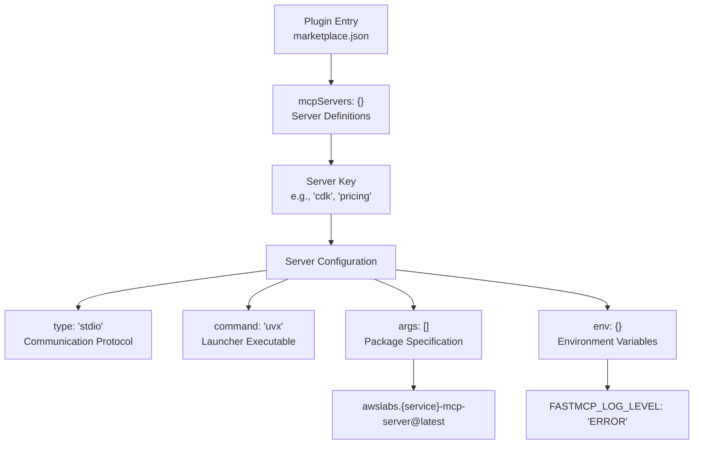
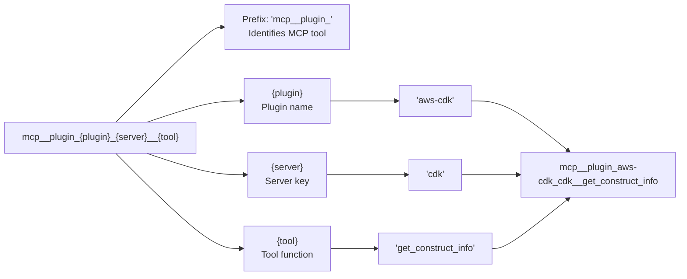
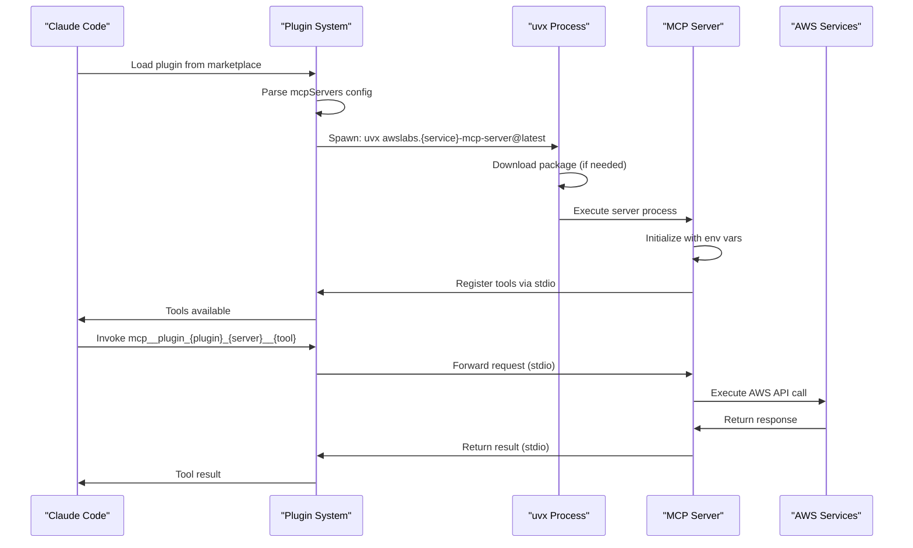
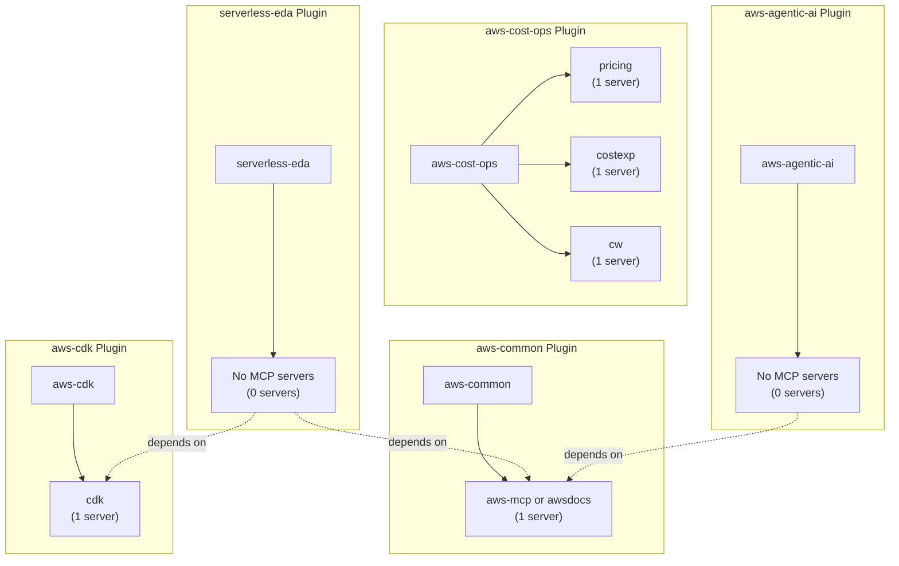
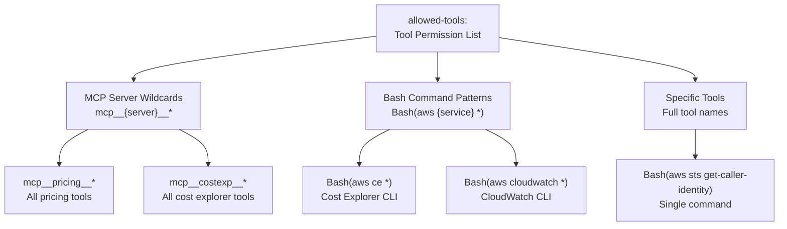
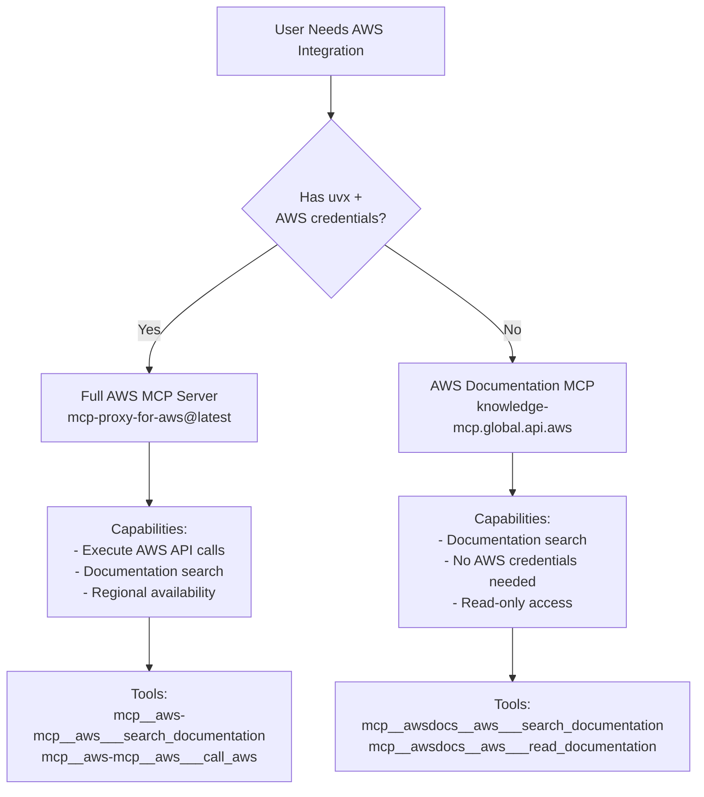
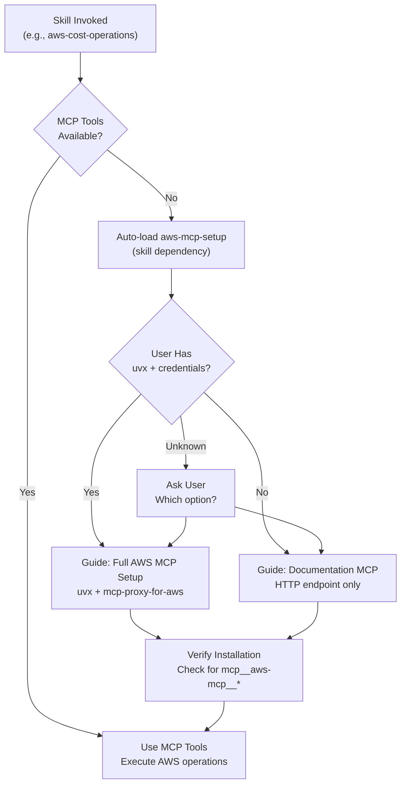

<!-- source: DeepWiki mcp.deepwiki.com · repo zxkane/aws-skills · page 3.3 MCP Server Integration · fetched 2026-10-27 -->

# MCP Server Integration

<details>
<summary>Relevant source files</summary>

The following files were used as context for generating this wiki page:

- [.claude-plugin/marketplace.json](.claude-plugin/marketplace.json)
- [plugins/aws-common/skills/aws-mcp-setup/SKILL.md](plugins/aws-common/skills/aws-mcp-setup/SKILL.md)
- [plugins/aws-cost-ops/skills/aws-cost-operations/SKILL.md](plugins/aws-cost-ops/skills/aws-cost-operations/SKILL.md)

</details>


This document describes how Model Context Protocol (MCP) servers are integrated into the AWS Skills plugin system. It covers the `mcpServers` configuration structure, server lifecycle management via `uvx`, the standardized tool naming convention, and how plugins declare tool permissions through `allowed-tools` frontmatter. For information about the marketplace and plugin structure, see [Marketplace and Plugin System](#3.1). For information about how skills consume MCP tools during execution, see [Skills and Execution Model](#3.2).

## Overview

MCP servers provide the bridge between Claude Code and AWS services. Plugins declare their required MCP servers in the `marketplace.json` configuration using the `mcpServers` object. Each server is launched as a separate process via the `uvx` package runner, communicates using the `stdio` protocol, and exposes tools following the naming pattern `mcp__plugin_{plugin}_{server}__{tool}`. Skills control which MCP tools they can invoke through the `allowed-tools` frontmatter field.

## mcpServers Configuration Schema

### Plugin-Level Declaration

Plugins declare MCP servers in their `marketplace.json` entry using the `mcpServers` object:



**Configuration Structure**

Sources: [.claude-plugin/marketplace.json:49-60](), [.claude-plugin/marketplace.json:80-111]()

The schema for each MCP server definition:

| Field | Type | Required | Description |
|-------|------|----------|-------------|
| `type` | `"stdio"` | Yes | Communication protocol (always stdio) |
| `command` | `"uvx"` | Yes | Launcher command (always uvx) |
| `args` | `string[]` | Yes | Package name and optional arguments |
| `env` | `object` | No | Environment variables for server process |

### Example Configurations

**aws-cdk Plugin - Single Server**

```json
"mcpServers": {
  "cdk": {
    "type": "stdio",
    "command": "uvx",
    "args": [
      "awslabs.cdk-mcp-server@latest"
    ],
    "env": {
      "FASTMCP_LOG_LEVEL": "ERROR"
    }
  }
}
```

Sources: [.claude-plugin/marketplace.json:49-60]()

**aws-cost-ops Plugin - Multiple Servers**

```json
"mcpServers": {
  "pricing": {
    "type": "stdio",
    "command": "uvx",
    "args": ["awslabs.aws-pricing-mcp-server@latest"],
    "env": {"FASTMCP_LOG_LEVEL": "ERROR"}
  },
  "costexp": {
    "type": "stdio",
    "command": "uvx",
    "args": ["awslabs.cost-explorer-mcp-server@latest"],
    "env": {"FASTMCP_LOG_LEVEL": "ERROR"}
  },
  "cw": {
    "type": "stdio",
    "command": "uvx",
    "args": ["awslabs.cloudwatch-mcp-server@latest"],
    "env": {"FASTMCP_LOG_LEVEL": "ERROR"}
  }
}
```

Sources: [.claude-plugin/marketplace.json:80-111]()

## Server Naming and Registration

### Server Key Conventions

Each server is identified by a short key in the `mcpServers` object:

| Plugin | Server Key | Package Name | Purpose |
|--------|-----------|--------------|---------|
| aws-cdk | `cdk` | `awslabs.cdk-mcp-server` | CDK construct recommendations |
| aws-cost-ops | `pricing` | `awslabs.aws-pricing-mcp-server` | Service pricing queries |
| aws-cost-ops | `costexp` | `awslabs.cost-explorer-mcp-server` | Historical cost analysis |
| aws-cost-ops | `cw` | `awslabs.cloudwatch-mcp-server` | Metrics and logs queries |
| aws-common | `aws-mcp` or `awsdocs` | Various | Documentation search |

Sources: [.claude-plugin/marketplace.json:11-151]()

### Package Naming Pattern

All AWS MCP servers follow the naming pattern: `awslabs.{service}-mcp-server@latest`

The `@latest` version specification ensures plugins always use the most recent server implementation.

Sources: [.claude-plugin/marketplace.json:54](), [.claude-plugin/marketplace.json:85]()

## Tool Naming Convention

### Pattern Structure

MCP tools exposed to Claude Code follow this naming convention:

```
mcp__plugin_{plugin}_{server}__{tool}
```



Sources: [plugins/aws-cost-ops/skills/aws-cost-operations/SKILL.md:6-10]()

### Real Examples

**aws-cdk Plugin Tools**

- `mcp__plugin_aws-cdk_cdk__get_construct_info`
- `mcp__plugin_aws-cdk_cdk__search_constructs`
- `mcp__plugin_aws-cdk_cdk__recommend_construct`

**aws-cost-ops Plugin Tools**

```
# Pricing server tools
mcp__pricing__get_service_pricing
mcp__pricing__compare_region_pricing
mcp__pricing__estimate_monthly_cost

# Cost Explorer server tools
mcp__costexp__get_cost_and_usage
mcp__costexp__get_cost_forecast
mcp__costexp__get_cost_anomalies

# CloudWatch server tools
mcp__cw__get_metric_statistics
mcp__cw__describe_alarms
mcp__cw__query_logs
```

Sources: [plugins/aws-cost-ops/skills/aws-cost-operations/SKILL.md:6-10]()

### Wildcard Pattern Matching

Skills use wildcard patterns in `allowed-tools` to grant access to entire server namespaces:

| Pattern | Matches | Use Case |
|---------|---------|----------|
| `mcp__pricing__*` | All pricing server tools | Grant full pricing access |
| `mcp__costexp__*` | All cost explorer tools | Grant full cost analysis |
| `mcp__cw__*` | All CloudWatch tools | Grant full monitoring access |
| `mcp__aws-mcp__*` | All aws-mcp server tools | Grant documentation + API access |
| `mcp__awsdocs__*` | All awsdocs server tools | Grant documentation-only access |

Sources: [plugins/aws-cost-ops/skills/aws-cost-operations/SKILL.md:6-11]()

## Server Lifecycle

### Launch Process



Sources: [.claude-plugin/marketplace.json:49-60]()

### Process Management

**Server Initialization**

1. Plugin installation triggers server registration
2. `uvx` downloads package from PyPI (first run only)
3. Server process spawns with configured environment
4. Server initializes and exposes tools via `stdio`
5. Tools become available to Claude Code session

**Communication Protocol**

- **Protocol**: `stdio` (standard input/output streams)
- **Format**: JSON-RPC 2.0 messages
- **Transport**: Bidirectional pipe between Claude Code and server process
- **Lifecycle**: Server runs for duration of Claude Code session

Sources: [.claude-plugin/marketplace.json:51]()

### Environment Configuration

**Standard Environment Variables**

All MCP servers in the marketplace use consistent environment configuration:

```json
"env": {
  "FASTMCP_LOG_LEVEL": "ERROR"
}
```

| Variable | Value | Purpose |
|----------|-------|---------|
| `FASTMCP_LOG_LEVEL` | `"ERROR"` | Suppress informational logs, show only errors |

This configuration reduces noise in Claude Code output by limiting server logs to critical errors.

Sources: [.claude-plugin/marketplace.json:57-58](), [.claude-plugin/marketplace.json:88-89]()

## Plugin-to-Server Mapping

### Integration Patterns



Sources: [.claude-plugin/marketplace.json:11-151]()

### Server Distribution

| Plugin | Servers | Integration Strategy |
|--------|---------|---------------------|
| `aws-common` | 1 | Foundation - documentation access for all plugins |
| `aws-cdk` | 1 | Focused - CDK-specific operations |
| `aws-cost-ops` | 3 | Comprehensive - full cost/monitoring stack |
| `serverless-eda` | 0 | Transitive - uses `aws-cdk` and `aws-common` servers |
| `aws-agentic-ai` | 0 | Transitive - uses `aws-common` documentation |

Plugins without dedicated servers rely on skill dependencies to access MCP tools from foundation plugins.

Sources: [.claude-plugin/marketplace.json:27-29](), [.claude-plugin/marketplace.json:46-48](), [.claude-plugin/marketplace.json:77-79](), [.claude-plugin/marketplace.json:128-130](), [.claude-plugin/marketplace.json:147-149]()

## Tool Permission Model

### allowed-tools Frontmatter

Skills declare which MCP tools they can invoke using the `allowed-tools` field in SKILL.md frontmatter:

```yaml
---
name: aws-cost-operations
allowed-tools:
  - mcp__pricing__*
  - mcp__costexp__*
  - mcp__cw__*
  - mcp__aws-mcp__*
  - mcp__awsdocs__*
  - Bash(aws ce *)
  - Bash(aws cloudwatch *)
---
```

Sources: [plugins/aws-cost-ops/skills/aws-cost-operations/SKILL.md:1-17]()

### Permission Categories



Sources: [plugins/aws-cost-ops/skills/aws-cost-operations/SKILL.md:6-17]()

### Permission Scope

**MCP Tool Permissions**

- `mcp__pricing__*` - All tools from pricing server
- `mcp__costexp__*` - All tools from cost explorer server
- `mcp__cw__*` - All tools from CloudWatch server
- `mcp__aws-mcp__*` - All tools from full AWS MCP server
- `mcp__awsdocs__*` - All tools from documentation-only server

**Bash Command Permissions**

- `Bash(aws ce *)` - All AWS Cost Explorer CLI commands
- `Bash(aws cloudwatch *)` - All CloudWatch CLI commands
- `Bash(aws logs *)` - All CloudWatch Logs CLI commands
- `Bash(aws budgets *)` - All AWS Budgets CLI commands
- `Bash(aws sts get-caller-identity)` - Single specific command

Sources: [plugins/aws-cost-ops/skills/aws-cost-operations/SKILL.md:6-17]()

## AWS MCP Server Setup

### Configuration Options

The `aws-common` plugin provides two MCP server configuration options through the `aws-mcp-setup` skill:



Sources: [plugins/aws-common/skills/aws-mcp-setup/SKILL.md:12-15]()

### Full AWS MCP Server Configuration

**Configuration Structure**

```json
{
  "mcpServers": {
    "aws-mcp": {
      "command": "uvx",
      "args": [
        "mcp-proxy-for-aws@latest",
        "https://aws-mcp.us-east-1.api.aws/mcp",
        "--metadata", "AWS_REGION=us-west-2"
      ]
    }
  }
}
```

**Credential Options**

| Method | Configuration | Use Case |
|--------|---------------|----------|
| AWS Profile | `--profile my-profile` | Development with named profiles |
| Environment Variables | `env: {AWS_ACCESS_KEY_ID, AWS_SECRET_ACCESS_KEY}` | CI/CD pipelines |
| IAM Role | No additional config | EC2/ECS/Lambda execution |

Sources: [plugins/aws-common/skills/aws-mcp-setup/SKILL.md:94-131]()

### Documentation-Only MCP Configuration

**Configuration Structure**

```json
{
  "mcpServers": {
    "awsdocs": {
      "type": "http",
      "url": "https://knowledge-mcp.global.api.aws"
    }
  }
}
```

**Characteristics**

- No prerequisites (no Python, uvx, or AWS credentials)
- HTTP protocol instead of stdio
- Read-only documentation access
- No AWS API execution capability

Sources: [plugins/aws-common/skills/aws-mcp-setup/SKILL.md:141-157]()

## Tool Availability Detection

### Runtime Verification

Skills automatically check for MCP tool availability before executing AWS operations:



Sources: [plugins/aws-cost-ops/skills/aws-cost-operations/SKILL.md:29-45]()

### Tool Name Patterns

Skills check for these tool patterns to determine MCP server type:

| Pattern | Server Type | Capabilities |
|---------|------------|--------------|
| `mcp__aws-mcp__*` or `mcp__aws__*` | Full AWS MCP Server | API execution + documentation |
| `mcp__*awsdocs*__aws___*` | Documentation MCP | Documentation only |

Skills use the `/mcp` command to list available MCP servers and verify tool presence.

Sources: [plugins/aws-common/skills/aws-mcp-setup/SKILL.md:24-26](), [plugins/aws-cost-ops/skills/aws-cost-operations/SKILL.md:35-38]()

## Error Handling and Logging

### Log Level Configuration

All marketplace-registered MCP servers use `ERROR` log level to minimize output noise:

```json
"env": {
  "FASTMCP_LOG_LEVEL": "ERROR"
}
```

This configuration ensures only critical errors appear in Claude Code output, suppressing informational and debug messages.

Sources: [.claude-plugin/marketplace.json:57-58](), [.claude-plugin/marketplace.json:88-89](), [.claude-plugin/marketplace.json:98-99](), [.claude-plugin/marketplace.json:107-108]()

### Troubleshooting

**Common Issues**

| Issue | Cause | Resolution |
|-------|-------|-----------|
| `uvx: command not found` | uv package manager not installed | Install via `pip install uv` |
| Tools not appearing | Server failed to start | Check server logs, verify package name |
| `AccessDenied` errors | Missing IAM permissions | Add required permissions to IAM policy |
| `InvalidSignatureException` | AWS credential issue | Verify credentials with `aws sts get-caller-identity` |

Sources: [plugins/aws-common/skills/aws-mcp-setup/SKILL.md:170-175]()

---

