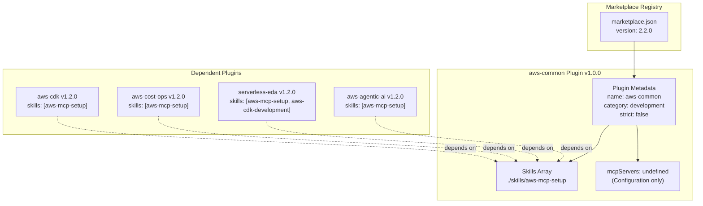
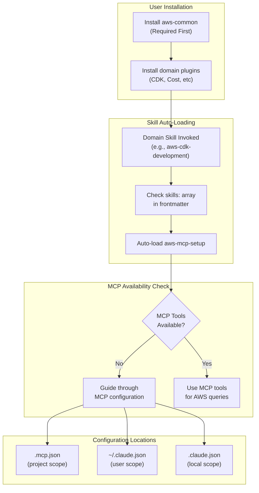
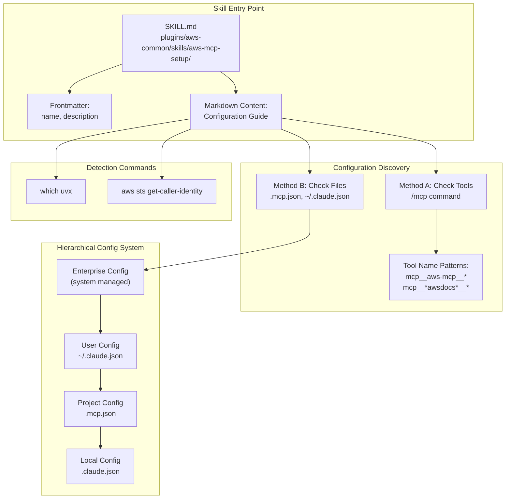
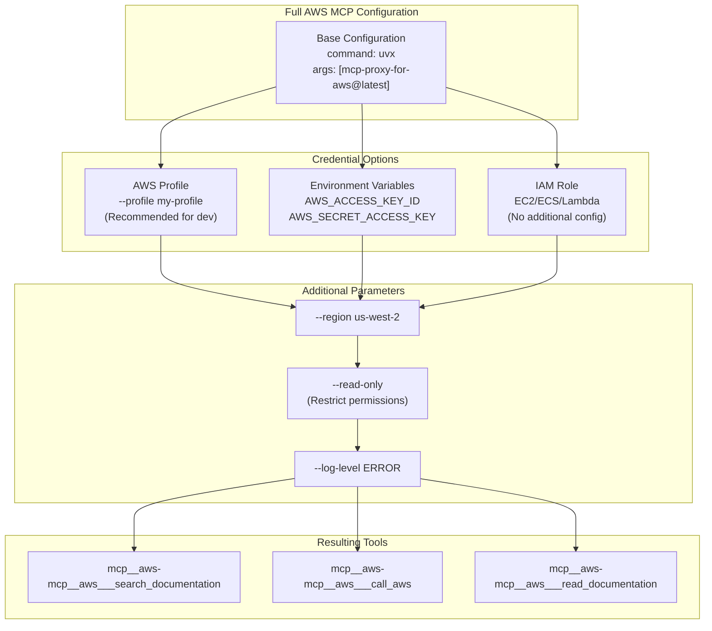
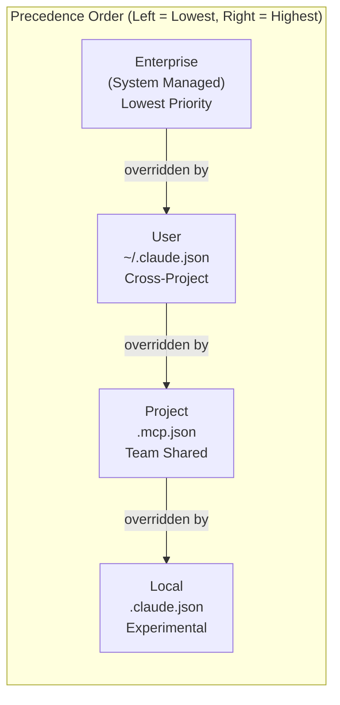
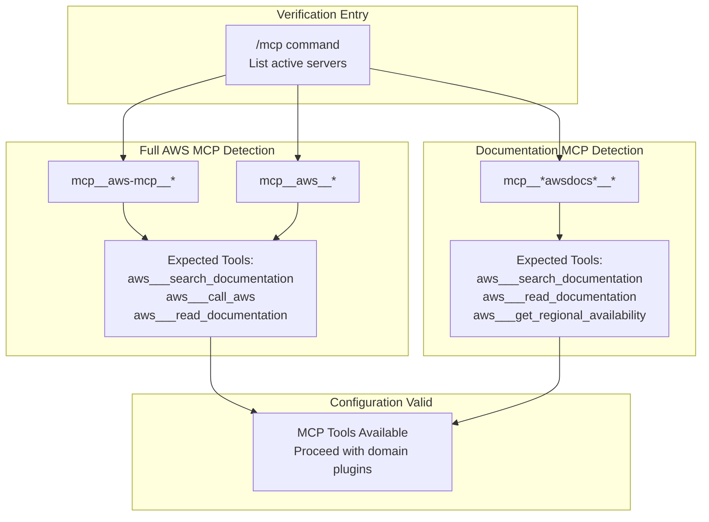
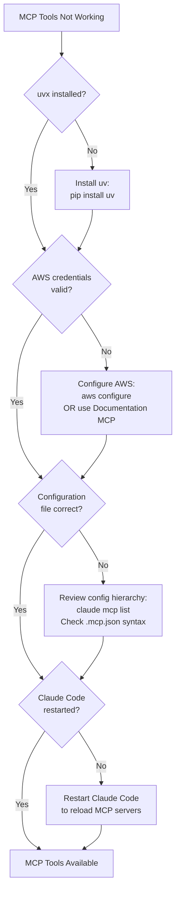
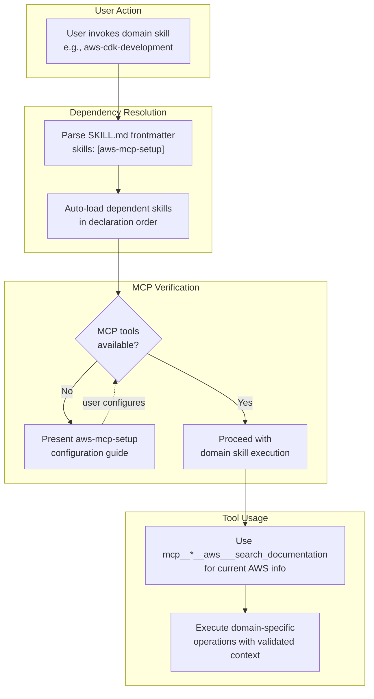

<!-- source: DeepWiki mcp.deepwiki.com · repo zxkane/aws-skills · page 4.1 aws-common Plugin · fetched 2026-10-27 -->

# aws-common Plugin

<details>
<summary>Relevant source files</summary>

The following files were used as context for generating this wiki page:

- [.claude-plugin/marketplace.json](.claude-plugin/marketplace.json)
- [docs/aws-mcp-setup.md](docs/aws-mcp-setup.md)
- [plugins/aws-common/skills/aws-mcp-setup/SKILL.md](plugins/aws-common/skills/aws-mcp-setup/SKILL.md)

</details>


## Purpose and Scope

The `aws-common` plugin provides foundational AWS integration capabilities that all other plugins in the marketplace depend on. It contains the `aws-mcp-setup` skill, which guides users through configuring AWS MCP (Model Context Protocol) tools for accessing up-to-date AWS documentation and APIs. This plugin must be installed before any domain-specific plugins (`aws-cdk`, `aws-cost-ops`, `serverless-eda`, `aws-agentic-ai`) can function properly.

For installation procedures and dependency order, see [Installation](#2.1). For broader marketplace architecture, see [Marketplace and Plugin System](#3.1).

## Plugin Registration and Metadata

The `aws-common` plugin is registered in the marketplace with stable foundational status:

| Property | Value |
|----------|-------|
| Name | `aws-common` |
| Version | `1.0.0` |
| Category | `development` |
| Source | `./plugins/aws-common` |
| Strict Mode | `false` |
| Skills | `aws-mcp-setup` |
| MCP Servers | None (guides configuration only) |

The plugin's stability is reflected in its v1.0.0 version, while domain plugins evolve more rapidly at v1.2.0. This version differential indicates `aws-common` serves as a stable dependency foundation.

**Plugin Registration Structure**



**Sources:** [.claude-plugin/marketplace.json:11-30]()

## Architecture and Dependency Model

Unlike other plugins that bundle MCP servers, `aws-common` provides a configuration skill that guides users to set up external AWS MCP infrastructure. This architectural choice enables centralized MCP configuration that all plugins can reference.

**Dependency Resolution Flow**



**Sources:** [.claude-plugin/marketplace.json:11-30](), [plugins/aws-common/skills/aws-mcp-setup/SKILL.md:1-20]()

## aws-mcp-setup Skill

The `aws-mcp-setup` skill is the only skill provided by this plugin. It serves as a gatekeeper that ensures AWS MCP tools are configured before any domain plugin can provide AWS-specific guidance.

**Skill Configuration**

```yaml
name: aws-mcp-setup
description: Configure AWS Documentation MCP server to query up-to-date AWS knowledge, APIs, and best practices
```

The skill operates through an interactive configuration guide rather than executable tools, distinguishing it from typical skills that perform operations.

**MCP Configuration Architecture**



**Sources:** [plugins/aws-common/skills/aws-mcp-setup/SKILL.md:1-68]()

## MCP Configuration Options

The skill guides users through two distinct MCP server configurations based on their environment and requirements.

### Option A: Full AWS MCP Server

The Full AWS MCP Server provides comprehensive AWS integration including API execution and documentation search.

**Prerequisites and Detection**

| Requirement | Detection Command | Purpose |
|-------------|------------------|---------|
| Python 3.10+ | `which uvx` | MCP server launcher |
| uvx package manager | `uvx --version` | Package execution |
| AWS credentials | `aws sts get-caller-identity` | API authentication |

**IAM Permissions Required**

```json
{
  "Version": "2012-10-17",
  "Statement": [{
    "Effect": "Allow",
    "Action": [
      "aws-mcp:InvokeMCP",
      "aws-mcp:CallReadOnlyTool",
      "aws-mcp:CallReadWriteTool"
    ],
    "Resource": "*"
  }]
}
```

**Configuration Structure**

```json
{
  "mcpServers": {
    "aws-mcp": {
      "command": "uvx",
      "args": [
        "mcp-proxy-for-aws@latest",
        "https://aws-mcp.us-east-1.api.aws/mcp",
        "--metadata", "AWS_REGION=us-west-2"
      ]
    }
  }
}
```

**Credential Configuration Variants**



**Sources:** [plugins/aws-common/skills/aws-mcp-setup/SKILL.md:64-137](), [docs/aws-mcp-setup.md:64-132]()

### Option B: AWS Documentation MCP

The AWS Documentation MCP provides documentation search without requiring AWS credentials or local Python environment.

**Use Cases**

- No Python/uvx installation available
- No AWS credentials configured
- Documentation-only requirements
- Public/read-only environments

**Configuration Structure**

```json
{
  "mcpServers": {
    "awsdocs": {
      "type": "http",
      "url": "https://knowledge-mcp.global.api.aws"
    }
  }
}
```

**Tool Availability Comparison**

| Capability | Full AWS MCP | Documentation MCP |
|------------|-------------|-------------------|
| Documentation Search | `mcp__aws-mcp__aws___search_documentation` | `mcp__awsdocs__aws___search_documentation` |
| Documentation Read | `mcp__aws-mcp__aws___read_documentation` | `mcp__awsdocs__aws___read_documentation` |
| Regional Availability | `mcp__aws-mcp__aws___get_regional_availability` | `mcp__awsdocs__aws___get_regional_availability` |
| AWS API Calls | `mcp__aws-mcp__aws___call_aws` | ❌ Not Available |
| Authentication | AWS credentials required | None required |
| Network | Outbound to aws-mcp endpoint | Outbound to knowledge-mcp endpoint |

**Sources:** [plugins/aws-common/skills/aws-mcp-setup/SKILL.md:139-167](), [docs/aws-mcp-setup.md:134-161]()

## Configuration File Hierarchy

The MCP server configuration follows a hierarchical precedence model where more specific scopes override broader ones.

**Configuration Precedence Flow**



**Configuration Check Commands**

```bash
# Check project configuration
cat .mcp.json 2>/dev/null | grep -E '"(aws-mcp|aws|awsdocs)"'

# Check user configuration
cat ~/.claude.json 2>/dev/null | grep -E '"(aws-mcp|aws|awsdocs)"'

# List all MCP servers
claude mcp list
```

**Sources:** [plugins/aws-common/skills/aws-mcp-setup/SKILL.md:29-51](), [docs/aws-mcp-setup.md:24-46]()

## Verification and Validation

After configuration, the skill provides verification steps to confirm MCP tools are accessible.

**Tool Name Pattern Detection**



**Sources:** [plugins/aws-common/skills/aws-mcp-setup/SKILL.md:158-167](), [docs/aws-mcp-setup.md:153-161]()

## Troubleshooting

Common issues and resolutions for MCP configuration:

| Issue | Cause | Solution |
|-------|-------|----------|
| `uvx: command not found` | uv not installed | Install with `pip install uv` or use Documentation MCP (Option B) |
| `AccessDenied` error | Missing IAM permissions | Add `aws-mcp:*` permissions to IAM policy |
| `InvalidSignatureException` | Credential misconfiguration | Verify with `aws sts get-caller-identity` |
| Tools not appearing | MCP not started | Restart Claude Code after configuration change |
| Wrong tools available | Configuration scope conflict | Check hierarchical config with `claude mcp list` |

**Diagnostic Command Flow**



**Sources:** [plugins/aws-common/skills/aws-mcp-setup/SKILL.md:169-176](), [docs/aws-mcp-setup.md:163-170]()

## Integration with Domain Plugins

All domain plugins in the marketplace declare `aws-mcp-setup` as a required skill dependency, creating an automatic bootstrap mechanism.

**Dependency Declaration Pattern**

When a domain plugin skill is invoked, its frontmatter `skills:` array triggers automatic loading:

```yaml
# Example from aws-cdk-development skill
skills: [aws-mcp-setup]

# Example from aws-serverless-eda skill  
skills: [aws-mcp-setup, aws-cdk-development]
```

This ensures that before any AWS-specific guidance is provided, the MCP configuration check occurs automatically. If tools are unavailable, users are guided through setup before proceeding.

**Auto-Loading Mechanism**



**Sources:** [.claude-plugin/marketplace.json:46-48](), [.claude-plugin/marketplace.json:77-78](), [.claude-plugin/marketplace.json:128-129](), [.claude-plugin/marketplace.json:147-148]()

## Design Rationale

The `aws-common` plugin's architecture reflects several key design decisions:

1. **Separation of Concerns**: Configuration guidance is separated from MCP server implementation, allowing external AWS MCP infrastructure to evolve independently.

2. **Zero MCP Servers**: Unlike domain plugins, `aws-common` bundles no MCP servers. This prevents version conflicts and allows users to configure the AWS MCP version that matches their requirements.

3. **Bootstrap Pattern**: By being a required dependency for all domain plugins, it creates a centralized entry point for AWS infrastructure configuration verification.

4. **Version Stability**: The v1.0.0 version signals API stability—domain plugins can safely depend on `aws-mcp-setup` without frequent breaking changes.

5. **Hierarchical Configuration**: Supporting multiple configuration scopes (enterprise → user → project → local) enables both organizational standards and individual experimentation.

**Sources:** [.claude-plugin/marketplace.json:11-30](), [plugins/aws-common/skills/aws-mcp-setup/SKILL.md:1-176]()

---

