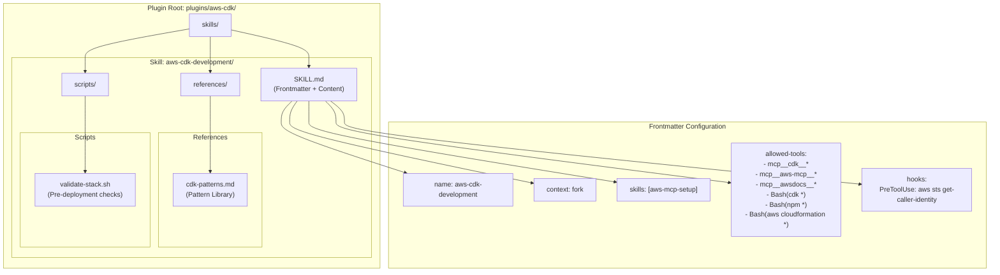
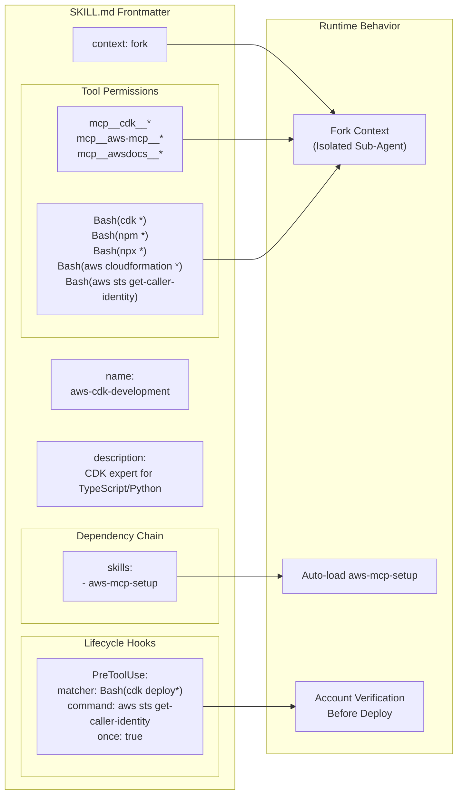
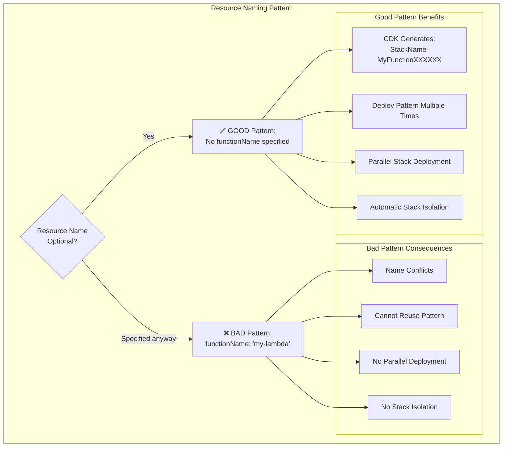
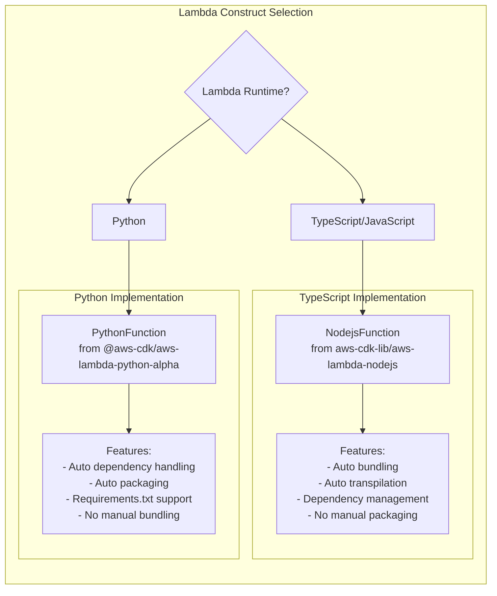
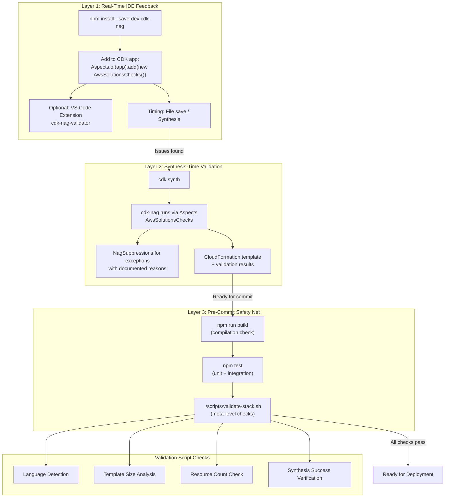
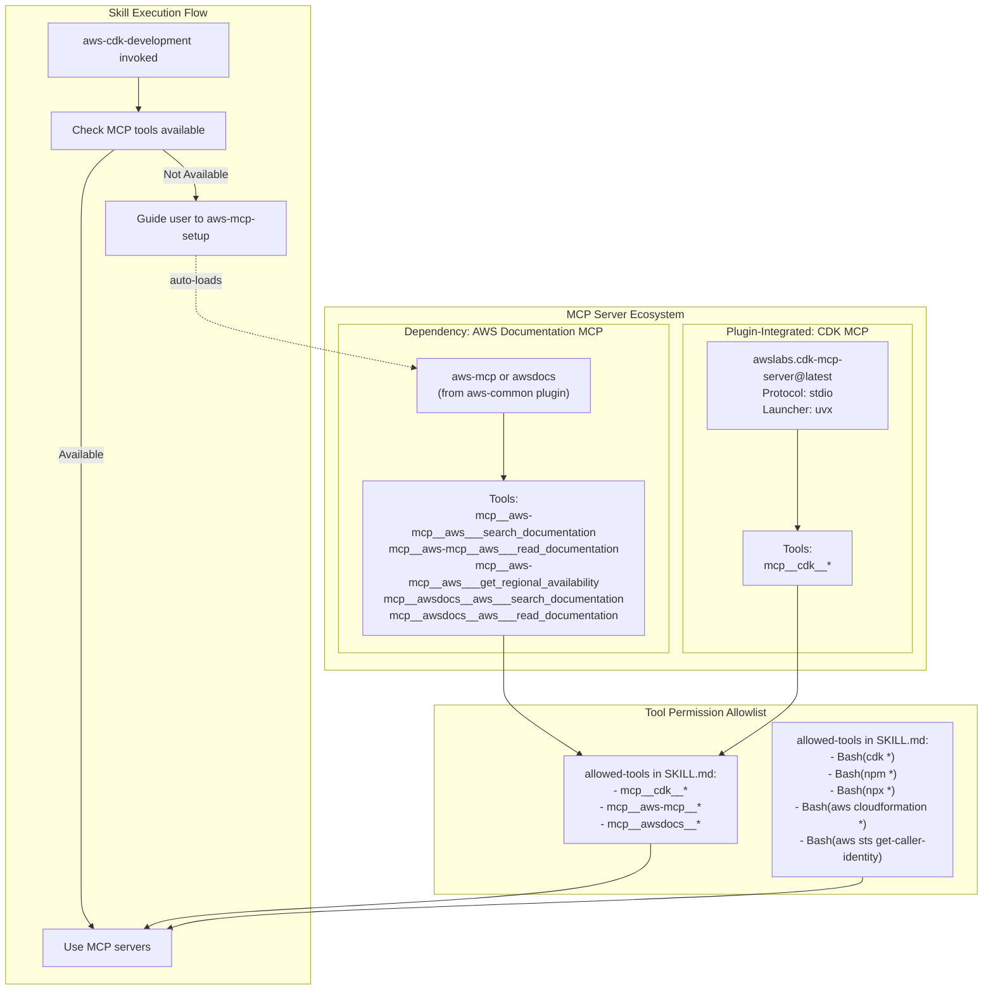
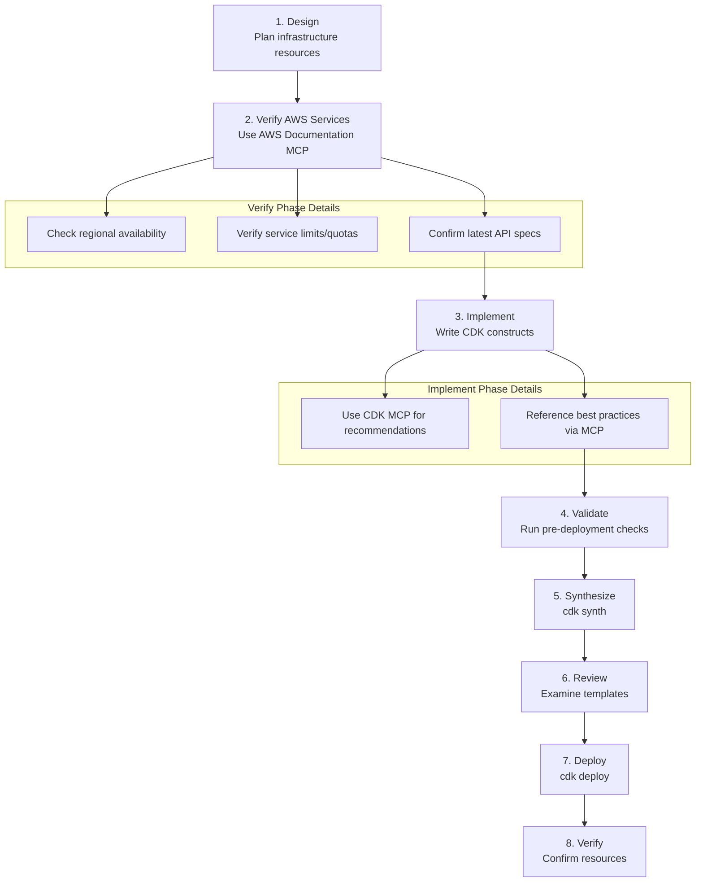

<!-- source: DeepWiki mcp.deepwiki.com · repo zxkane/aws-skills · page 4.2 aws-cdk Plugin · fetched 2026-10-27 -->

# aws-cdk Plugin

<details>
<summary>Relevant source files</summary>

The following files were used as context for generating this wiki page:

- [.gitignore](.gitignore)
- [README.md](README.md)
- [plugins/aws-cdk/skills/aws-cdk-development/SKILL.md](plugins/aws-cdk/skills/aws-cdk-development/SKILL.md)

</details>


The `aws-cdk` plugin provides comprehensive AWS Cloud Development Kit (CDK) development capabilities for Claude Code, enabling infrastructure-as-code development with TypeScript and Python. This plugin includes the `aws-cdk-development` skill, integrated CDK MCP server, validation scripts, and a comprehensive patterns library. It enforces AWS best practices including automatic resource naming, appropriate Lambda construct usage, and multi-layer pre-deployment validation.

This page covers the CDK plugin's structure, skill configuration, validation strategies, and MCP integration. For foundational MCP setup that this plugin depends on, see [aws-common Plugin](#4.1). For serverless patterns that build upon CDK infrastructure, see [serverless-eda Plugin](#4.4). For the complete plugin installation sequence, see [Installation](#2.1).

## Plugin Overview

The `aws-cdk` plugin is one of three development-focused plugins (alongside `serverless-eda` and `aws-agentic-ai`) at version 1.2.0. It provides a single skill (`aws-cdk-development`) with integrated tooling for CDK stack development, synthesis, and deployment.

**Key Characteristics**:
- **Version**: 1.2.0 (development plugin tier)
- **Dependencies**: `aws-common` v1.0.0 (required)
- **MCP Servers**: 1 server (CDK MCP)
- **Primary Skill**: `aws-cdk-development`
- **Execution Context**: Fork (isolated sub-agent)

Sources: [README.md:18-29](), [plugins/aws-cdk/skills/aws-cdk-development/SKILL.md:1-6]()

## Plugin Directory Structure

The plugin follows the standardized AWS Skills directory pattern with skills, references, and scripts:



**Directory Mapping**:

| Path | Purpose | Key Content |
|------|---------|-------------|
| `plugins/aws-cdk/skills/aws-cdk-development/` | Skill root directory | All skill components |
| `SKILL.md` | Skill definition with frontmatter | Configuration + guidance content |
| `references/cdk-patterns.md` | Pattern library | Detailed CDK patterns, anti-patterns |
| `scripts/validate-stack.sh` | Validation script | Pre-deployment safety checks |

Sources: [README.md:227-243](), [plugins/aws-cdk/skills/aws-cdk-development/SKILL.md:1-21]()

## The aws-cdk-development Skill

The `aws-cdk-development` skill is the core component of this plugin, configured through frontmatter metadata in `SKILL.md`.

### Skill Metadata Configuration



**Frontmatter Fields**:

| Field | Value | Purpose |
|-------|-------|---------|
| `name` | `aws-cdk-development` | Skill identifier |
| `description` | CDK expert for TypeScript/Python | Invocation trigger keywords |
| `context` | `fork` | Execute in isolated sub-agent |
| `skills` | `[aws-mcp-setup]` | Auto-load dependency |
| `allowed-tools` | MCP servers + bash commands | Tool permission whitelist |
| `hooks.PreToolUse` | Account verification | Pre-deployment safety check |

Sources: [plugins/aws-cdk/skills/aws-cdk-development/SKILL.md:1-21]()

### Invocation Triggers

The skill activates when users mention CDK-related keywords in prompts. From the description field:

**Trigger Keywords**: "CDK", "CloudFormation", "IaC", "cdk synth", "cdk deploy", "CDK stacks", "CDK constructs", "infrastructure as code", "define AWS infrastructure programmatically"

**Usage Scenarios**:
- Creating new CDK stacks or constructs
- Refactoring existing CDK infrastructure
- Implementing Lambda functions within CDK
- Validating CDK stack configurations
- Synthesizing and deploying CloudFormation templates

Sources: [plugins/aws-cdk/skills/aws-cdk-development/SKILL.md:3](), [plugins/aws-cdk/skills/aws-cdk-development/SKILL.md:59-68]()

## Core CDK Principles

The plugin enforces two critical CDK principles through skill guidance and validation.

### Resource Naming Convention

**Principle**: Do NOT explicitly specify resource names when optional in CDK constructs.

**Implementation Pattern**:



**Code Example from Skill**:

The skill provides explicit guidance at [plugins/aws-cdk/skills/aws-cdk-development/SKILL.md:83-95]():

```typescript
// ❌ BAD - Explicit naming prevents reusability and parallel deployments
new lambda.Function(this, 'MyFunction', {
  functionName: 'my-lambda',  // Avoid this
});

// ✅ GOOD - Let CDK generate unique names
new lambda.Function(this, 'MyFunction', {
  // No functionName specified - CDK generates: StackName-MyFunctionXXXXXX
});
```

**Rationale** (from [plugins/aws-cdk/skills/aws-cdk-development/SKILL.md:75-79]()):
- **Reusable patterns**: Deploy same construct/pattern multiple times without conflicts
- **Parallel deployments**: Multiple stacks can deploy simultaneously in same region
- **Cleaner shared logic**: Patterns and shared code can initialize multiple times
- **Stack isolation**: Each stack gets uniquely identified resources automatically

**Security Best Practice**: For environment separation (dev/staging/prod), use separate AWS accounts rather than resource naming within a single account. Account-level isolation provides stronger security boundaries.

Sources: [README.md:89-105](), [plugins/aws-cdk/skills/aws-cdk-development/SKILL.md:71-97]()

### Lambda Function Constructs

**Principle**: Use specialized constructs for automatic bundling based on runtime.



**TypeScript/JavaScript Pattern**:

From [plugins/aws-cdk/skills/aws-cdk-development/SKILL.md:104-111]():

```typescript
import { NodejsFunction } from 'aws-cdk-lib/aws-lambda-nodejs';

new NodejsFunction(this, 'MyFunction', {
  entry: 'lambda/handler.ts',
  handler: 'handler',
  // Automatically handles bundling, dependencies, and transpilation
});
```

**Python Pattern**:

From [plugins/aws-cdk/skills/aws-cdk-development/SKILL.md:114-123]():

```typescript
import { PythonFunction } from '@aws-cdk/aws-lambda-python-alpha';

new PythonFunction(this, 'MyFunction', {
  entry: 'lambda',
  index: 'handler.py',
  handler: 'handler',
  // Automatically handles dependencies and packaging
});
```

**Benefits** (from [plugins/aws-cdk/skills/aws-cdk-development/SKILL.md:126-130]()):
- Automatic bundling and dependency management
- Transpilation handled automatically
- No manual packaging required
- Consistent deployment patterns

Sources: [README.md:107-113](), [plugins/aws-cdk/skills/aws-cdk-development/SKILL.md:99-130]()

## Multi-Layer Validation Strategy

The plugin implements a three-layer validation approach for comprehensive quality assurance before deployment.



### Layer 1: Real-Time IDE Feedback

**Purpose**: Catch issues during development before synthesis.

**Implementation** (from [plugins/aws-cdk/skills/aws-cdk-development/SKILL.md:136-154]()):

1. Install `cdk-nag` as dev dependency
2. Add to CDK app initialization:
   ```typescript
   import { Aspects } from 'aws-cdk-lib';
   import { AwsSolutionsChecks } from 'cdk-nag';
   
   const app = new App();
   Aspects.of(app).add(new AwsSolutionsChecks());
   ```
3. Optional: Install VS Code extension `cdk-nag-validator` for faster feedback on file save

**Supported Languages**: TypeScript, JavaScript, Python, Java, C#, Go (all CDK languages)

Sources: [plugins/aws-cdk/skills/aws-cdk-development/SKILL.md:136-157]()

### Layer 2: Synthesis-Time Validation

**Purpose**: Comprehensive rule validation during template generation.

**Process** (from [plugins/aws-cdk/skills/aws-cdk-development/SKILL.md:159-177]()):

1. **Run synthesis**: `cdk synth` (cdk-nag runs automatically via Aspects)
2. **Suppress legitimate exceptions** with documented reasons:
   ```typescript
   import { NagSuppressions } from 'cdk-nag';
   
   NagSuppressions.addResourceSuppressions(resource, [
     {
       id: 'AwsSolutions-L1',
       reason: 'Lambda@Edge requires specific runtime for CloudFront compatibility'
     }
   ]);
   ```

**Key Principle**: Document WHY each exception is needed, not just suppress warnings.

Sources: [plugins/aws-cdk/skills/aws-cdk-development/SKILL.md:159-177]()

### Layer 3: Pre-Commit Safety Net

**Purpose**: Meta-level checks and comprehensive validation before committing code.

**Commands** (from [README.md:116-124]() and [plugins/aws-cdk/skills/aws-cdk-development/SKILL.md:179-199]()):

```bash
npm run build  # Ensure compilation succeeds
npm test       # Run unit and integration tests
./scripts/validate-stack.sh  # Meta-level validation
```

**Validation Script Focus** (`scripts/validate-stack.sh`):
- Language detection (TypeScript/Python/etc.)
- Template size analysis (CloudFormation limits)
- Resource count verification
- Synthesis success confirmation
- Note: Detailed anti-pattern checks delegated to cdk-nag

**Integration**: When GitHub Actions workflows exist in `.github/workflows/`, ensure all CI checks pass before committing (from [plugins/aws-cdk/skills/aws-cdk-development/SKILL.md:293-295]()).

Sources: [README.md:115-124](), [plugins/aws-cdk/skills/aws-cdk-development/SKILL.md:179-199](), [plugins/aws-cdk/skills/aws-cdk-development/SKILL.md:293-296]()

## MCP Server Integration

The plugin integrates with two MCP server types for comprehensive AWS knowledge and CDK-specific guidance.



### CDK MCP Server

**Configuration**: Automatically configured with the plugin (no manual setup required).

**Server Details**:
- **Package**: `awslabs.cdk-mcp-server@latest`
- **Protocol**: stdio
- **Launcher**: `uvx`
- **Tool Pattern**: `mcp__cdk__*`

**Capabilities** (from [plugins/aws-cdk/skills/aws-cdk-development/SKILL.md:48-57]()):
- Get CDK construct recommendations
- Retrieve CDK best practices
- Access CDK pattern suggestions
- Validate CDK configurations
- Get help with CDK-specific APIs

**When to Use** (from [plugins/aws-cdk/skills/aws-cdk-development/SKILL.md:250-264]()):
- CDK construct selection and usage
- CDK API parameter options
- CDK best practice patterns
- Construct property configurations
- CDK-specific optimizations

**Example Scenarios**:
- "What's the recommended CDK construct for API Gateway REST API?"
- "How to configure NodejsFunction bundling options?"
- "Best practices for CDK stack organization"
- "CDK construct for DynamoDB with auto-scaling"

Sources: [plugins/aws-cdk/skills/aws-cdk-development/SKILL.md:45-57](), [plugins/aws-cdk/skills/aws-cdk-development/SKILL.md:250-264]()

### AWS Documentation MCP (Dependency)

**Source**: Inherited from `aws-common` plugin via `skills: [aws-mcp-setup]` dependency.

**Tool Naming Patterns**:
- `mcp__aws-mcp__aws___search_documentation`
- `mcp__aws-mcp__aws___read_documentation`
- `mcp__aws-mcp__aws___get_regional_availability`
- `mcp__awsdocs__aws___search_documentation`
- `mcp__awsdocs__aws___read_documentation`

**When to Use** (from [plugins/aws-cdk/skills/aws-cdk-development/SKILL.md:235-248]()):
- New AWS service features or configurations
- Service availability in target regions
- API parameter specifications
- Service limits and quotas
- Security best practices for AWS services

**Example Scenarios**:
- "Check if Lambda supports Python 3.13 runtime"
- "Verify DynamoDB is available in eu-south-2"
- "What are the current Lambda timeout limits?"
- "Get latest S3 encryption options"

**Critical Requirement** (from [plugins/aws-cdk/skills/aws-cdk-development/SKILL.md:27-43]()):

The skill REQUIRES AWS MCP tools for accurate information. Before answering AWS questions:

1. **Verify** using AWS MCP tools if available
2. **If unavailable**: Guide user to `aws-mcp-setup` skill (auto-loaded as dependency)
3. **Setup options**:
   - Has uvx + AWS credentials → Full AWS MCP Server
   - No Python/credentials → AWS Documentation MCP (no auth)

This ensures no skill provides outdated AWS information.

Sources: [plugins/aws-cdk/skills/aws-cdk-development/SKILL.md:27-43](), [plugins/aws-cdk/skills/aws-cdk-development/SKILL.md:235-248]()

### MCP Usage Best Practices

From [plugins/aws-cdk/skills/aws-cdk-development/SKILL.md:265-272]():

1. **Verify First**: Always check AWS Documentation MCP before implementing new features
2. **Regional Validation**: Check service availability in target deployment regions
3. **CDK Guidance**: Use CDK MCP for construct-specific recommendations
4. **Stay Current**: MCP servers provide latest information beyond knowledge cutoff
5. **Combine Sources**: Use both skill patterns and MCP servers for comprehensive guidance

Sources: [plugins/aws-cdk/skills/aws-cdk-development/SKILL.md:265-272]()

## CDK Patterns and References

The plugin provides a comprehensive pattern library through `references/cdk-patterns.md`.

**File Location**: `plugins/aws-cdk/skills/aws-cdk-development/references/cdk-patterns.md`

**Content Coverage** (from [plugins/aws-cdk/skills/aws-cdk-development/SKILL.md:273-285]()):
- Common CDK patterns and their use cases
- Anti-patterns to avoid
- Security best practices
- Cost optimization strategies
- Performance considerations

**Reference from Skill**: The skill explicitly directs users to this file for detailed architectural guidance beyond the core principles covered in `SKILL.md`.

**Related Files**:
- `scripts/validate-stack.sh` - Pre-deployment validation script
- `SKILL.md` - Core skill definition and guidance

Sources: [plugins/aws-cdk/skills/aws-cdk-development/SKILL.md:273-291]()

## Workflow Integration

### Development Workflow

The skill prescribes a structured development process (from [plugins/aws-cdk/skills/aws-cdk-development/SKILL.md:202-218]()):



Sources: [plugins/aws-cdk/skills/aws-cdk-development/SKILL.md:202-218]()

### Pre-Deployment Hook

The skill implements a critical safety mechanism through the `PreToolUse` hook.

**Hook Configuration** (from [plugins/aws-cdk/skills/aws-cdk-development/SKILL.md:16-21]()):

```yaml
hooks:
  PreToolUse:
    - matcher: Bash(cdk deploy*)
      command: aws sts get-caller-identity --query Account --output text
      once: true
```

**Behavior**:
- **Trigger**: Before any `cdk deploy*` command executes
- **Action**: Runs `aws sts get-caller-identity` to verify AWS account context
- **Frequency**: Once per session (`once: true`)
- **Purpose**: Prevents accidental cross-account deployments

This hook demonstrates the lifecycle mechanism available in skill frontmatter for enforcing safety checks.

Sources: [plugins/aws-cdk/skills/aws-cdk-development/SKILL.md:16-21]()

### Stack Organization and Testing

**Stack Organization** (from [plugins/aws-cdk/skills/aws-cdk-development/SKILL.md:219-225]()):
- Use nested stacks for complex applications
- Separate concerns into logical construct boundaries
- Export values that other stacks may need
- Use CDK context for environment-specific configuration

**Testing Strategy** (from [plugins/aws-cdk/skills/aws-cdk-development/SKILL.md:227-232]()):
- Unit test individual constructs
- Integration test stack synthesis
- Snapshot test CloudFormation templates
- Validate resource properties and relationships

Sources: [plugins/aws-cdk/skills/aws-cdk-development/SKILL.md:219-232]()

## Tool Permissions and Bash Integration

The skill defines explicit tool permissions in its frontmatter, enabling both MCP server tools and specific bash commands.

**MCP Tool Permissions** (from [plugins/aws-cdk/skills/aws-cdk-development/SKILL.md:7-10]()):
- `mcp__cdk__*` - All CDK MCP server tools
- `mcp__aws-mcp__*` - AWS Documentation MCP tools (full version)
- `mcp__awsdocs__*` - AWS Documentation MCP tools (alternative naming)

**Bash Command Permissions** (from [plugins/aws-cdk/skills/aws-cdk-development/SKILL.md:11-15]()):
- `Bash(cdk *)` - All CDK CLI commands
- `Bash(npm *)` - npm package management
- `Bash(npx *)` - npx command execution
- `Bash(aws cloudformation *)` - CloudFormation CLI commands
- `Bash(aws sts get-caller-identity)` - Account identity verification

This permission model ensures the skill can execute CDK workflows (build, synth, deploy) while maintaining security boundaries through explicit allowlisting.

Sources: [plugins/aws-cdk/skills/aws-cdk-development/SKILL.md:7-15]()

## Additional Resources and Files

**Build Artifacts** (from [.gitignore:34-37]()):
- `cdk.out/` - CDK synthesis output directory
- `cdk.context.json` - CDK context cache
- `.cdk.staging/` - Staging directory for assets

**Testing and Coverage** (from [.gitignore:67-70]()):
- `coverage/` - Test coverage reports
- `.nyc_output` - NYC (Istanbul) coverage data
- `.pytest_cache/` - Pytest cache for Python tests

**Ignored Files**: AWS credentials, environment variables, temporary files are explicitly excluded from version control to prevent accidental credential exposure.

Sources: [.gitignore:34-37](), [.gitignore:67-70](), [.gitignore:88-91]()

---

