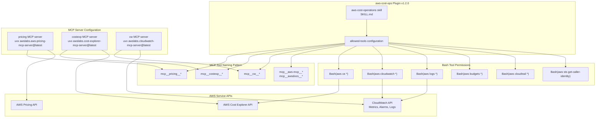
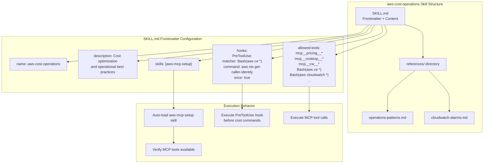
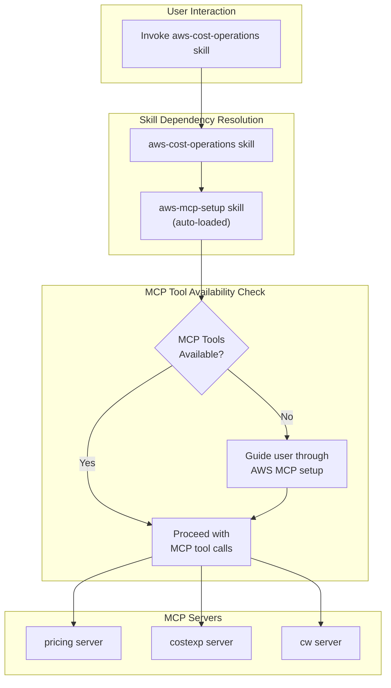

<!-- source: DeepWiki mcp.deepwiki.com · repo zxkane/aws-skills · page 4.3 aws-cost-ops Plugin · fetched 2026-10-27 -->

# aws-cost-ops Plugin

<details>
<summary>Relevant source files</summary>

The following files were used as context for generating this wiki page:

- [.claude-plugin/marketplace.json](.claude-plugin/marketplace.json)
- [README.md](README.md)
- [plugins/aws-cost-ops/skills/aws-cost-operations/SKILL.md](plugins/aws-cost-ops/skills/aws-cost-operations/SKILL.md)

</details>


The `aws-cost-ops` plugin provides AWS cost optimization, monitoring, and operational excellence capabilities for Claude Code. It integrates three AWS MCP servers (Pricing, Cost Explorer, CloudWatch) to enable pre-deployment cost estimation, post-deployment cost analysis, and comprehensive monitoring of AWS resources. This plugin is designed for post-deployment operational concerns including cost tracking, performance monitoring, observability, and audit analysis.

For infrastructure development and deployment, see [aws-cdk Plugin](#4.2). For foundational AWS MCP configuration, see [aws-common Plugin](#4.1).

## Overview

The `aws-cost-ops` plugin is categorized as an operations plugin (version 1.2.0) and provides a single skill named `aws-cost-operations`. Unlike development-focused plugins, this plugin emphasizes post-deployment operational concerns aligned with the AWS Well-Architected Framework's operational excellence and cost optimization pillars.

**Key Characteristics:**
- **Version**: 1.2.0
- **Category**: operations
- **MCP Server Count**: 3 (highest among all plugins)
- **Primary Skill**: `aws-cost-operations`
- **Dependencies**: `aws-common` plugin (for `aws-mcp-setup` skill)

Sources: [.claude-plugin/marketplace.json:63-111](), [plugins/aws-cost-ops/skills/aws-cost-operations/SKILL.md:1-23]()

## MCP Server Architecture

### Three-Server Integration Model

The `aws-cost-ops` plugin demonstrates the most comprehensive MCP server integration in the ecosystem, utilizing three distinct servers for specialized operational capabilities:



**MCP Server Configuration and Tool Namespace Mapping**

Sources: [.claude-plugin/marketplace.json:80-111](), [plugins/aws-cost-ops/skills/aws-cost-operations/SKILL.md:6-17]()

### Server Configuration Details

Each MCP server follows a consistent configuration pattern defined in the plugin's marketplace entry:

| Server Name | Package | Tool Pattern | Purpose |
|------------|---------|--------------|---------|
| `pricing` | `awslabs.aws-pricing-mcp-server@latest` | `mcp__pricing__*` | Pre-deployment cost estimation |
| `costexp` | `awslabs.cost-explorer-mcp-server@latest` | `mcp__costexp__*` | Post-deployment cost analysis |
| `cw` | `awslabs.cloudwatch-mcp-server@latest` | `mcp__cw__*` | Metrics, alarms, and log analysis |

**Common Configuration Parameters:**
- **Type**: `stdio` (standard input/output protocol)
- **Command**: `uvx` (UV package runner)
- **Environment**: `FASTMCP_LOG_LEVEL=ERROR` (minimal logging)

Sources: [.claude-plugin/marketplace.json:81-110]()

## Skill Structure and Configuration

### aws-cost-operations Skill

The plugin provides a single comprehensive skill located at [plugins/aws-cost-ops/skills/aws-cost-operations/]().



**Skill Definition and Execution Flow**

Sources: [plugins/aws-cost-ops/skills/aws-cost-operations/SKILL.md:1-23]()

### Frontmatter Configuration

The skill's frontmatter defines critical execution parameters:

**Dependency Management:**
```yaml
skills:
  - aws-mcp-setup
```
This creates an auto-loading dependency on the `aws-mcp-setup` skill from the `aws-common` plugin, ensuring MCP tools are configured before any cost operations are performed.

**Tool Permissions:**
```yaml
allowed-tools:
  - mcp__pricing__*
  - mcp__costexp__*
  - mcp__cw__*
  - mcp__aws-mcp__*
  - mcp__awsdocs__*
  - Bash(aws ce *)
  - Bash(aws cloudwatch *)
  - Bash(aws logs *)
  - Bash(aws budgets *)
  - Bash(aws cloudtrail *)
  - Bash(aws sts get-caller-identity)
```
The wildcard patterns (`*`) allow access to all tools provided by each MCP server, while specific Bash commands enable direct AWS CLI access for operations not covered by MCP servers.

**PreToolUse Hook:**
```yaml
hooks:
  PreToolUse:
    - matcher: Bash(aws ce *)
      command: aws sts get-caller-identity --query Account --output text
      once: true
```
This hook ensures account context verification before executing Cost Explorer commands, preventing accidental cross-account operations. The `once: true` flag ensures the verification runs only once per session.

Sources: [plugins/aws-cost-ops/skills/aws-cost-operations/SKILL.md:1-23]()

### Reference Documentation

The skill includes two reference documents located in the `references/` directory:

| File | Purpose | Content |
|------|---------|---------|
| `operations-patterns.md` | Operational patterns | Cost optimization strategies, monitoring patterns, observability best practices |
| `cloudwatch-alarms.md` | Alarm configurations | Common alarm configurations for Lambda, EC2, RDS, DynamoDB, API Gateway, ECS, ALB |

Sources: [plugins/aws-cost-ops/skills/aws-cost-operations/SKILL.md:314-337]()

## Operational Capabilities

### Cost Management

The plugin provides three-phase cost management through its MCP servers:

```mermaid
graph LR
    subgraph PreDeployment["Pre-Deployment Phase"]
        Estimate["Cost Estimation<br/>pricing MCP server"]
        Compare["Compare regions<br/>Compare options"]
        Calculate["Calculate TCO"]
    end
    
    subgraph PostDeployment["Post-Deployment Phase"]
        Track["Track Actual Spending<br/>Cost Explorer MCP"]
        Monitor["Monitor Budget<br/>costexp MCP server"]
        Alert["Budget Alerts"]
    end
    
    subgraph Analysis["Analysis Phase"]
        Trends["Analyze Trends<br/>costexp MCP server"]
        Anomalies["Identify Anomalies"]
        Recommendations["Generate Recommendations"]
        Optimize["Implement Optimizations"]
    end
    
    Estimate --> Compare
    Compare --> Calculate
    Calculate --> Track
    
    Track --> Monitor
    Monitor --> Alert
    Alert --> Trends
    
    Trends --> Anomalies
    Anomalies --> Recommendations
    Recommendations --> Optimize
    Optimize --> Estimate
```



**Cost Management Workflow Through MCP Servers**

**Pre-Deployment Estimation:**
The `pricing` MCP server enables cost estimation before resources are deployed:
- Query current AWS service pricing
- Compare costs across regions
- Calculate Total Cost of Ownership (TCO)
- Evaluate alternative service configurations

**Post-Deployment Tracking:**
The `costexp` MCP server provides real-time cost tracking:
- Monitor actual spending vs. estimates
- Track budget utilization
- Set up cost allocation tags
- Review consolidated billing for organizations

**Analysis and Optimization:**
The `costexp` MCP server enables detailed analysis:
- Analyze historical spending patterns
- Identify cost anomalies and unexpected charges
- Forecast future costs
- Generate cost optimization recommendations

Sources: [plugins/aws-cost-ops/skills/aws-cost-operations/SKILL.md:139-169]()

### Monitoring and Observability

The `cw` MCP server provides comprehensive CloudWatch integration:

**Metrics and Alarms:**
- Query CloudWatch metrics for resource utilization
- Create and manage CloudWatch alarms for threshold monitoring
- Set up custom dashboards for visualization
- Monitor critical metrics (CPU, memory, errors, latency)

**Log Analysis:**
- Query CloudWatch Logs for troubleshooting
- Use CloudWatch Logs Insights for complex queries
- Track application errors and warnings
- Analyze log patterns for operational issues

**Common Alarm Scenarios:**
| Resource Type | Metric | Threshold Example |
|--------------|--------|-------------------|
| Lambda | Error rate | > 1% |
| EC2 | CPU utilization | > 80% |
| API Gateway | 4xx/5xx errors | Spike detection |
| DynamoDB | Throttled requests | > 0 |
| ECS | Task failures | > 0 |

Sources: [plugins/aws-cost-ops/skills/aws-cost-operations/SKILL.md:182-219]()

### Audit and Security

While the marketplace configuration defines three MCP servers, the skill documentation mentions additional capabilities:

**CloudTrail Activity Analysis:**
The skill supports AWS CloudTrail analysis through Bash commands:
- Track API activity and resource changes
- Investigate security incidents
- Audit compliance with policies
- Monitor for suspicious activity patterns

**Security Assessment:**
The skill references Well-Architected Security Assessment capabilities:
- Assess security posture against AWS best practices
- Identify security gaps and vulnerabilities
- Review security pillar compliance
- Generate security assessment reports

**Note:** The marketplace configuration [.claude-plugin/marketplace.json:80-111]() defines only three MCP servers (pricing, costexp, cw), but the skill documentation [plugins/aws-cost-ops/skills/aws-cost-operations/SKILL.md:49-122]() mentions eight MCP servers total. The additional servers (CloudTrail, Well-Architected Security, etc.) may be accessed through the `aws-mcp` or `awsdocs` tool patterns allowed in the skill configuration.

Sources: [plugins/aws-cost-ops/skills/aws-cost-operations/SKILL.md:221-253](), [.claude-plugin/marketplace.json:80-111]()

## Integration with Other Plugins

### Dependency on aws-common

The `aws-cost-operations` skill declares a dependency on `aws-mcp-setup`:



**Skill Dependency and MCP Tool Verification Flow**

This dependency ensures that:
1. MCP tools are configured before answering AWS questions
2. Users are guided through MCP setup if tools are unavailable
3. The skill never provides outdated AWS information

Sources: [plugins/aws-cost-ops/skills/aws-cost-operations/SKILL.md:4-5](), [plugins/aws-cost-ops/skills/aws-cost-operations/SKILL.md:29-45]()

### Tool Permission Model

The skill's `allowed-tools` configuration defines a comprehensive permission model:

| Tool Pattern | Purpose | Examples |
|-------------|---------|----------|
| `mcp__pricing__*` | Access all pricing MCP tools | Cost estimation, regional pricing comparison |
| `mcp__costexp__*` | Access all Cost Explorer tools | Spending analysis, anomaly detection, forecasting |
| `mcp__cw__*` | Access all CloudWatch tools | Metrics queries, alarm management, log analysis |
| `mcp__aws-mcp__*` | Access AWS Documentation MCP | Documentation search, regional availability checks |
| `mcp__awsdocs__*` | Alternative AWS docs pattern | Same as aws-mcp, different naming convention |
| `Bash(aws ce *)` | Direct Cost Explorer CLI access | Commands not covered by MCP server |
| `Bash(aws cloudwatch *)` | Direct CloudWatch CLI access | Advanced CloudWatch operations |
| `Bash(aws logs *)` | CloudWatch Logs CLI access | Log group/stream management |
| `Bash(aws budgets *)` | AWS Budgets CLI access | Budget creation and management |
| `Bash(aws cloudtrail *)` | CloudTrail CLI access | Audit log queries |
| `Bash(aws sts get-caller-identity)` | Account verification | Used by PreToolUse hook |

This dual-mode access (MCP tools + Bash CLI) provides flexibility: MCP servers offer simplified, aggregated interfaces for common operations, while Bash commands enable direct AWS CLI access for advanced or edge-case scenarios.

Sources: [plugins/aws-cost-ops/skills/aws-cost-operations/SKILL.md:6-17]()

## Usage Patterns

### Cost Estimation Workflow

**Example: Pre-Deployment Cost Estimation**

1. User invokes skill: "Estimate the monthly cost of running 10 Lambda functions with 1M invocations each"
2. Skill auto-loads `aws-mcp-setup` dependency
3. MCP tool availability verified
4. Skill uses `mcp__pricing__*` tools to query AWS Pricing API
5. Results returned with cost breakdown by service and region

### Cost Analysis Workflow

**Example: Post-Deployment Cost Review**

1. User invokes skill: "Show me my AWS costs for the last 30 days broken down by service"
2. PreToolUse hook executes (if using `Bash(aws ce *)` commands): `aws sts get-caller-identity`
3. Account context verified
4. Skill uses `mcp__costexp__*` tools to query Cost Explorer API
5. Results returned with spending trends and anomaly detection

### Monitoring Workflow

**Example: CloudWatch Alarm Setup**

1. User invokes skill: "Create CloudWatch alarms for my Lambda functions to alert on errors and high duration"
2. Skill uses `mcp__cw__*` tools to:
   - List Lambda functions in the account
   - Retrieve current error rates and duration metrics
   - Create alarms with appropriate thresholds
3. Alarms configured with SNS notifications

Sources: [README.md:144-183]()

## Version Management

The `aws-cost-ops` plugin follows the version management strategy outlined in section [5.2](#5.2):

**Current Version**: 1.2.0

**Version Bump Triggers:**
- **Minor (1.Y.0)**: New MCP server integration, new skill, new dependency, structural changes
- **Patch (1.2.Z)**: Bug fixes, documentation updates, configuration tweaks, typo fixes

The plugin is currently at v1.2.0, indicating it has undergone at least two minor version increments since initial release (assumed 1.0.0). The `aws-common` plugin remains at v1.0.0, reflecting its role as a stable foundation.

Sources: [.claude-plugin/marketplace.json:65]()

## File Structure

```
plugins/aws-cost-ops/
├── skills/
│   └── aws-cost-operations/
│       ├── SKILL.md                      # Skill definition with frontmatter
│       └── references/
│           ├── operations-patterns.md    # Operational best practices
│           └── cloudwatch-alarms.md      # Alarm configurations
```

**Key Files:**
- **SKILL.md**: Contains frontmatter configuration (name, description, dependencies, allowed-tools, hooks) and skill guidance content
- **operations-patterns.md**: Comprehensive reference for cost optimization, monitoring, observability, and security patterns
- **cloudwatch-alarms.md**: Pre-configured alarm templates for common AWS services

Sources: [README.md:227-250](), [plugins/aws-cost-ops/skills/aws-cost-operations/SKILL.md:314-337]()

## Installation

The `aws-cost-ops` plugin requires the `aws-common` plugin as a dependency:

```bash
# 1. Add marketplace (if not already added)
/plugin marketplace add zxkane/aws-skills

# 2. Install aws-common first (required dependency)
/plugin install aws-common@aws-skills

# 3. Install aws-cost-ops
/plugin install aws-cost-ops@aws-skills
```

Upon installation, the three MCP servers (pricing, costexp, cw) are automatically configured and launched via `uvx` when the skill is invoked.

For detailed installation instructions and MCP setup, see [Installation](#2.1) and [MCP Setup](#2.2).

Sources: [README.md:68-87]()

---

