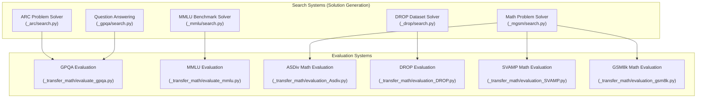
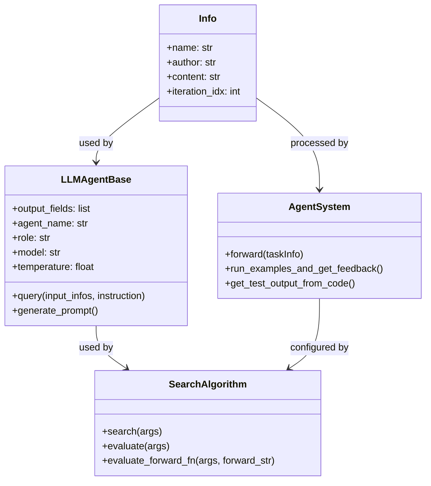
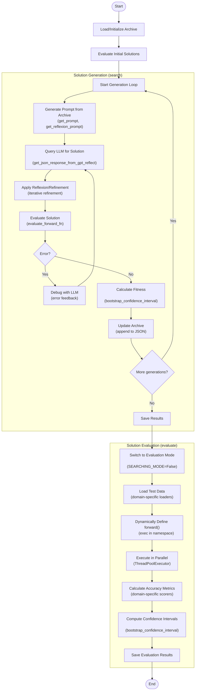
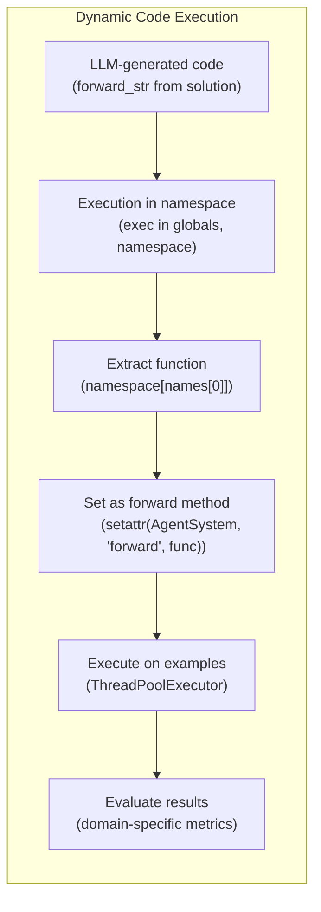
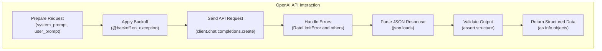

<!-- source: DeepWiki mcp.deepwiki.com · repo ShengranHu/ADAS · page 1 Overview · fetched 2026-10-26 -->

# Overview

Relevant source files

The following files were used as context for generating this wiki page:

- [_arc/search.py](_arc/search.py)
- [_drop/search.py](_drop/search.py)
- [_gpqa/search.py](_gpqa/search.py)
- [_mgsm/search.py](_mgsm/search.py)
- [_mmlu/search.py](_mmlu/search.py)

The Automated Diagnostic and Architecture System (ADAS) is a framework that implements evolutionary search algorithms using Large Language Models (LLMs) to generate, evaluate, and refine solutions for various AI tasks. This page provides a high-level introduction to the system architecture, core components, and supported problem domains.

For detailed information about the shared architectural patterns, see [Core Architecture](#2). For implementation details of specific problem solvers, see [Problem Solvers](#3).

## System Architecture Overview

ADAS is organized around two primary subsystems:

1. **Search Systems**: Generate and evolve solutions for specific problem domains
2. **Evaluation Systems**: Test the generated solutions on benchmark datasets

Sources: [_arc/search.py:1-447](), [_drop/search.py:1-362](), [_gpqa/search.py:1-380](), [_mgsm/search.py:1-361](), [_mmlu/search.py:1-389]()

## Core Components

The system is built around several shared components that provide common functionality across all problem domains:

Sources: [_arc/search.py:70-154](), [_arc/search.py:156-234](), [_arc/search.py:20-20](), [_arc/search.py:237-368]()

### Key Classes and Functions

1. **`LLMAgentBase`** - Base class for interacting with LLMs:
   - Handles prompt generation and formatting
   - Manages API interactions with error handling
   - Processes structured information using the `Info` class

2. **`AgentSystem`** - Executes and evaluates generated solutions:
   - Dynamically executes generated code
   - Provides feedback on solution performance
   - Tests solutions against benchmark datasets

3. **`Info`** - Named tuple for structured information exchange:
   - Organizes data between system components
   - Tracks authorship and iteration history

4. **Search Functions** - Core algorithm implementations:
   - `search()` - Generates and evolves solutions
   - `evaluate()` - Tests solutions on benchmark datasets
   - `evaluate_forward_fn()` - Dynamically executes and evaluates generated code

Sources: [_arc/search.py:70-154](), [_arc/search.py:156-234](), [_arc/search.py:20-20](), [_arc/search.py:237-368]()

## Problem Domains

ADAS supports multiple problem domains, each with dedicated search and evaluation components:

| Domain | Description | Main Search File | Evaluation Files |
|--------|-------------|------------------|------------------|
| **ARC** | Abstraction and Reasoning Corpus - visual reasoning puzzles | [_arc/search.py]() | Various evaluators |
| **DROP** | Discrete Reasoning Over Paragraphs - reading comprehension | [_drop/search.py]() | [_transfer_math/evaluation_DROP.py]() |
| **GPQA** | General Purpose Question Answering | [_gpqa/search.py]() | [_transfer_math/evaluate_gpqa.py]() |
| **MGSM** | Mathematical reasoning problems | [_mgsm/search.py]() | [_transfer_math/evaluation_gsm8k.py]() and others |
| **MMLU** | Massive Multitask Language Understanding benchmark | [_mmlu/search.py]() | [_transfer_math/evaluate_mmlu.py]() |

Sources: [_arc/search.py:1-447](), [_drop/search.py:1-362](), [_gpqa/search.py:1-380](), [_mgsm/search.py:1-361](), [_mmlu/search.py:1-389]()

## Solution Generation Workflow

The evolutionary search process follows this general workflow:

Sources: [_arc/search.py:237-331](), [_arc/search.py:333-367](), [_arc/search.py:369-418]()

## Dynamic Code Execution

A key feature of ADAS is its ability to dynamically execute and evaluate code generated by LLMs:

Sources: [_arc/search.py:369-418](), [_drop/search.py:278-332](), [_gpqa/search.py:277-352](), [_mgsm/search.py:278-332](), [_mmlu/search.py:279-359]()

## OpenAI API Integration

ADAS includes robust integration with the OpenAI API, featuring retry mechanisms and error handling:

Sources: [_arc/search.py:31-67](), [_drop/search.py:30-66](), [_gpqa/search.py:29-65](), [_mgsm/search.py:30-66](), [_mmlu/search.py:31-67]()

## Summary

ADAS implements an evolutionary approach to generating and refining solutions for various AI tasks using LLMs. The system:

1. **Generates** solutions using LLMs
2. **Evaluates** solutions on benchmark datasets
3. **Refines** solutions through reflection and feedback
4. **Archives** solutions for future reference and improvement

This architecture enables systematic improvement of LLM-based solutions across diverse problem domains, from visual reasoning (ARC) to reading comprehension (DROP) to mathematical problem-solving (MGSM).

Sources: [_arc/search.py:1-447](), [_drop/search.py:1-362](), [_gpqa/search.py:1-380](), [_mgsm/search.py:1-361](), [_mmlu/search.py:1-389]()

---

