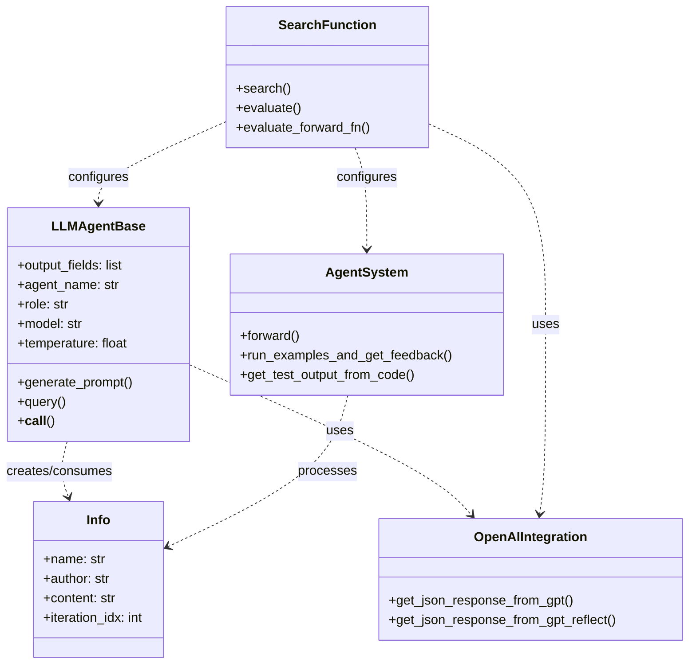
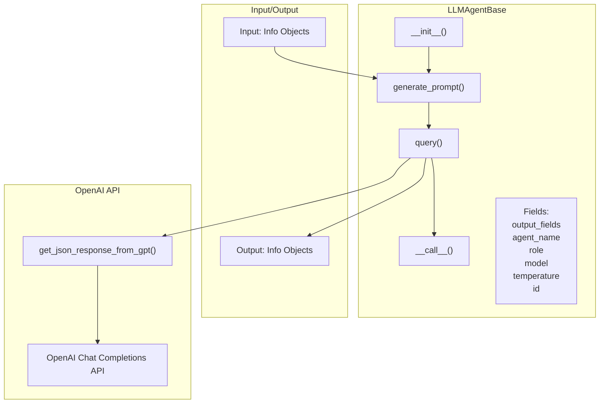
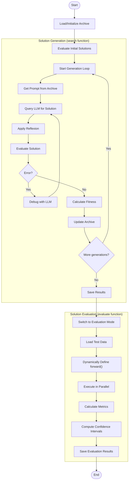
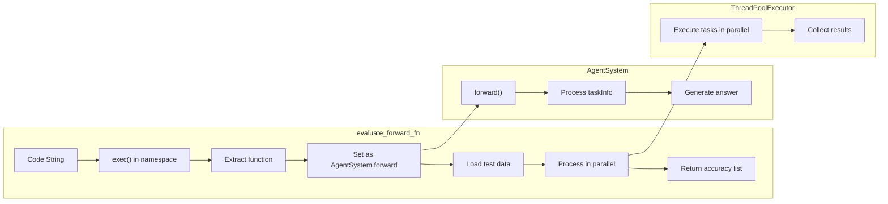
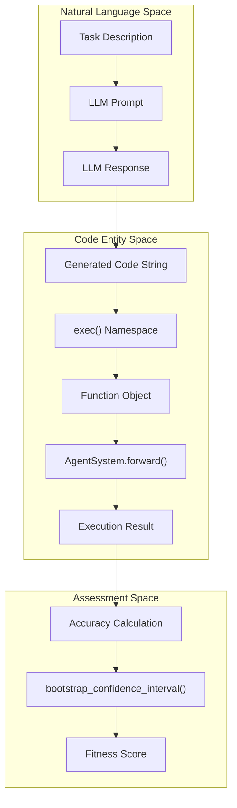
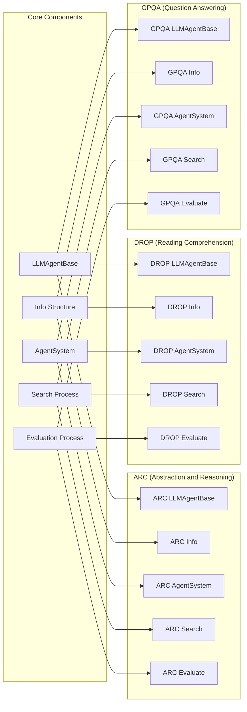

<!-- source: DeepWiki mcp.deepwiki.com · repo ShengranHu/ADAS · page 2 Core Architecture · fetched 2026-10-26 -->

# Core Architecture

<details>
<summary>Relevant source files</summary>

The following files were used as context for generating this wiki page:

- [_arc/search.py](_arc/search.py)
- [_drop/search.py](_drop/search.py)
- [_gpqa/search.py](_gpqa/search.py)

</details>


## Purpose and Scope

This document outlines the shared architectural components and design patterns that form the foundation of the ADAS (Automated Diagnostic and Architecture System) framework. The Core Architecture defines the base classes, interfaces, and utilities that power all problem-solving systems across various domains, from abstract reasoning to question answering and mathematical problem solving.

For specifics about the evolutionary search algorithm used to generate solutions, see [Evolutionary Search Algorithm](#2.1). For details on how LLM-generated code is executed, see [Dynamic Code Evaluation](#2.2).

## Key Components Overview



Sources: [_arc/search.py:20](), [_arc/search.py:31-67](), [_arc/search.py:70-154](), [_arc/search.py:156-234](), [_arc/search.py:237-367]()

## Core Components in Detail

### LLMAgentBase

The `LLMAgentBase` class provides the foundation for all LLM-based agents in the system. It manages interactions with language models and handles prompt construction.



Key responsibilities:
- Initializes with output field specifications, agent name, role, model, and temperature
- Generates structured prompts combining system instructions and input information
- Handles JSON response formatting and error recovery
- Wraps responses in `Info` objects for consistent information flow

Sources: [_arc/search.py:70-154](), [_drop/search.py:69-138](), [_gpqa/search.py:68-137]()

### AgentSystem

The `AgentSystem` class provides an execution environment for dynamically generated code and handles the evaluation of solutions.

Key features:
- Initialized with example problems and test inputs
- Executes LLM-generated code against examples to provide feedback
- Applies the generated code to test inputs to produce answers
- Manages execution errors and provides diagnostic information

Sources: [_arc/search.py:156-234](), [_drop/search.py:140-142](), [_gpqa/search.py:139-142]()

### Info Structure

The `Info` namedtuple provides a standardized way to represent structured information throughout the system:

```python
Info = namedtuple('Info', ['name', 'author', 'content', 'iteration_idx'])
```

Each field serves a specific purpose:
- `name`: Identifies the type of information (e.g., 'task', 'code', 'answer', 'feedback')
- `author`: Tracks who generated the information
- `content`: Contains the actual information content
- `iteration_idx`: Tracks which iteration of the evolutionary process produced this information

This structure enables consistent information exchange between components and tracking of solution evolution.

Sources: [_arc/search.py:20](), [_drop/search.py:20](), [_gpqa/search.py:19]()

### OpenAI Integration

The system integrates with OpenAI's API through two key functions:

1. `get_json_response_from_gpt`: Sends a single prompt to the API and returns a JSON response
2. `get_json_response_from_gpt_reflect`: Sends a conversation history to enable reflection and refinement

Both functions include:
- Exponential backoff for rate limit handling using the `@backoff.on_exception` decorator
- JSON response format enforcement
- Error handling and validation

Sources: [_arc/search.py:31-67](), [_drop/search.py:30-66](), [_gpqa/search.py:29-65]()

## Search and Evaluation Process



The search and evaluation process follows these key steps:

1. **Archive Initialization and Management**:
   - Loads existing archive or initializes with predefined solutions
   - Each solution in the archive contains code, fitness metrics, and metadata

2. **Solution Generation**:
   - Creates prompts based on the current archive
   - Queries the LLM to generate a new solution
   - Applies reflexion prompts to refine the solution

3. **Solution Evaluation**:
   - Dynamically executes the generated code
   - Computes fitness metrics using bootstrap confidence intervals
   - Tracks solution performance

4. **Archive Updates**:
   - Adds new solutions to the archive
   - Maintains solution history for reference and evolution

Sources: [_arc/search.py:237-367](), [_drop/search.py:145-276](), [_gpqa/search.py:144-275]()

## Dynamic Code Execution



The dynamic code execution mechanism follows these steps:

1. **Function Definition**:
   - The `evaluate_forward_fn` takes LLM-generated code as a string
   - Uses Python's `exec()` to evaluate the code in a controlled namespace
   - Extracts the defined function (typically named `transform` or similar)
   - Dynamically assigns this function as `AgentSystem.forward`

2. **Data Loading and Processing**:
   - Loads task data appropriate for the current domain
   - Creates `AgentSystem` instances and task information
   - Prepares the processing queue

3. **Parallel Execution**:
   - Uses `ThreadPoolExecutor` to process tasks in parallel
   - Handles errors and exceptions at the task level
   - Collects and aggregates results

4. **Confidence Calculation**:
   - Applies bootstrap confidence intervals to compute solution fitness
   - Provides statistical robustness to the evaluation

Sources: [_arc/search.py:369-418](), [_drop/search.py:278-332](), [_gpqa/search.py:277-352]()

## Natural Language to Code Transformation



The system bridges natural language instructions and executable code through:

1. **Prompt Engineering**:
   - Formats task descriptions into structured prompts
   - Includes system instructions and format specifications
   - Incorporates previous solutions for evolutionary improvement

2. **Code Generation**:
   - LLM generates Python code based on the prompt
   - Code is designed to implement a specific transformation or solution strategy
   - The main function (usually named based on the domain) processes input information

3. **Dynamic Assignment**:
   - Code is dynamically executed and assigned to `AgentSystem.forward`
   - This creates a callable interface between natural language instructions and executable code

4. **Evaluation and Feedback**:
   - Results are evaluated and feedback is provided
   - This feedback forms the basis for future generations

Sources: [_arc/search.py:31-154](), [_arc/search.py:369-418](), [_drop/search.py:278-332](), [_gpqa/search.py:277-352]()

## Common Utilities and Patterns

### Error Handling and Rate Limiting

The system incorporates robust error handling and rate limiting mechanisms:

- **Backoff Decorator**: Uses `@backoff.on_exception` to handle OpenAI API rate limits
- **Dynamic Error Recovery**: Attempts to recover from LLM response format errors
- **Code Execution Safety**: Isolates code execution in controlled namespaces
- **Debug Loops**: Implements debugging loops to refine solutions when execution errors occur

### Parallel Processing

Parallel processing is used to efficiently evaluate solutions:

- **ThreadPoolExecutor**: Processes multiple examples in parallel
- **Configurable Workers**: Adjusts the number of workers based on problem size and available resources
- **Progress Tracking**: Uses `tqdm` to provide progress feedback

### Confidence Calculation

Statistical robustness is ensured through:

- **Bootstrap Confidence Intervals**: Calculates confidence intervals to assess solution reliability
- **Multiple Evaluations**: Runs multiple evaluations to ensure consistent performance
- **Fitness Reporting**: Reports fitness as statistical measures rather than point estimates

Sources: [_arc/search.py:31-67](), [_arc/search.py:414-418](), [_drop/search.py:315-332](), [_gpqa/search.py:311-352]()

## Component Reuse Across Problem Domains



The core architecture components are reused across different problem domains with domain-specific adaptations:

| Component | Implementation | Domain-Specific Customization |
|-----------|----------------|-------------------------------|
| LLMAgentBase | [_arc/search.py:70-154]() | Output format, temperature, prompt structure |
| AgentSystem | [_arc/search.py:156-234]() | Run examples, test outputs, error handling |
| Info Structure | [_arc/search.py:20]() | Consistent across domains |
| Search Process | [_arc/search.py:237-332]() | Archive structure, solution format |
| Evaluation | [_arc/search.py:333-418]() | Domain-specific metrics, data formats |

Sources: [_arc/search.py](), [_drop/search.py](), [_gpqa/search.py]()

## Summary

The Core Architecture of ADAS provides a flexible, extensible framework for developing LLM-powered problem-solving systems. By separating concerns into distinct components and providing consistent interfaces between them, the architecture enables:

1. Reuse of common components across different problem domains
2. Consistent handling of LLM interactions, error recovery, and rate limiting
3. Evolutionary improvement of solutions through structured search and evaluation
4. Dynamic execution of LLM-generated code in controlled environments
5. Statistical evaluation of solution quality

These core components form the foundation upon which domain-specific solvers are built, allowing the system to address a wide range of problem types with minimal duplication of effort.

---

