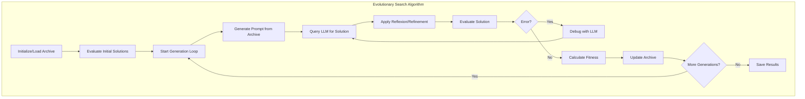
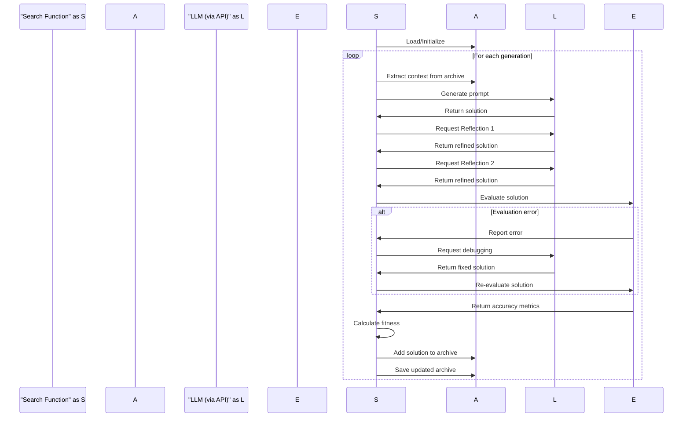
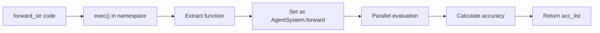

<!-- source: DeepWiki mcp.deepwiki.com · repo ShengranHu/ADAS · page 2.1 Evolutionary Search Algorithm · fetched 2026-10-26 -->

# Evolutionary Search Algorithm

<details>
<summary>Relevant source files</summary>

The following files were used as context for generating this wiki page:

- [_arc/search.py](_arc/search.py)
- [_gpqa/search.py](_gpqa/search.py)
- [_mgsm/search.py](_mgsm/search.py)

</details>


## Purpose and Scope

This document details the evolutionary search algorithm that serves as the core component of the ADAS (Automated Diagnostic and Architecture System). This algorithm is responsible for generating, evaluating, and iteratively improving solutions across different problem domains. The evolutionary search process systematically builds an archive of increasingly effective solutions by leveraging Large Language Models (LLMs) as the mutation and generation engine.

For information about how the dynamically generated code is executed, see [Dynamic Code Evaluation](#2.2).

## Algorithm Overview

The evolutionary search algorithm maintains an archive of solutions, each with associated fitness metrics. It iteratively generates new solutions based on the current archive, evaluates them, and adds promising candidates to the archive. The process continues for a specified number of generations, with each solution being refined through reflection and debugging steps when necessary.



Sources: [_arc/search.py:237-331](), [_gpqa/search.py:144-240](), [_mgsm/search.py:145-241]()

## Core Components

### Search Function

The `search()` function is the primary entry point for the evolutionary search algorithm. It manages the generation loop, archive updates, and the overall search process.

```mermaid
classDiagram
    class "search()" {
        +Load/Initialize Archive
        +Evaluate Initial Solutions
        +Generation Loop
        +Fitness Calculation
        +Archive Management
    }
    
    class "get_json_response_from_gpt_reflect()" {
        +API Interaction
        +Rate Limit Handling
        +JSON Response Parsing
    }
    
    class "evaluate_forward_fn()" {
        +Dynamic Code Execution
        +Parallel Evaluation
        +Accuracy Calculation
    }
    
    class "get_prompt()" {
        +Archive Analysis
        +Prompt Construction
    }
    
    class "get_reflexion_prompt()" {
        +Refinement Guidance
    }
    
    "search()" --> "get_json_response_from_gpt_reflect()"
    "search()" --> "evaluate_forward_fn()"
    "search()" --> "get_prompt()"
    "search()" --> "get_reflexion_prompt()"
```

Sources: [_arc/search.py:237-331](), [_gpqa/search.py:144-240](), [_mgsm/search.py:145-241]()

### Archive Structure

The archive is a JSON file containing an array of solution objects. Each solution includes:

| Field | Description |
|-------|-------------|
| `name` | Solution identifier |
| `thought` | Reasoning behind the solution |
| `code` | The implementation code (Python function) |
| `generation` | Generation number or "initial" |
| `fitness` | Bootstrap confidence interval of accuracy |

The archive preserves the evolutionary history and provides context for generating new solutions.

Sources: [_arc/search.py:238-269](), [_gpqa/search.py:145-176](), [_mgsm/search.py:146-177]()

## Search Process Workflow

### Initialization

The search process begins by either loading an existing archive or initializing a new one with predefined solutions.

```python
file_path = os.path.join(args.save_dir, f"{args.expr_name}_run_archive.json")
if os.path.exists(file_path):
    with open(file_path, 'r') as json_file:
        archive = json.load(json_file)
    # Determine starting generation
    start = archive[-1]['generation'] if "generation" in archive[-1] else 0
else:
    archive = get_init_archive()
    start = 0
```

Initial solutions are evaluated to establish baseline fitness metrics.

Sources: [_arc/search.py:238-246](), [_gpqa/search.py:145-155](), [_mgsm/search.py:146-156]()

### Generation Loop

For each generation, the algorithm:

1. Generates a prompt based on the current archive
2. Queries an LLM to create a new solution
3. Applies reflection and refinement steps
4. Evaluates the solution and calculates fitness
5. Adds the solution to the archive



Sources: [_arc/search.py:271-330](), [_gpqa/search.py:179-239](), [_mgsm/search.py:179-240]()

### Solution Generation and Reflection

The solution generation process relies on:

1. Constructing a prompt from the archive using `get_prompt()`
2. Querying the LLM for a new solution
3. Applying two rounds of reflection using `get_reflexion_prompt()`

This reflection mechanism allows the LLM to reconsider and refine its solution.

```python
system_prompt, prompt = get_prompt(archive)
msg_list = [
    {"role": "system", "content": system_prompt},
    {"role": "user", "content": prompt},
]
next_solution = get_json_response_from_gpt_reflect(msg_list, args.model)

Reflexion_prompt_1, Reflexion_prompt_2 = get_reflexion_prompt(archive[-1] if n > 0 else None)
# Reflexion 1
msg_list.append({"role": "assistant", "content": str(next_solution)})
msg_list.append({"role": "user", "content": Reflexion_prompt_1})
next_solution = get_json_response_from_gpt_reflect(msg_list, args.model)
# Reflexion 2
msg_list.append({"role": "assistant", "content": str(next_solution)})
msg_list.append({"role": "user", "content": Reflexion_prompt_2})
next_solution = get_json_response_from_gpt_reflect(msg_list, args.model)
```

Sources: [_arc/search.py:273-289](), [_gpqa/search.py:180-196](), [_mgsm/search.py:181-197]()

### Error Handling and Debugging

If evaluation fails, the algorithm enters a debugging loop:

1. Capture the error message
2. Send the error to the LLM with a debugging prompt
3. Receive a fixed solution
4. Retry evaluation

This continues for a specified number of attempts (`debug_max`).

```python
for _ in range(args.debug_max):
    try:
        acc_list = evaluate_forward_fn(args, next_solution["code"])
        if np.mean(acc_list) < 0.01 and SEARCHING_MODE:
            raise Exception("All 0 accuracy")
        break
    except Exception as e:
        print("During evaluation:")
        print(e)
        msg_list.append({"role": "assistant", "content": str(next_solution)})
        msg_list.append({"role": "user", "content": f"Error during evaluation:\n{e}\nCarefully consider where you went wrong in your latest implementation. Using insights from previous attempts, try to debug the current code to implement the same thought. Repeat your previous thought in 'thought', and put your thinking for debugging in 'debug_thought'"})
        try:
            next_solution = get_json_response_from_gpt_reflect(msg_list, args.model)
        except Exception as e:
            print("During LLM generate new solution:")
            print(e)
            continue
```

Sources: [_arc/search.py:295-316](), [_gpqa/search.py:203-224](), [_mgsm/search.py:204-225]()

### Fitness Calculation

Fitness is calculated using bootstrap confidence intervals on accuracy metrics:

```python
fitness_str = bootstrap_confidence_interval(acc_list)
next_solution['fitness'] = fitness_str
next_solution['generation'] = n + 1
```

This provides a statistical measure of solution quality with confidence bounds.

Sources: [_arc/search.py:317-319](), [_gpqa/search.py:226-228](), [_mgsm/search.py:227-229]()

## Solution Evaluation

### Dynamic Code Execution

The `evaluate_forward_fn()` function handles dynamic execution of solution code:

1. Executes the code string in a controlled namespace
2. Extracts the generated function
3. Sets it as the `forward` method of `AgentSystem`
4. Evaluates it on benchmark problems in parallel
5. Returns accuracy metrics



Sources: [_arc/search.py:369-418](), [_gpqa/search.py:277-352](), [_mgsm/search.py:278-332]()

### Parallel Evaluation

The evaluation process uses `ThreadPoolExecutor` to parallelize solution testing:

```python
with ThreadPoolExecutor(max_workers=max_workers) as executor:
    acc_list = list(tqdm(executor.map(call_forward, agent_task_queue), total=len(agent_task_queue)))
```

This allows efficient evaluation across multiple test cases simultaneously.

Sources: [_arc/search.py:414-415](), [_gpqa/search.py:311-312](), [_mgsm/search.py:315-316]()

## LLM Integration

### API Interaction

The system interacts with OpenAI's API through two key functions:

1. `get_json_response_from_gpt()` - For standard queries
2. `get_json_response_from_gpt_reflect()` - For reflection-based interactions

Both functions incorporate error handling and rate limit management through the `@backoff` decorator.

```python
@backoff.on_exception(backoff.expo, openai.RateLimitError)
def get_json_response_from_gpt_reflect(
        msg_list,
        model,
        temperature=0.8
):
    response = client.chat.completions.create(
        model=model,
        messages=msg_list,
        temperature=temperature, max_tokens=4096, stop=None, response_format={"type": "json_object"}
    )
    content = response.choices[0].message.content
    json_dict = json.loads(content)
    assert not json_dict is None
    return json_dict
```

Sources: [_arc/search.py:31-67](), [_gpqa/search.py:29-65](), [_mgsm/search.py:30-66]()

## Implementation Across Problem Domains

The evolutionary search algorithm is implemented consistently across different problem domains:

| Domain | File | Purpose |
|--------|------|---------|
| ARC | `_arc/search.py` | Abstraction and Reasoning Corpus problems |
| GPQA | `_gpqa/search.py` | General-purpose question answering |
| MGSM | `_mgsm/search.py` | Mathematical problem-solving |

While the core algorithm remains consistent, domain-specific adaptations exist in:
- Initialization archives via domain-specific `get_init_archive()`
- Prompt generation via domain-specific `get_prompt()` and `get_reflexion_prompt()`
- Evaluation methodologies for different problem types

Sources: [_arc/search.py](), [_gpqa/search.py](), [_mgsm/search.py]()

## Integration with Support Classes

### `LLMAgentBase` Class

The `LLMAgentBase` class provides the foundation for LLM-based agents:

```mermaid
classDiagram
    class "LLMAgentBase" {
        +output_fields: list
        +agent_name: str
        +role: str
        +model: str
        +temperature: float
        +generate_prompt()
        +query()
        +__call__()
    }
    
    class "Info" {
        +name: str
        +author: str
        +content: str
        +iteration_idx: int
    }
    
    "LLMAgentBase" ..> "Info" : creates/returns
```

This class handles prompt generation and LLM interaction, providing a consistent interface for the evolutionary search algorithm.

Sources: [_arc/search.py:70-153](), [_gpqa/search.py:68-137](), [_mgsm/search.py:69-138]()

### `AgentSystem` Class

The `AgentSystem` class serves as the execution environment for solutions:

- In ARC: Handles example evaluation and test execution
- In GPQA/MGSM: Provides the foundation for solution execution

The dynamic modification of this class's `forward` method enables flexible solution evaluation.

Sources: [_arc/search.py:156-234](), [_gpqa/search.py:139-142](), [_mgsm/search.py:140-143]()

## Conclusion

The evolutionary search algorithm forms the backbone of the ADAS system, providing a flexible and powerful approach to generating and refining solutions across diverse problem domains. By leveraging LLMs within an evolutionary framework, the system can iteratively improve solution quality while maintaining a diverse archive of approaches.

---

