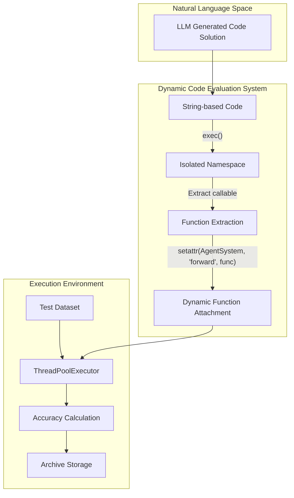
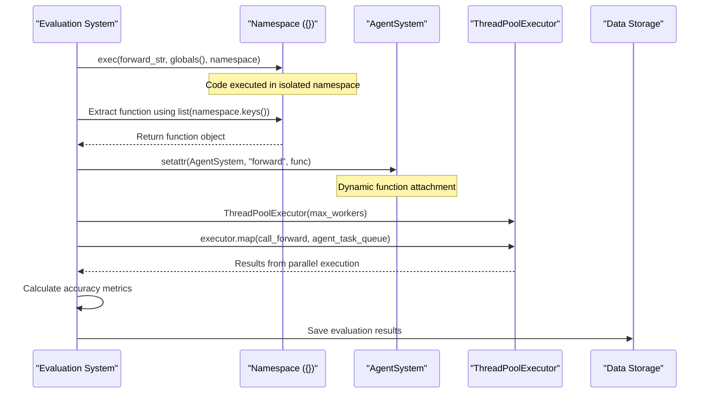
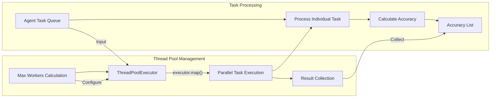
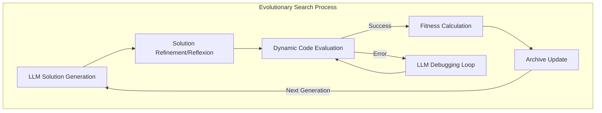

<!-- source: DeepWiki mcp.deepwiki.com · repo ShengranHu/ADAS · page 2.2 Dynamic Code Evaluation · fetched 2026-10-26 -->

# Dynamic Code Evaluation

<details>
<summary>Relevant source files</summary>

The following files were used as context for generating this wiki page:

- [_arc/search.py](_arc/search.py)
- [_transfer_math/evaluate_gpqa.py](_transfer_math/evaluate_gpqa.py)
- [_transfer_math/evaluate_mmlu.py](_transfer_math/evaluate_mmlu.py)

</details>


## Purpose and Scope

This page documents the dynamic code evaluation system within ADAS, which enables the framework to safely execute, test, and evaluate code solutions generated by Large Language Models (LLMs). This mechanism serves as a critical bridge between the solution generation process (detailed in [Evolutionary Search Algorithm](#2.1)) and the various evaluation systems that assess solution performance across different domains.

The dynamic code evaluation system is responsible for:
1. Converting string-based code solutions into executable Python functions
2. Attaching these functions to the appropriate agent systems
3. Safely executing them against test datasets
4. Collecting and analyzing performance metrics

Sources: [_arc/search.py:369-418](), [_transfer_math/evaluate_gpqa.py:159-234](), [_transfer_math/evaluate_mmlu.py:161-241]()

## System Architecture



Sources: [_arc/search.py:369-380](), [_transfer_math/evaluate_gpqa.py:159-172](), [_transfer_math/evaluate_mmlu.py:161-172]()

## Core Mechanism

The dynamic code evaluation mechanism centers around the `evaluate_forward_fn` function, which is implemented with slight variations across different problem domains. The function takes a string representation of code (typically containing a function definition) and executes it in a controlled environment.

### Key Steps in the Process



Sources: [_arc/search.py:369-380](), [_arc/search.py:399-418]()

### Isolation and Function Extraction

The system creates an isolated namespace using an empty dictionary and executes the code string within this environment. This provides a controlled context for code execution while ensuring that the main program space remains unaffected.

```python
namespace = {}
exec(forward_str, globals(), namespace)
```

After execution, the function extracts the defined function object:

```python
names = list(namespace.keys())
if len(names) != 1:
    raise AssertionError(f"{len(names)} things in namespace. Please only provide 1")
func = namespace[names[0]]
if not callable(func):
    raise AssertionError(f"{func} is not callable")
```

Sources: [_arc/search.py:372-379](), [_transfer_math/evaluate_gpqa.py:162-169](), [_transfer_math/evaluate_mmlu.py:164-171]()

## Dynamic Function Attachment

Once the function is extracted and validated, it's dynamically attached to the `AgentSystem` class using Python's `setattr` function:

```python
setattr(AgentSystem, "forward", func)
```

This makes the LLM-generated code accessible through the standard agent interface, allowing it to be called like any other method of the `AgentSystem` class.

Sources: [_arc/search.py:380](), [_transfer_math/evaluate_gpqa.py:170](), [_transfer_math/evaluate_mmlu.py:172]()

## Task-Specific Execution

Each domain-specific evaluator builds a task queue and executes the dynamically attached function against appropriate test examples:

### ARC Problem Execution

For ARC problems, the system:
1. Loads test examples from pickle files
2. Creates agent-task pairs
3. Executes the attached function on each task
4. Evaluates the generated output against expected solutions

Sources: [_arc/search.py:382-416]()

### Question-Answering Execution

For GPQA and MMLU tasks, the system:
1. Formats question-answering tasks
2. Creates task info objects
3. Executes the function on each task
4. Interprets responses to extract letter choices (A, B, C, D)
5. Compares with expected answers

Sources: [_transfer_math/evaluate_gpqa.py:172-233](), [_transfer_math/evaluate_mmlu.py:174-240]()

## Parallel Execution

The system leverages Python's `ThreadPoolExecutor` to parallelize the evaluation process, significantly reducing the time required to assess solutions across multiple test examples:



Sources: [_arc/search.py:390-399](), [_arc/search.py:414-415](), [_transfer_math/evaluate_gpqa.py:193-194](), [_transfer_math/evaluate_mmlu.py:200-201]()

## Error Handling and Validation

The system implements extensive error handling to ensure robustness:

1. **Code Execution Validation**: Checks if the executed code produces a valid function
2. **Function Callability**: Verifies that the extracted object is actually callable
3. **Execution Error Recovery**: Captures and reports exceptions during function execution
4. **Result Interpretation**: Gracefully handles format inconsistencies in function outputs

### Error Handling Process Table

| Error Type | Detection Mechanism | Recovery Action | Impact |
|------------|---------------------|-----------------|--------|
| Multiple objects in namespace | `len(names) != 1` | Raise AssertionError | Execution halted |
| Non-callable object | `not callable(func)` | Raise AssertionError | Execution halted |
| Runtime errors in function | `try-except` blocks | Record failure, continue | Individual test marked incorrect |
| Result format inconsistencies | Type checking and parsing | Default to incorrect answer | Individual test marked incorrect |

Sources: [_arc/search.py:375-379](), [_transfer_math/evaluate_gpqa.py:166-170](), [_transfer_math/evaluate_mmlu.py:167-172]()

## Fitness Calculation

After execution, the system calculates fitness metrics using bootstrap confidence intervals:

```python
fitness_str = bootstrap_confidence_interval(acc_list)
```

This provides statistical rigor when evaluating solution performance, accounting for variance in the evaluation process.

Sources: [_arc/search.py:263-264](), [_arc/search.py:417](), [_transfer_math/evaluate_gpqa.py:233](), [_transfer_math/evaluate_mmlu.py:240]()

## Integration with Evolutionary Search

The dynamic code evaluation system is tightly integrated with the evolutionary search process:

1. During the search phase, generated solutions are evaluated to determine their fitness
2. Solutions with higher fitness are retained in the archive
3. Errors during evaluation trigger debugging refinements via the LLM
4. The final archive contains solutions ranked by their performance



Sources: [_arc/search.py:237-330]()

## Best Practices for Solution Implementation

For LLM-generated solutions to work effectively with the dynamic code evaluation system:

1. **Single Function Definition**: Code should define exactly one function
2. **Proper Function Signature**: The function should accept and return appropriate data types
3. **Self-Contained Logic**: All necessary logic should be contained within the function
4. **No External Dependencies**: The function should not rely on external libraries not available in the evaluation environment
5. **No Side Effects**: The function should not modify global state or external resources

Sources: [_arc/search.py:374-379](), [_transfer_math/evaluate_gpqa.py:165-170](), [_transfer_math/evaluate_mmlu.py:166-172]()

## Domain-Specific Adaptations

The dynamic code evaluation system is adapted for different problem domains:

### ARC Problems
- Evaluates grid transformation functions
- Tests code against grid-based puzzles
- Verifies exact matches with expected outputs

### Question Answering (GPQA, MMLU)
- Evaluates answer selection functions
- Interprets various response formats to extract letter choices
- Compares selected answers against ground truth

This flexible architecture allows the same core mechanism to handle diverse task types while maintaining consistent evaluation procedures.

Sources: [_arc/search.py:382-416](), [_transfer_math/evaluate_gpqa.py:172-234](), [_transfer_math/evaluate_mmlu.py:174-241]()

## Conclusion

The Dynamic Code Evaluation system is a critical component that bridges the gap between LLM-generated code solutions and the automated evaluation of their performance. By safely executing code in controlled environments, dynamically attaching functions to agent systems, and rigorously testing them against benchmark datasets, this system enables the automated improvement of AI solutions through evolutionary search processes.

---

