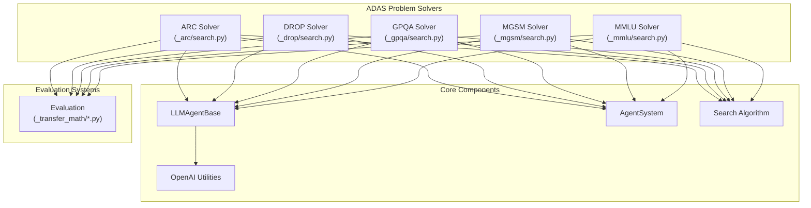
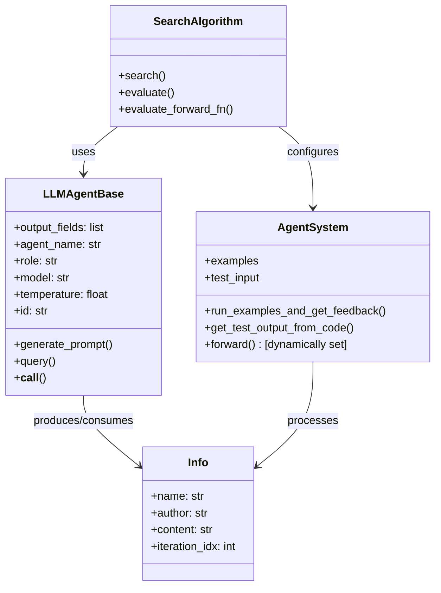
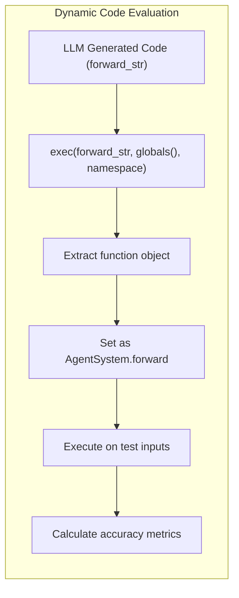
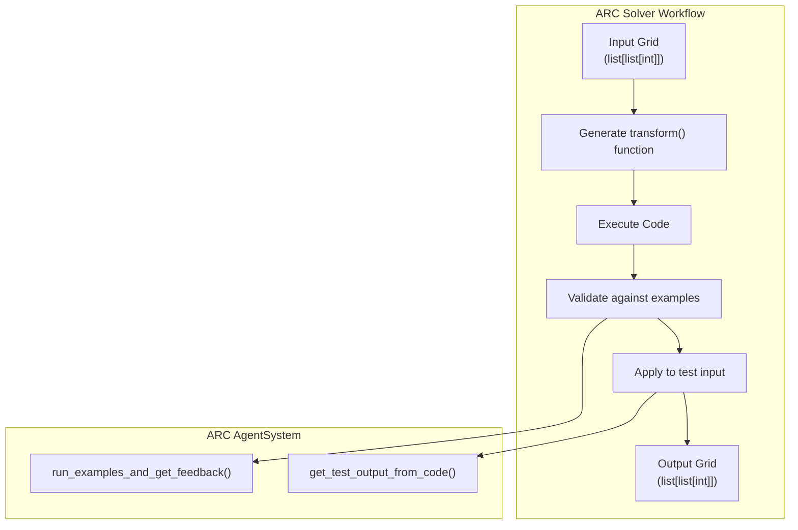
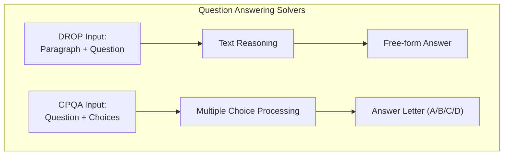
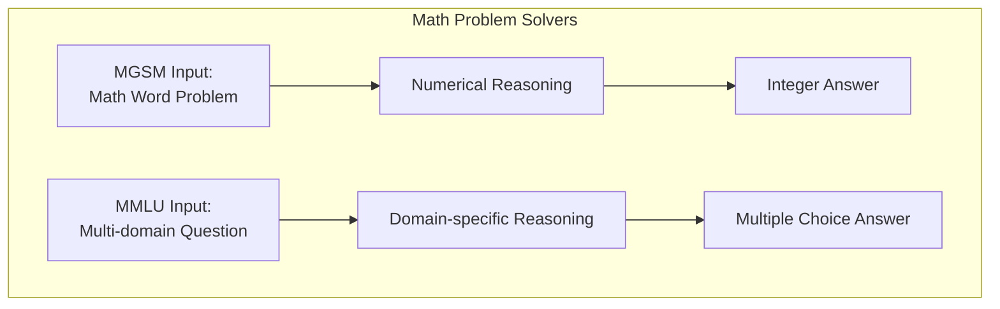
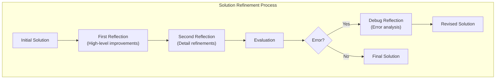

<!-- source: DeepWiki mcp.deepwiki.com · repo ShengranHu/ADAS · page 3 Problem Solvers · fetched 2026-10-26 -->

# Problem Solvers

<details>
<summary>Relevant source files</summary>

The following files were used as context for generating this wiki page:

- [_arc/search.py](_arc/search.py)
- [_drop/search.py](_drop/search.py)
- [_gpqa/search.py](_gpqa/search.py)
- [_mgsm/search.py](_mgsm/search.py)
- [_mmlu/search.py](_mmlu/search.py)

</details>


This document provides an overview of the various problem-solving systems within the ADAS repository. It describes the architecture, workflow, and implementation details of the solvers designed for different problem domains. For information about how these solvers are evaluated, see [Evaluation Systems](#4).

## Overview

The ADAS repository contains specialized problem solvers for tackling tasks across various domains. Each solver follows a common architecture but is tailored to specific problem types:

1. **ARC Solver** - Handles the Abstraction and Reasoning Corpus tasks (most important)
2. **DROP Solver** - Addresses the Discrete Reasoning Over Paragraphs dataset
3. **GPQA Solver** - Solves General Purpose Question Answering tasks
4. **MGSM Solver** - Tackles mathematical reasoning problems
5. **MMLU Solver** - Works on Massive Multitask Language Understanding benchmarks

All problem solvers implement an evolutionary search approach that iteratively generates, refines, and evaluates solutions using large language models.

Sources: [_arc/search.py:1-447](), [_drop/search.py:1-362](), [_gpqa/search.py:1-380](), [_mgsm/search.py:1-361](), [_mmlu/search.py:1-389]()

## Problem Solver Architecture

### Problem Solvers in Context



Sources: [_arc/search.py:31-153](), [_drop/search.py:30-138](), [_gpqa/search.py:30-138](), [_mgsm/search.py:30-138](), [_mmlu/search.py:30-138]()

### Common Components

All problem solvers share key architectural components:

1. **LLMAgentBase** - Base class for LLM-powered agents that generate solutions
2. **AgentSystem** - Framework for executing and evaluating generated code
3. **Search Algorithm** - Evolutionary search process for solution generation and refinement
4. **Evaluation** - Mechanisms to test and score generated solutions

The problem solvers use two main OpenAI API interaction functions:
- `get_json_response_from_gpt()` - Standard query to the LLM
- `get_json_response_from_gpt_reflect()` - Supports iterative reflection and refinement



Sources: [_arc/search.py:70-153](), [_drop/search.py:69-138](), [_gpqa/search.py:68-138](), [_mgsm/search.py:68-138](), [_mmlu/search.py:68-138]()

## Search Workflow

Each problem solver follows a similar workflow:

```mermaid
flowchart TD
    Start([Start]) --> LoadArchive[Load/Initialize Archive]
    LoadArchive --> EvalInitialArchive[Evaluate Initial Solutions]
    EvalInitialArchive --> GenerationLoop[Start Generation Loop]
    
    subgraph "Solution Generation"
        GenerationLoop --> GeneratePrompt[Generate Prompt from Archive]
        GeneratePrompt --> QueryLLM[Query LLM for Solution]
        QueryLLM --> Reflexion1[First Reflexion]
        Reflexion1 --> Reflexion2[Second Reflexion]
        Reflexion2 --> EvaluateSolution[Evaluate Solution]
        EvaluateSolution --> ErrorCheck{Error?}
        ErrorCheck -->|Yes| Debug[Debug with LLM]
        Debug --> QueryLLM
        ErrorCheck -->|No| CalculateFitness[Calculate Fitness]
        CalculateFitness --> UpdateArchive[Update Archive]
        UpdateArchive --> NextGeneration{More\ngenerations?}
        NextGeneration -->|Yes| GenerationLoop
        NextGeneration -->|No| SaveResults[Save Results]
    end
    
    SaveResults --> EvalMode[Switch to Evaluation Mode]
    
    subgraph "Solution Evaluation"
        EvalMode --> LoadTestData[Load Test Data]
        LoadTestData --> DefineForward[Define forward() Function]
        DefineForward --> RunInParallel[Run in Parallel]
        RunInParallel --> CalculateMetrics[Calculate Metrics]
        CalculateMetrics --> ConfidenceIntervals[Compute Confidence Intervals]
        ConfidenceIntervals --> SaveEvalResults[Save Evaluation Results]
    end
    
    SaveEvalResults --> End([End])
```

Sources: [_arc/search.py:237-366](), [_drop/search.py:145-276](), [_gpqa/search.py:144-275](), [_mgsm/search.py:145-276](), [_mmlu/search.py:146-276]()

## Dynamic Code Execution

A key feature of all problem solvers is the dynamic execution of LLM-generated code:



Sources: [_arc/search.py:369-418](), [_drop/search.py:278-332](), [_gpqa/search.py:277-352](), [_mgsm/search.py:278-331](), [_mmlu/search.py:279-358]()

## Domain-Specific Solvers

### ARC Problem Solver

The ARC (Abstraction and Reasoning Corpus) solver is the most important component of the ADAS system. It tackles abstract visual reasoning tasks where the system must identify and apply a transformation rule from examples, then apply it to novel test inputs.

Key characteristics of the ARC solver:
- Works with grid-based inputs and outputs represented as nested lists of integers
- Generates Python code that defines a `transform` function
- Tests solutions against example inputs to verify correctness
- Produces solutions that can generalize to unseen test cases



Sources: [_arc/search.py:156-234]()

### Question Answering Solvers

#### DROP Solver

The DROP (Discrete Reasoning Over Paragraphs) solver addresses reading comprehension tasks that require discrete reasoning:

- Input: Paragraph text and a question
- Output: An answer extracted or derived from the paragraph
- Evaluation: F1 score between predicted and correct answers

#### GPQA Solver

The GPQA (General Purpose Question Answering) solver handles multiple-choice questions:

- Input: Question text and four answer choices (A, B, C, D)
- Output: A single letter corresponding to the correct answer
- Evaluation: Accuracy score (correct/total)



Sources: [_drop/search.py:140-143](), [_gpqa/search.py:139-142]()

### Math Problem Solvers

#### MGSM Solver

The MGSM (Math GSM) solver tackles mathematical word problems:

- Input: Math word problem text
- Output: Numerical answer (integer)
- Evaluation: Exact match against correct solution

#### MMLU Solver

While MMLU (Massive Multitask Language Understanding) covers multiple domains, its math component handles multiple-choice math problems:

- Input: Question and four choices
- Output: Letter corresponding to the correct answer
- Evaluation: Accuracy score across various subject domains



Sources: [_mgsm/search.py:140-143](), [_mmlu/search.py:141-144]()

## Solution Generation

All solvers employ an evolutionary search approach to generate and refine solutions:

1. **Archive Initialization**: Load or create initial solution archive
2. **Evaluation Loop**: Evaluate solutions from the archive
3. **Generation Loop**: For each generation:
   - Generate prompt using the archive
   - Query LLM to generate solution
   - Apply reflexion for refinement
   - Evaluate solution through dynamic code execution
   - Debug if necessary
   - Calculate fitness
   - Update archive with new solution
4. **Final Evaluation**: Test solutions on evaluation datasets

### Reflexion and Debugging

A key aspect of the solution generation is the reflective debugging process:



The refinement process involves:
1. First reflection - High-level assessment of the solution approach
2. Second reflection - Detailed refinements to the implementation
3. Error-driven debugging - If evaluation fails, provide error information to the LLM for debugging

Sources: [_arc/search.py:280-289](), [_drop/search.py:189-197](), [_gpqa/search.py:188-196](), [_mgsm/search.py:189-197](), [_mmlu/search.py:190-198]()

## Parallel Evaluation

For efficient evaluation, all problem solvers use parallel processing:

```
With ThreadPoolExecutor(max_workers=max_workers) as executor:
    results = list(tqdm(executor.map(function, inputs), total=len(inputs)))
```

The parallel evaluation approach:
1. Creates a pool of worker threads (configurable maximum)
2. Maps the forward function over all task inputs
3. Processes results in parallel to calculate metrics
4. Computes bootstrap confidence intervals for robust performance estimates

Sources: [_arc/search.py:414-415](), [_drop/search.py:315-316](), [_gpqa/search.py:311-312](), [_mgsm/search.py:315-316](), [_mmlu/search.py:318-319]()

## Configuration and Usage

Each problem solver accepts configuration parameters through command-line arguments:

| Parameter | Description |
|-----------|-------------|
| `--data_filename` | Path to dataset file |
| `--valid_size` | Number of validation examples |
| `--test_size` | Number of test examples |
| `--n_repreat` | Number of repetitions for evaluation |
| `--multiprocessing` | Whether to use parallel processing |
| `--max_workers` | Maximum number of worker threads |
| `--save_dir` | Directory to save results |
| `--expr_name` | Experiment name |
| `--n_generation` | Number of generations for evolution |
| `--debug_max` | Maximum number of debug attempts |
| `--model` | LLM model to use (e.g., gpt-4o-2024-05-13) |

Sources: [_arc/search.py:422-437](), [_drop/search.py:336-351](), [_gpqa/search.py:356-371](), [_mgsm/search.py:336-351](), [_mmlu/search.py:363-379]()

---

