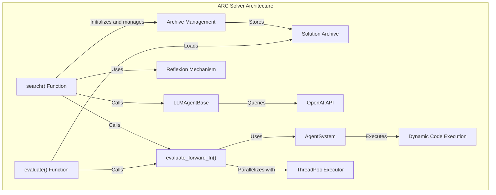
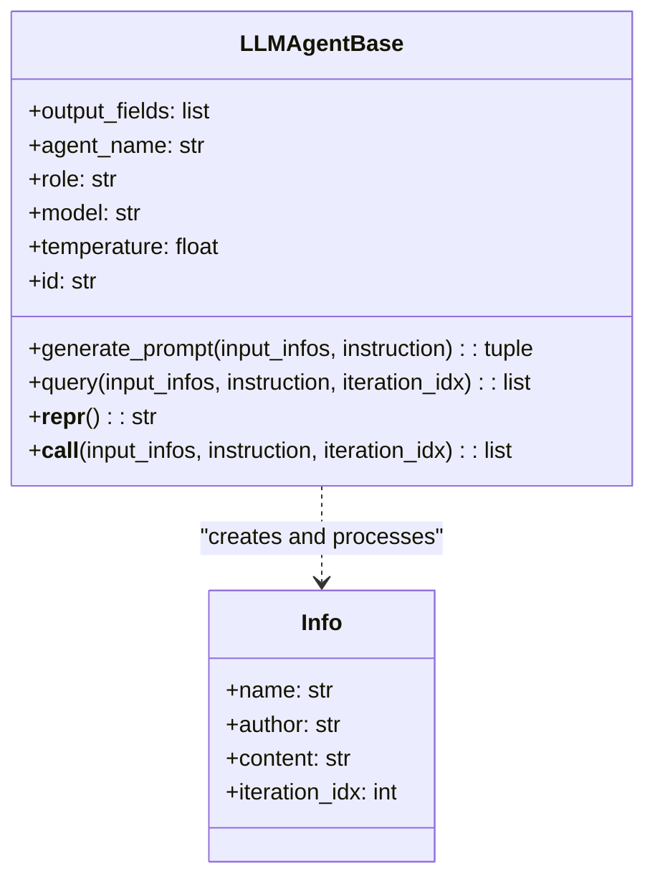
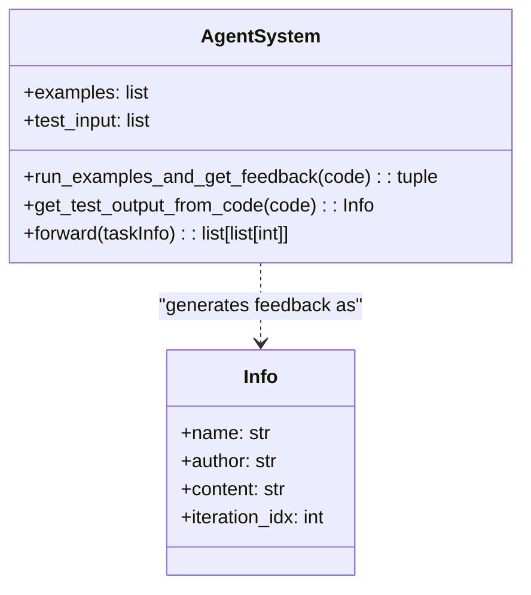
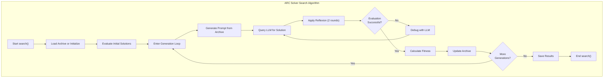
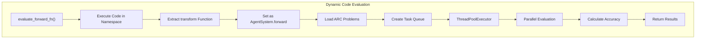
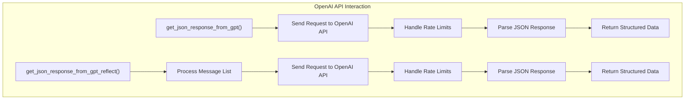
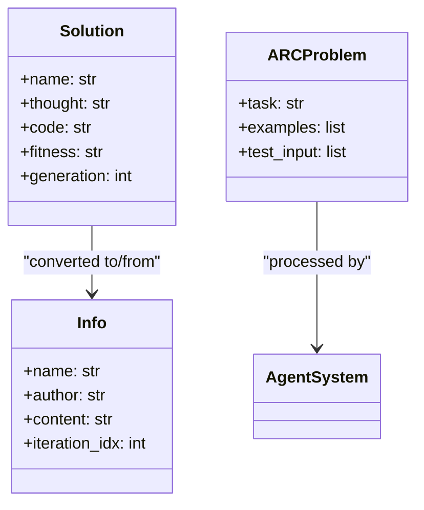
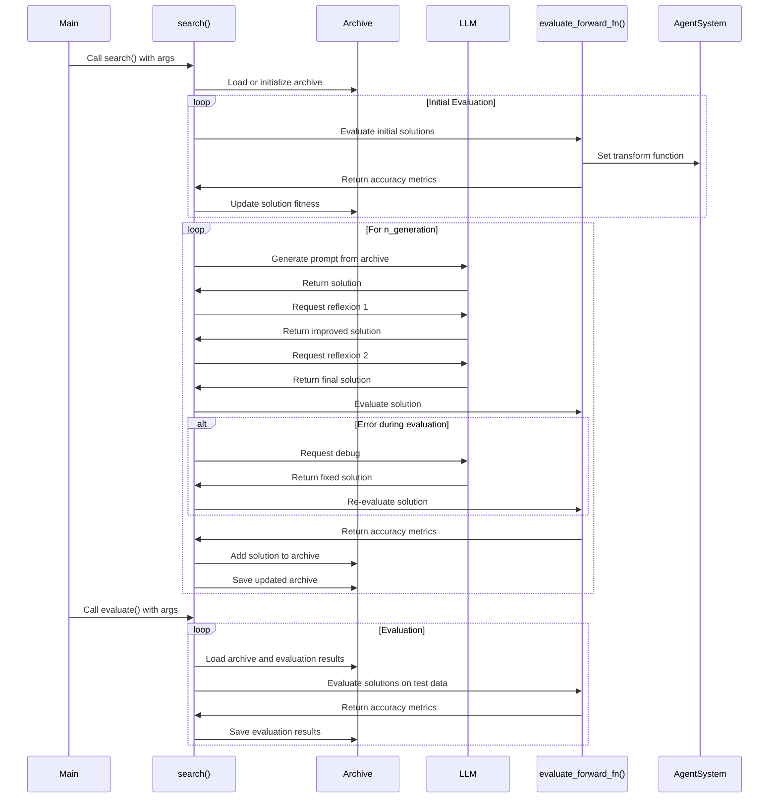

<!-- source: DeepWiki mcp.deepwiki.com · repo ShengranHu/ADAS · page 3.1 ARC Solver · fetched 2026-10-26 -->

# ARC Solver

Relevant source files

The following files were used as context for generating this wiki page:

- [_arc/search.py](_arc/search.py)

## Purpose and Scope

This document details the ARC (Abstraction and Reasoning Corpus) Solver, the most important component in the ADAS repository. The ARC Solver is an evolutionary search system that generates Python solutions for abstract visual reasoning problems. It leverages Large Language Models to iteratively improve solutions, using a reflection-based approach to enhance performance.

For information about other problem solvers in this repository, such as question answering solvers, see [Question Answering Solvers](#3.2) or math problem solvers, see [Math Problem Solvers](#3.3).

Sources: [_arc/search.py:1-446]()

## System Architecture

The ARC Solver follows an evolutionary search pattern where solutions are iteratively generated, evaluated, and refined. It consists of four core components:

1. **LLMAgentBase**: Base class that handles LLM interactions and prompt generation
2. **AgentSystem**: Executes and evaluates the generated solutions on ARC problems
3. **Search Algorithm**: Coordinates the evolutionary process and maintains solution archives
4. **Evaluation System**: Assesses solution quality on validation and test datasets

Sources: [_arc/search.py:70-446]()

## LLMAgentBase

The `LLMAgentBase` class manages all interactions with the language model and handles prompt construction. It is responsible for:

1. Formatting inputs and system prompts
2. Querying the language model via the OpenAI API
3. Processing and structuring responses

Key methods:
- `generate_prompt()`: Constructs system prompt and user prompt from input information
- `query()`: Sends queries to the language model and processes responses

Sources: [_arc/search.py:70-153]()

## AgentSystem

The `AgentSystem` class handles the execution and evaluation of generated code solutions. Its primary responsibilities are:

1. Running generated code against example ARC problems
2. Providing feedback on the correctness of solutions
3. Executing code against test inputs to evaluate final performance

Key methods:
- `run_examples_and_get_feedback()`: Evaluates code against example problems and provides detailed feedback
- `get_test_output_from_code()`: Executes code on test inputs and returns the output
- `forward()`: Dynamically defined method that contains the transformation function

Sources: [_arc/search.py:156-234]()

## Evolutionary Search Process

The `search()` function implements the evolutionary search algorithm that lies at the core of the ARC Solver. It uses the following process:

1. Initialize or load an archive of existing solutions
2. Evaluate initial solutions if not already evaluated
3. Generate new solutions using the LLM
4. Apply reflection to improve solutions
5. Debug and fix errors in solutions
6. Evaluate solutions and calculate fitness
7. Update the archive with the new solutions
8. Repeat steps 3-7 for a specified number of generations

The search algorithm incorporates multiple reflection steps to refine solutions, and includes error handling to debug solutions that fail during evaluation.

Sources: [_arc/search.py:237-331]()

## Dynamic Code Evaluation

The ARC Solver uses a dynamic code execution mechanism to evaluate generated solutions. This is implemented in the `evaluate_forward_fn()` function:

1. Execute the generated code in a separate namespace
2. Extract the transformation function
3. Attach it to the `AgentSystem` class as the `forward` method
4. Load ARC problems from a dataset
5. Parallelize evaluation across multiple problems
6. Calculate accuracy and confidence intervals

Sources: [_arc/search.py:369-418]()

## JSON Response Handling

The system includes specialized functions for interacting with the OpenAI API and handling JSON responses:

Both functions use the `@backoff.on_exception` decorator to handle rate limit errors from the OpenAI API, implementing exponential backoff.

Sources: [_arc/search.py:31-67]()

## Data Structures

The ARC Solver uses several key data structures:

1. **Info namedtuple**: A lightweight container for information produced and consumed by agents
2. **Archive**: A list of JSON objects representing solutions, maintained across generations
3. **ARC Problems**: Structured as examples (input/output pairs) and test inputs

Sources: [_arc/search.py:20-20](), [_arc/search.py:395-397]()

## Workflow Example

The complete workflow of the ARC Solver operates as follows:

Sources: [_arc/search.py:237-446]()

## Usage Example

To use the ARC Solver:

1. Prepare ARC validation and test data
2. Configure parameters via command-line arguments
3. Run `search()` to generate and evolve solutions
4. Run `evaluate()` to assess solutions on test data

The main script accepts various command-line arguments:

| Argument | Description | Default |
|----------|-------------|---------|
| `--val_data_path` | Path to validation data | `sampled_arc_val_data.pkl` |
| `--test_data_path` | Path to test data | `sampled_arc_test_data.pkl` |
| `--n_repreat` | Number of repetitions for evaluation | 5 |
| `--multiprocessing` | Enable multiprocessing | True |
| `--max_workers` | Maximum number of workers for ThreadPoolExecutor | 32 |
| `--save_dir` | Directory to save results | `results/` |
| `--expr_name` | Experiment name | `arc_gpt3.5_results` |
| `--n_generation` | Number of generations for search | 25 |
| `--reflect_max` | Maximum number of reflection steps | 3 |
| `--debug_max` | Maximum number of debugging attempts | 3 |
| `--model` | OpenAI model to use | `gpt-4o-2024-05-13` |

Sources: [_arc/search.py:421-446]()

## Integration with Evolutionary Systems

The ARC Solver is an implementation of an evolutionary algorithm where:

1. The LLM generates "offspring" solutions based on an archive of previous solutions
2. Solutions are evaluated on ARC problems to determine their "fitness"
3. The archive acts as a "population" that evolves over generations
4. Reflection and debugging provide mechanisms for "mutation" and improvement

The system follows the general evolutionary search process described in [Evolutionary Search Algorithm](#2.1) but is specialized for solving ARC problems.

Sources: [_arc/search.py:237-331]()

---

