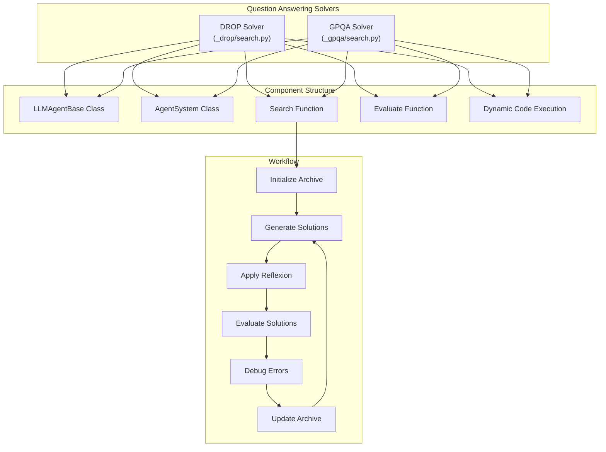
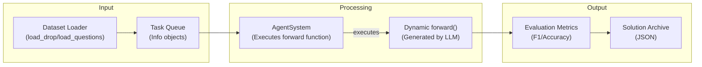
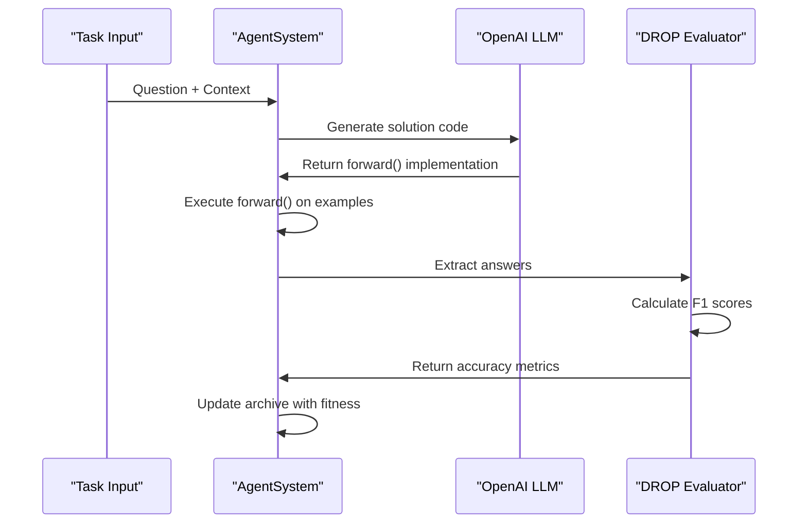
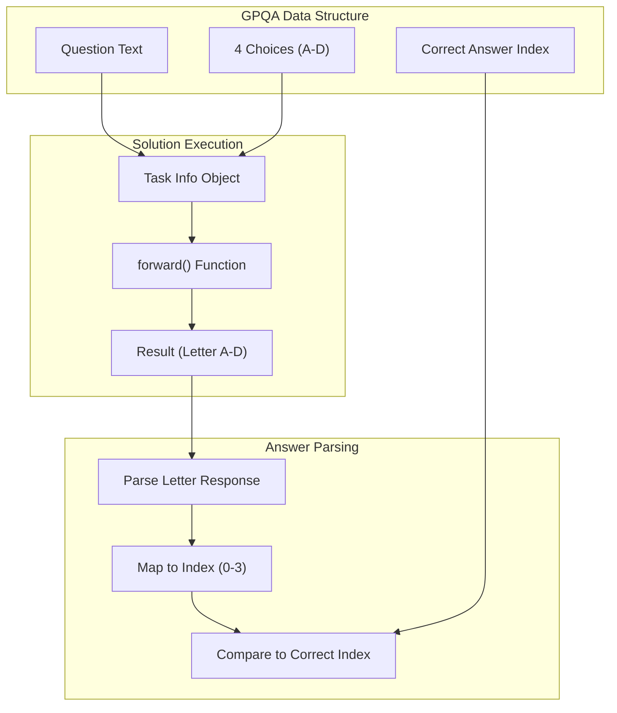
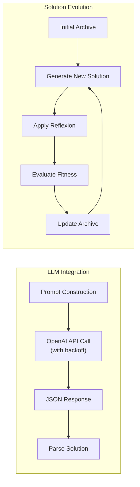

<!-- source: DeepWiki mcp.deepwiki.com · repo ShengranHu/ADAS · page 3.2 Question Answering Solvers · fetched 2026-10-26 -->

# Question Answering Solvers

<details>
<summary>Relevant source files</summary>

The following files were used as context for generating this wiki page:

- [_drop/search.py](_drop/search.py)
- [_gpqa/search.py](_gpqa/search.py)

</details>


## Purpose and Scope

This document provides technical details about the Question Answering (QA) solvers in the ADAS repository. These solvers are designed to tackle different types of QA tasks through evolutionary search algorithms that generate, evaluate, and refine solutions using Large Language Models (LLMs). 

This page specifically covers two QA solver implementations:
1. DROP (Discrete Reasoning Over Paragraphs) solver
2. GPQA (General Purpose Question Answering) solver

For information about Math Problem Solvers, see [Math Problem Solvers](#3.3).
For information about the core evolutionary search algorithm, see [Evolutionary Search Algorithm](#2.1).

## Architecture Overview

The QA solvers follow the general ADAS architecture but implement specific logic for question answering tasks. They leverage LLMs to generate code for solving QA problems, then evaluate and refine these solutions through an evolutionary process.

### High-Level System Architecture



Sources: [_drop/search.py:144-241](), [_gpqa/search.py:144-241]()

### System Components and Data Flow



Sources: [_drop/search.py:278-332](), [_gpqa/search.py:277-351]()

## DROP Solver

The DROP (Discrete Reasoning Over Paragraphs) solver is designed to answer questions that require reasoning over text passages. It uses a specialized evaluation metric that considers both exact match and partial matches through F1 score.

### Implementation Details

The DROP solver works by:
1. Loading DROP dataset questions and answers
2. Generating potential solution code with an LLM
3. Dynamically executing that code on validation examples
4. Evaluating the generated answers using the DROP F1 metric
5. Iteratively improving solutions through reflexion

### Data Format and Evaluation

The DROP solver expects input in the form of text passages with questions, and evaluates answers using both exact match and F1 scores to handle partial correctness.



Sources: [_drop/search.py:278-332]()

## GPQA Solver

The GPQA solver is designed for general purpose question answering with multiple-choice answers. It implements a specialized answer extraction mechanism to handle letter-based responses (A, B, C, D).

### Implementation Details

The GPQA solver works by:
1. Loading GPQA dataset questions with multiple choice options
2. Formatting questions and choices for the LLM
3. Generating solution code with an LLM
4. Executing the code on validation examples
5. Parsing the generated answers and matching to correct choices
6. Evaluating accuracy

### Data Format and Evaluation



Sources: [_gpqa/search.py:290-351]()

## Common Implementation Patterns

Both QA solvers share several implementation patterns that are central to their operation.

### LLM Interaction and Solution Generation

Both solvers use the OpenAI API to generate solution code, implementing backoff mechanisms for rate limiting and error handling.



Sources: [_drop/search.py:29-65](), [_gpqa/search.py:29-65]()

### Dynamic Code Execution

Both solvers use dynamic code execution to run LLM-generated Python code. This mechanism:
1. Takes a string containing Python code for a `forward()` function
2. Executes it in a namespace
3. Extracts the function and sets it as the `forward` method of the `AgentSystem` class
4. Runs the function on QA examples
5. Evaluates the results

The general pattern is:

```python
namespace = {}
exec(forward_str, globals(), namespace)
names = list(namespace.keys())
func = namespace[names[0]]
setattr(AgentSystem, "forward", func)
```

Sources: [_drop/search.py:278-289](), [_gpqa/search.py:277-288]()

### Parallel Processing and Error Handling

Both solvers use the `ThreadPoolExecutor` for parallel evaluation and implement comprehensive error handling to recover from failures during evaluation.

| Feature | Implementation | Purpose |
|---------|----------------|---------|
| Thread Pool | `ThreadPoolExecutor` | Parallel execution of solution on multiple examples |
| Backoff Decorator | `@backoff.on_exception` | Handle rate limits from OpenAI API |
| Try-Except Blocks | Throughout code | Recover from errors during evaluation |
| Debug Loop | `debug_max` parameter | Retry debugging failures up to a limit |

Sources: [_drop/search.py:203-224](), [_gpqa/search.py:203-224]()

## Technical Details

### `LLMAgentBase` Class

The `LLMAgentBase` class is foundational to both QA solvers. It handles the interaction with the LLM, constructs prompts, and processes responses.

Key methods:
- `generate_prompt()`: Constructs system and user prompts
- `query()`: Sends prompts to the LLM and processes responses
- `__call__()`: Simplified interface to query()

Sources: [_drop/search.py:69-137](), [_gpqa/search.py:68-136]()

### Solution Archive Structure

Solutions are stored in a JSON archive with the following structure:

| Field | Description |
|-------|-------------|
| `name` | Name of the solution |
| `thought` | Reasoning behind the solution |
| `code` | Python implementation of `forward()` |
| `fitness` | Performance metrics (`mean ± CI`) |
| `generation` | Generation number or "initial" |

Sources: [_drop/search.py:144-176](), [_gpqa/search.py:144-176]()

### Differences Between DROP and GPQA Solvers

| Feature | DROP Solver | GPQA Solver |
|---------|-------------|-------------|
| Dataset | Paragraphs with questions | Multiple-choice questions |
| Metric | F1 score | Accuracy |
| Output Format | Free-form text answers | Letter choices (A, B, C, D) |
| Answer Parsing | Direct extraction | Letter-to-index mapping |
| Evaluation | `drop_metric()` function | Direct comparison with correct index |

Sources: [_drop/search.py:314-331](), [_gpqa/search.py:315-350]()

---

