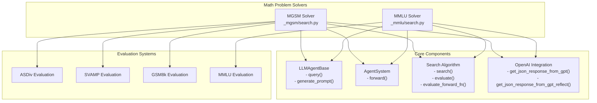
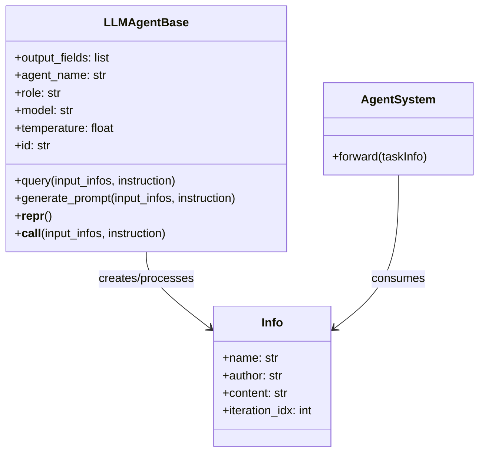
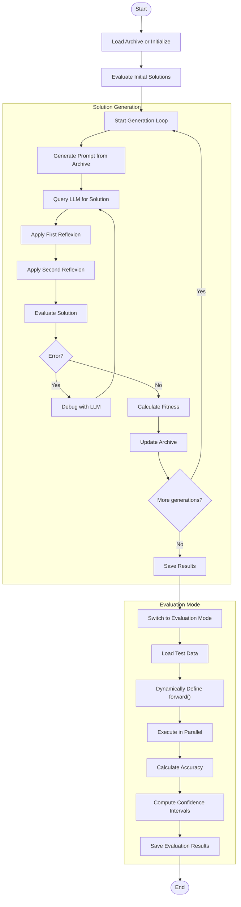
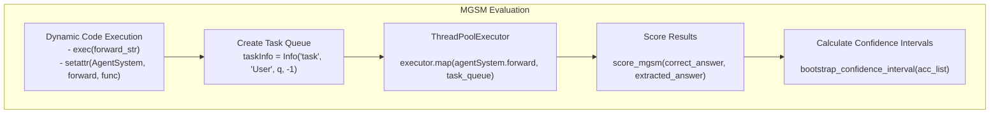
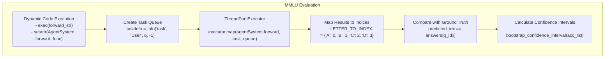
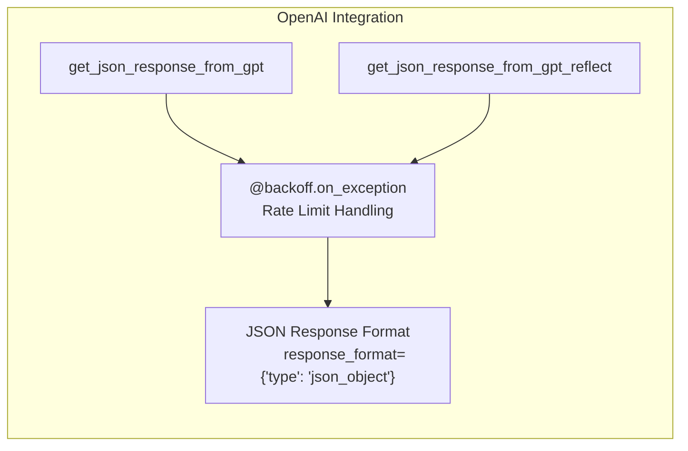

<!-- source: DeepWiki mcp.deepwiki.com · repo ShengranHu/ADAS · page 3.3 Math Problem Solvers · fetched 2026-10-26 -->

# Math Problem Solvers

<details>
<summary>Relevant source files</summary>

The following files were used as context for generating this wiki page:

- [_mgsm/search.py](_mgsm/search.py)
- [_mmlu/search.py](_mmlu/search.py)

</details>


## Purpose and Scope

This document provides a technical overview of the mathematical problem-solving components in the ADAS (Automated Diagnostic and Architecture System) repository. It covers two key solvers:

1. MGSM (Math GSM) - A system for solving numeric mathematical problems
2. MMLU (Massive Multitask Language Understanding) - A system for solving multiple-choice mathematical questions

For information about other problem solvers in the system, see [Question Answering Solvers](#3.2) or [ARC Solver](#3.1).

## Architecture Overview

The math problem solvers follow ADAS's shared evolutionary search framework, generating, refining, and evaluating LLM-generated code solutions for mathematical reasoning tasks.

### Math Solver Architecture



Sources: [_mgsm/search.py:1-361](), [_mmlu/search.py:1-389]()

## Shared Implementation

Both math problem solvers share a common implementation structure with these key components:

### Core Classes



Sources: [_mgsm/search.py:69-143](), [_mmlu/search.py:70-144]()

### Search and Evaluation Workflow



Sources: [_mgsm/search.py:145-242](), [_mmlu/search.py:146-242](), [_mgsm/search.py:244-276](), [_mmlu/search.py:244-276]()

## MGSM Solver

The MGSM solver focuses on generating mathematical solutions that return numeric answers to problems.

### Key Features

- Processes text-based mathematical problems
- Dynamically executes LLM-generated Python code to compute answers
- Returns numeric values as answers
- Uses bootstrapped confidence intervals for solution quality assessment

### Implementation Details

The MGSM solver implements the following workflow:

1. **Archive Initialization**: Load existing solutions or initialize a new archive
2. **Solution Generation**: Generate solutions using LLM
3. **Solution Refinement**: Apply two rounds of reflection for improvement
4. **Solution Evaluation**: Dynamically execute code and compute accuracy
5. **Archive Update**: Add successful solutions to the archive

### Evaluation Process



Sources: [_mgsm/search.py:278-332]()

## MMLU Solver

The MMLU solver focuses on multiple-choice questions, handling a broader range of mathematical and quantitative reasoning tasks.

### Key Features

- Processes multiple-choice questions (A, B, C, D format)
- Applies mathematical reasoning to select the correct answer
- Returns letter choices as answers
- Handles diverse topics covered in the MMLU benchmark

### Implementation Details

The MMLU solver follows the same general workflow as the MGSM solver but differs in:
1. Input format: Processes formatted multiple-choice questions
2. Output format: Returns letter choices instead of numeric values
3. Evaluation method: Maps letter choices to indices for correctness checking

### Evaluation Process



Sources: [_mmlu/search.py:279-359]()

## OpenAI Integration

Both solvers integrate with OpenAI's API through the following methods:

### API Interaction Flow



Sources: [_mgsm/search.py:30-67](), [_mmlu/search.py:31-67]()

## Configuration Parameters

Both solvers accept similar configuration parameters:

| Parameter | Description | Default |
|-----------|-------------|---------|
| `--valid_size` | Number of validation examples | 128 |
| `--test_size` | Number of test examples | 800 |
| `--shuffle_seed` | Seed for shuffling examples | 0 |
| `--n_repeat` | Number of times to repeat examples | 1 |
| `--multiprocessing` | Enable parallel processing | True |
| `--max_workers` | Maximum number of parallel workers | 48 |
| `--save_dir` | Directory to save results | 'results/' |
| `--expr_name` | Experiment name for output files | Varies by solver |
| `--n_generation` | Number of generations for search | 30 |
| `--debug_max` | Maximum debugging attempts | 3 |
| `--model` | LLM model to use | 'gpt-4o-2024-05-13' |

Sources: [_mgsm/search.py:336-360](), [_mmlu/search.py:362-388]()

## Key Differences Between Solvers

The primary differences between the two math problem solvers are:

| Feature | MGSM Solver | MMLU Solver |
|---------|-------------|-------------|
| Problem Type | Numeric mathematical problems | Multiple-choice questions |
| Input Format | Text math problems | Formatted multiple-choice questions |
| Output Format | Numeric answers | Letter choices (A, B, C, D) |
| Evaluation | `score_mgsm` function | Letter-to-index mapping |
| Dataset | MGSM, ASDiv, SVAMP, GSM8k | MMLU benchmark |
| Prompt Generation | Math-specific instructions | Multiple-choice instructions |

Sources: [_mgsm/search.py:86-89](), [_mmlu/search.py:87-90](), [_mgsm/search.py:304-331](), [_mmlu/search.py:292-357]()

## Usage Examples

The math problem solvers are typically executed with configuration parameters to control the search and evaluation process:

```
# MGSM Solver
python _mgsm/search.py --save_dir results/ --expr_name mgsm_gpt4_results --model gpt-4o-2024-05-13

# MMLU Solver
python _mmlu/search.py --data_filename dataset/mmlu.csv --save_dir results/ --expr_name mmlu_gpt4_results --model gpt-4o-2024-05-13
```

Sources: [_mgsm/search.py:335-360](), [_mmlu/search.py:362-388]()

---

