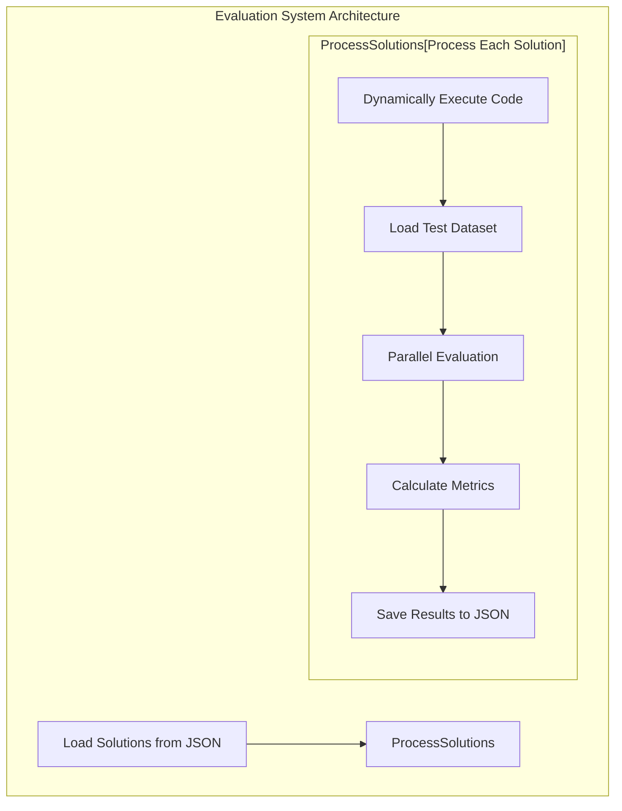
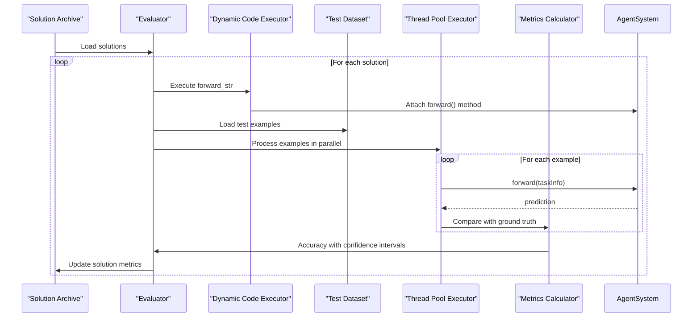
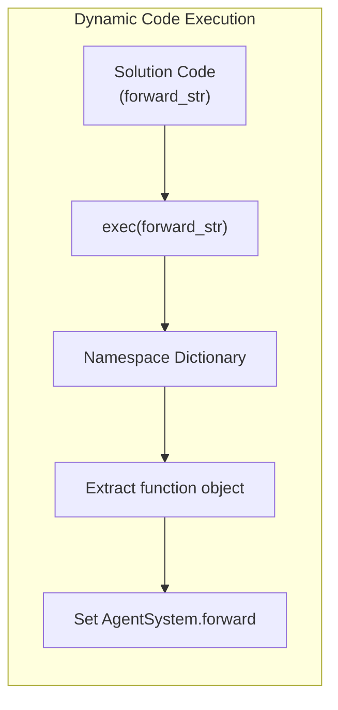
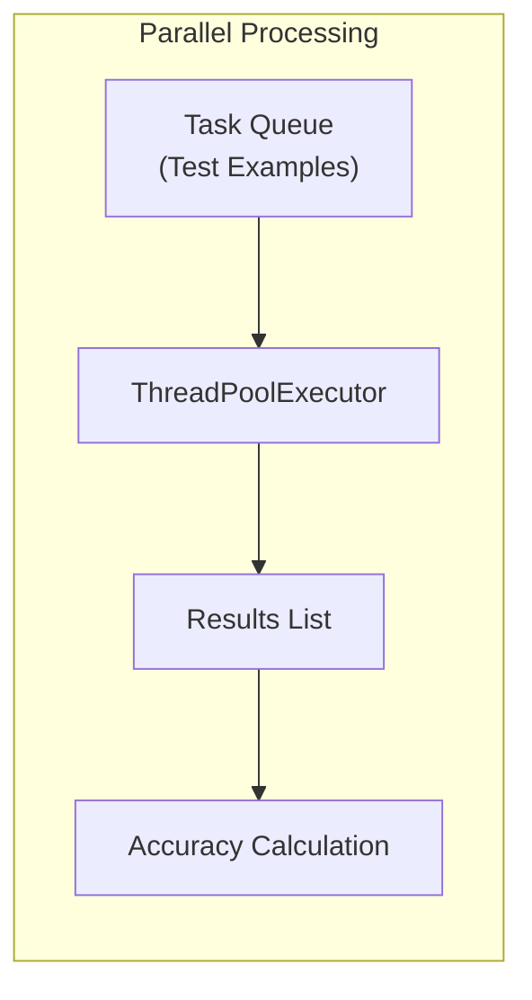
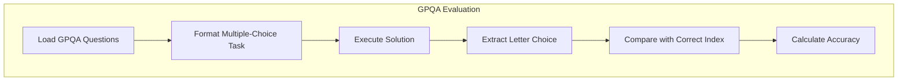
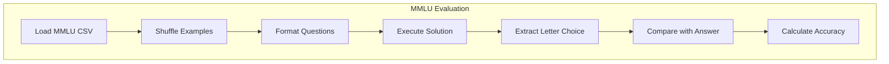
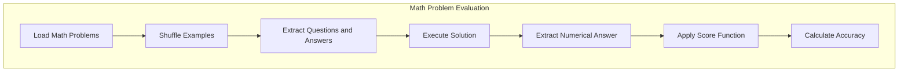
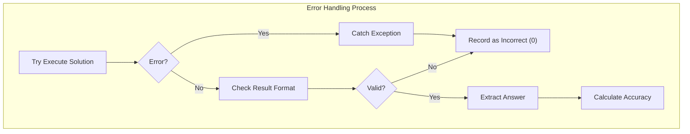

<!-- source: DeepWiki mcp.deepwiki.com · repo ShengranHu/ADAS · page 4 Evaluation Systems · fetched 2026-10-26 -->

# Evaluation Systems

<details>
<summary>Relevant source files</summary>

The following files were used as context for generating this wiki page:

- [_transfer_math/evaluate_gpqa.py](_transfer_math/evaluate_gpqa.py)
- [_transfer_math/evaluate_mmlu.py](_transfer_math/evaluate_mmlu.py)
- [_transfer_math/evaluation_Asdiv.py](_transfer_math/evaluation_Asdiv.py)

</details>


## Purpose and Scope

The Evaluation Systems in ADAS provide a framework for assessing the performance of solutions generated by the Search Systems. They focus on testing solutions against various benchmarks and datasets, calculating accuracy metrics with confidence intervals, and storing evaluation results. This page documents the architecture, workflow, and implementation details of these evaluation systems.

For information about how solutions are generated, see [Problem Solvers](#3) and [Search Algorithm](#2.1).

## Core Evaluation Architecture

The evaluation systems share a common architecture designed to:
1. Load solutions from archive files
2. Dynamically execute solution code on test datasets
3. Process test examples in parallel
4. Calculate accuracy metrics with bootstrap confidence intervals
5. Save evaluation results back to the archive



Sources: [_transfer_math/evaluate_gpqa.py:141-156](), [_transfer_math/evaluate_mmlu.py:143-158](), [_transfer_math/evaluation_Asdiv.py:139-154]()

### Evaluation Workflow

The evaluation workflow consists of several key steps that transform solution code into quantitative performance metrics:



Sources: [_transfer_math/evaluate_gpqa.py:159-234](), [_transfer_math/evaluate_mmlu.py:161-241](), [_transfer_math/evaluation_Asdiv.py:157-212]()

## Evaluation Components

### Dynamic Code Execution

A core feature of the evaluation systems is their ability to dynamically execute solution code. This is accomplished through Python's `exec()` function, which allows solution code to be loaded and executed at runtime:



Sources: [_transfer_math/evaluate_gpqa.py:159-170](), [_transfer_math/evaluate_mmlu.py:161-172](), [_transfer_math/evaluation_Asdiv.py:157-168]()

### Parallel Processing

The evaluation systems use ThreadPoolExecutor to process test examples in parallel, significantly improving evaluation speed:



Sources: [_transfer_math/evaluate_gpqa.py:192-194](), [_transfer_math/evaluate_mmlu.py:199-201](), [_transfer_math/evaluation_Asdiv.py:194-196]()

## Specific Evaluation Systems

The ADAS codebase includes several domain-specific evaluation systems:

### GPQA Evaluation

The GPQA (General Purpose Question Answering) evaluation system tests solutions on multiple-choice questions from the GPQA dataset. It loads questions with four answer choices and evaluates whether the solution can correctly select the right answer (A, B, C, or D).



Sources: [_transfer_math/evaluate_gpqa.py:172-234]()

### MMLU Evaluation

The MMLU (Massive Multitask Language Understanding) evaluation system tests solutions on the MMLU benchmark, which spans multiple domains of knowledge. Like GPQA, it evaluates multiple-choice questions.



Sources: [_transfer_math/evaluate_mmlu.py:174-241]()

### Math Problem Evaluations

The evaluation systems for mathematical reasoning tasks (such as ASDiv) process word problems and validate numerical answers:



Sources: [_transfer_math/evaluation_Asdiv.py:170-212]()

## Code Entity Mapping

The following diagram maps evaluation system concepts to actual code entities:

```mermaid
classDiagram
    class "AgentSystem" {
        +forward(taskInfo): prediction
    }
    
    class "evaluate()" {
        +args: ArgParse.Namespace
        +Load test_entries from eval_file_path
        +Process each solution
        +Save updated test_entries
    }
    
    class "evaluate_forward_fn()" {
        +args: ArgParse.Namespace
        +forward_str: String
        +Dynamically define forward()
        +Load and process test examples
        +Return acc_list
    }
    
    class "bootstrap_confidence_interval()" {
        +Calculate confidence interval
        +Format as string with mean and CI
    }
    
    class "Info" {
        +name: String
        +author: String
        +content: String
        +iteration_idx: Integer
    }
    
    "evaluate()" --> "evaluate_forward_fn()": calls for each solution
    "evaluate_forward_fn()" --> "AgentSystem": attaches forward()
    "evaluate_forward_fn()" --> "bootstrap_confidence_interval()": calculates final metrics
    "AgentSystem" --> "Info": processes taskInfo
```

Sources: [_transfer_math/evaluate_gpqa.py:16-141](), [_transfer_math/evaluate_mmlu.py:18-143](), [_transfer_math/evaluation_Asdiv.py:19-139]()

## Implementation Details

### Command-Line Configuration

All evaluation systems provide similar command-line arguments to configure the evaluation process:

| Argument | Description | Default |
|----------|-------------|---------|
| `--data_filename` | Path to the dataset file | Dataset-specific |
| `--valid_size` | Number of examples for validation | 32-128 |
| `--test_size` | Number of examples for testing | 800 |
| `--shuffle_seed` | Random seed for shuffling examples | 0 |
| `--n_repreat` | Number of times to repeat each example | 1-5 |
| `--multiprocessing` | Enable parallel processing | True |
| `--max_workers` | Maximum number of parallel workers | 32-48 |
| `--eval_file_path` | Path to the solution file | Required |
| `--model` | OpenAI model to use | gpt-4o-2024-05-13 |

Sources: [_transfer_math/evaluate_gpqa.py:237-256](), [_transfer_math/evaluate_mmlu.py:244-262](), [_transfer_math/evaluation_Asdiv.py:215-232]()

### Solution Archive Format

Solutions are stored in JSON format with the following structure:

```json
[
  {
    "name": "solution_name",
    "code": "def forward(taskInfo):\n    # Solution code here\n    return answer",
    "test_fitness_GPQA": "0.76 [0.73, 0.79]"  // Mean accuracy with confidence interval
  },
  // Additional solutions...
]
```

Sources: [_transfer_math/evaluate_gpqa.py:145-156](), [_transfer_math/evaluate_mmlu.py:147-158](), [_transfer_math/evaluation_Asdiv.py:143-154]()

## Error Handling and Robustness

The evaluation systems include robust error handling to manage various failure modes:



Sources: [_transfer_math/evaluate_gpqa.py:203-232](), [_transfer_math/evaluate_mmlu.py:203-237](), [_transfer_math/evaluation_Asdiv.py:198-210]()

The evaluation systems are designed to be resilient against:
- Solution code that throws exceptions
- Unexpected output formats
- Missing or malformed answers
- OpenAI API rate limits (using backoff)

By capturing all exceptions and continuing execution, the evaluation systems ensure that all solutions can be evaluated even if some examples fail.

---

