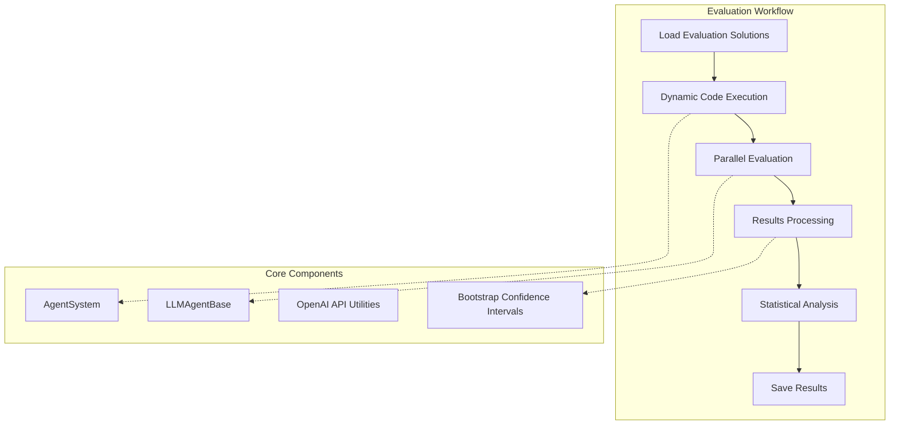
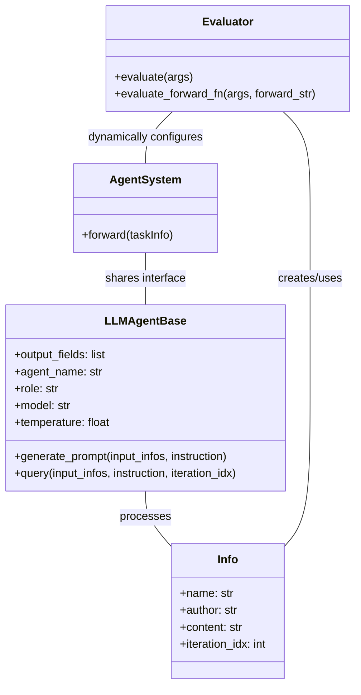
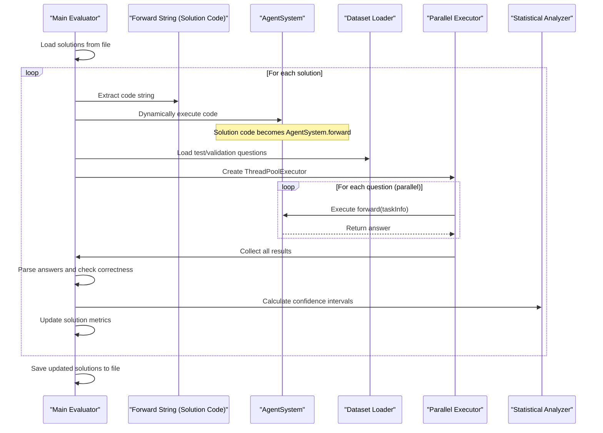
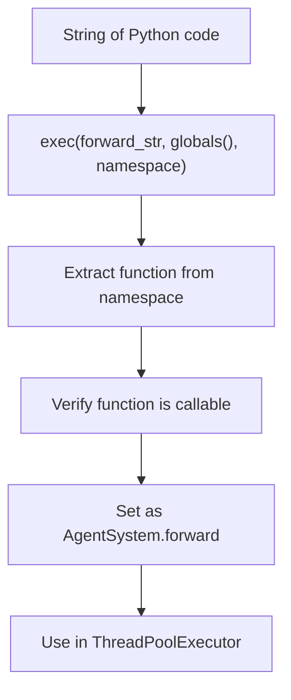

<!-- source: DeepWiki mcp.deepwiki.com · repo ShengranHu/ADAS · page 4.1 GPQA and MMLU Evaluation · fetched 2026-10-26 -->

# GPQA and MMLU Evaluation

<details>
<summary>Relevant source files</summary>

The following files were used as context for generating this wiki page:

- [_transfer_math/evaluate_gpqa.py](_transfer_math/evaluate_gpqa.py)
- [_transfer_math/evaluate_mmlu.py](_transfer_math/evaluate_mmlu.py)

</details>


## Purpose and Scope

This document details the evaluation systems for General Purpose Question Answering (GPQA) and Massive Multitask Language Understanding (MMLU) benchmarks within the ADAS framework. It covers the implementation of test harnesses, dynamic code execution, parallel evaluation processes, and accuracy measurement techniques used to evaluate solution quality. For information about the actual solvers that generate solutions for these tasks, see [Question Answering Solvers](#3.2).

## Overview

The GPQA and MMLU evaluation systems assess the quality of LLM-generated solutions against standardized question-answering benchmarks. Both systems share a common architecture but operate on different datasets and question formats.



Sources: [_transfer_math/evaluate_gpqa.py:141-158](), [_transfer_math/evaluate_mmlu.py:141-158]()

## System Architecture

The evaluation systems follow a consistent architecture pattern:



Sources: [_transfer_math/evaluate_gpqa.py:65-140](), [_transfer_math/evaluate_mmlu.py:65-140]()

## Core Components

### LLMAgentBase

`LLMAgentBase` is the fundamental class that handles interaction with the OpenAI API and structures the input/output flow. Key functionalities include:

- Prompt generation with structured formatting
- OpenAI API interaction with JSON response handling
- Error recovery for incomplete or malformed responses
- Management of conversation context and iteration tracking

Sources: [_transfer_math/evaluate_gpqa.py:65-136](), [_transfer_math/evaluate_mmlu.py:65-136]()

### AgentSystem

`AgentSystem` is a lightweight class that serves as a container for dynamically loaded solution code. During evaluation:

1. The system loads a solution's code string
2. Dynamically executes this code to extract a callable function object
3. Attaches this function as `AgentSystem.forward`
4. Uses this function to process evaluation examples

Sources: [_transfer_math/evaluate_gpqa.py:138-140](), [_transfer_math/evaluate_mmlu.py:138-140]()

### OpenAI API Utilities

Both evaluation systems use identical utility functions to interact with the OpenAI API:

- `get_json_response_from_gpt`: Makes API calls with backoff for rate limits
- `get_json_response_from_gpt_reflect`: Similar but for reflection-based prompts

These functions handle JSON response formatting, error recovery, and rate limit handling.

Sources: [_transfer_math/evaluate_gpqa.py:26-62](), [_transfer_math/evaluate_mmlu.py:26-62]()

## Evaluation Process

The evaluation workflow follows these steps:



Sources: [_transfer_math/evaluate_gpqa.py:141-158](), [_transfer_math/evaluate_mmlu.py:141-158](), [_transfer_math/evaluate_gpqa.py:159-241](), [_transfer_math/evaluate_mmlu.py:159-241]()

## Dynamic Code Evaluation

A key feature of both evaluation systems is the dynamic code execution mechanism:



This approach allows the system to evaluate arbitrary solution code without requiring predefined interfaces or structures.

Sources: [_transfer_math/evaluate_gpqa.py:159-172](), [_transfer_math/evaluate_mmlu.py:159-172]()

## Dataset-Specific Processing

### GPQA Evaluation

For GPQA evaluation:
- Uses `load_questions` from `gpqa_utils.py` to load the dataset
- Formats questions with explicit task content
- Operates on the GPQA Diamond dataset (default)
- Constructs questions with 4-choice multiple choice format

Sources: [_transfer_math/evaluate_gpqa.py:174-188]()

### MMLU Evaluation

For MMLU evaluation:
- Uses pandas to read CSV files directly
- Applies `format_multichoice_question` from `mmlu_utils.py`
- Operates on various MMLU subject datasets
- Maintains the standard MMLU question format

Sources: [_transfer_math/evaluate_mmlu.py:176-187]()

## Answer Processing and Scoring

Both systems use robust answer parsing with multiple fallback methods:

1. Direct letter matching ('A', 'B', 'C', 'D')
2. Substring matching ('A)', 'B)', etc.)
3. Content extraction from Info objects
4. Special handling for list responses

Results are scored as 1 for correct answers and 0 for incorrect answers, then aggregated for statistical analysis.

Sources: [_transfer_math/evaluate_gpqa.py:203-232](), [_transfer_math/evaluate_mmlu.py:203-232]()

## Statistical Analysis

Both evaluation systems use bootstrap confidence intervals to provide robust performance metrics:

```
acc_list = [1, 0, 1, 1, ...] # Binary correctness for each question
confidence_interval = bootstrap_confidence_interval(acc_list)
```

This provides mean accuracy along with confidence intervals to account for dataset variance.

Sources: [_transfer_math/evaluate_gpqa.py:233-234](), [_transfer_math/evaluate_mmlu.py:240-241]()

## Command-Line Interface

Both evaluation systems provide command-line interfaces with similar parameters:

| Parameter | Description | GPQA Default | MMLU Default |
|-----------|-------------|--------------|--------------|
| `data_filename` | Path to dataset file | `dataset/gpqa_diamond.csv` | `dataset/mmlu.csv` |
| `valid_size` | Validation set size | 32 | 128 |
| `test_size` | Test set size | 800 | 800 |
| `shuffle_seed` | Seed for data shuffling | 0 | 0 |
| `n_repeat` | Times to repeat evaluation | 5 | 1 |
| `max_workers` | Max parallel workers | 32 | 48 |
| `model` | OpenAI model to use | `gpt-4o-2024-05-13` | `gpt-4o-2024-05-13` |
| `eval_file_path` | Path to solutions file | Required | Required |

Sources: [_transfer_math/evaluate_gpqa.py:238-258](), [_transfer_math/evaluate_mmlu.py:245-258]()

## Usage Example

To evaluate a set of solutions on the GPQA benchmark:

```bash
python _transfer_math/evaluate_gpqa.py --eval_file_path path/to/solutions.json --model gpt-4-turbo-2024-04-09
```

For MMLU:

```bash
python _transfer_math/evaluate_mmlu.py --eval_file_path path/to/solutions.json --model gpt-4-turbo-2024-04-09
```

The output will be an updated solutions file with new accuracy metrics added to each solution entry.

Sources: [_transfer_math/evaluate_gpqa.py:254-257](), [_transfer_math/evaluate_mmlu.py:254-264]()

---

