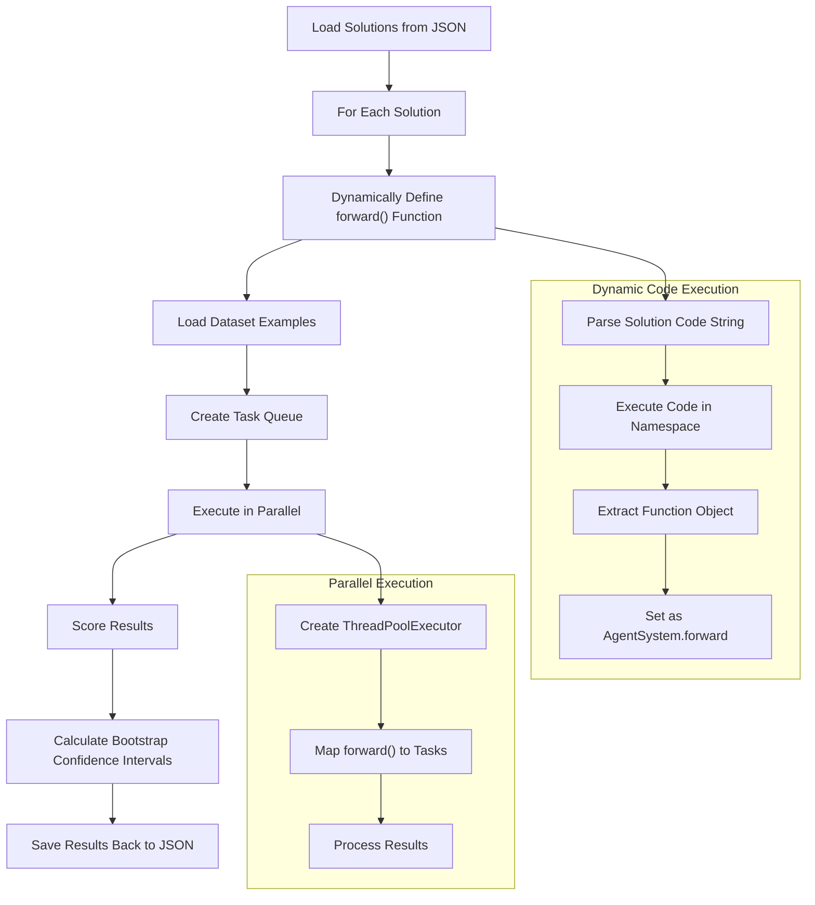
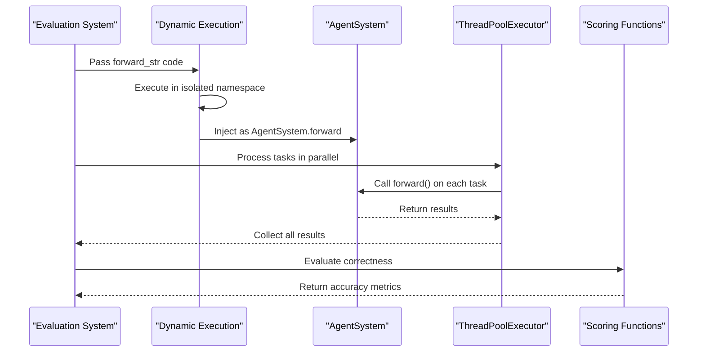
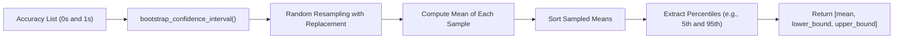
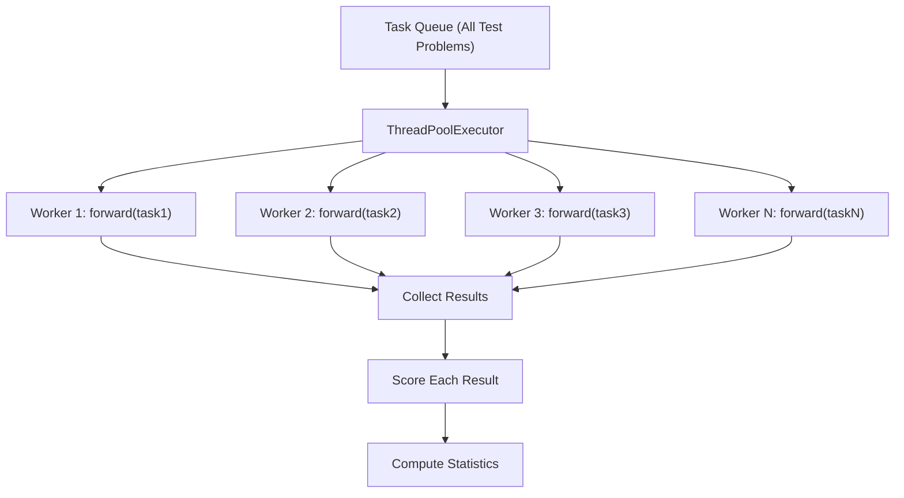

<!-- source: DeepWiki mcp.deepwiki.com · repo ShengranHu/ADAS · page 4.2 Math Problem Evaluations · fetched 2026-10-26 -->

# Math Problem Evaluations

<details>
<summary>Relevant source files</summary>

The following files were used as context for generating this wiki page:

- [_transfer_math/evaluation_Asdiv.py](_transfer_math/evaluation_Asdiv.py)
- [_transfer_math/evaluation_DROP.py](_transfer_math/evaluation_DROP.py)
- [_transfer_math/evaluation_SVAMP.py](_transfer_math/evaluation_SVAMP.py)
- [_transfer_math/evaluation_gsm8k.py](_transfer_math/evaluation_gsm8k.py)

</details>


## Purpose and Scope

This document describes the evaluation systems used for testing mathematical reasoning capabilities across multiple datasets in the ADAS framework. These evaluation systems take solutions generated by ADAS solvers (covered in [Math Problem Solvers](#3.3)) and quantitatively assess their performance on various mathematical reasoning tasks.

The evaluation systems covered in this document include:
- ASDiv (arithmetic word problems)
- DROP (discrete reasoning over paragraphs with mathematical components)
- SVAMP (challenging math word problems)
- GSM8k (grade school math problems)

Sources: [_transfer_math/evaluation_Asdiv.py:1-234](), [_transfer_math/evaluation_DROP.py:1-234](), [_transfer_math/evaluation_SVAMP.py:1-234](), [_transfer_math/evaluation_gsm8k.py:1-234]()

## Common Evaluation Architecture

All math problem evaluation modules share a common architecture and workflow, providing consistent measurement methodology across different datasets.

### Evaluation System Architecture

```mermaid
classDiagram
    class "AgentSystem" {
        +forward() dynamic
    }
    
    class "evaluate(args)" {
        +loads solutions from file
        +evaluates each solution
        +saves results with confidence intervals
    }
    
    class "evaluate_forward_fn(args, forward_str)" {
        +dynamically executes code
        +processes examples in parallel
        +computes accuracy metrics
    }
    
    class "bootstrap_confidence_interval()" {
        +computes statistical bounds
    }
    
    class "dataset_utils" {
        +get_all_examples()
        +score_fn() / drop_metric() / score_gsm8k()
    }
    
    "evaluate(args)" --> "evaluate_forward_fn(args, forward_str)" : calls
    "evaluate_forward_fn(args, forward_str)" --> "AgentSystem" : injects forward()
    "evaluate_forward_fn(args, forward_str)" --> "bootstrap_confidence_interval()" : computes stats
    "evaluate_forward_fn(args, forward_str)" --> "dataset_utils" : loads & scores
```

Sources: [_transfer_math/evaluation_Asdiv.py:139-155](), [_transfer_math/evaluation_DROP.py:139-155](), [_transfer_math/evaluation_SVAMP.py:139-155](), [_transfer_math/evaluation_gsm8k.py:139-155]()

### Evaluation Workflow



Sources: [_transfer_math/evaluation_Asdiv.py:157-212](), [_transfer_math/evaluation_DROP.py:157-212](), [_transfer_math/evaluation_SVAMP.py:157-212](), [_transfer_math/evaluation_gsm8k.py:157-212]()

## Dynamic Code Evaluation

A key feature of the math problem evaluation systems is their ability to dynamically execute code strings generated by LLMs. 

### Code Injection Process



The code execution follows these steps:
1. A string containing Python code (the `forward_str`) is passed to `evaluate_forward_fn`
2. The code is executed in an isolated namespace using Python's `exec()` function
3. The defined function is extracted and set as the `forward` method of `AgentSystem`
4. This dynamically defined function is then executed on all test examples

Sources: [_transfer_math/evaluation_Asdiv.py:157-169](), [_transfer_math/evaluation_DROP.py:157-169](), [_transfer_math/evaluation_SVAMP.py:157-169](), [_transfer_math/evaluation_gsm8k.py:157-169]()

## Dataset-Specific Evaluations

Each dataset has specific characteristics and scoring methods.

### ASDiv Evaluation

ASDiv (A dataset for arithmetic word problems with diverse structures) contains elementary math word problems. The evaluation system loads examples from the ASDiv XML file, converts them to a standardized format, and evaluates the accuracy of solutions.

ASDiv problems typically follow this structure:
```
Problem: Joan found 70 seashells on the beach. She gave Sam some of her seashells. She has 27 seashells left. How many seashells did she give to Sam?
```

The scoring function checks if the provided answer matches the correct answer, with some normalization to handle numerical formatting differences.

Sources: [_transfer_math/evaluation_Asdiv.py:1-20](), [_transfer_math/evaluation_Asdiv.py:214-234]()

### DROP Evaluation

DROP (Discrete Reasoning Over Paragraphs) includes reading comprehension problems that require numerical reasoning. The evaluation uses F1 score as the metric, which is more appropriate for questions that might have multiple correct answers or require extracting spans from text.

DROP problems typically include:
- A paragraph of text
- A question requiring numerical reasoning
- One or more possible correct answers

Example:
```
Paragraph: In 1983, the Green Bay Packers scored 429 points and gave up 439 points...
Question: How many more points did the Packers give up than they scored in 1983?
```

Sources: [_transfer_math/evaluation_DROP.py:1-20](), [_transfer_math/evaluation_DROP.py:198-210]()

### SVAMP Evaluation

SVAMP (Simple Variations on Arithmetic Math word Problems) is a challenging dataset designed specifically to test robustness of models on math word problems through systematic variations.

The evaluation works similarly to ASDiv, but with problems that are specifically designed to challenge naive solution approaches through keyword matching or pattern recognition.

Sources: [_transfer_math/evaluation_SVAMP.py:1-20](), [_transfer_math/evaluation_SVAMP.py:214-234]()

### GSM8k Evaluation

GSM8k (Grade School Math 8k) contains diverse grade school math word problems requiring multi-step reasoning. The evaluation uses a specific scoring function (`score_gsm8k`) that extracts the final numerical answer from potentially long reasoning chains.

GSM8k problems typically require multiple calculation steps and often involve:
- Arithmetic operations
- Unit conversions
- Rate problems
- Percentages

Example:
```
Janet's ducks lay 16 eggs per day. She eats 3 eggs per day and sells the rest at the farmers market daily for $2 per egg. How much money does she make in 30 days?
```

Sources: [_transfer_math/evaluation_gsm8k.py:1-20](), [_transfer_math/evaluation_gsm8k.py:198-210]()

## Statistical Evaluation Methods

All evaluation systems use bootstrap confidence intervals to provide statistically robust performance metrics.

### Bootstrap Confidence Interval Process

The evaluation systems don't just report a simple accuracy value. Instead, they compute bootstrap confidence intervals to provide statistical rigor:



This provides a more reliable estimate of model performance, especially for smaller test sets, by quantifying the uncertainty in the accuracy measurement.

Sources: [_transfer_math/evaluation_Asdiv.py:211-212](), [_transfer_math/evaluation_DROP.py:211-212](), [_transfer_math/evaluation_SVAMP.py:211-212](), [_transfer_math/evaluation_gsm8k.py:211-212]()

## Parallel Execution Architecture

Each evaluation module uses parallel processing to efficiently evaluate solutions across multiple examples.



This approach significantly reduces evaluation time by processing multiple problems simultaneously, with the number of workers configurable via command-line arguments.

Sources: [_transfer_math/evaluation_Asdiv.py:184-196](), [_transfer_math/evaluation_DROP.py:184-196](), [_transfer_math/evaluation_SVAMP.py:184-196](), [_transfer_math/evaluation_gsm8k.py:184-196]()

## Configuration and Usage

All evaluation modules accept similar command-line arguments:

| Argument | Description | Default |
|----------|-------------|---------|
| `--data_filename` | Path to the dataset file | Varies by dataset |
| `--valid_size` | Number of examples used for validation | 128 |
| `--test_size` | Number of examples used for testing | 800 |
| `--shuffle_seed` | Random seed for shuffling examples | 0 |
| `--n_repreat` | Number of times to repeat examples | 1 |
| `--multiprocessing` | Enable parallel processing | True |
| `--max_workers` | Maximum number of parallel workers | 48 |
| `--debug` | Enable debug mode | True |
| `--eval_file_path` | Path to solution file to evaluate | '' |
| `--model` | OpenAI model to use | 'gpt-4o-2024-05-13' |

Example usage:
```bash
python _transfer_math/evaluation_gsm8k.py --eval_file_path my_solutions.json --data_filename dataset/GSM8k_test.jsonl
```

When running an evaluation:
1. Set `SEARCHING_MODE = False` to use the test set rather than validation set
2. Provide a valid path to a JSON file containing solutions to evaluate
3. The evaluation will compute metrics for each solution and update the JSON file with the results

Sources: [_transfer_math/evaluation_Asdiv.py:214-234](), [_transfer_math/evaluation_DROP.py:214-234](), [_transfer_math/evaluation_SVAMP.py:214-234](), [_transfer_math/evaluation_gsm8k.py:214-234]()

## Solution Format

The evaluation systems expect solutions in a specific JSON format:

```json
[
  {
    "name": "Solution Name",
    "code": "def forward(taskInfo):\n    # Solution code here\n    return answer",
    "test_fitness_X": [0.75, 0.70, 0.80]  // Added after evaluation
  },
  // More solutions...
]
```

After evaluation, the file is updated with test fitness metrics for the corresponding dataset, showing [mean, lower_bound, upper_bound] from the bootstrap confidence interval.

Sources: [_transfer_math/evaluation_Asdiv.py:139-154](), [_transfer_math/evaluation_DROP.py:139-154](), [_transfer_math/evaluation_SVAMP.py:139-154](), [_transfer_math/evaluation_gsm8k.py:139-154]()

---

