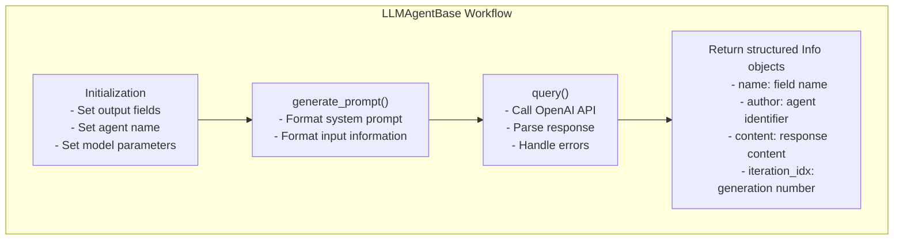
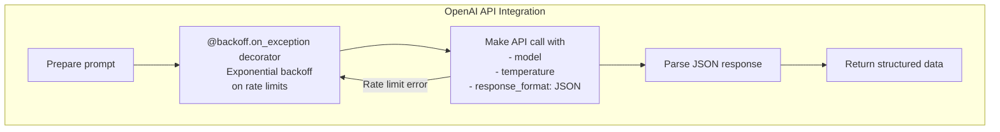
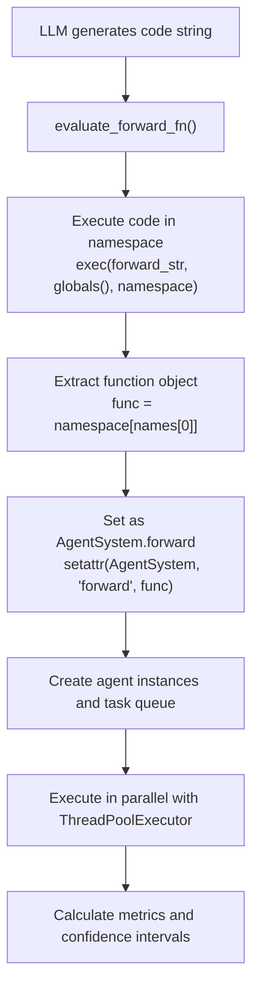
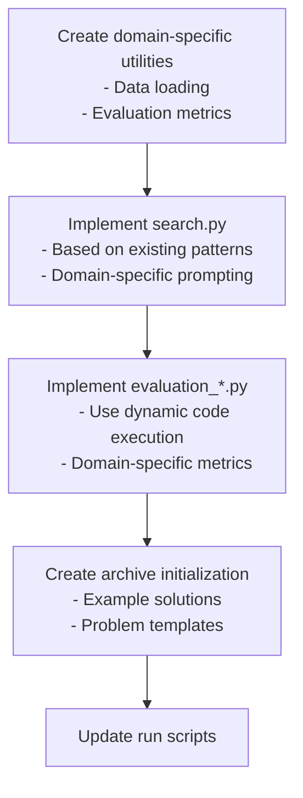
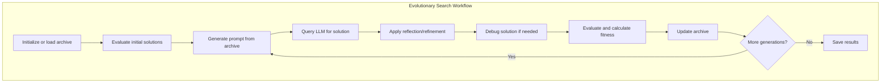
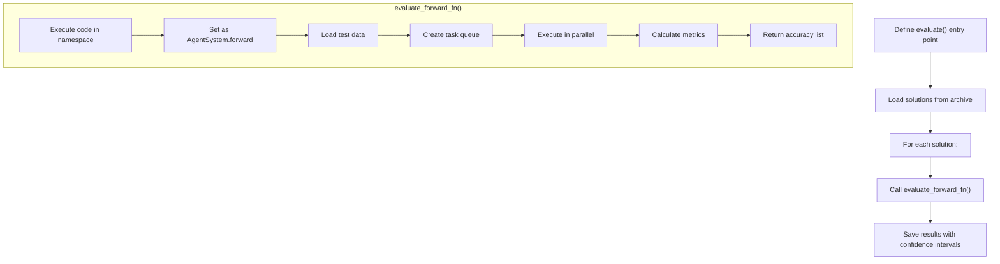

<!-- source: DeepWiki mcp.deepwiki.com · repo ShengranHu/ADAS · page 5 Developer Guide · fetched 2026-10-26 -->

# Developer Guide

<details>
<summary>Relevant source files</summary>

The following files were used as context for generating this wiki page:

- [_arc/search.py](_arc/search.py)
- [_transfer_math/evaluation_DROP.py](_transfer_math/evaluation_DROP.py)
- [_transfer_math/evaluation_gsm8k.py](_transfer_math/evaluation_gsm8k.py)

</details>


This guide provides practical information for developers working with or extending the ADAS (Automated Diagnostic and Architecture System) repository. It covers core development patterns, integration with external APIs, and guidelines for extending the system to new domains.

For information about the system's architecture, see [Core Architecture](#2), and for specific implementation details of problem solvers, see [Problem Solvers](#3).

## Development Environment Setup

Before you begin working with the ADAS codebase, you need to set up your environment with the necessary dependencies and API access.

### Prerequisites

- Python 3.8+
- OpenAI API key with access to required models
- Git (for version control)

### Installation

1. Clone the repository:
   ```bash
   git clone https://github.com/ShengranHu/ADAS
   cd ADAS
   ```

2. Install requirements:
   ```bash
   pip install -r requirements.txt
   ```

3. Set up your OpenAI API key:
   ```bash
   export OPENAI_API_KEY=your_api_key_here
   ```

Sources: [_arc/search.py:1-19](), [_transfer_math/evaluation_DROP.py:1-19](), [_transfer_math/evaluation_gsm8k.py:1-19]()

## Core Components for Developers

### Development Architecture Overview

The following diagram illustrates the key components developers interact with when extending or modifying ADAS:

```mermaid
classDiagram
    class "LLMAgentBase" {
        +output_fields: list
        +agent_name: str
        +role: str
        +model: str
        +temperature: float
        +generate_prompt()
        +query()
    }
    
    class "AgentSystem" {
        +forward(taskInfo)
        +run_examples_and_get_feedback()
        +get_test_output_from_code()
    }
    
    class "DynamicExecution" {
        +evaluate_forward_fn()
        +exec(code)
        +setattr(AgentSystem, "forward", func)
    }
    
    class "EvaluationFramework" {
        +bootstrap_confidence_interval()
        +domain_specific_metrics()
    }
    
    class "OpenAIIntegration" {
        +get_json_response_from_gpt()
        +get_json_response_from_gpt_reflect()
        +backoff handlers
    }
    
    "LLMAgentBase" --> "OpenAIIntegration": uses
    "AgentSystem" <-- "DynamicExecution": configures
    "DynamicExecution" --> "EvaluationFramework": produces metrics via
    "OpenAIIntegration" --> "EvaluationFramework": results feed into
```

Sources: [_arc/search.py:31-154](), [_arc/search.py:156-234](), [_arc/search.py:369-418]()

### Key Classes and Functions

#### LLMAgentBase

The `LLMAgentBase` class serves as the foundation for all LLM-based agents in the system:



Key components:
- `generate_prompt()`: Creates the system message and user prompt
- `query()`: Sends the prompt to the LLM and returns structured `Info` objects
- Error handling for context length and API limitations

Sources: [_arc/search.py:70-154](), [_transfer_math/evaluation_DROP.py:65-134](), [_transfer_math/evaluation_gsm8k.py:65-134]()

#### AgentSystem

The `AgentSystem` class is designed to be configured dynamically with different forward functions:

- For ARC problems: Evaluates code solutions against examples
- For other domains: Acts as a task-specific forwarding mechanism

Sources: [_arc/search.py:156-234](), [_transfer_math/evaluation_DROP.py:135-138](), [_transfer_math/evaluation_gsm8k.py:135-138]()

## Working with the OpenAI API

ADAS incorporates robust patterns for working with the OpenAI API, including rate limiting, error handling, and response formatting.

### Making API Calls

Two primary functions handle API interactions:

1. `get_json_response_from_gpt`: For standard completions
2. `get_json_response_from_gpt_reflect`: For multi-turn reflection

Both include backoff handling for rate limits:



Sources: [_arc/search.py:31-67](), [_transfer_math/evaluation_DROP.py:28-63](), [_transfer_math/evaluation_gsm8k.py:28-63]()

### API Integration Best Practices

When working with the API in your code, follow these guidelines:

| Best Practice | Implementation | Reason |
|---------------|----------------|--------|
| Use backoff decorators | `@backoff.on_exception(backoff.expo, openai.RateLimitError)` | Handles rate limits gracefully |
| Set response format | `response_format={"type": "json_object"}` | Ensures consistent parsing |
| Handle context limits | Check for "maximum context length" in exceptions | Prevent runtime failures |
| Implement fallbacks | Fill missing fields when JSON is incomplete | Maintain robustness |

Sources: [_arc/search.py:31-67](), [_arc/search.py:106-143]()

## Dynamic Code Execution Pattern

One of the most important patterns in ADAS is the dynamic execution of LLM-generated code. This section explains how to work with this pattern.

### The Execution Flow



Sources: [_arc/search.py:369-418](), [_transfer_math/evaluation_DROP.py:157-212](), [_transfer_math/evaluation_gsm8k.py:157-212]()

### Implementation Example

The core implementation pattern follows this sequence:

1. Execute the code string in a controlled namespace
2. Extract the defined function
3. Dynamically attach it to the `AgentSystem` class
4. Create task queue and execute in parallel
5. Calculate metrics

This pattern is consistent across evaluation files with minor domain-specific variations.

Sources: [_arc/search.py:369-418](), [_transfer_math/evaluation_DROP.py:157-212](), [_transfer_math/evaluation_gsm8k.py:157-212]()

## Adding New Problem Domains

To extend ADAS with support for new datasets or problem domains, follow this workflow:



### Step-by-Step Guide

1. **Create domain-specific utilities**:
   - Implement data loading functions
   - Define evaluation metrics for your domain
   - Create helper functions as needed

2. **Implement search functionality**:
   - Create a new directory `_your_domain/`
   - Implement `search.py` following the pattern in existing domains
   - Define appropriate prompts and instructions

3. **Implement evaluation**:
   - Create `evaluation_your_domain.py` in `_transfer_math/`
   - Implement domain-specific evaluation metrics
   - Use the existing dynamic code execution pattern

4. **Initialize archive**:
   - Create example solutions for bootstrapping
   - Define problem templates or adaptation strategies

Sources: [_arc/search.py:237-331](), [_transfer_math/evaluation_DROP.py:139-155](), [_transfer_math/evaluation_gsm8k.py:139-155]()

## Working with Evolutionary Search

The evolutionary search mechanism is central to ADAS. When extending or modifying this functionality:

### Search Algorithm Components



Key components to understand:

1. **Archive**: Stores solutions with their fitness metrics
2. **Prompt generation**: Creates prompts based on archive contents
3. **Reflection**: Improves solutions through self-critique
4. **Debugging**: Fixes solutions that fail to execute
5. **Fitness calculation**: Computes confidence intervals on accuracy

Sources: [_arc/search.py:237-331](), [_arc/search.py:369-418]()

## Evaluation Systems Integration

When developing evaluation systems, follow these guidelines:

### Evaluation Implementation Pattern



This pattern is consistent across evaluation files with domain-specific variations in:
- Data loading
- Metric calculation
- Result formatting

Sources: [_transfer_math/evaluation_DROP.py:139-212](), [_transfer_math/evaluation_gsm8k.py:139-212]()

## Testing and Debugging

When testing and debugging ADAS components, use these approaches:

### Testing Strategies

| Component | Testing Approach | Tools |
|-----------|------------------|-------|
| Code Generation | Unit test with sample prompts | Manual inspection |
| Dynamic Execution | Test with known-good code samples | Try/except blocks |
| API Integration | Mocking OpenAI responses | Backoff mechanism |
| Metric Calculation | Compare with reference implementations | Domain-specific tools |

### Debugging Tips

1. Set `PRINT_LLM_DEBUG = True` for detailed logging
2. Use `args.debug = True` to enable debugging mode
3. Add manual checkpoints in parallel execution code
4. Check exception handling in dynamic code execution
5. Verify JSON parsing of LLM responses

Sources: [_arc/search.py:25-26](), [_transfer_math/evaluation_DROP.py:25-26](), [_transfer_math/evaluation_gsm8k.py:25-26]()

## Performance Optimization

When working with ADAS at scale, consider these optimization strategies:

### Parallel Execution

The codebase uses `ThreadPoolExecutor` for parallel execution. To optimize:

```python
max_workers = min(len(examples), args.max_workers) if args.multiprocessing else 1
with ThreadPoolExecutor(max_workers=max_workers) as executor:
    results = list(tqdm(executor.map(agentSystem.forward, task_queue), total=len(task_queue)))
```

Tune `max_workers` based on your hardware and the task characteristics.

### API Cost Management

To manage API costs:
1. Use smaller models for development and testing
2. Implement caching for repeated queries
3. Monitor token usage
4. Use the smallest context needed for the task

Sources: [_arc/search.py:383-417](), [_transfer_math/evaluation_DROP.py:184-196](), [_transfer_math/evaluation_gsm8k.py:184-196]()

## Common Development Tasks

### Adding a New Agent Type

1. Subclass `LLMAgentBase` with domain-specific methods
2. Define output fields and roles
3. Implement custom prompt generation if needed
4. Create appropriate system instructions

### Implementing a New Evaluation Metric

1. Create a domain-specific scoring function
2. Integrate with `evaluate_forward_fn()`
3. Update result handling and confidence interval calculation
4. Add to the result aggregation code

### Creating New Problem Templates

1. Study existing templates in `arc_prompt.py` or similar files
2. Create domain-appropriate prompts and examples
3. Test with manual execution before full integration
4. Ensure proper error handling for new formats

Sources: [_arc/search.py:70-154](), [_transfer_math/evaluation_DROP.py:65-134](), [_transfer_math/evaluation_gsm8k.py:65-134]()

## Conclusion

This Developer Guide covers the essential patterns and components for working with the ADAS codebase. By understanding the core architecture, integration points, and development patterns, you can effectively extend and modify the system for new problem domains and applications.

For more detailed information on specific system components, refer to:
- [LLM Integration](#5.1) for in-depth OpenAI API integration details
- [Adding New Datasets](#5.2) for comprehensive dataset integration guidance

---

