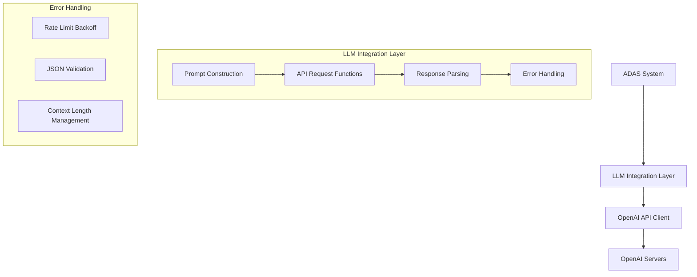
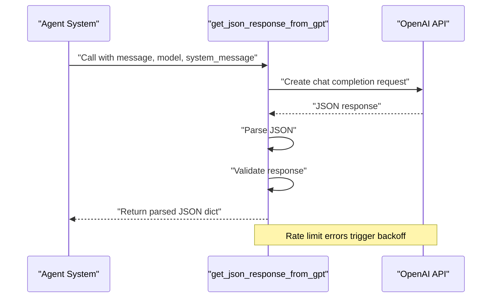
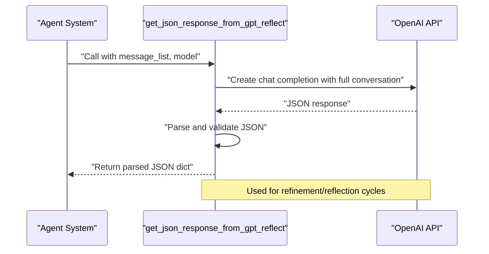
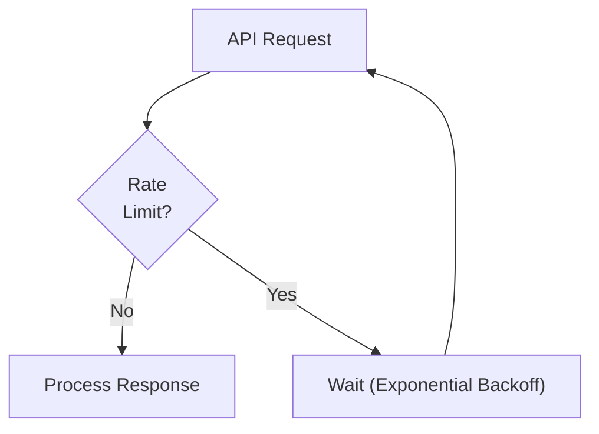
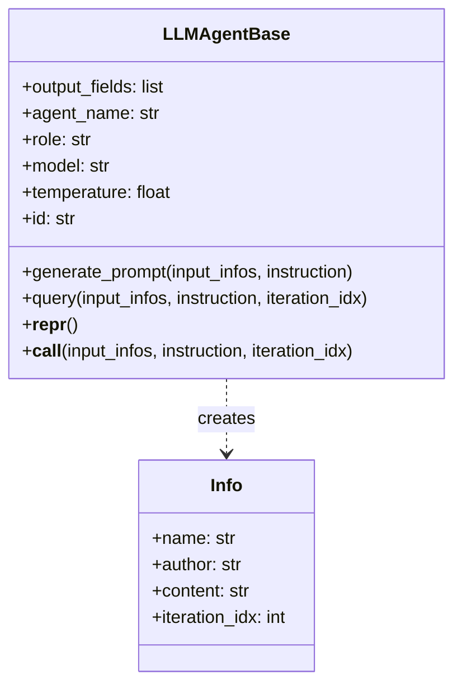
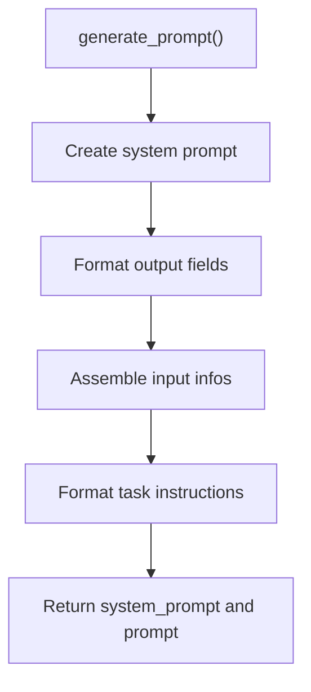
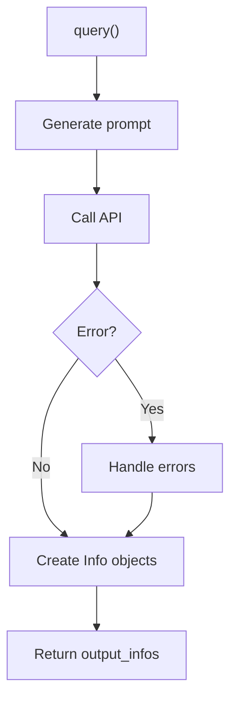
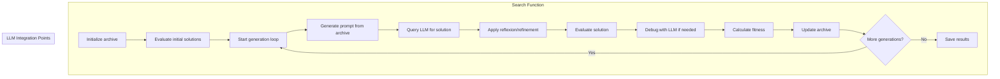

<!-- source: DeepWiki mcp.deepwiki.com · repo ShengranHu/ADAS · page 5.1 LLM Integration · fetched 2026-10-26 -->

# LLM Integration

<details>
<summary>Relevant source files</summary>

The following files were used as context for generating this wiki page:

- [_arc/search.py](_arc/search.py)
- [_drop/search.py](_drop/search.py)
- [_gpqa/search.py](_gpqa/search.py)

</details>


## Purpose and Scope

This document details how the ADAS system integrates with Large Language Models (LLMs) through the OpenAI API. It covers the core mechanisms for sending prompts to LLMs, handling responses, implementing error recovery, and managing rate limits. This documentation focuses on the technical implementation details rather than high-level architectural decisions or specific problem solvers. For information on the evolutionary search algorithm that uses these LLM integrations, see [Evolutionary Search Algorithm](#2.1).

## OpenAI API Integration Overview

The ADAS system communicates with OpenAI's models through a standardized interface that handles:

1. Prompt construction and formatting
2. API request management with backoff
3. Response parsing and error handling
4. Rate limit management
5. Conversation context maintenance



Sources: [_arc/search.py:27-67](), [_drop/search.py:26-67](), [_gpqa/search.py:25-66]()

## Core Request Functions

Two primary functions manage the communication with the OpenAI API:

### Basic API Requests with `get_json_response_from_gpt`

This function handles single-message interactions with the LLM:



Function signature:
```
get_json_response_from_gpt(
    msg,               # The user message/prompt
    model,             # Model identifier (e.g., 'gpt-4o-2024-05-13')
    system_message,    # System role instructions 
    temperature=0.5    # Sampling temperature
)
```

Sources: [_arc/search.py:31-50](), [_drop/search.py:30-50](), [_gpqa/search.py:29-48]()

### Multi-Message Conversations with `get_json_response_from_gpt_reflect`

This function handles multi-turn conversations, particularly for reflection and refinement:



Function signature:
```
get_json_response_from_gpt_reflect(
    msg_list,          # List of message objects with role/content
    model,             # Model identifier
    temperature=0.8    # Higher temperature for creative refinement
)
```

Sources: [_arc/search.py:53-67](), [_drop/search.py:52-67](), [_gpqa/search.py:51-65]()

## Error Handling and Resilience

The LLM integration implements several resilience mechanisms:

### Rate Limit Backoff

The system uses the `backoff` library to automatically retry requests when encountering rate limits, with exponential backoff:



Implementation:
- Both API request functions are decorated with `@backoff.on_exception(backoff.expo, openai.RateLimitError)`
- This automatically retries with increasing wait times between attempts

Sources: [_arc/search.py:31-32](), [_arc/search.py:53-54](), [_drop/search.py:30-31](), [_drop/search.py:52-53](), [_gpqa/search.py:29-30](), [_gpqa/search.py:51-52]()

### JSON Validation and Error Recovery

The system implements validation and recovery for malformed responses:

1. Validates that the response is valid JSON
2. Ensures all required output fields are present
3. Falls back to empty values for missing fields when necessary
4. Removes unexpected fields

Sources: [_arc/search.py:129-142](), [_drop/search.py:112-126](), [_gpqa/search.py:111-125]()

### Context Length Management

The system handles context length errors during model interaction:

1. Detects "maximum context length" errors
2. Raises appropriate exceptions during search mode
3. Enables agent designs to avoid exceeding context limits

Sources: [_arc/search.py:134-135](), [_drop/search.py:117-119](), [_gpqa/search.py:117-118]()

## The LLMAgentBase Class

The `LLMAgentBase` class serves as the foundation for LLM-powered agents in the system:



Key responsibilities:
1. Maintaining agent identity and configuration
2. Generating structured prompts
3. Managing API interactions
4. Handling response parsing and formatting
5. Creating Info objects from responses

Sources: [_arc/search.py:70-153](), [_drop/search.py:69-137](), [_gpqa/search.py:68-136]()

### Prompt Generation

The `generate_prompt` method constructs prompts with consistent formatting:



Key components:
1. System role description
2. Output format instructions
3. Input information formatting
4. Task instructions
5. Optional code formatting instructions

Sources: [_arc/search.py:87-124](), [_drop/search.py:86-108](), [_gpqa/search.py:85-107]()

### Query Execution

The `query` method manages the end-to-end process of interacting with the LLM:



Key steps:
1. Generate prompt using `generate_prompt`
2. Send request to the LLM using `get_json_response_from_gpt`
3. Handle any errors (JSON parsing, missing fields, etc.)
4. Create Info objects from response
5. Return structured output

Sources: [_arc/search.py:126-147](), [_drop/search.py:110-131](), [_gpqa/search.py:109-130]()

## Integration with the Search Algorithm

The LLM integration is a core component of the evolutionary search process:



The search algorithm interacts with LLMs at three key points:

1. Initial solution generation
2. Reflection and refinement cycles
3. Error debugging and recovery

Sources: [_arc/search.py:237-330](), [_drop/search.py:145-240](), [_gpqa/search.py:144-239]()

## Prompt Engineering Patterns

The system employs several prompt engineering techniques to ensure effective LLM interactions:

### Format Instructions

Format instructions ensure consistent, parseable responses:

```
FORMAT_INST = lambda request_keys: f"""Reply EXACTLY with the following JSON format.
{str(request_keys)}
DO NOT MISS ANY REQUEST FIELDS and ensure that your response is a well-formed JSON object!
"""
```

Sources: [_arc/search.py:22](), [_drop/search.py:22](), [_gpqa/search.py:21]()

### Role Descriptions

Role descriptions set the LLM's behavior:

```
ROLE_DESC = lambda role: f"You are a {role}."
```

Sources: [_arc/search.py:23-24](), [_drop/search.py:23](), [_gpqa/search.py:22]()

### Task-Specific Instructions

Task-specific instructions guide the LLM for particular domains:

```
CODE_INST = "You will write code to solve this task by creating a function..."
```

Source: [_arc/search.py:25]()

## Best Practices for LLM Integration

When extending the ADAS system with new LLM integration code:

1. **Always use backoff for API requests** to handle rate limits
2. **Validate JSON responses** and handle parsing errors
3. **Manage context length** with appropriate prompt design
4. **Structure prompts consistently** using the established patterns
5. **Handle LLM errors gracefully** with appropriate fallbacks
6. **Use reflection and refinement** for higher quality outputs

Sources: Analysis of patterns across [_arc/search.py](), [_drop/search.py](), [_gpqa/search.py]()

## Configuration Options

The LLM integration can be configured with several parameters:

| Parameter | Description | Default |
|-----------|-------------|---------|
| `model` | OpenAI model identifier | `'gpt-4o-2024-05-13'` |
| `temperature` | Sampling temperature (0.0-1.0) | `0.5` for basic requests, `0.8` for reflections |
| `max_tokens` | Maximum response length | `1024` or `4096` depending on use case |
| `response_format` | Response format specification | `{"type": "json_object"}` |

Default model options:
- `gpt-4-turbo-2024-04-09`
- `gpt-3.5-turbo-0125`
- `gpt-4o-2024-05-13`

Sources: [_arc/search.py:32-45](), [_arc/search.py:53-62](), [_drop/search.py:31-44](), [_drop/search.py:52-62](), [_gpqa/search.py:30-43](), [_gpqa/search.py:51-61]()

---

