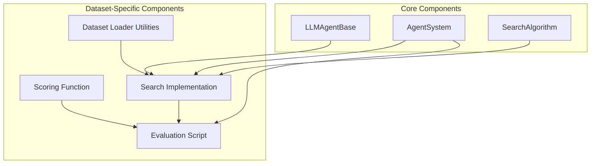
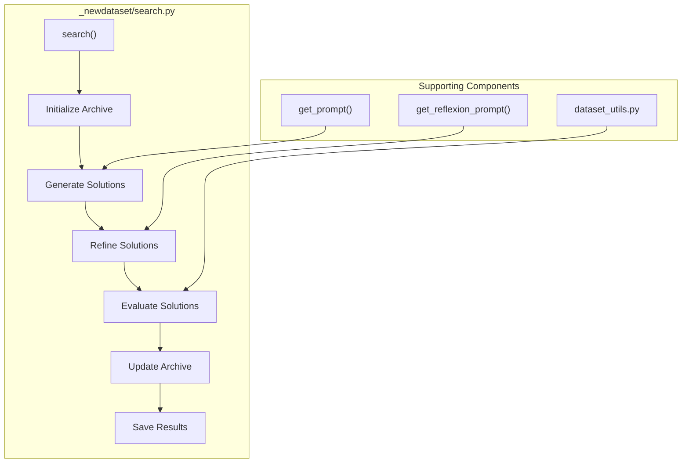
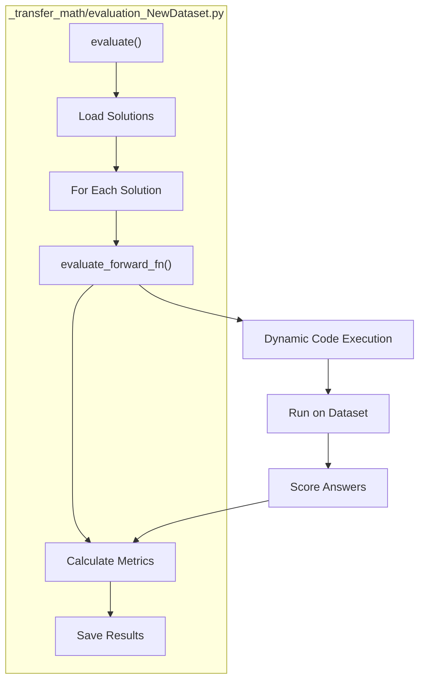
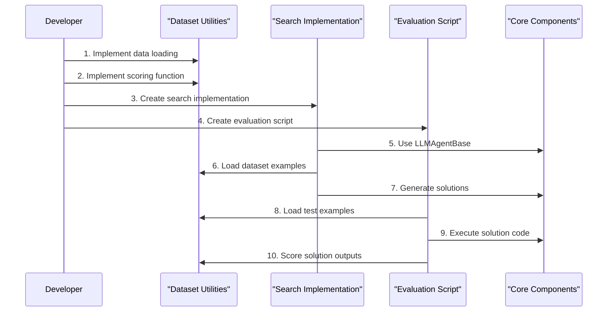

<!-- source: DeepWiki mcp.deepwiki.com · repo ShengranHu/ADAS · page 5.2 Adding New Datasets · fetched 2026-10-26 -->

# Adding New Datasets

<details>
<summary>Relevant source files</summary>

The following files were used as context for generating this wiki page:

- [_arc/search.py](_arc/search.py)
- [_transfer_math/evaluation_Asdiv.py](_transfer_math/evaluation_Asdiv.py)
- [_transfer_math/evaluation_gsm8k.py](_transfer_math/evaluation_gsm8k.py)

</details>


This guide provides a step-by-step approach for extending the ADAS framework to support new datasets or problem domains. It covers the required components for dataset integration, evaluation setup, and search implementation. For information about using existing datasets, see [Problem Solvers](#3) and [Evaluation Systems](#4).

## Dataset Integration Architecture

The ADAS framework is designed to be extensible for new datasets through a modular architecture. Adding a new dataset requires implementing several key components that connect to the core system:



Sources: [_arc/search.py:237-446](), [_transfer_math/evaluation_Asdiv.py:139-212](), [_transfer_math/evaluation_gsm8k.py:139-212]()

## Required Components for New Datasets

To add support for a new dataset, you need to implement the following components:

### 1. Dataset Utilities

For each new dataset, create a dedicated utilities file containing:

```mermaid
classDiagram
    class DatasetUtils {
        +get_all_examples(file_path)
        +score_function(reference_answer, submitted_answer)
        +bootstrap_confidence_interval(results)
        +format_dataset_data(data)
    }
    
    DatasetUtils --> "SearchImplementation"
    DatasetUtils --> "EvaluationScript"
```

Sources: [_transfer_math/evaluation_Asdiv.py:18](), [_transfer_math/evaluation_gsm8k.py:18]()

### 2. Search Implementation

Create a search implementation file that defines how solutions are generated for your dataset:



Sources: [_arc/search.py:237-332]()

### 3. Evaluation Script

Create an evaluation script that tests solutions against your dataset:



Sources: [_transfer_math/evaluation_Asdiv.py:139-212](), [_transfer_math/evaluation_gsm8k.py:139-212]()

## Implementation Guide

### Step 1: Create Dataset Utilities

1. Create a new Python file named `newdataset_utils.py` with the following functions:

```
- get_all_examples(file_path): Loads and formats dataset examples
- score_function(reference, submission): Scores answers for your dataset 
- random_id(): Generates random identifiers for agents
- bootstrap_confidence_interval(acc_list): Calculates confidence intervals
```

Example utility functions should handle dataset-specific formatting requirements.

Sources: [_transfer_math/evaluation_Asdiv.py:18](), [_transfer_math/evaluation_gsm8k.py:18]()

### Step 2: Implement Search Functionality

1. Create a new directory `_newdataset` for your dataset
2. Create a search.py file with the following components:

   a. Import necessary utilities:
   ```python
   from newdataset_utils import get_all_examples, random_id, bootstrap_confidence_interval, score_function
   ```

   b. Implement LLM interaction methods (or reuse existing ones):
   ```python
   def get_json_response_from_gpt(...)
   def get_json_response_from_gpt_reflect(...)
   ```

   c. Define prompts for your dataset:
   ```python
   def get_prompt(archive)
   def get_reflexion_prompt(solution)
   ```

   d. Implement search function to generate solutions:
   ```python
   def search(args)
   ```

   e. Implement local evaluation function:
   ```python
   def evaluate_forward_fn(args, forward_str)
   ```

Sources: [_arc/search.py:31-67](), [_arc/search.py:237-332](), [_arc/search.py:369-418]()

### Step 3: Create Evaluation Script

1. Create a new file in the `_transfer_math` directory named `evaluation_NewDataset.py` with:

   a. Dataset loading and formatting code
   ```python
   # Load dataset examples
   examples = get_all_examples(args.data_filename)
   # Split into validation and test sets
   ```

   b. Evaluation setup
   ```python
   def evaluate(args):
       # Load solutions from file
       # Evaluate each solution on the dataset
       # Save results
   ```

   c. Dynamic code execution implementation
   ```python
   def evaluate_forward_fn(args, forward_str):
       # Set up AgentSystem with the solution code
       # Run evaluation on dataset
       # Calculate metrics
   ```

   d. Command-line interface
   ```python
   if __name__ == "__main__":
       parser = argparse.ArgumentParser()
       # Add command-line arguments
       args = parser.parse_args()
       evaluate(args)
   ```

Sources: [_transfer_math/evaluation_Asdiv.py:139-233](), [_transfer_math/evaluation_gsm8k.py:139-233]()

## Key Considerations

When adding a new dataset, consider the following:

| Consideration | Description |
|---------------|-------------|
| Data Format | Ensure the data loader handles the specific format of your dataset |
| Answer Validation | Implement appropriate scoring logic for your dataset's answer format |
| Solution Structure | Design prompts that guide LLMs to generate appropriate solution formats |
| Resource Usage | Consider parallelization settings for performance optimization |
| Error Handling | Implement robust error handling for various failure modes |

## Integration with Core Components

Your new dataset implementation will integrate with the core ADAS components:

1. **AgentSystem Class**: Your solution code will be dynamically loaded into an AgentSystem for execution
2. **LLMAgentBase**: Used to interact with LLMs during search and evaluation
3. **Search Algorithm**: Follows the evolutionary search pattern established in other dataset implementations
4. **Evaluation Pipeline**: Uses the common pattern of dynamic code execution and parallel processing

Sources: [_arc/search.py:70-154](), [_arc/search.py:156-235](), [_transfer_math/evaluation_Asdiv.py:65-134](), [_transfer_math/evaluation_gsm8k.py:65-134]()

## Example Integration Workflow



By following this guide, you can successfully integrate a new dataset or problem domain into the ADAS framework, enabling evolutionary search and evaluation of LLM-generated solutions for your specific use case.

Sources: [_arc/search.py:237-332](), [_transfer_math/evaluation_Asdiv.py:139-212](), [_transfer_math/evaluation_gsm8k.py:139-212]()