# Page: Overview

# Overview

<details>
<summary>Relevant source files</summary>

The following files were used as context for generating this wiki page:

- [_arc/search.py](_arc/search.py)
- [_drop/search.py](_drop/search.py)
- [_gpqa/search.py](_gpqa/search.py)
- [_mgsm/search.py](_mgsm/search.py)
- [_mmlu/search.py](_mmlu/search.py)

</details>


The Automated Diagnostic and Architecture System (ADAS) is a framework that implements evolutionary search algorithms using Large Language Models (LLMs) to generate, evaluate, and refine solutions for various AI tasks. This page provides a high-level introduction to the system architecture, core components, and supported problem domains.

For detailed information about the shared architectural patterns, see [Core Architecture](#2). For implementation details of specific problem solvers, see [Problem Solvers](#3).

## System Architecture Overview

ADAS is organized around two primary subsystems:

1. **Search Systems**: Generate and evolve solutions for specific problem domains
2. **Evaluation Systems**: Test the generated solutions on benchmark datasets

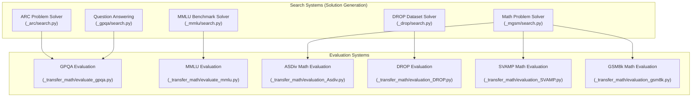

Sources: [_arc/search.py:1-447](), [_drop/search.py:1-362](), [_gpqa/search.py:1-380](), [_mgsm/search.py:1-361](), [_mmlu/search.py:1-389]()

## Core Components

The system is built around several shared components that provide common functionality across all problem domains:

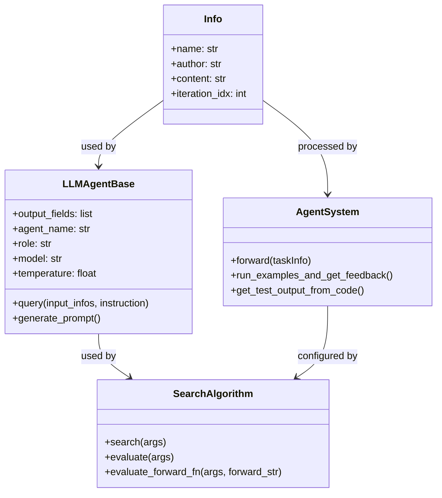

Sources: [_arc/search.py:70-154](), [_arc/search.py:156-234](), [_arc/search.py:20-20](), [_arc/search.py:237-368]()

### Key Classes and Functions

1. **`LLMAgentBase`** - Base class for interacting with LLMs:
   - Handles prompt generation and formatting
   - Manages API interactions with error handling
   - Processes structured information using the `Info` class

2. **`AgentSystem`** - Executes and evaluates generated solutions:
   - Dynamically executes generated code
   - Provides feedback on solution performance
   - Tests solutions against benchmark datasets

3. **`Info`** - Named tuple for structured information exchange:
   - Organizes data between system components
   - Tracks authorship and iteration history

4. **Search Functions** - Core algorithm implementations:
   - `search()` - Generates and evolves solutions
   - `evaluate()` - Tests solutions on benchmark datasets
   - `evaluate_forward_fn()` - Dynamically executes and evaluates generated code

Sources: [_arc/search.py:70-154](), [_arc/search.py:156-234](), [_arc/search.py:20-20](), [_arc/search.py:237-368]()

## Problem Domains

ADAS supports multiple problem domains, each with dedicated search and evaluation components:

| Domain | Description | Main Search File | Evaluation Files |
|--------|-------------|------------------|------------------|
| **ARC** | Abstraction and Reasoning Corpus - visual reasoning puzzles | [_arc/search.py]() | Various evaluators |
| **DROP** | Discrete Reasoning Over Paragraphs - reading comprehension | [_drop/search.py]() | [_transfer_math/evaluation_DROP.py]() |
| **GPQA** | General Purpose Question Answering | [_gpqa/search.py]() | [_transfer_math/evaluate_gpqa.py]() |
| **MGSM** | Mathematical reasoning problems | [_mgsm/search.py]() | [_transfer_math/evaluation_gsm8k.py]() and others |
| **MMLU** | Massive Multitask Language Understanding benchmark | [_mmlu/search.py]() | [_transfer_math/evaluate_mmlu.py]() |

Sources: [_arc/search.py:1-447](), [_drop/search.py:1-362](), [_gpqa/search.py:1-380](), [_mgsm/search.py:1-361](), [_mmlu/search.py:1-389]()

## Solution Generation Workflow

The evolutionary search process follows this general workflow:

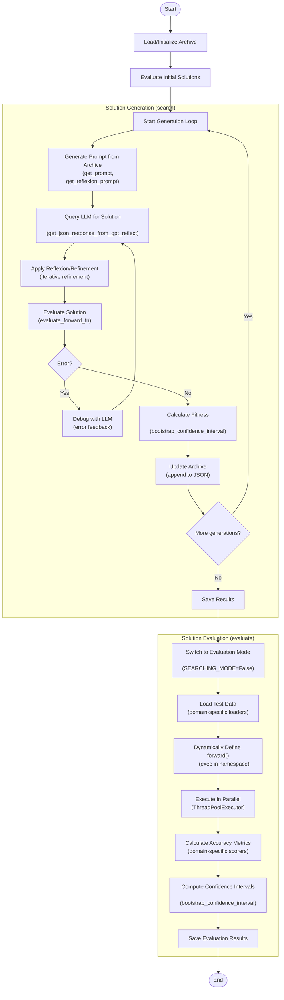

Sources: [_arc/search.py:237-331](), [_arc/search.py:333-367](), [_arc/search.py:369-418]()

## Dynamic Code Execution

A key feature of ADAS is its ability to dynamically execute and evaluate code generated by LLMs:

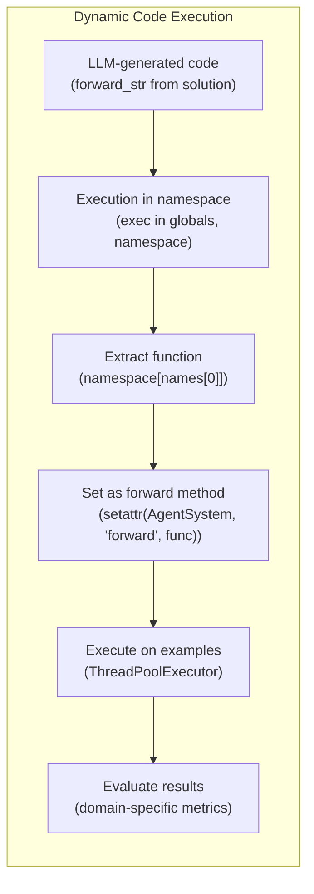

Sources: [_arc/search.py:369-418](), [_drop/search.py:278-332](), [_gpqa/search.py:277-352](), [_mgsm/search.py:278-332](), [_mmlu/search.py:279-359]()

## OpenAI API Integration

ADAS includes robust integration with the OpenAI API, featuring retry mechanisms and error handling:

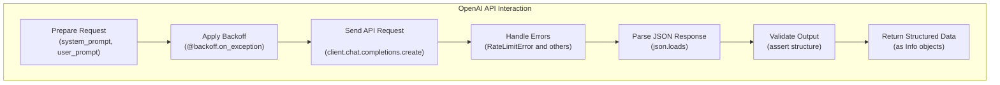

Sources: [_arc/search.py:31-67](), [_drop/search.py:30-66](), [_gpqa/search.py:29-65](), [_mgsm/search.py:30-66](), [_mmlu/search.py:31-67]()

## Summary

ADAS implements an evolutionary approach to generating and refining solutions for various AI tasks using LLMs. The system:

1. **Generates** solutions using LLMs
2. **Evaluates** solutions on benchmark datasets
3. **Refines** solutions through reflection and feedback
4. **Archives** solutions for future reference and improvement

This architecture enables systematic improvement of LLM-based solutions across diverse problem domains, from visual reasoning (ARC) to reading comprehension (DROP) to mathematical problem-solving (MGSM).

Sources: [_arc/search.py:1-447](), [_drop/search.py:1-362](), [_gpqa/search.py:1-380](), [_mgsm/search.py:1-361](), [_mmlu/search.py:1-389]()

---

# Page: Core Architecture

# Core Architecture

<details>
<summary>Relevant source files</summary>

The following files were used as context for generating this wiki page:

- [_arc/search.py](_arc/search.py)
- [_drop/search.py](_drop/search.py)
- [_gpqa/search.py](_gpqa/search.py)

</details>


## Purpose and Scope

This document outlines the shared architectural components and design patterns that form the foundation of the ADAS (Automated Diagnostic and Architecture System) framework. The Core Architecture defines the base classes, interfaces, and utilities that power all problem-solving systems across various domains, from abstract reasoning to question answering and mathematical problem solving.

For specifics about the evolutionary search algorithm used to generate solutions, see [Evolutionary Search Algorithm](#2.1). For details on how LLM-generated code is executed, see [Dynamic Code Evaluation](#2.2).

## Key Components Overview

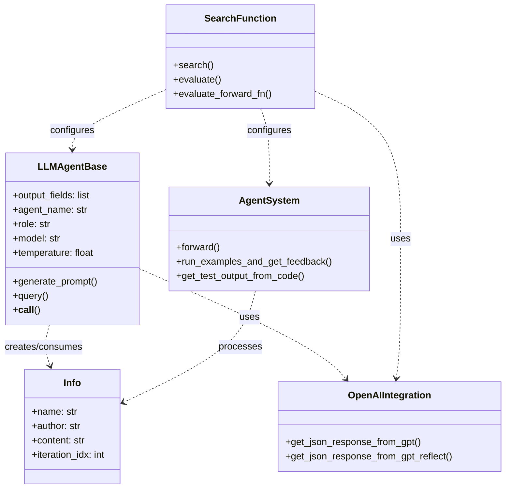

Sources: [_arc/search.py:20](), [_arc/search.py:31-67](), [_arc/search.py:70-154](), [_arc/search.py:156-234](), [_arc/search.py:237-367]()

## Core Components in Detail

### LLMAgentBase

The `LLMAgentBase` class provides the foundation for all LLM-based agents in the system. It manages interactions with language models and handles prompt construction.

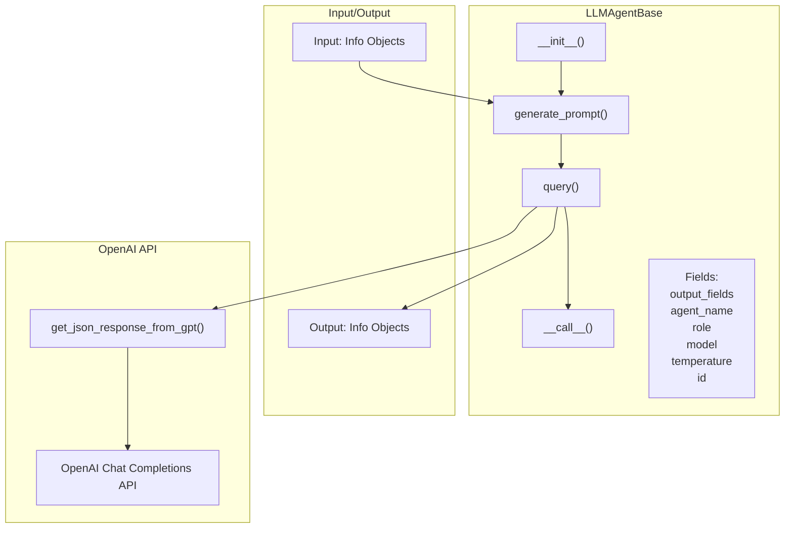

Key responsibilities:
- Initializes with output field specifications, agent name, role, model, and temperature
- Generates structured prompts combining system instructions and input information
- Handles JSON response formatting and error recovery
- Wraps responses in `Info` objects for consistent information flow

Sources: [_arc/search.py:70-154](), [_drop/search.py:69-138](), [_gpqa/search.py:68-137]()

### AgentSystem

The `AgentSystem` class provides an execution environment for dynamically generated code and handles the evaluation of solutions.

Key features:
- Initialized with example problems and test inputs
- Executes LLM-generated code against examples to provide feedback
- Applies the generated code to test inputs to produce answers
- Manages execution errors and provides diagnostic information

Sources: [_arc/search.py:156-234](), [_drop/search.py:140-142](), [_gpqa/search.py:139-142]()

### Info Structure

The `Info` namedtuple provides a standardized way to represent structured information throughout the system:

```python
Info = namedtuple('Info', ['name', 'author', 'content', 'iteration_idx'])
```

Each field serves a specific purpose:
- `name`: Identifies the type of information (e.g., 'task', 'code', 'answer', 'feedback')
- `author`: Tracks who generated the information
- `content`: Contains the actual information content
- `iteration_idx`: Tracks which iteration of the evolutionary process produced this information

This structure enables consistent information exchange between components and tracking of solution evolution.

Sources: [_arc/search.py:20](), [_drop/search.py:20](), [_gpqa/search.py:19]()

### OpenAI Integration

The system integrates with OpenAI's API through two key functions:

1. `get_json_response_from_gpt`: Sends a single prompt to the API and returns a JSON response
2. `get_json_response_from_gpt_reflect`: Sends a conversation history to enable reflection and refinement

Both functions include:
- Exponential backoff for rate limit handling using the `@backoff.on_exception` decorator
- JSON response format enforcement
- Error handling and validation

Sources: [_arc/search.py:31-67](), [_drop/search.py:30-66](), [_gpqa/search.py:29-65]()

## Search and Evaluation Process

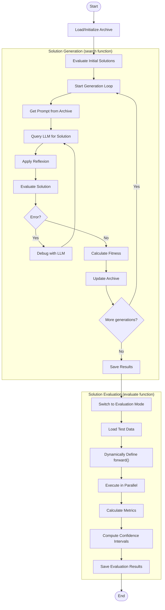

The search and evaluation process follows these key steps:

1. **Archive Initialization and Management**:
   - Loads existing archive or initializes with predefined solutions
   - Each solution in the archive contains code, fitness metrics, and metadata

2. **Solution Generation**:
   - Creates prompts based on the current archive
   - Queries the LLM to generate a new solution
   - Applies reflexion prompts to refine the solution

3. **Solution Evaluation**:
   - Dynamically executes the generated code
   - Computes fitness metrics using bootstrap confidence intervals
   - Tracks solution performance

4. **Archive Updates**:
   - Adds new solutions to the archive
   - Maintains solution history for reference and evolution

Sources: [_arc/search.py:237-367](), [_drop/search.py:145-276](), [_gpqa/search.py:144-275]()

## Dynamic Code Execution

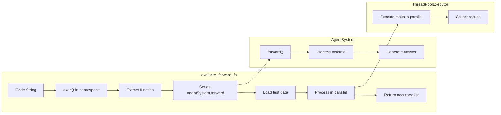

The dynamic code execution mechanism follows these steps:

1. **Function Definition**:
   - The `evaluate_forward_fn` takes LLM-generated code as a string
   - Uses Python's `exec()` to evaluate the code in a controlled namespace
   - Extracts the defined function (typically named `transform` or similar)
   - Dynamically assigns this function as `AgentSystem.forward`

2. **Data Loading and Processing**:
   - Loads task data appropriate for the current domain
   - Creates `AgentSystem` instances and task information
   - Prepares the processing queue

3. **Parallel Execution**:
   - Uses `ThreadPoolExecutor` to process tasks in parallel
   - Handles errors and exceptions at the task level
   - Collects and aggregates results

4. **Confidence Calculation**:
   - Applies bootstrap confidence intervals to compute solution fitness
   - Provides statistical robustness to the evaluation

Sources: [_arc/search.py:369-418](), [_drop/search.py:278-332](), [_gpqa/search.py:277-352]()

## Natural Language to Code Transformation

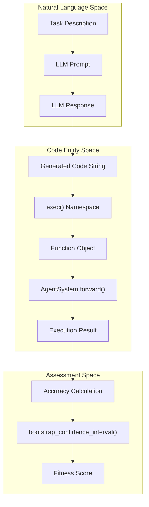

The system bridges natural language instructions and executable code through:

1. **Prompt Engineering**:
   - Formats task descriptions into structured prompts
   - Includes system instructions and format specifications
   - Incorporates previous solutions for evolutionary improvement

2. **Code Generation**:
   - LLM generates Python code based on the prompt
   - Code is designed to implement a specific transformation or solution strategy
   - The main function (usually named based on the domain) processes input information

3. **Dynamic Assignment**:
   - Code is dynamically executed and assigned to `AgentSystem.forward`
   - This creates a callable interface between natural language instructions and executable code

4. **Evaluation and Feedback**:
   - Results are evaluated and feedback is provided
   - This feedback forms the basis for future generations

Sources: [_arc/search.py:31-154](), [_arc/search.py:369-418](), [_drop/search.py:278-332](), [_gpqa/search.py:277-352]()

## Common Utilities and Patterns

### Error Handling and Rate Limiting

The system incorporates robust error handling and rate limiting mechanisms:

- **Backoff Decorator**: Uses `@backoff.on_exception` to handle OpenAI API rate limits
- **Dynamic Error Recovery**: Attempts to recover from LLM response format errors
- **Code Execution Safety**: Isolates code execution in controlled namespaces
- **Debug Loops**: Implements debugging loops to refine solutions when execution errors occur

### Parallel Processing

Parallel processing is used to efficiently evaluate solutions:

- **ThreadPoolExecutor**: Processes multiple examples in parallel
- **Configurable Workers**: Adjusts the number of workers based on problem size and available resources
- **Progress Tracking**: Uses `tqdm` to provide progress feedback

### Confidence Calculation

Statistical robustness is ensured through:

- **Bootstrap Confidence Intervals**: Calculates confidence intervals to assess solution reliability
- **Multiple Evaluations**: Runs multiple evaluations to ensure consistent performance
- **Fitness Reporting**: Reports fitness as statistical measures rather than point estimates

Sources: [_arc/search.py:31-67](), [_arc/search.py:414-418](), [_drop/search.py:315-332](), [_gpqa/search.py:311-352]()

## Component Reuse Across Problem Domains

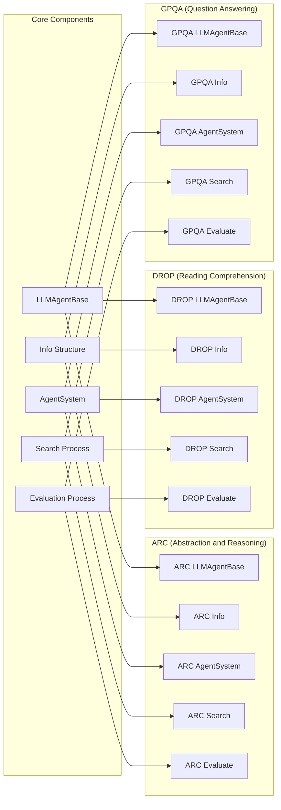

The core architecture components are reused across different problem domains with domain-specific adaptations:

| Component | Implementation | Domain-Specific Customization |
|-----------|----------------|-------------------------------|
| LLMAgentBase | [_arc/search.py:70-154]() | Output format, temperature, prompt structure |
| AgentSystem | [_arc/search.py:156-234]() | Run examples, test outputs, error handling |
| Info Structure | [_arc/search.py:20]() | Consistent across domains |
| Search Process | [_arc/search.py:237-332]() | Archive structure, solution format |
| Evaluation | [_arc/search.py:333-418]() | Domain-specific metrics, data formats |

Sources: [_arc/search.py](), [_drop/search.py](), [_gpqa/search.py]()

## Summary

The Core Architecture of ADAS provides a flexible, extensible framework for developing LLM-powered problem-solving systems. By separating concerns into distinct components and providing consistent interfaces between them, the architecture enables:

1. Reuse of common components across different problem domains
2. Consistent handling of LLM interactions, error recovery, and rate limiting
3. Evolutionary improvement of solutions through structured search and evaluation
4. Dynamic execution of LLM-generated code in controlled environments
5. Statistical evaluation of solution quality

These core components form the foundation upon which domain-specific solvers are built, allowing the system to address a wide range of problem types with minimal duplication of effort.

---

# Page: Evolutionary Search Algorithm

# Evolutionary Search Algorithm

<details>
<summary>Relevant source files</summary>

The following files were used as context for generating this wiki page:

- [_arc/search.py](_arc/search.py)
- [_gpqa/search.py](_gpqa/search.py)
- [_mgsm/search.py](_mgsm/search.py)

</details>


## Purpose and Scope

This document details the evolutionary search algorithm that serves as the core component of the ADAS (Automated Diagnostic and Architecture System). This algorithm is responsible for generating, evaluating, and iteratively improving solutions across different problem domains. The evolutionary search process systematically builds an archive of increasingly effective solutions by leveraging Large Language Models (LLMs) as the mutation and generation engine.

For information about how the dynamically generated code is executed, see [Dynamic Code Evaluation](#2.2).

## Algorithm Overview

The evolutionary search algorithm maintains an archive of solutions, each with associated fitness metrics. It iteratively generates new solutions based on the current archive, evaluates them, and adds promising candidates to the archive. The process continues for a specified number of generations, with each solution being refined through reflection and debugging steps when necessary.

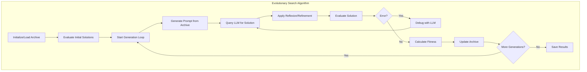

Sources: [_arc/search.py:237-331](), [_gpqa/search.py:144-240](), [_mgsm/search.py:145-241]()

## Core Components

### Search Function

The `search()` function is the primary entry point for the evolutionary search algorithm. It manages the generation loop, archive updates, and the overall search process.

```mermaid
classDiagram
    class "search()" {
        +Load/Initialize Archive
        +Evaluate Initial Solutions
        +Generation Loop
        +Fitness Calculation
        +Archive Management
    }
    
    class "get_json_response_from_gpt_reflect()" {
        +API Interaction
        +Rate Limit Handling
        +JSON Response Parsing
    }
    
    class "evaluate_forward_fn()" {
        +Dynamic Code Execution
        +Parallel Evaluation
        +Accuracy Calculation
    }
    
    class "get_prompt()" {
        +Archive Analysis
        +Prompt Construction
    }
    
    class "get_reflexion_prompt()" {
        +Refinement Guidance
    }
    
    "search()" --> "get_json_response_from_gpt_reflect()"
    "search()" --> "evaluate_forward_fn()"
    "search()" --> "get_prompt()"
    "search()" --> "get_reflexion_prompt()"
```

Sources: [_arc/search.py:237-331](), [_gpqa/search.py:144-240](), [_mgsm/search.py:145-241]()

### Archive Structure

The archive is a JSON file containing an array of solution objects. Each solution includes:

| Field | Description |
|-------|-------------|
| `name` | Solution identifier |
| `thought` | Reasoning behind the solution |
| `code` | The implementation code (Python function) |
| `generation` | Generation number or "initial" |
| `fitness` | Bootstrap confidence interval of accuracy |

The archive preserves the evolutionary history and provides context for generating new solutions.

Sources: [_arc/search.py:238-269](), [_gpqa/search.py:145-176](), [_mgsm/search.py:146-177]()

## Search Process Workflow

### Initialization

The search process begins by either loading an existing archive or initializing a new one with predefined solutions.

```python
file_path = os.path.join(args.save_dir, f"{args.expr_name}_run_archive.json")
if os.path.exists(file_path):
    with open(file_path, 'r') as json_file:
        archive = json.load(json_file)
    # Determine starting generation
    start = archive[-1]['generation'] if "generation" in archive[-1] else 0
else:
    archive = get_init_archive()
    start = 0
```

Initial solutions are evaluated to establish baseline fitness metrics.

Sources: [_arc/search.py:238-246](), [_gpqa/search.py:145-155](), [_mgsm/search.py:146-156]()

### Generation Loop

For each generation, the algorithm:

1. Generates a prompt based on the current archive
2. Queries an LLM to create a new solution
3. Applies reflection and refinement steps
4. Evaluates the solution and calculates fitness
5. Adds the solution to the archive

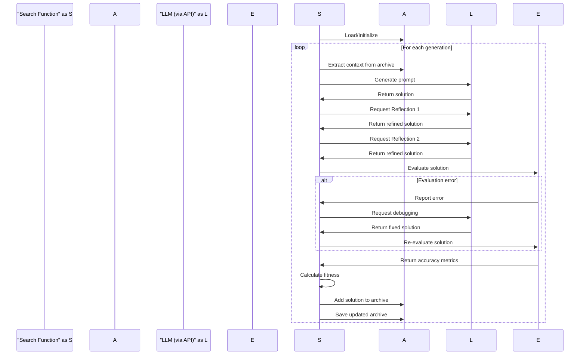

Sources: [_arc/search.py:271-330](), [_gpqa/search.py:179-239](), [_mgsm/search.py:179-240]()

### Solution Generation and Reflection

The solution generation process relies on:

1. Constructing a prompt from the archive using `get_prompt()`
2. Querying the LLM for a new solution
3. Applying two rounds of reflection using `get_reflexion_prompt()`

This reflection mechanism allows the LLM to reconsider and refine its solution.

```python
system_prompt, prompt = get_prompt(archive)
msg_list = [
    {"role": "system", "content": system_prompt},
    {"role": "user", "content": prompt},
]
next_solution = get_json_response_from_gpt_reflect(msg_list, args.model)

Reflexion_prompt_1, Reflexion_prompt_2 = get_reflexion_prompt(archive[-1] if n > 0 else None)
# Reflexion 1
msg_list.append({"role": "assistant", "content": str(next_solution)})
msg_list.append({"role": "user", "content": Reflexion_prompt_1})
next_solution = get_json_response_from_gpt_reflect(msg_list, args.model)
# Reflexion 2
msg_list.append({"role": "assistant", "content": str(next_solution)})
msg_list.append({"role": "user", "content": Reflexion_prompt_2})
next_solution = get_json_response_from_gpt_reflect(msg_list, args.model)
```

Sources: [_arc/search.py:273-289](), [_gpqa/search.py:180-196](), [_mgsm/search.py:181-197]()

### Error Handling and Debugging

If evaluation fails, the algorithm enters a debugging loop:

1. Capture the error message
2. Send the error to the LLM with a debugging prompt
3. Receive a fixed solution
4. Retry evaluation

This continues for a specified number of attempts (`debug_max`).

```python
for _ in range(args.debug_max):
    try:
        acc_list = evaluate_forward_fn(args, next_solution["code"])
        if np.mean(acc_list) < 0.01 and SEARCHING_MODE:
            raise Exception("All 0 accuracy")
        break
    except Exception as e:
        print("During evaluation:")
        print(e)
        msg_list.append({"role": "assistant", "content": str(next_solution)})
        msg_list.append({"role": "user", "content": f"Error during evaluation:\n{e}\nCarefully consider where you went wrong in your latest implementation. Using insights from previous attempts, try to debug the current code to implement the same thought. Repeat your previous thought in 'thought', and put your thinking for debugging in 'debug_thought'"})
        try:
            next_solution = get_json_response_from_gpt_reflect(msg_list, args.model)
        except Exception as e:
            print("During LLM generate new solution:")
            print(e)
            continue
```

Sources: [_arc/search.py:295-316](), [_gpqa/search.py:203-224](), [_mgsm/search.py:204-225]()

### Fitness Calculation

Fitness is calculated using bootstrap confidence intervals on accuracy metrics:

```python
fitness_str = bootstrap_confidence_interval(acc_list)
next_solution['fitness'] = fitness_str
next_solution['generation'] = n + 1
```

This provides a statistical measure of solution quality with confidence bounds.

Sources: [_arc/search.py:317-319](), [_gpqa/search.py:226-228](), [_mgsm/search.py:227-229]()

## Solution Evaluation

### Dynamic Code Execution

The `evaluate_forward_fn()` function handles dynamic execution of solution code:

1. Executes the code string in a controlled namespace
2. Extracts the generated function
3. Sets it as the `forward` method of `AgentSystem`
4. Evaluates it on benchmark problems in parallel
5. Returns accuracy metrics

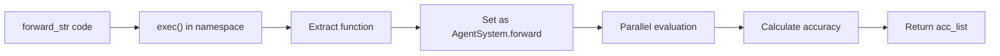

Sources: [_arc/search.py:369-418](), [_gpqa/search.py:277-352](), [_mgsm/search.py:278-332]()

### Parallel Evaluation

The evaluation process uses `ThreadPoolExecutor` to parallelize solution testing:

```python
with ThreadPoolExecutor(max_workers=max_workers) as executor:
    acc_list = list(tqdm(executor.map(call_forward, agent_task_queue), total=len(agent_task_queue)))
```

This allows efficient evaluation across multiple test cases simultaneously.

Sources: [_arc/search.py:414-415](), [_gpqa/search.py:311-312](), [_mgsm/search.py:315-316]()

## LLM Integration

### API Interaction

The system interacts with OpenAI's API through two key functions:

1. `get_json_response_from_gpt()` - For standard queries
2. `get_json_response_from_gpt_reflect()` - For reflection-based interactions

Both functions incorporate error handling and rate limit management through the `@backoff` decorator.

```python
@backoff.on_exception(backoff.expo, openai.RateLimitError)
def get_json_response_from_gpt_reflect(
        msg_list,
        model,
        temperature=0.8
):
    response = client.chat.completions.create(
        model=model,
        messages=msg_list,
        temperature=temperature, max_tokens=4096, stop=None, response_format={"type": "json_object"}
    )
    content = response.choices[0].message.content
    json_dict = json.loads(content)
    assert not json_dict is None
    return json_dict
```

Sources: [_arc/search.py:31-67](), [_gpqa/search.py:29-65](), [_mgsm/search.py:30-66]()

## Implementation Across Problem Domains

The evolutionary search algorithm is implemented consistently across different problem domains:

| Domain | File | Purpose |
|--------|------|---------|
| ARC | `_arc/search.py` | Abstraction and Reasoning Corpus problems |
| GPQA | `_gpqa/search.py` | General-purpose question answering |
| MGSM | `_mgsm/search.py` | Mathematical problem-solving |

While the core algorithm remains consistent, domain-specific adaptations exist in:
- Initialization archives via domain-specific `get_init_archive()`
- Prompt generation via domain-specific `get_prompt()` and `get_reflexion_prompt()`
- Evaluation methodologies for different problem types

Sources: [_arc/search.py](), [_gpqa/search.py](), [_mgsm/search.py]()

## Integration with Support Classes

### `LLMAgentBase` Class

The `LLMAgentBase` class provides the foundation for LLM-based agents:

```mermaid
classDiagram
    class "LLMAgentBase" {
        +output_fields: list
        +agent_name: str
        +role: str
        +model: str
        +temperature: float
        +generate_prompt()
        +query()
        +__call__()
    }
    
    class "Info" {
        +name: str
        +author: str
        +content: str
        +iteration_idx: int
    }
    
    "LLMAgentBase" ..> "Info" : creates/returns
```

This class handles prompt generation and LLM interaction, providing a consistent interface for the evolutionary search algorithm.

Sources: [_arc/search.py:70-153](), [_gpqa/search.py:68-137](), [_mgsm/search.py:69-138]()

### `AgentSystem` Class

The `AgentSystem` class serves as the execution environment for solutions:

- In ARC: Handles example evaluation and test execution
- In GPQA/MGSM: Provides the foundation for solution execution

The dynamic modification of this class's `forward` method enables flexible solution evaluation.

Sources: [_arc/search.py:156-234](), [_gpqa/search.py:139-142](), [_mgsm/search.py:140-143]()

## Conclusion

The evolutionary search algorithm forms the backbone of the ADAS system, providing a flexible and powerful approach to generating and refining solutions across diverse problem domains. By leveraging LLMs within an evolutionary framework, the system can iteratively improve solution quality while maintaining a diverse archive of approaches.

---

# Page: Dynamic Code Evaluation

# Dynamic Code Evaluation

<details>
<summary>Relevant source files</summary>

The following files were used as context for generating this wiki page:

- [_arc/search.py](_arc/search.py)
- [_transfer_math/evaluate_gpqa.py](_transfer_math/evaluate_gpqa.py)
- [_transfer_math/evaluate_mmlu.py](_transfer_math/evaluate_mmlu.py)

</details>


## Purpose and Scope

This page documents the dynamic code evaluation system within ADAS, which enables the framework to safely execute, test, and evaluate code solutions generated by Large Language Models (LLMs). This mechanism serves as a critical bridge between the solution generation process (detailed in [Evolutionary Search Algorithm](#2.1)) and the various evaluation systems that assess solution performance across different domains.

The dynamic code evaluation system is responsible for:
1. Converting string-based code solutions into executable Python functions
2. Attaching these functions to the appropriate agent systems
3. Safely executing them against test datasets
4. Collecting and analyzing performance metrics

Sources: [_arc/search.py:369-418](), [_transfer_math/evaluate_gpqa.py:159-234](), [_transfer_math/evaluate_mmlu.py:161-241]()

## System Architecture

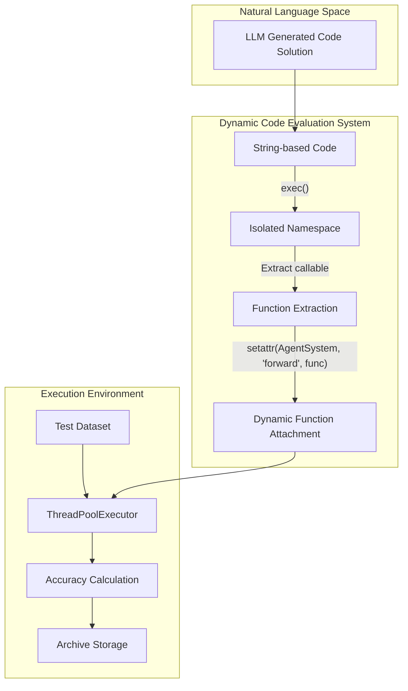

Sources: [_arc/search.py:369-380](), [_transfer_math/evaluate_gpqa.py:159-172](), [_transfer_math/evaluate_mmlu.py:161-172]()

## Core Mechanism

The dynamic code evaluation mechanism centers around the `evaluate_forward_fn` function, which is implemented with slight variations across different problem domains. The function takes a string representation of code (typically containing a function definition) and executes it in a controlled environment.

### Key Steps in the Process

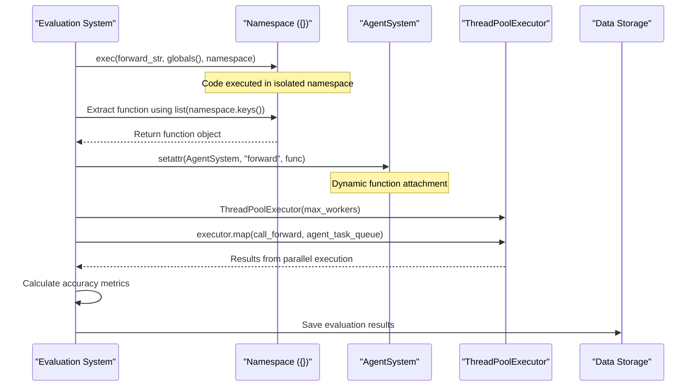

Sources: [_arc/search.py:369-380](), [_arc/search.py:399-418]()

### Isolation and Function Extraction

The system creates an isolated namespace using an empty dictionary and executes the code string within this environment. This provides a controlled context for code execution while ensuring that the main program space remains unaffected.

```python
namespace = {}
exec(forward_str, globals(), namespace)
```

After execution, the function extracts the defined function object:

```python
names = list(namespace.keys())
if len(names) != 1:
    raise AssertionError(f"{len(names)} things in namespace. Please only provide 1")
func = namespace[names[0]]
if not callable(func):
    raise AssertionError(f"{func} is not callable")
```

Sources: [_arc/search.py:372-379](), [_transfer_math/evaluate_gpqa.py:162-169](), [_transfer_math/evaluate_mmlu.py:164-171]()

## Dynamic Function Attachment

Once the function is extracted and validated, it's dynamically attached to the `AgentSystem` class using Python's `setattr` function:

```python
setattr(AgentSystem, "forward", func)
```

This makes the LLM-generated code accessible through the standard agent interface, allowing it to be called like any other method of the `AgentSystem` class.

Sources: [_arc/search.py:380](), [_transfer_math/evaluate_gpqa.py:170](), [_transfer_math/evaluate_mmlu.py:172]()

## Task-Specific Execution

Each domain-specific evaluator builds a task queue and executes the dynamically attached function against appropriate test examples:

### ARC Problem Execution

For ARC problems, the system:
1. Loads test examples from pickle files
2. Creates agent-task pairs
3. Executes the attached function on each task
4. Evaluates the generated output against expected solutions

Sources: [_arc/search.py:382-416]()

### Question-Answering Execution

For GPQA and MMLU tasks, the system:
1. Formats question-answering tasks
2. Creates task info objects
3. Executes the function on each task
4. Interprets responses to extract letter choices (A, B, C, D)
5. Compares with expected answers

Sources: [_transfer_math/evaluate_gpqa.py:172-233](), [_transfer_math/evaluate_mmlu.py:174-240]()

## Parallel Execution

The system leverages Python's `ThreadPoolExecutor` to parallelize the evaluation process, significantly reducing the time required to assess solutions across multiple test examples:

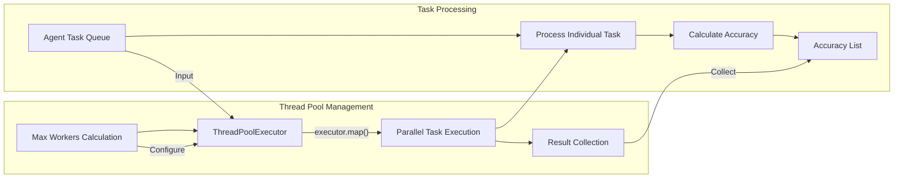

Sources: [_arc/search.py:390-399](), [_arc/search.py:414-415](), [_transfer_math/evaluate_gpqa.py:193-194](), [_transfer_math/evaluate_mmlu.py:200-201]()

## Error Handling and Validation

The system implements extensive error handling to ensure robustness:

1. **Code Execution Validation**: Checks if the executed code produces a valid function
2. **Function Callability**: Verifies that the extracted object is actually callable
3. **Execution Error Recovery**: Captures and reports exceptions during function execution
4. **Result Interpretation**: Gracefully handles format inconsistencies in function outputs

### Error Handling Process Table

| Error Type | Detection Mechanism | Recovery Action | Impact |
|------------|---------------------|-----------------|--------|
| Multiple objects in namespace | `len(names) != 1` | Raise AssertionError | Execution halted |
| Non-callable object | `not callable(func)` | Raise AssertionError | Execution halted |
| Runtime errors in function | `try-except` blocks | Record failure, continue | Individual test marked incorrect |
| Result format inconsistencies | Type checking and parsing | Default to incorrect answer | Individual test marked incorrect |

Sources: [_arc/search.py:375-379](), [_transfer_math/evaluate_gpqa.py:166-170](), [_transfer_math/evaluate_mmlu.py:167-172]()

## Fitness Calculation

After execution, the system calculates fitness metrics using bootstrap confidence intervals:

```python
fitness_str = bootstrap_confidence_interval(acc_list)
```

This provides statistical rigor when evaluating solution performance, accounting for variance in the evaluation process.

Sources: [_arc/search.py:263-264](), [_arc/search.py:417](), [_transfer_math/evaluate_gpqa.py:233](), [_transfer_math/evaluate_mmlu.py:240]()

## Integration with Evolutionary Search

The dynamic code evaluation system is tightly integrated with the evolutionary search process:

1. During the search phase, generated solutions are evaluated to determine their fitness
2. Solutions with higher fitness are retained in the archive
3. Errors during evaluation trigger debugging refinements via the LLM
4. The final archive contains solutions ranked by their performance

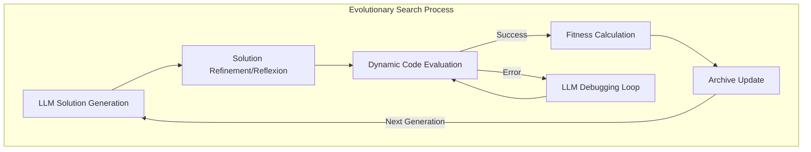

Sources: [_arc/search.py:237-330]()

## Best Practices for Solution Implementation

For LLM-generated solutions to work effectively with the dynamic code evaluation system:

1. **Single Function Definition**: Code should define exactly one function
2. **Proper Function Signature**: The function should accept and return appropriate data types
3. **Self-Contained Logic**: All necessary logic should be contained within the function
4. **No External Dependencies**: The function should not rely on external libraries not available in the evaluation environment
5. **No Side Effects**: The function should not modify global state or external resources

Sources: [_arc/search.py:374-379](), [_transfer_math/evaluate_gpqa.py:165-170](), [_transfer_math/evaluate_mmlu.py:166-172]()

## Domain-Specific Adaptations

The dynamic code evaluation system is adapted for different problem domains:

### ARC Problems
- Evaluates grid transformation functions
- Tests code against grid-based puzzles
- Verifies exact matches with expected outputs

### Question Answering (GPQA, MMLU)
- Evaluates answer selection functions
- Interprets various response formats to extract letter choices
- Compares selected answers against ground truth

This flexible architecture allows the same core mechanism to handle diverse task types while maintaining consistent evaluation procedures.

Sources: [_arc/search.py:382-416](), [_transfer_math/evaluate_gpqa.py:172-234](), [_transfer_math/evaluate_mmlu.py:174-241]()

## Conclusion

The Dynamic Code Evaluation system is a critical component that bridges the gap between LLM-generated code solutions and the automated evaluation of their performance. By safely executing code in controlled environments, dynamically attaching functions to agent systems, and rigorously testing them against benchmark datasets, this system enables the automated improvement of AI solutions through evolutionary search processes.

---

# Page: Problem Solvers

# Problem Solvers

<details>
<summary>Relevant source files</summary>

The following files were used as context for generating this wiki page:

- [_arc/search.py](_arc/search.py)
- [_drop/search.py](_drop/search.py)
- [_gpqa/search.py](_gpqa/search.py)
- [_mgsm/search.py](_mgsm/search.py)
- [_mmlu/search.py](_mmlu/search.py)

</details>


This document provides an overview of the various problem-solving systems within the ADAS repository. It describes the architecture, workflow, and implementation details of the solvers designed for different problem domains. For information about how these solvers are evaluated, see [Evaluation Systems](#4).

## Overview

The ADAS repository contains specialized problem solvers for tackling tasks across various domains. Each solver follows a common architecture but is tailored to specific problem types:

1. **ARC Solver** - Handles the Abstraction and Reasoning Corpus tasks (most important)
2. **DROP Solver** - Addresses the Discrete Reasoning Over Paragraphs dataset
3. **GPQA Solver** - Solves General Purpose Question Answering tasks
4. **MGSM Solver** - Tackles mathematical reasoning problems
5. **MMLU Solver** - Works on Massive Multitask Language Understanding benchmarks

All problem solvers implement an evolutionary search approach that iteratively generates, refines, and evaluates solutions using large language models.

Sources: [_arc/search.py:1-447](), [_drop/search.py:1-362](), [_gpqa/search.py:1-380](), [_mgsm/search.py:1-361](), [_mmlu/search.py:1-389]()

## Problem Solver Architecture

### Problem Solvers in Context

```mermaid
graph TD
    subgraph "ADAS Problem Solvers"
        ARC["ARC Solver
        (_arc/search.py)"]
        DROP["DROP Solver
        (_drop/search.py)"]
        GPQA["GPQA Solver
        (_gpqa/search.py)"]
        MGSM["MGSM Solver
        (_mgsm/search.py)"]
        MMLU["MMLU Solver
        (_mmlu/search.py)"]
    end
    
    subgraph "Core Components"
        LLMBase["LLMAgentBase"]
        AgentSys["AgentSystem"]
        OpenAIUtil["OpenAI Utilities"]
        SearchAlgo["Search Algorithm"]
    end
    
    subgraph "Evaluation Systems"
        EVAL["Evaluation
        (_transfer_math/*.py)"]
    end
    
    ARC --> LLMBase
    DROP --> LLMBase
    GPQA --> LLMBase
    MGSM --> LLMBase
    MMLU --> LLMBase
    
    ARC --> AgentSys
    DROP --> AgentSys
    GPQA --> AgentSys
    MGSM --> AgentSys
    MMLU --> AgentSys
    
    ARC --> SearchAlgo
    DROP --> SearchAlgo
    GPQA --> SearchAlgo
    MGSM --> SearchAlgo
    MMLU --> SearchAlgo
    
    LLMBase --> OpenAIUtil
    
    ARC --> EVAL
    DROP --> EVAL
    GPQA --> EVAL
    MGSM --> EVAL
    MMLU --> EVAL
```

Sources: [_arc/search.py:31-153](), [_drop/search.py:30-138](), [_gpqa/search.py:30-138](), [_mgsm/search.py:30-138](), [_mmlu/search.py:30-138]()

### Common Components

All problem solvers share key architectural components:

1. **LLMAgentBase** - Base class for LLM-powered agents that generate solutions
2. **AgentSystem** - Framework for executing and evaluating generated code
3. **Search Algorithm** - Evolutionary search process for solution generation and refinement
4. **Evaluation** - Mechanisms to test and score generated solutions

The problem solvers use two main OpenAI API interaction functions:
- `get_json_response_from_gpt()` - Standard query to the LLM
- `get_json_response_from_gpt_reflect()` - Supports iterative reflection and refinement

```mermaid
classDiagram
    class LLMAgentBase {
        +output_fields: list
        +agent_name: str
        +role: str
        +model: str
        +temperature: float
        +id: str
        +generate_prompt()
        +query()
        +__call__()
    }
    
    class AgentSystem {
        +examples
        +test_input
        +run_examples_and_get_feedback()
        +get_test_output_from_code()
        +forward() [dynamically set]
    }
    
    class Info {
        +name: str
        +author: str
        +content: str
        +iteration_idx: int
    }
    
    class SearchAlgorithm {
        +search()
        +evaluate()
        +evaluate_forward_fn()
    }
    
    LLMAgentBase --> Info: produces/consumes
    AgentSystem --> Info: processes
    SearchAlgorithm --> LLMAgentBase: uses
    SearchAlgorithm --> AgentSystem: configures
```

Sources: [_arc/search.py:70-153](), [_drop/search.py:69-138](), [_gpqa/search.py:68-138](), [_mgsm/search.py:68-138](), [_mmlu/search.py:68-138]()

## Search Workflow

Each problem solver follows a similar workflow:

```mermaid
flowchart TD
    Start([Start]) --> LoadArchive[Load/Initialize Archive]
    LoadArchive --> EvalInitialArchive[Evaluate Initial Solutions]
    EvalInitialArchive --> GenerationLoop[Start Generation Loop]
    
    subgraph "Solution Generation"
        GenerationLoop --> GeneratePrompt[Generate Prompt from Archive]
        GeneratePrompt --> QueryLLM[Query LLM for Solution]
        QueryLLM --> Reflexion1[First Reflexion]
        Reflexion1 --> Reflexion2[Second Reflexion]
        Reflexion2 --> EvaluateSolution[Evaluate Solution]
        EvaluateSolution --> ErrorCheck{Error?}
        ErrorCheck -->|Yes| Debug[Debug with LLM]
        Debug --> QueryLLM
        ErrorCheck -->|No| CalculateFitness[Calculate Fitness]
        CalculateFitness --> UpdateArchive[Update Archive]
        UpdateArchive --> NextGeneration{More\ngenerations?}
        NextGeneration -->|Yes| GenerationLoop
        NextGeneration -->|No| SaveResults[Save Results]
    end
    
    SaveResults --> EvalMode[Switch to Evaluation Mode]
    
    subgraph "Solution Evaluation"
        EvalMode --> LoadTestData[Load Test Data]
        LoadTestData --> DefineForward[Define forward() Function]
        DefineForward --> RunInParallel[Run in Parallel]
        RunInParallel --> CalculateMetrics[Calculate Metrics]
        CalculateMetrics --> ConfidenceIntervals[Compute Confidence Intervals]
        ConfidenceIntervals --> SaveEvalResults[Save Evaluation Results]
    end
    
    SaveEvalResults --> End([End])
```

Sources: [_arc/search.py:237-366](), [_drop/search.py:145-276](), [_gpqa/search.py:144-275](), [_mgsm/search.py:145-276](), [_mmlu/search.py:146-276]()

## Dynamic Code Execution

A key feature of all problem solvers is the dynamic execution of LLM-generated code:

```mermaid
flowchart LR
    subgraph "Dynamic Code Evaluation"
        A["LLM Generated Code (forward_str)"] --> B["exec(forward_str, globals(), namespace)"]
        B --> C["Extract function object"]
        C --> D["Set as AgentSystem.forward"]
        D --> E["Execute on test inputs"]
        E --> F["Calculate accuracy metrics"]
    end
```

Sources: [_arc/search.py:369-418](), [_drop/search.py:278-332](), [_gpqa/search.py:277-352](), [_mgsm/search.py:278-331](), [_mmlu/search.py:279-358]()

## Domain-Specific Solvers

### ARC Problem Solver

The ARC (Abstraction and Reasoning Corpus) solver is the most important component of the ADAS system. It tackles abstract visual reasoning tasks where the system must identify and apply a transformation rule from examples, then apply it to novel test inputs.

Key characteristics of the ARC solver:
- Works with grid-based inputs and outputs represented as nested lists of integers
- Generates Python code that defines a `transform` function
- Tests solutions against example inputs to verify correctness
- Produces solutions that can generalize to unseen test cases

```mermaid
graph TD
    subgraph "ARC Solver Workflow"
        Input["Input Grid\n(list[list[int]])"] --> CodeGen["Generate transform() function"]
        CodeGen --> ExecCode["Execute Code"]
        ExecCode --> Validate["Validate against examples"]
        Validate --> Apply["Apply to test input"]
        Apply --> Output["Output Grid\n(list[list[int]])"]
    end
    
    subgraph "ARC AgentSystem"
        RunExamples["run_examples_and_get_feedback()"]
        GetTestOutput["get_test_output_from_code()"]
    end
    
    Validate --> RunExamples
    Apply --> GetTestOutput
```

Sources: [_arc/search.py:156-234]()

### Question Answering Solvers

#### DROP Solver

The DROP (Discrete Reasoning Over Paragraphs) solver addresses reading comprehension tasks that require discrete reasoning:

- Input: Paragraph text and a question
- Output: An answer extracted or derived from the paragraph
- Evaluation: F1 score between predicted and correct answers

#### GPQA Solver

The GPQA (General Purpose Question Answering) solver handles multiple-choice questions:

- Input: Question text and four answer choices (A, B, C, D)
- Output: A single letter corresponding to the correct answer
- Evaluation: Accuracy score (correct/total)

```mermaid
graph TD
    subgraph "Question Answering Solvers"
        DROP_Input["DROP Input:\nParagraph + Question"] --> DROP_Process["Text Reasoning"]
        DROP_Process --> DROP_Output["Free-form Answer"]
        
        GPQA_Input["GPQA Input:\nQuestion + Choices"] --> GPQA_Process["Multiple Choice Processing"]
        GPQA_Process --> GPQA_Output["Answer Letter (A/B/C/D)"]
    end
```

Sources: [_drop/search.py:140-143](), [_gpqa/search.py:139-142]()

### Math Problem Solvers

#### MGSM Solver

The MGSM (Math GSM) solver tackles mathematical word problems:

- Input: Math word problem text
- Output: Numerical answer (integer)
- Evaluation: Exact match against correct solution

#### MMLU Solver

While MMLU (Massive Multitask Language Understanding) covers multiple domains, its math component handles multiple-choice math problems:

- Input: Question and four choices
- Output: Letter corresponding to the correct answer
- Evaluation: Accuracy score across various subject domains

```mermaid
graph TD
    subgraph "Math Problem Solvers"
        MGSM_Input["MGSM Input:\nMath Word Problem"] --> MGSM_Process["Numerical Reasoning"]
        MGSM_Process --> MGSM_Output["Integer Answer"]
        
        MMLU_Input["MMLU Input:\nMulti-domain Question"] --> MMLU_Process["Domain-specific Reasoning"]
        MMLU_Process --> MMLU_Output["Multiple Choice Answer"]
    end
```

Sources: [_mgsm/search.py:140-143](), [_mmlu/search.py:141-144]()

## Solution Generation

All solvers employ an evolutionary search approach to generate and refine solutions:

1. **Archive Initialization**: Load or create initial solution archive
2. **Evaluation Loop**: Evaluate solutions from the archive
3. **Generation Loop**: For each generation:
   - Generate prompt using the archive
   - Query LLM to generate solution
   - Apply reflexion for refinement
   - Evaluate solution through dynamic code execution
   - Debug if necessary
   - Calculate fitness
   - Update archive with new solution
4. **Final Evaluation**: Test solutions on evaluation datasets

### Reflexion and Debugging

A key aspect of the solution generation is the reflective debugging process:

```mermaid
flowchart TB
    subgraph "Solution Refinement Process"
        InitSol["Initial Solution"] --> Reflect1["First Reflection\n(High-level improvements)"]
        Reflect1 --> Reflect2["Second Reflection\n(Detail refinements)"]
        Reflect2 --> Eval["Evaluation"]
        Eval --> Error{Error?}
        Error -->|Yes| Debug["Debug Reflection\n(Error analysis)"]
        Debug --> NewSol["Revised Solution"]
        Error -->|No| Final["Final Solution"]
    end
```

The refinement process involves:
1. First reflection - High-level assessment of the solution approach
2. Second reflection - Detailed refinements to the implementation
3. Error-driven debugging - If evaluation fails, provide error information to the LLM for debugging

Sources: [_arc/search.py:280-289](), [_drop/search.py:189-197](), [_gpqa/search.py:188-196](), [_mgsm/search.py:189-197](), [_mmlu/search.py:190-198]()

## Parallel Evaluation

For efficient evaluation, all problem solvers use parallel processing:

```
With ThreadPoolExecutor(max_workers=max_workers) as executor:
    results = list(tqdm(executor.map(function, inputs), total=len(inputs)))
```

The parallel evaluation approach:
1. Creates a pool of worker threads (configurable maximum)
2. Maps the forward function over all task inputs
3. Processes results in parallel to calculate metrics
4. Computes bootstrap confidence intervals for robust performance estimates

Sources: [_arc/search.py:414-415](), [_drop/search.py:315-316](), [_gpqa/search.py:311-312](), [_mgsm/search.py:315-316](), [_mmlu/search.py:318-319]()

## Configuration and Usage

Each problem solver accepts configuration parameters through command-line arguments:

| Parameter | Description |
|-----------|-------------|
| `--data_filename` | Path to dataset file |
| `--valid_size` | Number of validation examples |
| `--test_size` | Number of test examples |
| `--n_repreat` | Number of repetitions for evaluation |
| `--multiprocessing` | Whether to use parallel processing |
| `--max_workers` | Maximum number of worker threads |
| `--save_dir` | Directory to save results |
| `--expr_name` | Experiment name |
| `--n_generation` | Number of generations for evolution |
| `--debug_max` | Maximum number of debug attempts |
| `--model` | LLM model to use (e.g., gpt-4o-2024-05-13) |

Sources: [_arc/search.py:422-437](), [_drop/search.py:336-351](), [_gpqa/search.py:356-371](), [_mgsm/search.py:336-351](), [_mmlu/search.py:363-379]()

---

# Page: ARC Solver

# ARC Solver

<details>
<summary>Relevant source files</summary>

The following files were used as context for generating this wiki page:

- [_arc/search.py](_arc/search.py)

</details>


## Purpose and Scope

This document details the ARC (Abstraction and Reasoning Corpus) Solver, the most important component in the ADAS repository. The ARC Solver is an evolutionary search system that generates Python solutions for abstract visual reasoning problems. It leverages Large Language Models to iteratively improve solutions, using a reflection-based approach to enhance performance.

For information about other problem solvers in this repository, such as question answering solvers, see [Question Answering Solvers](#3.2) or math problem solvers, see [Math Problem Solvers](#3.3).

Sources: [_arc/search.py:1-446]()

## System Architecture

The ARC Solver follows an evolutionary search pattern where solutions are iteratively generated, evaluated, and refined. It consists of four core components:

1. **LLMAgentBase**: Base class that handles LLM interactions and prompt generation
2. **AgentSystem**: Executes and evaluates the generated solutions on ARC problems
3. **Search Algorithm**: Coordinates the evolutionary process and maintains solution archives
4. **Evaluation System**: Assesses solution quality on validation and test datasets

```mermaid
flowchart TD
    subgraph "ARC Solver Architecture"
        A["search() Function"] --> |"Initializes and manages"| B["Archive Management"]
        A --> |"Calls"| C["LLMAgentBase"]
        A --> |"Uses"| D["Reflexion Mechanism"]
        A --> |"Calls"| E["evaluate_forward_fn()"]
        
        B --> |"Stores"| F["Solution Archive"]
        
        C --> |"Queries"| G["OpenAI API"]
        
        E --> |"Uses"| H["AgentSystem"]
        E --> |"Parallelizes with"| I["ThreadPoolExecutor"]
        
        H --> |"Executes"| J["Dynamic Code Execution"]
        
        K["evaluate() Function"] --> |"Loads"| F
        K --> |"Calls"| E
    end
```

Sources: [_arc/search.py:70-446]()

## LLMAgentBase

The `LLMAgentBase` class manages all interactions with the language model and handles prompt construction. It is responsible for:

1. Formatting inputs and system prompts
2. Querying the language model via the OpenAI API
3. Processing and structuring responses

```mermaid
classDiagram
    class LLMAgentBase {
        +output_fields: list
        +agent_name: str
        +role: str
        +model: str
        +temperature: float
        +id: str
        +generate_prompt(input_infos, instruction): tuple
        +query(input_infos, instruction, iteration_idx): list
        +__repr__(): str
        +__call__(input_infos, instruction, iteration_idx): list
    }
    
    class Info {
        +name: str
        +author: str
        +content: str
        +iteration_idx: int
    }
    
    LLMAgentBase ..> Info : "creates and processes"
```

Key methods:
- `generate_prompt()`: Constructs system prompt and user prompt from input information
- `query()`: Sends queries to the language model and processes responses

Sources: [_arc/search.py:70-153]()

## AgentSystem

The `AgentSystem` class handles the execution and evaluation of generated code solutions. Its primary responsibilities are:

1. Running generated code against example ARC problems
2. Providing feedback on the correctness of solutions
3. Executing code against test inputs to evaluate final performance

```mermaid
classDiagram
    class AgentSystem {
        +examples: list
        +test_input: list
        +run_examples_and_get_feedback(code): tuple
        +get_test_output_from_code(code): Info
        +forward(taskInfo): list[list[int]]
    }
    
    class Info {
        +name: str
        +author: str
        +content: str
        +iteration_idx: int
    }
    
    AgentSystem ..> Info : "generates feedback as"
```

Key methods:
- `run_examples_and_get_feedback()`: Evaluates code against example problems and provides detailed feedback
- `get_test_output_from_code()`: Executes code on test inputs and returns the output
- `forward()`: Dynamically defined method that contains the transformation function

Sources: [_arc/search.py:156-234]()

## Evolutionary Search Process

The `search()` function implements the evolutionary search algorithm that lies at the core of the ARC Solver. It uses the following process:

1. Initialize or load an archive of existing solutions
2. Evaluate initial solutions if not already evaluated
3. Generate new solutions using the LLM
4. Apply reflection to improve solutions
5. Debug and fix errors in solutions
6. Evaluate solutions and calculate fitness
7. Update the archive with the new solutions
8. Repeat steps 3-7 for a specified number of generations

```mermaid
flowchart TD
    subgraph "ARC Solver Search Algorithm"
        A["Start search()"] --> B["Load Archive or Initialize"]
        B --> C["Evaluate Initial Solutions"]
        C --> D["Enter Generation Loop"]
        
        D --> E["Generate Prompt from Archive"]
        E --> F["Query LLM for Solution"]
        F --> G["Apply Reflexion (2 rounds)"]
        
        G --> H{"Evaluation\nSuccessful?"}
        H -->|"No"| I["Debug with LLM"]
        I --> F
        
        H -->|"Yes"| J["Calculate Fitness"]
        J --> K["Update Archive"]
        K --> L{"More\nGenerations?"}
        L -->|"Yes"| D
        L -->|"No"| M["Save Results"]
        M --> N["End search()"]
    end
```

The search algorithm incorporates multiple reflection steps to refine solutions, and includes error handling to debug solutions that fail during evaluation.

Sources: [_arc/search.py:237-331]()

## Dynamic Code Evaluation

The ARC Solver uses a dynamic code execution mechanism to evaluate generated solutions. This is implemented in the `evaluate_forward_fn()` function:

1. Execute the generated code in a separate namespace
2. Extract the transformation function
3. Attach it to the `AgentSystem` class as the `forward` method
4. Load ARC problems from a dataset
5. Parallelize evaluation across multiple problems
6. Calculate accuracy and confidence intervals

```mermaid
flowchart TD
    subgraph "Dynamic Code Evaluation"
        A["evaluate_forward_fn()"] --> B["Execute Code in Namespace"]
        B --> C["Extract transform Function"]
        C --> D["Set as AgentSystem.forward"]
        
        D --> E["Load ARC Problems"]
        E --> F["Create Task Queue"]
        
        F --> G["ThreadPoolExecutor"]
        G --> H["Parallel Evaluation"]
        
        H --> I["Calculate Accuracy"]
        I --> J["Return Results"]
    end
```

Sources: [_arc/search.py:369-418]()

## JSON Response Handling

The system includes specialized functions for interacting with the OpenAI API and handling JSON responses:

```mermaid
flowchart TD
    subgraph "OpenAI API Interaction"
        A["get_json_response_from_gpt()"] --> B["Send Request to OpenAI API"]
        B --> C["Handle Rate Limits"]
        C --> D["Parse JSON Response"]
        D --> E["Return Structured Data"]
        
        F["get_json_response_from_gpt_reflect()"] --> G["Process Message List"]
        G --> H["Send Request to OpenAI API"]
        H --> I["Handle Rate Limits"]
        I --> J["Parse JSON Response"]
        J --> K["Return Structured Data"]
    end
```

Both functions use the `@backoff.on_exception` decorator to handle rate limit errors from the OpenAI API, implementing exponential backoff.

Sources: [_arc/search.py:31-67]()

## Data Structures

The ARC Solver uses several key data structures:

1. **Info namedtuple**: A lightweight container for information produced and consumed by agents
2. **Archive**: A list of JSON objects representing solutions, maintained across generations
3. **ARC Problems**: Structured as examples (input/output pairs) and test inputs

```mermaid
classDiagram
    class Info {
        +name: str
        +author: str
        +content: str
        +iteration_idx: int
    }
    
    class Solution {
        +name: str
        +thought: str
        +code: str
        +fitness: str
        +generation: int
    }
    
    class ARCProblem {
        +task: str
        +examples: list
        +test_input: list
    }
    
    Solution --> Info : "converted to/from"
    ARCProblem --> AgentSystem : "processed by"
```

Sources: [_arc/search.py:20-20](), [_arc/search.py:395-397]()

## Workflow Example

The complete workflow of the ARC Solver operates as follows:

```mermaid
sequenceDiagram
    participant M as Main
    participant S as search()
    participant A as Archive
    participant L as LLM
    participant E as evaluate_forward_fn()
    participant AS as AgentSystem
    
    M->>S: Call search() with args
    S->>A: Load or initialize archive
    
    loop Initial Evaluation
        S->>E: Evaluate initial solutions
        E->>AS: Set transform function
        E->>S: Return accuracy metrics
        S->>A: Update solution fitness
    end
    
    loop For n_generation
        S->>L: Generate prompt from archive
        L->>S: Return solution
        
        S->>L: Request reflexion 1
        L->>S: Return improved solution
        
        S->>L: Request reflexion 2
        L->>S: Return final solution
        
        S->>E: Evaluate solution
        
        alt Error during evaluation
            S->>L: Request debug
            L->>S: Return fixed solution
            S->>E: Re-evaluate solution
        end
        
        E->>S: Return accuracy metrics
        S->>A: Add solution to archive
        S->>A: Save updated archive
    end
    
    M->>S: Call evaluate() with args
    
    loop Evaluation
        S->>A: Load archive and evaluation results
        S->>E: Evaluate solutions on test data
        E->>S: Return accuracy metrics
        S->>A: Save evaluation results
    end
```

Sources: [_arc/search.py:237-446]()

## Usage Example

To use the ARC Solver:

1. Prepare ARC validation and test data
2. Configure parameters via command-line arguments
3. Run `search()` to generate and evolve solutions
4. Run `evaluate()` to assess solutions on test data

The main script accepts various command-line arguments:

| Argument | Description | Default |
|----------|-------------|---------|
| `--val_data_path` | Path to validation data | `sampled_arc_val_data.pkl` |
| `--test_data_path` | Path to test data | `sampled_arc_test_data.pkl` |
| `--n_repreat` | Number of repetitions for evaluation | 5 |
| `--multiprocessing` | Enable multiprocessing | True |
| `--max_workers` | Maximum number of workers for ThreadPoolExecutor | 32 |
| `--save_dir` | Directory to save results | `results/` |
| `--expr_name` | Experiment name | `arc_gpt3.5_results` |
| `--n_generation` | Number of generations for search | 25 |
| `--reflect_max` | Maximum number of reflection steps | 3 |
| `--debug_max` | Maximum number of debugging attempts | 3 |
| `--model` | OpenAI model to use | `gpt-4o-2024-05-13` |

Sources: [_arc/search.py:421-446]()

## Integration with Evolutionary Systems

The ARC Solver is an implementation of an evolutionary algorithm where:

1. The LLM generates "offspring" solutions based on an archive of previous solutions
2. Solutions are evaluated on ARC problems to determine their "fitness"
3. The archive acts as a "population" that evolves over generations
4. Reflection and debugging provide mechanisms for "mutation" and improvement

The system follows the general evolutionary search process described in [Evolutionary Search Algorithm](#2.1) but is specialized for solving ARC problems.

Sources: [_arc/search.py:237-331]()

---

# Page: Question Answering Solvers

# Question Answering Solvers

<details>
<summary>Relevant source files</summary>

The following files were used as context for generating this wiki page:

- [_drop/search.py](_drop/search.py)
- [_gpqa/search.py](_gpqa/search.py)

</details>


## Purpose and Scope

This document provides technical details about the Question Answering (QA) solvers in the ADAS repository. These solvers are designed to tackle different types of QA tasks through evolutionary search algorithms that generate, evaluate, and refine solutions using Large Language Models (LLMs). 

This page specifically covers two QA solver implementations:
1. DROP (Discrete Reasoning Over Paragraphs) solver
2. GPQA (General Purpose Question Answering) solver

For information about Math Problem Solvers, see [Math Problem Solvers](#3.3).
For information about the core evolutionary search algorithm, see [Evolutionary Search Algorithm](#2.1).

## Architecture Overview

The QA solvers follow the general ADAS architecture but implement specific logic for question answering tasks. They leverage LLMs to generate code for solving QA problems, then evaluate and refine these solutions through an evolutionary process.

### High-Level System Architecture

```mermaid
flowchart TD
    subgraph "Question Answering Solvers"
        DROP["DROP Solver
        (_drop/search.py)"]
        GPQA["GPQA Solver
        (_gpqa/search.py)"]
    end

    subgraph "Component Structure"
        LLMAgent["LLMAgentBase Class"]
        AgentSys["AgentSystem Class"]
        SearchAlgo["Search Function"]
        EvalFn["Evaluate Function"]
        DynamicExec["Dynamic Code Execution"]
    end

    subgraph "Workflow"
        Init["Initialize Archive"]
        Generate["Generate Solutions"]
        Reflex["Apply Reflexion"]
        Eval["Evaluate Solutions"]
        Debug["Debug Errors"]
        Update["Update Archive"]
    end

    DROP --> LLMAgent
    DROP --> AgentSys
    DROP --> SearchAlgo
    DROP --> EvalFn
    DROP --> DynamicExec
    
    GPQA --> LLMAgent
    GPQA --> AgentSys
    GPQA --> SearchAlgo
    GPQA --> EvalFn
    GPQA --> DynamicExec
    
    SearchAlgo --> Init
    Init --> Generate
    Generate --> Reflex
    Reflex --> Eval
    Eval --> Debug
    Debug --> Update
    Update --> Generate
```

Sources: [_drop/search.py:144-241](), [_gpqa/search.py:144-241]()

### System Components and Data Flow

```mermaid
flowchart LR
    subgraph "Input"
        DataLoader["Dataset Loader
        (load_drop/load_questions)"]
        TaskQueue["Task Queue
        (Info objects)"]
    end

    subgraph "Processing"
        AgentSystem["AgentSystem
        (Executes forward function)"]
        ForwardFn["Dynamic forward()
        (Generated by LLM)"]
    end

    subgraph "Output"
        Evaluation["Evaluation Metrics
        (F1/Accuracy)"]
        Archive["Solution Archive
        (JSON)"]
    end

    DataLoader --> TaskQueue
    TaskQueue --> AgentSystem
    AgentSystem -- "executes" --> ForwardFn
    ForwardFn --> Evaluation
    Evaluation --> Archive
```

Sources: [_drop/search.py:278-332](), [_gpqa/search.py:277-351]()

## DROP Solver

The DROP (Discrete Reasoning Over Paragraphs) solver is designed to answer questions that require reasoning over text passages. It uses a specialized evaluation metric that considers both exact match and partial matches through F1 score.

### Implementation Details

The DROP solver works by:
1. Loading DROP dataset questions and answers
2. Generating potential solution code with an LLM
3. Dynamically executing that code on validation examples
4. Evaluating the generated answers using the DROP F1 metric
5. Iteratively improving solutions through reflexion

### Data Format and Evaluation

The DROP solver expects input in the form of text passages with questions, and evaluates answers using both exact match and F1 scores to handle partial correctness.

```mermaid
sequenceDiagram
    participant User as "Task Input"
    participant System as "AgentSystem"
    participant LLM as "OpenAI LLM"
    participant Evaluator as "DROP Evaluator"
    
    User->>System: Question + Context
    System->>LLM: Generate solution code
    LLM->>System: Return forward() implementation
    System->>System: Execute forward() on examples
    System->>Evaluator: Extract answers
    Evaluator->>Evaluator: Calculate F1 scores
    Evaluator->>System: Return accuracy metrics
    System->>System: Update archive with fitness
```

Sources: [_drop/search.py:278-332]()

## GPQA Solver

The GPQA solver is designed for general purpose question answering with multiple-choice answers. It implements a specialized answer extraction mechanism to handle letter-based responses (A, B, C, D).

### Implementation Details

The GPQA solver works by:
1. Loading GPQA dataset questions with multiple choice options
2. Formatting questions and choices for the LLM
3. Generating solution code with an LLM
4. Executing the code on validation examples
5. Parsing the generated answers and matching to correct choices
6. Evaluating accuracy

### Data Format and Evaluation

```mermaid
flowchart TD
    subgraph "GPQA Data Structure"
        Question["Question Text"]
        Choices["4 Choices (A-D)"]
        CorrectIndex["Correct Answer Index"]
    end
    
    subgraph "Solution Execution"
        ForwardFunc["forward() Function"]
        TaskInfo["Task Info Object"]
        Result["Result (Letter A-D)"]
    end
    
    subgraph "Answer Parsing"
        ParseLetter["Parse Letter Response"]
        MapToIndex["Map to Index (0-3)"]
        CompareAnswer["Compare to Correct Index"]
    end
    
    Question --> TaskInfo
    Choices --> TaskInfo
    TaskInfo --> ForwardFunc
    ForwardFunc --> Result
    Result --> ParseLetter
    ParseLetter --> MapToIndex
    MapToIndex --> CompareAnswer
    CorrectIndex --> CompareAnswer
```

Sources: [_gpqa/search.py:290-351]()

## Common Implementation Patterns

Both QA solvers share several implementation patterns that are central to their operation.

### LLM Interaction and Solution Generation

Both solvers use the OpenAI API to generate solution code, implementing backoff mechanisms for rate limiting and error handling.

```mermaid
flowchart LR
    subgraph "LLM Integration"
        Prompt["Prompt Construction"]
        APICall["OpenAI API Call 
        (with backoff)"]
        Response["JSON Response"]
        Parse["Parse Solution"]
    end
    
    subgraph "Solution Evolution"
        InitArchive["Initial Archive"]
        GenerateSolution["Generate New Solution"]
        ApplyReflexion["Apply Reflexion"]
        EvaluateFitness["Evaluate Fitness"]
        UpdateArchive["Update Archive"]
    end
    
    Prompt --> APICall
    APICall --> Response
    Response --> Parse
    
    InitArchive --> GenerateSolution
    GenerateSolution --> ApplyReflexion
    ApplyReflexion --> EvaluateFitness
    EvaluateFitness --> UpdateArchive
    UpdateArchive --> GenerateSolution
```

Sources: [_drop/search.py:29-65](), [_gpqa/search.py:29-65]()

### Dynamic Code Execution

Both solvers use dynamic code execution to run LLM-generated Python code. This mechanism:
1. Takes a string containing Python code for a `forward()` function
2. Executes it in a namespace
3. Extracts the function and sets it as the `forward` method of the `AgentSystem` class
4. Runs the function on QA examples
5. Evaluates the results

The general pattern is:

```python
namespace = {}
exec(forward_str, globals(), namespace)
names = list(namespace.keys())
func = namespace[names[0]]
setattr(AgentSystem, "forward", func)
```

Sources: [_drop/search.py:278-289](), [_gpqa/search.py:277-288]()

### Parallel Processing and Error Handling

Both solvers use the `ThreadPoolExecutor` for parallel evaluation and implement comprehensive error handling to recover from failures during evaluation.

| Feature | Implementation | Purpose |
|---------|----------------|---------|
| Thread Pool | `ThreadPoolExecutor` | Parallel execution of solution on multiple examples |
| Backoff Decorator | `@backoff.on_exception` | Handle rate limits from OpenAI API |
| Try-Except Blocks | Throughout code | Recover from errors during evaluation |
| Debug Loop | `debug_max` parameter | Retry debugging failures up to a limit |

Sources: [_drop/search.py:203-224](), [_gpqa/search.py:203-224]()

## Technical Details

### `LLMAgentBase` Class

The `LLMAgentBase` class is foundational to both QA solvers. It handles the interaction with the LLM, constructs prompts, and processes responses.

Key methods:
- `generate_prompt()`: Constructs system and user prompts
- `query()`: Sends prompts to the LLM and processes responses
- `__call__()`: Simplified interface to query()

Sources: [_drop/search.py:69-137](), [_gpqa/search.py:68-136]()

### Solution Archive Structure

Solutions are stored in a JSON archive with the following structure:

| Field | Description |
|-------|-------------|
| `name` | Name of the solution |
| `thought` | Reasoning behind the solution |
| `code` | Python implementation of `forward()` |
| `fitness` | Performance metrics (`mean ± CI`) |
| `generation` | Generation number or "initial" |

Sources: [_drop/search.py:144-176](), [_gpqa/search.py:144-176]()

### Differences Between DROP and GPQA Solvers

| Feature | DROP Solver | GPQA Solver |
|---------|-------------|-------------|
| Dataset | Paragraphs with questions | Multiple-choice questions |
| Metric | F1 score | Accuracy |
| Output Format | Free-form text answers | Letter choices (A, B, C, D) |
| Answer Parsing | Direct extraction | Letter-to-index mapping |
| Evaluation | `drop_metric()` function | Direct comparison with correct index |

Sources: [_drop/search.py:314-331](), [_gpqa/search.py:315-350]()

---

# Page: Math Problem Solvers

# Math Problem Solvers

<details>
<summary>Relevant source files</summary>

The following files were used as context for generating this wiki page:

- [_mgsm/search.py](_mgsm/search.py)
- [_mmlu/search.py](_mmlu/search.py)

</details>


## Purpose and Scope

This document provides a technical overview of the mathematical problem-solving components in the ADAS (Automated Diagnostic and Architecture System) repository. It covers two key solvers:

1. MGSM (Math GSM) - A system for solving numeric mathematical problems
2. MMLU (Massive Multitask Language Understanding) - A system for solving multiple-choice mathematical questions

For information about other problem solvers in the system, see [Question Answering Solvers](#3.2) or [ARC Solver](#3.1).

## Architecture Overview

The math problem solvers follow ADAS's shared evolutionary search framework, generating, refining, and evaluating LLM-generated code solutions for mathematical reasoning tasks.

### Math Solver Architecture

```mermaid
flowchart TD
    subgraph "Math Problem Solvers"
        MGSM["MGSM Solver
        _mgsm/search.py"]
        MMLU["MMLU Solver
        _mmlu/search.py"]
    end
    
    subgraph "Core Components"
        LLMAgent["LLMAgentBase
        - query()
        - generate_prompt()"]
        AgentSys["AgentSystem
        - forward()"]
        Search["Search Algorithm
        - search()
        - evaluate()
        - evaluate_forward_fn()"]
        OpenAI["OpenAI Integration
        - get_json_response_from_gpt()
        - get_json_response_from_gpt_reflect()"]
    end
    
    subgraph "Evaluation Systems"
        EVAL_ASDIV["ASDiv Evaluation"]
        EVAL_SVAMP["SVAMP Evaluation"]
        EVAL_GSM8K["GSM8k Evaluation"]
        EVAL_MMLU["MMLU Evaluation"]
    end
    
    MGSM --> LLMAgent
    MGSM --> AgentSys
    MGSM --> Search
    MGSM --> OpenAI
    
    MMLU --> LLMAgent
    MMLU --> AgentSys
    MMLU --> Search
    MMLU --> OpenAI
    
    MGSM --> EVAL_ASDIV
    MGSM --> EVAL_SVAMP
    MGSM --> EVAL_GSM8K
    MMLU --> EVAL_MMLU
```

Sources: [_mgsm/search.py:1-361](), [_mmlu/search.py:1-389]()

## Shared Implementation

Both math problem solvers share a common implementation structure with these key components:

### Core Classes

```mermaid
classDiagram
    class LLMAgentBase {
        +output_fields: list
        +agent_name: str
        +role: str
        +model: str
        +temperature: float
        +id: str
        +query(input_infos, instruction)
        +generate_prompt(input_infos, instruction)
        +__repr__()
        +__call__(input_infos, instruction)
    }
    
    class AgentSystem {
        +forward(taskInfo)
    }
    
    class Info {
        +name: str
        +author: str
        +content: str
        +iteration_idx: int
    }
    
    LLMAgentBase --> Info: creates/processes
    AgentSystem --> Info: consumes
```

Sources: [_mgsm/search.py:69-143](), [_mmlu/search.py:70-144]()

### Search and Evaluation Workflow

```mermaid
flowchart TB
    Start([Start]) --> LoadArchive["Load Archive or Initialize"]
    LoadArchive --> EvalInitArchive["Evaluate Initial Solutions"]
    EvalInitArchive --> GenerationLoop["Start Generation Loop"]
    
    subgraph "Solution Generation"
        GenerationLoop --> GenPrompt["Generate Prompt from Archive"]
        GenPrompt --> QueryLLM["Query LLM for Solution"]
        QueryLLM --> Reflexion1["Apply First Reflexion"]
        Reflexion1 --> Reflexion2["Apply Second Reflexion"]
        Reflexion2 --> Evaluate["Evaluate Solution"]
        Evaluate --> Error{Error?}
        Error -->|Yes| Debug["Debug with LLM"]
        Debug --> QueryLLM
        Error -->|No| CalcFitness["Calculate Fitness"]
        CalcFitness --> UpdateArchive["Update Archive"]
        UpdateArchive --> NextGen{More generations?}
        NextGen -->|Yes| GenerationLoop
        NextGen -->|No| SaveRes["Save Results"]
    end
    
    SaveRes --> SwitchEval["Switch to Evaluation Mode"]
    
    subgraph "Evaluation Mode"
        SwitchEval --> LoadTest["Load Test Data"]
        LoadTest --> DefineForward["Dynamically Define forward()"]
        DefineForward --> ExecuteParallel["Execute in Parallel"]
        ExecuteParallel --> CalcMetrics["Calculate Accuracy"]
        CalcMetrics --> Bootstrap["Compute Confidence Intervals"]
        Bootstrap --> SaveEval["Save Evaluation Results"]
    end
    
    SaveEval --> End([End])
```

Sources: [_mgsm/search.py:145-242](), [_mmlu/search.py:146-242](), [_mgsm/search.py:244-276](), [_mmlu/search.py:244-276]()

## MGSM Solver

The MGSM solver focuses on generating mathematical solutions that return numeric answers to problems.

### Key Features

- Processes text-based mathematical problems
- Dynamically executes LLM-generated Python code to compute answers
- Returns numeric values as answers
- Uses bootstrapped confidence intervals for solution quality assessment

### Implementation Details

The MGSM solver implements the following workflow:

1. **Archive Initialization**: Load existing solutions or initialize a new archive
2. **Solution Generation**: Generate solutions using LLM
3. **Solution Refinement**: Apply two rounds of reflection for improvement
4. **Solution Evaluation**: Dynamically execute code and compute accuracy
5. **Archive Update**: Add successful solutions to the archive

### Evaluation Process

```mermaid
flowchart TD
    subgraph "MGSM Evaluation"
        DynamicExec["Dynamic Code Execution
        - exec(forward_str)
        - setattr(AgentSystem, forward, func)"]
        TaskQueue["Create Task Queue
        taskInfo = Info('task', 'User', q, -1)"]
        ParallelExec["ThreadPoolExecutor
        executor.map(agentSystem.forward, task_queue)"]
        Scoring["Score Results
        score_mgsm(correct_answer, extracted_answer)"]
        Bootstrap["Calculate Confidence Intervals
        bootstrap_confidence_interval(acc_list)"]
    end

    DynamicExec --> TaskQueue
    TaskQueue --> ParallelExec
    ParallelExec --> Scoring
    Scoring --> Bootstrap
```

Sources: [_mgsm/search.py:278-332]()

## MMLU Solver

The MMLU solver focuses on multiple-choice questions, handling a broader range of mathematical and quantitative reasoning tasks.

### Key Features

- Processes multiple-choice questions (A, B, C, D format)
- Applies mathematical reasoning to select the correct answer
- Returns letter choices as answers
- Handles diverse topics covered in the MMLU benchmark

### Implementation Details

The MMLU solver follows the same general workflow as the MGSM solver but differs in:
1. Input format: Processes formatted multiple-choice questions
2. Output format: Returns letter choices instead of numeric values
3. Evaluation method: Maps letter choices to indices for correctness checking

### Evaluation Process

```mermaid
flowchart TD
    subgraph "MMLU Evaluation"
        DynamicExec["Dynamic Code Execution
        - exec(forward_str)
        - setattr(AgentSystem, forward, func)"]
        TaskQueue["Create Task Queue
        taskInfo = Info('task', 'User', q, -1)"]
        ParallelExec["ThreadPoolExecutor
        executor.map(agentSystem.forward, task_queue)"]
        LetterMapping["Map Results to Indices
        LETTER_TO_INDEX = {'A': 0, 'B': 1, 'C': 2, 'D': 3}"]
        Compare["Compare with Ground Truth
        predicted_idx == answers[q_idx]"]
        Bootstrap["Calculate Confidence Intervals
        bootstrap_confidence_interval(acc_list)"]
    end

    DynamicExec --> TaskQueue
    TaskQueue --> ParallelExec
    ParallelExec --> LetterMapping
    LetterMapping --> Compare
    Compare --> Bootstrap
```

Sources: [_mmlu/search.py:279-359]()

## OpenAI Integration

Both solvers integrate with OpenAI's API through the following methods:

### API Interaction Flow

```mermaid
flowchart LR
    subgraph "OpenAI Integration"
        Request["get_json_response_from_gpt"]
        Reflect["get_json_response_from_gpt_reflect"]
        Backoff["@backoff.on_exception
        Rate Limit Handling"]
        JSON["JSON Response Format
        response_format={'type': 'json_object'}"]
    end
    
    Request --> Backoff
    Reflect --> Backoff
    Backoff --> JSON
```

Sources: [_mgsm/search.py:30-67](), [_mmlu/search.py:31-67]()

## Configuration Parameters

Both solvers accept similar configuration parameters:

| Parameter | Description | Default |
|-----------|-------------|---------|
| `--valid_size` | Number of validation examples | 128 |
| `--test_size` | Number of test examples | 800 |
| `--shuffle_seed` | Seed for shuffling examples | 0 |
| `--n_repeat` | Number of times to repeat examples | 1 |
| `--multiprocessing` | Enable parallel processing | True |
| `--max_workers` | Maximum number of parallel workers | 48 |
| `--save_dir` | Directory to save results | 'results/' |
| `--expr_name` | Experiment name for output files | Varies by solver |
| `--n_generation` | Number of generations for search | 30 |
| `--debug_max` | Maximum debugging attempts | 3 |
| `--model` | LLM model to use | 'gpt-4o-2024-05-13' |

Sources: [_mgsm/search.py:336-360](), [_mmlu/search.py:362-388]()

## Key Differences Between Solvers

The primary differences between the two math problem solvers are:

| Feature | MGSM Solver | MMLU Solver |
|---------|-------------|-------------|
| Problem Type | Numeric mathematical problems | Multiple-choice questions |
| Input Format | Text math problems | Formatted multiple-choice questions |
| Output Format | Numeric answers | Letter choices (A, B, C, D) |
| Evaluation | `score_mgsm` function | Letter-to-index mapping |
| Dataset | MGSM, ASDiv, SVAMP, GSM8k | MMLU benchmark |
| Prompt Generation | Math-specific instructions | Multiple-choice instructions |

Sources: [_mgsm/search.py:86-89](), [_mmlu/search.py:87-90](), [_mgsm/search.py:304-331](), [_mmlu/search.py:292-357]()

## Usage Examples

The math problem solvers are typically executed with configuration parameters to control the search and evaluation process:

```
# MGSM Solver
python _mgsm/search.py --save_dir results/ --expr_name mgsm_gpt4_results --model gpt-4o-2024-05-13

# MMLU Solver
python _mmlu/search.py --data_filename dataset/mmlu.csv --save_dir results/ --expr_name mmlu_gpt4_results --model gpt-4o-2024-05-13
```

Sources: [_mgsm/search.py:335-360](), [_mmlu/search.py:362-388]()

---

# Page: Evaluation Systems

# Evaluation Systems

<details>
<summary>Relevant source files</summary>

The following files were used as context for generating this wiki page:

- [_transfer_math/evaluate_gpqa.py](_transfer_math/evaluate_gpqa.py)
- [_transfer_math/evaluate_mmlu.py](_transfer_math/evaluate_mmlu.py)
- [_transfer_math/evaluation_Asdiv.py](_transfer_math/evaluation_Asdiv.py)

</details>


## Purpose and Scope

The Evaluation Systems in ADAS provide a framework for assessing the performance of solutions generated by the Search Systems. They focus on testing solutions against various benchmarks and datasets, calculating accuracy metrics with confidence intervals, and storing evaluation results. This page documents the architecture, workflow, and implementation details of these evaluation systems.

For information about how solutions are generated, see [Problem Solvers](#3) and [Search Algorithm](#2.1).

## Core Evaluation Architecture

The evaluation systems share a common architecture designed to:
1. Load solutions from archive files
2. Dynamically execute solution code on test datasets
3. Process test examples in parallel
4. Calculate accuracy metrics with bootstrap confidence intervals
5. Save evaluation results back to the archive

```mermaid
flowchart TB
    subgraph "Evaluation System Architecture"
        LoadSolutions["Load Solutions from JSON"] --> ProcessSolutions
        
        subgraph "ProcessSolutions[Process Each Solution]"
            ExecuteCode["Dynamically Execute Code"] --> LoadDataset["Load Test Dataset"]
            LoadDataset --> ParallelEvaluation["Parallel Evaluation"]
            ParallelEvaluation --> CalculateMetrics["Calculate Metrics"]
            CalculateMetrics --> SaveResults["Save Results to JSON"]
        end
    end
```

Sources: [_transfer_math/evaluate_gpqa.py:141-156](), [_transfer_math/evaluate_mmlu.py:143-158](), [_transfer_math/evaluation_Asdiv.py:139-154]()

### Evaluation Workflow

The evaluation workflow consists of several key steps that transform solution code into quantitative performance metrics:

```mermaid
sequenceDiagram
    participant Archive as "Solution Archive"
    participant Evaluator as "Evaluator"
    participant CodeExec as "Dynamic Code Executor"
    participant Dataset as "Test Dataset"
    participant ThreadPool as "Thread Pool Executor"
    participant Metrics as "Metrics Calculator"
    
    Archive->>Evaluator: Load solutions
    loop For each solution
        Evaluator->>CodeExec: Execute forward_str
        CodeExec->>AgentSystem: Attach forward() method
        Evaluator->>Dataset: Load test examples
        Evaluator->>ThreadPool: Process examples in parallel
        loop For each example
            ThreadPool->>AgentSystem: forward(taskInfo)
            AgentSystem-->>ThreadPool: prediction
            ThreadPool->>Metrics: Compare with ground truth
        end
        Metrics->>Evaluator: Accuracy with confidence intervals
        Evaluator->>Archive: Update solution metrics
    end
```

Sources: [_transfer_math/evaluate_gpqa.py:159-234](), [_transfer_math/evaluate_mmlu.py:161-241](), [_transfer_math/evaluation_Asdiv.py:157-212]()

## Evaluation Components

### Dynamic Code Execution

A core feature of the evaluation systems is their ability to dynamically execute solution code. This is accomplished through Python's `exec()` function, which allows solution code to be loaded and executed at runtime:

```mermaid
flowchart LR
    subgraph "Dynamic Code Execution"
        SolutionCode["Solution Code\n(forward_str)"] --> ExecFunction["exec(forward_str)"]
        ExecFunction --> Namespace["Namespace Dictionary"]
        Namespace --> ExtractFunction["Extract function object"]
        ExtractFunction --> AttachToAgent["Set AgentSystem.forward"]
    end
```

Sources: [_transfer_math/evaluate_gpqa.py:159-170](), [_transfer_math/evaluate_mmlu.py:161-172](), [_transfer_math/evaluation_Asdiv.py:157-168]()

### Parallel Processing

The evaluation systems use ThreadPoolExecutor to process test examples in parallel, significantly improving evaluation speed:

```mermaid
flowchart LR
    subgraph "Parallel Processing"
        TaskQueue["Task Queue\n(Test Examples)"] --> ThreadPool["ThreadPoolExecutor"]
        ThreadPool --> Results["Results List"]
        Results --> AccuracyCalculation["Accuracy Calculation"]
    end
```

Sources: [_transfer_math/evaluate_gpqa.py:192-194](), [_transfer_math/evaluate_mmlu.py:199-201](), [_transfer_math/evaluation_Asdiv.py:194-196]()

## Specific Evaluation Systems

The ADAS codebase includes several domain-specific evaluation systems:

### GPQA Evaluation

The GPQA (General Purpose Question Answering) evaluation system tests solutions on multiple-choice questions from the GPQA dataset. It loads questions with four answer choices and evaluates whether the solution can correctly select the right answer (A, B, C, or D).

```mermaid
flowchart TB
    subgraph "GPQA Evaluation"
        LoadGPQA["Load GPQA Questions"] --> FormatTask["Format Multiple-Choice Task"]
        FormatTask --> ExecuteSolution["Execute Solution"]
        ExecuteSolution --> ExtractChoice["Extract Letter Choice"]
        ExtractChoice --> Compare["Compare with Correct Index"]
        Compare --> CalculateAccuracy["Calculate Accuracy"]
    end
```

Sources: [_transfer_math/evaluate_gpqa.py:172-234]()

### MMLU Evaluation

The MMLU (Massive Multitask Language Understanding) evaluation system tests solutions on the MMLU benchmark, which spans multiple domains of knowledge. Like GPQA, it evaluates multiple-choice questions.

```mermaid
flowchart TB
    subgraph "MMLU Evaluation"
        LoadCSV["Load MMLU CSV"] --> ShuffleExamples["Shuffle Examples"]
        ShuffleExamples --> FormatQuestions["Format Questions"]
        FormatQuestions --> ExecuteSolution["Execute Solution"]
        ExecuteSolution --> ExtractChoice["Extract Letter Choice"]
        ExtractChoice --> Compare["Compare with Answer"]
        Compare --> CalculateAccuracy["Calculate Accuracy"]
    end
```

Sources: [_transfer_math/evaluate_mmlu.py:174-241]()

### Math Problem Evaluations

The evaluation systems for mathematical reasoning tasks (such as ASDiv) process word problems and validate numerical answers:

```mermaid
flowchart TB
    subgraph "Math Problem Evaluation"
        LoadMathProblems["Load Math Problems"] --> ShuffleExamples["Shuffle Examples"]
        ShuffleExamples --> ExtractQA["Extract Questions and Answers"]
        ExtractQA --> ExecuteSolution["Execute Solution"]
        ExecuteSolution --> ExtractAnswer["Extract Numerical Answer"]
        ExtractAnswer --> ScoreFunction["Apply Score Function"]
        ScoreFunction --> CalculateAccuracy["Calculate Accuracy"]
    end
```

Sources: [_transfer_math/evaluation_Asdiv.py:170-212]()

## Code Entity Mapping

The following diagram maps evaluation system concepts to actual code entities:

```mermaid
classDiagram
    class "AgentSystem" {
        +forward(taskInfo): prediction
    }
    
    class "evaluate()" {
        +args: ArgParse.Namespace
        +Load test_entries from eval_file_path
        +Process each solution
        +Save updated test_entries
    }
    
    class "evaluate_forward_fn()" {
        +args: ArgParse.Namespace
        +forward_str: String
        +Dynamically define forward()
        +Load and process test examples
        +Return acc_list
    }
    
    class "bootstrap_confidence_interval()" {
        +Calculate confidence interval
        +Format as string with mean and CI
    }
    
    class "Info" {
        +name: String
        +author: String
        +content: String
        +iteration_idx: Integer
    }
    
    "evaluate()" --> "evaluate_forward_fn()": calls for each solution
    "evaluate_forward_fn()" --> "AgentSystem": attaches forward()
    "evaluate_forward_fn()" --> "bootstrap_confidence_interval()": calculates final metrics
    "AgentSystem" --> "Info": processes taskInfo
```

Sources: [_transfer_math/evaluate_gpqa.py:16-141](), [_transfer_math/evaluate_mmlu.py:18-143](), [_transfer_math/evaluation_Asdiv.py:19-139]()

## Implementation Details

### Command-Line Configuration

All evaluation systems provide similar command-line arguments to configure the evaluation process:

| Argument | Description | Default |
|----------|-------------|---------|
| `--data_filename` | Path to the dataset file | Dataset-specific |
| `--valid_size` | Number of examples for validation | 32-128 |
| `--test_size` | Number of examples for testing | 800 |
| `--shuffle_seed` | Random seed for shuffling examples | 0 |
| `--n_repreat` | Number of times to repeat each example | 1-5 |
| `--multiprocessing` | Enable parallel processing | True |
| `--max_workers` | Maximum number of parallel workers | 32-48 |
| `--eval_file_path` | Path to the solution file | Required |
| `--model` | OpenAI model to use | gpt-4o-2024-05-13 |

Sources: [_transfer_math/evaluate_gpqa.py:237-256](), [_transfer_math/evaluate_mmlu.py:244-262](), [_transfer_math/evaluation_Asdiv.py:215-232]()

### Solution Archive Format

Solutions are stored in JSON format with the following structure:

```json
[
  {
    "name": "solution_name",
    "code": "def forward(taskInfo):\n    # Solution code here\n    return answer",
    "test_fitness_GPQA": "0.76 [0.73, 0.79]"  // Mean accuracy with confidence interval
  },
  // Additional solutions...
]
```

Sources: [_transfer_math/evaluate_gpqa.py:145-156](), [_transfer_math/evaluate_mmlu.py:147-158](), [_transfer_math/evaluation_Asdiv.py:143-154]()

## Error Handling and Robustness

The evaluation systems include robust error handling to manage various failure modes:

```mermaid
flowchart TB
    subgraph "Error Handling Process"
        TryExecution["Try Execute Solution"] --> Error{Error?}
        Error -->|Yes| CatchBlock["Catch Exception"]
        CatchBlock --> RecordFailure["Record as Incorrect (0)"]
        Error -->|No| CheckResult["Check Result Format"]
        CheckResult --> Valid{Valid?}
        Valid -->|Yes| ExtractAnswer["Extract Answer"]
        Valid -->|No| RecordFailure
        ExtractAnswer --> CalculateAccuracy["Calculate Accuracy"]
    end
```

Sources: [_transfer_math/evaluate_gpqa.py:203-232](), [_transfer_math/evaluate_mmlu.py:203-237](), [_transfer_math/evaluation_Asdiv.py:198-210]()

The evaluation systems are designed to be resilient against:
- Solution code that throws exceptions
- Unexpected output formats
- Missing or malformed answers
- OpenAI API rate limits (using backoff)

By capturing all exceptions and continuing execution, the evaluation systems ensure that all solutions can be evaluated even if some examples fail.

---

# Page: GPQA and MMLU Evaluation

# GPQA and MMLU Evaluation

<details>
<summary>Relevant source files</summary>

The following files were used as context for generating this wiki page:

- [_transfer_math/evaluate_gpqa.py](_transfer_math/evaluate_gpqa.py)
- [_transfer_math/evaluate_mmlu.py](_transfer_math/evaluate_mmlu.py)

</details>


## Purpose and Scope

This document details the evaluation systems for General Purpose Question Answering (GPQA) and Massive Multitask Language Understanding (MMLU) benchmarks within the ADAS framework. It covers the implementation of test harnesses, dynamic code execution, parallel evaluation processes, and accuracy measurement techniques used to evaluate solution quality. For information about the actual solvers that generate solutions for these tasks, see [Question Answering Solvers](#3.2).

## Overview

The GPQA and MMLU evaluation systems assess the quality of LLM-generated solutions against standardized question-answering benchmarks. Both systems share a common architecture but operate on different datasets and question formats.

```mermaid
flowchart TD
    subgraph "Evaluation Workflow"
        A["Load Evaluation Solutions"] --> B["Dynamic Code Execution"]
        B --> C["Parallel Evaluation"]
        C --> D["Results Processing"]
        D --> E["Statistical Analysis"]
        E --> F["Save Results"]
    end

    subgraph "Core Components"
        G["LLMAgentBase"]
        H["AgentSystem"]
        I["OpenAI API Utilities"]
        J["Bootstrap Confidence Intervals"]
    end

    B -.-> H
    C -.-> G
    D -.-> J
```

Sources: [_transfer_math/evaluate_gpqa.py:141-158](), [_transfer_math/evaluate_mmlu.py:141-158]()

## System Architecture

The evaluation systems follow a consistent architecture pattern:

```mermaid
classDiagram
    class LLMAgentBase {
        +output_fields: list
        +agent_name: str
        +role: str
        +model: str
        +temperature: float
        +generate_prompt(input_infos, instruction)
        +query(input_infos, instruction, iteration_idx)
    }
    
    class AgentSystem {
        +forward(taskInfo)
    }
    
    class Info {
        +name: str
        +author: str
        +content: str
        +iteration_idx: int
    }
    
    class Evaluator {
        +evaluate(args)
        +evaluate_forward_fn(args, forward_str)
    }
    
    Evaluator -- AgentSystem: dynamically configures
    AgentSystem -- LLMAgentBase: shares interface
    LLMAgentBase -- Info: processes
    Evaluator -- Info: creates/uses
```

Sources: [_transfer_math/evaluate_gpqa.py:65-140](), [_transfer_math/evaluate_mmlu.py:65-140]()

## Core Components

### LLMAgentBase

`LLMAgentBase` is the fundamental class that handles interaction with the OpenAI API and structures the input/output flow. Key functionalities include:

- Prompt generation with structured formatting
- OpenAI API interaction with JSON response handling
- Error recovery for incomplete or malformed responses
- Management of conversation context and iteration tracking

Sources: [_transfer_math/evaluate_gpqa.py:65-136](), [_transfer_math/evaluate_mmlu.py:65-136]()

### AgentSystem

`AgentSystem` is a lightweight class that serves as a container for dynamically loaded solution code. During evaluation:

1. The system loads a solution's code string
2. Dynamically executes this code to extract a callable function object
3. Attaches this function as `AgentSystem.forward`
4. Uses this function to process evaluation examples

Sources: [_transfer_math/evaluate_gpqa.py:138-140](), [_transfer_math/evaluate_mmlu.py:138-140]()

### OpenAI API Utilities

Both evaluation systems use identical utility functions to interact with the OpenAI API:

- `get_json_response_from_gpt`: Makes API calls with backoff for rate limits
- `get_json_response_from_gpt_reflect`: Similar but for reflection-based prompts

These functions handle JSON response formatting, error recovery, and rate limit handling.

Sources: [_transfer_math/evaluate_gpqa.py:26-62](), [_transfer_math/evaluate_mmlu.py:26-62]()

## Evaluation Process

The evaluation workflow follows these steps:

```mermaid
sequenceDiagram
    participant ME as "Main Evaluator"
    participant FS as "Forward String (Solution Code)"
    participant AS as "AgentSystem"
    participant DS as "Dataset Loader"
    participant PE as "Parallel Executor"
    participant SA as "Statistical Analyzer"
    
    ME->>ME: Load solutions from file
    loop For each solution
        ME->>FS: Extract code string
        ME->>AS: Dynamically execute code
        Note over AS: Solution code becomes AgentSystem.forward
        ME->>DS: Load test/validation questions
        ME->>PE: Create ThreadPoolExecutor
        loop For each question (parallel)
            PE->>AS: Execute forward(taskInfo)
            AS-->>PE: Return answer
        end
        PE->>ME: Collect all results
        ME->>ME: Parse answers and check correctness
        ME->>SA: Calculate confidence intervals
        ME->>ME: Update solution metrics
    end
    ME->>ME: Save updated solutions to file
```

Sources: [_transfer_math/evaluate_gpqa.py:141-158](), [_transfer_math/evaluate_mmlu.py:141-158](), [_transfer_math/evaluate_gpqa.py:159-241](), [_transfer_math/evaluate_mmlu.py:159-241]()

## Dynamic Code Evaluation

A key feature of both evaluation systems is the dynamic code execution mechanism:

```mermaid
flowchart TD
    A["String of Python code"] --> B["exec(forward_str, globals(), namespace)"]
    B --> C["Extract function from namespace"]
    C --> D["Verify function is callable"]
    D --> E["Set as AgentSystem.forward"]
    E --> F["Use in ThreadPoolExecutor"]
```

This approach allows the system to evaluate arbitrary solution code without requiring predefined interfaces or structures.

Sources: [_transfer_math/evaluate_gpqa.py:159-172](), [_transfer_math/evaluate_mmlu.py:159-172]()

## Dataset-Specific Processing

### GPQA Evaluation

For GPQA evaluation:
- Uses `load_questions` from `gpqa_utils.py` to load the dataset
- Formats questions with explicit task content
- Operates on the GPQA Diamond dataset (default)
- Constructs questions with 4-choice multiple choice format

Sources: [_transfer_math/evaluate_gpqa.py:174-188]()

### MMLU Evaluation

For MMLU evaluation:
- Uses pandas to read CSV files directly
- Applies `format_multichoice_question` from `mmlu_utils.py`
- Operates on various MMLU subject datasets
- Maintains the standard MMLU question format

Sources: [_transfer_math/evaluate_mmlu.py:176-187]()

## Answer Processing and Scoring

Both systems use robust answer parsing with multiple fallback methods:

1. Direct letter matching ('A', 'B', 'C', 'D')
2. Substring matching ('A)', 'B)', etc.)
3. Content extraction from Info objects
4. Special handling for list responses

Results are scored as 1 for correct answers and 0 for incorrect answers, then aggregated for statistical analysis.

Sources: [_transfer_math/evaluate_gpqa.py:203-232](), [_transfer_math/evaluate_mmlu.py:203-232]()

## Statistical Analysis

Both evaluation systems use bootstrap confidence intervals to provide robust performance metrics:

```
acc_list = [1, 0, 1, 1, ...] # Binary correctness for each question
confidence_interval = bootstrap_confidence_interval(acc_list)
```

This provides mean accuracy along with confidence intervals to account for dataset variance.

Sources: [_transfer_math/evaluate_gpqa.py:233-234](), [_transfer_math/evaluate_mmlu.py:240-241]()

## Command-Line Interface

Both evaluation systems provide command-line interfaces with similar parameters:

| Parameter | Description | GPQA Default | MMLU Default |
|-----------|-------------|--------------|--------------|
| `data_filename` | Path to dataset file | `dataset/gpqa_diamond.csv` | `dataset/mmlu.csv` |
| `valid_size` | Validation set size | 32 | 128 |
| `test_size` | Test set size | 800 | 800 |
| `shuffle_seed` | Seed for data shuffling | 0 | 0 |
| `n_repeat` | Times to repeat evaluation | 5 | 1 |
| `max_workers` | Max parallel workers | 32 | 48 |
| `model` | OpenAI model to use | `gpt-4o-2024-05-13` | `gpt-4o-2024-05-13` |
| `eval_file_path` | Path to solutions file | Required | Required |

Sources: [_transfer_math/evaluate_gpqa.py:238-258](), [_transfer_math/evaluate_mmlu.py:245-258]()

## Usage Example

To evaluate a set of solutions on the GPQA benchmark:

```bash
python _transfer_math/evaluate_gpqa.py --eval_file_path path/to/solutions.json --model gpt-4-turbo-2024-04-09
```

For MMLU:

```bash
python _transfer_math/evaluate_mmlu.py --eval_file_path path/to/solutions.json --model gpt-4-turbo-2024-04-09
```

The output will be an updated solutions file with new accuracy metrics added to each solution entry.

Sources: [_transfer_math/evaluate_gpqa.py:254-257](), [_transfer_math/evaluate_mmlu.py:254-264]()

---

# Page: Math Problem Evaluations

# Math Problem Evaluations

<details>
<summary>Relevant source files</summary>

The following files were used as context for generating this wiki page:

- [_transfer_math/evaluation_Asdiv.py](_transfer_math/evaluation_Asdiv.py)
- [_transfer_math/evaluation_DROP.py](_transfer_math/evaluation_DROP.py)
- [_transfer_math/evaluation_SVAMP.py](_transfer_math/evaluation_SVAMP.py)
- [_transfer_math/evaluation_gsm8k.py](_transfer_math/evaluation_gsm8k.py)

</details>


## Purpose and Scope

This document describes the evaluation systems used for testing mathematical reasoning capabilities across multiple datasets in the ADAS framework. These evaluation systems take solutions generated by ADAS solvers (covered in [Math Problem Solvers](#3.3)) and quantitatively assess their performance on various mathematical reasoning tasks.

The evaluation systems covered in this document include:
- ASDiv (arithmetic word problems)
- DROP (discrete reasoning over paragraphs with mathematical components)
- SVAMP (challenging math word problems)
- GSM8k (grade school math problems)

Sources: [_transfer_math/evaluation_Asdiv.py:1-234](), [_transfer_math/evaluation_DROP.py:1-234](), [_transfer_math/evaluation_SVAMP.py:1-234](), [_transfer_math/evaluation_gsm8k.py:1-234]()

## Common Evaluation Architecture

All math problem evaluation modules share a common architecture and workflow, providing consistent measurement methodology across different datasets.

### Evaluation System Architecture

```mermaid
classDiagram
    class "AgentSystem" {
        +forward() dynamic
    }
    
    class "evaluate(args)" {
        +loads solutions from file
        +evaluates each solution
        +saves results with confidence intervals
    }
    
    class "evaluate_forward_fn(args, forward_str)" {
        +dynamically executes code
        +processes examples in parallel
        +computes accuracy metrics
    }
    
    class "bootstrap_confidence_interval()" {
        +computes statistical bounds
    }
    
    class "dataset_utils" {
        +get_all_examples()
        +score_fn() / drop_metric() / score_gsm8k()
    }
    
    "evaluate(args)" --> "evaluate_forward_fn(args, forward_str)" : calls
    "evaluate_forward_fn(args, forward_str)" --> "AgentSystem" : injects forward()
    "evaluate_forward_fn(args, forward_str)" --> "bootstrap_confidence_interval()" : computes stats
    "evaluate_forward_fn(args, forward_str)" --> "dataset_utils" : loads & scores
```

Sources: [_transfer_math/evaluation_Asdiv.py:139-155](), [_transfer_math/evaluation_DROP.py:139-155](), [_transfer_math/evaluation_SVAMP.py:139-155](), [_transfer_math/evaluation_gsm8k.py:139-155]()

### Evaluation Workflow

```mermaid
flowchart TD
    A["Load Solutions from JSON"] --> B["For Each Solution"]
    B --> C["Dynamically Define forward() Function"]
    C --> D["Load Dataset Examples"]
    D --> E["Create Task Queue"]
    E --> F["Execute in Parallel"]
    F --> G["Score Results"]
    G --> H["Calculate Bootstrap Confidence Intervals"]
    H --> I["Save Results Back to JSON"]
    
    subgraph "Dynamic Code Execution"
        C1["Parse Solution Code String"] --> C2["Execute Code in Namespace"]
        C2 --> C3["Extract Function Object"]
        C3 --> C4["Set as AgentSystem.forward"]
    end
    
    subgraph "Parallel Execution"
        F1["Create ThreadPoolExecutor"] --> F2["Map forward() to Tasks"]
        F2 --> F3["Process Results"]
    end
    
    C --> C1
    F --> F1
```

Sources: [_transfer_math/evaluation_Asdiv.py:157-212](), [_transfer_math/evaluation_DROP.py:157-212](), [_transfer_math/evaluation_SVAMP.py:157-212](), [_transfer_math/evaluation_gsm8k.py:157-212]()

## Dynamic Code Evaluation

A key feature of the math problem evaluation systems is their ability to dynamically execute code strings generated by LLMs. 

### Code Injection Process

```mermaid
sequenceDiagram
    participant EvalSystem as "Evaluation System"
    participant DynamicExec as "Dynamic Execution"
    participant AgentSys as "AgentSystem"
    participant Executor as "ThreadPoolExecutor"
    participant Scoring as "Scoring Functions"
    
    EvalSystem->>DynamicExec: Pass forward_str code
    DynamicExec->>DynamicExec: Execute in isolated namespace
    DynamicExec->>AgentSys: Inject as AgentSystem.forward
    EvalSystem->>Executor: Process tasks in parallel
    Executor->>AgentSys: Call forward() on each task
    AgentSys-->>Executor: Return results
    Executor-->>EvalSystem: Collect all results
    EvalSystem->>Scoring: Evaluate correctness
    Scoring-->>EvalSystem: Return accuracy metrics
```

The code execution follows these steps:
1. A string containing Python code (the `forward_str`) is passed to `evaluate_forward_fn`
2. The code is executed in an isolated namespace using Python's `exec()` function
3. The defined function is extracted and set as the `forward` method of `AgentSystem`
4. This dynamically defined function is then executed on all test examples

Sources: [_transfer_math/evaluation_Asdiv.py:157-169](), [_transfer_math/evaluation_DROP.py:157-169](), [_transfer_math/evaluation_SVAMP.py:157-169](), [_transfer_math/evaluation_gsm8k.py:157-169]()

## Dataset-Specific Evaluations

Each dataset has specific characteristics and scoring methods.

### ASDiv Evaluation

ASDiv (A dataset for arithmetic word problems with diverse structures) contains elementary math word problems. The evaluation system loads examples from the ASDiv XML file, converts them to a standardized format, and evaluates the accuracy of solutions.

ASDiv problems typically follow this structure:
```
Problem: Joan found 70 seashells on the beach. She gave Sam some of her seashells. She has 27 seashells left. How many seashells did she give to Sam?
```

The scoring function checks if the provided answer matches the correct answer, with some normalization to handle numerical formatting differences.

Sources: [_transfer_math/evaluation_Asdiv.py:1-20](), [_transfer_math/evaluation_Asdiv.py:214-234]()

### DROP Evaluation

DROP (Discrete Reasoning Over Paragraphs) includes reading comprehension problems that require numerical reasoning. The evaluation uses F1 score as the metric, which is more appropriate for questions that might have multiple correct answers or require extracting spans from text.

DROP problems typically include:
- A paragraph of text
- A question requiring numerical reasoning
- One or more possible correct answers

Example:
```
Paragraph: In 1983, the Green Bay Packers scored 429 points and gave up 439 points...
Question: How many more points did the Packers give up than they scored in 1983?
```

Sources: [_transfer_math/evaluation_DROP.py:1-20](), [_transfer_math/evaluation_DROP.py:198-210]()

### SVAMP Evaluation

SVAMP (Simple Variations on Arithmetic Math word Problems) is a challenging dataset designed specifically to test robustness of models on math word problems through systematic variations.

The evaluation works similarly to ASDiv, but with problems that are specifically designed to challenge naive solution approaches through keyword matching or pattern recognition.

Sources: [_transfer_math/evaluation_SVAMP.py:1-20](), [_transfer_math/evaluation_SVAMP.py:214-234]()

### GSM8k Evaluation

GSM8k (Grade School Math 8k) contains diverse grade school math word problems requiring multi-step reasoning. The evaluation uses a specific scoring function (`score_gsm8k`) that extracts the final numerical answer from potentially long reasoning chains.

GSM8k problems typically require multiple calculation steps and often involve:
- Arithmetic operations
- Unit conversions
- Rate problems
- Percentages

Example:
```
Janet's ducks lay 16 eggs per day. She eats 3 eggs per day and sells the rest at the farmers market daily for $2 per egg. How much money does she make in 30 days?
```

Sources: [_transfer_math/evaluation_gsm8k.py:1-20](), [_transfer_math/evaluation_gsm8k.py:198-210]()

## Statistical Evaluation Methods

All evaluation systems use bootstrap confidence intervals to provide statistically robust performance metrics.

### Bootstrap Confidence Interval Process

The evaluation systems don't just report a simple accuracy value. Instead, they compute bootstrap confidence intervals to provide statistical rigor:

```mermaid
flowchart LR
    A["Accuracy List (0s and 1s)"] --> B["bootstrap_confidence_interval()"]
    B --> C["Random Resampling with Replacement"]
    C --> D["Compute Mean of Each Sample"]
    D --> E["Sort Sampled Means"]
    E --> F["Extract Percentiles (e.g., 5th and 95th)"]
    F --> G["Return [mean, lower_bound, upper_bound]"]
```

This provides a more reliable estimate of model performance, especially for smaller test sets, by quantifying the uncertainty in the accuracy measurement.

Sources: [_transfer_math/evaluation_Asdiv.py:211-212](), [_transfer_math/evaluation_DROP.py:211-212](), [_transfer_math/evaluation_SVAMP.py:211-212](), [_transfer_math/evaluation_gsm8k.py:211-212]()

## Parallel Execution Architecture

Each evaluation module uses parallel processing to efficiently evaluate solutions across multiple examples.

```mermaid
flowchart TD
    A["Task Queue (All Test Problems)"] --> B["ThreadPoolExecutor"]
    B --> C1["Worker 1: forward(task1)"]
    B --> C2["Worker 2: forward(task2)"]
    B --> C3["Worker 3: forward(task3)"]
    B --> CN["Worker N: forward(taskN)"]
    C1 --> D["Collect Results"]
    C2 --> D
    C3 --> D
    CN --> D
    D --> E["Score Each Result"]
    E --> F["Compute Statistics"]
```

This approach significantly reduces evaluation time by processing multiple problems simultaneously, with the number of workers configurable via command-line arguments.

Sources: [_transfer_math/evaluation_Asdiv.py:184-196](), [_transfer_math/evaluation_DROP.py:184-196](), [_transfer_math/evaluation_SVAMP.py:184-196](), [_transfer_math/evaluation_gsm8k.py:184-196]()

## Configuration and Usage

All evaluation modules accept similar command-line arguments:

| Argument | Description | Default |
|----------|-------------|---------|
| `--data_filename` | Path to the dataset file | Varies by dataset |
| `--valid_size` | Number of examples used for validation | 128 |
| `--test_size` | Number of examples used for testing | 800 |
| `--shuffle_seed` | Random seed for shuffling examples | 0 |
| `--n_repreat` | Number of times to repeat examples | 1 |
| `--multiprocessing` | Enable parallel processing | True |
| `--max_workers` | Maximum number of parallel workers | 48 |
| `--debug` | Enable debug mode | True |
| `--eval_file_path` | Path to solution file to evaluate | '' |
| `--model` | OpenAI model to use | 'gpt-4o-2024-05-13' |

Example usage:
```bash
python _transfer_math/evaluation_gsm8k.py --eval_file_path my_solutions.json --data_filename dataset/GSM8k_test.jsonl
```

When running an evaluation:
1. Set `SEARCHING_MODE = False` to use the test set rather than validation set
2. Provide a valid path to a JSON file containing solutions to evaluate
3. The evaluation will compute metrics for each solution and update the JSON file with the results

Sources: [_transfer_math/evaluation_Asdiv.py:214-234](), [_transfer_math/evaluation_DROP.py:214-234](), [_transfer_math/evaluation_SVAMP.py:214-234](), [_transfer_math/evaluation_gsm8k.py:214-234]()

## Solution Format

The evaluation systems expect solutions in a specific JSON format:

```json
[
  {
    "name": "Solution Name",
    "code": "def forward(taskInfo):\n    # Solution code here\n    return answer",
    "test_fitness_X": [0.75, 0.70, 0.80]  // Added after evaluation
  },
  // More solutions...
]
```

After evaluation, the file is updated with test fitness metrics for the corresponding dataset, showing [mean, lower_bound, upper_bound] from the bootstrap confidence interval.

Sources: [_transfer_math/evaluation_Asdiv.py:139-154](), [_transfer_math/evaluation_DROP.py:139-154](), [_transfer_math/evaluation_SVAMP.py:139-154](), [_transfer_math/evaluation_gsm8k.py:139-154]()

---

# Page: Developer Guide

# Developer Guide

<details>
<summary>Relevant source files</summary>

The following files were used as context for generating this wiki page:

- [_arc/search.py](_arc/search.py)
- [_transfer_math/evaluation_DROP.py](_transfer_math/evaluation_DROP.py)
- [_transfer_math/evaluation_gsm8k.py](_transfer_math/evaluation_gsm8k.py)

</details>


This guide provides practical information for developers working with or extending the ADAS (Automated Diagnostic and Architecture System) repository. It covers core development patterns, integration with external APIs, and guidelines for extending the system to new domains.

For information about the system's architecture, see [Core Architecture](#2), and for specific implementation details of problem solvers, see [Problem Solvers](#3).

## Development Environment Setup

Before you begin working with the ADAS codebase, you need to set up your environment with the necessary dependencies and API access.

### Prerequisites

- Python 3.8+
- OpenAI API key with access to required models
- Git (for version control)

### Installation

1. Clone the repository:
   ```bash
   git clone https://github.com/ShengranHu/ADAS
   cd ADAS
   ```

2. Install requirements:
   ```bash
   pip install -r requirements.txt
   ```

3. Set up your OpenAI API key:
   ```bash
   export OPENAI_API_KEY=your_api_key_here
   ```

Sources: [_arc/search.py:1-19](), [_transfer_math/evaluation_DROP.py:1-19](), [_transfer_math/evaluation_gsm8k.py:1-19]()

## Core Components for Developers

### Development Architecture Overview

The following diagram illustrates the key components developers interact with when extending or modifying ADAS:

```mermaid
classDiagram
    class "LLMAgentBase" {
        +output_fields: list
        +agent_name: str
        +role: str
        +model: str
        +temperature: float
        +generate_prompt()
        +query()
    }
    
    class "AgentSystem" {
        +forward(taskInfo)
        +run_examples_and_get_feedback()
        +get_test_output_from_code()
    }
    
    class "DynamicExecution" {
        +evaluate_forward_fn()
        +exec(code)
        +setattr(AgentSystem, "forward", func)
    }
    
    class "EvaluationFramework" {
        +bootstrap_confidence_interval()
        +domain_specific_metrics()
    }
    
    class "OpenAIIntegration" {
        +get_json_response_from_gpt()
        +get_json_response_from_gpt_reflect()
        +backoff handlers
    }
    
    "LLMAgentBase" --> "OpenAIIntegration": uses
    "AgentSystem" <-- "DynamicExecution": configures
    "DynamicExecution" --> "EvaluationFramework": produces metrics via
    "OpenAIIntegration" --> "EvaluationFramework": results feed into
```

Sources: [_arc/search.py:31-154](), [_arc/search.py:156-234](), [_arc/search.py:369-418]()

### Key Classes and Functions

#### LLMAgentBase

The `LLMAgentBase` class serves as the foundation for all LLM-based agents in the system:

```mermaid
flowchart TD
    subgraph "LLMAgentBase Workflow"
        A["Initialization
        - Set output fields
        - Set agent name
        - Set model parameters"] --> B["generate_prompt()
        - Format system prompt
        - Format input information"]
        B --> C["query()
        - Call OpenAI API
        - Parse response
        - Handle errors"]
        C --> D["Return structured Info objects
        - name: field name
        - author: agent identifier
        - content: response content
        - iteration_idx: generation number"]
    end
```

Key components:
- `generate_prompt()`: Creates the system message and user prompt
- `query()`: Sends the prompt to the LLM and returns structured `Info` objects
- Error handling for context length and API limitations

Sources: [_arc/search.py:70-154](), [_transfer_math/evaluation_DROP.py:65-134](), [_transfer_math/evaluation_gsm8k.py:65-134]()

#### AgentSystem

The `AgentSystem` class is designed to be configured dynamically with different forward functions:

- For ARC problems: Evaluates code solutions against examples
- For other domains: Acts as a task-specific forwarding mechanism

Sources: [_arc/search.py:156-234](), [_transfer_math/evaluation_DROP.py:135-138](), [_transfer_math/evaluation_gsm8k.py:135-138]()

## Working with the OpenAI API

ADAS incorporates robust patterns for working with the OpenAI API, including rate limiting, error handling, and response formatting.

### Making API Calls

Two primary functions handle API interactions:

1. `get_json_response_from_gpt`: For standard completions
2. `get_json_response_from_gpt_reflect`: For multi-turn reflection

Both include backoff handling for rate limits:

```mermaid
flowchart TD
    subgraph "OpenAI API Integration"
        A["Prepare prompt"] --> B["@backoff.on_exception decorator
        Exponential backoff on rate limits"]
        B --> C["Make API call with
        - model
        - temperature
        - response_format: JSON"]
        C --> D["Parse JSON response"]
        D --> E["Return structured data"]
        C -->|"Rate limit error"| B
    end
```

Sources: [_arc/search.py:31-67](), [_transfer_math/evaluation_DROP.py:28-63](), [_transfer_math/evaluation_gsm8k.py:28-63]()

### API Integration Best Practices

When working with the API in your code, follow these guidelines:

| Best Practice | Implementation | Reason |
|---------------|----------------|--------|
| Use backoff decorators | `@backoff.on_exception(backoff.expo, openai.RateLimitError)` | Handles rate limits gracefully |
| Set response format | `response_format={"type": "json_object"}` | Ensures consistent parsing |
| Handle context limits | Check for "maximum context length" in exceptions | Prevent runtime failures |
| Implement fallbacks | Fill missing fields when JSON is incomplete | Maintain robustness |

Sources: [_arc/search.py:31-67](), [_arc/search.py:106-143]()

## Dynamic Code Execution Pattern

One of the most important patterns in ADAS is the dynamic execution of LLM-generated code. This section explains how to work with this pattern.

### The Execution Flow

```mermaid
flowchart TD
    A["LLM generates code string"] --> B["evaluate_forward_fn()"]
    B --> C["Execute code in namespace
    exec(forward_str, globals(), namespace)"]
    C --> D["Extract function object
    func = namespace[names[0]]"]
    D --> E["Set as AgentSystem.forward
    setattr(AgentSystem, 'forward', func)"]
    E --> F["Create agent instances and task queue"]
    F --> G["Execute in parallel with ThreadPoolExecutor"]
    G --> H["Calculate metrics and confidence intervals"]
```

Sources: [_arc/search.py:369-418](), [_transfer_math/evaluation_DROP.py:157-212](), [_transfer_math/evaluation_gsm8k.py:157-212]()

### Implementation Example

The core implementation pattern follows this sequence:

1. Execute the code string in a controlled namespace
2. Extract the defined function
3. Dynamically attach it to the `AgentSystem` class
4. Create task queue and execute in parallel
5. Calculate metrics

This pattern is consistent across evaluation files with minor domain-specific variations.

Sources: [_arc/search.py:369-418](), [_transfer_math/evaluation_DROP.py:157-212](), [_transfer_math/evaluation_gsm8k.py:157-212]()

## Adding New Problem Domains

To extend ADAS with support for new datasets or problem domains, follow this workflow:

```mermaid
flowchart TD
    A["Create domain-specific utilities
    - Data loading
    - Evaluation metrics"] --> B["Implement search.py
    - Based on existing patterns
    - Domain-specific prompting"]
    B --> C["Implement evaluation_*.py
    - Use dynamic code execution
    - Domain-specific metrics"]
    C --> D["Create archive initialization
    - Example solutions
    - Problem templates"]
    D --> E["Update run scripts"]
```

### Step-by-Step Guide

1. **Create domain-specific utilities**:
   - Implement data loading functions
   - Define evaluation metrics for your domain
   - Create helper functions as needed

2. **Implement search functionality**:
   - Create a new directory `_your_domain/`
   - Implement `search.py` following the pattern in existing domains
   - Define appropriate prompts and instructions

3. **Implement evaluation**:
   - Create `evaluation_your_domain.py` in `_transfer_math/`
   - Implement domain-specific evaluation metrics
   - Use the existing dynamic code execution pattern

4. **Initialize archive**:
   - Create example solutions for bootstrapping
   - Define problem templates or adaptation strategies

Sources: [_arc/search.py:237-331](), [_transfer_math/evaluation_DROP.py:139-155](), [_transfer_math/evaluation_gsm8k.py:139-155]()

## Working with Evolutionary Search

The evolutionary search mechanism is central to ADAS. When extending or modifying this functionality:

### Search Algorithm Components

```mermaid
flowchart TD
    subgraph "Evolutionary Search Workflow"
        A["Initialize or load archive"] --> B["Evaluate initial solutions"]
        B --> C["Generate prompt from archive"]
        C --> D["Query LLM for solution"]
        D --> E["Apply reflection/refinement"]
        E --> F["Debug solution if needed"]
        F --> G["Evaluate and calculate fitness"]
        G --> H["Update archive"]
        H --> I{More generations?}
        I -->|Yes| C
        I -->|No| J["Save results"]
    end
```

Key components to understand:

1. **Archive**: Stores solutions with their fitness metrics
2. **Prompt generation**: Creates prompts based on archive contents
3. **Reflection**: Improves solutions through self-critique
4. **Debugging**: Fixes solutions that fail to execute
5. **Fitness calculation**: Computes confidence intervals on accuracy

Sources: [_arc/search.py:237-331](), [_arc/search.py:369-418]()

## Evaluation Systems Integration

When developing evaluation systems, follow these guidelines:

### Evaluation Implementation Pattern

```mermaid
flowchart TB
    A["Define evaluate() entry point"] --> B["Load solutions from archive"]
    B --> C["For each solution:"]
    C --> D["Call evaluate_forward_fn()"]
    D --> E["Save results with confidence intervals"]
    
    subgraph "evaluate_forward_fn()"
        F["Execute code in namespace"] --> G["Set as AgentSystem.forward"]
        G --> H["Load test data"]
        H --> I["Create task queue"]
        I --> J["Execute in parallel"]
        J --> K["Calculate metrics"]
        K --> L["Return accuracy list"]
    end
```

This pattern is consistent across evaluation files with domain-specific variations in:
- Data loading
- Metric calculation
- Result formatting

Sources: [_transfer_math/evaluation_DROP.py:139-212](), [_transfer_math/evaluation_gsm8k.py:139-212]()

## Testing and Debugging

When testing and debugging ADAS components, use these approaches:

### Testing Strategies

| Component | Testing Approach | Tools |
|-----------|------------------|-------|
| Code Generation | Unit test with sample prompts | Manual inspection |
| Dynamic Execution | Test with known-good code samples | Try/except blocks |
| API Integration | Mocking OpenAI responses | Backoff mechanism |
| Metric Calculation | Compare with reference implementations | Domain-specific tools |

### Debugging Tips

1. Set `PRINT_LLM_DEBUG = True` for detailed logging
2. Use `args.debug = True` to enable debugging mode
3. Add manual checkpoints in parallel execution code
4. Check exception handling in dynamic code execution
5. Verify JSON parsing of LLM responses

Sources: [_arc/search.py:25-26](), [_transfer_math/evaluation_DROP.py:25-26](), [_transfer_math/evaluation_gsm8k.py:25-26]()

## Performance Optimization

When working with ADAS at scale, consider these optimization strategies:

### Parallel Execution

The codebase uses `ThreadPoolExecutor` for parallel execution. To optimize:

```python
max_workers = min(len(examples), args.max_workers) if args.multiprocessing else 1
with ThreadPoolExecutor(max_workers=max_workers) as executor:
    results = list(tqdm(executor.map(agentSystem.forward, task_queue), total=len(task_queue)))
```

Tune `max_workers` based on your hardware and the task characteristics.

### API Cost Management

To manage API costs:
1. Use smaller models for development and testing
2. Implement caching for repeated queries
3. Monitor token usage
4. Use the smallest context needed for the task

Sources: [_arc/search.py:383-417](), [_transfer_math/evaluation_DROP.py:184-196](), [_transfer_math/evaluation_gsm8k.py:184-196]()

## Common Development Tasks

### Adding a New Agent Type

1. Subclass `LLMAgentBase` with domain-specific methods
2. Define output fields and roles
3. Implement custom prompt generation if needed
4. Create appropriate system instructions

### Implementing a New Evaluation Metric

1. Create a domain-specific scoring function
2. Integrate with `evaluate_forward_fn()`
3. Update result handling and confidence interval calculation
4. Add to the result aggregation code

### Creating New Problem Templates

1. Study existing templates in `arc_prompt.py` or similar files
2. Create domain-appropriate prompts and examples
3. Test with manual execution before full integration
4. Ensure proper error handling for new formats

Sources: [_arc/search.py:70-154](), [_transfer_math/evaluation_DROP.py:65-134](), [_transfer_math/evaluation_gsm8k.py:65-134]()

## Conclusion

This Developer Guide covers the essential patterns and components for working with the ADAS codebase. By understanding the core architecture, integration points, and development patterns, you can effectively extend and modify the system for new problem domains and applications.

For more detailed information on specific system components, refer to:
- [LLM Integration](#5.1) for in-depth OpenAI API integration details
- [Adding New Datasets](#5.2) for comprehensive dataset integration guidance

---

# Page: LLM Integration

# LLM Integration

<details>
<summary>Relevant source files</summary>

The following files were used as context for generating this wiki page:

- [_arc/search.py](_arc/search.py)
- [_drop/search.py](_drop/search.py)
- [_gpqa/search.py](_gpqa/search.py)

</details>


## Purpose and Scope

This document details how the ADAS system integrates with Large Language Models (LLMs) through the OpenAI API. It covers the core mechanisms for sending prompts to LLMs, handling responses, implementing error recovery, and managing rate limits. This documentation focuses on the technical implementation details rather than high-level architectural decisions or specific problem solvers. For information on the evolutionary search algorithm that uses these LLM integrations, see [Evolutionary Search Algorithm](#2.1).

## OpenAI API Integration Overview

The ADAS system communicates with OpenAI's models through a standardized interface that handles:

1. Prompt construction and formatting
2. API request management with backoff
3. Response parsing and error handling
4. Rate limit management
5. Conversation context maintenance

```mermaid
flowchart TD
    A["ADAS System"] --> B["LLM Integration Layer"]
    B --> C["OpenAI API Client"]
    C --> D["OpenAI Servers"]
    
    subgraph "LLM Integration Layer"
        E["Prompt Construction"] --> F["API Request Functions"]
        F --> G["Response Parsing"]
        G --> H["Error Handling"]
    end
    
    subgraph "Error Handling"
        I["Rate Limit Backoff"] 
        J["JSON Validation"]
        K["Context Length Management"]
    end
```

Sources: [_arc/search.py:27-67](), [_drop/search.py:26-67](), [_gpqa/search.py:25-66]()

## Core Request Functions

Two primary functions manage the communication with the OpenAI API:

### Basic API Requests with `get_json_response_from_gpt`

This function handles single-message interactions with the LLM:

```mermaid
sequenceDiagram
    participant Agent as "Agent System"
    participant Func as "get_json_response_from_gpt"
    participant API as "OpenAI API"
    
    Agent->>Func: "Call with message, model, system_message"
    Func->>API: "Create chat completion request"
    API-->>Func: "JSON response"
    Func->>Func: "Parse JSON"
    Func->>Func: "Validate response"
    Func-->>Agent: "Return parsed JSON dict"
    
    Note over Func,API: Rate limit errors trigger backoff
```

Function signature:
```
get_json_response_from_gpt(
    msg,               # The user message/prompt
    model,             # Model identifier (e.g., 'gpt-4o-2024-05-13')
    system_message,    # System role instructions 
    temperature=0.5    # Sampling temperature
)
```

Sources: [_arc/search.py:31-50](), [_drop/search.py:30-50](), [_gpqa/search.py:29-48]()

### Multi-Message Conversations with `get_json_response_from_gpt_reflect`

This function handles multi-turn conversations, particularly for reflection and refinement:

```mermaid
sequenceDiagram
    participant Agent as "Agent System"
    participant Func as "get_json_response_from_gpt_reflect"
    participant API as "OpenAI API"
    
    Agent->>Func: "Call with message_list, model"
    Func->>API: "Create chat completion with full conversation"
    API-->>Func: "JSON response"
    Func->>Func: "Parse and validate JSON"
    Func-->>Agent: "Return parsed JSON dict"
    
    Note over Func,API: Used for refinement/reflection cycles
```

Function signature:
```
get_json_response_from_gpt_reflect(
    msg_list,          # List of message objects with role/content
    model,             # Model identifier
    temperature=0.8    # Higher temperature for creative refinement
)
```

Sources: [_arc/search.py:53-67](), [_drop/search.py:52-67](), [_gpqa/search.py:51-65]()

## Error Handling and Resilience

The LLM integration implements several resilience mechanisms:

### Rate Limit Backoff

The system uses the `backoff` library to automatically retry requests when encountering rate limits, with exponential backoff:

```mermaid
flowchart TD
    A["API Request"] --> B{"Rate\nLimit?"}
    B -->|"No"| C["Process Response"]
    B -->|"Yes"| D["Wait (Exponential Backoff)"]
    D --> A
```

Implementation:
- Both API request functions are decorated with `@backoff.on_exception(backoff.expo, openai.RateLimitError)`
- This automatically retries with increasing wait times between attempts

Sources: [_arc/search.py:31-32](), [_arc/search.py:53-54](), [_drop/search.py:30-31](), [_drop/search.py:52-53](), [_gpqa/search.py:29-30](), [_gpqa/search.py:51-52]()

### JSON Validation and Error Recovery

The system implements validation and recovery for malformed responses:

1. Validates that the response is valid JSON
2. Ensures all required output fields are present
3. Falls back to empty values for missing fields when necessary
4. Removes unexpected fields

Sources: [_arc/search.py:129-142](), [_drop/search.py:112-126](), [_gpqa/search.py:111-125]()

### Context Length Management

The system handles context length errors during model interaction:

1. Detects "maximum context length" errors
2. Raises appropriate exceptions during search mode
3. Enables agent designs to avoid exceeding context limits

Sources: [_arc/search.py:134-135](), [_drop/search.py:117-119](), [_gpqa/search.py:117-118]()

## The LLMAgentBase Class

The `LLMAgentBase` class serves as the foundation for LLM-powered agents in the system:

```mermaid
classDiagram
    class LLMAgentBase {
        +output_fields: list
        +agent_name: str
        +role: str
        +model: str
        +temperature: float
        +id: str
        +generate_prompt(input_infos, instruction)
        +query(input_infos, instruction, iteration_idx)
        +__repr__()
        +__call__(input_infos, instruction, iteration_idx)
    }
    
    class Info {
        +name: str
        +author: str
        +content: str
        +iteration_idx: int
    }
    
    LLMAgentBase ..> Info : creates
```

Key responsibilities:
1. Maintaining agent identity and configuration
2. Generating structured prompts
3. Managing API interactions
4. Handling response parsing and formatting
5. Creating Info objects from responses

Sources: [_arc/search.py:70-153](), [_drop/search.py:69-137](), [_gpqa/search.py:68-136]()

### Prompt Generation

The `generate_prompt` method constructs prompts with consistent formatting:

```mermaid
flowchart TD
    A["generate_prompt()"] --> B["Create system prompt"]
    B --> C["Format output fields"]
    C --> D["Assemble input infos"]
    D --> E["Format task instructions"]
    E --> F["Return system_prompt and prompt"]
```

Key components:
1. System role description
2. Output format instructions
3. Input information formatting
4. Task instructions
5. Optional code formatting instructions

Sources: [_arc/search.py:87-124](), [_drop/search.py:86-108](), [_gpqa/search.py:85-107]()

### Query Execution

The `query` method manages the end-to-end process of interacting with the LLM:

```mermaid
flowchart TD
    A["query()"] --> B["Generate prompt"]
    B --> C["Call API"]
    C --> D{"Error?"}
    D -->|"Yes"| E["Handle errors"]
    D -->|"No"| F["Create Info objects"]
    E --> F
    F --> G["Return output_infos"]
```

Key steps:
1. Generate prompt using `generate_prompt`
2. Send request to the LLM using `get_json_response_from_gpt`
3. Handle any errors (JSON parsing, missing fields, etc.)
4. Create Info objects from response
5. Return structured output

Sources: [_arc/search.py:126-147](), [_drop/search.py:110-131](), [_gpqa/search.py:109-130]()

## Integration with the Search Algorithm

The LLM integration is a core component of the evolutionary search process:

```mermaid
flowchart TB
    subgraph "Search Function"
        A["Initialize archive"] --> B["Evaluate initial solutions"]
        B --> C["Start generation loop"]
        C --> D["Generate prompt from archive"]
        D --> E["Query LLM for solution"]
        E --> F["Apply reflexion/refinement"]
        F --> G["Evaluate solution"]
        G --> H["Debug with LLM if needed"]
        H --> I["Calculate fitness"]
        I --> J["Update archive"]
        J --> K{"More generations?"}
        K -->|"Yes"| C
        K -->|"No"| L["Save results"]
    end
    
    subgraph "LLM Integration Points"
        E
        F
        H
    end
```

The search algorithm interacts with LLMs at three key points:

1. Initial solution generation
2. Reflection and refinement cycles
3. Error debugging and recovery

Sources: [_arc/search.py:237-330](), [_drop/search.py:145-240](), [_gpqa/search.py:144-239]()

## Prompt Engineering Patterns

The system employs several prompt engineering techniques to ensure effective LLM interactions:

### Format Instructions

Format instructions ensure consistent, parseable responses:

```
FORMAT_INST = lambda request_keys: f"""Reply EXACTLY with the following JSON format.
{str(request_keys)}
DO NOT MISS ANY REQUEST FIELDS and ensure that your response is a well-formed JSON object!
"""
```

Sources: [_arc/search.py:22](), [_drop/search.py:22](), [_gpqa/search.py:21]()

### Role Descriptions

Role descriptions set the LLM's behavior:

```
ROLE_DESC = lambda role: f"You are a {role}."
```

Sources: [_arc/search.py:23-24](), [_drop/search.py:23](), [_gpqa/search.py:22]()

### Task-Specific Instructions

Task-specific instructions guide the LLM for particular domains:

```
CODE_INST = "You will write code to solve this task by creating a function..."
```

Source: [_arc/search.py:25]()

## Best Practices for LLM Integration

When extending the ADAS system with new LLM integration code:

1. **Always use backoff for API requests** to handle rate limits
2. **Validate JSON responses** and handle parsing errors
3. **Manage context length** with appropriate prompt design
4. **Structure prompts consistently** using the established patterns
5. **Handle LLM errors gracefully** with appropriate fallbacks
6. **Use reflection and refinement** for higher quality outputs

Sources: Analysis of patterns across [_arc/search.py](), [_drop/search.py](), [_gpqa/search.py]()

## Configuration Options

The LLM integration can be configured with several parameters:

| Parameter | Description | Default |
|-----------|-------------|---------|
| `model` | OpenAI model identifier | `'gpt-4o-2024-05-13'` |
| `temperature` | Sampling temperature (0.0-1.0) | `0.5` for basic requests, `0.8` for reflections |
| `max_tokens` | Maximum response length | `1024` or `4096` depending on use case |
| `response_format` | Response format specification | `{"type": "json_object"}` |

Default model options:
- `gpt-4-turbo-2024-04-09`
- `gpt-3.5-turbo-0125`
- `gpt-4o-2024-05-13`

Sources: [_arc/search.py:32-45](), [_arc/search.py:53-62](), [_drop/search.py:31-44](), [_drop/search.py:52-62](), [_gpqa/search.py:30-43](), [_gpqa/search.py:51-61]()

---

# Page: Adding New Datasets

# Adding New Datasets

<details>
<summary>Relevant source files</summary>

The following files were used as context for generating this wiki page:

- [_arc/search.py](_arc/search.py)
- [_transfer_math/evaluation_Asdiv.py](_transfer_math/evaluation_Asdiv.py)
- [_transfer_math/evaluation_gsm8k.py](_transfer_math/evaluation_gsm8k.py)

</details>


This guide provides a step-by-step approach for extending the ADAS framework to support new datasets or problem domains. It covers the required components for dataset integration, evaluation setup, and search implementation. For information about using existing datasets, see [Problem Solvers](#3) and [Evaluation Systems](#4).

## Dataset Integration Architecture

The ADAS framework is designed to be extensible for new datasets through a modular architecture. Adding a new dataset requires implementing several key components that connect to the core system:

```mermaid
flowchart TD
    subgraph "Core Components"
        LLMAgentBase["LLMAgentBase"]
        AgentSystem["AgentSystem"]
        SearchAlgorithm["SearchAlgorithm"]
    end
    
    subgraph "Dataset-Specific Components"
        DataLoader["Dataset Loader Utilities"]
        ScoringFunction["Scoring Function"]
        SearchImplementation["Search Implementation"]
        EvaluationScript["Evaluation Script"]
    end
    
    DataLoader --> SearchImplementation
    ScoringFunction --> EvaluationScript
    LLMAgentBase --> SearchImplementation
    AgentSystem --> SearchImplementation
    AgentSystem --> EvaluationScript
    SearchAlgorithm --> SearchImplementation
    
    SearchImplementation --> EvaluationScript
```

Sources: [_arc/search.py:237-446](), [_transfer_math/evaluation_Asdiv.py:139-212](), [_transfer_math/evaluation_gsm8k.py:139-212]()

## Required Components for New Datasets

To add support for a new dataset, you need to implement the following components:

### 1. Dataset Utilities

For each new dataset, create a dedicated utilities file containing:

```mermaid
classDiagram
    class DatasetUtils {
        +get_all_examples(file_path)
        +score_function(reference_answer, submitted_answer)
        +bootstrap_confidence_interval(results)
        +format_dataset_data(data)
    }
    
    DatasetUtils --> "SearchImplementation"
    DatasetUtils --> "EvaluationScript"
```

Sources: [_transfer_math/evaluation_Asdiv.py:18](), [_transfer_math/evaluation_gsm8k.py:18]()

### 2. Search Implementation

Create a search implementation file that defines how solutions are generated for your dataset:

```mermaid
flowchart TD
    subgraph "_newdataset/search.py"
        A["search()"] --> B["Initialize Archive"]
        B --> C["Generate Solutions"]
        C --> D["Refine Solutions"]
        D --> E["Evaluate Solutions"]
        E --> F["Update Archive"]
        F --> G["Save Results"]
    end
    
    subgraph "Supporting Components"
        Prompt["get_prompt()"]
        Reflexion["get_reflexion_prompt()"]
        Utils["dataset_utils.py"]
    end
    
    Prompt --> C
    Reflexion --> D
    Utils --> E
```

Sources: [_arc/search.py:237-332]()

### 3. Evaluation Script

Create an evaluation script that tests solutions against your dataset:

```mermaid
flowchart TD
    subgraph "_transfer_math/evaluation_NewDataset.py"
        A["evaluate()"] --> B["Load Solutions"]
        B --> C["For Each Solution"]
        C --> D["evaluate_forward_fn()"]
        D --> E["Calculate Metrics"]
        E --> F["Save Results"]
    end
    
    D --> G["Dynamic Code Execution"]
    G --> H["Run on Dataset"]
    H --> I["Score Answers"]
    I --> E
```

Sources: [_transfer_math/evaluation_Asdiv.py:139-212](), [_transfer_math/evaluation_gsm8k.py:139-212]()

## Implementation Guide

### Step 1: Create Dataset Utilities

1. Create a new Python file named `newdataset_utils.py` with the following functions:

```
- get_all_examples(file_path): Loads and formats dataset examples
- score_function(reference, submission): Scores answers for your dataset 
- random_id(): Generates random identifiers for agents
- bootstrap_confidence_interval(acc_list): Calculates confidence intervals
```

Example utility functions should handle dataset-specific formatting requirements.

Sources: [_transfer_math/evaluation_Asdiv.py:18](), [_transfer_math/evaluation_gsm8k.py:18]()

### Step 2: Implement Search Functionality

1. Create a new directory `_newdataset` for your dataset
2. Create a search.py file with the following components:

   a. Import necessary utilities:
   ```python
   from newdataset_utils import get_all_examples, random_id, bootstrap_confidence_interval, score_function
   ```

   b. Implement LLM interaction methods (or reuse existing ones):
   ```python
   def get_json_response_from_gpt(...)
   def get_json_response_from_gpt_reflect(...)
   ```

   c. Define prompts for your dataset:
   ```python
   def get_prompt(archive)
   def get_reflexion_prompt(solution)
   ```

   d. Implement search function to generate solutions:
   ```python
   def search(args)
   ```

   e. Implement local evaluation function:
   ```python
   def evaluate_forward_fn(args, forward_str)
   ```

Sources: [_arc/search.py:31-67](), [_arc/search.py:237-332](), [_arc/search.py:369-418]()

### Step 3: Create Evaluation Script

1. Create a new file in the `_transfer_math` directory named `evaluation_NewDataset.py` with:

   a. Dataset loading and formatting code
   ```python
   # Load dataset examples
   examples = get_all_examples(args.data_filename)
   # Split into validation and test sets
   ```

   b. Evaluation setup
   ```python
   def evaluate(args):
       # Load solutions from file
       # Evaluate each solution on the dataset
       # Save results
   ```

   c. Dynamic code execution implementation
   ```python
   def evaluate_forward_fn(args, forward_str):
       # Set up AgentSystem with the solution code
       # Run evaluation on dataset
       # Calculate metrics
   ```

   d. Command-line interface
   ```python
   if __name__ == "__main__":
       parser = argparse.ArgumentParser()
       # Add command-line arguments
       args = parser.parse_args()
       evaluate(args)
   ```

Sources: [_transfer_math/evaluation_Asdiv.py:139-233](), [_transfer_math/evaluation_gsm8k.py:139-233]()

## Key Considerations

When adding a new dataset, consider the following:

| Consideration | Description |
|---------------|-------------|
| Data Format | Ensure the data loader handles the specific format of your dataset |
| Answer Validation | Implement appropriate scoring logic for your dataset's answer format |
| Solution Structure | Design prompts that guide LLMs to generate appropriate solution formats |
| Resource Usage | Consider parallelization settings for performance optimization |
| Error Handling | Implement robust error handling for various failure modes |

## Integration with Core Components

Your new dataset implementation will integrate with the core ADAS components:

1. **AgentSystem Class**: Your solution code will be dynamically loaded into an AgentSystem for execution
2. **LLMAgentBase**: Used to interact with LLMs during search and evaluation
3. **Search Algorithm**: Follows the evolutionary search pattern established in other dataset implementations
4. **Evaluation Pipeline**: Uses the common pattern of dynamic code execution and parallel processing

Sources: [_arc/search.py:70-154](), [_arc/search.py:156-235](), [_transfer_math/evaluation_Asdiv.py:65-134](), [_transfer_math/evaluation_gsm8k.py:65-134]()

## Example Integration Workflow

```mermaid
sequenceDiagram
    participant Developer
    participant DataUtils as "Dataset Utilities"
    participant Search as "Search Implementation"
    participant Eval as "Evaluation Script"
    participant Core as "Core Components"
    
    Developer->>DataUtils: 1. Implement data loading
    Developer->>DataUtils: 2. Implement scoring function
    Developer->>Search: 3. Create search implementation
    Developer->>Eval: 4. Create evaluation script
    
    Search->>Core: 5. Use LLMAgentBase
    Search->>DataUtils: 6. Load dataset examples
    Search->>Core: 7. Generate solutions
    
    Eval->>DataUtils: 8. Load test examples
    Eval->>Core: 9. Execute solution code
    Eval->>DataUtils: 10. Score solution outputs
```

By following this guide, you can successfully integrate a new dataset or problem domain into the ADAS framework, enabling evolutionary search and evaluation of LLM-generated solutions for your specific use case.

Sources: [_arc/search.py:237-332](), [_transfer_math/evaluation_Asdiv.py:139-212](), [_transfer_math/evaluation_gsm8k.py:139-212]()