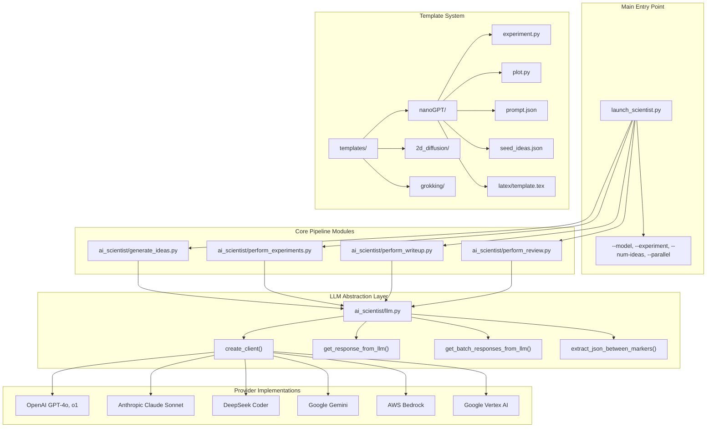
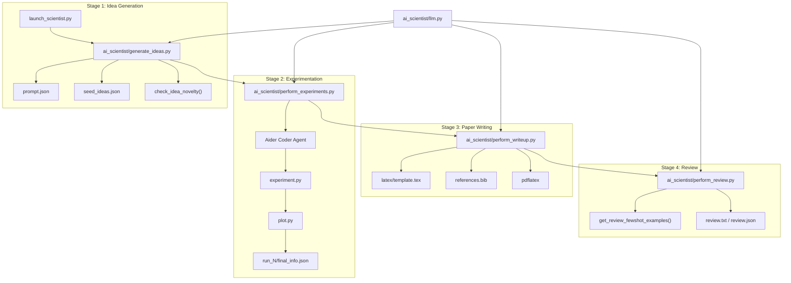

<!-- source: DeepWiki mcp.deepwiki.com · repo SakanaAI/AI-Scientist · page 1 Overview · fetched 2026-10-26 -->

# Overview

Relevant source files

The following files were used as context for generating this wiki page:

- [LICENSE](LICENSE)
- [README.md](README.md)
- [ai_scientist/__init__.py](ai_scientist/__init__.py)

The AI-Scientist repository implements an automated scientific research system that uses Large Language Models (LLMs) to conduct complete research workflows from idea generation through paper publication. The system executes experiments, analyzes results, writes papers, and performs reviews without human intervention.

For system setup information, see [Installation and Setup](#1.2). For architectural details, see [System Architecture](#1.1).

## Purpose and Scope

The AI-Scientist system demonstrates autonomous scientific research capabilities using frontier LLMs. The system implements a complete pipeline consisting of four main Python modules: `generate_ideas.py`, `perform_experiments.py`, `perform_writeup.py`, and `perform_review.py`, orchestrated by `launch_scientist.py`.

The system's core capabilities include:
- Research idea generation using LLM-based brainstorming and novelty checking via academic APIs.
- Automated experiment execution through template-based code generation and execution via an Aider-based coder agent.
- Scientific paper writing with LaTeX compilation and citation management using Semantic Scholar.
- Peer review simulation using few-shot learning from existing review examples.
- Multi-provider LLM integration supporting OpenAI, Anthropic, DeepSeek, Google, and other providers.

The system operates within predefined research templates that specify experimental frameworks, data preparation scripts, and domain-specific prompts.

Sources: [README.md:14-18](), [README.md:57-60](), [ai_scientist/llm.py:1-10]()

## System Architecture

The AI-Scientist system implements a modular pipeline architecture with four core modules orchestrated by a main entry point script.

**AI-Scientist Core Architecture**

The architecture consists of:

1. **Entry Point**: `launch_scientist.py` orchestrates the pipeline by sequentially calling the four core modules.
2. **Core Modules**: Four specialized Python modules handle idea generation, experimentation, paper writing, and review.
3. **LLM Interface**: `ai_scientist/llm.py` provides unified access to multiple LLM providers through standardized functions.
4. **Template System**: Directory structure containing domain-specific experimental frameworks and configuration files.

Sources: [README.md:48-55](), [ai_scientist/llm.py:38-114](), [launch_scientist.py:1-50]()

## Scientific Workflow

The AI-Scientist implements a four-stage pipeline that mirrors the complete scientific research process.

**End-to-End Scientific Pipeline**

The workflow executes sequentially through four stages:

1. **Idea Generation**: `generate_ideas.py` uses template prompts and seed ideas to generate research concepts, then validates novelty using academic search APIs.
2. **Experimentation**: `perform_experiments.py` implements a coder agent that modifies `experiment.py` and `plot.py` files to test hypotheses and record results in `final_info.json`.
3. **Paper Writing**: `perform_writeup.py` generates LaTeX documents using template files, manages citations, and compiles PDFs.
4. **Review**: `perform_review.py` evaluates papers using few-shot examples and generates structured reviews with scores and decisions.

Sources: [README.md:14-18](), [ai_scientist/llm.py:121-145](), [launch_scientist.py:194-245]()

## Key Components

### Launch Scientist

The `launch_scientist.py` script serves as the main orchestrator and entry point for the complete research pipeline.

The script implements the following execution parameters:
- `--model`: LLM model identifier (e.g., `gpt-4o-2024-05-13`, `claude-3-5-sonnet-20241022`).
- `--experiment`: Template directory name (e.g., `nanoGPT`, `2d_diffusion`, `grokking`).
- `--num-ideas`: Integer count of research ideas to process sequentially.
- `--parallel`: Boolean flag to distribute ideas across multiple GPU devices.

Sources: [launch_scientist.py:31-105](), [README.md:48-55]()

### LLM Integration

The `ai_scientist/llm.py` module implements a unified interface for multiple LLM providers through standardized functions and client creation patterns.

The module supports the following provider implementations:
- **OpenAI**: GPT-4o, GPT-4o-mini, o1 models.
- **Anthropic**: Claude Sonnet 3.5.
- **Cloud Providers**: AWS Bedrock and Google Vertex AI for Claude models.
- **Open-Weight/Others**: DeepSeek, Llama (via OpenRouter), and Google Gemini via OpenAI-compatible interfaces.

Sources: [ai_scientist/llm.py:38-114](), [README.md:79-134]()

### Template System

The template system defines research domains through standardized directory structures containing experimental code, configuration files, and LaTeX document templates.

Each template implements the following standardized components:
- `experiment.py`: Main experimental logic with `--out_dir` parameter for result storage.
- `plot.py`: Visualization generation script that reads from run directories.
- `prompt.json`: Domain-specific LLM prompts and instructions for idea generation.
- `seed_ideas.json`: Example research ideas to bootstrap the generation process.
- `latex/template.tex`: LaTeX document template.

Sources: [README.md:44-52](), [README.md:57-60]()

The system includes core templates and community-contributed extensions:

| Template | Description |
|----------|-------------|
| **nanoGPT** | Transformer autoregressive language modeling. |
| **2d_diffusion** | Low-dimensional diffusion model research. |
| **grokking** | Neural network generalization dynamics. |
| **MACE** | Quantum chemistry modeling (Community). |
| **TensoRF** | Tensorial radiance fields (Community). |

Sources: [README.md:44-52](), [README.md:164-233]()

## Conclusion

The AI-Scientist repository represents a complete framework for autonomous scientific discovery using LLMs. By automating the entire research workflow from idea generation to paper publication, it demonstrates the potential of foundation models to accelerate scientific progress.

For details on the orchestration logic, see [System Architecture](#1.1). For details on environment configuration, see [Installation and Setup](#1.2).

---

