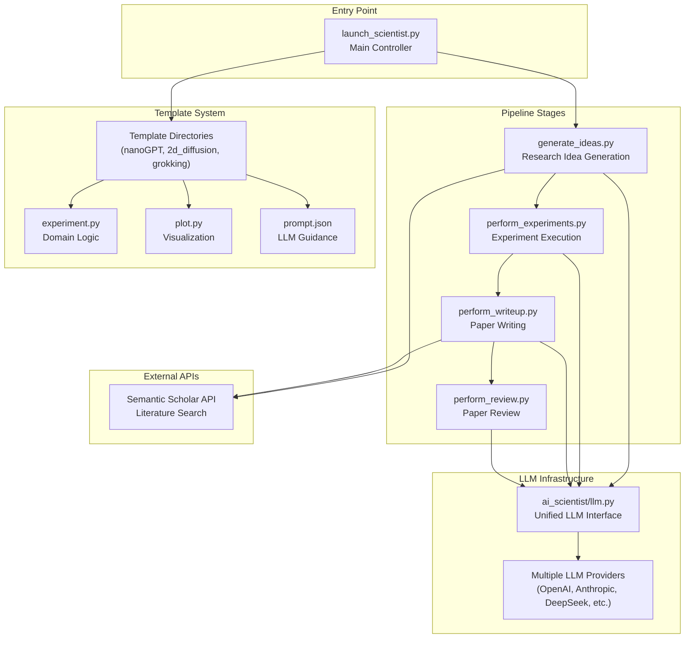
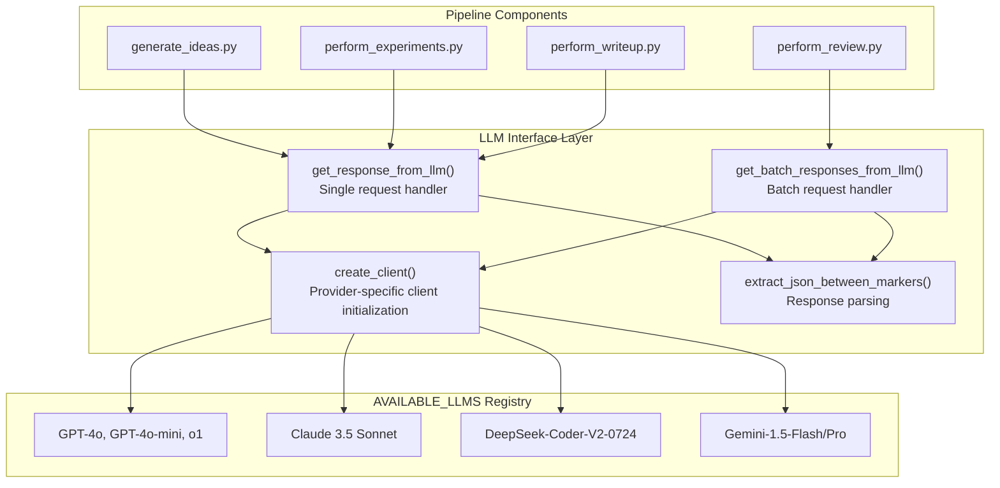
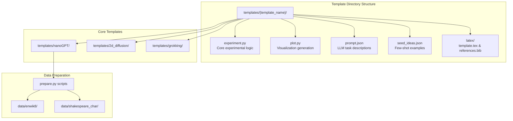
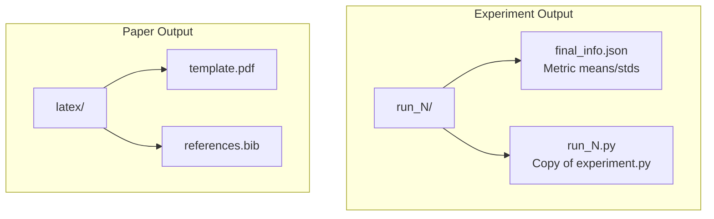

<!-- source: DeepWiki mcp.deepwiki.com · repo SakanaAI/AI-Scientist · page 1.1 System Architecture · fetched 2026-10-26 -->

# System Architecture

Relevant source files

The following files were used as context for generating this wiki page:

- [README.md](README.md)
- [ai_scientist/__init__.py](ai_scientist/__init__.py)
- [ai_scientist/generate_ideas.py](ai_scientist/generate_ideas.py)
- [ai_scientist/perform_experiments.py](ai_scientist/perform_experiments.py)
- [ai_scientist/perform_review.py](ai_scientist/perform_review.py)
- [ai_scientist/perform_writeup.py](ai_scientist/perform_writeup.py)

This document describes the high-level architecture of the AI Scientist system, explaining how the main components interact to enable fully automated scientific research. It covers the core pipeline orchestration, LLM integration patterns, and template-based research domain specialization.

## Overview

The AI Scientist implements a four-stage automated research pipeline orchestrated by a central controller. The system uses a template-based approach to enable research across different scientific domains, with a unified LLM interface supporting multiple foundation model providers.

**Core Pipeline Architecture**

Sources: [README.md:1-30](), [ai_scientist/generate_ideas.py:76-174](), [ai_scientist/perform_experiments.py:116-166](), [ai_scientist/perform_writeup.py:15-91](), [ai_scientist/perform_review.py:13-63](), [ai_scientist/llm.py:1-20]()

## Pipeline Orchestration

The `launch_scientist.py` script serves as the main orchestrator, coordinating the execution of each pipeline stage with proper error handling and parallel execution support.

**Pipeline Execution Flow**

```mermaid
flowchart TD
    start["User executes launch_scientist.py<br/>--model --experiment --num-ideas"]
    
    subgraph "Initialization"
        parse_args["argparse<br/>Command line parsing"]
        load_template["Load template directory<br/>experiment.py, plot.py, prompt.json"]
        init_llm["create_client()<br/>Initialize LLM client"]
    end
    
    subgraph "Idea Generation Loop"
        gen_ideas["generate_ideas.py<br/>generate_ideas()"]
        search_papers["search_for_papers()<br/>Semantic Scholar API"]
    end
    
    subgraph "Experiment Execution"
        run_exp["perform_experiments.py<br/>perform_experiments()"]
        coder_agent["Aider Coder Agent<br/>modify experiment.py"]
        execute["run_experiment()<br/>subprocess.run(experiment.py)"]
        plot["run_plotting()<br/>subprocess.run(plot.py)"]
    end
    
    subgraph "Paper Generation"
        write_paper["perform_writeup.py<br/>perform_writeup()"]
        latex["generate_latex()<br/>LaTeX generation"]
        compile_pdf["compile_latex()<br/>PDF compilation"]
    end
    
    subgraph "Review Generation"
        review_paper["perform_review.py<br/>perform_review()"]
        ensemble["perform_review_ensemble()<br/>Multiple review aggregation"]
    end
    
    start --> parse_args
    parse_args --> load_template
    load_template --> init_llm
    init_llm --> gen_ideas
    
    gen_ideas --> search_papers
    search_papers --> run_exp
    
    run_exp --> coder_agent
    coder_agent --> execute
    execute --> plot
    plot --> write_paper
    
    write_paper --> latex
    latex --> compile_pdf
    compile_pdf --> review_paper
    
    review_paper --> ensemble
```

Sources: [ai_scientist/generate_ideas.py:76-110](), [ai_scientist/perform_experiments.py:30-85](), [ai_scientist/perform_experiments.py:116-166](), [ai_scientist/perform_writeup.py:15-91](), [ai_scientist/perform_review.py:300-340]()

## LLM Integration Architecture

The system uses a unified interface in `ai_scientist/llm.py` to support multiple LLM providers with consistent API patterns across the pipeline.

**LLM Provider Architecture**

Sources: [ai_scientist/llm.py:385-450](), [ai_scientist/llm.py:452-520](), [ai_scientist/llm.py:522-550](), [README.md:79-159]()

## Template System Architecture

The template system enables domain-specific research by providing structured interfaces for experiment execution, visualization, and LLM guidance.

**Template Structure and Interface**

Sources: [ai_scientist/generate_ideas.py:99-110](), [ai_scientist/perform_experiments.py:30-43](), [ai_scientist/perform_writeup.py:17-32](), [README.md:44-59]()

## Data Flow and State Management

The system manages state through filesystem-based run directories and JSON configuration files, enabling resumability and analysis.

| Component | Input | Output | State Storage |
|-----------|-------|---------|---------------|
| `generate_ideas.py` | `prompt.json`, `seed_ideas.json` | `ideas.json` | `ideas.json` in template dir [ai_scientist/generate_ideas.py:171-172]() |
| `perform_experiments.py` | Idea JSON, `experiment.py` | `run_N.py`, `run_N/` | `run_N/final_info.json` [ai_scientist/perform_experiments.py:62-63]() |
| `perform_writeup.py` | `notes.txt`, `run_N/` results | `template.pdf` | `latex/` directory [ai_scientist/perform_writeup.py:17-18]() |
| `perform_review.py` | Paper PDF | `review.json` | Review files [ai_scientist/perform_review.py:330-340]() |

**Run Directory Structure**

Sources: [ai_scientist/perform_experiments.py:33-36](), [ai_scientist/perform_experiments.py:62-64](), [ai_scientist/perform_writeup.py:125-128]()

## Reliability and Error Handling

The system implements specific mechanisms to handle the unreliability of LLM-generated code and external APIs.

| Mechanism | Implementation | Location |
|-----------|----------------|----------|
| **Iterative Refinement** | Ideas are refined over `num_reflections` rounds. | [ai_scientist/generate_ideas.py:138-159]() |
| **Execution Retries** | Experiments are retried up to `MAX_ITERS` if they fail. | [ai_scientist/perform_experiments.py:126-138]() |
| **LaTeX Correction** | System uses `chktex` and LLM to fix LaTeX errors. | [ai_scientist/perform_writeup.py:78-90]() |
| **Timeouts** | Subprocess calls have hard timeouts (e.g., 7200s for experiments). | [ai_scientist/perform_experiments.py:30-47]() |
| **API Backoff** | `backoff` decorator for LLM and Semantic Scholar requests. | [ai_scientist/generate_ideas.py:7-8]() |

Sources: [ai_scientist/generate_ideas.py:7-8](), [ai_scientist/generate_ideas.py:138-159](), [ai_scientist/perform_experiments.py:8-10](), [ai_scientist/perform_experiments.py:30-47](), [ai_scientist/perform_writeup.py:78-90]()

---

