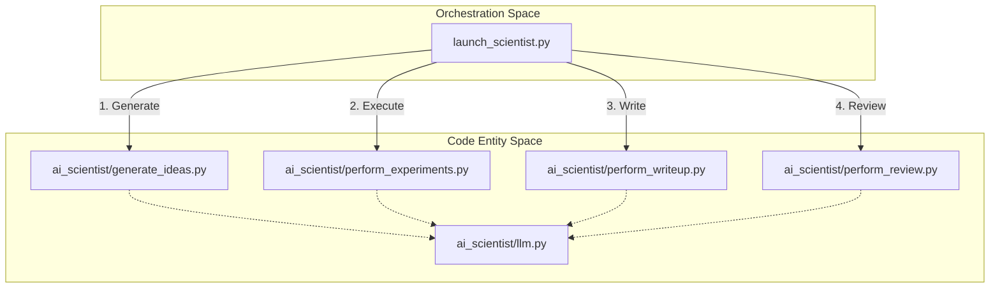
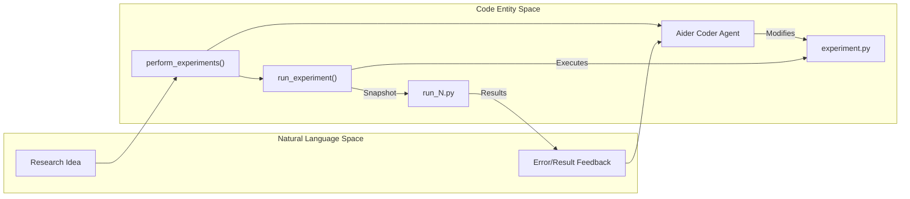

<!-- source: DeepWiki mcp.deepwiki.com · repo SakanaAI/AI-Scientist · page 2 Core Components · fetched 2026-10-26 -->

# Core Components

Relevant source files

The following files were used as context for generating this wiki page:

- [ai_scientist/__init__.py](ai_scientist/__init__.py)
- [ai_scientist/generate_ideas.py](ai_scientist/generate_ideas.py)
- [ai_scientist/llm.py](ai_scientist/llm.py)
- [ai_scientist/perform_experiments.py](ai_scientist/perform_experiments.py)
- [ai_scientist/perform_review.py](ai_scientist/perform_review.py)
- [ai_scientist/perform_writeup.py](ai_scientist/perform_writeup.py)

This document provides a high-level overview of the main functional modules that implement the AI Scientist pipeline. The system is designed as a modular research factory, moving from initial conceptualization to final peer review. Each section below links to a dedicated child page containing deep technical specifications.

## Pipeline Orchestration

The AI Scientist is orchestrated through a central entry point that manages the transition between research phases. The system uses a template-based approach where each research project starts with a base directory containing an initial codebase (`experiment.py`), plotting scripts (`plot.py`), and task descriptions (`prompt.json`).

### High-Level System Flow

Sources: [launch_scientist.py:1-45](), [ai_scientist/generate_ideas.py:76-83](), [ai_scientist/perform_experiments.py:116-125]()

---

## 2.1 Launch Scientist
The `launch_scientist.py` script is the primary entry point. It handles command-line arguments, manages GPU allocation for parallel runs, and loops through the generated ideas to trigger the subsequent phases. An experimental version, `experimental/launch_oe_scientist.py`, provides an open-ended evolution mode where the system continuously builds on its own previous results.

For details, see [Launch Scientist](#2.1).

Sources: [launch_scientist.py:1-50]()

## 2.2 LLM Integration
The `ai_scientist/llm.py` module acts as a unified abstraction layer for multiple LLM providers. It manages API clients for OpenAI, Anthropic, Google Gemini, DeepSeek, and others through the `AVAILABLE_LLMS` registry. It provides robust error handling via `backoff` and specialized functions like `get_response_from_llm` and `get_batch_responses_from_llm` for ensembling.

For details, see [LLM Integration](#2.2).

Sources: [ai_scientist/llm.py:13-62](), [ai_scientist/llm.py:143-151]()

## 2.3 Idea Generation
The `generate_ideas.py` module uses the LLM to brainstorm research directions. It parses the `experiment.py` code and `seed_ideas.json` to propose novel experiments. The process includes a multi-round reflection loop where the LLM critiques its own ideas for feasibility and novelty before saving them to `ideas.json`.

For details, see [Idea Generation](#2.3).

Sources: [ai_scientist/generate_ideas.py:14-52](), [ai_scientist/generate_ideas.py:76-112]()

## 2.4 Experiment Execution
Experimental validation is handled by `perform_experiments.py`. This module interfaces with the **Aider** coder agent to modify the template's `experiment.py`. It manages a loop of up to `MAX_RUNS` (default 5), executing the code via `subprocess`, capturing `stderr` for debugging, and passing results back to the LLM to decide on the next hyperparameter sweep or code modification.

### Experiment Execution Entity Mapping

Sources: [ai_scientist/perform_experiments.py:8-10](), [ai_scientist/perform_experiments.py:30-43](), [ai_scientist/perform_experiments.py:116-138]()

For details, see [Experiment Execution](#2.4).

## 2.5 Paper Writing
Once experiments are complete, `perform_writeup.py` orchestrates the creation of a full LaTeX progress report. It uses the LLM to write sections (Abstract, Introduction, Methods, etc.) based on `notes.txt` and experimental results. It manages `references.bib` via Semantic Scholar searches and iteratively fixes LaTeX compilation errors using `pdflatex` and `chktex`.

For details, see [Paper Writing](#2.5).

Sources: [ai_scientist/perform_writeup.py:15-30](), [ai_scientist/perform_writeup.py:130-165]()

## 2.6 Paper Review
The final stage is an automated peer review implemented in `perform_review.py`. It converts the generated PDF to text and evaluates it against a structured schema (Soundness, Contribution, etc.) based on the NeurIPS review form. It supports ensembling multiple reviews to reach a final "Accept" or "Reject" decision.

For details, see [Paper Review](#2.6).

Sources: [ai_scientist/perform_review.py:27-63](), [ai_scientist/perform_review.py:65-101]()

---

