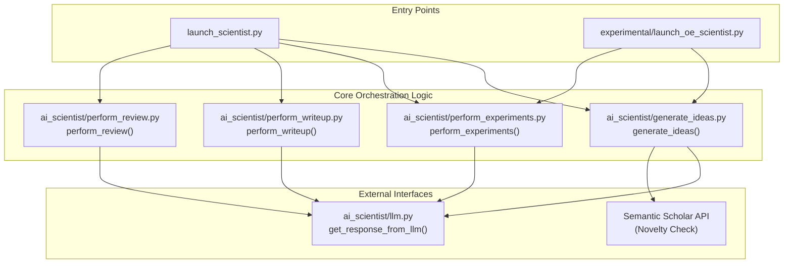
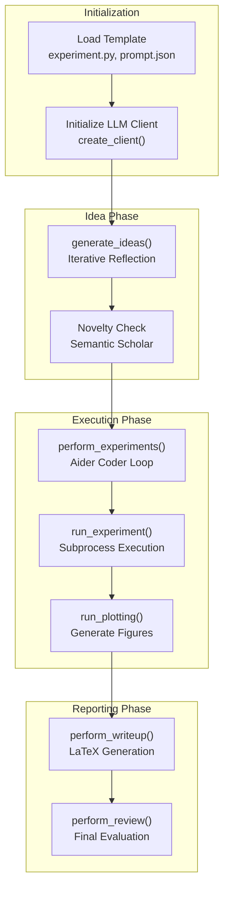

<!-- source: DeepWiki mcp.deepwiki.com · repo SakanaAI/AI-Scientist · page 2.1 Launch Scientist · fetched 2026-10-26 -->

# Launch Scientist

Relevant source files

The following files were used as context for generating this wiki page:

- [README.md](README.md)
- [ai_scientist/generate_ideas.py](ai_scientist/generate_ideas.py)
- [ai_scientist/perform_experiments.py](ai_scientist/perform_experiments.py)

This document covers the main entry point scripts that orchestrate the entire AI Scientist research pipeline. The `launch_scientist.py` script and the experimental `experimental/launch_oe_scientist.py` serve as the central command-line interfaces that coordinate idea generation, experiment execution, paper writing, and paper review to produce complete scientific papers automatically.

## System Overview

The `launch_scientist.py` script functions as the central orchestrator. It manages the data flow between specialized modules, transforming high-level research goals into validated experiments and formatted manuscripts.

**Launch Scientist Code Entity Map**

Sources: [ai_scientist/generate_ideas.py:76-83](), [ai_scientist/perform_experiments.py:116-116](), [README.md:242-246]()

## Pipeline Execution Flow

The execution follows a strictly defined sequence where the output of one stage informs the next. The orchestrator ensures that the `experiment.py` and `prompt.json` from the chosen template are correctly passed to the LLM agents.

**Data Flow and Logic Sequence**

Sources: [ai_scientist/generate_ideas.py:104-110](), [ai_scientist/perform_experiments.py:118-138](), [ai_scientist/perform_experiments.py:153-158]()

## Core Components Detail

### Idea Generation Orchestration
The script triggers `generate_ideas` which loads `seed_ideas.json` [ai_scientist/generate_ideas.py:99-102]() and enters a reflection loop. The LLM is prompted to refine ideas over a set number of rounds (default `num_reflections=5`) [ai_scientist/generate_ideas.py:83]().

### Experiment Execution Loop
The `perform_experiments` function manages a "Coder" agent. It provides the agent with the generated idea and baseline results [ai_scientist/perform_experiments.py:120-125]().
*   **Subprocess Management**: Each experiment is executed via `subprocess.run` calling `python experiment.py` [ai_scientist/perform_experiments.py:39-47]().
*   **Iterative Refinement**: If a run fails, the stderr is captured (truncated to 1500 chars) and fed back to the LLM for debugging [ai_scientist/perform_experiments.py:57-60]().
*   **Plotting**: After successful experiments, the system triggers `plot.py` to visualize results [ai_scientist/perform_experiments.py:91-98]().

### Open-Ended Execution (Experimental)
The `experimental/launch_oe_scientist.py` script introduces a more autonomous loop. Unlike the standard version, it can use `generate_next_idea` to continuously build upon previous results in an open-ended fashion [ai_scientist/generate_ideas.py:178-185]().

## Parallel Execution Support

The system supports parallelization across multiple GPUs using the `--parallel` flag. This distributes different research ideas to different processes, each bound to a specific `CUDA_VISIBLE_DEVICES` [README.md:246]().

**Parallel Resource Distribution**

| Component | Logic | Source |
| :--- | :--- | :--- |
| **GPU Assignment** | Uses `--gpus` argument to specify available IDs | [README.md:246]() |
| **Process Isolation** | Each idea runs in a separate directory to avoid file conflicts | [ai_scientist/perform_experiments.py:30-31]() |
| **Concurrency** | Managed via Python multiprocessing, launching independent pipelines per idea | [README.md:246]() |

## Error Handling and Timeouts

The orchestrator implements strict resource limits to prevent runaway LLM processes:
*   **Experiment Timeout**: Default is 7200 seconds (2 hours) per run [ai_scientist/perform_experiments.py:30]().
*   **Plotting Timeout**: Default is 600 seconds (10 minutes) [ai_scientist/perform_experiments.py:88]().
*   **Iteration Limits**: Maximum of 4 iterations per experiment and 5 total runs per idea [ai_scientist/perform_experiments.py:8-9]().

Sources: [ai_scientist/perform_experiments.py:8-10](), [ai_scientist/perform_experiments.py:30](), [ai_scientist/perform_experiments.py:88]()

---

