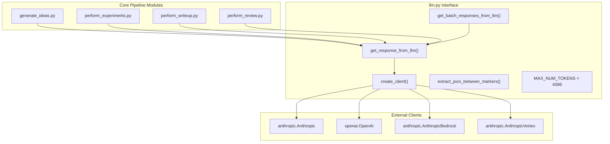
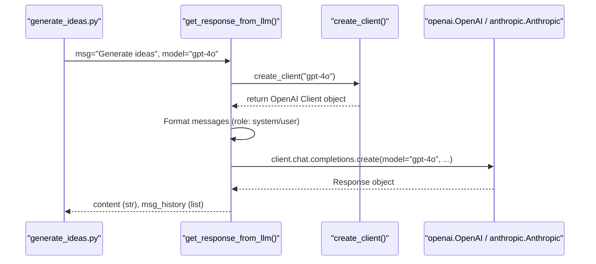

<!-- source: DeepWiki mcp.deepwiki.com · repo SakanaAI/AI-Scientist · page 2.2 LLM Integration · fetched 2026-10-26 -->

# LLM Integration

<details>
<summary>Relevant source files</summary>

The following files were used as context for generating this wiki page:

- [ai_scientist/llm.py](ai_scientist/llm.py)

</details>


This document explains how the AI Scientist system interfaces with various Large Language Model (LLM) providers. The LLM integration layer, primarily implemented in `ai_scientist/llm.py`, serves as a unified abstraction that enables the different components of the system to leverage state-of-the-art language models for scientific tasks including idea generation, experiment execution, paper writing, and paper review.

## Supported LLM Providers and Models

The AI Scientist system supports a wide range of LLM providers and models. The complete list of supported model strings is maintained in the `AVAILABLE_LLMS` registry.

```mermaid
graph TD
    subgraph "LLM Provider Categories"
        ["Anthropic Models"] -- "claude-3-5-sonnet variants" --> B1["AVAILABLE_LLMS"]
        ["OpenAI Models"] -- "gpt-4o, gpt-4.1, o1, o3 variants" --> B1
        ["Amazon Bedrock"] -- "bedrock/anthropic.claude-*" --> B1
        ["Google Vertex AI"] -- "vertex_ai/claude-3-*" --> B1
        ["OpenRouter"] -- "llama3.1-405b" --> B1
        ["DeepSeek"] -- "deepseek-chat, deepseek-reasoner" --> B1
        ["Google Gemini"] -- "gemini-1.5, gemini-2.0, gemini-2.5" --> B1
    end
```
Sources: [ai_scientist/llm.py:13-62]()

The system currently supports the following providers and models:

| Provider | Model String Patterns | Client Implementation |
|----------|----------------|-------------|
| **Anthropic** | `claude-3-5-sonnet-20240620`, `claude-3-5-sonnet-20241022` | `anthropic.Anthropic` |
| **OpenAI** | `gpt-4o`, `gpt-4.1`, `o1-mini`, `o3-mini` | `openai.OpenAI` |
| **Amazon Bedrock** | `bedrock/anthropic.claude-3-5-sonnet-*` | `anthropic.AnthropicBedrock` |
| **Google Vertex AI** | `vertex_ai/claude-3-5-sonnet-*` | `anthropic.AnthropicVertex` |
| **DeepSeek** | `deepseek-chat`, `deepseek-coder`, `deepseek-reasoner` | `openai.OpenAI` (DeepSeek Base URL) |
| **Google Gemini** | `gemini-1.5-pro`, `gemini-2.0-flash` | `openai.OpenAI` (Google Base URL) |

Sources: [ai_scientist/llm.py:13-62](), [ai_scientist/llm.py:317-351]()

## Core Architecture

The LLM integration layer serves as the bridge between AI Scientist's core modules and various LLM providers. It handles formatting differences, token limits, and retry logic.


Sources: [ai_scientist/llm.py:11](), [ai_scientist/llm.py:66-139](), [ai_scientist/llm.py:142-286](), [ai_scientist/llm.py:317-351]()

## Key Functions

### Client Initialization (`create_client`)
The `create_client` function instantiates the appropriate client based on the model string and retrieves the necessary API keys from environment variables.

*   **Anthropic**: Uses `ANTHROPIC_API_KEY` [ai_scientist/llm.py:334-335]().
*   **OpenAI**: Uses `OPENAI_API_KEY` [ai_scientist/llm.py:336-337]().
*   **DeepSeek**: Uses `DEEPSEEK_API_KEY` and sets `base_url="https://api.deepseek.com"` [ai_scientist/llm.py:341-344]().
*   **Google Gemini**: Uses `GEMINI_API_KEY` and sets `base_url="https://generativelanguage.googleapis.com/v1beta/openai/"` [ai_scientist/llm.py:345-348]().

Sources: [ai_scientist/llm.py:317-351]()

### LLM Response Generation
The system provides two primary functions for inference:

1.  **`get_response_from_llm`**: The base function for a single interaction. It handles model-specific prompt formatting (e.g., Anthropic's `messages.create` vs OpenAI's `chat.completions.create`) [ai_scientist/llm.py:143-286]().
2.  **`get_batch_responses_from_llm`**: Used for ensembling (e.g., in paper reviews). For OpenAI/Llama models, it uses the native `n` parameter to get multiple completions in one call [ai_scientist/llm.py:80-114](). For others, it loops over `get_response_from_llm` [ai_scientist/llm.py:117-129]().

### Robustness and Parsing
*   **Retries**: Both functions use `@backoff.on_exception` with exponential backoff to handle `RateLimitError` and `APITimeoutError` [ai_scientist/llm.py:66](), [ai_scientist/llm.py:142]().
*   **JSON Extraction**: `extract_json_between_markers` uses regex to pull structured data from LLM responses, looking for ` ```json ` blocks or raw curly braces, and sanitizing control characters [ai_scientist/llm.py:289-314]().

## Data Flow: Natural Language to Code Entities

The following diagram illustrates how a high-level request from a researcher is transformed through the `llm.py` entities into a provider-specific API call.


Sources: [ai_scientist/llm.py:143-286](), [ai_scientist/llm.py:317-351]()

## Model-Specific Logic Table

The `get_response_from_llm` function implements several branching paths to accommodate API differences:

| Model Logic Branch | Key Implementation Detail | Code Reference |
| :--- | :--- | :--- |
| **Anthropic (`claude`)** | Uses `client.messages.create` with a separate `system` parameter. | [ai_scientist/llm.py:155-185]() |
| **OpenAI (`gpt`)** | Uses `client.chat.completions.create` with `role: "system"`. | [ai_scientist/llm.py:186-201]() |
| **Reasoning (`o1`/`o3`)** | Passes the system message as a `user` role; uses `max_completion_tokens`. | [ai_scientist/llm.py:202-216]() |
| **Llama (OpenRouter)** | Explicitly maps to `meta-llama/llama-3.1-405b-instruct`. | [ai_scientist/llm.py:217-231]() |
| **DeepSeek** | Configures `max_tokens` and `temperature` for DeepSeek's API. | [ai_scientist/llm.py:232-247]() |
| **Gemini** | Uses OpenAI-compatible client but handles specific `max_tokens` mapping. | [ai_scientist/llm.py:248-262]() |

Sources: [ai_scientist/llm.py:155-275]()

---

