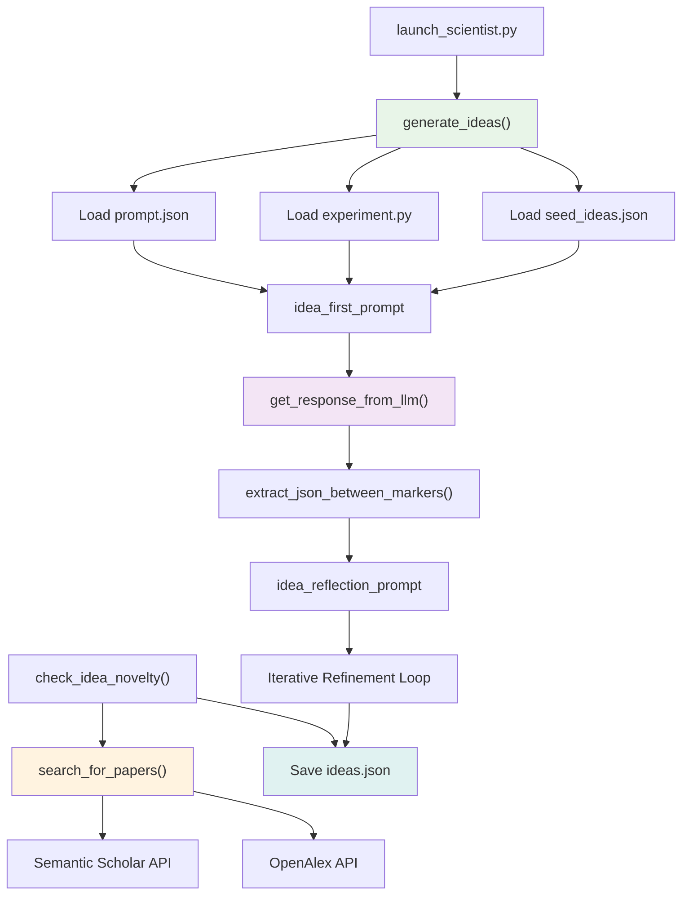
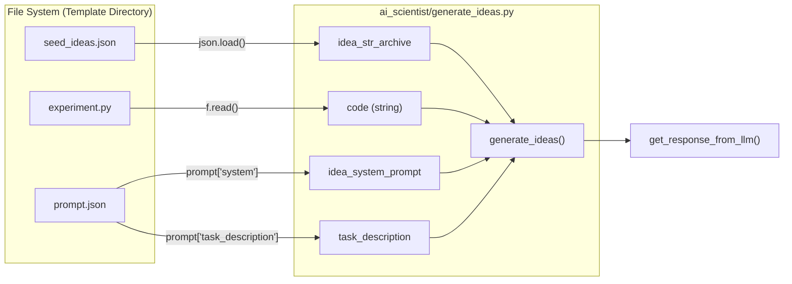
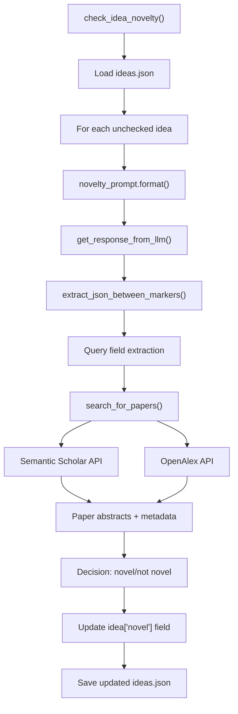

<!-- source: DeepWiki mcp.deepwiki.com · repo SakanaAI/AI-Scientist · page 2.3 Idea Generation · fetched 2026-10-26 -->

# Idea Generation

Relevant source files

The following files were used as context for generating this wiki page:

- [ai_scientist/generate_ideas.py](ai_scientist/generate_ideas.py)
- [example_papers/adaptive_dual_scale_denoising/ideas.json](example_papers/adaptive_dual_scale_denoising/ideas.json)
- [example_papers/adaptive_dual_scale_denoising/seed_ideas.json](example_papers/adaptive_dual_scale_denoising/seed_ideas.json)

This document covers the AI Scientist's idea generation system, which creates novel research hypotheses and experiments for a given research domain. The system generates creative ideas by analyzing existing code, reviewing previous ideas, and optionally checking novelty against the scientific literature.

For information about executing the generated ideas as experiments, see [2.4 Experiment Execution](). For details on the LLM integration that powers idea generation, see [2.2 LLM Integration]().

## Overview

The idea generation system serves as the creative engine of the AI Scientist pipeline. It takes a research template containing experimental code and generates novel research directions that can be feasibly implemented within the template's constraints. The system supports iterative refinement of ideas and optional novelty checking against existing literature.

### Core Workflow

The diagram below illustrates the flow from initial template loading to the final generation of research ideas, highlighting the key functions in `ai_scientist/generate_ideas.py`.

**Idea Generation Workflow**

Sources: [ai_scientist/generate_ideas.py:76-174](), [ai_scientist/generate_ideas.py:405-492]()

## Idea Generation Process

### Primary Generation Function

The `generate_ideas()` function orchestrates the complete idea generation process. It supports both batch generation of multiple ideas and loading of existing ideas when `skip_generation=True` [ai_scientist/generate_ideas.py:84-97]().

| Parameter | Type | Default | Description |
|-----------|------|---------|-------------|
| `base_dir` | str | - | Template directory path |
| `client` | object | - | LLM client from `create_client()` |
| `model` | str | - | Model identifier |
| `skip_generation` | bool | False | Load existing ideas instead of generating |
| `max_num_generations` | int | 20 | Maximum ideas to generate |
| `num_reflections` | int | 5 | Refinement iterations per idea |

### Template Integration

The system integrates with research templates by loading three key files from the `base_dir` [ai_scientist/generate_ideas.py:99-111]():

- **`seed_ideas.json`**: Initial example ideas for the domain.
- **`experiment.py`**: The experimental code that constrains feasible ideas.  
- **`prompt.json`**: Contains the `system` prompt and `task_description` for the domain.

The following diagram maps the relationship between these files and the code entities in the generation script.

**Template to Code Entity Mapping**

Sources: [ai_scientist/generate_ideas.py:99-131]()

### Idea Refinement Loop

Each generated idea undergoes iterative refinement using the `idea_reflection_prompt` [ai_scientist/generate_ideas.py:54-72](). The system supports up to `num_reflections` iterations, with early termination when the LLM outputs "I am done" [ai_scientist/generate_ideas.py:157-159]().

The refinement process evaluates:
- Quality and feasibility of the implementation.
- Novelty compared to existing ideas.
- Clarity and concision of the proposal.
- Correctness of the JSON format.

Sources: [ai_scientist/generate_ideas.py:137-160]()

### Idea JSON Schema

Generated ideas follow a structured JSON format [ai_scientist/generate_ideas.py:41-47](). An example of this structure can be seen in the output of the diffusion template [example_papers/adaptive_dual_scale_denoising/ideas.json:2-10]().

| Field | Type | Description |
|-------|------|-------------|
| `Name` | string | Lowercase identifier with underscores. |
| `Title` | string | Human-readable title for the idea. |
| `Experiment` | string | Implementation outline and approach. |
| `Interestingness` | integer | Rating from 1-10. |
| `Feasibility` | integer | Rating from 1-10. |
| `Novelty` | integer | Rating from 1-10. |

Sources: [ai_scientist/generate_ideas.py:41-47](), [example_papers/adaptive_dual_scale_denoising/ideas.json:2-10]()

## Novelty Checking

### Literature Search Integration

The system supports automated novelty checking through the `check_idea_novelty()` function, which integrates with academic search APIs to validate idea uniqueness [ai_scientist/generate_ideas.py:405-492]().

**Novelty Checking Process**

Sources: [ai_scientist/generate_ideas.py:405-492]()

### Supported Search Engines

The `search_for_papers()` function supports two academic search engines [ai_scientist/generate_ideas.py:285-352]():

#### Semantic Scholar
- **API Endpoint**: `https://api.semanticscholar.org/graph/v1/paper/search` [ai_scientist/generate_ideas.py:302]()
- **Authentication**: Optional `S2_API_KEY` environment variable [ai_scientist/generate_ideas.py:12]()
- **Fields Retrieved**: `title`, `authors`, `venue`, `year`, `abstract`, `citationStyles`, `citationCount` [ai_scientist/generate_ideas.py:304]()
- **Rate Limiting**: 1 second delay between requests [ai_scientist/generate_ideas.py:313]()

#### OpenAlex
- **Library**: `pyalex` package.
- **Authentication**: `OPENALEX_MAIL_ADDRESS` environment variable (recommended) [ai_scientist/generate_ideas.py:321-322]().
- **Features**: Abstract length truncation, venue extraction, author list formatting [ai_scientist/generate_ideas.py:333-352]().

Sources: [ai_scientist/generate_ideas.py:285-352]()

## Advanced Features

### Open-Ended Generation

The `generate_next_idea()` function supports incremental idea generation, building upon previous ideas and their success scores [ai_scientist/generate_ideas.py:178-272](). This is used in the experimental open-ended scientist pipeline.

Key differences from batch generation:
- Incorporates score feedback from previous experiments [ai_scientist/generate_ideas.py:228-232]().
- Uses single seed idea initialization if the archive is empty [ai_scientist/generate_ideas.py:191-197]().
- Supports incremental archive building [ai_scientist/generate_ideas.py:263]().

Sources: [ai_scientist/generate_ideas.py:178-272]()

### Error Handling and Resilience

The system implements robust error handling:
- **Backoff Strategy**: Uses `@backoff.on_exception` decorator for API calls [ai_scientist/generate_ideas.py:282-284]().
- **JSON Parsing Failures**: Continues to next attempt on extraction errors [ai_scientist/generate_ideas.py:162-164]().
- **API Rate Limiting**: Implements delays and retry logic for Semantic Scholar [ai_scientist/generate_ideas.py:313]().

Sources: [ai_scientist/generate_ideas.py:282-284](), [ai_scientist/generate_ideas.py:162-164]()

## Configuration and Usage

### Command Line Interface

When run as a standalone script, the module supports several arguments via `argparse` [ai_scientist/generate_ideas.py:495-515]():

| Argument | Type | Default | Description |
|----------|------|---------|-------------|
| `--experiment` | str | "nanoGPT" | Template name to use. |
| `--model` | str | "gpt-4o-2024-05-13" | LLM model identifier. |
| `--skip-idea-generation` | bool | False | Use existing `ideas.json`. |
| `--check-novelty` | bool | False | Enable novelty checking. |

### File Outputs

The system produces the following output files in the template directory:

- **`ideas.json`**: Array of generated ideas with metadata [ai_scientist/generate_ideas.py:171-172]().
- **Backup/Recovery**: Automatic loading of existing ideas when `skip_generation=True` [ai_scientist/generate_ideas.py:84-92]().

Sources: [ai_scientist/generate_ideas.py:495-547]()

---

