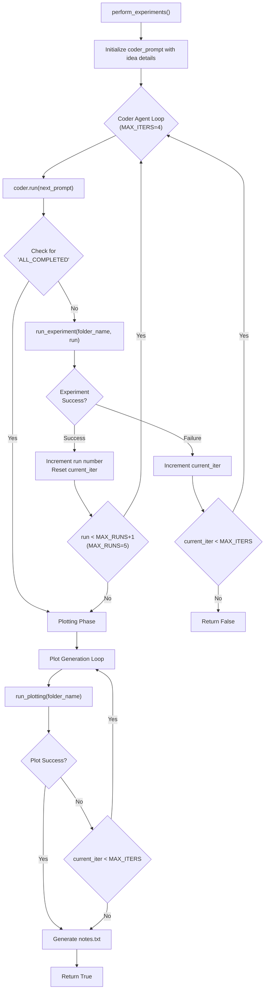
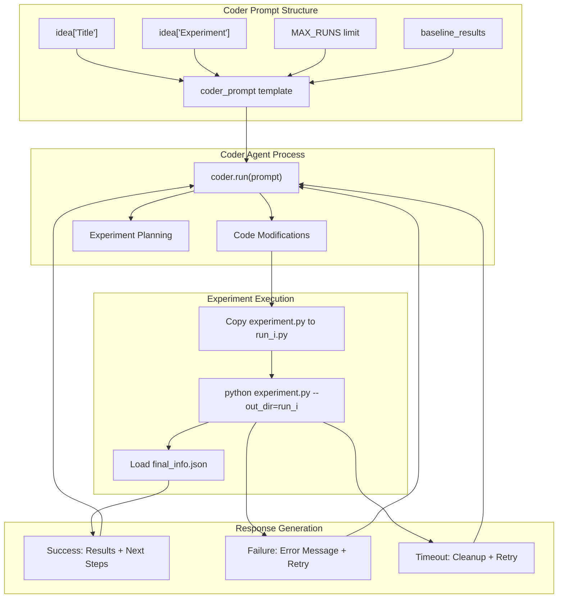
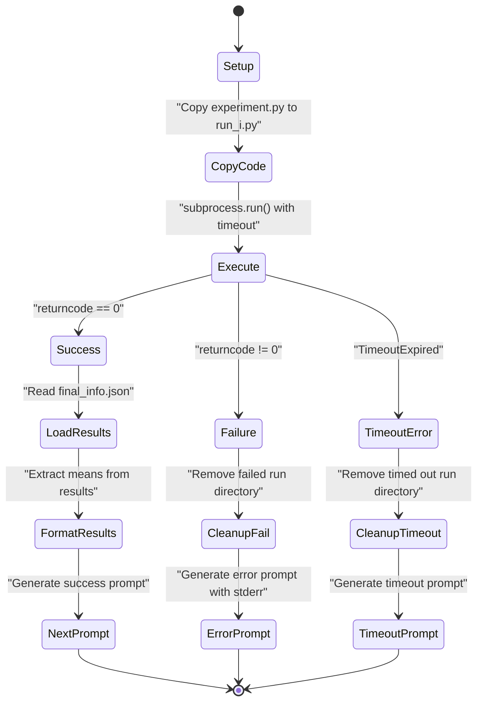
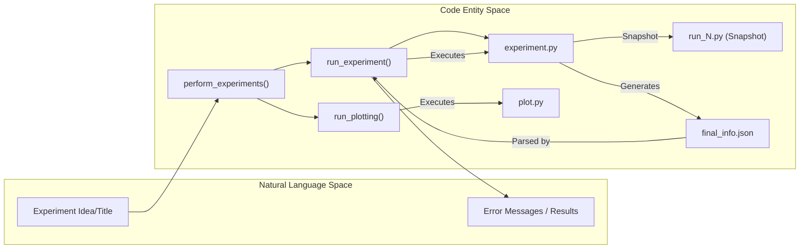
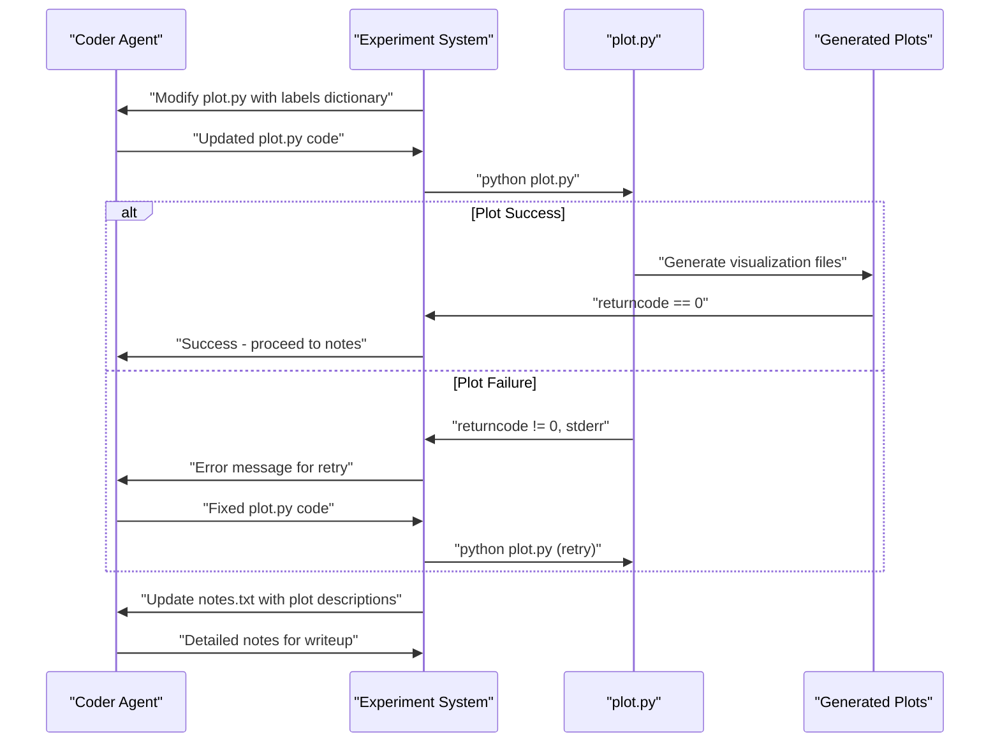
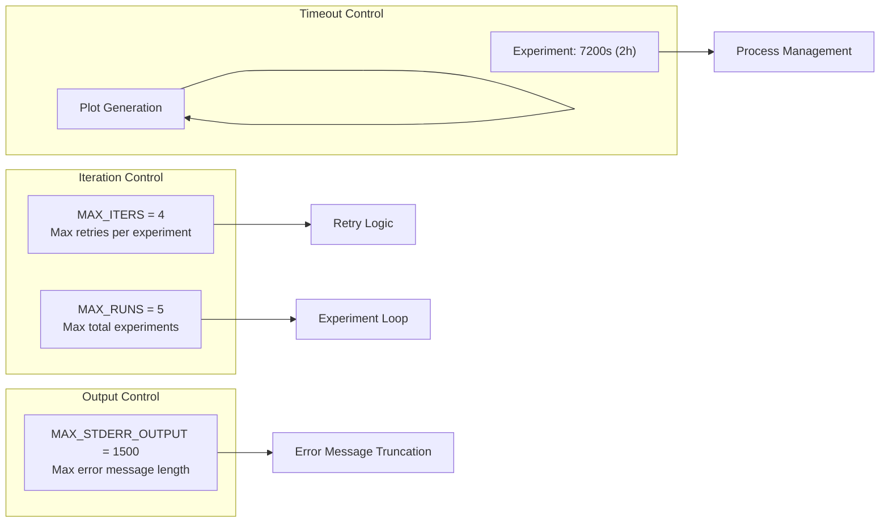

<!-- source: DeepWiki mcp.deepwiki.com · repo SakanaAI/AI-Scientist · page 2.4 Experiment Execution · fetched 2026-10-26 -->

# Experiment Execution

Relevant source files

The following files were used as context for generating this wiki page:

- [ai_scientist/perform_experiments.py](ai_scientist/perform_experiments.py)
- [example_papers/adaptive_dual_scale_denoising/experiment.py](example_papers/adaptive_dual_scale_denoising/experiment.py)
- [example_papers/adaptive_dual_scale_denoising/run_0/final_info.json](example_papers/adaptive_dual_scale_denoising/run_0/final_info.json)
- [example_papers/adaptive_dual_scale_denoising/run_1.py](example_papers/adaptive_dual_scale_denoising/run_1.py)
- [example_papers/data_augmentation_grokking/experiment.py](example_papers/data_augmentation_grokking/experiment.py)

This document covers the experiment execution system that runs research experiments after ideas have been generated. The system uses an interactive coder agent to iteratively implement and test experimental variations based on research ideas.

## Purpose and Scope

The experiment execution system manages the automated running of research experiments through an interactive loop between a coder agent and experiment scripts. It handles experiment planning, code modification, execution, result collection, error handling, and visualization generation. The system is designed to be robust with retry mechanisms and timeout handling for reliable automated experimentation.

## Experiment Execution Workflow

The experiment execution follows a structured workflow that combines LLM-driven code generation with automated script execution and result validation.

### Overall Process Flow

Sources: [ai_scientist/perform_experiments.py:115-167]()

### Coder Agent Interaction

The system uses a conversational approach with the coder agent, providing structured prompts and processing responses to guide experiment implementation.

Sources: [ai_scientist/perform_experiments.py:12-26](), [ai_scientist/perform_experiments.py:116-141]()

## Experiment Running Mechanism

The `run_experiment` function handles the core execution logic for individual experimental runs with comprehensive error handling and result collection.

### Experiment Execution Details

| Component | Details |
|-----------|---------|
| **Command Format** | `python experiment.py --out_dir=run_{run_num}` |
| **Timeout** | 7200 seconds (2 hours) default |
| **Working Directory** | Absolute path to experiment folder |
| **Code Backup** | Copies `experiment.py` to `run_{run_num}.py` |
| **Result Format** | JSON file at `run_{run_num}/final_info.json` |
| **Error Handling** | Captures stderr, truncates if > 1500 chars |

### Experiment State Management

Sources: [ai_scientist/perform_experiments.py:30-85]()

## Code Entity Interaction

The following diagram bridges the natural language experiment goals with the specific code entities manipulated and executed during the process.

Sources: [ai_scientist/perform_experiments.py:30-85](), [ai_scientist/perform_experiments.py:115-167]()

## Plotting and Visualization

After successful experiment completion, the system generates visualizations through an interactive plotting phase.

### Plotting Process

The plotting phase follows a similar interactive pattern with the coder agent but focuses on visualization generation and documentation.

### Plotting Configuration

| Setting | Value | Purpose |
|---------|-------|---------|
| **Timeout** | 600 seconds | Prevent hanging on complex plots |
| **Max Iterations** | 4 (MAX_ITERS) | Limit retry attempts |
| **Labels Dictionary** | Required | Maps run numbers to display names |
| **Output Format** | Plot files + notes.txt | Visualization + documentation |

Sources: [ai_scientist/perform_experiments.py:87-113](), [ai_scientist/perform_experiments.py:144-165]()

## Configuration and Limits

The experiment execution system uses several configurable constants to control resource usage and execution behavior.

### System Limits

### Error Handling Strategy

The system implements a multi-layered error handling approach:

1. **Process-level**: Captures subprocess return codes and stderr [ai_scientist/perform_experiments.py:45-53]().
2. **Timeout-level**: Uses subprocess timeout to prevent hanging [ai_scientist/perform_experiments.py:79-84]().
3. **Iteration-level**: Retry logic with `MAX_ITERS` limit per operation [ai_scientist/perform_experiments.py:127-129]().
4. **Run-level**: `MAX_RUNS` limit for total experiment attempts [ai_scientist/perform_experiments.py:126]().
5. **Cleanup**: Automatic removal of failed experiment directories [ai_scientist/perform_experiments.py:54-55]().

Sources: [ai_scientist/perform_experiments.py:8-11](), [ai_scientist/perform_experiments.py:44-84]()

## Integration Points

The experiment execution system integrates with several other components of the AI Scientist pipeline:

- **Input**: Receives idea dictionaries from idea generation phase.
- **Coder Agent**: Uses the coder interface for interactive code modification [ai_scientist/perform_experiments.py:130]().
- **Template System**: Operates on template-specific `experiment.py` and `plot.py` files.
- **Output**: Produces experimental results (e.g., `final_info.json`) and plots for paper writing phase [ai_scientist/perform_experiments.py:62-64]().
- **File System**: Manages run directories, code backups (`run_N.py`), and result files [ai_scientist/perform_experiments.py:33-36]().

The system is designed to be template-agnostic, working with any template that provides the required `experiment.py` and `plot.py` interface.

Sources: [ai_scientist/perform_experiments.py:1-167]()

---

