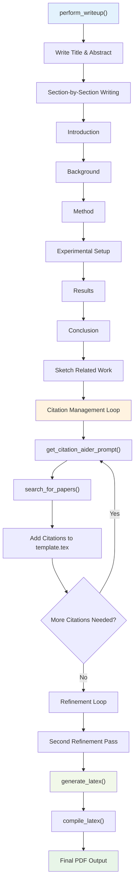
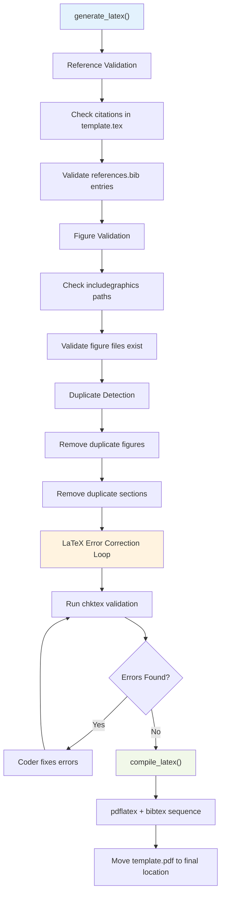
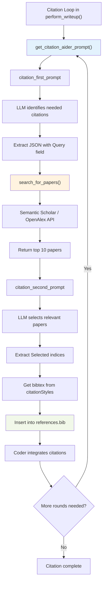
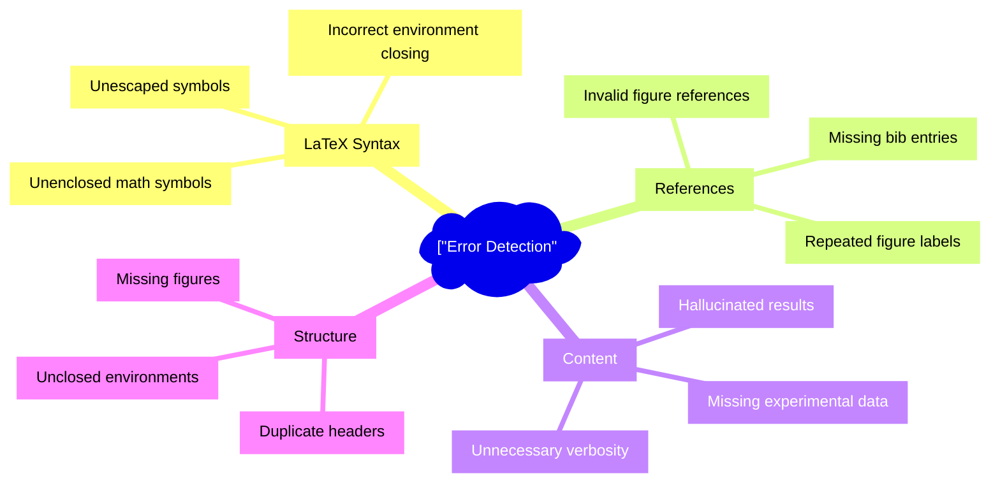

<!-- source: DeepWiki mcp.deepwiki.com · repo SakanaAI/AI-Scientist · page 2.5 Paper Writing · fetched 2026-10-26 -->

# Paper Writing

Relevant source files

The following files were used as context for generating this wiki page:

- [ai_scientist/perform_writeup.py](ai_scientist/perform_writeup.py)
- [example_papers/adaptive_dual_scale_denoising/latex/fancyhdr.sty](example_papers/adaptive_dual_scale_denoising/latex/fancyhdr.sty)
- [example_papers/adaptive_dual_scale_denoising/latex/iclr2024_conference.sty](example_papers/adaptive_dual_scale_denoising/latex/iclr2024_conference.sty)
- [example_papers/adaptive_dual_scale_denoising/latex/references.bib](example_papers/adaptive_dual_scale_denoising/latex/references.bib)
- [example_papers/adaptive_dual_scale_denoising/latex/template.tex](example_papers/adaptive_dual_scale_denoising/latex/template.tex)

This document covers the automated paper writing system that generates complete academic papers in LaTeX format, including citation management and compilation. The system takes experimental results and generates publication-ready scientific papers through multi-stage LLM interactions.

For information about experiment execution that precedes paper writing, see [Experiment Execution](2.4). For information about paper review that follows paper writing, see [Paper Review](2.6).

## System Overview

The paper writing system is implemented in `perform_writeup.py` and serves as the third major component in the AI Scientist pipeline. It transforms experimental results and notes into complete academic papers by orchestrating multiple LLM interactions through the Aider coding assistant framework.

The system generates papers section-by-section, performs automated citation searches, validates LaTeX syntax, and compiles the final PDF output. It includes sophisticated error checking, reference validation, and iterative refinement processes.

## Paper Writing Workflow

The paper writing process follows a structured multi-stage approach:

#### Paper Writing Pipeline Flow

Sources: [ai_scientist/perform_writeup.py:401-513]()

## Core Components

### LaTeX Generation and Compilation

The `generate_latex()` function handles LaTeX processing, error checking, and PDF compilation:

#### LaTeX Processing System

The system performs comprehensive validation including:
- Citation consistency checking using regex patterns `\\cite[a-z]*{([^}]*)}` [ai_scientist/perform_writeup.py:23-23]()
- Figure reference validation against actual PNG files in the directory [ai_scientist/perform_writeup.py:44-51]()
- Duplicate detection for figures and section headers [ai_scientist/perform_writeup.py:53-75]()
- LaTeX syntax validation using `chktex` with filtered error checking [ai_scientist/perform_writeup.py:78-90]()

Sources: [ai_scientist/perform_writeup.py:15-92](), [ai_scientist/perform_writeup.py:94-128]()

### Citation Management System

The citation system automatically searches for and integrates relevant papers into the bibliography. It identifies gaps in the current draft and uses the `search_for_papers` utility to find matches on Semantic Scholar or OpenAlex.

#### Citation Search and Integration Flow

The citation system uses structured prompts to:
- Identify citation gaps in the draft paper [ai_scientist/perform_writeup.py:302-315]()
- Generate appropriate search queries [ai_scientist/perform_writeup.py:317-328]()
- Select relevant papers from search results [ai_scientist/perform_writeup.py:348-369]()
- Automatically integrate bibtex entries and in-text citations [ai_scientist/perform_writeup.py:382-398]()

Sources: [ai_scientist/perform_writeup.py:296-398](), [ai_scientist/perform_writeup.py:464-482]()

### Section Writing Framework

Each paper section is written using specialized prompts stored in the `per_section_tips` dictionary:

| Section | Key Focus Areas |
|---------|----------------|
| Abstract | TL;DR, problem statement, contribution, verification [ai_scientist/perform_writeup.py:131-139]() |
| Introduction | Extended abstract with bullet-point contributions [ai_scientist/perform_writeup.py:140-148]() |
| Related Work | Compare/contrast with academic siblings [ai_scientist/perform_writeup.py:149-153]() |
| Background | Academic ancestors, problem setting, formalism [ai_scientist/perform_writeup.py:154-158]() |
| Method | Technical approach using established formalism [ai_scientist/perform_writeup.py:159-161]() |
| Experimental Setup | Dataset, metrics, hyperparameters, implementation [ai_scientist/perform_writeup.py:162-166]() |
| Results | Actual experimental results with statistics [ai_scientist/perform_writeup.py:167-175]() |
| Conclusion | Brief recap and future work [ai_scientist/perform_writeup.py:176-180]() |

The system uses two refinement passes:
1. `refinement_prompt` - focuses on error correction and completeness [ai_scientist/perform_writeup.py:197-205]()
2. `second_refinement_prompt` - emphasizes conciseness and integration [ai_scientist/perform_writeup.py:206-217]()

Sources: [ai_scientist/perform_writeup.py:130-180](), [ai_scientist/perform_writeup.py:197-217]()

## Error Detection and Validation

The system includes comprehensive error checking through the `error_list` specification [ai_scientist/perform_writeup.py:182-195]():

#### Validation Categories

The validation system checks for:
- LaTeX syntax errors through `chktex` integration [ai_scientist/perform_writeup.py:80-88]()
- Reference integrity between citations and bibliography [ai_scientist/perform_writeup.py:20-40]()
- Figure availability and proper referencing [ai_scientist/perform_writeup.py:42-63]()
- Content accuracy against experimental logs
- Structural consistency in document organization [ai_scientist/perform_writeup.py:65-75]()

Sources: [ai_scientist/perform_writeup.py:182-195]()

## Integration Points

### Aider Framework Integration

The system integrates with the Aider coding assistant framework to perform the actual file modifications:

```mermaid
flowchart LR
    A["perform_writeup()"] --> B["Coder.create()"]
    B --> C["main_model selection"]
    C --> D["File management"]
    D --> E["exp_file, writeup_file, notes"]
    E --> F["InputOutput with chat_history"]
    F --> G["coder.run() interactions"]
    G --> H["SEARCH/REPLACE blocks"]
    H --> I["template.tex modifications"]
    
    style A fill:#e3f2fd
    style G fill:#fff3e0
    style I fill:#f1f8e9
```

The integration handles:
- Model selection for different LLM providers [ai_scientist/perform_writeup.py:539-551]()
- File management for experiment files, LaTeX templates, and notes [ai_scientist/perform_writeup.py:560-565]()
- Chat history preservation for debugging and reproducibility [ai_scientist/perform_writeup.py:553-558]()
- Structured editing through SEARCH/REPLACE block format via `coder.run()` [ai_scientist/perform_writeup.py:421-460]()

Sources: [ai_scientist/perform_writeup.py:515-580]()

### LLM Provider Integration

The system supports multiple LLM providers through the unified client interface:

- **Writing Model**: Used for section writing and refinement via Aider [ai_scientist/perform_writeup.py:401-403]()
- **Citation Model**: Used for citation search and selection [ai_scientist/perform_writeup.py:464-465]()
- **Engine Selection**: Supports `semanticscholar` and `openalex` for paper search [ai_scientist/perform_writeup.py:535-537]()

The separation allows for different model optimization - citation tasks may use different models than creative writing tasks.

Sources: [ai_scientist/perform_writeup.py:401-403](), [ai_scientist/perform_writeup.py:539]()

## Configuration and Usage

The system supports several operational modes:

| Parameter | Purpose | Default |
|-----------|---------|---------|
| `--folder` | Target experiment directory | Required |
| `--no-writing` | PDF generation only mode | False |
| `--model` | LLM model selection | `gpt-4o-2024-05-13` |
| `--engine` | Citation search engine | `semanticscholar` |

The `--no-writing` flag enables PDF compilation without content generation, useful for testing LaTeX compilation or regenerating PDFs from existing content [ai_scientist/perform_writeup.py:582-588]().

Sources: [ai_scientist/perform_writeup.py:521-537]()

---

