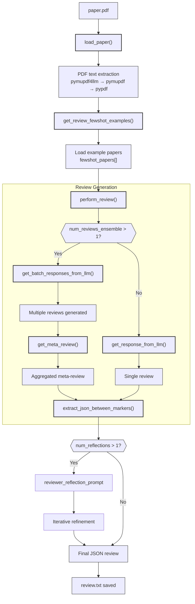
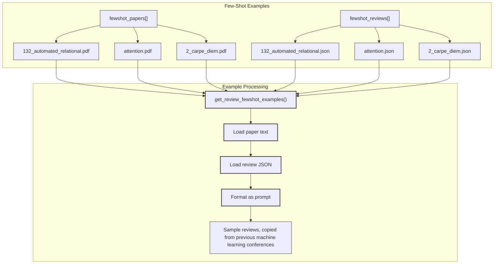
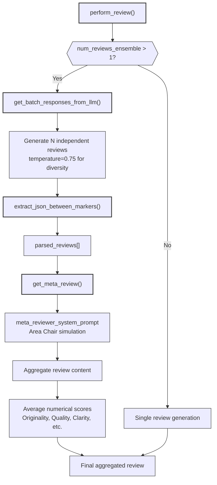
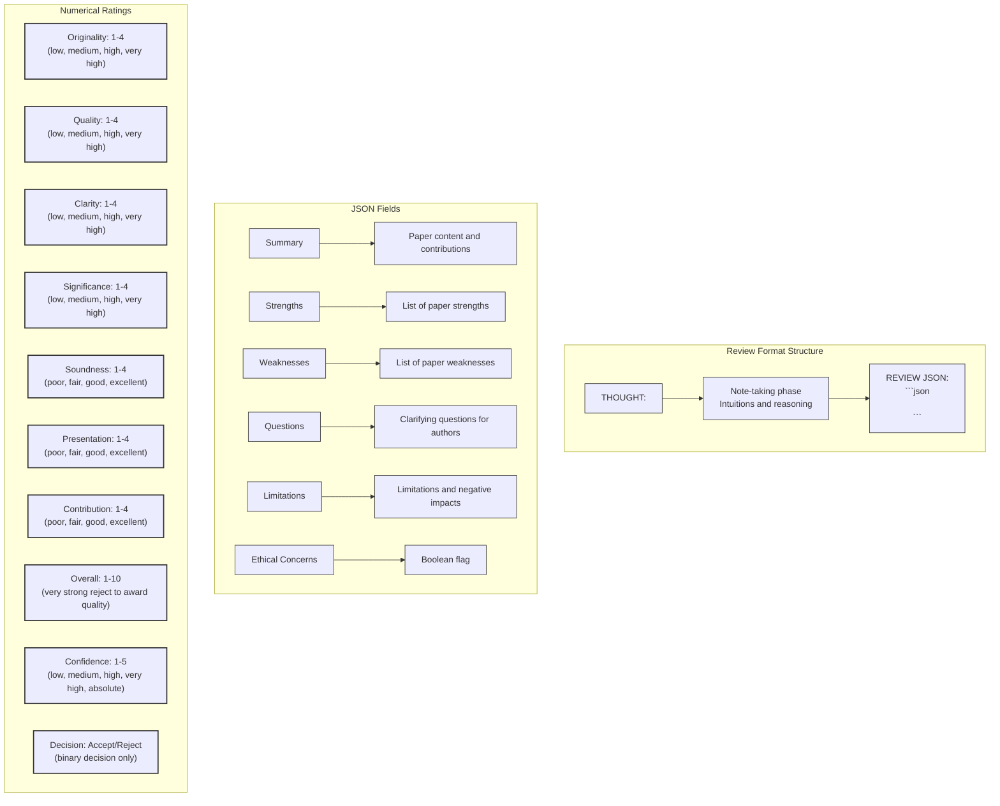
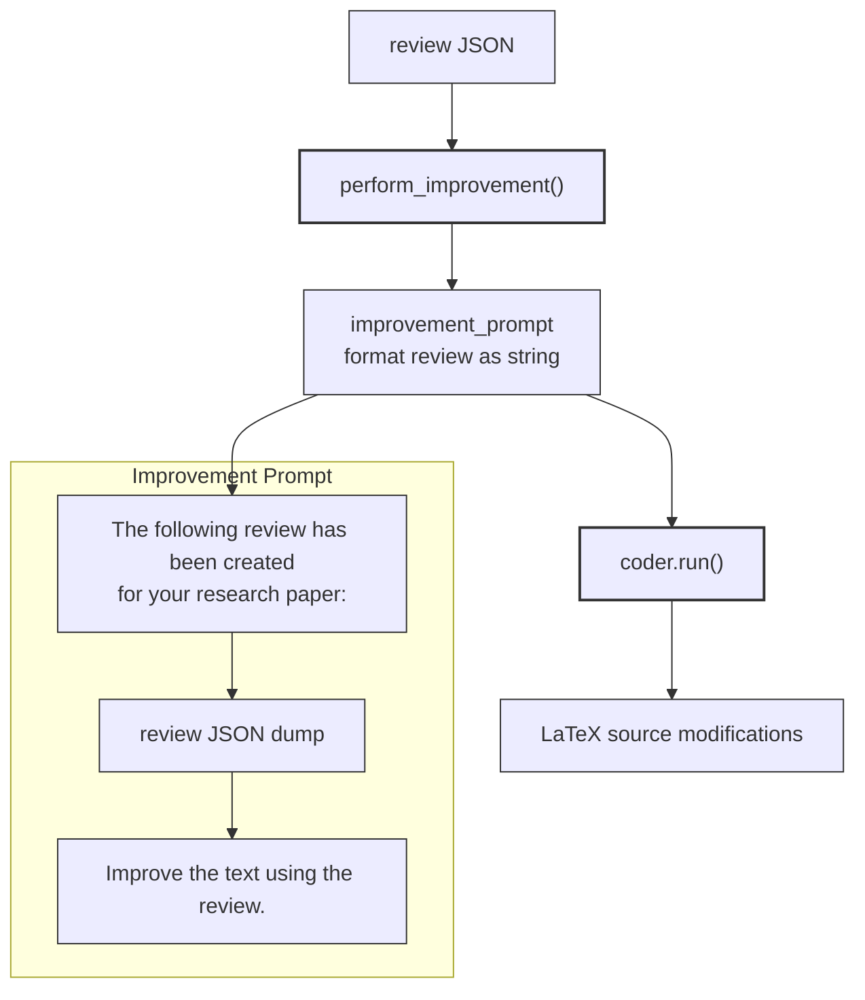

<!-- source: DeepWiki mcp.deepwiki.com · repo SakanaAI/AI-Scientist · page 2.6 Paper Review · fetched 2026-10-26 -->

# Paper Review

Relevant source files

The following files were used as context for generating this wiki page:

- [ai_scientist/fewshot_examples/132_automated_relational.json](ai_scientist/fewshot_examples/132_automated_relational.json)
- [ai_scientist/fewshot_examples/2_carpe_diem.json](ai_scientist/fewshot_examples/2_carpe_diem.json)
- [ai_scientist/fewshot_examples/attention.json](ai_scientist/fewshot_examples/attention.json)
- [ai_scientist/perform_review.py](ai_scientist/perform_review.py)

The Paper Review component implements an automated peer review system that evaluates generated research papers using LLMs. The system employs few-shot learning, ensemble methods, and meta-review aggregation to produce structured critiques similar to academic conference reviews.

## Overview

The Paper Review system operates as the final quality control step in the AI Scientist pipeline. The core functionality is implemented in `ai_scientist/perform_review.py` and provides:

1. PDF text extraction using multiple fallback methods (`load_paper`)
2. Few-shot learning from example papers and reviews (`get_review_fewshot_examples`)
3. Ensemble review generation with multiple LLM calls (`perform_review`)
4. Meta-review aggregation from multiple individual reviews (`get_meta_review`)
5. Iterative reflection and refinement mechanisms
6. Structured JSON output following NeurIPS review format

The system can generate both positive and negative biased reviews using different system prompts, and supports configurable ensemble sizes, reflection iterations, and few-shot example counts.

## Core Review Process Flow

The following diagram illustrates the data flow from a PDF file to a final structured review, highlighting the key functions in `ai_scientist/perform_review.py`.

Sources: [ai_scientist/perform_review.py:126-243](), [ai_scientist/perform_review.py:267-298]()

## Key Components and Functions

The Paper Review system implements several core functions that handle different aspects of the review process, bridging the gap between raw PDF data and structured LLM responses.

```mermaid
graph TD
    subgraph "PDF Processing"
        A["load_paper()"] --> B["pymupdf4llm.to_markdown()"]
        B --> C["pymupdf fallback"]
        C --> D["pypdf fallback"]
    end
    
    subgraph "Few-Shot Learning"
        E["get_review_fewshot_examples()"] --> F["fewshot_papers[]<br/>132_automated_relational.pdf<br/>attention.pdf<br/>2_carpe_diem.pdf"]
        F --> G["fewshot_reviews[]<br/>*.json files"]
        G --> H["Concatenated examples"]
    end
    
    subgraph "Review Generation"
        I["perform_review()"] --> J["reviewer_system_prompt_neg/pos"]
        J --> K["neurips_form + template_instructions"]
        I --> L["get_batch_responses_from_llm()"]
        I --> M["get_response_from_llm()"]
        L --> N["extract_json_between_markers()"]
        M --> N
    end
    
    subgraph "Meta-Review System"
        O["get_meta_review()"] --> P["meta_reviewer_system_prompt"]
        P --> Q["Aggregate multiple reviews"]
        Q --> R["Average numerical scores"]
    end
    
    subgraph "Improvement System"
        S["perform_improvement()"] --> T["improvement_prompt"]
        T --> U["coder.run()"]
    end

    classDef function stroke:#333,stroke-width:2px
    classDef data stroke:#333,stroke-width:1px
    
    class A,E,I,O,S function
    class B,C,D,F,G,H,J,K,L,M,N,P,Q,R,T,U data
```

### Core Function Descriptions

| Function | Purpose | Key Parameters | Output |
|----------|---------|----------------|--------|
| `load_paper()` | Extract text from PDF using multiple methods | `pdf_path`, `num_pages`, `min_size` | Extracted text string |
| `perform_review()` | Generate structured review using LLM | `text`, `model`, `num_reflections`, `num_fs_examples`, `num_reviews_ensemble` | JSON review dictionary |
| `get_review_fewshot_examples()` | Load few-shot training examples | `num_fs_examples` | Formatted prompt string |
| `get_meta_review()` | Aggregate multiple reviews into meta-review | `model`, `client`, `reviews` | Aggregated JSON review |
| `perform_improvement()` | Improve paper based on review feedback | `review`, `coder` | Modified paper output |

Sources: [ai_scientist/perform_review.py:267-298](), [ai_scientist/perform_review.py:126-243](), [ai_scientist/perform_review.py:323-352](), [ai_scientist/perform_review.py:361-383](), [ai_scientist/perform_review.py:386-396]()

## Few-Shot Learning Approach

The review system uses few-shot learning with three specific example papers and their corresponding reviews to guide the LLM's output style and critical depth.

The system dynamically loads examples based on the `num_fs_examples` parameter. For each example:
1. It loads the paper text (preferring cached `.txt` files over PDF extraction) [ai_scientist/perform_review.py:323-338]().
2. It loads the corresponding review JSON (e.g., [ai_scientist/fewshot_examples/attention.json:1-3]()).
3. It formats both as a paper-review pair in the prompt.
4. It concatenates multiple examples to provide context for the LLM [ai_scientist/perform_review.py:347-352]().

Sources: [ai_scientist/perform_review.py:310-352](), [ai_scientist/fewshot_examples/132_automated_relational.json:1-3](), [ai_scientist/fewshot_examples/2_carpe_diem.json:1-3](), [ai_scientist/fewshot_examples/attention.json:1-3]()

## Ensemble Review and Meta-Review System

When `num_reviews_ensemble > 1`, the system generates multiple independent reviews and aggregates them using an "Area Chair" persona.

The meta-review process in `get_meta_review`:
1. **Multiple Reviews**: Generates `num_reviews_ensemble` independent reviews with a temperature of 0.75 to ensure diversity [ai_scientist/perform_review.py:151-175]().
2. **Parsing**: Uses `extract_json_between_markers` to isolate the JSON content [ai_scientist/perform_review.py:176-192]().
3. **Meta-Reviewer**: Employs `meta_reviewer_system_prompt` to simulate an Area Chair aggregating findings [ai_scientist/perform_review.py:361-383]().
4. **Score Averaging**: Calculates the mean for numerical fields like Soundness, Contribution, and Overall score [ai_scientist/perform_review.py:377-383]().

Sources: [ai_scientist/perform_review.py:151-192](), [ai_scientist/perform_review.py:361-383]()

## Reflection and Iterative Refinement

The system supports iterative review refinement through a reflection loop.

| Parameter | Description | Default Range |
|-----------|-------------|---------------|
| `num_reflections` | Number of reflection iterations | 1 (configurable) |
| `reviewer_reflection_prompt` | Prompt for self-improvement | Fixed template |
| Convergence check | "I am done" detection | Automatic termination |

The reflection process asks the LLM to:
1. Evaluate the accuracy and soundness of its previous review.
2. Consider additional important factors.
3. Refine and improve the review while maintaining its spirit.
4. Optionally terminate early with the phrase "I am done" [ai_scientist/perform_review.py:222-264]().

Sources: [ai_scientist/perform_review.py:222-238](), [ai_scientist/perform_review.py:246-264]()

## Review Structure and Output Format

The system generates structured reviews following a strict schema defined in `template_instructions` and `neurips_form`.

### Complete Review Field Specification

The `Decision` field is restricted to "Accept" or "Reject" to avoid ambiguity [ai_scientist/perform_review.py:59-61]().

| Field | Type | Range | Description |
|-------|------|-------|-------------|
| `Summary` | String | - | Brief paper summary and contributions |
| `Strengths` | List | - | Key strengths of the paper |
| `Weaknesses` | List | - | Key weaknesses of the paper |
| `Originality` | Integer | 1-4 | Novelty assessment (low to very high) |
| `Quality` | Integer | 1-4 | Technical quality (low to very high) |
| `Clarity` | Integer | 1-4 | Writing clarity (low to very high) |
| `Significance` | Integer | 1-4 | Impact assessment (low to very high) |
| `Questions` | List | - | Clarifying questions for authors |
| `Limitations` | List | - | Work limitations and negative impacts |
| `Ethical Concerns` | Boolean | - | Whether ethical issues exist |
| `Soundness` | Integer | 1-4 | Technical correctness (poor to excellent) |
| `Presentation` | Integer | 1-4 | Writing quality (poor to excellent) |
| `Contribution` | Integer | 1-4 | Research contribution (poor to excellent) |
| `Overall` | Integer | 1-10 | Overall score (1: Strong Reject, 10: Award) |
| `Confidence` | Integer | 1-5 | Reviewer confidence (low to absolute) |
| `Decision` | String | Accept/Reject | Binary decision |

Sources: [ai_scientist/perform_review.py:27-63](), [ai_scientist/perform_review.py:65-123]()

## System Prompts and Reviewer Behavior

The system uses different reviewer personas to generate varied review perspectives, including biased prompts to explore the decision boundary.

| Prompt Type | Purpose | Key Characteristics |
|-------------|---------|-------------------|
| `reviewer_system_prompt_base` | Base reviewer identity | "AI researcher", "prestigious ML venue", "critical and cautious" |
| `reviewer_system_prompt_neg` | Negative bias reviewer | "If bad or unsure, give bad scores and reject" |
| `reviewer_system_prompt_pos` | Positive bias reviewer | "If good or unsure, give good scores and accept" |
| `meta_reviewer_system_prompt` | Area Chair simulation | "Aggregate reviews", "find consensus", "respect all reviewers" |

Sources: [ai_scientist/perform_review.py:13-25](), [ai_scientist/perform_review.py:361-370]()

## Paper Improvement Integration

The `perform_improvement()` function integrates the review feedback back into the research cycle by providing the coder agent with specific critique.

The process takes the structured review JSON and instructs the coder to "Improve the text using the review" [ai_scientist/perform_review.py:386-396]().

Sources: [ai_scientist/perform_review.py:386-396]()

---

