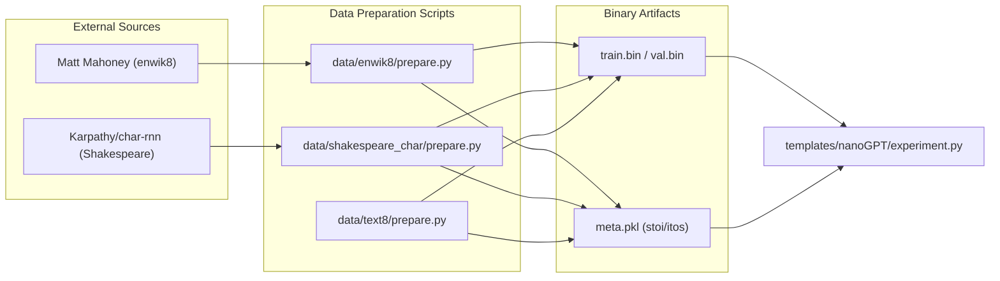

<!-- source: DeepWiki mcp.deepwiki.com · repo SakanaAI/AI-Scientist · page 3 Templates and Data · fetched 2026-10-26 -->

# Templates and Data

Relevant source files

The following files were used as context for generating this wiki page:

- [data/enwik8/prepare.py](data/enwik8/prepare.py)
- [data/shakespeare_char/prepare.py](data/shakespeare_char/prepare.py)
- [data/shakespeare_char/readme.md](data/shakespeare_char/readme.md)
- [data/text8/prepare.py](data/text8/prepare.py)
- [example_papers/adaptive_dual_scale_denoising/prompt.json](example_papers/adaptive_dual_scale_denoising/prompt.json)

## Purpose and Scope

This document provides a high-level overview of the template system and data preparation infrastructure within **The AI Scientist**. Templates define the specific research boundaries and starting codebases for the AI, while the data scripts provide the necessary character-level or numerical datasets required for experiments.

The system is designed to be modular: by swapping a template, the AI transitions from researching transformer optimization to diffusion models or epidemiology.

## 3.1 Template System

Templates are the "DNA" of a research project in this framework. They provide the LLM with a foundational codebase, a task description, and a set of initial ideas to kickstart the evolutionary research process.

### Template Structure
A standard template directory (e.g., `templates/2d_diffusion/`) contains:
*   `experiment.py`: The core executable script that the AI modifies to test hypotheses. It must accept an `--out_dir` argument [example_papers/adaptive_dual_scale_denoising/prompt.json:3-3]().
*   `plot.py`: A script used to visualize results from `run_n` directories.
*   `prompt.json`: Contains the `system` role and `task_description` that defines the research goal for the AI PhD student agent [example_papers/adaptive_dual_scale_denoising/prompt.json:1-4]().
*   `seed_ideas.json`: A collection of initial research directions to prime the `generate_ideas.py` module.
*   `latex/`: A directory containing `template.tex` and necessary style files for paper generation.

For details on how these files interact, see [Template System](#3.1).

**Sources:** [example_papers/adaptive_dual_scale_denoising/prompt.json:1-4]()

## 3.2 Data Preparation Scripts

Before running experiments in domains like Language Modeling, the raw data must be preprocessed into binary formats for efficient loading. The `data/` directory contains standalone scripts to fetch and encode datasets.

### Character-Level Modeling Pipeline
The system focuses on character-level encoding rather than BPE to simplify the vocabulary for the AI's experiments.

### Key Datasets
*   **enwik8**: The first 10^8 bytes of Wikipedia. The script `data/enwik8/prepare.py` downloads, unzips, and splits it into train/val/test [data/enwik8/prepare.py:12-57]().
*   **Shakespeare**: A smaller character-level dataset (`input.txt`) used for rapid prototyping [data/shakespeare_char/prepare.py:12-21]().
*   **text8**: A cleaned version of Wikipedia text, processed similarly to enwik8 [data/text8/prepare.py:1-25]().

For details on dataset splits and encoding logic, see [Data Preparation Scripts](#3.2).

**Sources:** [data/enwik8/prepare.py:1-75](), [data/shakespeare_char/prepare.py:1-61](), [data/text8/prepare.py:1-76]()

## 3.3 Available Templates

The repository includes a variety of templates covering different scientific and machine learning domains. These are categorized into "Core" templates provided by the authors and "Community" templates added via contributions.

### Core Templates
*   **NanoGPT / NanoGPT Lite**: Focused on transformer architectures and character-level language modeling.
*   **2D Diffusion**: Researching denoising diffusion probabilistic models (DDPM) on low-dimensional datasets [example_papers/adaptive_dual_scale_denoising/prompt.json:3-3]().
*   **Grokking**: Investigating sudden generalization in neural networks.

### Community Templates
The ecosystem has expanded to include specialized domains:
*   **MACE**: Quantum chemistry and interatomic potentials.
*   **SEIR**: Epidemiological modeling for disease spread.
*   **Earthquake Prediction**: Seismological data analysis.
*   **TensoRF**: Neural Radiance Fields (NeRF) optimization.

### System Mapping: Natural Language to Code Entities

This table bridges the research goals defined in `prompt.json` to the actual files the AI manipulates.

| Research Goal (Natural Language) | Code Entity (Implementation) | File Path |
| :--- | :--- | :--- |
| "Controllable generation" | `DiffusionModel` class | `templates/2d_diffusion/experiment.py` |
| "Character-level LM" | `stoi` / `itos` mappings | `data/enwik8/meta.pkl` |
| "Paper Writeup" | `latex/template.tex` | `templates/{name}/latex/` |
| "Idea Seed" | `seed_ideas.json` | `templates/{name}/seed_ideas.json` |

For a full catalog of all available templates and their specific requirements, see [Available Templates](#3.3).

**Sources:** [example_papers/adaptive_dual_scale_denoising/prompt.json:1-4](), [data/enwik8/prepare.py:69-73](), [data/shakespeare_char/prepare.py:55-59]()

---

