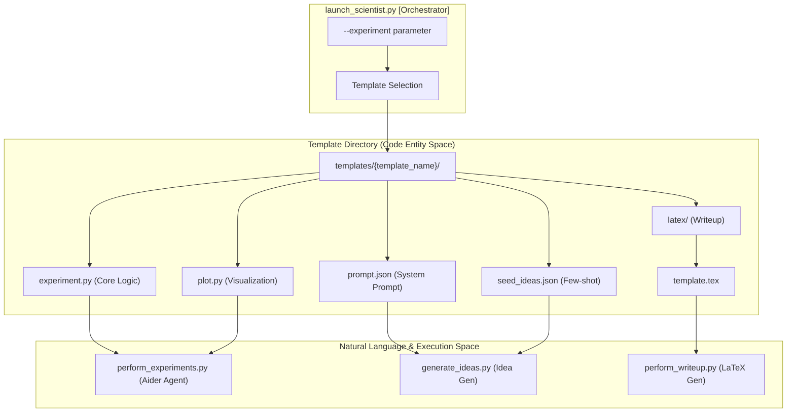
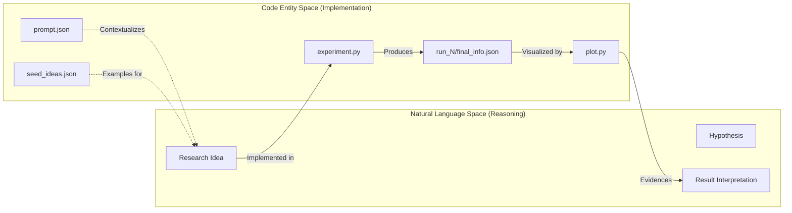

<!-- source: DeepWiki mcp.deepwiki.com · repo SakanaAI/AI-Scientist · page 3.1 Template System · fetched 2026-10-26 -->

# Template System

Relevant source files

The following files were used as context for generating this wiki page:

- [example_papers/adaptive_dual_scale_denoising/experiment.py](example_papers/adaptive_dual_scale_denoising/experiment.py)
- [example_papers/adaptive_dual_scale_denoising/plot.py](example_papers/adaptive_dual_scale_denoising/plot.py)
- [example_papers/adaptive_dual_scale_denoising/prompt.json](example_papers/adaptive_dual_scale_denoising/prompt.json)
- [example_papers/adaptive_dual_scale_denoising/seed_ideas.json](example_papers/adaptive_dual_scale_denoising/seed_ideas.json)
- [example_papers/data_augmentation_grokking/prompt.json](example_papers/data_augmentation_grokking/prompt.json)

## Overview

The template system is the architectural foundation that enables **The AI Scientist** to conduct domain-specific research across diverse scientific fields. By providing a standardized scaffold of code, data, and prompts, templates allow the system to bootstrap its research process in a new area without starting from scratch. Each template encapsulates the essential domain knowledge, experimental logic, and formatting requirements needed for the AI to generate ideas, execute experiments, and produce a peer-reviewed-quality paper.

The system is invoked via `launch_scientist.py` using the `--experiment` flag, which points the pipeline to a specific template directory.

## Template Architecture and Data Flow

Templates act as a bridge between the general-purpose AI agents and the specific requirements of a research domain. They are structured to provide specific entry points for different stages of the research pipeline.

**Template System Integration with AI Scientist Pipeline**

Sources: [example_papers/adaptive_dual_scale_denoising/prompt.json:1-4](), [example_papers/adaptive_dual_scale_denoising/seed_ideas.json:1-10]()

## Core Template Components

### 1. Experimental Logic (`experiment.py`)
This is the primary Python script that defines the baseline experiment. It typically contains the model architecture, training loops, and evaluation metrics.
- **Interface Requirement**: It must be executable via command line and should ideally accept an `--out_dir` argument to store results for specific runs (e.g., `run_1`, `run_2`).
- **Implementation Detail**: In the 2D Diffusion template, `experiment.py` defines classes like `MLPDenoiser` [example_papers/adaptive_dual_scale_denoising/experiment.py:51-112]() and `NoiseScheduler` [example_papers/adaptive_dual_scale_denoising/experiment.py:114-200]().
- **Data Output**: It is expected to save results (like `final_info.json` or `all_results.pkl`) that the plotting script can later consume.

### 2. Visualization (`plot.py`)
This script automates the generation of figures for the final paper. 
- **Mechanism**: It iterates through the `run_N` directories created during the experiment phase, loads the JSON/Pickle data, and uses libraries like `matplotlib` to create `.png` files.
- **Example**: In the adaptive denoising example, `plot.py` generates `train_loss.png` [example_papers/adaptive_dual_scale_denoising/plot.py:75](), `generated_images.png` [example_papers/adaptive_dual_scale_denoising/plot.py:98](), and `weight_evolution.png` [example_papers/adaptive_dual_scale_denoising/plot.py:121]().

### 3. Domain Context (`prompt.json`)
This file defines the "persona" and the specific task constraints for the LLM.
- **Structure**: It contains a `system` string (defining the AI's role) and a `task_description` (describing the codebase and suggesting interesting research directions).
- **Example**: "You are an ambitious AI PhD student... particularly interesting ideas would involve controllable generation..." [example_papers/adaptive_dual_scale_denoising/prompt.json:2-3]().

### 4. Seed Ideas (`seed_ideas.json`)
A collection of initial research ideas that serve as few-shot examples for the `generate_ideas.py` module.
- **Fields**: Each idea includes a `Name`, `Title`, `Experiment` description, and scores for `Interestingness`, `Feasibility`, and `Novelty`.
- **Example**: An idea for "Adaptive Learning Rate Schedules" with a feasibility score of 10 [example_papers/adaptive_dual_scale_denoising/seed_ideas.json:3-9]().

### 5. Paper Template (`latex/`)
A directory containing a standard LaTeX scaffold (usually based on conference templates like ICLR).
- **template.tex**: The main file where the AI will insert the abstract, introduction, methods, results (including the plots generated by `plot.py`), and conclusion.

## Mapping Code Entities to Research Workflow

The following diagram bridges the "Natural Language Space" (the AI's reasoning) to the "Code Entity Space" (the actual files it manipulates).

**Code-to-Workflow Mapping**

Sources: [example_papers/adaptive_dual_scale_denoising/experiment.py:201-205](), [example_papers/adaptive_dual_scale_denoising/plot.py:26-31]()

## Execution and Data Flow

When `launch_scientist.py` runs, it follows a strict data flow using these template files:

| Phase | Input Files | Primary Action | Output |
| :--- | :--- | :--- | :--- |
| **Idea Generation** | `prompt.json`, `seed_ideas.json` | `generate_ideas.py` calls LLM to brainstorm | `ideas.json` |
| **Experimentation** | `experiment.py`, `ideas.json` | `perform_experiments.py` uses **Aider** to modify `experiment.py` | `run_1/`, `run_2/`, etc. |
| **Plotting** | `plot.py`, `run_N/` data | Subprocess call to `plot.py` | `.png` figures |
| **Writeup** | `latex/template.tex`, `.png` files | `perform_writeup.py` fills LaTeX sections | `paper.pdf` |

### Result Extraction Implementation
The `plot.py` script is designed to be robust to varying numbers of experimental runs. It typically uses `os.listdir("./")` to find directories starting with "run" [example_papers/adaptive_dual_scale_denoising/plot.py:26-27]() and loads the `final_info.json` from each to populate a `final_results` dictionary [example_papers/adaptive_dual_scale_denoising/plot.py:28-29]().

## Available Templates

The repository includes several "Core" templates and supports "Community" templates:

*   **NanoGPT**: For transformer-based language modeling research.
*   **2D Diffusion**: For generative modeling on low-dimensional datasets (e.g., "circle", "dino", "moons") [example_papers/adaptive_dual_scale_denoising/plot.py:10]().
*   **Grokking**: For studying generalization in small algorithmic datasets [example_papers/data_augmentation_grokking/prompt.json:3]().

Sources: [example_papers/adaptive_dual_scale_denoising/plot.py:10-13](), [example_papers/data_augmentation_grokking/prompt.json:1-4]()

---

