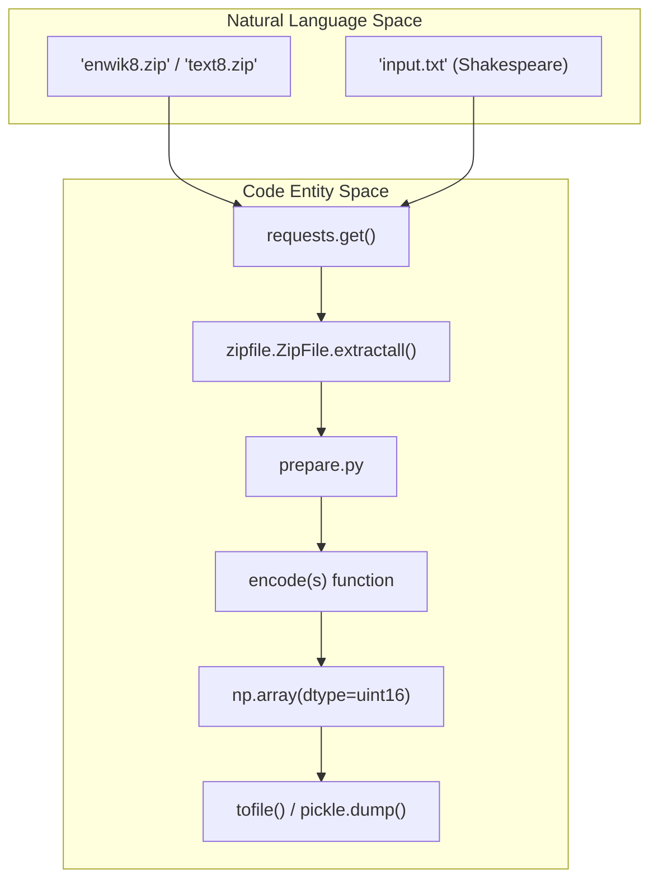
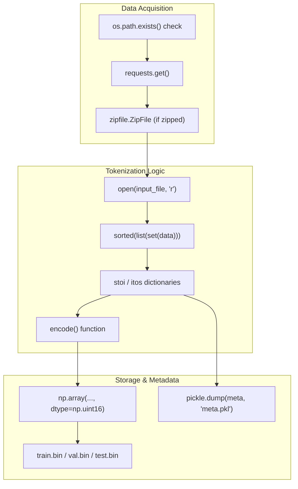
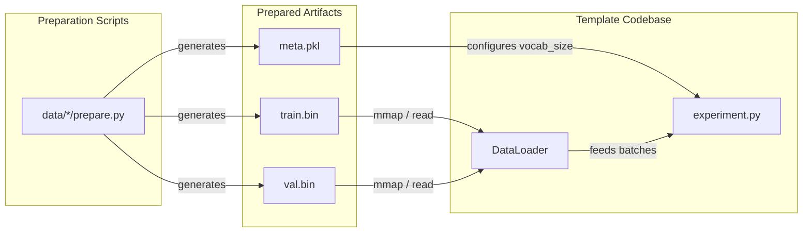

<!-- source: DeepWiki mcp.deepwiki.com · repo SakanaAI/AI-Scientist · page 3.2 Data Preparation Scripts · fetched 2026-10-26 -->

# Data Preparation Scripts

<details>
<summary>Relevant source files</summary>

The following files were used as context for generating this wiki page:

- [data/enwik8/prepare.py](data/enwik8/prepare.py)
- [data/shakespeare_char/prepare.py](data/shakespeare_char/prepare.py)
- [data/shakespeare_char/readme.md](data/shakespeare_char/readme.md)
- [data/text8/prepare.py](data/text8/prepare.py)

</details>


This document covers the data preparation infrastructure used to preprocess datasets for character-level language modeling experiments in the AI Scientist system. These scripts convert raw text data into tokenized binary formats suitable for training neural language models.

For information about how these scripts integrate with research templates, see [3.1 Template System](). For details about the nanoGPT template that uses these datasets, see [3.3 Available Templates]().

## Overview

The data preparation scripts provide a standardized pipeline for converting raw text datasets into character-level tokenized data. Each script follows a consistent pattern: download raw data, create character-to-integer mappings, split data into train/validation/test sets, and export to binary files with metadata.


**Data Processing Pipeline: Natural Language to Code Entities**

Sources: [data/enwik8/prepare.py:1-75](), [data/shakespeare_char/prepare.py:1-61](), [data/text8/prepare.py:1-75]()

## Available Datasets

The system includes three character-level datasets commonly used for language modeling research:

| Dataset | Script | Source | Size | Vocab Size | Split Strategy |
|---------|--------|--------|------|------------|----------------|
| enwik8 | `data/enwik8/prepare.py` | Wikipedia dump | 100M chars | 205 (approx) | 5M test, 5M val [data/enwik8/prepare.py:45-48]() |
| shakespeare_char | `data/shakespeare_char/prepare.py` | Tiny Shakespeare | 1.1M chars | 65 [data/shakespeare_char/readme.md:66]() | 90/10 train/val [data/shakespeare_char/prepare.py:39-40]() |
| text8 | `data/text8/prepare.py` | Cleaned Wikipedia | 100M chars | 27 (approx) | 5M test, 5M val [data/text8/prepare.py:45-48]() |

### enwik8 Dataset

The enwik8 dataset contains the first 100 million characters of a Wikipedia XML dump. The preparation script handles automatic download and extraction.

Key processing steps:
- Downloads from `http://mattmahoney.net/dc/enwik8.zip` [data/enwik8/prepare.py:15]()
- Uses `latin-1` encoding for reading the raw file [data/enwik8/prepare.py:25]()
- Creates fixed-size test and validation splits of 5,000,000 characters each [data/enwik8/prepare.py:45-48]()
- Exports data as `uint16` arrays to `train.bin`, `val.bin`, and `test.bin` [data/enwik8/prepare.py:60-66]()

### shakespeare_char Dataset

Contains the complete works of Shakespeare formatted for character-level modeling. This smaller dataset is useful for quick experimentation and testing.

Key processing steps:
- Downloads from Karpathy's char-rnn repository [data/shakespeare_char/prepare.py:15]()
- Uses proportional 90% train and 10% validation split [data/shakespeare_char/prepare.py:39-40]()
- Fixed vocabulary size of 65 characters including punctuation and case [data/shakespeare_char/readme.md:65-66]()

### text8 Dataset

A cleaned version of Wikipedia text (containing only lowercase 'a'-'z' and spaces) used to normalize the data for character-level modeling.

Key processing steps:
- Downloads from `http://mattmahoney.net/dc/text8.zip` [data/text8/prepare.py:15]()
- Identical split strategy to enwik8 with 5M character buffers for validation and testing [data/text8/prepare.py:45-48]()
- Exports metadata including `stoi` (string-to-int) and `itos` (int-to-string) mappings [data/text8/prepare.py:69-73]()

Sources: [data/enwik8/prepare.py:1-75](), [data/shakespeare_char/prepare.py:1-61](), [data/shakespeare_char/readme.md:1-10](), [data/text8/prepare.py:1-75]()

## Common Processing Pattern

All data preparation scripts implement the same core processing pipeline with minor variations for dataset-specific requirements.


**Shared Processing Components**

### Character Encoding

Each script creates bidirectional mappings between characters and integers to bypass standard BPE tokenizers:

```python
stoi = { ch:i for i,ch in enumerate(chars) }  # String to int [data/enwik8/prepare.py:36]
itos = { i:ch for i,ch in enumerate(chars) }  # Int to string [data/enwik8/prepare.py:37]
```

The `encode()` and `decode()` functions provide conversion between text and token sequences [data/enwik8/prepare.py:38-41](), [data/shakespeare_char/prepare.py:32-35](), [data/text8/prepare.py:38-41]().

### Output Files

Each preparation script generates a consistent set of output files in its respective directory:

- **`train.bin`**: Binary file containing training token sequences [data/enwik8/prepare.py:64]()
- **`val.bin`**: Binary file containing validation token sequences [data/enwik8/prepare.py:65]()
- **`test.bin`**: Binary file containing test token sequences (present in enwik8 and text8) [data/enwik8/prepare.py:66]()
- **`meta.pkl`**: Pickled metadata containing vocabulary mappings and size information [data/enwik8/prepare.py:74-75]()

The metadata structure includes:
```python
meta = {
    'vocab_size': vocab_size,
    'itos': itos,     # Int to string mapping
    'stoi': stoi,     # String to int mapping
}
```

Sources: [data/enwik8/prepare.py:29-41](), [data/shakespeare_char/prepare.py:23-35](), [data/text8/prepare.py:29-41](), [data/enwik8/prepare.py:69-75]()

## Integration with Templates

The data preparation scripts are designed to work seamlessly with the nanoGPT template system for transformer research experiments.


**Template Integration Flow**

The nanoGPT template expects prepared data in the specific binary format produced by these scripts. The template's `experiment.py` loads the binary files and metadata to configure the model's vocabulary size and data loaders.

### Usage in Experiments

When running experiments, the AI Scientist system automatically uses the prepared data:

1. Template selection specifies the dataset (e.g., `shakespeare_char`).
2. The `experiment.py` script loads `train.bin`, `val.bin`, and `meta.pkl`.
3. `vocab_size` from metadata configures the transformer model's embedding and output layers [data/enwik8/prepare.py:70]().
4. Binary data provides efficient loading via `numpy` during training [data/enwik8/prepare.py:60]().

Sources: [data/enwik8/prepare.py:64-75](), [data/shakespeare_char/prepare.py:51-61](), [data/text8/prepare.py:64-75]()

## File Format Specifications

### Binary Data Format

Token sequences are stored as numpy arrays with `dtype=np.uint16` [data/enwik8/prepare.py:60](), allowing for vocabularies up to 65,536 characters. This format provides:

- **Efficient storage**: 2 bytes per token instead of standard 4 or 8 byte integers.
- **Fast loading**: Supports direct binary reading via `tofile()` and corresponding `fromfile()` in training scripts.
- **Consistency**: All character-level templates share this underlying storage format.

### Metadata Format

The `meta.pkl` file contains Python objects serialized with pickle [data/enwik8/prepare.py:75]():

```python
{
    'vocab_size': int,           # Total unique characters
    'itos': {int: str},         # Index to character mapping
    'stoi': {str: int},         # Character to index mapping
}
```

This metadata enables the template system to:
- Configure model vocabulary dimensions dynamically based on the dataset.
- Decode model outputs (integers) back to readable text for logging or evaluation.
- Ensure the model's output layer matches the actual character set present in the data.

Sources: [data/enwik8/prepare.py:60-75](), [data/shakespeare_char/prepare.py:49-61](), [data/text8/prepare.py:60-75]()

---

