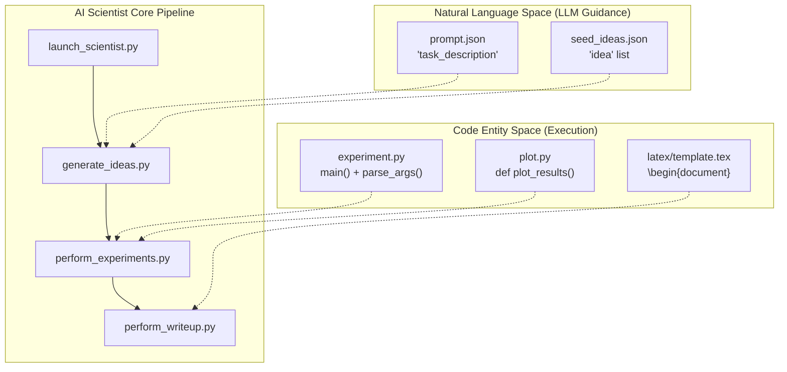
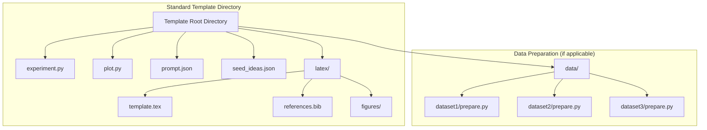
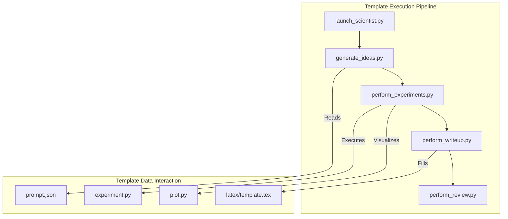

<!-- source: DeepWiki mcp.deepwiki.com · repo SakanaAI/AI-Scientist · page 3.3 Available Templates · fetched 2026-10-26 -->

# Available Templates

<details>
<summary>Relevant source files</summary>

The following files were used as context for generating this wiki page:

- [example_papers/adaptive_dual_scale_denoising/DatasaurusDozen.tsv](example_papers/adaptive_dual_scale_denoising/DatasaurusDozen.tsv)
- [example_papers/adaptive_dual_scale_denoising/datasets.py](example_papers/adaptive_dual_scale_denoising/datasets.py)
- [example_papers/adaptive_dual_scale_denoising/ema_pytorch.py](example_papers/adaptive_dual_scale_denoising/ema_pytorch.py)
- [example_papers/adaptive_dual_scale_denoising/prompt.json](example_papers/adaptive_dual_scale_denoising/prompt.json)

</details>


## Overview

The AI Scientist framework provides multiple research templates that enable automated scientific discovery across different domains. Templates serve as the foundation for generating research ideas, conducting experiments, and writing scientific papers. Each template encapsulates domain-specific knowledge, experimental procedures, and evaluation metrics.

The framework includes core templates maintained by the AI Scientist team, plus additional community-contributed templates covering diverse research areas. Templates enable the system to explore different scientific domains while maintaining consistent structure and integration with the core AI Scientist pipeline.

Sources: [README.md:59-60](), [README.md:286-296](), [README.md:298-309]()

## Template Architecture

### Template Structure and Integration

The following diagram illustrates how template files map to specific components in the `launch_scientist.py` pipeline.



Sources: [README.md:286-296](), [example_papers/adaptive_dual_scale_denoising/prompt.json:1-4]()

### Template File Structure



Sources: [README.md:286-296]()

## Core Templates

The AI Scientist framework provides core templates that have been extensively tested and validated:

### NanoGPT Template
*   **Domain**: Transformer-based language modeling
*   **Focus**: Character-level autoregressive next-token prediction
*   **Location**: `templates/nanoGPT_lite/`

The NanoGPT template implements a lightweight GPT architecture. It supports multiple character-level datasets and enables research into transformer architectures and optimization.

**Key Features**:
*   Character-level tokenization.
*   Support for `shakespeare_char`, `text8`, and `enwik8`.
*   Efficient training with mixed precision and gradient clipping [templates/nanoGPT_lite/experiment.py:1-719]().

### 2D Diffusion Template
*   **Domain**: Generative modeling with diffusion processes
*   **Focus**: Low-dimensional diffusion model performance improvement
*   **Location**: `templates/2d_diffusion/`

The 2D Diffusion template studies Denoising Diffusion Probabilistic Models (DDPM) on 2D datasets. It provides a `prompt.json` encouraging ideas in controllable generation or new encodings [example_papers/adaptive_dual_scale_denoising/prompt.json:1-4]().

**Data Flow**:
The template utilizes synthetic and tabular datasets defined in `datasets.py` [example_papers/adaptive_dual_scale_denoising/datasets.py:57-67]().

| Dataset | Source / Function |
| :--- | :--- |
| `moons` | `sklearn.datasets.make_moons` [example_papers/adaptive_dual_scale_denoising/datasets.py:9-13]() |
| `dino` | `DatasaurusDozen.tsv` [example_papers/adaptive_dual_scale_denoising/datasets.py:41-54]() |
| `line` | Uniform distribution [example_papers/adaptive_dual_scale_denoising/datasets.py:16-22]() |
| `circle` | Trigonometric generation [example_papers/adaptive_dual_scale_denoising/datasets.py:25-38]() |

**Technical Components**:
*   **EMA Implementation**: Uses `EMA` class for shadowing model weights [example_papers/adaptive_dual_scale_denoising/ema_pytorch.py:31-71]().
*   **Training**: DDPM training loop with MSE loss on predicted noise.

### Grokking Template
*   **Domain**: Neural network generalization dynamics
*   **Focus**: Grokking phenomenon in deep learning
*   **Location**: `templates/grokking/`

Investigates modular arithmetic tasks where generalization occurs long after overfitting training data.

Sources: [README.md:164-233](), [example_papers/adaptive_dual_scale_denoising/datasets.py:57-67]()

## Community-Contributed Templates

These templates extend the system's capabilities to additional scientific domains:

| Template Name | Research Domain | Description |
|---------------|-----------------|-------------|
| `seir` | Epidemiology | Infectious Disease Modeling (PR #137) |
| `mobilenetV3` | CV Architecture | MobileNetV3 image classification (PR #141) |
| `sketch_rnn` | Sequence Gen | Sketch RNN for drawing generation (PR #143) |
| `MACE` | Quantum Chem | AI applications in quantum chemistry (PR #157) |
| `earthquake-prediction` | Geophysics | Earthquake prediction models (PR #167) |
| `tensorf` | 3D Rendering | Tensorial radiance fields (PR #175) |
| `probes` | Interpretability | LLM steering and probing (PR #215) |

Sources: [README.md:298-309]()

## Template Selection and Usage

### Running Templates with AI Scientist

Templates are selected using the `--experiment` parameter in `launch_scientist.py`.

```bash
# Example for 2D Diffusion
python launch_scientist.py --model "gpt-4o-2024-05-13" --experiment 2d_diffusion --num-ideas 2
```

Sources: [README.md:240-244]()

### Template Execution Flow



Sources: [README.md:240-244](), [README.md:286-296]()

## Creating Custom Templates

To create a new template, you must implement the following:

1.  **`experiment.py`**: Must accept `--out_dir` and save results (e.g., `final_info.json`) there.
2.  **`plot.py`**: Must load data from the directory created by `experiment.py` and save `.png` files.
3.  **`prompt.json`**: Contains the `system` role and `task_description` to guide the LLM [example_papers/adaptive_dual_scale_denoising/prompt.json:1-4]().
4.  **`seed_ideas.json`**: A list of JSON objects containing `Name`, `Title`, `Experiment`, and `Interestingness`.
5.  **`latex/`**: Contains `template.tex` and `references.bib`.

Sources: [README.md:286-296](), [example_papers/adaptive_dual_scale_denoising/prompt.json:1-4]()

---

