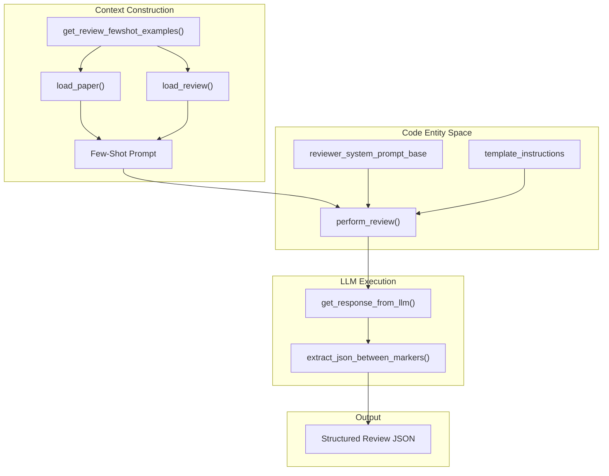
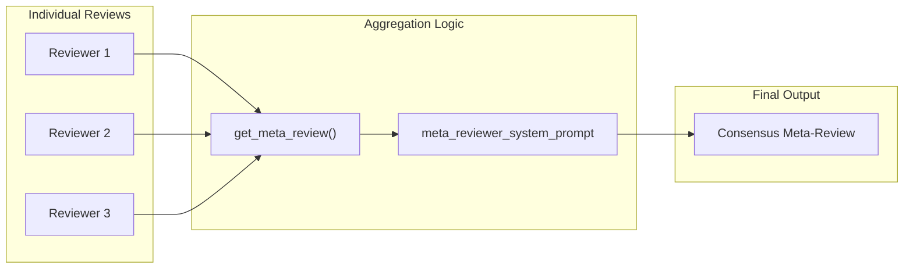

<!-- source: DeepWiki mcp.deepwiki.com · repo SakanaAI/AI-Scientist · page 4 Review System Training · fetched 2026-10-26 -->

# Review System Training

Relevant source files

The following files were used as context for generating this wiki page:

- [ai_scientist/fewshot_examples/132_automated_relational.json](ai_scientist/fewshot_examples/132_automated_relational.json)
- [ai_scientist/fewshot_examples/2_carpe_diem.json](ai_scientist/fewshot_examples/2_carpe_diem.json)
- [ai_scientist/fewshot_examples/attention.json](ai_scientist/fewshot_examples/attention.json)
- [ai_scientist/perform_review.py](ai_scientist/perform_review.py)

This document provides a high-level overview of the training methodology for the AI Scientist's automated review system. The system utilizes a few-shot learning approach, leveraging curated academic papers and structured reviews to guide the LLM in generating high-quality, consistent peer reviews.

## Few-Shot Learning Approach

The review system does not require traditional gradient-based fine-tuning. Instead, it uses **few-shot learning** by injecting real-world examples of papers and their corresponding reviews into the LLM's context. This approach teaches the model the expected tone, depth of analysis, and the specific JSON schema required for the output.

The system uses a sophisticated prompt structure that includes:
- **System Prompts**: Defining the persona of a critical and cautious AI researcher [ai_scientist/perform_review.py:13-25]().
- **Review Schema**: A strict JSON format covering fields such as `Summary`, `Strengths`, `Weaknesses`, `Originality`, `Quality`, `Clarity`, `Significance`, `Soundness`, `Presentation`, `Contribution`, `Overall`, `Confidence`, and `Decision` [ai_scientist/perform_review.py:27-63]().
- **NeurIPS Guidelines**: Explicit instructions based on the official NeurIPS review form to standardize evaluation criteria [ai_scientist/perform_review.py:65-123]().

For details on the implementation of these prompts and the ensemble reflection loops, see [Few-Shot Learning Approach](#4.1).

## Training Examples

The training set consists of three primary "gold-standard" examples stored in the `ai_scientist/fewshot_examples/` directory. These examples provide the model with diverse benchmarks for both high-quality (Accept) and lower-quality (Reject) submissions.

### Core Training Corpus

| Paper Identifier | Research Topic | Role in Training |
|:---|:---|:---|
| `132_automated_relational` | Meta-Learning & Knowledge Graphs | Demonstrates a high-quality "Accept" review with detailed technical feedback [ai_scientist/fewshot_examples/132_automated_relational.json:1-3](). |
| `attention` | Transformer Architecture | Represents a foundational, high-impact paper with "Strong Accept" scores [ai_scientist/fewshot_examples/attention.json:1-3](). |
| `2_carpe_diem` | Mini-batch Selection Optimization | Provides an example of a "Reject" decision, focusing on lack of rigorous experimentation and modest benefits [ai_scientist/fewshot_examples/2_carpe_diem.json:1-3](). |

The function `get_review_fewshot_examples` is responsible for loading these files and formatting them into the prompt context [ai_scientist/perform_review.py:323-352]().

For details on the content of these papers and their specific review patterns, see [Training Examples](#4.2).

## Review Pipeline Architecture

The following diagram illustrates how the training examples are integrated into the live review generation process within `perform_review.py`.

### Review Generation Logic

Sources: [ai_scientist/perform_review.py:323-352](), [ai_scientist/perform_review.py:126-243]()

## ICLR Benchmark Evaluation

To validate the effectiveness of this training approach, the system includes a benchmarking suite in `review_iclr_bench/`. This infrastructure allows for a large-scale comparison between AI-generated reviews and real human reviews from the ICLR conference.

Key components include:
- `iclr_analysis.py`: Tools for calculating correlations between AI and human ratings.
- **Paper Corpus**: A dataset of 1019 parsed ICLR papers used to test the reviewer's generalization capabilities.
- **Model Comparison**: Evaluation of different LLM backends (GPT-4o, Claude, Llama, DeepSeek) to determine which best adheres to the few-shot training.

For details on the evaluation results and the benchmarking infrastructure, see [ICLR Benchmark Evaluation](#4.3).

## Meta-Review and Ensemble Training

The system also includes training for an **Area Chair** persona, which performs meta-reviews by aggregating multiple individual reviews. This uses an ensemble method where the `meta_reviewer_system_prompt` guides the model to find consensus among conflicting reviews [ai_scientist/perform_review.py:355-383]().

### Meta-Review Workflow

Sources: [ai_scientist/perform_review.py:355-383](), [ai_scientist/perform_review.py:151-209]()

---

