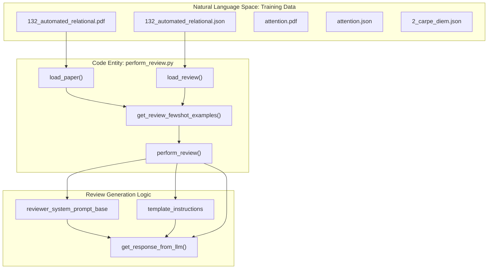
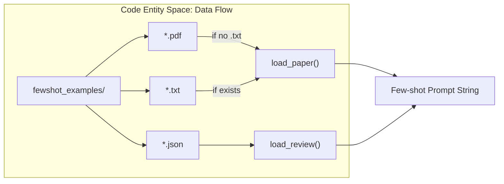

<!-- source: DeepWiki mcp.deepwiki.com · repo SakanaAI/AI-Scientist · page 4.1 Few-Shot Learning Approach · fetched 2026-10-26 -->

# Few-Shot Learning Approach

Relevant source files

The following files were used as context for generating this wiki page:

- [ai_scientist/fewshot_examples/132_automated_relational.json](ai_scientist/fewshot_examples/132_automated_relational.json)
- [ai_scientist/fewshot_examples/2_carpe_diem.json](ai_scientist/fewshot_examples/2_carpe_diem.json)
- [ai_scientist/perform_review.py](ai_scientist/perform_review.py)

This document explains how the AI Scientist review system implements few-shot learning to train language models for generating high-quality academic paper reviews. The system uses a structured schema and curated examples to guide the LLM in understanding review patterns, scoring distributions, and critical evaluation standards.

## Overview

The few-shot learning approach enables the review system to generate consistent, well-structured academic reviews by providing the language model with concrete examples of high-quality reviews. This method leverages in-context learning through carefully selected paper-review pairs, combined with ensemble methods and reflection loops to ensure robustness.

### Few-Shot Learning Architecture

Sources: [ai_scientist/perform_review.py:126-243](), [ai_scientist/perform_review.py:310-352]()

## Review Schema and Instructions

The system enforces a strict JSON schema for all reviews to ensure they can be programmatically parsed and analyzed. This schema covers both qualitative feedback and quantitative ratings.

### Mandatory Fields
The `template_instructions` constant defines the required JSON structure:
- **Qualitative**: `Summary`, `Strengths`, `Weaknesses`, `Questions`, `Limitations`.
- **Quantitative (1-4 scale)**: `Originality`, `Quality`, `Clarity`, `Significance`, `Soundness`, `Presentation`, `Contribution`.
- **Global Ratings**: `Overall` (1-10), `Confidence` (1-5), `Decision` (Accept/Reject).
- **Metadata**: `Ethical Concerns` (boolean).

### Prompting Strategy
The system uses different system prompts to adjust the "strictness" of the reviewer:
- `reviewer_system_prompt_neg`: Encourages a critical stance ("If a paper is bad... reject it") [ai_scientist/perform_review.py:18-21]().
- `reviewer_system_prompt_pos`: Encourages a more lenient stance ("If a paper is good... accept it") [ai_scientist/perform_review.py:22-25]().

Sources: [ai_scientist/perform_review.py:27-63](), [ai_scientist/perform_review.py:13-25]()

## Few-Shot Example Loading

The `get_review_fewshot_examples()` function serves as the core mechanism for loading and formatting training examples. It dynamically constructs prompts containing paper-review pairs.

### Training Data Integration

| Component | File Path / Reference | Role |
|------|----------|---------|
| **Example 1** | `132_automated_relational.json` | Meta-learning paper with an "Accept" decision [ai_scientist/fewshot_examples/132_automated_relational.json:1-3](). |
| **Example 2** | `attention.json` | Classic transformer paper used as a high-quality baseline. |
| **Example 3** | `2_carpe_diem.json` | Batch selection paper with a "Reject" decision [ai_scientist/fewshot_examples/2_carpe_diem.json:1-3](). |

### Text Extraction and Caching
The system optimizes performance by checking for pre-extracted text files (`.txt`) before attempting to parse PDFs using `pymupdf4llm` [ai_scientist/perform_review.py:331-337]().

Sources: [ai_scientist/perform_review.py:310-320](), [ai_scientist/perform_review.py:323-352]()

## Ensemble Methods and Reflection

To increase the reliability of the automated reviews, the system supports ensembling and meta-reviewing.

### Execution Flow
1. **Parallel Generation**: If `num_reviews_ensemble > 1`, the system calls `get_batch_responses_from_llm` to generate multiple independent reviews [ai_scientist/perform_review.py:185-191]().
2. **Meta-Reviewing**: The individual reviews are then passed to `get_meta_review()`, which aggregates the feedback into a single consensus review [ai_scientist/perform_review.py:230-243]().
3. **Score Aggregation**: Quantitative scores are averaged across the ensemble to reduce variance.

### Reflection Loops
The prompt structure includes a `THOUGHT` block [ai_scientist/perform_review.py:30-41](). This forces the LLM to engage in "Chain-of-Thought" reasoning, discussing intuitions and reasoning before committing to the final JSON scores. This acts as a self-reflection loop during the inference phase.

Sources: [ai_scientist/perform_review.py:126-243](), [ai_scientist/perform_review.py:27-63]()

## Configuration Parameters

The few-shot learning system is controlled by parameters passed to `perform_review`:

| Parameter | Type | Default | Purpose |
|-----------|------|---------|---------|
| `num_fs_examples` | int | 1 | Number of few-shot examples to include in the prompt [ai_scientist/perform_review.py:129](). |
| `num_reviews_ensemble` | int | 1 | Number of parallel reviews to generate for ensembling [ai_scientist/perform_review.py:130](). |
| `temperature` | float | 0.75 | Controls randomness in review generation [ai_scientist/perform_review.py:131](). |

Sources: [ai_scientist/perform_review.py:126-135]()

---

