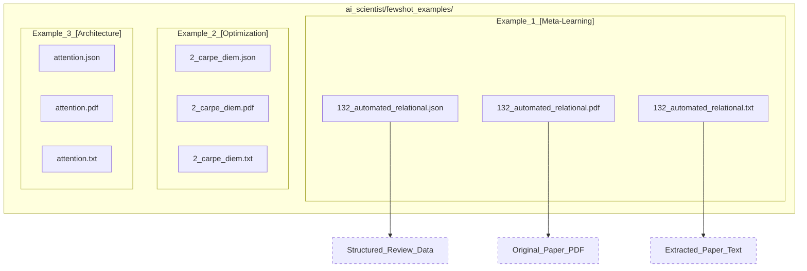
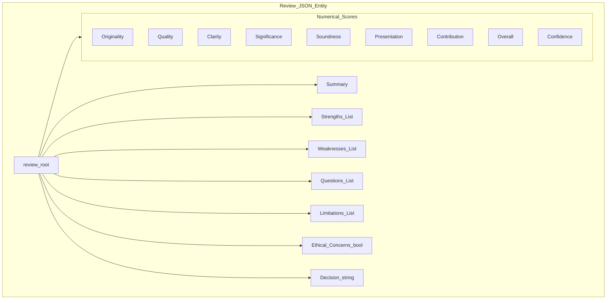
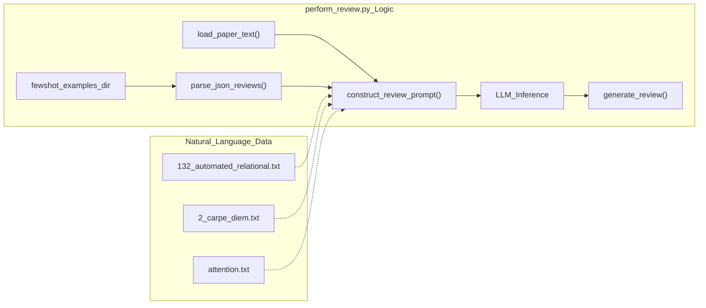

<!-- source: DeepWiki mcp.deepwiki.com · repo SakanaAI/AI-Scientist · page 4.2 Training Examples · fetched 2026-10-26 -->

# Training Examples

Relevant source files

The following files were used as context for generating this wiki page:

- [ai_scientist/fewshot_examples/132_automated_relational.json](ai_scientist/fewshot_examples/132_automated_relational.json)
- [ai_scientist/fewshot_examples/132_automated_relational.pdf](ai_scientist/fewshot_examples/132_automated_relational.pdf)
- [ai_scientist/fewshot_examples/132_automated_relational.txt](ai_scientist/fewshot_examples/132_automated_relational.txt)
- [ai_scientist/fewshot_examples/2_carpe_diem.json](ai_scientist/fewshot_examples/2_carpe_diem.json)
- [ai_scientist/fewshot_examples/2_carpe_diem.pdf](ai_scientist/fewshot_examples/2_carpe_diem.pdf)
- [ai_scientist/fewshot_examples/2_carpe_diem.txt](ai_scientist/fewshot_examples/2_carpe_diem.txt)
- [ai_scientist/fewshot_examples/attention.json](ai_scientist/fewshot_examples/attention.json)
- [ai_scientist/fewshot_examples/attention.pdf](ai_scientist/fewshot_examples/attention.pdf)
- [ai_scientist/fewshot_examples/attention.txt](ai_scientist/fewshot_examples/attention.txt)

This document describes the specific few-shot training examples used by the AI Scientist's review system. These examples serve as templates for the automated review generation process, providing the system with concrete instances of how to structure and write scientific paper reviews.

For information about the overall few-shot learning approach and methodology, see [Few-Shot Learning Approach](4.1). For details about the review system architecture, see [Paper Review](2.6).

## Overview

The training examples consist of three curated scientific papers with corresponding high-quality reviews. Each example includes multiple file formats (JSON, TXT, and PDF) to provide comprehensive training data for different aspects of the review process.

## File Structure and Organization

The training examples are stored in the `ai_scientist/fewshot_examples/` directory. Each example follows a strict naming convention to link the structured review data with the source paper text.

**Training Example File Structure**
Sources: [ai_scientist/fewshot_examples/132_automated_relational.json:1-3](), [ai_scientist/fewshot_examples/2_carpe_diem.json:1-3](), [ai_scientist/fewshot_examples/attention.json:1-3]()

## Review Data Structure

Each JSON file contains a structured review with standardized fields that correspond to the `Review` schema used during the inference phase in `perform_review.py`.

**Review Structure Components**
Sources: [ai_scientist/fewshot_examples/132_automated_relational.json:2](), [ai_scientist/fewshot_examples/2_carpe_diem.json:2](), [ai_scientist/fewshot_examples/attention.json:2]()

## Training Example Descriptions

### 1. Automated Relational Meta-Learning (ARML)
This example demonstrates a review of a meta-learning research paper focused on task heterogeneity.

| Field | Content |
|-------|---------|
| **Paper Title** | Automated Relational Meta-Learning |
| **Decision** | Accept |
| **Overall Score** | 7 |
| **Confidence** | 5 |
| **Core Concept** | Proposes a "meta-knowledge graph" to dynamically find relevant structures for new tasks. |
| **Role in Training** | Teaches the model how to evaluate architectural novelty and the importance of comprehensive ablation studies. |

Sources: [ai_scientist/fewshot_examples/132_automated_relational.json:2](), [ai_scientist/fewshot_examples/132_automated_relational.txt:1-21]()

### 2. Carpe Diem (Recency Bias)
This example shows a critical review of a deep learning optimization paper that suggests a "sliding window" approach for mini-batch selection.

| Field | Content |
|-------|---------|
| **Paper Title** | Carpe Diem, Seize the Samples Uncertain "At the Moment" |
| **Decision** | Reject |
| **Overall Score** | 4 |
| **Confidence** | 3 |
| **Core Concept** | Introduces "Recency Bias" to select informative minibatches based on prediction inconsistency. |
| **Role in Training** | Provides a template for identifying "Reject" criteria, such as lack of rigorous experimentation and limited novelty over prior work (Active Bias). |

Sources: [ai_scientist/fewshot_examples/2_carpe_diem.json:2](), [ai_scientist/fewshot_examples/2_carpe_diem.txt:1-19]()

### 3. Attention Is All You Need
This example represents a review of the seminal Transformer architecture paper.

| Field | Content |
|-------|---------|
| **Paper Title** | Attention Is All You Need |
| **Decision** | Accept |
| **Overall Score** | 8 |
| **Confidence** | 5 |
| **Core Concept** | Replacing recurrent and convolutional layers entirely with self-attention mechanisms. |
| **Role in Training** | Guides the model in recognizing high-impact architectural shifts and state-of-the-art (SOTA) performance benchmarks. |

Sources: [ai_scientist/fewshot_examples/attention.json:2](), [ai_scientist/fewshot_examples/attention.txt:57-70]()

## Integration with Review System

The training examples are loaded and utilized by the review system through the few-shot learning mechanism. During the execution of `perform_review.py`, these examples are injected into the LLM prompt to ground the generation in realistic academic standards.

**Few-shot Example Integration**
Sources: [ai_scientist/fewshot_examples/132_automated_relational.json:1-3](), [ai_scientist/fewshot_examples/2_carpe_diem.json:1-3](), [ai_scientist/fewshot_examples/attention.json:1-3]()

## Content Diversity and Coverage

The three training examples provide diverse coverage across multiple dimensions to prevent the reviewer from becoming biased toward a single style or outcome.

| Dimension | ARML Example | Carpe Diem Example | Attention Example |
|-----------|-----------|-----------|-----------|
| **Outcome** | Accept (Positive) | Reject (Negative) | Accept (Highly Positive) |
| **Focus** | Meta-Learning | Batch Selection | Neural Architecture |
| **Critique Style** | Suggests specific ablations | Questions experimental rigor | Notes limited domain scope |
| **Score Range** | 7 (Solid) | 4 (Weak) | 8 (Excellent) |

Sources: [ai_scientist/fewshot_examples/132_automated_relational.json:2](), [ai_scientist/fewshot_examples/2_carpe_diem.json:2](), [ai_scientist/fewshot_examples/attention.json:2]()

---

