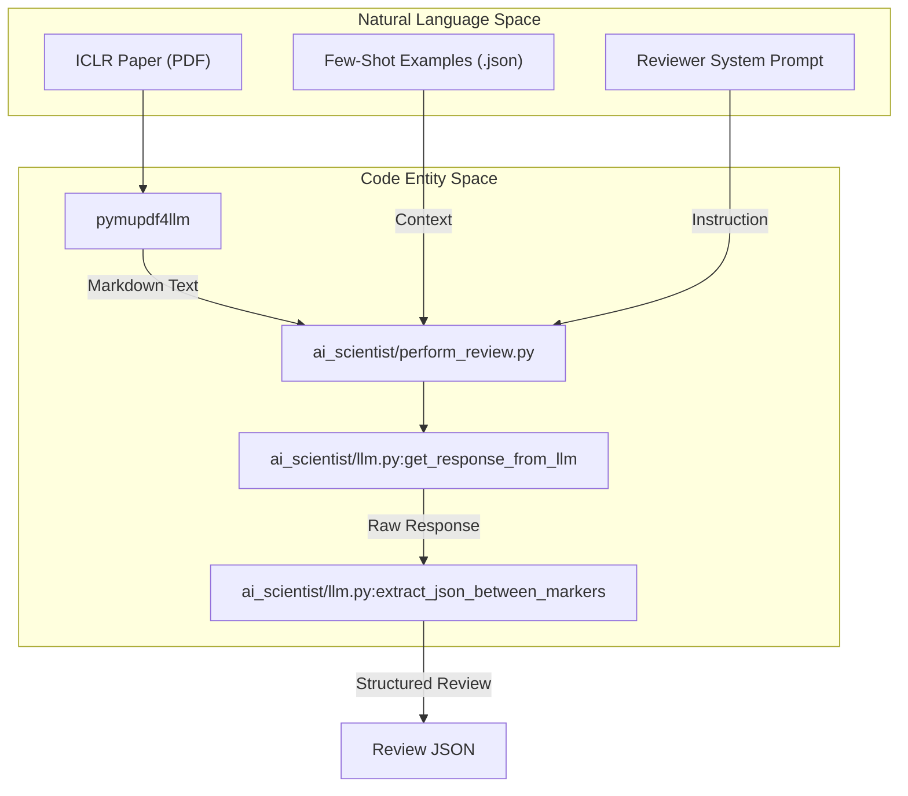
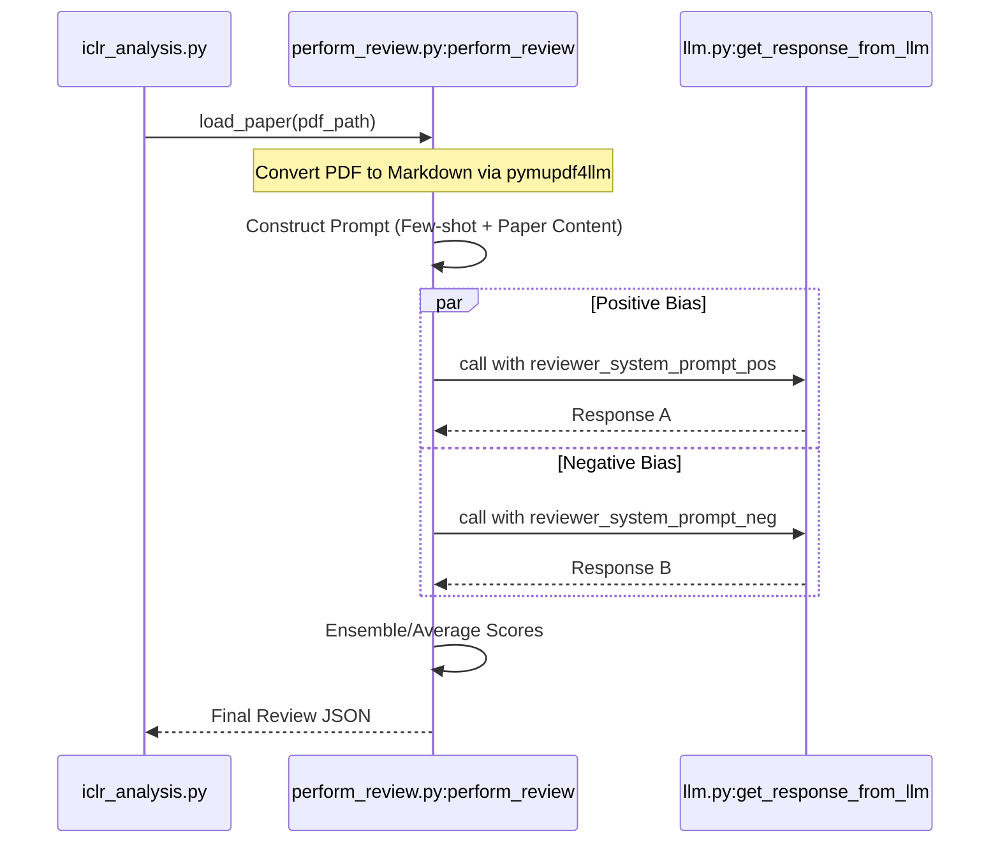

<!-- source: DeepWiki mcp.deepwiki.com · repo SakanaAI/AI-Scientist · page 4.3 ICLR Benchmark Evaluation · fetched 2026-10-26 -->

# ICLR Benchmark Evaluation

Relevant source files

The following files were used as context for generating this wiki page:

- [ai_scientist/fewshot_examples/2_carpe_diem.json](ai_scientist/fewshot_examples/2_carpe_diem.json)
- [ai_scientist/perform_review.py](ai_scientist/perform_review.py)

The ICLR Benchmark Evaluation infrastructure provides a standardized framework for assessing the performance of the AI reviewer against a ground-truth corpus of human-reviewed papers from the International Conference on Learning Representations (ICLR). This evaluation validates the system's ability to provide high-quality, consistent, and human-aligned reviews across various LLM backends including GPT-4o, Claude, Llama, and DeepSeek.

## Overview of Evaluation Infrastructure

The benchmark utilizes a parsed corpus of 1019 ICLR papers, comparing AI-generated reviews against official ratings and decisions. The system evaluates the AI's "Reviewer" capabilities by measuring its alignment with human scores (Soundness, Presentation, Contribution, and Overall) and its accuracy in predicting the final "Accept" or "Reject" decision.

### Key Components

*   **`review_iclr_bench/iclr_analysis.py`**: The primary script for processing the corpus, executing batch reviews, and calculating performance metrics.
*   **`review_iclr_bench/ratings_subset.tsv`**: A metadata file containing human ratings and decisions for the 1019 papers.
*   **Few-Shot Examples**: Uses curated human reviews (e.g., `ai_scientist/fewshot_examples/2_carpe_diem.json`) to provide in-context learning for the LLM [ai_scientist/fewshot_examples/2_carpe_diem.json:1-3]().
*   **Ensemble Strategy**: Employs multiple LLM calls with varying system prompts to reach a consensus, mitigating individual model biases [ai_scientist/perform_review.py:18-25]().

Sources: [ai_scientist/fewshot_examples/2_carpe_diem.json:1-3](), [ai_scientist/perform_review.py:18-25]()

## Data Flow and Architecture

The evaluation process transforms raw PDF papers into structured JSON reviews that match the NeurIPS/ICLR review form schema.

### Review Generation Pipeline

The system uses `pymupdf4llm` to convert PDF content into a markdown-style format suitable for LLM context windows before passing it to the `perform_review` logic.

**ICLR Evaluation Data Flow**

Sources: [ai_scientist/perform_review.py:4-11](), [ai_scientist/perform_review.py:27-63]()

## Review Schema and Scoring

The AI reviewer is instructed to generate a JSON object containing specific fields that mirror the official ICLR/NeurIPS review form [ai_scientist/perform_review.py:65-107]().

### Quantitative Fields
| Field | Range | Description |
| :--- | :--- | :--- |
| `Soundness` | 1-4 | Technical claims and methodology quality [ai_scientist/perform_review.py:85-89](). |
| `Presentation` | 1-4 | Writing style, clarity, and contextualization [ai_scientist/perform_review.py:91-95](). |
| `Contribution` | 1-4 | Importance and originality of ideas [ai_scientist/perform_review.py:97-101](). |
| `Overall` | 1-10 | Final score from "Strong Reject" to "Award Quality" [ai_scientist/perform_review.py:103-107](). |
| `Confidence` | 1-5 | Reviewer's self-assessed expertise [ai_scientist/perform_review.py:58](). |

### Qualitative Fields
*   **`Summary`**: Non-critical overview of contributions [ai_scientist/perform_review.py:44]().
*   **`Strengths` / `Weaknesses`**: Detailed lists of paper attributes [ai_scientist/perform_review.py:45-46]().
*   **`Questions`**: Specific queries for the authors [ai_scientist/perform_review.py:51]().
*   **`Decision`**: Binary "Accept" or "Reject" [ai_scientist/perform_review.py:59-61]().

Sources: [ai_scientist/perform_review.py:43-63](), [ai_scientist/perform_review.py:85-107]()

## Implementation Detail: `perform_review.py`

The core logic for the benchmark evaluation resides in `ai_scientist/perform_review.py`. It manages the prompt construction, few-shot integration, and the ensemble mechanism.

### Ensemble and Prompting Strategy
To increase reliability, the system uses two distinct system prompts:
1.  **`reviewer_system_prompt_neg`**: Instructs the AI to be critical and lean towards rejection if unsure [ai_scientist/perform_review.py:18-21]().
2.  **`reviewer_system_prompt_pos`**: Instructs the AI to be supportive and lean towards acceptance if unsure [ai_scientist/perform_review.py:22-25]().

**Review Execution Logic**

Sources: [ai_scientist/perform_review.py:13-25](), [ai_scientist/perform_review.py:27-63]()

## Comparative Model Analysis

The benchmark evaluates performance across multiple state-of-the-art LLMs. Each model is tested on its ability to recover human decisions and provide substantive feedback.

| Model | Role in Benchmark |
| :--- | :--- |
| **GPT-4o** | Primary baseline for high-fidelity reasoning and structured output. |
| **Claude 3.5 Sonnet** | Evaluated for nuance in qualitative feedback (Strengths/Weaknesses). |
| **Llama 3.1 (405B)** | Open-weights comparison for large-scale review generation. |
| **DeepSeek-V2** | Efficiency baseline for automated review pipelines. |

The `iclr_analysis.py` script aggregates results from these models to calculate:
*   **Decision Accuracy**: Percentage of AI "Accept/Reject" decisions matching ICLR results.
*   **Score Correlation**: Pearson/Spearman correlation between AI "Overall" scores and human means.
*   **Calibration**: Whether the AI's "Confidence" scores correlate with its accuracy.

Sources: [ai_scientist/perform_review.py:7-11](), [ai_scientist/fewshot_examples/2_carpe_diem.json:1-3]()

---

