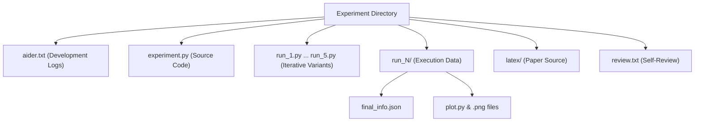
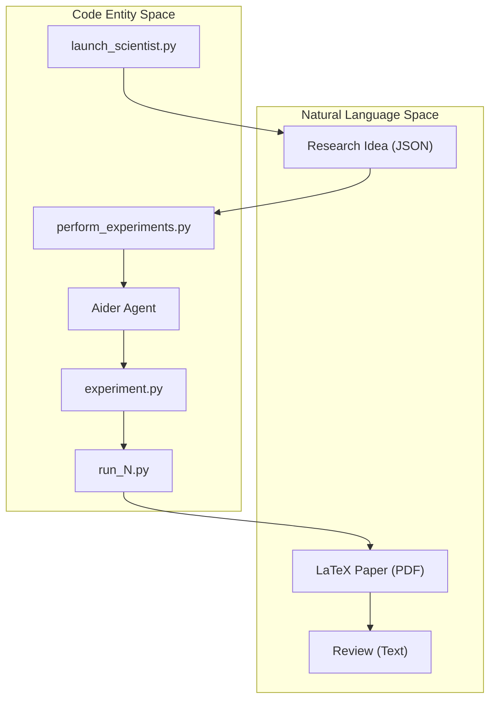

<!-- source: DeepWiki mcp.deepwiki.com · repo SakanaAI/AI-Scientist · page 5 Example Papers and Results · fetched 2026-10-26 -->

# Example Papers and Results

Relevant source files

The following files were used as context for generating this wiki page:

- [example_papers/adaptive_dual_scale_denoising.pdf](example_papers/adaptive_dual_scale_denoising.pdf)
- [example_papers/adaptive_dual_scale_denoising/adaptive_dual_scale_denoising.pdf](example_papers/adaptive_dual_scale_denoising/adaptive_dual_scale_denoising.pdf)
- [example_papers/data_augmentation_grokking.pdf](example_papers/data_augmentation_grokking.pdf)
- [example_papers/data_augmentation_grokking/data_augmentation_grokking.pdf](example_papers/data_augmentation_grokking/data_augmentation_grokking.pdf)

This section documents the structure and content of research papers automatically generated by the AI Scientist system, along with their associated experimental data, implementation logs, and evaluation infrastructure. This page provides a high-level overview of the 10 example papers and the analysis tools used to validate them.

For information about the core AI Scientist pipeline that generates these papers, see [Core Components](#2). For details about the review system used to evaluate these results, see [Review System Training](#4).

## Purpose and Scope

The AI Scientist system generates complete research papers with associated experimental implementations, results, and analysis. Each generated paper represents an automated research cycle covering idea generation, coding, experimentation, and write-up.

This page serves as a gateway to:
- The catalog of 10 specific research papers across different domains.
- The standardized directory structure of an experiment run.
- The self-review infrastructure used to analyze the quality of AI-generated science.

## Generated Paper Catalog

The system has generated 10 example papers across various machine learning domains, including Diffusion Models, Transformers (Grokking), and GANs. These papers demonstrate the system's ability to propose architectural changes, optimization strategies, and data augmentation techniques.

### Example Papers Overview

| Paper Name | Domain | Key Innovation |
|------------|--------|----------------|
| `adaptive_dual_scale_denoising` | Diffusion | Dual-scale processing with dynamic balancing |
| `data_augmentation_grokking` | Grokking | Impact of noise and transformations on generalization |
| `dual_expert_denoiser` | Diffusion | Mixture-of-experts approach to noise removal |
| `gan_diffusion` | Generative | Hybridizing GAN losses with diffusion training |
| `grid_based_noise_adaptation` | Diffusion | Spatial-aware noise scheduling |
| `layerwise_lr_grokking` | Optimization | Differential learning rates across transformer layers |
| `mdl_grokking_correlation` | Theory | Minimum Description Length as a grokking predictor |
| `multi_style_adapter` | Diffusion | Style-conditioned adapter modules |
| `rl_lr_adaptation` | Optimization | Reinforcement learning for dynamic hyperparameter tuning |
| `weight_initialization_grokking` | Optimization | Impact of initial variance on phase transitions |

For details on the specific findings and methodologies of each paper, see [Generated Paper Catalog](#5.1).

Sources: [example_papers/adaptive_dual_scale_denoising.pdf:1-18](), [example_papers/data_augmentation_grokking.pdf:1-23]()

## Experiment Run Structure

Each generated paper is housed in a directory that captures the entire "thought process" and execution history of the AI Scientist. This structure ensures reproducibility and allows for technical auditing of the AI's actions.

### Key Components of a Run
- **Implementation Logs**: Recorded in `aider.txt`, showing the step-by-step code edits and terminal outputs.
- **Iterative Refinement**: The system generates multiple versions of the experiment (e.g., `run_1.py` through `run_5.py`) as it refines the implementation.
- **Results Metadata**: `final_info.json` contains the quantitative metrics extracted from the training runs.

For a detailed breakdown of these files and their roles, see [Experiment Run Structure](#5.2).

Sources: [example_papers/adaptive_dual_scale_denoising/20240802_090035_adaptive_dual_scale_denoising_aider.txt:1-50](), [example_papers/adaptive_dual_scale_denoising/20240802_090035_adaptive_dual_scale_denoising_aider.txt:120-132]()

## AI Scientist Self-Review Analysis

To evaluate the quality of the generated research, the repository includes a dedicated analysis infrastructure located in `review_ai_scientist/`. This allows for large-scale comparison of generated papers across different LLM backends (GPT-4o, Claude, Llama-3, etc.).

### Analysis Infrastructure Components

| Component | Code Entity | Purpose |
|-----------|-------------|---------|
| **Review Runner** | `run_ai_reviews.ipynb` | Orchestrates batch reviews of the 10 example papers |
| **Figure Generator** | `paper_figures.ipynb` | Visualizes rating distributions and model comparisons |
| **Paper Corpus** | `parsed_ai_papers/` | Plaintext versions of the 10 generated papers for LLM ingestion |
| **Rating Data** | `*.csv` | Per-model ratings (Soundness, Contribution, etc.) |

For details on the rating distributions and how to run the analysis, see [AI Scientist Self-Review Analysis](#5.3).

Sources: [example_papers/adaptive_dual_scale_denoising.pdf:9-16](), [example_papers/data_augmentation_grokking.pdf:9-16]()

## Integration with AI Scientist Pipeline

The results documented here are the direct output of the main orchestration pipeline. The transition from Natural Language ideas to Code Entities is handled by the interaction between the generator and the coder agent.

Sources: [example_papers/adaptive_dual_scale_denoising/20240802_090035_adaptive_dual_scale_denoising_aider.txt:21-27](), [example_papers/adaptive_dual_scale_denoising/20240802_090035_adaptive_dual_scale_denoising_aider.txt:226-285]()

---

