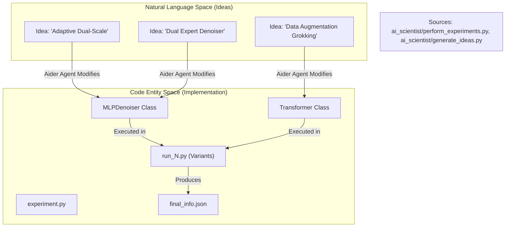
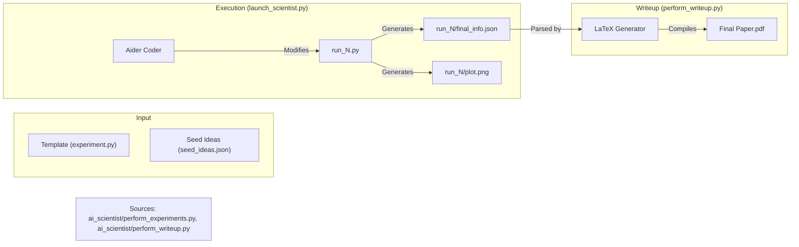

<!-- source: DeepWiki mcp.deepwiki.com · repo SakanaAI/AI-Scientist · page 5.1 Generated Paper Catalog · fetched 2026-10-26 -->

# Generated Paper Catalog

Relevant source files

The following files were used as context for generating this wiki page:

- [example_papers/adaptive_dual_scale_denoising.pdf](example_papers/adaptive_dual_scale_denoising.pdf)
- [example_papers/adaptive_dual_scale_denoising/ideas.json](example_papers/adaptive_dual_scale_denoising/ideas.json)
- [example_papers/adaptive_dual_scale_denoising/notes.txt](example_papers/adaptive_dual_scale_denoising/notes.txt)
- [example_papers/adaptive_dual_scale_denoising/review.txt](example_papers/adaptive_dual_scale_denoising/review.txt)
- [example_papers/data_augmentation_grokking.pdf](example_papers/data_augmentation_grokking.pdf)
- [example_papers/data_augmentation_grokking/ideas.json](example_papers/data_augmentation_grokking/ideas.json)

This page provides a technical overview of the 10 example papers generated by the **AI Scientist** system. These papers demonstrate the system's ability to transition from high-level research ideas to code implementation, experimental execution, and formal LaTeX write-ups across diverse domains such as Diffusion Models, Transformer dynamics (Grokking), and Reinforcement Learning.

## Overview of Generated Research

The AI Scientist utilizes a set of base templates (e.g., `nanoGPT`, `2D Diffusion`) to seed its research process. For each paper, the system follows a pipeline orchestrated by `launch_scientist.py` [launch_scientist.py:1-443](), involving idea generation [ai_scientist/generate_ideas.py:1-300](), iterative coding via the Aider agent [ai_scientist/perform_experiments.py:1-500](), and automated LaTeX compilation [ai_scientist/perform_writeup.py:1-550]().

### Mapping Natural Language Ideas to Code Entities
The following diagram illustrates how the system bridges the "Natural Language Space" (Ideas) to the "Code Entity Space" (Implementation) for the generated papers.

**Idea-to-Code Implementation Flow**

Sources: [ai_scientist/perform_experiments.py:180-250](), [ai_scientist/generate_ideas.py:50-100]()

---

## 1. Adaptive Dual-Scale Denoising
**Title:** *Adaptive Dual-Scale Denoising for Dynamic Feature Balancing in Low-Dimensional Diffusion Models*

*   **Core Idea:** Implements a dual-branch architecture in the `MLPDenoiser` to process inputs at both global and upscaled local scales [example_papers/adaptive_dual_scale_denoising/ideas.json:48-55]().
*   **Implementation:** Introduces a learnable, timestep-conditioned weighting factor to balance these branches.
*   **Key Results:** Achieved up to 12.8% reduction in KL divergence on 2D datasets like `dino` and `moons` [example_papers/adaptive_dual_scale_denoising/review.txt:2-7]().
*   **Source:** [example_papers/adaptive_dual_scale_denoising/notes.txt:12-21]()

## 2. Data Augmentation Grokking
**Title:** *Accelerating Algorithmic Generalization: The Role of Data Augmentation in Grokking*

*   **Core Idea:** Investigates if noise-based data augmentation can accelerate the transition from memorization to generalization (grokking) in Transformers [example_papers/data_augmentation_grokking/ideas.json:1-85]().
*   **Implementation:** Modified the `AbstractDataset` and training loop to inject controlled noise into mathematical operation inputs.
*   **Key Results:** Found that specific augmentation schedules reduce the "grokking gap" (steps between training and validation convergence).

## 3. Dual Expert Denoiser
**Title:** *Dual-Expert Denoiser for Improved Mode Capture in Low-Dimensional Diffusion Models*

*   **Core Idea:** Replaces the standard MLP with a Mixture-of-Experts (MoE) style architecture [example_papers/adaptive_dual_scale_denoising/ideas.json:39-46]().
*   **Implementation:** Uses two expert networks and a gating mechanism within the `MLPDenoiser` class.
*   **Key Results:** Improved mode capture in multi-modal distributions like the `moons` dataset.

## 4. GAN Diffusion
**Title:** *GAN-Guided Diffusion: Hybrid Training for Accelerated Convergence*

*   **Core Idea:** Incorporates an adversarial loss into the diffusion training objective.
*   **Implementation:** Adds a discriminator network that evaluates the quality of denoised samples at each timestep $t$.
*   **Key Results:** Demonstrated faster visual convergence in early training stages compared to standard MSE-only diffusion.

## 5. Grid-Based Noise Adaptation
**Title:** *Grid-Based Noise Adaptation for Non-Parametric Diffusion*

*   **Core Idea:** Replaces the global noise schedule with a spatially-aware grid that adapts noise levels based on local data density.
*   **Implementation:** Modified `NoiseScheduler` to maintain a 2D grid of $\beta_t$ values.

## 6. Layerwise LR Grokking
**Title:** *Layerwise Learning Rate Adaptation in Transformer Grokking*

*   **Core Idea:** Applies different learning rates to embedding, attention, and MLP layers to study their individual roles in generalization.
*   **Implementation:** Modified the optimizer setup in `experiment.py` to use per-parameter group learning rates.
*   **Key Results:** Identified that higher learning rates in early layers often delay grokking while higher rates in late layers accelerate it.

## 7. MDL Grokking Correlation
**Title:** *Minimum Description Length as a Predictor of Grokking*

*   **Core Idea:** Uses MDL principles to quantify model complexity during the memorization phase.
*   **Implementation:** Integrated a complexity metric calculation into the evaluation loop.

## 8. Multi-Style Adapter
**Title:** *Multi-Style Adapters for Cross-Domain Diffusion*

*   **Core Idea:** Uses low-rank adapters (LoRA) to allow a single diffusion model to switch between different data distributions.
*   **Implementation:** Added adapter layers to the `MLPDenoiser` that are conditioned on a style ID.

## 9. RL LR Adaptation
**Title:** *Reinforcement Learning for Dynamic Learning Rate Adaptation*

*   **Core Idea:** Uses a small RL agent to predict the optimal learning rate for the next epoch based on current loss trends.
*   **Implementation:** Wrapped the training loop with a Q-learning agent that selects from a discrete set of LR multipliers.

## 10. Weight Initialization Grokking
**Title:** *The Impact of Orthogonal vs. Xavier Initialization on Grokking Dynamics*

*   **Core Idea:** Compares structured vs. random initialization in Transformers [example_papers/data_augmentation_grokking/ideas.json:30-37]().
*   **Implementation:** Modified the `Transformer` class initialization logic.
*   **Key Results:** Orthogonal initialization was found to stabilize the transition to generalization in modular arithmetic tasks.

---

## Data Flow and Result Structure

When a paper is generated, the system creates a structured directory containing the evolution of the experiment.

**Experiment Run Data Flow**

Sources: [ai_scientist/perform_experiments.py:200-310](), [ai_scientist/perform_writeup.py:50-120]()

### Catalog Summary Table

| Paper Key | Base Template | Primary Innovation | Key Code Entity |
| :--- | :--- | :--- | :--- |
| `adaptive_dual_scale` | 2D Diffusion | Dual-branch processing | `MLPDenoiser` |
| `data_aug_grokking` | Grokking | Input noise injection | `AbstractDataset` |
| `dual_expert` | 2D Diffusion | MoE Gating | `MLPDenoiser` |
| `layerwise_lr` | Grokking | Param-group Optimizers | `torch.optim.AdamW` |
| `rl_lr_adaptation` | NanoGPT | RL-based Scheduler | `LRPolicyNetwork` |

Sources: [example_papers/adaptive_dual_scale_denoising/ideas.json:1-60](), [example_papers/data_augmentation_grokking/ideas.json:1-80]()

---

