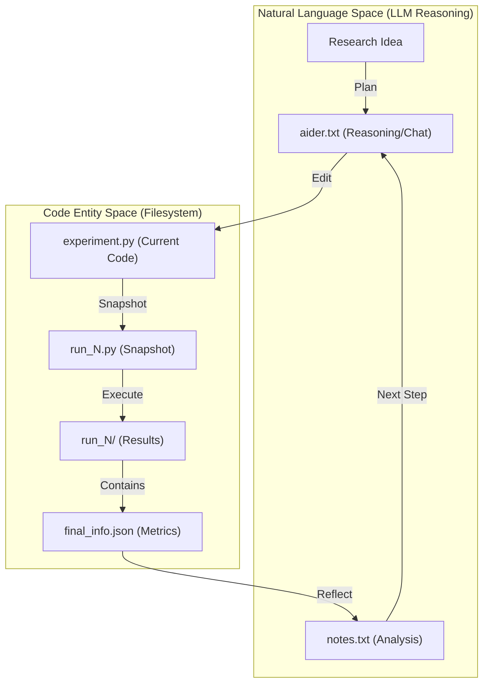
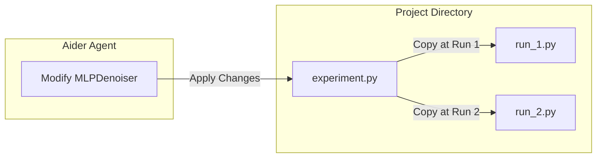

<!-- source: DeepWiki mcp.deepwiki.com · repo SakanaAI/AI-Scientist · page 5.2 Experiment Run Structure · fetched 2026-10-26 -->

# Experiment Run Structure

<details>
<summary>Relevant source files</summary>

The following files were used as context for generating this wiki page:

- [example_papers/adaptive_dual_scale_denoising/20240802_090035_adaptive_dual_scale_denoising_aider.txt](example_papers/adaptive_dual_scale_denoising/20240802_090035_adaptive_dual_scale_denoising_aider.txt)
- [example_papers/adaptive_dual_scale_denoising/experiment.py](example_papers/adaptive_dual_scale_denoising/experiment.py)
- [example_papers/adaptive_dual_scale_denoising/log.txt](example_papers/adaptive_dual_scale_denoising/log.txt)
- [example_papers/adaptive_dual_scale_denoising/notes.txt](example_papers/adaptive_dual_scale_denoising/notes.txt)
- [example_papers/adaptive_dual_scale_denoising/plot.py](example_papers/adaptive_dual_scale_denoising/plot.py)
- [example_papers/adaptive_dual_scale_denoising/run_0/final_info.json](example_papers/adaptive_dual_scale_denoising/run_0/final_info.json)
- [example_papers/adaptive_dual_scale_denoising/run_1.py](example_papers/adaptive_dual_scale_denoising/run_1.py)
- [example_papers/adaptive_dual_scale_denoising/run_1/final_info.json](example_papers/adaptive_dual_scale_denoising/run_1/final_info.json)

</details>


The AI Scientist generates a comprehensive directory for each research project. This directory serves as a complete record of the scientific process, containing the evolution of code, raw experimental results, logs of the AI's reasoning, and the final manuscript artifacts.

## Directory Overview

When an experiment is launched, the system creates a folder named after the generated idea. This folder contains all the necessary components to reproduce the study and trace the AI's iterative development.

### Key Components

| File/Folder | Description |
| :--- | :--- |
| `aider.txt` | A complete transcript of the interaction between the AI Scientist and the `Aider` coding agent, showing the logic behind code changes [example_papers/adaptive_dual_scale_denoising/20240802_090035_adaptive_dual_scale_denoising_aider.txt:1-20](). |
| `log.txt` | A high-level execution log detailing the progression of experiment runs and implementation milestones [example_papers/adaptive_dual_scale_denoising/log.txt:1-10](). |
| `notes.txt` | A structured record of the research idea, descriptions of each run, quantitative results, and the AI's self-analysis of those results [example_papers/adaptive_dual_scale_denoising/notes.txt:1-15](). |
| `experiment.py` | The current, most up-to-date version of the experimental code [example_papers/adaptive_dual_scale_denoising/experiment.py:1-20](). |
| `run_N.py` | Snapshots of the `experiment.py` file as it existed during a specific run (e.g., `run_1.py`, `run_2.py`) [example_papers/adaptive_dual_scale_denoising/run_1.py:1-20](). |
| `run_N/` | Subdirectories containing the output artifacts for a specific run, including `final_info.json` [example_papers/adaptive_dual_scale_denoising/run_1/final_info.json:1-1](). |
| `plot.py` | A generated script used to visualize the results from the various `run_N/` directories [example_papers/adaptive_dual_scale_denoising/plot.py:1-10](). |
| `latex/` | The LaTeX source files, bibtex references, and compiled PDF of the final paper. |
| `review.txt` | The final automated peer review of the generated paper. |

**Sources:** [example_papers/adaptive_dual_scale_denoising/20240802_090035_adaptive_dual_scale_denoising_aider.txt](), [example_papers/adaptive_dual_scale_denoising/log.txt](), [example_papers/adaptive_dual_scale_denoising/notes.txt](), [example_papers/adaptive_dual_scale_denoising/plot.py]().

## Iterative Experimentation Flow

The AI Scientist operates in a loop, proposing changes and executing them. Each iteration is captured as a distinct "Run".

### Data Flow Diagram: Experiment Iteration
This diagram shows how the AI's natural language intentions are converted into code entities and stored within the directory structure.


**Sources:** [example_papers/adaptive_dual_scale_denoising/20240802_090035_adaptive_dual_scale_denoising_aider.txt:21-28](), [example_papers/adaptive_dual_scale_denoising/notes.txt:7-11]().

## The Role of Aider and Snapshots

The `aider.txt` file is critical for understanding *why* the code changed. It records the "Search/Replace" blocks used to modify `MLPDenoiser` or other components [example_papers/adaptive_dual_scale_denoising/20240802_090035_adaptive_dual_scale_denoising_aider.txt:32-110](). 

When the AI Scientist executes a command like `python experiment.py --out_dir=run_1`, the system preserves the state of the code by copying `experiment.py` to `run_1.py` [example_papers/adaptive_dual_scale_denoising/20240802_090035_adaptive_dual_scale_denoising_aider.txt:17-18]().

### Code Snapshotting Relationship

**Sources:** [example_papers/adaptive_dual_scale_denoising/20240802_090035_adaptive_dual_scale_denoising_aider.txt:17-18](), [example_papers/adaptive_dual_scale_denoising/run_1.py:51-80]().

## Result Aggregation and Plotting

After multiple runs (usually up to 5), the `plot.py` script is responsible for aggregating data across all `run_N/` subdirectories.

1.  **Data Loading**: It iterates through folders starting with "run" and loads `final_info.json` [example_papers/adaptive_dual_scale_denoising/plot.py:26-32]().
2.  **Visualization**: It generates standard plots such as `train_loss.png` and `generated_images.png` [example_papers/adaptive_dual_scale_denoising/plot.py:75-98]().
3.  **Analysis**: The `notes.txt` file is updated with a comparison of metrics (e.g., `kl_divergence`, `eval_loss`) across the different runs to determine if the proposed idea improved upon the baseline [example_papers/adaptive_dual_scale_denoising/notes.txt:14-21]().

### Result Structure (`final_info.json`)
Each run directory contains a `final_info.json` that stores a dictionary of results per dataset:
```json
{
  "circle": {
    "means": {
      "training_time": 73.06,
      "eval_loss": 0.43,
      "kl_divergence": 0.36
    }
  }
}
```
**Sources:** [example_papers/adaptive_dual_scale_denoising/run_1/final_info.json:1-1](), [example_papers/adaptive_dual_scale_denoising/plot.py:28-29]().

## Summary of Execution Logs
The `log.txt` file provides a timestamped high-level overview of the pipeline stages, from the initial idea generation to the completion of the experiment phase [example_papers/adaptive_dual_scale_denoising/log.txt:1-4](). It mirrors the content found in `aider.txt` but focuses on the system-level orchestration.

**Sources:** [example_papers/adaptive_dual_scale_denoising/log.txt:1-10]().

---

