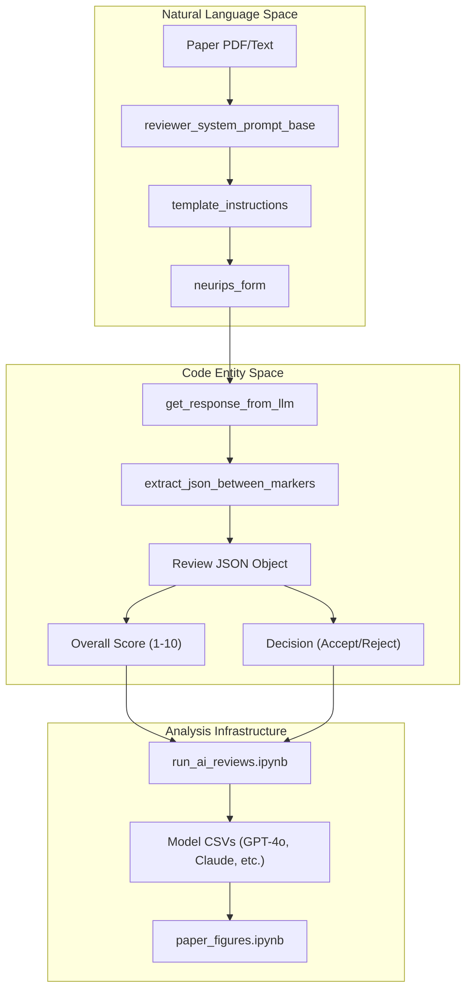
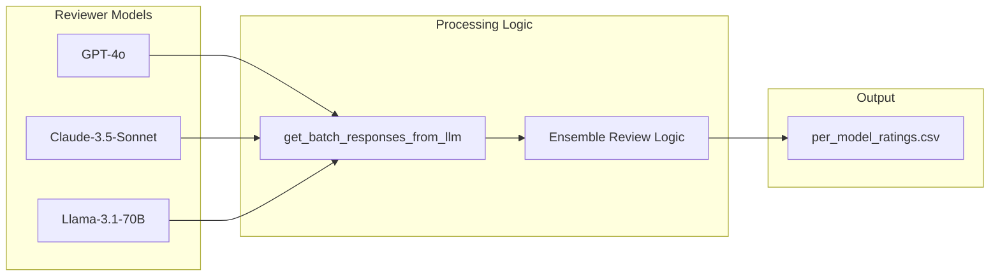

<!-- source: DeepWiki mcp.deepwiki.com · repo SakanaAI/AI-Scientist · page 5.3 AI Scientist Self-Review Analysis · fetched 2026-10-26 -->

# AI Scientist Self-Review Analysis

Relevant source files

The following files were used as context for generating this wiki page:

- [ai_scientist/perform_review.py](ai_scientist/perform_review.py)
- [example_papers/adaptive_dual_scale_denoising/review.txt](example_papers/adaptive_dual_scale_denoising/review.txt)
- [example_papers/data_augmentation_grokking/review.txt](example_papers/data_augmentation_grokking/review.txt)

The AI Scientist includes a dedicated infrastructure for "self-reviewing" its own generated research. This component allows the system to evaluate the quality, soundness, and contribution of the papers it produces using the same LLM-based reviewer protocol used for external benchmarks. The `review_ai_scientist/` directory contains the tools, parsed data, and comparative ratings across multiple LLM providers (GPT-4o, Claude, Llama, and DeepSeek) to analyze the performance of the automated research pipeline.

## Overview of Self-Review Infrastructure

The self-review system is designed to provide a "meta-evaluation" of the AI Scientist's output. By running the automated reviewer over the 10 example papers generated during the project's development, the system generates structured feedback that mimics the peer-review process of venues like NeurIPS or ICLR.

### Key Components

| Component | Description |
| :--- | :--- |
| `run_ai_reviews.ipynb` | The primary notebook used to execute batch reviews of the generated papers using different LLM backends. |
| `paper_figures.ipynb` | A visualization notebook that processes the resulting CSVs to create performance distributions and model comparison plots. |
| `parsed_ai_papers/` | A directory containing the text-extracted versions of the 10 generated papers, used as input for the LLM reviewers. |
| `perform_review.py` | The core logic for prompting LLMs, extracting JSON scores, and managing the review ensemble. |

Sources: `ai_scientist/perform_review.py:1-63`(), `example_papers/adaptive_dual_scale_denoising/review.txt:1-51`()

## Data Flow and Implementation

The self-review process follows a pipeline where a generated PDF is converted to text, processed by a "Reviewer" LLM, and scored according to a fixed schema.

### Review Process Diagram

The following diagram illustrates how the system transitions from the "Natural Language Space" (the paper text and prompts) to the "Code Entity Space" (the structured data and scoring logic).

**Title: AI Scientist Self-Review Data Flow**

Sources: `ai_scientist/perform_review.py:13-63`(), `ai_scientist/perform_review.py:7-11`()

## Review Schema and Scoring

The system uses a standardized JSON schema to ensure consistency across different models. This schema is defined in the `template_instructions` within `ai_scientist/perform_review.py`.

### Schema Fields
*   **Numerical Ratings (1-4):** `Soundness`, `Presentation`, `Contribution`, `Originality`, `Quality`, `Clarity`, `Significance`.
*   **Overall Score (1-10):** A comprehensive score where 10 is "Award quality" and 1 is "Strong Reject".
*   **Confidence (1-5):** The model's self-assessment of its review accuracy.
*   **Decision:** A binary `Accept` or `Reject` choice.

### Example Review Output
The system generates a `review.txt` file for each paper. For instance, the paper "Adaptive Dual-Scale Denoising" received the following evaluation:

| Metric | Score |
| :--- | :--- |
| **Soundness** | 3 (Good) |
| **Presentation** | 3 (Good) |
| **Contribution** | 3 (Good) |
| **Overall** | 5 |
| **Decision** | Reject |

Sources: `ai_scientist/perform_review.py:43-61`(), `example_papers/adaptive_dual_scale_denoising/review.txt:45-50`()

## Multi-Model Comparison

The infrastructure supports comparing how different models perceive the same AI-generated content. This is critical for identifying biases in LLM-based evaluation (e.g., whether a model is more lenient toward its own generated text).

**Title: Model Interaction and Rating Logic**

Sources: `ai_scientist/perform_review.py:7-11`(), `ai_scientist/perform_review.py:103-115`()

## Implementation Details

### Prompting Strategy
The system uses three distinct system prompts to guide the LLM's "personality":
1.  `reviewer_system_prompt_base`: Standard AI researcher persona [ai_scientist/perform_review.py:13-16]().
2.  `reviewer_system_prompt_neg`: Encourages critical evaluation and rejection if unsure [ai_scientist/perform_review.py:18-21]().
3.  `reviewer_system_prompt_pos`: Encourages positive evaluation and acceptance if unsure [ai_scientist/perform_review.py:22-25]().

### Review Ensemble
To increase the robustness of the self-review, the system can perform an ensemble of reviews. It aggregates multiple LLM calls to reach a final consensus on the `Decision` and `Overall` score. This is handled by `get_batch_responses_from_llm` to parallelize the evaluation of the 10 generated papers [ai_scientist/perform_review.py:9]().

### Parsing Logic
Since LLMs often provide conversational filler, the system uses `extract_json_between_markers` to isolate the structured review data from the `THOUGHT` block provided by the model [ai_scientist/perform_review.py:10]().

Sources: `ai_scientist/perform_review.py:7-25`(), `ai_scientist/perform_review.py:30-36`()

---

