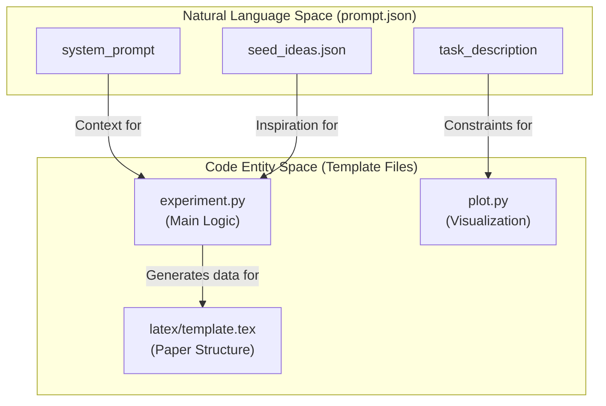

<!-- source: DeepWiki mcp.deepwiki.com · repo SakanaAI/AI-Scientist · page 6 Advanced Usage · fetched 2026-10-26 -->

# Advanced Usage

<details>
<summary>Relevant source files</summary>

The following files were used as context for generating this wiki page:

- [README.md](README.md)
- [ai_scientist/llm.py](ai_scientist/llm.py)

</details>


This document covers advanced configuration and customization options for **The AI Scientist**. It provides high-level guidance for power users who need fine-grained control over LLM providers, research domain templates, and parallel execution architectures.

## Advanced LLM Configuration

The AI Scientist utilizes a unified interface in `ai_scientist/llm.py` to support a wide range of LLM providers. This abstraction allows the system to switch between frontier models like GPT-4o, Claude 3.5 Sonnet, and DeepSeek while maintaining consistent prompting and response parsing.

### Multi-Provider Architecture

```mermaid
graph TB
    subgraph "Execution Entry"
        [launch_scientist.py] -- "parses --model" --> [create_client]
        [launch_oe_scientist.py] -- "experimental open-ended" --> [create_client]
    end
    
    subgraph "ai_scientist/llm.py"
        [create_client] -- "initializes" --> CLIENTS["LLM Clients<br/>(OpenAI, Anthropic, etc.)"]
        [get_response_from_llm] -- "single call" --> CLIENTS
        [get_batch_responses_from_llm] -- "parallel calls/n-responses" --> CLIENTS
        [AVAILABLE_LLMS] -- "registry" --> [create_client]
    end
    
    subgraph "Provider APIs"
        CLIENTS --> OPENAI["OpenAI API<br/>(gpt-4o, o1, o3-mini)"]
        CLIENTS --> ANTHROPIC["Anthropic API<br/>(claude-3-5-sonnet)"]
        CLIENTS --> BEDROCK["AWS Bedrock<br/>(anthropic.claude-*)"]
        CLIENTS --> VERTEX["Vertex AI<br/>(claude-3-5-*)"]
        CLIENTS --> DEEPSEEK["DeepSeek API<br/>(deepseek-chat, reasoner)"]
        CLIENTS --> GOOGLE["Google Gemini API<br/>(gemini-2.0-flash)"]
    end
```

### Configuration and Model Selection
The system supports advanced configuration through environment variables and the `AVAILABLE_LLMS` registry [ai_scientist/llm.py:13-62](). For specialized models like OpenAI's reasoning series (`o1`, `o3-mini`), the system adjusts parameters such as `max_completion_tokens` and handles the absence of a `system` role by converting it to a `user` role [ai_scientist/llm.py:202-216]().

For details on setting up specific providers and API keys, see [Advanced LLM Configuration](#6.2).

Sources: [ai_scientist/llm.py:13-62](), [ai_scientist/llm.py:143-216](), [README.md:79-159]()

## Creating Custom Templates

Custom templates are the primary mechanism for extending The AI Scientist to new research domains. A template provides the "seed" code and domain knowledge necessary for the LLM to conduct experiments and write papers.

### Template-to-Code Mapping



### Template Component Requirements
A valid template must include:
*   **`experiment.py`**: The core execution script. It must accept an `--out_dir` argument to store results [README.md:284-296]().
*   **`plot.py`**: A script that processes results from `experiment.py` to create figures.
*   **`prompt.json`**: Contains the `system` prompt and `task_description` that guide the Aider agent [ai_scientist/perform_experiments.py]().
*   **`seed_ideas.json`**: A list of initial ideas to kickstart the generation process.

For a step-by-step guide on building these components, see [Creating Custom Templates](#6.1).

Sources: [README.md:284-296](), [README.md:57-60]()

## Parallel Experimentation

To accelerate research, The AI Scientist can run multiple ideas in parallel across available hardware resources. This is managed via the `--parallel` flag in the main entry point.

### Parallel Execution Architecture

```mermaid
graph TB
    subgraph "Orchestration (launch_scientist.py)"
        [main] -- "if --parallel" --> [multiprocessing.Pool]
        [multiprocessing.Pool] -- "assigns" --> WORKER["Worker Process"]
    end

    subgraph "Worker Resource Allocation"
        WORKER -- "manages" --> GPU["NVIDIA GPU<br/>(via CUDA_VISIBLE_DEVICES)"]
        WORKER -- "executes" --> PIPELINE["Research Pipeline"]
    end

    subgraph "Pipeline Steps"
        PIPELINE --> [generate_ideas]
        PIPELINE --> [perform_experiments]
        PIPELINE --> [perform_writeup]
        PIPELINE --> [perform_review]
    end
```

### Resource Management
The system utilizes the `multiprocessing` library to spawn independent workers for each idea. When running with `--parallel`, the system distributes tasks across GPUs specified by the `--gpus` argument [README.md:246](). Users can also utilize the experimental Docker configuration for isolated, containerized execution of LLM-written code [README.md:370-389]().

For details on configuring GPU offsets and Docker deployment, see [Parallel Experimentation](#6.3).

Sources: [README.md:246](), [README.md:370-389]()

## Advanced Reviewer Configuration

The automated reviewer in `ai_scientist/perform_review.py` can be tuned for different levels of rigor. By adjusting `num_reflections` and `num_reviews_ensemble`, users can balance between fast heuristic reviews and deep, multi-pass critical analysis.

The system uses a few-shot approach, pulling examples from the `fewshot_examples/` directory to ground the LLM in high-quality peer review standards [README.md:248-282]().

Sources: [README.md:248-282]()

---

