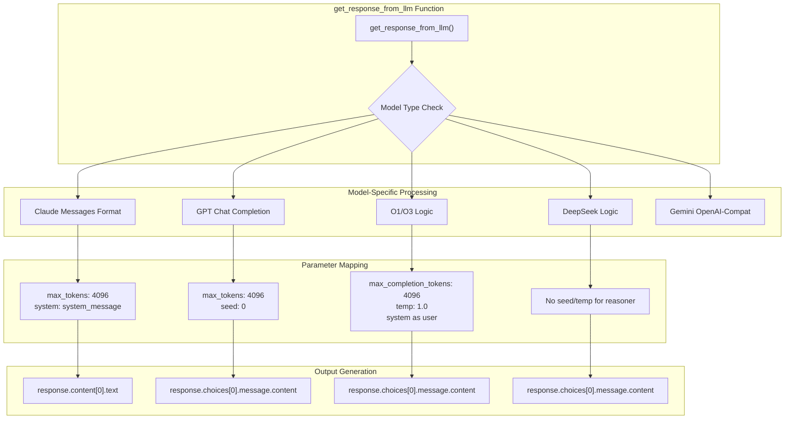

<!-- source: DeepWiki mcp.deepwiki.com · repo SakanaAI/AI-Scientist · page 6.2 Advanced LLM Configuration · fetched 2026-10-26 -->

# Advanced LLM Configuration

<details>
<summary>Relevant source files</summary>

The following files were used as context for generating this wiki page:

- [README.md](README.md)
- [ai_scientist/llm.py](ai_scientist/llm.py)

</details>


This document covers advanced configuration options for Large Language Model (LLM) providers in the AI Scientist system. It details provider-specific settings, authentication methods, batch processing capabilities, and the integration of experimental models. For basic LLM integration concepts, see [LLM Integration](2.2).

## LLM Provider Architecture

The AI Scientist system implements a unified interface for multiple LLM providers through the `ai_scientist/llm.py` module. The architecture supports over 60 different model identifiers across several major providers, with automatic client creation and provider-specific parameter handling.

### Provider Routing System

The `create_client` function serves as the primary factory for initializing the correct API client based on the model string.

```mermaid
graph TB
    subgraph "Model Selection"
        MS["Model String Input"]
    end
    
    subgraph "create_client Function"
        CC["create_client(model)"]
        CC --> CLAUDE_CHECK{"model.startswith('claude-')"}
        CC --> BEDROCK_CHECK{"model.startswith('bedrock')"}
        CC --> VERTEX_CHECK{"model.startswith('vertex_ai')"}
        CC --> GPT_CHECK{"'gpt' in model or 'o1' in model or 'o3' in model"}
        CC --> DEEPSEEK_CHECK{"'deepseek' in model"}
        CC --> LLAMA_CHECK{"'llama' in model"}
        CC --> GEMINI_CHECK{"'gemini' in model"}
    end
    
    subgraph "Provider Clients"
        ANTHRO["anthropic.Anthropic()"]
        BEDROCK["anthropic.AnthropicBedrock()"]
        VERTEX["anthropic.AnthropicVertex()"]
        OPENAI["openai.OpenAI()"]
        DEEPSEEK["openai.OpenAI(base_url='https://api.deepseek.com')"]
        OPENROUTER["openai.OpenAI(base_url='https://openrouter.ai/api/v1')"]
        GEMINI_CLIENT["openai.OpenAI(base_url='https://generativelanguage.googleapis.com/v1beta/openai/')"]
    end
    
    MS --> CC
    
    CLAUDE_CHECK -->|Yes| ANTHRO
    BEDROCK_CHECK -->|Yes| BEDROCK
    VERTEX_CHECK -->|Yes| VERTEX
    GPT_CHECK -->|Yes| OPENAI
    DEEPSEEK_CHECK -->|Yes| DEEPSEEK
    LLAMA_CHECK -->|Yes| OPENROUTER
    GEMINI_CHECK -->|Yes| GEMINI_CLIENT
```



Sources: [ai_scientist/llm.py:317-355]()

### Supported Model Matrix

| Provider | Model Identifier Examples | Authentication | Base URL |
|----------|--------|---------------|----------|
| **Anthropic** | `claude-3-5-sonnet-20241022` | `ANTHROPIC_API_KEY` | Default |
| **OpenAI** | `gpt-4o`, `o1-mini`, `o3-mini` | `OPENAI_API_KEY` | Default |
| **DeepSeek** | `deepseek-chat`, `deepseek-reasoner` | `DEEPSEEK_API_KEY` | `https://api.deepseek.com` |
| **OpenRouter** | `llama3.1-405b` | `OPENROUTER_API_KEY` | `https://openrouter.ai/api/v1` |
| **Google Gemini** | `gemini-2.0-flash` | `GEMINI_API_KEY` | `https://generativelanguage.googleapis.com/v1beta/openai/` |
| **AWS Bedrock** | `bedrock/anthropic.claude-3-5-sonnet...` | AWS Credentials | Bedrock |
| **Vertex AI** | `vertex_ai/claude-3-5-sonnet...` | GCP Credentials | Vertex |

Sources: [ai_scientist/llm.py:13-62](), [ai_scientist/llm.py:317-355]()

## Authentication Configuration

### Environment Variables Setup

The system requires specific environment variables depending on the providers used. These are typically set in the shell or a `.env` file.

```bash
# OpenAI & Anthropic
export OPENAI_API_KEY="sk-..."
export ANTHROPIC_API_KEY="sk-ant-..."

# DeepSeek & OpenRouter
export DEEPSEEK_API_KEY="sk-..."
export OPENROUTER_API_KEY="sk-or-..."

# Google Gemini (OpenAI-compatible route)
export GEMINI_API_KEY="..."

# AWS Bedrock (Requires anthropic[bedrock])
export AWS_ACCESS_KEY_ID="..."
export AWS_SECRET_ACCESS_KEY="..."
export AWS_REGION_NAME="us-east-1"

# Google Vertex AI (Requires anthropic[vertex])
export CLOUD_ML_REGION="us-central1"
export ANTHROPIC_VERTEX_PROJECT_ID="your-project-id"
```

Sources: [README.md:85-154]()

## Request Processing Architecture

### Single Response Flow

The `get_response_from_llm` function handles the specific prompt formatting and parameter mapping for each provider.



Sources: [ai_scientist/llm.py:143-286]()

### Batch Response Processing

For ensemble methods (like the paper reviewer), `get_batch_responses_from_llm` is used to generate multiple candidate responses simultaneously.

*   **Native Batching:** Models like GPT-4o support the `n` parameter to return multiple completions in one request [ai_scientist/llm.py:90]().
*   **Sequential Fallback:** For providers that do not support native `n > 1` (like Anthropic), the system loops through `get_response_from_llm` multiple times [ai_scientist/llm.py:117-128]().

Sources: [ai_scientist/llm.py:67-139]()

## Model-Specific Configuration Details

### OpenAI O1/O3 Models
These models utilize a "Reasoning" phase and have different parameter requirements:
*   **System Messages:** O1/O3 models do not support the `system` role in the same way; the system message is prepended to the user message history [ai_scientist/llm.py:207-208]().
*   **Token Limits:** They use `max_completion_tokens` instead of `max_tokens` [ai_scientist/llm.py:211]().
*   **Temperature:** Temperature is strictly set to `1` [ai_scientist/llm.py:210]().

### DeepSeek Reasoner
The `deepseek-reasoner` model is handled with specific exclusions:
*   **Temperature/Seed:** These parameters are omitted as they are not supported by the reasoner endpoint [ai_scientist/llm.py:252-257]().

### Google Gemini
Gemini models are accessed via an OpenAI-compatible base URL [ai_scientist/llm.py:343](). They follow standard chat completion patterns but require the `GEMINI_API_KEY` [ai_scientist/llm.py:344]().

## Advanced Features

### JSON Extraction
Scientific outputs (ideas, reviews) often require structured JSON. `extract_json_between_markers` is used to find and parse JSON blocks even if the LLM includes conversational filler.

1.  Searches for ` ```json ` blocks [ai_scientist/llm.py:291]().
2.  If missing, it attempts to find the first `{` and last `}` [ai_scientist/llm.py:298-301]().
3.  Cleans control characters that break standard `json.loads` [ai_scientist/llm.py:307]().

Sources: [ai_scientist/llm.py:289-314]()

### Retry and Backoff
To handle API instability and rate limits, the system uses the `backoff` library.
*   **Decorators:** `@backoff.on_exception(backoff.expo, ...)` is applied to all LLM call functions [ai_scientist/llm.py:66, 142]().
*   **Exceptions:** It specifically catches `RateLimitError` and `APITimeoutError` [ai_scientist/llm.py:66]().

### Experimental: Open-Ended Scientist
The `experimental/launch_oe_scientist.py` script represents an advanced mode where the LLM has more autonomy over the research direction. This script utilizes the same LLM configuration infrastructure but applies it to a more iterative, less constrained loop compared to the standard `launch_scientist.py`.

Sources: [experimental/launch_oe_scientist.py:1-50]()

## Custom Model Integration

To add a new model or local LLM (e.g., via vLLM or Ollama):
1.  Add the model name to `AVAILABLE_LLMS` in `ai_scientist/llm.py` [ai_scientist/llm.py:13-62]().
2.  Update `create_client` to recognize the new prefix or name and return an `openai.OpenAI` client with a custom `base_url` [ai_scientist/llm.py:317-355]().
3.  Ensure the model follows the chat completion schema used in `get_response_from_llm`.

Sources: [ai_scientist/llm.py:13-62](), [ai_scientist/llm.py:317-355]()

---

