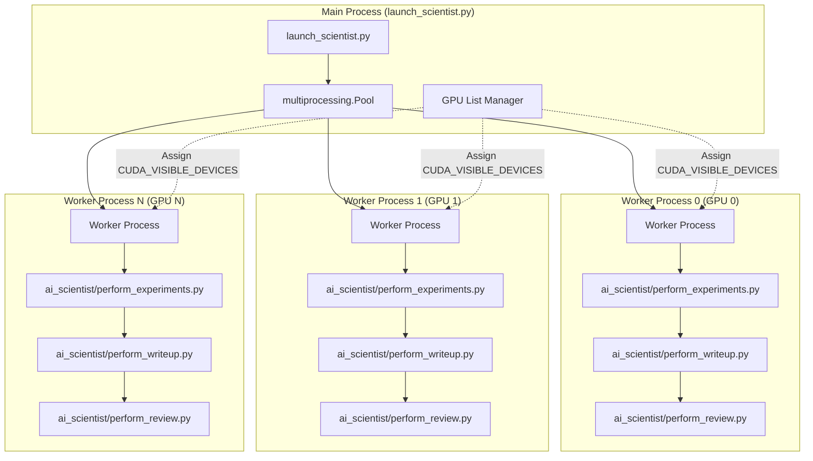
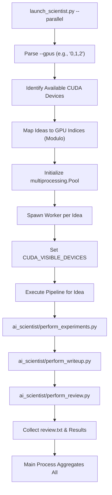

<!-- source: DeepWiki mcp.deepwiki.com · repo SakanaAI/AI-Scientist · page 6.3 Parallel Experimentation · fetched 2026-10-26 -->

# Parallel Experimentation

<details>
<summary>Relevant source files</summary>

The following files were used as context for generating this wiki page:

- [README.md](README.md)
- [ai_scientist/perform_experiments.py](ai_scientist/perform_experiments.py)

</details>


This document covers the parallel experimentation capabilities of the AI Scientist system, which enables running multiple research ideas simultaneously across multiple GPUs. This feature allows for efficient utilization of multi-GPU systems by distributing experiment execution across available hardware resources.

For information about the core experiment execution process, see [Experiment Execution](#2.4). For details about the main system orchestration, see [Launch Scientist](#2.1).

## Overview

The AI Scientist supports parallel experimentation through the `--parallel` and `--gpus` command-line options. This parallel execution model significantly reduces the total time required to explore multiple research directions by leveraging concurrent GPU utilization.

The parallel experimentation system operates at the idea level, where each research idea is assigned to a separate GPU for independent execution. This approach ensures that the computationally intensive experiment execution, paper writing, and review phases can proceed simultaneously without resource conflicts.

**Parallel Execution Architecture**



Sources: [README.md:246-258](), [ai_scientist/perform_experiments.py:30-47]()

## Usage and Configuration

### Basic Parallel Execution

To enable parallel experimentation, use the `--parallel` flag. By default, it uses all available GPUs. You can restrict the GPUs used by providing a comma-separated list to the `--gpus` argument:

```bash
# Use all available GPUs
python launch_scientist.py --model "gpt-4o-2024-05-13" --experiment nanoGPT_lite --num-ideas 4 --parallel

# Use specific GPUs (e.g., GPU 0 and GPU 1)
python launch_scientist.py --model "gpt-4o-2024-05-13" --experiment nanoGPT_lite --num-ideas 4 --parallel --gpus 0,1
```

Sources: [README.md:246-258]()

### GPU Detection and Allocation

The system relies on CUDA-compatible GPUs. When `--parallel` is invoked, the orchestrator determines the number of workers based on the length of the GPU list provided (or detected). Each worker process is assigned a specific `CUDA_VISIBLE_DEVICES` environment variable to ensure it only utilizes its designated hardware.

**GPU Resource Allocation Flow**



Sources: [README.md:246-258](), [ai_scientist/perform_experiments.py:116-166]()

## Process Coordination

### Independent Process Execution

Each parallel process operates independently. In `ai_scientist/perform_experiments.py`, the system manages a loop of up to 5 runs (`MAX_RUNS`) [ai_scientist/perform_experiments.py:9](). For each run, it copies the current `experiment.py` to a versioned file (e.g., `run_1.py`) [ai_scientist/perform_experiments.py:33-36]() and executes it using `subprocess.run` [ai_scientist/perform_experiments.py:45-47]().

### Resource Isolation and Data Flow

Isolation is maintained by creating unique subdirectories for each idea. Within these directories, the `run_experiment` function executes the generated code.

| Entity | Implementation Detail | Source |
| :--- | :--- | :--- |
| **Worker Process** | Managed via `multiprocessing` | [README.md:246]() |
| **Execution Command** | `python experiment.py --out_dir=run_i` | [ai_scientist/perform_experiments.py:39-43]() |
| **Timeout Handling** | Default 7200s (2 hours) per experiment run | [ai_scientist/perform_experiments.py:30]() |
| **Result Retrieval** | Loads `final_info.json` from the run directory | [ai_scientist/perform_experiments.py:62-63]() |

Sources: [ai_scientist/perform_experiments.py:9-63]()

## Containerization (Experimental)

To mitigate the risks of executing LLM-generated code, the project provides an experimental Dockerfile for containerized execution. This is highly recommended for parallel runs where multiple untrusted processes are active.

```bash
# Build the image
docker build -t ai_scientist .

# Run in a container with GPU support
docker run --gpus all -it ai_scientist /bin/bash
```

Sources: [README.md:31-32](), [README.md:259-266]()

## Performance Considerations

### Hardware Requirements
Parallel experimentation requires multiple NVIDIA GPUs. Memory requirements vary by template:

| Template | Typical GPU Memory | Source |
| :--- | :--- | :--- |
| **NanoGPT** | 4-8 GB | [README.md:62-64]() |
| **2D Diffusion** | 2-4 GB | [README.md:62-64]() |
| **Grokking** | 1-2 GB | [README.md:62-64]() |

### Throughput and Limitations
1. **Sequential Phases**: Initial idea generation (`ai_scientist/generate_ideas.py`) and novelty checking remain sequential before the parallel pool is initialized.
2. **API Rate Limiting**: Parallel workers make concurrent calls to the LLM. Using `gpt-4o-mini` or `claude-3-5-sonnet` may require monitoring tier-based rate limits.
3. **Storage**: Each run produces `run_N.py` files and `run_N/` directories. Total storage scales linearly with `--num-ideas`.

Sources: [README.md:62-64](), [ai_scientist/perform_experiments.py:33-36](), [ai_scientist/perform_experiments.py:116-126]()

---

