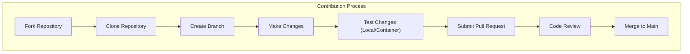
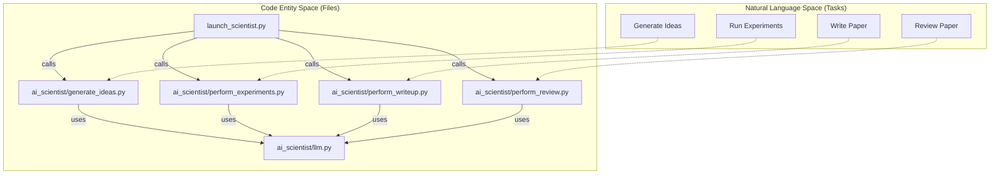
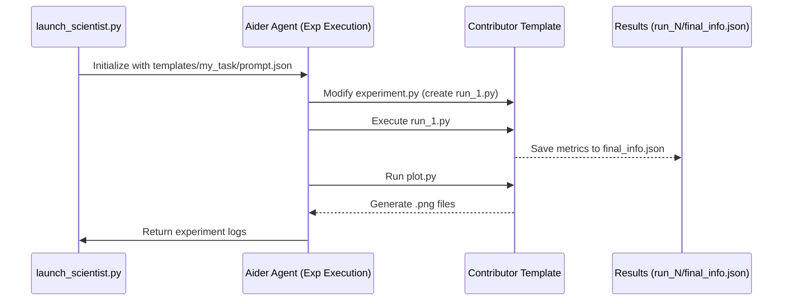

<!-- source: DeepWiki mcp.deepwiki.com · repo SakanaAI/AI-Scientist · page 7 Contributing · fetched 2026-10-26 -->

# Contributing

<details>
<summary>Relevant source files</summary>

The following files were used as context for generating this wiki page:

- [.gitignore](.gitignore)
- [LICENSE](LICENSE)
- [README.md](README.md)

</details>


This page provides comprehensive guidelines for contributing to the AI Scientist project. It covers the types of contributions welcome, licensing restrictions, development workflow, and the technical structure of templates.

## Licensing and The "AI Scientist" Clause

The AI Scientist is released under the **AI Scientist Source Code License v1.0** [LICENSE:1-2](). This license includes specific restrictions to ensure responsible use of the technology:

*   **Disclosure Requirement**: You must expressly and intelligibly disclaim that any scientific manuscript, research paper, or technical report was machine-generated or produced using The AI Scientist [LICENSE:39-41]().
*   **Prohibited Uses**: The software may not be used for surveillance (detecting protected classes), generating deceptive audio/video-realistic media without watermarks, healthcare diagnostics without human oversight, or criminal recidivism prediction [LICENSE:25-38]().
*   **Redistribution**: If you distribute any portion of the Contribution, you must include a complete copy of the License and include these restrictions as enforceable provisions [LICENSE:21-23]().

Sources: [LICENSE:1-54]()

## Types of Contributions

The project welcomes several categories of contributions:

1.  **Core Improvements**: Enhancing the orchestration logic in `launch_scientist.py` [launch_scientist.py:1-10]() or the LLM interface in `ai_scientist/llm.py` [ai_scientist/llm.py:1-20]().
2.  **New Experiment Templates**: Expanding the system's reach into new scientific domains [README.md:286-296]().
3.  **LLM Provider Integrations**: Adding support for new models in the `AVAILABLE_LLMS` registry [ai_scientist/llm.py:22-100]().
4.  **Bug Fixes**: Addressing issues in paper generation (`perform_writeup.py`) or automated reviewing (`perform_review.py`).

### Contribution Workflow



Sources: [README.md:296-309]()

## Development Setup

The environment requires Python 3.11 and a full TeX Live installation for PDF compilation.

### Setup Commands
```bash
conda create -n ai_scientist python=3.11
conda activate ai_scientist
sudo apt-get install texlive-full
pip install -r requirements.txt
```
Sources: [README.md:67-75]()

### Codebase Organization

The following diagram maps the logical components to their specific code entities:



Sources: [launch_scientist.py:1-50](), [README.md:57-61]()

## Contributing New Templates

Templates are the primary way to teach The AI Scientist new skills. A template is a self-contained research environment.

### Required Template Components

| Entity | File Path (Example) | Role |
| :--- | :--- | :--- |
| **Core Logic** | `templates/my_task/experiment.py` | The base code the AI will modify to run experiments. |
| **Visualization** | `templates/my_task/plot.py` | Script used by the AI to generate figures for the paper. |
| **LLM Guidance** | `templates/my_task/prompt.json` | Contains the `system_prompt` and `task_description`. |
| **Inspiration** | `templates/my_task/seed_ideas.json` | Examples of good research ideas in this domain. |
| **LaTeX Base** | `templates/my_task/latex/template.tex` | The formatting and boilerplate for the final PDF. |

### Template Data Flow

This diagram illustrates how a contributor's template code interacts with the `Aider` agent during an experiment run.



Sources: [README.md:286-296](), [ai_scientist/perform_experiments.py:1-100]()

## Pull Request Guidelines

To ensure high-quality contributions, please adhere to the following:

1.  **Containerization**: Test your changes within a container if possible, as the system executes LLM-generated code which carries security risks [README.md:31-32]().
2.  **Template Baselines**: When submitting a new template, include a `run_0` directory showing that the base `experiment.py` runs successfully and produces the expected outputs.
3.  **Documentation**: If adding a community template, update the list in the README to include your domain (e.g., MACE, SEIR, etc.) [README.md:297-307]().
4.  **Style**: Follow PEP 8. The project uses standard Python tooling; ensure `__pycache__` and environment folders are ignored via the `.gitignore` [ .gitignore:1-133]().

### Community Templates
The project has successfully integrated several community-driven domains:
*   **MACE**: Quantum chemistry [README.md:301]().
*   **SEIR**: Epidemiology modeling [README.md:304]().
*   **TensoRF**: Tensorial Radiance Fields [README.md:306]().

Sources: [README.md:297-309]()

---

