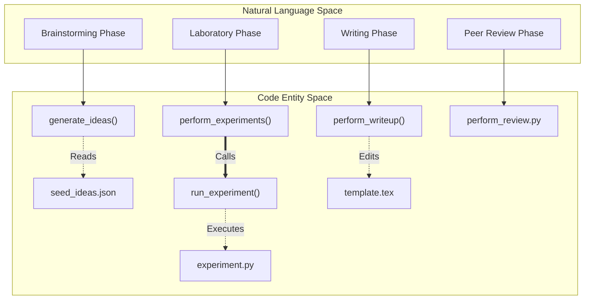
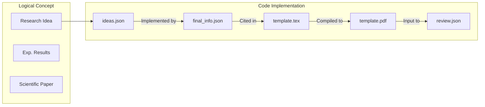

<!-- source: DeepWiki mcp.deepwiki.com · repo SakanaAI/AI-Scientist · page 8 Glossary · fetched 2026-10-26 -->

# Glossary

Relevant source files

The following files were used as context for generating this wiki page:

- [README.md](README.md)
- [ai_scientist/__init__.py](ai_scientist/__init__.py)
- [ai_scientist/fewshot_examples/132_automated_relational.json](ai_scientist/fewshot_examples/132_automated_relational.json)
- [ai_scientist/fewshot_examples/2_carpe_diem.json](ai_scientist/fewshot_examples/2_carpe_diem.json)
- [ai_scientist/fewshot_examples/attention.json](ai_scientist/fewshot_examples/attention.json)
- [ai_scientist/generate_ideas.py](ai_scientist/generate_ideas.py)
- [ai_scientist/llm.py](ai_scientist/llm.py)
- [ai_scientist/perform_experiments.py](ai_scientist/perform_experiments.py)
- [ai_scientist/perform_review.py](ai_scientist/perform_review.py)
- [ai_scientist/perform_writeup.py](ai_scientist/perform_writeup.py)
- [example_papers/adaptive_dual_scale_denoising/seed_ideas.json](example_papers/adaptive_dual_scale_denoising/seed_ideas.json)

This glossary defines codebase-specific terms, abbreviations, and domain concepts used throughout **The AI Scientist**. It serves as a technical reference for onboarding engineers to bridge the gap between high-level scientific concepts and their specific implementations in the Python source code.

## Core System Concepts

### Idea Generation & Novelty
The process of brainstorming new research directions based on a provided template.
*   **Seed Idea**: A baseline research idea provided in a template to kickstart the LLM's brainstorming process. Defined in `seed_ideas.json` [example_papers/adaptive_dual_scale_denoising/seed_ideas.json:1-10]().
*   **Novelty Check**: A validation step where the system queries the Semantic Scholar API to ensure a generated idea has not been previously published. This is handled by `search_for_papers` in `ai_scientist/generate_ideas.py` [ai_scientist/generate_ideas.py:10-10]().
*   **Idea Reflection**: An iterative loop where the LLM critiques its own generated JSON idea for feasibility and impact before finalizing it [ai_scientist/generate_ideas.py:54-72]().

### Experimentation & Execution
*   **Aider**: The specialized "coder" agent (using the Aider library) that modifies `experiment.py` and `plot.py` to implement the LLM's research ideas [ai_scientist/perform_experiments.py:12-26]().
*   **Run (run_N)**: A single execution of the `experiment.py` script. The system typically allows up to 5 runs (`MAX_RUNS`) per idea to gather results or perform hyperparameter sweeps [ai_scientist/perform_experiments.py:8-10]().
*   **Baseline Results**: The performance metrics of the original, unmodified template code, used by the LLM as a reference point for improvement [ai_scientist/perform_experiments.py:20-22]().
*   **Final Info**: The `final_info.json` file generated by an experiment run, containing the "means" of the metrics used for paper writing [ai_scientist/perform_experiments.py:62-64]().

### Writeup & Review
*   **Notes (notes.txt)**: A persistent text file where the coder agent records experimental observations and figure descriptions for the writeup phase [ai_scientist/perform_experiments.py:159-164]().
*   **LaTeX Pipeline**: The automated process of converting the LLM's generated text into a formatted PDF using `pdflatex` and `bibtex` [ai_scientist/perform_writeup.py:94-121]().
*   **Review Schema**: A structured JSON format for paper evaluations, including fields like `Soundness`, `Contribution`, and `Overall` score (1-10) [ai_scientist/perform_review.py:43-59]().

---

## Natural Language to Code Mapping

The following diagrams illustrate how abstract pipeline stages and scientific entities map to specific code structures and files.

### Pipeline Orchestration Mapping
This diagram shows how the conceptual "Research Phases" translate into the primary execution functions and the files they manage.

**Sources:** `ai_scientist/generate_ideas.py` [ai_scientist/generate_ideas.py:76-83](), `ai_scientist/perform_experiments.py` [ai_scientist/perform_experiments.py:116-138](), `ai_scientist/perform_writeup.py` [ai_scientist/perform_writeup.py:15-18]().

### Data Flow & File Artifacts
This diagram tracks how a "Research Idea" evolves from a JSON object into a physical PDF and Review.

**Sources:** `ai_scientist/perform_experiments.py` [ai_scientist/perform_experiments.py:62-64](), `ai_scientist/perform_writeup.py` [ai_scientist/perform_writeup.py:124-128](), `ai_scientist/perform_review.py` [ai_scientist/perform_review.py:43-59]().

---

## Technical Abbreviations & Jargon

| Term | Definition | Code Pointer |
| :--- | :--- | :--- |
| **S2** | Semantic Scholar. Used for automated literature search. | `ai_scientist/generate_ideas.py` [ai_scientist/generate_ideas.py:12-12]() |
| **LLM Registry** | The `AVAILABLE_LLMS` list defining supported models (OpenAI, Anthropic, DeepSeek, etc.). | `ai_scientist/llm.py` [ai_scientist/llm.py:13-62]() |
| **Backoff** | A decorator strategy to retry LLM API calls upon rate limits. | `ai_scientist/llm.py` [ai_scientist/llm.py:142-142]() |
| **Coder** | Refers to the `coder` object, an instance of an automated programming agent. | `ai_scientist/perform_experiments.py` [ai_scientist/perform_experiments.py:130-130]() |
| **chktex** | A LaTeX semantic checker used to find errors before compilation. | `ai_scientist/perform_writeup.py` [ai_scientist/perform_writeup.py:80-80]() |
| **Few-shot** | Providing the LLM with example reviews to guide its evaluation style. | `ai_scientist/fewshot_examples/` [ai_scientist/fewshot_examples/attention.json:1-3]() |

---

## Key Class/Function Reference

### `get_response_from_llm`
The universal entry point for LLM interactions. It abstracts provider-specific APIs (OpenAI, Anthropic, Google) into a standard interface.
*   **File**: `ai_scientist/llm.py` [ai_scientist/llm.py:143-151]()

### `generate_ideas`
Handles the initial phase of the pipeline. It reads `seed_ideas.json`, generates new ideas, and saves them to `ideas.json`.
*   **File**: `ai_scientist/generate_ideas.py` [ai_scientist/generate_ideas.py:76-174]()

### `perform_experiments`
The orchestration loop for the "Laboratory Phase." It manages the `coder` agent's attempts to modify code and execute runs.
*   **File**: `ai_scientist/perform_experiments.py` [ai_scientist/perform_experiments.py:116-166]()

### `generate_latex`
Manages the document creation process, including citation validation against `references.bib` and image path checking.
*   **File**: `ai_scientist/perform_writeup.py` [ai_scientist/perform_writeup.py:15-91]()

**Sources:** `ai_scientist/llm.py`, `ai_scientist/generate_ideas.py`, `ai_scientist/perform_experiments.py`, `ai_scientist/perform_writeup.py`.