# Page: Overview

# Overview

<details>
<summary>Relevant source files</summary>

The following files were used as context for generating this wiki page:

- [LICENSE](LICENSE)
- [README.md](README.md)
- [ai_scientist/__init__.py](ai_scientist/__init__.py)

</details>


The AI-Scientist repository implements an automated scientific research system that uses Large Language Models (LLMs) to conduct complete research workflows from idea generation through paper publication. The system executes experiments, analyzes results, writes papers, and performs reviews without human intervention.

For system setup information, see [Installation and Setup](#1.2). For architectural details, see [System Architecture](#1.1).

## Purpose and Scope

The AI-Scientist system demonstrates autonomous scientific research capabilities using frontier LLMs. The system implements a complete pipeline consisting of four main Python modules: `generate_ideas.py`, `perform_experiments.py`, `perform_writeup.py`, and `perform_review.py`, orchestrated by `launch_scientist.py`.

The system's core capabilities include:
- Research idea generation using LLM-based brainstorming and novelty checking via academic APIs.
- Automated experiment execution through template-based code generation and execution via an Aider-based coder agent.
- Scientific paper writing with LaTeX compilation and citation management using Semantic Scholar.
- Peer review simulation using few-shot learning from existing review examples.
- Multi-provider LLM integration supporting OpenAI, Anthropic, DeepSeek, Google, and other providers.

The system operates within predefined research templates that specify experimental frameworks, data preparation scripts, and domain-specific prompts.

Sources: [README.md:14-18](), [README.md:57-60](), [ai_scientist/llm.py:1-10]()

## System Architecture

The AI-Scientist system implements a modular pipeline architecture with four core modules orchestrated by a main entry point script.

**AI-Scientist Core Architecture**
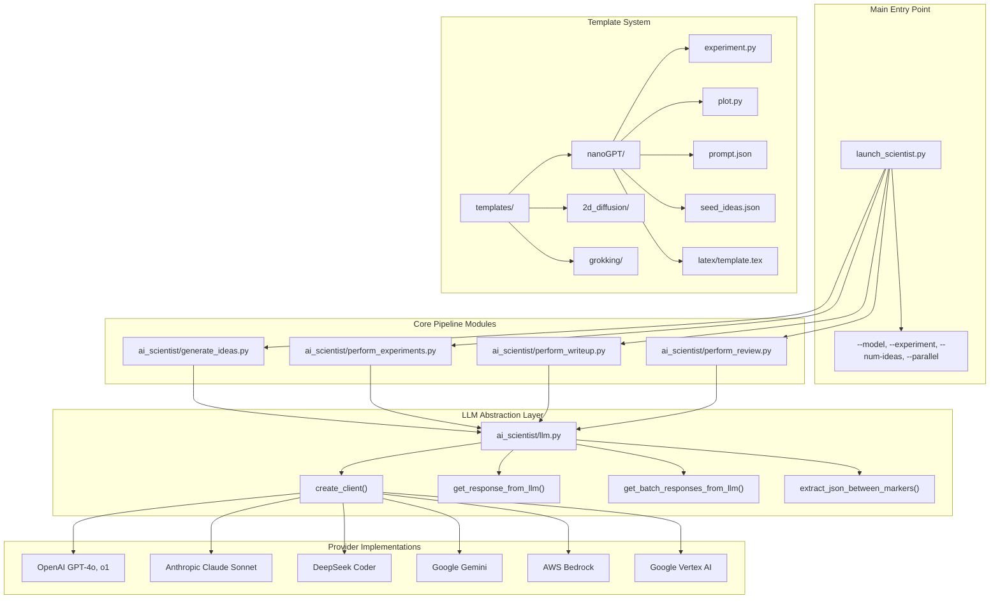

The architecture consists of:

1. **Entry Point**: `launch_scientist.py` orchestrates the pipeline by sequentially calling the four core modules.
2. **Core Modules**: Four specialized Python modules handle idea generation, experimentation, paper writing, and review.
3. **LLM Interface**: `ai_scientist/llm.py` provides unified access to multiple LLM providers through standardized functions.
4. **Template System**: Directory structure containing domain-specific experimental frameworks and configuration files.

Sources: [README.md:48-55](), [ai_scientist/llm.py:38-114](), [launch_scientist.py:1-50]()

## Scientific Workflow

The AI-Scientist implements a four-stage pipeline that mirrors the complete scientific research process.

**End-to-End Scientific Pipeline**
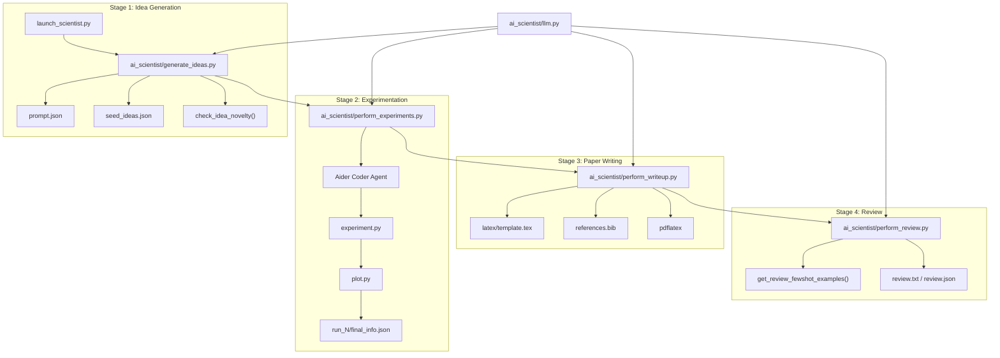

The workflow executes sequentially through four stages:

1. **Idea Generation**: `generate_ideas.py` uses template prompts and seed ideas to generate research concepts, then validates novelty using academic search APIs.
2. **Experimentation**: `perform_experiments.py` implements a coder agent that modifies `experiment.py` and `plot.py` files to test hypotheses and record results in `final_info.json`.
3. **Paper Writing**: `perform_writeup.py` generates LaTeX documents using template files, manages citations, and compiles PDFs.
4. **Review**: `perform_review.py` evaluates papers using few-shot examples and generates structured reviews with scores and decisions.

Sources: [README.md:14-18](), [ai_scientist/llm.py:121-145](), [launch_scientist.py:194-245]()

## Key Components

### Launch Scientist

The `launch_scientist.py` script serves as the main orchestrator and entry point for the complete research pipeline.

The script implements the following execution parameters:
- `--model`: LLM model identifier (e.g., `gpt-4o-2024-05-13`, `claude-3-5-sonnet-20241022`).
- `--experiment`: Template directory name (e.g., `nanoGPT`, `2d_diffusion`, `grokking`).
- `--num-ideas`: Integer count of research ideas to process sequentially.
- `--parallel`: Boolean flag to distribute ideas across multiple GPU devices.

Sources: [launch_scientist.py:31-105](), [README.md:48-55]()

### LLM Integration

The `ai_scientist/llm.py` module implements a unified interface for multiple LLM providers through standardized functions and client creation patterns.

The module supports the following provider implementations:
- **OpenAI**: GPT-4o, GPT-4o-mini, o1 models.
- **Anthropic**: Claude Sonnet 3.5.
- **Cloud Providers**: AWS Bedrock and Google Vertex AI for Claude models.
- **Open-Weight/Others**: DeepSeek, Llama (via OpenRouter), and Google Gemini via OpenAI-compatible interfaces.

Sources: [ai_scientist/llm.py:38-114](), [README.md:79-134]()

### Template System

The template system defines research domains through standardized directory structures containing experimental code, configuration files, and LaTeX document templates.

Each template implements the following standardized components:
- `experiment.py`: Main experimental logic with `--out_dir` parameter for result storage.
- `plot.py`: Visualization generation script that reads from run directories.
- `prompt.json`: Domain-specific LLM prompts and instructions for idea generation.
- `seed_ideas.json`: Example research ideas to bootstrap the generation process.
- `latex/template.tex`: LaTeX document template.

Sources: [README.md:44-52](), [README.md:57-60]()

The system includes core templates and community-contributed extensions:

| Template | Description |
|----------|-------------|
| **nanoGPT** | Transformer autoregressive language modeling. |
| **2d_diffusion** | Low-dimensional diffusion model research. |
| **grokking** | Neural network generalization dynamics. |
| **MACE** | Quantum chemistry modeling (Community). |
| **TensoRF** | Tensorial radiance fields (Community). |

Sources: [README.md:44-52](), [README.md:164-233]()

## Conclusion

The AI-Scientist repository represents a complete framework for autonomous scientific discovery using LLMs. By automating the entire research workflow from idea generation to paper publication, it demonstrates the potential of foundation models to accelerate scientific progress.

For details on the orchestration logic, see [System Architecture](#1.1). For details on environment configuration, see [Installation and Setup](#1.2).

---

# Page: System Architecture

# System Architecture

<details>
<summary>Relevant source files</summary>

The following files were used as context for generating this wiki page:

- [README.md](README.md)
- [ai_scientist/__init__.py](ai_scientist/__init__.py)
- [ai_scientist/generate_ideas.py](ai_scientist/generate_ideas.py)
- [ai_scientist/perform_experiments.py](ai_scientist/perform_experiments.py)
- [ai_scientist/perform_review.py](ai_scientist/perform_review.py)
- [ai_scientist/perform_writeup.py](ai_scientist/perform_writeup.py)

</details>


This document describes the high-level architecture of the AI Scientist system, explaining how the main components interact to enable fully automated scientific research. It covers the core pipeline orchestration, LLM integration patterns, and template-based research domain specialization.

## Overview

The AI Scientist implements a four-stage automated research pipeline orchestrated by a central controller. The system uses a template-based approach to enable research across different scientific domains, with a unified LLM interface supporting multiple foundation model providers.

**Core Pipeline Architecture**

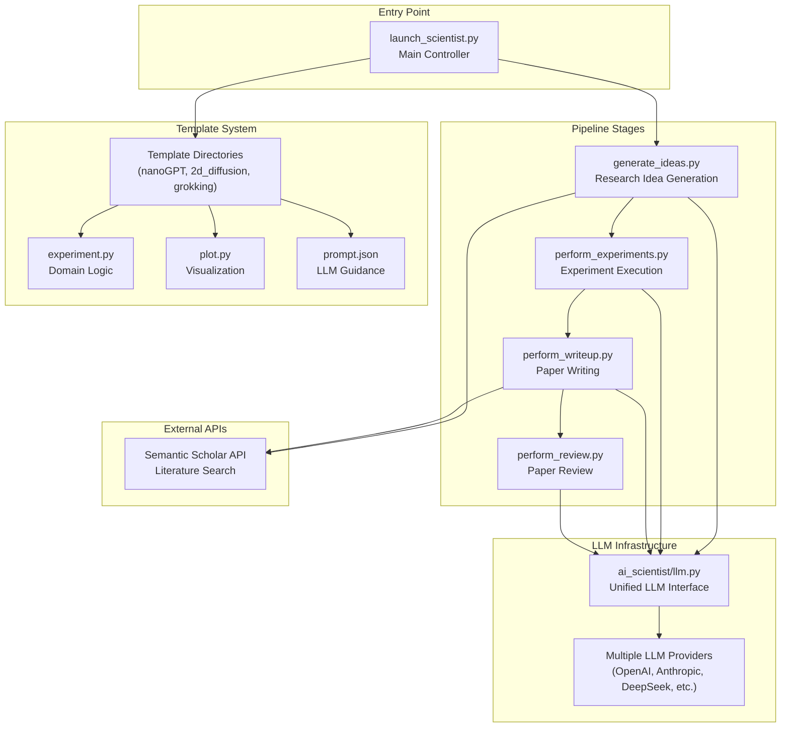

Sources: [README.md:1-30](), [ai_scientist/generate_ideas.py:76-174](), [ai_scientist/perform_experiments.py:116-166](), [ai_scientist/perform_writeup.py:15-91](), [ai_scientist/perform_review.py:13-63](), [ai_scientist/llm.py:1-20]()

## Pipeline Orchestration

The `launch_scientist.py` script serves as the main orchestrator, coordinating the execution of each pipeline stage with proper error handling and parallel execution support.

**Pipeline Execution Flow**

```mermaid
flowchart TD
    start["User executes launch_scientist.py<br/>--model --experiment --num-ideas"]
    
    subgraph "Initialization"
        parse_args["argparse<br/>Command line parsing"]
        load_template["Load template directory<br/>experiment.py, plot.py, prompt.json"]
        init_llm["create_client()<br/>Initialize LLM client"]
    end
    
    subgraph "Idea Generation Loop"
        gen_ideas["generate_ideas.py<br/>generate_ideas()"]
        search_papers["search_for_papers()<br/>Semantic Scholar API"]
    end
    
    subgraph "Experiment Execution"
        run_exp["perform_experiments.py<br/>perform_experiments()"]
        coder_agent["Aider Coder Agent<br/>modify experiment.py"]
        execute["run_experiment()<br/>subprocess.run(experiment.py)"]
        plot["run_plotting()<br/>subprocess.run(plot.py)"]
    end
    
    subgraph "Paper Generation"
        write_paper["perform_writeup.py<br/>perform_writeup()"]
        latex["generate_latex()<br/>LaTeX generation"]
        compile_pdf["compile_latex()<br/>PDF compilation"]
    end
    
    subgraph "Review Generation"
        review_paper["perform_review.py<br/>perform_review()"]
        ensemble["perform_review_ensemble()<br/>Multiple review aggregation"]
    end
    
    start --> parse_args
    parse_args --> load_template
    load_template --> init_llm
    init_llm --> gen_ideas
    
    gen_ideas --> search_papers
    search_papers --> run_exp
    
    run_exp --> coder_agent
    coder_agent --> execute
    execute --> plot
    plot --> write_paper
    
    write_paper --> latex
    latex --> compile_pdf
    compile_pdf --> review_paper
    
    review_paper --> ensemble
```

Sources: [ai_scientist/generate_ideas.py:76-110](), [ai_scientist/perform_experiments.py:30-85](), [ai_scientist/perform_experiments.py:116-166](), [ai_scientist/perform_writeup.py:15-91](), [ai_scientist/perform_review.py:300-340]()

## LLM Integration Architecture

The system uses a unified interface in `ai_scientist/llm.py` to support multiple LLM providers with consistent API patterns across the pipeline.

**LLM Provider Architecture**

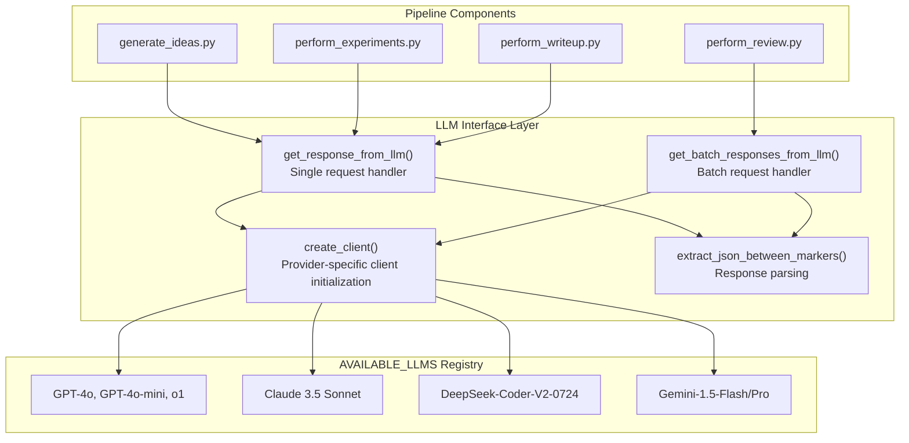

Sources: [ai_scientist/llm.py:385-450](), [ai_scientist/llm.py:452-520](), [ai_scientist/llm.py:522-550](), [README.md:79-159]()

## Template System Architecture

The template system enables domain-specific research by providing structured interfaces for experiment execution, visualization, and LLM guidance.

**Template Structure and Interface**

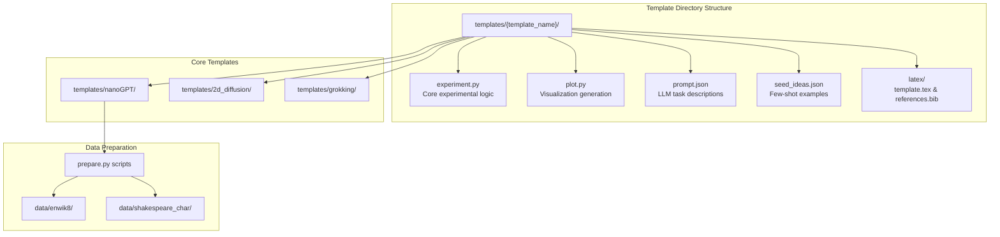

Sources: [ai_scientist/generate_ideas.py:99-110](), [ai_scientist/perform_experiments.py:30-43](), [ai_scientist/perform_writeup.py:17-32](), [README.md:44-59]()

## Data Flow and State Management

The system manages state through filesystem-based run directories and JSON configuration files, enabling resumability and analysis.

| Component | Input | Output | State Storage |
|-----------|-------|---------|---------------|
| `generate_ideas.py` | `prompt.json`, `seed_ideas.json` | `ideas.json` | `ideas.json` in template dir [ai_scientist/generate_ideas.py:171-172]() |
| `perform_experiments.py` | Idea JSON, `experiment.py` | `run_N.py`, `run_N/` | `run_N/final_info.json` [ai_scientist/perform_experiments.py:62-63]() |
| `perform_writeup.py` | `notes.txt`, `run_N/` results | `template.pdf` | `latex/` directory [ai_scientist/perform_writeup.py:17-18]() |
| `perform_review.py` | Paper PDF | `review.json` | Review files [ai_scientist/perform_review.py:330-340]() |

**Run Directory Structure**

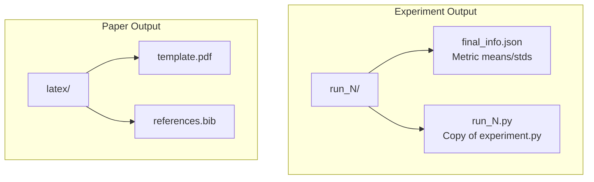

Sources: [ai_scientist/perform_experiments.py:33-36](), [ai_scientist/perform_experiments.py:62-64](), [ai_scientist/perform_writeup.py:125-128]()

## Reliability and Error Handling

The system implements specific mechanisms to handle the unreliability of LLM-generated code and external APIs.

| Mechanism | Implementation | Location |
|-----------|----------------|----------|
| **Iterative Refinement** | Ideas are refined over `num_reflections` rounds. | [ai_scientist/generate_ideas.py:138-159]() |
| **Execution Retries** | Experiments are retried up to `MAX_ITERS` if they fail. | [ai_scientist/perform_experiments.py:126-138]() |
| **LaTeX Correction** | System uses `chktex` and LLM to fix LaTeX errors. | [ai_scientist/perform_writeup.py:78-90]() |
| **Timeouts** | Subprocess calls have hard timeouts (e.g., 7200s for experiments). | [ai_scientist/perform_experiments.py:30-47]() |
| **API Backoff** | `backoff` decorator for LLM and Semantic Scholar requests. | [ai_scientist/generate_ideas.py:7-8]() |

Sources: [ai_scientist/generate_ideas.py:7-8](), [ai_scientist/generate_ideas.py:138-159](), [ai_scientist/perform_experiments.py:8-10](), [ai_scientist/perform_experiments.py:30-47](), [ai_scientist/perform_writeup.py:78-90]()

---

# Page: Installation and Setup

# Installation and Setup

<details>
<summary>Relevant source files</summary>

The following files were used as context for generating this wiki page:

- [.gitignore](.gitignore)
- [LICENSE](LICENSE)
- [README.md](README.md)

</details>


This document covers the installation requirements, configuration steps, and initial setup needed to run the AI Scientist system. It includes system requirements, dependency installation, API key configuration, and template preparation.

For information about the overall system architecture, see [System Architecture](#1.1). For details about creating custom templates, see [Creating Custom Templates](#6.1).

## System Requirements

The AI Scientist system has specific hardware and software requirements that must be met before installation.

### Hardware Requirements

The system is designed to run on Linux with NVIDIA GPUs using CUDA and PyTorch. The templates require GPU acceleration and would be infeasible to run on CPU-only machines. Support for other GPU architectures may be possible by following PyTorch guidelines. [README.md:61-64]()

### Operating System Support

The system is primarily designed for Linux operating systems. Running on other operating systems may require significant adjustments and is not officially supported. [README.md:61-64]()

### Technical Environment Overview
The following diagram maps the high-level system requirements to the specific environment configurations used in the codebase.

**System Environment Mapping**
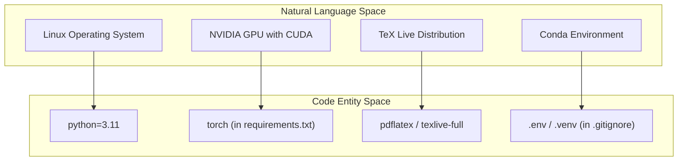
Sources: [README.md:61-75](), [.gitignore:125-132]()

## Basic Installation

The installation process involves creating a conda environment, installing LaTeX, and installing Python dependencies.

### Environment Setup

Create and activate a new conda environment with Python 3.11: [README.md:67-69]()

```bash
conda create -n ai_scientist python=3.11
conda activate ai_scientist
```

### LaTeX Installation

Install the complete TeX Live distribution, which is required for PDF generation via `pdflatex`: [README.md:70-71]()

```bash
sudo apt-get install texlive-full
```

**Note:** Installing `texlive-full` can take a significant amount of time. You may need to hold Enter during the installation process to handle interactive prompts. [README.md:77]()

### Python Dependencies

Install the required Python packages defined in the project root: [README.md:74]()

```bash
pip install -r requirements.txt
```

**Installation Flow**
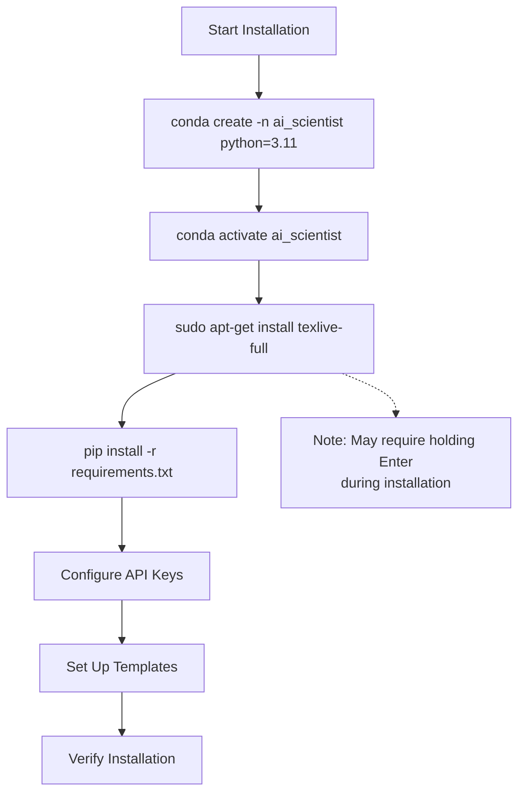
Sources: [README.md:67-77]()

## API Key Configuration

The system supports multiple LLM providers, each requiring specific API key configuration through environment variables. These are handled internally by the `ai_scientist/llm.py` module. [README.md:81-82]()

### OpenAI API
For GPT-4o, GPT-4o-mini, and o1 models: [README.md:83-85]()
```bash
export OPENAI_API_KEY="YOUR_OPENAI_API_KEY"
```

### Anthropic API
For Claude Sonnet 3.5 models: [README.md:87-89]()
```bash
export ANTHROPIC_API_KEY="YOUR_ANTHROPIC_API_KEY"
```

#### Claude via AWS Bedrock
For Claude models through Amazon Bedrock, install additional dependencies and configure AWS credentials: [README.md:91-101]()
```bash
pip install anthropic[bedrock]
export AWS_ACCESS_KEY_ID="YOUR_AWS_ACCESS_KEY"
export AWS_SECRET_ACCESS_KEY="YOUR_AWS_SECRET_KEY"
export AWS_REGION_NAME="YOUR_AWS_REGION"
```

### Additional Providers
The system also supports DeepSeek, OpenRouter, Google Gemini, and academic search APIs: [README.md:107-157]()

```bash
# LLM Providers
export DEEPSEEK_API_KEY="YOUR_DEEPSEEK_API_KEY"
export OPENROUTER_API_KEY="YOUR_OPENROUTER_API_KEY"
export GEMINI_API_KEY="YOUR_GEMINI_API_KEY"

# Research Search APIs (Used in generate_ideas.py)
export S2_API_KEY="YOUR_S2_API_KEY"
export OPENALEX_MAIL_ADDRESS="YOUR_EMAIL_ADDRESS"
```

**API Integration Architecture**
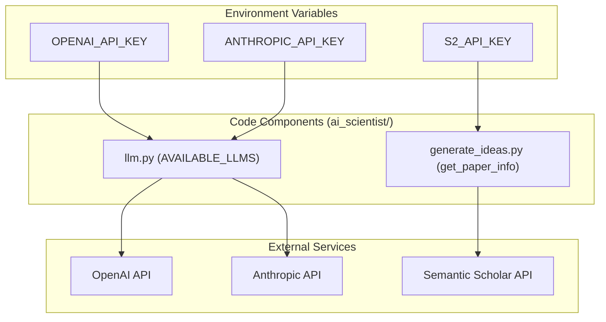
Sources: [README.md:79-157](), [ai_scientist/llm.py:1-50](), [ai_scientist/generate_ideas.py:1-100]()

## Template Setup

The system includes three core templates that require specific setup procedures before use. Each template requires a baseline "run 0" to establish performance metrics. [README.md:164-233]()

### NanoGPT Template
The NanoGPT template investigates transformer-based autoregressive next-token prediction. [README.md:164-167]()

**Data Preparation:**
```bash
python data/enwik8/prepare.py
python data/shakespeare_char/prepare.py
python data/text8/prepare.py
```

**Baseline Run:**
```bash
cd templates/nanoGPT
python experiment.py --out_dir run_0
python plot.py
```

### 2D Diffusion Template
The 2D Diffusion template studies diffusion generative models on low-dimensional datasets. [README.md:195-201]()

**Dependencies:**
```bash
git clone https://github.com/gregversteeg/NPEET.git
cd NPEET && pip install .
pip install scikit-learn
```

**Baseline Run:**
```bash
cd templates/2d_diffusion
python experiment.py --out_dir run_0
python plot.py
```

### Grokking Template
The Grokking template investigates generalization in deep neural networks. [README.md:218-223]()

**Dependencies:**
```bash
pip install einops
```

**Baseline Run:**
```bash
cd templates/grokking
python experiment.py --out_dir run_0
python plot.py
```

Sources: [README.md:164-233]()

## Installation Verification

After setup, verify the system by running a minimal end-to-end experiment using `launch_scientist.py`.

### Basic Execution
Test the pipeline with a small number of ideas: [README.md:235-239]()
```bash
python launch_scientist.py --model "gpt-4o-2024-05-13" --experiment nanoGPT_lite --num-ideas 2
```

### Parallel Execution
If multiple GPUs are available, verify parallel orchestration: [README.md:255-257]()
```bash
python launch_scientist.py --model "claude-3-5-sonnet-20241022" --experiment nanoGPT_lite --num-ideas 2 --parallel
```

### Review System Verification
Test the review logic manually via `ai_scientist/perform_review.py`: [README.md:264-275]()
```python
from ai_scientist.perform_review import load_paper, perform_review
# Load a generated paper text and perform review ensemble
paper_txt = load_paper("report.pdf")
# This triggers the ensemble review process
```

| Verification Step | Target File/Command | Purpose |
|------------------|---------------------|---------|
| Environment | `conda activate` | Check Python 3.11 setup |
| Template Baseline | `templates/*/run_0/` | Verify hardware-specific metrics |
| LLM Access | `ai_scientist/llm.py` | Verify API key connectivity |
| Pipeline | `launch_scientist.py` | Full E2E orchestration check |

Sources: [README.md:235-275](), [ai_scientist/perform_review.py:441-455]()

## Troubleshooting

### Common Issues
*   **Missing Files:** Ensure `run_0` exists in the template directory. The `.gitignore` excludes these by default. [.gitignore:172]()
*   **PDF Failures:** Check `pdflatex` availability. The system uses it in `perform_writeup.py` to compile the generated LaTeX. [README.md:345-348]()
*   **Aider Logs:** If experiments fail, check `.aider*` files for the LLM's coding history. [.gitignore:164]()
*   **Rate Limits:** Use `S2_API_KEY` to avoid Semantic Scholar throttling during idea generation. [README.md:154-157]()

Sources: [README.md:338-369](), [.gitignore:164-175]()

---

# Page: Core Components

# Core Components

<details>
<summary>Relevant source files</summary>

The following files were used as context for generating this wiki page:

- [ai_scientist/__init__.py](ai_scientist/__init__.py)
- [ai_scientist/generate_ideas.py](ai_scientist/generate_ideas.py)
- [ai_scientist/llm.py](ai_scientist/llm.py)
- [ai_scientist/perform_experiments.py](ai_scientist/perform_experiments.py)
- [ai_scientist/perform_review.py](ai_scientist/perform_review.py)
- [ai_scientist/perform_writeup.py](ai_scientist/perform_writeup.py)

</details>


This document provides a high-level overview of the main functional modules that implement the AI Scientist pipeline. The system is designed as a modular research factory, moving from initial conceptualization to final peer review. Each section below links to a dedicated child page containing deep technical specifications.

## Pipeline Orchestration

The AI Scientist is orchestrated through a central entry point that manages the transition between research phases. The system uses a template-based approach where each research project starts with a base directory containing an initial codebase (`experiment.py`), plotting scripts (`plot.py`), and task descriptions (`prompt.json`).

### High-Level System Flow

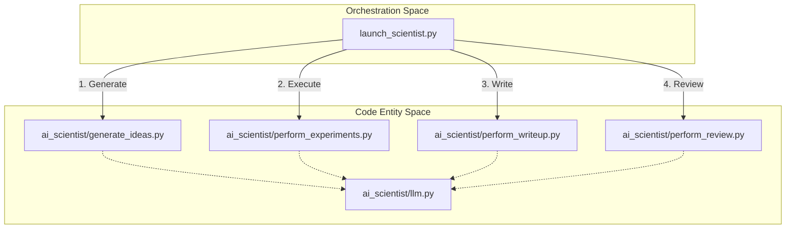
Sources: [launch_scientist.py:1-45](), [ai_scientist/generate_ideas.py:76-83](), [ai_scientist/perform_experiments.py:116-125]()

---

## 2.1 Launch Scientist
The `launch_scientist.py` script is the primary entry point. It handles command-line arguments, manages GPU allocation for parallel runs, and loops through the generated ideas to trigger the subsequent phases. An experimental version, `experimental/launch_oe_scientist.py`, provides an open-ended evolution mode where the system continuously builds on its own previous results.

For details, see [Launch Scientist](#2.1).

Sources: [launch_scientist.py:1-50]()

## 2.2 LLM Integration
The `ai_scientist/llm.py` module acts as a unified abstraction layer for multiple LLM providers. It manages API clients for OpenAI, Anthropic, Google Gemini, DeepSeek, and others through the `AVAILABLE_LLMS` registry. It provides robust error handling via `backoff` and specialized functions like `get_response_from_llm` and `get_batch_responses_from_llm` for ensembling.

For details, see [LLM Integration](#2.2).

Sources: [ai_scientist/llm.py:13-62](), [ai_scientist/llm.py:143-151]()

## 2.3 Idea Generation
The `generate_ideas.py` module uses the LLM to brainstorm research directions. It parses the `experiment.py` code and `seed_ideas.json` to propose novel experiments. The process includes a multi-round reflection loop where the LLM critiques its own ideas for feasibility and novelty before saving them to `ideas.json`.

For details, see [Idea Generation](#2.3).

Sources: [ai_scientist/generate_ideas.py:14-52](), [ai_scientist/generate_ideas.py:76-112]()

## 2.4 Experiment Execution
Experimental validation is handled by `perform_experiments.py`. This module interfaces with the **Aider** coder agent to modify the template's `experiment.py`. It manages a loop of up to `MAX_RUNS` (default 5), executing the code via `subprocess`, capturing `stderr` for debugging, and passing results back to the LLM to decide on the next hyperparameter sweep or code modification.

### Experiment Execution Entity Mapping

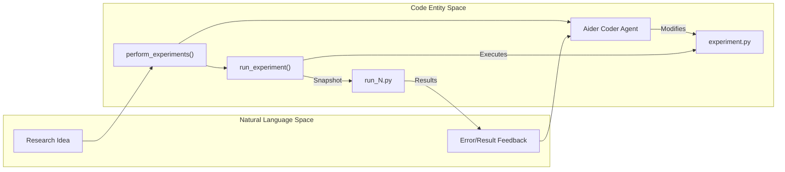
Sources: [ai_scientist/perform_experiments.py:8-10](), [ai_scientist/perform_experiments.py:30-43](), [ai_scientist/perform_experiments.py:116-138]()

For details, see [Experiment Execution](#2.4).

## 2.5 Paper Writing
Once experiments are complete, `perform_writeup.py` orchestrates the creation of a full LaTeX progress report. It uses the LLM to write sections (Abstract, Introduction, Methods, etc.) based on `notes.txt` and experimental results. It manages `references.bib` via Semantic Scholar searches and iteratively fixes LaTeX compilation errors using `pdflatex` and `chktex`.

For details, see [Paper Writing](#2.5).

Sources: [ai_scientist/perform_writeup.py:15-30](), [ai_scientist/perform_writeup.py:130-165]()

## 2.6 Paper Review
The final stage is an automated peer review implemented in `perform_review.py`. It converts the generated PDF to text and evaluates it against a structured schema (Soundness, Contribution, etc.) based on the NeurIPS review form. It supports ensembling multiple reviews to reach a final "Accept" or "Reject" decision.

For details, see [Paper Review](#2.6).

Sources: [ai_scientist/perform_review.py:27-63](), [ai_scientist/perform_review.py:65-101]()

---

# Page: Launch Scientist

# Launch Scientist

<details>
<summary>Relevant source files</summary>

The following files were used as context for generating this wiki page:

- [README.md](README.md)
- [ai_scientist/generate_ideas.py](ai_scientist/generate_ideas.py)
- [ai_scientist/perform_experiments.py](ai_scientist/perform_experiments.py)

</details>


This document covers the main entry point scripts that orchestrate the entire AI Scientist research pipeline. The `launch_scientist.py` script and the experimental `experimental/launch_oe_scientist.py` serve as the central command-line interfaces that coordinate idea generation, experiment execution, paper writing, and paper review to produce complete scientific papers automatically.

## System Overview

The `launch_scientist.py` script functions as the central orchestrator. It manages the data flow between specialized modules, transforming high-level research goals into validated experiments and formatted manuscripts.

**Launch Scientist Code Entity Map**

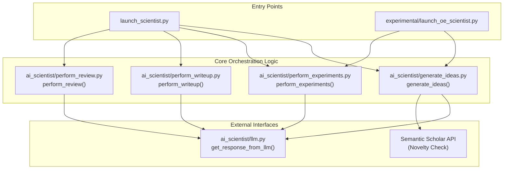

Sources: [ai_scientist/generate_ideas.py:76-83](), [ai_scientist/perform_experiments.py:116-116](), [README.md:242-246]()

## Pipeline Execution Flow

The execution follows a strictly defined sequence where the output of one stage informs the next. The orchestrator ensures that the `experiment.py` and `prompt.json` from the chosen template are correctly passed to the LLM agents.

**Data Flow and Logic Sequence**

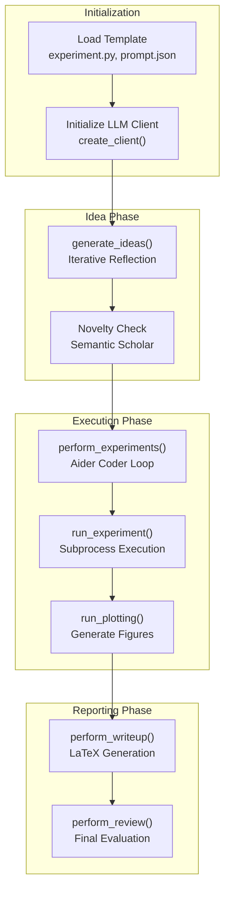

Sources: [ai_scientist/generate_ideas.py:104-110](), [ai_scientist/perform_experiments.py:118-138](), [ai_scientist/perform_experiments.py:153-158]()

## Core Components Detail

### Idea Generation Orchestration
The script triggers `generate_ideas` which loads `seed_ideas.json` [ai_scientist/generate_ideas.py:99-102]() and enters a reflection loop. The LLM is prompted to refine ideas over a set number of rounds (default `num_reflections=5`) [ai_scientist/generate_ideas.py:83]().

### Experiment Execution Loop
The `perform_experiments` function manages a "Coder" agent. It provides the agent with the generated idea and baseline results [ai_scientist/perform_experiments.py:120-125]().
*   **Subprocess Management**: Each experiment is executed via `subprocess.run` calling `python experiment.py` [ai_scientist/perform_experiments.py:39-47]().
*   **Iterative Refinement**: If a run fails, the stderr is captured (truncated to 1500 chars) and fed back to the LLM for debugging [ai_scientist/perform_experiments.py:57-60]().
*   **Plotting**: After successful experiments, the system triggers `plot.py` to visualize results [ai_scientist/perform_experiments.py:91-98]().

### Open-Ended Execution (Experimental)
The `experimental/launch_oe_scientist.py` script introduces a more autonomous loop. Unlike the standard version, it can use `generate_next_idea` to continuously build upon previous results in an open-ended fashion [ai_scientist/generate_ideas.py:178-185]().

## Parallel Execution Support

The system supports parallelization across multiple GPUs using the `--parallel` flag. This distributes different research ideas to different processes, each bound to a specific `CUDA_VISIBLE_DEVICES` [README.md:246]().

**Parallel Resource Distribution**

| Component | Logic | Source |
| :--- | :--- | :--- |
| **GPU Assignment** | Uses `--gpus` argument to specify available IDs | [README.md:246]() |
| **Process Isolation** | Each idea runs in a separate directory to avoid file conflicts | [ai_scientist/perform_experiments.py:30-31]() |
| **Concurrency** | Managed via Python multiprocessing, launching independent pipelines per idea | [README.md:246]() |

## Error Handling and Timeouts

The orchestrator implements strict resource limits to prevent runaway LLM processes:
*   **Experiment Timeout**: Default is 7200 seconds (2 hours) per run [ai_scientist/perform_experiments.py:30]().
*   **Plotting Timeout**: Default is 600 seconds (10 minutes) [ai_scientist/perform_experiments.py:88]().
*   **Iteration Limits**: Maximum of 4 iterations per experiment and 5 total runs per idea [ai_scientist/perform_experiments.py:8-9]().

Sources: [ai_scientist/perform_experiments.py:8-10](), [ai_scientist/perform_experiments.py:30](), [ai_scientist/perform_experiments.py:88]()

---

# Page: LLM Integration

# LLM Integration

<details>
<summary>Relevant source files</summary>

The following files were used as context for generating this wiki page:

- [ai_scientist/llm.py](ai_scientist/llm.py)

</details>


This document explains how the AI Scientist system interfaces with various Large Language Model (LLM) providers. The LLM integration layer, primarily implemented in `ai_scientist/llm.py`, serves as a unified abstraction that enables the different components of the system to leverage state-of-the-art language models for scientific tasks including idea generation, experiment execution, paper writing, and paper review.

## Supported LLM Providers and Models

The AI Scientist system supports a wide range of LLM providers and models. The complete list of supported model strings is maintained in the `AVAILABLE_LLMS` registry.

```mermaid
graph TD
    subgraph "LLM Provider Categories"
        ["Anthropic Models"] -- "claude-3-5-sonnet variants" --> B1["AVAILABLE_LLMS"]
        ["OpenAI Models"] -- "gpt-4o, gpt-4.1, o1, o3 variants" --> B1
        ["Amazon Bedrock"] -- "bedrock/anthropic.claude-*" --> B1
        ["Google Vertex AI"] -- "vertex_ai/claude-3-*" --> B1
        ["OpenRouter"] -- "llama3.1-405b" --> B1
        ["DeepSeek"] -- "deepseek-chat, deepseek-reasoner" --> B1
        ["Google Gemini"] -- "gemini-1.5, gemini-2.0, gemini-2.5" --> B1
    end
```
Sources: [ai_scientist/llm.py:13-62]()

The system currently supports the following providers and models:

| Provider | Model String Patterns | Client Implementation |
|----------|----------------|-------------|
| **Anthropic** | `claude-3-5-sonnet-20240620`, `claude-3-5-sonnet-20241022` | `anthropic.Anthropic` |
| **OpenAI** | `gpt-4o`, `gpt-4.1`, `o1-mini`, `o3-mini` | `openai.OpenAI` |
| **Amazon Bedrock** | `bedrock/anthropic.claude-3-5-sonnet-*` | `anthropic.AnthropicBedrock` |
| **Google Vertex AI** | `vertex_ai/claude-3-5-sonnet-*` | `anthropic.AnthropicVertex` |
| **DeepSeek** | `deepseek-chat`, `deepseek-coder`, `deepseek-reasoner` | `openai.OpenAI` (DeepSeek Base URL) |
| **Google Gemini** | `gemini-1.5-pro`, `gemini-2.0-flash` | `openai.OpenAI` (Google Base URL) |

Sources: [ai_scientist/llm.py:13-62](), [ai_scientist/llm.py:317-351]()

## Core Architecture

The LLM integration layer serves as the bridge between AI Scientist's core modules and various LLM providers. It handles formatting differences, token limits, and retry logic.

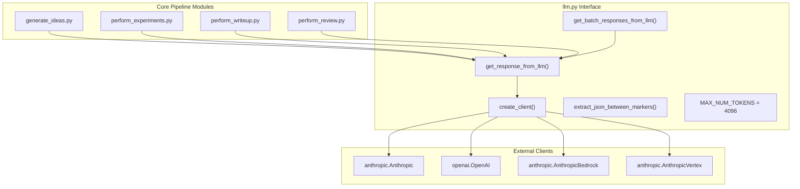
Sources: [ai_scientist/llm.py:11](), [ai_scientist/llm.py:66-139](), [ai_scientist/llm.py:142-286](), [ai_scientist/llm.py:317-351]()

## Key Functions

### Client Initialization (`create_client`)
The `create_client` function instantiates the appropriate client based on the model string and retrieves the necessary API keys from environment variables.

*   **Anthropic**: Uses `ANTHROPIC_API_KEY` [ai_scientist/llm.py:334-335]().
*   **OpenAI**: Uses `OPENAI_API_KEY` [ai_scientist/llm.py:336-337]().
*   **DeepSeek**: Uses `DEEPSEEK_API_KEY` and sets `base_url="https://api.deepseek.com"` [ai_scientist/llm.py:341-344]().
*   **Google Gemini**: Uses `GEMINI_API_KEY` and sets `base_url="https://generativelanguage.googleapis.com/v1beta/openai/"` [ai_scientist/llm.py:345-348]().

Sources: [ai_scientist/llm.py:317-351]()

### LLM Response Generation
The system provides two primary functions for inference:

1.  **`get_response_from_llm`**: The base function for a single interaction. It handles model-specific prompt formatting (e.g., Anthropic's `messages.create` vs OpenAI's `chat.completions.create`) [ai_scientist/llm.py:143-286]().
2.  **`get_batch_responses_from_llm`**: Used for ensembling (e.g., in paper reviews). For OpenAI/Llama models, it uses the native `n` parameter to get multiple completions in one call [ai_scientist/llm.py:80-114](). For others, it loops over `get_response_from_llm` [ai_scientist/llm.py:117-129]().

### Robustness and Parsing
*   **Retries**: Both functions use `@backoff.on_exception` with exponential backoff to handle `RateLimitError` and `APITimeoutError` [ai_scientist/llm.py:66](), [ai_scientist/llm.py:142]().
*   **JSON Extraction**: `extract_json_between_markers` uses regex to pull structured data from LLM responses, looking for ` ```json ` blocks or raw curly braces, and sanitizing control characters [ai_scientist/llm.py:289-314]().

## Data Flow: Natural Language to Code Entities

The following diagram illustrates how a high-level request from a researcher is transformed through the `llm.py` entities into a provider-specific API call.

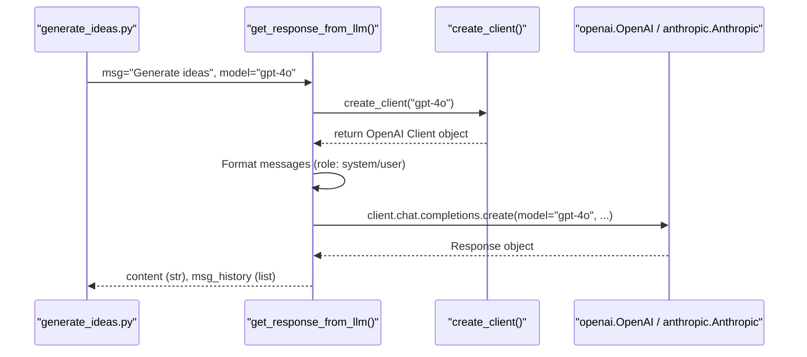
Sources: [ai_scientist/llm.py:143-286](), [ai_scientist/llm.py:317-351]()

## Model-Specific Logic Table

The `get_response_from_llm` function implements several branching paths to accommodate API differences:

| Model Logic Branch | Key Implementation Detail | Code Reference |
| :--- | :--- | :--- |
| **Anthropic (`claude`)** | Uses `client.messages.create` with a separate `system` parameter. | [ai_scientist/llm.py:155-185]() |
| **OpenAI (`gpt`)** | Uses `client.chat.completions.create` with `role: "system"`. | [ai_scientist/llm.py:186-201]() |
| **Reasoning (`o1`/`o3`)** | Passes the system message as a `user` role; uses `max_completion_tokens`. | [ai_scientist/llm.py:202-216]() |
| **Llama (OpenRouter)** | Explicitly maps to `meta-llama/llama-3.1-405b-instruct`. | [ai_scientist/llm.py:217-231]() |
| **DeepSeek** | Configures `max_tokens` and `temperature` for DeepSeek's API. | [ai_scientist/llm.py:232-247]() |
| **Gemini** | Uses OpenAI-compatible client but handles specific `max_tokens` mapping. | [ai_scientist/llm.py:248-262]() |

Sources: [ai_scientist/llm.py:155-275]()

---

# Page: Idea Generation

# Idea Generation

<details>
<summary>Relevant source files</summary>

The following files were used as context for generating this wiki page:

- [ai_scientist/generate_ideas.py](ai_scientist/generate_ideas.py)
- [example_papers/adaptive_dual_scale_denoising/ideas.json](example_papers/adaptive_dual_scale_denoising/ideas.json)
- [example_papers/adaptive_dual_scale_denoising/seed_ideas.json](example_papers/adaptive_dual_scale_denoising/seed_ideas.json)

</details>


This document covers the AI Scientist's idea generation system, which creates novel research hypotheses and experiments for a given research domain. The system generates creative ideas by analyzing existing code, reviewing previous ideas, and optionally checking novelty against the scientific literature.

For information about executing the generated ideas as experiments, see [2.4 Experiment Execution](). For details on the LLM integration that powers idea generation, see [2.2 LLM Integration]().

## Overview

The idea generation system serves as the creative engine of the AI Scientist pipeline. It takes a research template containing experimental code and generates novel research directions that can be feasibly implemented within the template's constraints. The system supports iterative refinement of ideas and optional novelty checking against existing literature.

### Core Workflow

The diagram below illustrates the flow from initial template loading to the final generation of research ideas, highlighting the key functions in `ai_scientist/generate_ideas.py`.

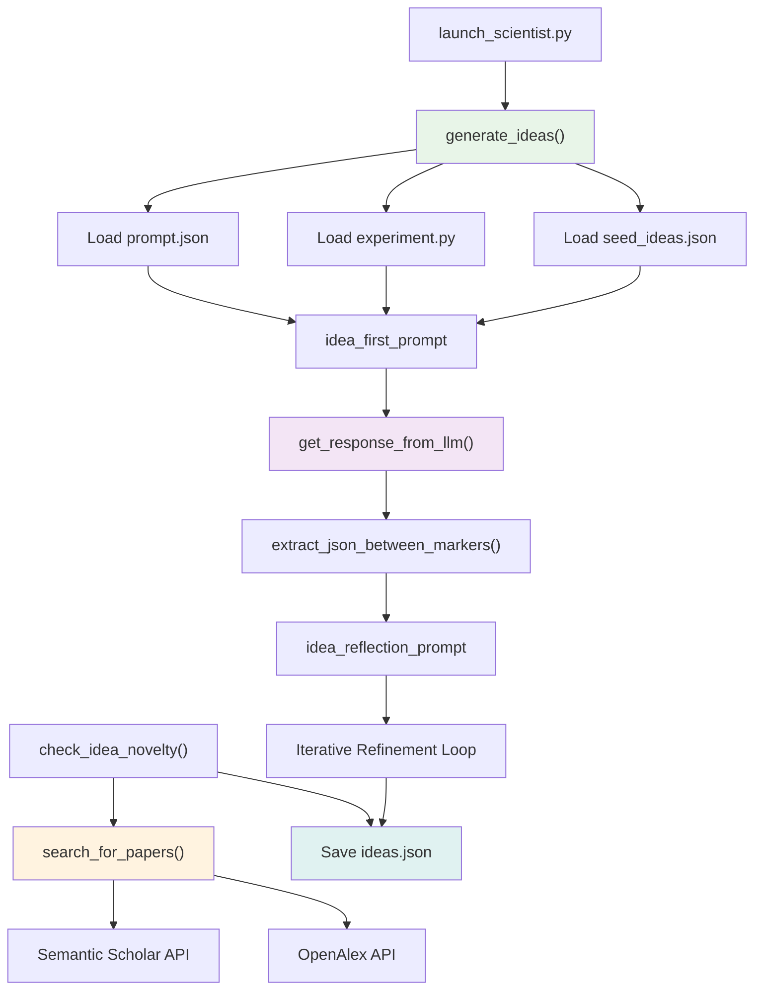

**Idea Generation Workflow**

Sources: [ai_scientist/generate_ideas.py:76-174](), [ai_scientist/generate_ideas.py:405-492]()

## Idea Generation Process

### Primary Generation Function

The `generate_ideas()` function orchestrates the complete idea generation process. It supports both batch generation of multiple ideas and loading of existing ideas when `skip_generation=True` [ai_scientist/generate_ideas.py:84-97]().

| Parameter | Type | Default | Description |
|-----------|------|---------|-------------|
| `base_dir` | str | - | Template directory path |
| `client` | object | - | LLM client from `create_client()` |
| `model` | str | - | Model identifier |
| `skip_generation` | bool | False | Load existing ideas instead of generating |
| `max_num_generations` | int | 20 | Maximum ideas to generate |
| `num_reflections` | int | 5 | Refinement iterations per idea |

### Template Integration

The system integrates with research templates by loading three key files from the `base_dir` [ai_scientist/generate_ideas.py:99-111]():

- **`seed_ideas.json`**: Initial example ideas for the domain.
- **`experiment.py`**: The experimental code that constrains feasible ideas.  
- **`prompt.json`**: Contains the `system` prompt and `task_description` for the domain.

The following diagram maps the relationship between these files and the code entities in the generation script.

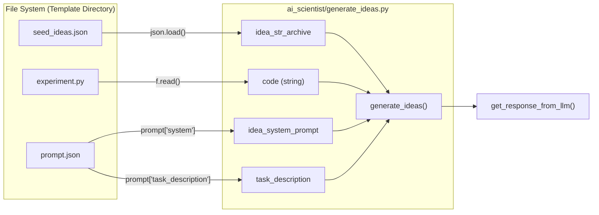

**Template to Code Entity Mapping**

Sources: [ai_scientist/generate_ideas.py:99-131]()

### Idea Refinement Loop

Each generated idea undergoes iterative refinement using the `idea_reflection_prompt` [ai_scientist/generate_ideas.py:54-72](). The system supports up to `num_reflections` iterations, with early termination when the LLM outputs "I am done" [ai_scientist/generate_ideas.py:157-159]().

The refinement process evaluates:
- Quality and feasibility of the implementation.
- Novelty compared to existing ideas.
- Clarity and concision of the proposal.
- Correctness of the JSON format.

Sources: [ai_scientist/generate_ideas.py:137-160]()

### Idea JSON Schema

Generated ideas follow a structured JSON format [ai_scientist/generate_ideas.py:41-47](). An example of this structure can be seen in the output of the diffusion template [example_papers/adaptive_dual_scale_denoising/ideas.json:2-10]().

| Field | Type | Description |
|-------|------|-------------|
| `Name` | string | Lowercase identifier with underscores. |
| `Title` | string | Human-readable title for the idea. |
| `Experiment` | string | Implementation outline and approach. |
| `Interestingness` | integer | Rating from 1-10. |
| `Feasibility` | integer | Rating from 1-10. |
| `Novelty` | integer | Rating from 1-10. |

Sources: [ai_scientist/generate_ideas.py:41-47](), [example_papers/adaptive_dual_scale_denoising/ideas.json:2-10]()

## Novelty Checking

### Literature Search Integration

The system supports automated novelty checking through the `check_idea_novelty()` function, which integrates with academic search APIs to validate idea uniqueness [ai_scientist/generate_ideas.py:405-492]().

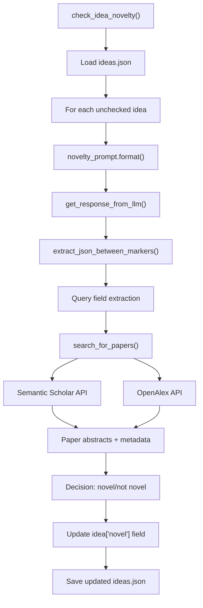

**Novelty Checking Process**

Sources: [ai_scientist/generate_ideas.py:405-492]()

### Supported Search Engines

The `search_for_papers()` function supports two academic search engines [ai_scientist/generate_ideas.py:285-352]():

#### Semantic Scholar
- **API Endpoint**: `https://api.semanticscholar.org/graph/v1/paper/search` [ai_scientist/generate_ideas.py:302]()
- **Authentication**: Optional `S2_API_KEY` environment variable [ai_scientist/generate_ideas.py:12]()
- **Fields Retrieved**: `title`, `authors`, `venue`, `year`, `abstract`, `citationStyles`, `citationCount` [ai_scientist/generate_ideas.py:304]()
- **Rate Limiting**: 1 second delay between requests [ai_scientist/generate_ideas.py:313]()

#### OpenAlex
- **Library**: `pyalex` package.
- **Authentication**: `OPENALEX_MAIL_ADDRESS` environment variable (recommended) [ai_scientist/generate_ideas.py:321-322]().
- **Features**: Abstract length truncation, venue extraction, author list formatting [ai_scientist/generate_ideas.py:333-352]().

Sources: [ai_scientist/generate_ideas.py:285-352]()

## Advanced Features

### Open-Ended Generation

The `generate_next_idea()` function supports incremental idea generation, building upon previous ideas and their success scores [ai_scientist/generate_ideas.py:178-272](). This is used in the experimental open-ended scientist pipeline.

Key differences from batch generation:
- Incorporates score feedback from previous experiments [ai_scientist/generate_ideas.py:228-232]().
- Uses single seed idea initialization if the archive is empty [ai_scientist/generate_ideas.py:191-197]().
- Supports incremental archive building [ai_scientist/generate_ideas.py:263]().

Sources: [ai_scientist/generate_ideas.py:178-272]()

### Error Handling and Resilience

The system implements robust error handling:
- **Backoff Strategy**: Uses `@backoff.on_exception` decorator for API calls [ai_scientist/generate_ideas.py:282-284]().
- **JSON Parsing Failures**: Continues to next attempt on extraction errors [ai_scientist/generate_ideas.py:162-164]().
- **API Rate Limiting**: Implements delays and retry logic for Semantic Scholar [ai_scientist/generate_ideas.py:313]().

Sources: [ai_scientist/generate_ideas.py:282-284](), [ai_scientist/generate_ideas.py:162-164]()

## Configuration and Usage

### Command Line Interface

When run as a standalone script, the module supports several arguments via `argparse` [ai_scientist/generate_ideas.py:495-515]():

| Argument | Type | Default | Description |
|----------|------|---------|-------------|
| `--experiment` | str | "nanoGPT" | Template name to use. |
| `--model` | str | "gpt-4o-2024-05-13" | LLM model identifier. |
| `--skip-idea-generation` | bool | False | Use existing `ideas.json`. |
| `--check-novelty` | bool | False | Enable novelty checking. |

### File Outputs

The system produces the following output files in the template directory:

- **`ideas.json`**: Array of generated ideas with metadata [ai_scientist/generate_ideas.py:171-172]().
- **Backup/Recovery**: Automatic loading of existing ideas when `skip_generation=True` [ai_scientist/generate_ideas.py:84-92]().

Sources: [ai_scientist/generate_ideas.py:495-547]()

---

# Page: Experiment Execution

# Experiment Execution

<details>
<summary>Relevant source files</summary>

The following files were used as context for generating this wiki page:

- [ai_scientist/perform_experiments.py](ai_scientist/perform_experiments.py)
- [example_papers/adaptive_dual_scale_denoising/experiment.py](example_papers/adaptive_dual_scale_denoising/experiment.py)
- [example_papers/adaptive_dual_scale_denoising/run_0/final_info.json](example_papers/adaptive_dual_scale_denoising/run_0/final_info.json)
- [example_papers/adaptive_dual_scale_denoising/run_1.py](example_papers/adaptive_dual_scale_denoising/run_1.py)
- [example_papers/data_augmentation_grokking/experiment.py](example_papers/data_augmentation_grokking/experiment.py)

</details>


This document covers the experiment execution system that runs research experiments after ideas have been generated. The system uses an interactive coder agent to iteratively implement and test experimental variations based on research ideas.

## Purpose and Scope

The experiment execution system manages the automated running of research experiments through an interactive loop between a coder agent and experiment scripts. It handles experiment planning, code modification, execution, result collection, error handling, and visualization generation. The system is designed to be robust with retry mechanisms and timeout handling for reliable automated experimentation.

## Experiment Execution Workflow

The experiment execution follows a structured workflow that combines LLM-driven code generation with automated script execution and result validation.

### Overall Process Flow

```mermaid
flowchart TD
    Start["perform_experiments()"] --> InitPrompt["Initialize coder_prompt with idea details"]
    InitPrompt --> CoderLoop{"Coder Agent Loop<br/>(MAX_ITERS=4)"}
    
    CoderLoop --> CoderRun["coder.run(next_prompt)"]
    CoderRun --> CheckComplete{"Check for<br/>'ALL_COMPLETED'"}
    
    CheckComplete -->|Yes| PlotPhase["Plotting Phase"]
    CheckComplete -->|No| RunExp["run_experiment(folder_name, run)"]
    
    RunExp --> ExpResult{"Experiment<br/>Success?"}
    ExpResult -->|Success| IncRun["Increment run number<br/>Reset current_iter"]
    ExpResult -->|Failure| IncIter["Increment current_iter"]
    
    IncRun --> CheckMaxRuns{"run < MAX_RUNS+1<br/>(MAX_RUNS=5)"}
    IncIter --> CheckMaxIters{"current_iter < MAX_ITERS"}
    
    CheckMaxRuns -->|Yes| CoderLoop
    CheckMaxRuns -->|No| PlotPhase
    CheckMaxIters -->|Yes| CoderLoop
    CheckMaxIters -->|No| Failure["Return False"]
    
    PlotPhase --> PlotLoop["Plot Generation Loop"]
    PlotLoop --> RunPlot["run_plotting(folder_name)"]
    RunPlot --> PlotSuccess{"Plot Success?"}
    PlotSuccess -->|Yes| Notes["Generate notes.txt"]
    PlotSuccess -->|No| PlotRetry{"current_iter < MAX_ITERS"}
    PlotRetry -->|Yes| PlotLoop
    PlotRetry -->|No| Notes
    
    Notes --> Success["Return True"]
```

Sources: [ai_scientist/perform_experiments.py:115-167]()

### Coder Agent Interaction

The system uses a conversational approach with the coder agent, providing structured prompts and processing responses to guide experiment implementation.

```mermaid
graph TD
    subgraph "Coder Prompt Structure"
        InitPrompt["coder_prompt template"]
        Title["idea['Title']"]
        Experiment["idea['Experiment']"]
        MaxRuns["MAX_RUNS limit"]
        Baseline["baseline_results"]
    end
    
    subgraph "Coder Agent Process"
        CoderRun["coder.run(prompt)"]
        CodeMods["Code Modifications"]
        ExpPlan["Experiment Planning"]
    end
    
    subgraph "Experiment Execution"
        CopyCode["Copy experiment.py to run_i.py"]
        RunCmd["python experiment.py --out_dir=run_i"]
        CollectResults["Load final_info.json"]
    end
    
    subgraph "Response Generation"
        Success["Success: Results + Next Steps"]
        Failure["Failure: Error Message + Retry"]
        Timeout["Timeout: Cleanup + Retry"]
    end
    
    InitPrompt --> CoderRun
    Title --> InitPrompt
    Experiment --> InitPrompt
    MaxRuns --> InitPrompt
    Baseline --> InitPrompt
    
    CoderRun --> CodeMods
    CoderRun --> ExpPlan
    
    CodeMods --> CopyCode
    CopyCode --> RunCmd
    RunCmd --> CollectResults
    
    CollectResults --> Success
    RunCmd --> Failure
    RunCmd --> Timeout
    
    Success --> CoderRun
    Failure --> CoderRun
    Timeout --> CoderRun
```

Sources: [ai_scientist/perform_experiments.py:12-26](), [ai_scientist/perform_experiments.py:116-141]()

## Experiment Running Mechanism

The `run_experiment` function handles the core execution logic for individual experimental runs with comprehensive error handling and result collection.

### Experiment Execution Details

| Component | Details |
|-----------|---------|
| **Command Format** | `python experiment.py --out_dir=run_{run_num}` |
| **Timeout** | 7200 seconds (2 hours) default |
| **Working Directory** | Absolute path to experiment folder |
| **Code Backup** | Copies `experiment.py` to `run_{run_num}.py` |
| **Result Format** | JSON file at `run_{run_num}/final_info.json` |
| **Error Handling** | Captures stderr, truncates if > 1500 chars |

### Experiment State Management

```mermaid
stateDiagram-v2
    [*] --> Setup
    Setup --> CopyCode : "Copy experiment.py to run_i.py"
    CopyCode --> Execute : "subprocess.run() with timeout"
    
    Execute --> Success : "returncode == 0"
    Execute --> Failure : "returncode != 0"
    Execute --> TimeoutError : "TimeoutExpired"
    
    Success --> LoadResults : "Read final_info.json"
    LoadResults --> FormatResults : "Extract means from results"
    FormatResults --> NextPrompt : "Generate success prompt"
    
    Failure --> CleanupFail : "Remove failed run directory"
    CleanupFail --> ErrorPrompt : "Generate error prompt with stderr"
    
    TimeoutError --> CleanupTimeout : "Remove timed out run directory"
    CleanupTimeout --> TimeoutPrompt : "Generate timeout prompt"
    
    NextPrompt --> [*]
    ErrorPrompt --> [*]
    TimeoutPrompt --> [*]
```

Sources: [ai_scientist/perform_experiments.py:30-85]()

## Code Entity Interaction

The following diagram bridges the natural language experiment goals with the specific code entities manipulated and executed during the process.

```mermaid
graph LR
    subgraph "Natural Language Space"
        Goal["Experiment Idea/Title"]
        Feedback["Error Messages / Results"]
    end

    subgraph "Code Entity Space"
        PerformExp["perform_experiments()"]
        RunExp["run_experiment()"]
        RunPlot["run_plotting()"]
        ExpPy["experiment.py"]
        PlotPy["plot.py"]
        RunNPy["run_N.py (Snapshot)"]
        FinalJson["final_info.json"]
    end

    Goal --> PerformExp
    PerformExp --> RunExp
    RunExp --> ExpPy
    ExpPy -- "Snapshot" --> RunNPy
    RunExp -- "Executes" --> ExpPy
    ExpPy -- "Generates" --> FinalJson
    FinalJson -- "Parsed by" --> RunExp
    RunExp --> Feedback
    PerformExp --> RunPlot
    RunPlot -- "Executes" --> PlotPy
```

Sources: [ai_scientist/perform_experiments.py:30-85](), [ai_scientist/perform_experiments.py:115-167]()

## Plotting and Visualization

After successful experiment completion, the system generates visualizations through an interactive plotting phase.

### Plotting Process

The plotting phase follows a similar interactive pattern with the coder agent but focuses on visualization generation and documentation.

```mermaid
sequenceDiagram
    participant Coder as "Coder Agent"
    participant System as "Experiment System"
    participant PlotScript as "plot.py"
    participant Results as "Generated Plots"
    
    System->>Coder: "Modify plot.py with labels dictionary"
    Coder->>System: "Updated plot.py code"
    System->>PlotScript: "python plot.py"
    
    alt Plot Success
        PlotScript->>Results: "Generate visualization files"
        Results->>System: "returncode == 0"
        System->>Coder: "Success - proceed to notes"
    else Plot Failure
        PlotScript->>System: "returncode != 0, stderr"
        System->>Coder: "Error message for retry"
        Coder->>System: "Fixed plot.py code"
        System->>PlotScript: "python plot.py (retry)"
    end
    
    System->>Coder: "Update notes.txt with plot descriptions"
    Coder->>System: "Detailed notes for writeup"
```

### Plotting Configuration

| Setting | Value | Purpose |
|---------|-------|---------|
| **Timeout** | 600 seconds | Prevent hanging on complex plots |
| **Max Iterations** | 4 (MAX_ITERS) | Limit retry attempts |
| **Labels Dictionary** | Required | Maps run numbers to display names |
| **Output Format** | Plot files + notes.txt | Visualization + documentation |

Sources: [ai_scientist/perform_experiments.py:87-113](), [ai_scientist/perform_experiments.py:144-165]()

## Configuration and Limits

The experiment execution system uses several configurable constants to control resource usage and execution behavior.

### System Limits

```mermaid
graph LR
    subgraph "Iteration Control"
        MaxIters["MAX_ITERS = 4<br/>Max retries per experiment"]
        MaxRuns["MAX_RUNS = 5<br/>Max total experiments"]
    end
    
    subgraph "Output Control"
        MaxStderr["MAX_STDERR_OUTPUT = 1500<br/>Max error message length"]
    end
    
    subgraph "Timeout Control"
        ExpTimeout["Experiment: 7200s (2h)"]
        PlotTimeout["Plotting: 600s (10m)"]
    end
    
    MaxIters --> RetryLogic["Retry Logic"]
    MaxRuns --> ExperimentLoop["Experiment Loop"]
    MaxStderr --> ErrorHandling["Error Message Truncation"]
    ExpTimeout --> ProcessTimeout["Process Management"]
    PlotTimeout --> PlotTimeout["Plot Generation"]
```

### Error Handling Strategy

The system implements a multi-layered error handling approach:

1. **Process-level**: Captures subprocess return codes and stderr [ai_scientist/perform_experiments.py:45-53]().
2. **Timeout-level**: Uses subprocess timeout to prevent hanging [ai_scientist/perform_experiments.py:79-84]().
3. **Iteration-level**: Retry logic with `MAX_ITERS` limit per operation [ai_scientist/perform_experiments.py:127-129]().
4. **Run-level**: `MAX_RUNS` limit for total experiment attempts [ai_scientist/perform_experiments.py:126]().
5. **Cleanup**: Automatic removal of failed experiment directories [ai_scientist/perform_experiments.py:54-55]().

Sources: [ai_scientist/perform_experiments.py:8-11](), [ai_scientist/perform_experiments.py:44-84]()

## Integration Points

The experiment execution system integrates with several other components of the AI Scientist pipeline:

- **Input**: Receives idea dictionaries from idea generation phase.
- **Coder Agent**: Uses the coder interface for interactive code modification [ai_scientist/perform_experiments.py:130]().
- **Template System**: Operates on template-specific `experiment.py` and `plot.py` files.
- **Output**: Produces experimental results (e.g., `final_info.json`) and plots for paper writing phase [ai_scientist/perform_experiments.py:62-64]().
- **File System**: Manages run directories, code backups (`run_N.py`), and result files [ai_scientist/perform_experiments.py:33-36]().

The system is designed to be template-agnostic, working with any template that provides the required `experiment.py` and `plot.py` interface.

Sources: [ai_scientist/perform_experiments.py:1-167]()

---

# Page: Paper Writing

# Paper Writing

<details>
<summary>Relevant source files</summary>

The following files were used as context for generating this wiki page:

- [ai_scientist/perform_writeup.py](ai_scientist/perform_writeup.py)
- [example_papers/adaptive_dual_scale_denoising/latex/fancyhdr.sty](example_papers/adaptive_dual_scale_denoising/latex/fancyhdr.sty)
- [example_papers/adaptive_dual_scale_denoising/latex/iclr2024_conference.sty](example_papers/adaptive_dual_scale_denoising/latex/iclr2024_conference.sty)
- [example_papers/adaptive_dual_scale_denoising/latex/references.bib](example_papers/adaptive_dual_scale_denoising/latex/references.bib)
- [example_papers/adaptive_dual_scale_denoising/latex/template.tex](example_papers/adaptive_dual_scale_denoising/latex/template.tex)

</details>


This document covers the automated paper writing system that generates complete academic papers in LaTeX format, including citation management and compilation. The system takes experimental results and generates publication-ready scientific papers through multi-stage LLM interactions.

For information about experiment execution that precedes paper writing, see [Experiment Execution](2.4). For information about paper review that follows paper writing, see [Paper Review](2.6).

## System Overview

The paper writing system is implemented in `perform_writeup.py` and serves as the third major component in the AI Scientist pipeline. It transforms experimental results and notes into complete academic papers by orchestrating multiple LLM interactions through the Aider coding assistant framework.

The system generates papers section-by-section, performs automated citation searches, validates LaTeX syntax, and compiles the final PDF output. It includes sophisticated error checking, reference validation, and iterative refinement processes.

## Paper Writing Workflow

The paper writing process follows a structured multi-stage approach:

#### Paper Writing Pipeline Flow

```mermaid
flowchart TD
    A["perform_writeup()"] --> B["Write Title & Abstract"]
    B --> C["Section-by-Section Writing"]
    C --> D["Introduction"]
    D --> E["Background"]
    E --> F["Method"]
    F --> G["Experimental Setup"]
    G --> H["Results"]
    H --> I["Conclusion"]
    I --> J["Sketch Related Work"]
    J --> K["Citation Management Loop"]
    K --> L["get_citation_aider_prompt()"]
    L --> M["search_for_papers()"]
    M --> N["Add Citations to template.tex"]
    N --> O{More Citations Needed?}
    O -->|Yes| L
    O -->|No| P["Refinement Loop"]
    P --> Q["Second Refinement Pass"]
    Q --> R["generate_latex()"]
    R --> S["compile_latex()"]
    S --> T["Final PDF Output"]
    
    style A fill:#e3f2fd
    style K fill:#fff3e0
    style R fill:#f1f8e9
    style T fill:#e8f5e8
```

Sources: [ai_scientist/perform_writeup.py:401-513]()

## Core Components

### LaTeX Generation and Compilation

The `generate_latex()` function handles LaTeX processing, error checking, and PDF compilation:

#### LaTeX Processing System

```mermaid
flowchart TB
    A["generate_latex()"] --> B["Reference Validation"]
    B --> C["Check citations in template.tex"]
    C --> D["Validate references.bib entries"]
    D --> E["Figure Validation"]
    E --> F["Check includegraphics paths"]
    F --> G["Validate figure files exist"]
    G --> H["Duplicate Detection"]
    H --> I["Remove duplicate figures"]
    I --> J["Remove duplicate sections"]
    J --> K["LaTeX Error Correction Loop"]
    K --> L["Run chktex validation"]
    L --> M{Errors Found?}
    M -->|Yes| N["Coder fixes errors"]
    N --> L
    M -->|No| O["compile_latex()"]
    O --> P["pdflatex + bibtex sequence"]
    P --> Q["Move template.pdf to final location"]
    
    style A fill:#e3f2fd
    style K fill:#fff3e0
    style O fill:#f1f8e9
```

The system performs comprehensive validation including:
- Citation consistency checking using regex patterns `\\cite[a-z]*{([^}]*)}` [ai_scientist/perform_writeup.py:23-23]()
- Figure reference validation against actual PNG files in the directory [ai_scientist/perform_writeup.py:44-51]()
- Duplicate detection for figures and section headers [ai_scientist/perform_writeup.py:53-75]()
- LaTeX syntax validation using `chktex` with filtered error checking [ai_scientist/perform_writeup.py:78-90]()

Sources: [ai_scientist/perform_writeup.py:15-92](), [ai_scientist/perform_writeup.py:94-128]()

### Citation Management System

The citation system automatically searches for and integrates relevant papers into the bibliography. It identifies gaps in the current draft and uses the `search_for_papers` utility to find matches on Semantic Scholar or OpenAlex.

#### Citation Search and Integration Flow

```mermaid
flowchart TD
    A["Citation Loop in perform_writeup()"] --> B["get_citation_aider_prompt()"]
    B --> C["citation_first_prompt"]
    C --> D["LLM identifies needed citations"]
    D --> E["Extract JSON with Query field"]
    E --> F["search_for_papers()"]
    F --> G["Semantic Scholar / OpenAlex API"]
    G --> H["Return top 10 papers"]
    H --> I["citation_second_prompt"]
    I --> J["LLM selects relevant papers"]
    J --> K["Extract Selected indices"]
    K --> L["Get bibtex from citationStyles"]
    L --> M["Insert into references.bib"]
    M --> N["Coder integrates citations"]
    N --> O{More rounds needed?}
    O -->|Yes| B
    O -->|No| P["Citation complete"]
    
    style B fill:#e3f2fd
    style F fill:#fff3e0
    style M fill:#f1f8e9
```

The citation system uses structured prompts to:
- Identify citation gaps in the draft paper [ai_scientist/perform_writeup.py:302-315]()
- Generate appropriate search queries [ai_scientist/perform_writeup.py:317-328]()
- Select relevant papers from search results [ai_scientist/perform_writeup.py:348-369]()
- Automatically integrate bibtex entries and in-text citations [ai_scientist/perform_writeup.py:382-398]()

Sources: [ai_scientist/perform_writeup.py:296-398](), [ai_scientist/perform_writeup.py:464-482]()

### Section Writing Framework

Each paper section is written using specialized prompts stored in the `per_section_tips` dictionary:

| Section | Key Focus Areas |
|---------|----------------|
| Abstract | TL;DR, problem statement, contribution, verification [ai_scientist/perform_writeup.py:131-139]() |
| Introduction | Extended abstract with bullet-point contributions [ai_scientist/perform_writeup.py:140-148]() |
| Related Work | Compare/contrast with academic siblings [ai_scientist/perform_writeup.py:149-153]() |
| Background | Academic ancestors, problem setting, formalism [ai_scientist/perform_writeup.py:154-158]() |
| Method | Technical approach using established formalism [ai_scientist/perform_writeup.py:159-161]() |
| Experimental Setup | Dataset, metrics, hyperparameters, implementation [ai_scientist/perform_writeup.py:162-166]() |
| Results | Actual experimental results with statistics [ai_scientist/perform_writeup.py:167-175]() |
| Conclusion | Brief recap and future work [ai_scientist/perform_writeup.py:176-180]() |

The system uses two refinement passes:
1. `refinement_prompt` - focuses on error correction and completeness [ai_scientist/perform_writeup.py:197-205]()
2. `second_refinement_prompt` - emphasizes conciseness and integration [ai_scientist/perform_writeup.py:206-217]()

Sources: [ai_scientist/perform_writeup.py:130-180](), [ai_scientist/perform_writeup.py:197-217]()

## Error Detection and Validation

The system includes comprehensive error checking through the `error_list` specification [ai_scientist/perform_writeup.py:182-195]():

#### Validation Categories

```mermaid
mindmap
  root)["Error Detection"]
    ["LaTeX Syntax"]
      ["Unenclosed math symbols"]
      ["Incorrect environment closing"]
      ["Unescaped symbols"]
    ["References"]
      ["Invalid figure references"]
      ["Missing bib entries"]
      ["Repeated figure labels"]
    ["Content"]
      ["Hallucinated results"]
      ["Missing experimental data"]
      ["Unnecessary verbosity"]
    ["Structure"]
      ["Duplicate headers"]
      ["Unclosed environments"]
      ["Missing figures"]
```

The validation system checks for:
- LaTeX syntax errors through `chktex` integration [ai_scientist/perform_writeup.py:80-88]()
- Reference integrity between citations and bibliography [ai_scientist/perform_writeup.py:20-40]()
- Figure availability and proper referencing [ai_scientist/perform_writeup.py:42-63]()
- Content accuracy against experimental logs
- Structural consistency in document organization [ai_scientist/perform_writeup.py:65-75]()

Sources: [ai_scientist/perform_writeup.py:182-195]()

## Integration Points

### Aider Framework Integration

The system integrates with the Aider coding assistant framework to perform the actual file modifications:

```mermaid
flowchart LR
    A["perform_writeup()"] --> B["Coder.create()"]
    B --> C["main_model selection"]
    C --> D["File management"]
    D --> E["exp_file, writeup_file, notes"]
    E --> F["InputOutput with chat_history"]
    F --> G["coder.run() interactions"]
    G --> H["SEARCH/REPLACE blocks"]
    H --> I["template.tex modifications"]
    
    style A fill:#e3f2fd
    style G fill:#fff3e0
    style I fill:#f1f8e9
```

The integration handles:
- Model selection for different LLM providers [ai_scientist/perform_writeup.py:539-551]()
- File management for experiment files, LaTeX templates, and notes [ai_scientist/perform_writeup.py:560-565]()
- Chat history preservation for debugging and reproducibility [ai_scientist/perform_writeup.py:553-558]()
- Structured editing through SEARCH/REPLACE block format via `coder.run()` [ai_scientist/perform_writeup.py:421-460]()

Sources: [ai_scientist/perform_writeup.py:515-580]()

### LLM Provider Integration

The system supports multiple LLM providers through the unified client interface:

- **Writing Model**: Used for section writing and refinement via Aider [ai_scientist/perform_writeup.py:401-403]()
- **Citation Model**: Used for citation search and selection [ai_scientist/perform_writeup.py:464-465]()
- **Engine Selection**: Supports `semanticscholar` and `openalex` for paper search [ai_scientist/perform_writeup.py:535-537]()

The separation allows for different model optimization - citation tasks may use different models than creative writing tasks.

Sources: [ai_scientist/perform_writeup.py:401-403](), [ai_scientist/perform_writeup.py:539]()

## Configuration and Usage

The system supports several operational modes:

| Parameter | Purpose | Default |
|-----------|---------|---------|
| `--folder` | Target experiment directory | Required |
| `--no-writing` | PDF generation only mode | False |
| `--model` | LLM model selection | `gpt-4o-2024-05-13` |
| `--engine` | Citation search engine | `semanticscholar` |

The `--no-writing` flag enables PDF compilation without content generation, useful for testing LaTeX compilation or regenerating PDFs from existing content [ai_scientist/perform_writeup.py:582-588]().

Sources: [ai_scientist/perform_writeup.py:521-537]()

---

# Page: Paper Review

# Paper Review

<details>
<summary>Relevant source files</summary>

The following files were used as context for generating this wiki page:

- [ai_scientist/fewshot_examples/132_automated_relational.json](ai_scientist/fewshot_examples/132_automated_relational.json)
- [ai_scientist/fewshot_examples/2_carpe_diem.json](ai_scientist/fewshot_examples/2_carpe_diem.json)
- [ai_scientist/fewshot_examples/attention.json](ai_scientist/fewshot_examples/attention.json)
- [ai_scientist/perform_review.py](ai_scientist/perform_review.py)

</details>


The Paper Review component implements an automated peer review system that evaluates generated research papers using LLMs. The system employs few-shot learning, ensemble methods, and meta-review aggregation to produce structured critiques similar to academic conference reviews.

## Overview

The Paper Review system operates as the final quality control step in the AI Scientist pipeline. The core functionality is implemented in `ai_scientist/perform_review.py` and provides:

1. PDF text extraction using multiple fallback methods (`load_paper`)
2. Few-shot learning from example papers and reviews (`get_review_fewshot_examples`)
3. Ensemble review generation with multiple LLM calls (`perform_review`)
4. Meta-review aggregation from multiple individual reviews (`get_meta_review`)
5. Iterative reflection and refinement mechanisms
6. Structured JSON output following NeurIPS review format

The system can generate both positive and negative biased reviews using different system prompts, and supports configurable ensemble sizes, reflection iterations, and few-shot example counts.

## Core Review Process Flow

The following diagram illustrates the data flow from a PDF file to a final structured review, highlighting the key functions in `ai_scientist/perform_review.py`.

```mermaid
flowchart TD
    A["paper.pdf"] --> B["load_paper()"]
    B --> C["PDF text extraction<br/>pymupdf4llm → pymupdf → pypdf"]
    C --> D["get_review_fewshot_examples()"]
    D --> E["Load example papers<br/>fewshot_papers[]"]
    E --> F["perform_review()"]
    
    subgraph "Review Generation"
        F --> G{{"num_reviews_ensemble > 1?"}}
        G -->|"Yes"| H["get_batch_responses_from_llm()"]
        G -->|"No"| I["get_response_from_llm()"]
        H --> J["Multiple reviews generated"]
        J --> K["get_meta_review()"]
        K --> L["Aggregated meta-review"]
        I --> M["Single review"]
        L --> N["extract_json_between_markers()"]
        M --> N
    end
    
    N --> O{{"num_reflections > 1?"}}
    O -->|"Yes"| P["reviewer_reflection_prompt"]
    P --> Q["Iterative refinement"]
    Q --> R["Final JSON review"]
    O -->|"No"| R
    
    R --> S["review.txt saved"]

    classDef function stroke:#333,stroke-width:2px
    classDef data stroke:#333,stroke-width:1px
    classDef decision stroke:#333,stroke-width:1px
    
    class B,D,F,H,I,K,N function
    class A,C,E,J,L,M,R,S data
    class G,O decision
```

Sources: [ai_scientist/perform_review.py:126-243](), [ai_scientist/perform_review.py:267-298]()

## Key Components and Functions

The Paper Review system implements several core functions that handle different aspects of the review process, bridging the gap between raw PDF data and structured LLM responses.

```mermaid
graph TD
    subgraph "PDF Processing"
        A["load_paper()"] --> B["pymupdf4llm.to_markdown()"]
        B --> C["pymupdf fallback"]
        C --> D["pypdf fallback"]
    end
    
    subgraph "Few-Shot Learning"
        E["get_review_fewshot_examples()"] --> F["fewshot_papers[]<br/>132_automated_relational.pdf<br/>attention.pdf<br/>2_carpe_diem.pdf"]
        F --> G["fewshot_reviews[]<br/>*.json files"]
        G --> H["Concatenated examples"]
    end
    
    subgraph "Review Generation"
        I["perform_review()"] --> J["reviewer_system_prompt_neg/pos"]
        J --> K["neurips_form + template_instructions"]
        I --> L["get_batch_responses_from_llm()"]
        I --> M["get_response_from_llm()"]
        L --> N["extract_json_between_markers()"]
        M --> N
    end
    
    subgraph "Meta-Review System"
        O["get_meta_review()"] --> P["meta_reviewer_system_prompt"]
        P --> Q["Aggregate multiple reviews"]
        Q --> R["Average numerical scores"]
    end
    
    subgraph "Improvement System"
        S["perform_improvement()"] --> T["improvement_prompt"]
        T --> U["coder.run()"]
    end

    classDef function stroke:#333,stroke-width:2px
    classDef data stroke:#333,stroke-width:1px
    
    class A,E,I,O,S function
    class B,C,D,F,G,H,J,K,L,M,N,P,Q,R,T,U data
```

### Core Function Descriptions

| Function | Purpose | Key Parameters | Output |
|----------|---------|----------------|--------|
| `load_paper()` | Extract text from PDF using multiple methods | `pdf_path`, `num_pages`, `min_size` | Extracted text string |
| `perform_review()` | Generate structured review using LLM | `text`, `model`, `num_reflections`, `num_fs_examples`, `num_reviews_ensemble` | JSON review dictionary |
| `get_review_fewshot_examples()` | Load few-shot training examples | `num_fs_examples` | Formatted prompt string |
| `get_meta_review()` | Aggregate multiple reviews into meta-review | `model`, `client`, `reviews` | Aggregated JSON review |
| `perform_improvement()` | Improve paper based on review feedback | `review`, `coder` | Modified paper output |

Sources: [ai_scientist/perform_review.py:267-298](), [ai_scientist/perform_review.py:126-243](), [ai_scientist/perform_review.py:323-352](), [ai_scientist/perform_review.py:361-383](), [ai_scientist/perform_review.py:386-396]()

## Few-Shot Learning Approach

The review system uses few-shot learning with three specific example papers and their corresponding reviews to guide the LLM's output style and critical depth.

```mermaid
graph TD
    subgraph "Few-Shot Examples"
        A["fewshot_papers[]"] --> B["132_automated_relational.pdf"]
        A --> C["attention.pdf"] 
        A --> D["2_carpe_diem.pdf"]
        
        E["fewshot_reviews[]"] --> F["132_automated_relational.json"]
        E --> G["attention.json"]
        E --> H["2_carpe_diem.json"]
    end
    
    subgraph "Example Processing"
        I["get_review_fewshot_examples()"] --> J["Load paper text"]
        J --> K["Load review JSON"]
        K --> L["Format as prompt"]
        L --> M["Sample reviews, copied from previous machine learning conferences"]
    end
    
    B --> I
    C --> I
    D --> I
    F --> I
    G --> I
    H --> I

    classDef data stroke:#333,stroke-width:1px
    classDef function stroke:#333,stroke-width:2px
    
    class A,B,C,D,E,F,G,H,M data
    class I,J,K,L function
```

The system dynamically loads examples based on the `num_fs_examples` parameter. For each example:
1. It loads the paper text (preferring cached `.txt` files over PDF extraction) [ai_scientist/perform_review.py:323-338]().
2. It loads the corresponding review JSON (e.g., [ai_scientist/fewshot_examples/attention.json:1-3]()).
3. It formats both as a paper-review pair in the prompt.
4. It concatenates multiple examples to provide context for the LLM [ai_scientist/perform_review.py:347-352]().

Sources: [ai_scientist/perform_review.py:310-352](), [ai_scientist/fewshot_examples/132_automated_relational.json:1-3](), [ai_scientist/fewshot_examples/2_carpe_diem.json:1-3](), [ai_scientist/fewshot_examples/attention.json:1-3]()

## Ensemble Review and Meta-Review System

When `num_reviews_ensemble > 1`, the system generates multiple independent reviews and aggregates them using an "Area Chair" persona.

```mermaid
flowchart TD
    A["perform_review()"] --> B{{"num_reviews_ensemble > 1?"}}
    B -->|"Yes"| C["get_batch_responses_from_llm()"]
    C --> D["Generate N independent reviews<br/>temperature=0.75 for diversity"]
    D --> E["extract_json_between_markers()"]
    E --> F["parsed_reviews[]"]
    
    F --> G["get_meta_review()"]
    G --> H["meta_reviewer_system_prompt<br/>Area Chair simulation"]
    H --> I["Aggregate review content"]
    I --> J["Average numerical scores<br/>Originality, Quality, Clarity, etc."]
    
    B -->|"No"| K["Single review generation"]
    
    J --> L["Final aggregated review"]
    K --> L

    classDef function stroke:#333,stroke-width:2px
    classDef data stroke:#333,stroke-width:1px
    classDef decision stroke:#333,stroke-width:1px
    
    class A,C,E,G function
    class D,F,H,I,J,K,L data
    class B decision
```

The meta-review process in `get_meta_review`:
1. **Multiple Reviews**: Generates `num_reviews_ensemble` independent reviews with a temperature of 0.75 to ensure diversity [ai_scientist/perform_review.py:151-175]().
2. **Parsing**: Uses `extract_json_between_markers` to isolate the JSON content [ai_scientist/perform_review.py:176-192]().
3. **Meta-Reviewer**: Employs `meta_reviewer_system_prompt` to simulate an Area Chair aggregating findings [ai_scientist/perform_review.py:361-383]().
4. **Score Averaging**: Calculates the mean for numerical fields like Soundness, Contribution, and Overall score [ai_scientist/perform_review.py:377-383]().

Sources: [ai_scientist/perform_review.py:151-192](), [ai_scientist/perform_review.py:361-383]()

## Reflection and Iterative Refinement

The system supports iterative review refinement through a reflection loop.

| Parameter | Description | Default Range |
|-----------|-------------|---------------|
| `num_reflections` | Number of reflection iterations | 1 (configurable) |
| `reviewer_reflection_prompt` | Prompt for self-improvement | Fixed template |
| Convergence check | "I am done" detection | Automatic termination |

The reflection process asks the LLM to:
1. Evaluate the accuracy and soundness of its previous review.
2. Consider additional important factors.
3. Refine and improve the review while maintaining its spirit.
4. Optionally terminate early with the phrase "I am done" [ai_scientist/perform_review.py:222-264]().

Sources: [ai_scientist/perform_review.py:222-238](), [ai_scientist/perform_review.py:246-264]()

## Review Structure and Output Format

The system generates structured reviews following a strict schema defined in `template_instructions` and `neurips_form`.

```mermaid
graph TD
    subgraph "Review Format Structure"
        A["THOUGHT:<br/><THOUGHT>"] --> B["Note-taking phase<br/>Intuitions and reasoning"]
        B --> C["REVIEW JSON:<br/>```json<br/><JSON><br/>```"]
    end
    
    subgraph "JSON Fields"
        D["Summary"] --> E["Paper content and contributions"]
        F["Strengths"] --> G["List of paper strengths"]
        H["Weaknesses"] --> I["List of paper weaknesses"]
        J["Questions"] --> K["Clarifying questions for authors"]
        L["Limitations"] --> M["Limitations and negative impacts"]
        N["Ethical Concerns"] --> O["Boolean flag"]
    end
    
    subgraph "Numerical Ratings"
        P["Originality: 1-4<br/>(low, medium, high, very high)"]
        Q["Quality: 1-4<br/>(low, medium, high, very high)"] 
        R["Clarity: 1-4<br/>(low, medium, high, very high)"]
        S["Significance: 1-4<br/>(low, medium, high, very high)"]
        T["Soundness: 1-4<br/>(poor, fair, good, excellent)"]
        U["Presentation: 1-4<br/>(poor, fair, good, excellent)"]
        V["Contribution: 1-4<br/>(poor, fair, good, excellent)"]
        W["Overall: 1-10<br/>(very strong reject to award quality)"]
        X["Confidence: 1-5<br/>(low, medium, high, very high, absolute)"]
        Y["Decision: Accept/Reject<br/>(binary decision only)"]
    end

    classDef text stroke:#333,stroke-width:1px
    classDef rating stroke:#333,stroke-width:2px
    
    class A,B,C,D,E,F,G,H,I,J,K,L,M,N,O text
    class P,Q,R,S,T,U,V,W,X,Y rating
```

### Complete Review Field Specification

The `Decision` field is restricted to "Accept" or "Reject" to avoid ambiguity [ai_scientist/perform_review.py:59-61]().

| Field | Type | Range | Description |
|-------|------|-------|-------------|
| `Summary` | String | - | Brief paper summary and contributions |
| `Strengths` | List | - | Key strengths of the paper |
| `Weaknesses` | List | - | Key weaknesses of the paper |
| `Originality` | Integer | 1-4 | Novelty assessment (low to very high) |
| `Quality` | Integer | 1-4 | Technical quality (low to very high) |
| `Clarity` | Integer | 1-4 | Writing clarity (low to very high) |
| `Significance` | Integer | 1-4 | Impact assessment (low to very high) |
| `Questions` | List | - | Clarifying questions for authors |
| `Limitations` | List | - | Work limitations and negative impacts |
| `Ethical Concerns` | Boolean | - | Whether ethical issues exist |
| `Soundness` | Integer | 1-4 | Technical correctness (poor to excellent) |
| `Presentation` | Integer | 1-4 | Writing quality (poor to excellent) |
| `Contribution` | Integer | 1-4 | Research contribution (poor to excellent) |
| `Overall` | Integer | 1-10 | Overall score (1: Strong Reject, 10: Award) |
| `Confidence` | Integer | 1-5 | Reviewer confidence (low to absolute) |
| `Decision` | String | Accept/Reject | Binary decision |

Sources: [ai_scientist/perform_review.py:27-63](), [ai_scientist/perform_review.py:65-123]()

## System Prompts and Reviewer Behavior

The system uses different reviewer personas to generate varied review perspectives, including biased prompts to explore the decision boundary.

| Prompt Type | Purpose | Key Characteristics |
|-------------|---------|-------------------|
| `reviewer_system_prompt_base` | Base reviewer identity | "AI researcher", "prestigious ML venue", "critical and cautious" |
| `reviewer_system_prompt_neg` | Negative bias reviewer | "If bad or unsure, give bad scores and reject" |
| `reviewer_system_prompt_pos` | Positive bias reviewer | "If good or unsure, give good scores and accept" |
| `meta_reviewer_system_prompt` | Area Chair simulation | "Aggregate reviews", "find consensus", "respect all reviewers" |

Sources: [ai_scientist/perform_review.py:13-25](), [ai_scientist/perform_review.py:361-370]()

## Paper Improvement Integration

The `perform_improvement()` function integrates the review feedback back into the research cycle by providing the coder agent with specific critique.

```mermaid
flowchart TD
    A["review JSON"] --> B["perform_improvement()"]
    B --> C["improvement_prompt<br/>format review as string"]
    C --> D["coder.run()"]
    D --> E["LaTeX source modifications"]
    
    subgraph "Improvement Prompt"
        F["The following review has been created<br/>for your research paper:"]
        G["review JSON dump"]
        H["Improve the text using the review."]
        F --> G
        G --> H
    end
    
    C --> F

    classDef function stroke:#333,stroke-width:2px
    classDef data stroke:#333,stroke-width:1px
    
    class B,D function
    class A,C,E,F,G,H data
```

The process takes the structured review JSON and instructs the coder to "Improve the text using the review" [ai_scientist/perform_review.py:386-396]().

Sources: [ai_scientist/perform_review.py:386-396]()

---

# Page: Templates and Data

# Templates and Data

<details>
<summary>Relevant source files</summary>

The following files were used as context for generating this wiki page:

- [data/enwik8/prepare.py](data/enwik8/prepare.py)
- [data/shakespeare_char/prepare.py](data/shakespeare_char/prepare.py)
- [data/shakespeare_char/readme.md](data/shakespeare_char/readme.md)
- [data/text8/prepare.py](data/text8/prepare.py)
- [example_papers/adaptive_dual_scale_denoising/prompt.json](example_papers/adaptive_dual_scale_denoising/prompt.json)

</details>


## Purpose and Scope

This document provides a high-level overview of the template system and data preparation infrastructure within **The AI Scientist**. Templates define the specific research boundaries and starting codebases for the AI, while the data scripts provide the necessary character-level or numerical datasets required for experiments.

The system is designed to be modular: by swapping a template, the AI transitions from researching transformer optimization to diffusion models or epidemiology.

## 3.1 Template System

Templates are the "DNA" of a research project in this framework. They provide the LLM with a foundational codebase, a task description, and a set of initial ideas to kickstart the evolutionary research process.

### Template Structure
A standard template directory (e.g., `templates/2d_diffusion/`) contains:
*   `experiment.py`: The core executable script that the AI modifies to test hypotheses. It must accept an `--out_dir` argument [example_papers/adaptive_dual_scale_denoising/prompt.json:3-3]().
*   `plot.py`: A script used to visualize results from `run_n` directories.
*   `prompt.json`: Contains the `system` role and `task_description` that defines the research goal for the AI PhD student agent [example_papers/adaptive_dual_scale_denoising/prompt.json:1-4]().
*   `seed_ideas.json`: A collection of initial research directions to prime the `generate_ideas.py` module.
*   `latex/`: A directory containing `template.tex` and necessary style files for paper generation.

For details on how these files interact, see [Template System](#3.1).

**Sources:** [example_papers/adaptive_dual_scale_denoising/prompt.json:1-4]()

## 3.2 Data Preparation Scripts

Before running experiments in domains like Language Modeling, the raw data must be preprocessed into binary formats for efficient loading. The `data/` directory contains standalone scripts to fetch and encode datasets.

### Character-Level Modeling Pipeline
The system focuses on character-level encoding rather than BPE to simplify the vocabulary for the AI's experiments.

```mermaid
graph LR
    subgraph "External Sources"
        URL1["Matt Mahoney (enwik8)"]
        URL2["Karpathy/char-rnn (Shakespeare)"]
    end

    subgraph "Data Preparation Scripts"
        P1["data/enwik8/prepare.py"]
        P2["data/shakespeare_char/prepare.py"]
        P3["data/text8/prepare.py"]
    end

    subgraph "Binary Artifacts"
        B1["train.bin / val.bin"]
        M1["meta.pkl (stoi/itos)"]
    end

    URL1 --> P1
    URL2 --> P2
    P1 & P2 & P3 --> B1
    P1 & P2 & P3 --> M1
    B1 & M1 --> EXP["templates/nanoGPT/experiment.py"]
```

### Key Datasets
*   **enwik8**: The first 10^8 bytes of Wikipedia. The script `data/enwik8/prepare.py` downloads, unzips, and splits it into train/val/test [data/enwik8/prepare.py:12-57]().
*   **Shakespeare**: A smaller character-level dataset (`input.txt`) used for rapid prototyping [data/shakespeare_char/prepare.py:12-21]().
*   **text8**: A cleaned version of Wikipedia text, processed similarly to enwik8 [data/text8/prepare.py:1-25]().

For details on dataset splits and encoding logic, see [Data Preparation Scripts](#3.2).

**Sources:** [data/enwik8/prepare.py:1-75](), [data/shakespeare_char/prepare.py:1-61](), [data/text8/prepare.py:1-76]()

## 3.3 Available Templates

The repository includes a variety of templates covering different scientific and machine learning domains. These are categorized into "Core" templates provided by the authors and "Community" templates added via contributions.

### Core Templates
*   **NanoGPT / NanoGPT Lite**: Focused on transformer architectures and character-level language modeling.
*   **2D Diffusion**: Researching denoising diffusion probabilistic models (DDPM) on low-dimensional datasets [example_papers/adaptive_dual_scale_denoising/prompt.json:3-3]().
*   **Grokking**: Investigating sudden generalization in neural networks.

### Community Templates
The ecosystem has expanded to include specialized domains:
*   **MACE**: Quantum chemistry and interatomic potentials.
*   **SEIR**: Epidemiological modeling for disease spread.
*   **Earthquake Prediction**: Seismological data analysis.
*   **TensoRF**: Neural Radiance Fields (NeRF) optimization.

### System Mapping: Natural Language to Code Entities

This table bridges the research goals defined in `prompt.json` to the actual files the AI manipulates.

| Research Goal (Natural Language) | Code Entity (Implementation) | File Path |
| :--- | :--- | :--- |
| "Controllable generation" | `DiffusionModel` class | `templates/2d_diffusion/experiment.py` |
| "Character-level LM" | `stoi` / `itos` mappings | `data/enwik8/meta.pkl` |
| "Paper Writeup" | `latex/template.tex` | `templates/{name}/latex/` |
| "Idea Seed" | `seed_ideas.json` | `templates/{name}/seed_ideas.json` |

For a full catalog of all available templates and their specific requirements, see [Available Templates](#3.3).

**Sources:** [example_papers/adaptive_dual_scale_denoising/prompt.json:1-4](), [data/enwik8/prepare.py:69-73](), [data/shakespeare_char/prepare.py:55-59]()

---

# Page: Template System

# Template System

<details>
<summary>Relevant source files</summary>

The following files were used as context for generating this wiki page:

- [example_papers/adaptive_dual_scale_denoising/experiment.py](example_papers/adaptive_dual_scale_denoising/experiment.py)
- [example_papers/adaptive_dual_scale_denoising/plot.py](example_papers/adaptive_dual_scale_denoising/plot.py)
- [example_papers/adaptive_dual_scale_denoising/prompt.json](example_papers/adaptive_dual_scale_denoising/prompt.json)
- [example_papers/adaptive_dual_scale_denoising/seed_ideas.json](example_papers/adaptive_dual_scale_denoising/seed_ideas.json)
- [example_papers/data_augmentation_grokking/prompt.json](example_papers/data_augmentation_grokking/prompt.json)

</details>


## Overview

The template system is the architectural foundation that enables **The AI Scientist** to conduct domain-specific research across diverse scientific fields. By providing a standardized scaffold of code, data, and prompts, templates allow the system to bootstrap its research process in a new area without starting from scratch. Each template encapsulates the essential domain knowledge, experimental logic, and formatting requirements needed for the AI to generate ideas, execute experiments, and produce a peer-reviewed-quality paper.

The system is invoked via `launch_scientist.py` using the `--experiment` flag, which points the pipeline to a specific template directory.

## Template Architecture and Data Flow

Templates act as a bridge between the general-purpose AI agents and the specific requirements of a research domain. They are structured to provide specific entry points for different stages of the research pipeline.

**Template System Integration with AI Scientist Pipeline**
```mermaid
graph TD
    subgraph "launch_scientist.py [Orchestrator]"
        CLI["--experiment parameter"] --> TS["Template Selection"]
    end
    
    subgraph "Template Directory (Code Entity Space)"
        TS --> TD["templates/{template_name}/"]
        TD --> experiment_py["experiment.py (Core Logic)"]
        TD --> plot_py["plot.py (Visualization)"] 
        TD --> prompt_json["prompt.json (System Prompt)"]
        TD --> seed_ideas_json["seed_ideas.json (Few-shot)"]
        TD --> latex_dir["latex/ (Writeup)"]
        latex_dir --> template_tex["template.tex"]
    end
    
    subgraph "Natural Language & Execution Space"
        experiment_py --> PE["perform_experiments.py (Aider Agent)"]
        plot_py --> PE
        prompt_json --> GI["generate_ideas.py (Idea Gen)"]
        seed_ideas_json --> GI
        template_tex --> PW["perform_writeup.py (LaTeX Gen)"]
    end
```

Sources: [example_papers/adaptive_dual_scale_denoising/prompt.json:1-4](), [example_papers/adaptive_dual_scale_denoising/seed_ideas.json:1-10]()

## Core Template Components

### 1. Experimental Logic (`experiment.py`)
This is the primary Python script that defines the baseline experiment. It typically contains the model architecture, training loops, and evaluation metrics.
- **Interface Requirement**: It must be executable via command line and should ideally accept an `--out_dir` argument to store results for specific runs (e.g., `run_1`, `run_2`).
- **Implementation Detail**: In the 2D Diffusion template, `experiment.py` defines classes like `MLPDenoiser` [example_papers/adaptive_dual_scale_denoising/experiment.py:51-112]() and `NoiseScheduler` [example_papers/adaptive_dual_scale_denoising/experiment.py:114-200]().
- **Data Output**: It is expected to save results (like `final_info.json` or `all_results.pkl`) that the plotting script can later consume.

### 2. Visualization (`plot.py`)
This script automates the generation of figures for the final paper. 
- **Mechanism**: It iterates through the `run_N` directories created during the experiment phase, loads the JSON/Pickle data, and uses libraries like `matplotlib` to create `.png` files.
- **Example**: In the adaptive denoising example, `plot.py` generates `train_loss.png` [example_papers/adaptive_dual_scale_denoising/plot.py:75](), `generated_images.png` [example_papers/adaptive_dual_scale_denoising/plot.py:98](), and `weight_evolution.png` [example_papers/adaptive_dual_scale_denoising/plot.py:121]().

### 3. Domain Context (`prompt.json`)
This file defines the "persona" and the specific task constraints for the LLM.
- **Structure**: It contains a `system` string (defining the AI's role) and a `task_description` (describing the codebase and suggesting interesting research directions).
- **Example**: "You are an ambitious AI PhD student... particularly interesting ideas would involve controllable generation..." [example_papers/adaptive_dual_scale_denoising/prompt.json:2-3]().

### 4. Seed Ideas (`seed_ideas.json`)
A collection of initial research ideas that serve as few-shot examples for the `generate_ideas.py` module.
- **Fields**: Each idea includes a `Name`, `Title`, `Experiment` description, and scores for `Interestingness`, `Feasibility`, and `Novelty`.
- **Example**: An idea for "Adaptive Learning Rate Schedules" with a feasibility score of 10 [example_papers/adaptive_dual_scale_denoising/seed_ideas.json:3-9]().

### 5. Paper Template (`latex/`)
A directory containing a standard LaTeX scaffold (usually based on conference templates like ICLR).
- **template.tex**: The main file where the AI will insert the abstract, introduction, methods, results (including the plots generated by `plot.py`), and conclusion.

## Mapping Code Entities to Research Workflow

The following diagram bridges the "Natural Language Space" (the AI's reasoning) to the "Code Entity Space" (the actual files it manipulates).

**Code-to-Workflow Mapping**
```mermaid
graph LR
    subgraph "Natural Language Space (Reasoning)"
        Idea["Research Idea"]
        Hypothesis["Hypothesis"]
        Analysis["Result Interpretation"]
    end

    subgraph "Code Entity Space (Implementation)"
        prompt_json["prompt.json"]
        seed_ideas_json["seed_ideas.json"]
        experiment_py["experiment.py"]
        plot_py["plot.py"]
        final_info["run_N/final_info.json"]
    end

    prompt_json -.->|"Contextualizes"| Idea
    seed_ideas_json -.->|"Examples for"| Idea
    Idea -->|"Implemented in"| experiment_py
    experiment_py -->|"Produces"| final_info
    final_info -->|"Visualized by"| plot_py
    plot_py -->|"Evidences"| Analysis
```

Sources: [example_papers/adaptive_dual_scale_denoising/experiment.py:201-205](), [example_papers/adaptive_dual_scale_denoising/plot.py:26-31]()

## Execution and Data Flow

When `launch_scientist.py` runs, it follows a strict data flow using these template files:

| Phase | Input Files | Primary Action | Output |
| :--- | :--- | :--- | :--- |
| **Idea Generation** | `prompt.json`, `seed_ideas.json` | `generate_ideas.py` calls LLM to brainstorm | `ideas.json` |
| **Experimentation** | `experiment.py`, `ideas.json` | `perform_experiments.py` uses **Aider** to modify `experiment.py` | `run_1/`, `run_2/`, etc. |
| **Plotting** | `plot.py`, `run_N/` data | Subprocess call to `plot.py` | `.png` figures |
| **Writeup** | `latex/template.tex`, `.png` files | `perform_writeup.py` fills LaTeX sections | `paper.pdf` |

### Result Extraction Implementation
The `plot.py` script is designed to be robust to varying numbers of experimental runs. It typically uses `os.listdir("./")` to find directories starting with "run" [example_papers/adaptive_dual_scale_denoising/plot.py:26-27]() and loads the `final_info.json` from each to populate a `final_results` dictionary [example_papers/adaptive_dual_scale_denoising/plot.py:28-29]().

## Available Templates

The repository includes several "Core" templates and supports "Community" templates:

*   **NanoGPT**: For transformer-based language modeling research.
*   **2D Diffusion**: For generative modeling on low-dimensional datasets (e.g., "circle", "dino", "moons") [example_papers/adaptive_dual_scale_denoising/plot.py:10]().
*   **Grokking**: For studying generalization in small algorithmic datasets [example_papers/data_augmentation_grokking/prompt.json:3]().

Sources: [example_papers/adaptive_dual_scale_denoising/plot.py:10-13](), [example_papers/data_augmentation_grokking/prompt.json:1-4]()

---

# Page: Data Preparation Scripts

# Data Preparation Scripts

<details>
<summary>Relevant source files</summary>

The following files were used as context for generating this wiki page:

- [data/enwik8/prepare.py](data/enwik8/prepare.py)
- [data/shakespeare_char/prepare.py](data/shakespeare_char/prepare.py)
- [data/shakespeare_char/readme.md](data/shakespeare_char/readme.md)
- [data/text8/prepare.py](data/text8/prepare.py)

</details>


This document covers the data preparation infrastructure used to preprocess datasets for character-level language modeling experiments in the AI Scientist system. These scripts convert raw text data into tokenized binary formats suitable for training neural language models.

For information about how these scripts integrate with research templates, see [3.1 Template System](). For details about the nanoGPT template that uses these datasets, see [3.3 Available Templates]().

## Overview

The data preparation scripts provide a standardized pipeline for converting raw text datasets into character-level tokenized data. Each script follows a consistent pattern: download raw data, create character-to-integer mappings, split data into train/validation/test sets, and export to binary files with metadata.

```mermaid
flowchart TD
    subgraph "Natural Language Space"
        A["'enwik8.zip' / 'text8.zip'"]
        B["'input.txt' (Shakespeare)"]
    end

    subgraph "Code Entity Space"
        C["prepare.py"]
        D["requests.get()"]
        E["zipfile.ZipFile.extractall()"]
        F["encode(s) function"]
        G["np.array(dtype=uint16)"]
        H["tofile() / pickle.dump()"]
    end

    A --> D
    B --> D
    D --> E
    E --> C
    C --> F
    F --> G
    G --> H
```
**Data Processing Pipeline: Natural Language to Code Entities**

Sources: [data/enwik8/prepare.py:1-75](), [data/shakespeare_char/prepare.py:1-61](), [data/text8/prepare.py:1-75]()

## Available Datasets

The system includes three character-level datasets commonly used for language modeling research:

| Dataset | Script | Source | Size | Vocab Size | Split Strategy |
|---------|--------|--------|------|------------|----------------|
| enwik8 | `data/enwik8/prepare.py` | Wikipedia dump | 100M chars | 205 (approx) | 5M test, 5M val [data/enwik8/prepare.py:45-48]() |
| shakespeare_char | `data/shakespeare_char/prepare.py` | Tiny Shakespeare | 1.1M chars | 65 [data/shakespeare_char/readme.md:66]() | 90/10 train/val [data/shakespeare_char/prepare.py:39-40]() |
| text8 | `data/text8/prepare.py` | Cleaned Wikipedia | 100M chars | 27 (approx) | 5M test, 5M val [data/text8/prepare.py:45-48]() |

### enwik8 Dataset

The enwik8 dataset contains the first 100 million characters of a Wikipedia XML dump. The preparation script handles automatic download and extraction.

Key processing steps:
- Downloads from `http://mattmahoney.net/dc/enwik8.zip` [data/enwik8/prepare.py:15]()
- Uses `latin-1` encoding for reading the raw file [data/enwik8/prepare.py:25]()
- Creates fixed-size test and validation splits of 5,000,000 characters each [data/enwik8/prepare.py:45-48]()
- Exports data as `uint16` arrays to `train.bin`, `val.bin`, and `test.bin` [data/enwik8/prepare.py:60-66]()

### shakespeare_char Dataset

Contains the complete works of Shakespeare formatted for character-level modeling. This smaller dataset is useful for quick experimentation and testing.

Key processing steps:
- Downloads from Karpathy's char-rnn repository [data/shakespeare_char/prepare.py:15]()
- Uses proportional 90% train and 10% validation split [data/shakespeare_char/prepare.py:39-40]()
- Fixed vocabulary size of 65 characters including punctuation and case [data/shakespeare_char/readme.md:65-66]()

### text8 Dataset

A cleaned version of Wikipedia text (containing only lowercase 'a'-'z' and spaces) used to normalize the data for character-level modeling.

Key processing steps:
- Downloads from `http://mattmahoney.net/dc/text8.zip` [data/text8/prepare.py:15]()
- Identical split strategy to enwik8 with 5M character buffers for validation and testing [data/text8/prepare.py:45-48]()
- Exports metadata including `stoi` (string-to-int) and `itos` (int-to-string) mappings [data/text8/prepare.py:69-73]()

Sources: [data/enwik8/prepare.py:1-75](), [data/shakespeare_char/prepare.py:1-61](), [data/shakespeare_char/readme.md:1-10](), [data/text8/prepare.py:1-75]()

## Common Processing Pattern

All data preparation scripts implement the same core processing pipeline with minor variations for dataset-specific requirements.

```mermaid
graph TD
    subgraph "Data Acquisition"
        A["os.path.exists() check"] --> B["requests.get()"]
        B --> C["zipfile.ZipFile (if zipped)"]
    end
    
    subgraph "Tokenization Logic"
        D["open(input_file, 'r')"] --> E["sorted(list(set(data)))"]
        E --> F["stoi / itos dictionaries"]
        F --> G["encode() function"]
    end
    
    subgraph "Storage & Metadata"
        G --> H["np.array(..., dtype=np.uint16)"]
        H --> I["train.bin / val.bin / test.bin"]
        F --> J["pickle.dump(meta, 'meta.pkl')"]
    end
    
    C --> D
```
**Shared Processing Components**

### Character Encoding

Each script creates bidirectional mappings between characters and integers to bypass standard BPE tokenizers:

```python
stoi = { ch:i for i,ch in enumerate(chars) }  # String to int [data/enwik8/prepare.py:36]
itos = { i:ch for i,ch in enumerate(chars) }  # Int to string [data/enwik8/prepare.py:37]
```

The `encode()` and `decode()` functions provide conversion between text and token sequences [data/enwik8/prepare.py:38-41](), [data/shakespeare_char/prepare.py:32-35](), [data/text8/prepare.py:38-41]().

### Output Files

Each preparation script generates a consistent set of output files in its respective directory:

- **`train.bin`**: Binary file containing training token sequences [data/enwik8/prepare.py:64]()
- **`val.bin`**: Binary file containing validation token sequences [data/enwik8/prepare.py:65]()
- **`test.bin`**: Binary file containing test token sequences (present in enwik8 and text8) [data/enwik8/prepare.py:66]()
- **`meta.pkl`**: Pickled metadata containing vocabulary mappings and size information [data/enwik8/prepare.py:74-75]()

The metadata structure includes:
```python
meta = {
    'vocab_size': vocab_size,
    'itos': itos,     # Int to string mapping
    'stoi': stoi,     # String to int mapping
}
```

Sources: [data/enwik8/prepare.py:29-41](), [data/shakespeare_char/prepare.py:23-35](), [data/text8/prepare.py:29-41](), [data/enwik8/prepare.py:69-75]()

## Integration with Templates

The data preparation scripts are designed to work seamlessly with the nanoGPT template system for transformer research experiments.

```mermaid
graph LR
    subgraph "Template Codebase"
        EXP["experiment.py"]
        DATA["DataLoader"]
    end
    
    subgraph "Prepared Artifacts"
        TBIN["train.bin"]
        VBIN["val.bin"]
        META["meta.pkl"]
    end
    
    subgraph "Preparation Scripts"
        PREP["data/*/prepare.py"]
    end
    
    PREP -- "generates" --> TBIN
    PREP -- "generates" --> VBIN
    PREP -- "generates" --> META
    
    TBIN -- "mmap / read" --> DATA
    VBIN -- "mmap / read" --> DATA
    META -- "configures vocab_size" --> EXP
    DATA -- "feeds batches" --> EXP
```
**Template Integration Flow**

The nanoGPT template expects prepared data in the specific binary format produced by these scripts. The template's `experiment.py` loads the binary files and metadata to configure the model's vocabulary size and data loaders.

### Usage in Experiments

When running experiments, the AI Scientist system automatically uses the prepared data:

1. Template selection specifies the dataset (e.g., `shakespeare_char`).
2. The `experiment.py` script loads `train.bin`, `val.bin`, and `meta.pkl`.
3. `vocab_size` from metadata configures the transformer model's embedding and output layers [data/enwik8/prepare.py:70]().
4. Binary data provides efficient loading via `numpy` during training [data/enwik8/prepare.py:60]().

Sources: [data/enwik8/prepare.py:64-75](), [data/shakespeare_char/prepare.py:51-61](), [data/text8/prepare.py:64-75]()

## File Format Specifications

### Binary Data Format

Token sequences are stored as numpy arrays with `dtype=np.uint16` [data/enwik8/prepare.py:60](), allowing for vocabularies up to 65,536 characters. This format provides:

- **Efficient storage**: 2 bytes per token instead of standard 4 or 8 byte integers.
- **Fast loading**: Supports direct binary reading via `tofile()` and corresponding `fromfile()` in training scripts.
- **Consistency**: All character-level templates share this underlying storage format.

### Metadata Format

The `meta.pkl` file contains Python objects serialized with pickle [data/enwik8/prepare.py:75]():

```python
{
    'vocab_size': int,           # Total unique characters
    'itos': {int: str},         # Index to character mapping
    'stoi': {str: int},         # Character to index mapping
}
```

This metadata enables the template system to:
- Configure model vocabulary dimensions dynamically based on the dataset.
- Decode model outputs (integers) back to readable text for logging or evaluation.
- Ensure the model's output layer matches the actual character set present in the data.

Sources: [data/enwik8/prepare.py:60-75](), [data/shakespeare_char/prepare.py:49-61](), [data/text8/prepare.py:60-75]()

---

# Page: Available Templates

# Available Templates

<details>
<summary>Relevant source files</summary>

The following files were used as context for generating this wiki page:

- [example_papers/adaptive_dual_scale_denoising/DatasaurusDozen.tsv](example_papers/adaptive_dual_scale_denoising/DatasaurusDozen.tsv)
- [example_papers/adaptive_dual_scale_denoising/datasets.py](example_papers/adaptive_dual_scale_denoising/datasets.py)
- [example_papers/adaptive_dual_scale_denoising/ema_pytorch.py](example_papers/adaptive_dual_scale_denoising/ema_pytorch.py)
- [example_papers/adaptive_dual_scale_denoising/prompt.json](example_papers/adaptive_dual_scale_denoising/prompt.json)

</details>


## Overview

The AI Scientist framework provides multiple research templates that enable automated scientific discovery across different domains. Templates serve as the foundation for generating research ideas, conducting experiments, and writing scientific papers. Each template encapsulates domain-specific knowledge, experimental procedures, and evaluation metrics.

The framework includes core templates maintained by the AI Scientist team, plus additional community-contributed templates covering diverse research areas. Templates enable the system to explore different scientific domains while maintaining consistent structure and integration with the core AI Scientist pipeline.

Sources: [README.md:59-60](), [README.md:286-296](), [README.md:298-309]()

## Template Architecture

### Template Structure and Integration

The following diagram illustrates how template files map to specific components in the `launch_scientist.py` pipeline.

```mermaid
graph TB
    subgraph "Natural Language Space (LLM Guidance)"
        PROMPT["prompt.json<br/>'task_description'"]
        SEED["seed_ideas.json<br/>'idea' list"]
    end

    subgraph "Code Entity Space (Execution)"
        EXP["experiment.py<br/>main() + parse_args()"]
        PLOT["plot.py<br/>def plot_results()"]
        LATEX["latex/template.tex<br/>\begin{document}"]
    end
    
    subgraph "AI Scientist Core Pipeline"
        LS["launch_scientist.py"] --> IG["generate_ideas.py"]
        IG --> PE["perform_experiments.py"]
        PE --> PW["perform_writeup.py"]
    end
    
    PROMPT -.-> IG
    SEED -.-> IG
    EXP -.-> PE
    PLOT -.-> PE
    LATEX -.-> PW
```

Sources: [README.md:286-296](), [example_papers/adaptive_dual_scale_denoising/prompt.json:1-4]()

### Template File Structure

```mermaid
graph TD
    subgraph "Standard Template Directory"
        TEMP["Template Root Directory"] --> EXP["experiment.py"]
        TEMP --> PLOT["plot.py"]
        TEMP --> PROMPT["prompt.json"]
        TEMP --> SEED["seed_ideas.json"]
        TEMP --> LATEX["latex/"]
        
        LATEX --> TEMPLATE["template.tex"]
        LATEX --> BIB["references.bib"]
        LATEX --> FIG["figures/"]
    end
    
    subgraph "Data Preparation (if applicable)"
        DATA["data/"] --> PREP1["dataset1/prepare.py"]
        DATA --> PREP2["dataset2/prepare.py"]
        DATA --> PREP3["dataset3/prepare.py"]
    end
    
    TEMP --> DATA
```

Sources: [README.md:286-296]()

## Core Templates

The AI Scientist framework provides core templates that have been extensively tested and validated:

### NanoGPT Template
*   **Domain**: Transformer-based language modeling
*   **Focus**: Character-level autoregressive next-token prediction
*   **Location**: `templates/nanoGPT_lite/`

The NanoGPT template implements a lightweight GPT architecture. It supports multiple character-level datasets and enables research into transformer architectures and optimization.

**Key Features**:
*   Character-level tokenization.
*   Support for `shakespeare_char`, `text8`, and `enwik8`.
*   Efficient training with mixed precision and gradient clipping [templates/nanoGPT_lite/experiment.py:1-719]().

### 2D Diffusion Template
*   **Domain**: Generative modeling with diffusion processes
*   **Focus**: Low-dimensional diffusion model performance improvement
*   **Location**: `templates/2d_diffusion/`

The 2D Diffusion template studies Denoising Diffusion Probabilistic Models (DDPM) on 2D datasets. It provides a `prompt.json` encouraging ideas in controllable generation or new encodings [example_papers/adaptive_dual_scale_denoising/prompt.json:1-4]().

**Data Flow**:
The template utilizes synthetic and tabular datasets defined in `datasets.py` [example_papers/adaptive_dual_scale_denoising/datasets.py:57-67]().

| Dataset | Source / Function |
| :--- | :--- |
| `moons` | `sklearn.datasets.make_moons` [example_papers/adaptive_dual_scale_denoising/datasets.py:9-13]() |
| `dino` | `DatasaurusDozen.tsv` [example_papers/adaptive_dual_scale_denoising/datasets.py:41-54]() |
| `line` | Uniform distribution [example_papers/adaptive_dual_scale_denoising/datasets.py:16-22]() |
| `circle` | Trigonometric generation [example_papers/adaptive_dual_scale_denoising/datasets.py:25-38]() |

**Technical Components**:
*   **EMA Implementation**: Uses `EMA` class for shadowing model weights [example_papers/adaptive_dual_scale_denoising/ema_pytorch.py:31-71]().
*   **Training**: DDPM training loop with MSE loss on predicted noise.

### Grokking Template
*   **Domain**: Neural network generalization dynamics
*   **Focus**: Grokking phenomenon in deep learning
*   **Location**: `templates/grokking/`

Investigates modular arithmetic tasks where generalization occurs long after overfitting training data.

Sources: [README.md:164-233](), [example_papers/adaptive_dual_scale_denoising/datasets.py:57-67]()

## Community-Contributed Templates

These templates extend the system's capabilities to additional scientific domains:

| Template Name | Research Domain | Description |
|---------------|-----------------|-------------|
| `seir` | Epidemiology | Infectious Disease Modeling (PR #137) |
| `mobilenetV3` | CV Architecture | MobileNetV3 image classification (PR #141) |
| `sketch_rnn` | Sequence Gen | Sketch RNN for drawing generation (PR #143) |
| `MACE` | Quantum Chem | AI applications in quantum chemistry (PR #157) |
| `earthquake-prediction` | Geophysics | Earthquake prediction models (PR #167) |
| `tensorf` | 3D Rendering | Tensorial radiance fields (PR #175) |
| `probes` | Interpretability | LLM steering and probing (PR #215) |

Sources: [README.md:298-309]()

## Template Selection and Usage

### Running Templates with AI Scientist

Templates are selected using the `--experiment` parameter in `launch_scientist.py`.

```bash
# Example for 2D Diffusion
python launch_scientist.py --model "gpt-4o-2024-05-13" --experiment 2d_diffusion --num-ideas 2
```

Sources: [README.md:240-244]()

### Template Execution Flow

```mermaid
flowchart TD
    subgraph "Template Execution Pipeline"
        START["launch_scientist.py"] --> IDEAS["generate_ideas.py"]
        IDEAS --> EXP["perform_experiments.py"]
        EXP --> WRITEUP["perform_writeup.py"]
        WRITEUP --> REVIEW["perform_review.py"]
    end
    
    subgraph "Template Data Interaction"
        IDEAS -- "Reads" --> PROMPT["prompt.json"]
        EXP -- "Executes" --> EXPY["experiment.py"]
        EXP -- "Visualizes" --> PLOT["plot.py"]
        WRITEUP -- "Fills" --> TEX["latex/template.tex"]
    end
```

Sources: [README.md:240-244](), [README.md:286-296]()

## Creating Custom Templates

To create a new template, you must implement the following:

1.  **`experiment.py`**: Must accept `--out_dir` and save results (e.g., `final_info.json`) there.
2.  **`plot.py`**: Must load data from the directory created by `experiment.py` and save `.png` files.
3.  **`prompt.json`**: Contains the `system` role and `task_description` to guide the LLM [example_papers/adaptive_dual_scale_denoising/prompt.json:1-4]().
4.  **`seed_ideas.json`**: A list of JSON objects containing `Name`, `Title`, `Experiment`, and `Interestingness`.
5.  **`latex/`**: Contains `template.tex` and `references.bib`.

Sources: [README.md:286-296](), [example_papers/adaptive_dual_scale_denoising/prompt.json:1-4]()

---

# Page: Review System Training

# Review System Training

<details>
<summary>Relevant source files</summary>

The following files were used as context for generating this wiki page:

- [ai_scientist/fewshot_examples/132_automated_relational.json](ai_scientist/fewshot_examples/132_automated_relational.json)
- [ai_scientist/fewshot_examples/2_carpe_diem.json](ai_scientist/fewshot_examples/2_carpe_diem.json)
- [ai_scientist/fewshot_examples/attention.json](ai_scientist/fewshot_examples/attention.json)
- [ai_scientist/perform_review.py](ai_scientist/perform_review.py)

</details>


This document provides a high-level overview of the training methodology for the AI Scientist's automated review system. The system utilizes a few-shot learning approach, leveraging curated academic papers and structured reviews to guide the LLM in generating high-quality, consistent peer reviews.

## Few-Shot Learning Approach

The review system does not require traditional gradient-based fine-tuning. Instead, it uses **few-shot learning** by injecting real-world examples of papers and their corresponding reviews into the LLM's context. This approach teaches the model the expected tone, depth of analysis, and the specific JSON schema required for the output.

The system uses a sophisticated prompt structure that includes:
- **System Prompts**: Defining the persona of a critical and cautious AI researcher [ai_scientist/perform_review.py:13-25]().
- **Review Schema**: A strict JSON format covering fields such as `Summary`, `Strengths`, `Weaknesses`, `Originality`, `Quality`, `Clarity`, `Significance`, `Soundness`, `Presentation`, `Contribution`, `Overall`, `Confidence`, and `Decision` [ai_scientist/perform_review.py:27-63]().
- **NeurIPS Guidelines**: Explicit instructions based on the official NeurIPS review form to standardize evaluation criteria [ai_scientist/perform_review.py:65-123]().

For details on the implementation of these prompts and the ensemble reflection loops, see [Few-Shot Learning Approach](#4.1).

## Training Examples

The training set consists of three primary "gold-standard" examples stored in the `ai_scientist/fewshot_examples/` directory. These examples provide the model with diverse benchmarks for both high-quality (Accept) and lower-quality (Reject) submissions.

### Core Training Corpus

| Paper Identifier | Research Topic | Role in Training |
|:---|:---|:---|
| `132_automated_relational` | Meta-Learning & Knowledge Graphs | Demonstrates a high-quality "Accept" review with detailed technical feedback [ai_scientist/fewshot_examples/132_automated_relational.json:1-3](). |
| `attention` | Transformer Architecture | Represents a foundational, high-impact paper with "Strong Accept" scores [ai_scientist/fewshot_examples/attention.json:1-3](). |
| `2_carpe_diem` | Mini-batch Selection Optimization | Provides an example of a "Reject" decision, focusing on lack of rigorous experimentation and modest benefits [ai_scientist/fewshot_examples/2_carpe_diem.json:1-3](). |

The function `get_review_fewshot_examples` is responsible for loading these files and formatting them into the prompt context [ai_scientist/perform_review.py:323-352]().

For details on the content of these papers and their specific review patterns, see [Training Examples](#4.2).

## Review Pipeline Architecture

The following diagram illustrates how the training examples are integrated into the live review generation process within `perform_review.py`.

### Review Generation Logic
```mermaid
graph TD
    subgraph "Context Construction"
        A["get_review_fewshot_examples()"] --> B["load_paper()"]
        A --> C["load_review()"]
        B --> D["Few-Shot Prompt"]
        C --> D
    end

    subgraph "Code Entity Space"
        D --> E["perform_review()"]
        F["reviewer_system_prompt_base"] --> E
        G["template_instructions"] --> E
    end

    subgraph "LLM Execution"
        E --> H["get_response_from_llm()"]
        H --> I["extract_json_between_markers()"]
    end

    subgraph "Output"
        I --> J["Structured Review JSON"]
    end
```
Sources: [ai_scientist/perform_review.py:323-352](), [ai_scientist/perform_review.py:126-243]()

## ICLR Benchmark Evaluation

To validate the effectiveness of this training approach, the system includes a benchmarking suite in `review_iclr_bench/`. This infrastructure allows for a large-scale comparison between AI-generated reviews and real human reviews from the ICLR conference.

Key components include:
- `iclr_analysis.py`: Tools for calculating correlations between AI and human ratings.
- **Paper Corpus**: A dataset of 1019 parsed ICLR papers used to test the reviewer's generalization capabilities.
- **Model Comparison**: Evaluation of different LLM backends (GPT-4o, Claude, Llama, DeepSeek) to determine which best adheres to the few-shot training.

For details on the evaluation results and the benchmarking infrastructure, see [ICLR Benchmark Evaluation](#4.3).

## Meta-Review and Ensemble Training

The system also includes training for an **Area Chair** persona, which performs meta-reviews by aggregating multiple individual reviews. This uses an ensemble method where the `meta_reviewer_system_prompt` guides the model to find consensus among conflicting reviews [ai_scientist/perform_review.py:355-383]().

### Meta-Review Workflow
```mermaid
flowchart LR
    subgraph "Individual Reviews"
        R1["Reviewer 1"]
        R2["Reviewer 2"]
        R3["Reviewer 3"]
    end

    subgraph "Aggregation Logic"
        R1 & R2 & R3 --> AC["get_meta_review()"]
        AC --> SP["meta_reviewer_system_prompt"]
    end

    subgraph "Final Output"
        SP --> MR["Consensus Meta-Review"]
    end
```
Sources: [ai_scientist/perform_review.py:355-383](), [ai_scientist/perform_review.py:151-209]()

---

# Page: Few-Shot Learning Approach

# Few-Shot Learning Approach

<details>
<summary>Relevant source files</summary>

The following files were used as context for generating this wiki page:

- [ai_scientist/fewshot_examples/132_automated_relational.json](ai_scientist/fewshot_examples/132_automated_relational.json)
- [ai_scientist/fewshot_examples/2_carpe_diem.json](ai_scientist/fewshot_examples/2_carpe_diem.json)
- [ai_scientist/perform_review.py](ai_scientist/perform_review.py)

</details>


This document explains how the AI Scientist review system implements few-shot learning to train language models for generating high-quality academic paper reviews. The system uses a structured schema and curated examples to guide the LLM in understanding review patterns, scoring distributions, and critical evaluation standards.

## Overview

The few-shot learning approach enables the review system to generate consistent, well-structured academic reviews by providing the language model with concrete examples of high-quality reviews. This method leverages in-context learning through carefully selected paper-review pairs, combined with ensemble methods and reflection loops to ensure robustness.

### Few-Shot Learning Architecture

```mermaid
graph TB
    subgraph "Code Entity: perform_review.py"
        PR["perform_review()"]
        GFS["get_review_fewshot_examples()"]
        LP["load_paper()"]
        LR["load_review()"]
    end
    
    subgraph "Natural Language Space: Training Data"
        PDF1["132_automated_relational.pdf"]
        JSON1["132_automated_relational.json"]
        PDF2["attention.pdf"] 
        JSON2["attention.json"]
        PDF3["2_carpe_diem.json"]
    end
    
    subgraph "Review Generation Logic"
        SYS_P["reviewer_system_prompt_base"]
        INST["template_instructions"]
        LLM["get_response_from_llm()"]
    end
    
    PDF1 --> LP
    JSON1 --> LR
    LP --> GFS
    LR --> GFS
    GFS --> PR
    PR --> SYS_P
    PR --> INST
    SYS_P --> LLM
    INST --> LLM
    PR --> LLM
```

Sources: [ai_scientist/perform_review.py:126-243](), [ai_scientist/perform_review.py:310-352]()

## Review Schema and Instructions

The system enforces a strict JSON schema for all reviews to ensure they can be programmatically parsed and analyzed. This schema covers both qualitative feedback and quantitative ratings.

### Mandatory Fields
The `template_instructions` constant defines the required JSON structure:
- **Qualitative**: `Summary`, `Strengths`, `Weaknesses`, `Questions`, `Limitations`.
- **Quantitative (1-4 scale)**: `Originality`, `Quality`, `Clarity`, `Significance`, `Soundness`, `Presentation`, `Contribution`.
- **Global Ratings**: `Overall` (1-10), `Confidence` (1-5), `Decision` (Accept/Reject).
- **Metadata**: `Ethical Concerns` (boolean).

### Prompting Strategy
The system uses different system prompts to adjust the "strictness" of the reviewer:
- `reviewer_system_prompt_neg`: Encourages a critical stance ("If a paper is bad... reject it") [ai_scientist/perform_review.py:18-21]().
- `reviewer_system_prompt_pos`: Encourages a more lenient stance ("If a paper is good... accept it") [ai_scientist/perform_review.py:22-25]().

Sources: [ai_scientist/perform_review.py:27-63](), [ai_scientist/perform_review.py:13-25]()

## Few-Shot Example Loading

The `get_review_fewshot_examples()` function serves as the core mechanism for loading and formatting training examples. It dynamically constructs prompts containing paper-review pairs.

### Training Data Integration

| Component | File Path / Reference | Role |
|------|----------|---------|
| **Example 1** | `132_automated_relational.json` | Meta-learning paper with an "Accept" decision [ai_scientist/fewshot_examples/132_automated_relational.json:1-3](). |
| **Example 2** | `attention.json` | Classic transformer paper used as a high-quality baseline. |
| **Example 3** | `2_carpe_diem.json` | Batch selection paper with a "Reject" decision [ai_scientist/fewshot_examples/2_carpe_diem.json:1-3](). |

### Text Extraction and Caching
The system optimizes performance by checking for pre-extracted text files (`.txt`) before attempting to parse PDFs using `pymupdf4llm` [ai_scientist/perform_review.py:331-337]().

```mermaid
graph LR
    subgraph "Code Entity Space: Data Flow"
        DIR["fewshot_examples/"]
        PDF["*.pdf"]
        TXT["*.txt"]
        JSON["*.json"]
        
        LOAD_P["load_paper()"]
        LOAD_R["load_review()"]
    end
    
    DIR --> PDF
    DIR --> TXT
    DIR --> JSON
    
    PDF -- "if no .txt" --> LOAD_P
    TXT -- "if exists" --> LOAD_P
    JSON --> LOAD_R
    
    LOAD_P --> PROMPT["Few-shot Prompt String"]
    LOAD_R --> PROMPT
```

Sources: [ai_scientist/perform_review.py:310-320](), [ai_scientist/perform_review.py:323-352]()

## Ensemble Methods and Reflection

To increase the reliability of the automated reviews, the system supports ensembling and meta-reviewing.

### Execution Flow
1. **Parallel Generation**: If `num_reviews_ensemble > 1`, the system calls `get_batch_responses_from_llm` to generate multiple independent reviews [ai_scientist/perform_review.py:185-191]().
2. **Meta-Reviewing**: The individual reviews are then passed to `get_meta_review()`, which aggregates the feedback into a single consensus review [ai_scientist/perform_review.py:230-243]().
3. **Score Aggregation**: Quantitative scores are averaged across the ensemble to reduce variance.

### Reflection Loops
The prompt structure includes a `THOUGHT` block [ai_scientist/perform_review.py:30-41](). This forces the LLM to engage in "Chain-of-Thought" reasoning, discussing intuitions and reasoning before committing to the final JSON scores. This acts as a self-reflection loop during the inference phase.

Sources: [ai_scientist/perform_review.py:126-243](), [ai_scientist/perform_review.py:27-63]()

## Configuration Parameters

The few-shot learning system is controlled by parameters passed to `perform_review`:

| Parameter | Type | Default | Purpose |
|-----------|------|---------|---------|
| `num_fs_examples` | int | 1 | Number of few-shot examples to include in the prompt [ai_scientist/perform_review.py:129](). |
| `num_reviews_ensemble` | int | 1 | Number of parallel reviews to generate for ensembling [ai_scientist/perform_review.py:130](). |
| `temperature` | float | 0.75 | Controls randomness in review generation [ai_scientist/perform_review.py:131](). |

Sources: [ai_scientist/perform_review.py:126-135]()

---

# Page: Training Examples

# Training Examples

<details>
<summary>Relevant source files</summary>

The following files were used as context for generating this wiki page:

- [ai_scientist/fewshot_examples/132_automated_relational.json](ai_scientist/fewshot_examples/132_automated_relational.json)
- [ai_scientist/fewshot_examples/132_automated_relational.pdf](ai_scientist/fewshot_examples/132_automated_relational.pdf)
- [ai_scientist/fewshot_examples/132_automated_relational.txt](ai_scientist/fewshot_examples/132_automated_relational.txt)
- [ai_scientist/fewshot_examples/2_carpe_diem.json](ai_scientist/fewshot_examples/2_carpe_diem.json)
- [ai_scientist/fewshot_examples/2_carpe_diem.pdf](ai_scientist/fewshot_examples/2_carpe_diem.pdf)
- [ai_scientist/fewshot_examples/2_carpe_diem.txt](ai_scientist/fewshot_examples/2_carpe_diem.txt)
- [ai_scientist/fewshot_examples/attention.json](ai_scientist/fewshot_examples/attention.json)
- [ai_scientist/fewshot_examples/attention.pdf](ai_scientist/fewshot_examples/attention.pdf)
- [ai_scientist/fewshot_examples/attention.txt](ai_scientist/fewshot_examples/attention.txt)

</details>


This document describes the specific few-shot training examples used by the AI Scientist's review system. These examples serve as templates for the automated review generation process, providing the system with concrete instances of how to structure and write scientific paper reviews.

For information about the overall few-shot learning approach and methodology, see [Few-Shot Learning Approach](4.1). For details about the review system architecture, see [Paper Review](2.6).

## Overview

The training examples consist of three curated scientific papers with corresponding high-quality reviews. Each example includes multiple file formats (JSON, TXT, and PDF) to provide comprehensive training data for different aspects of the review process.

## File Structure and Organization

The training examples are stored in the `ai_scientist/fewshot_examples/` directory. Each example follows a strict naming convention to link the structured review data with the source paper text.

```mermaid
graph TB
    subgraph "ai_scientist/fewshot_examples/"
        subgraph "Example_1_[Meta-Learning]"
            A1["132_automated_relational.json"]
            A2["132_automated_relational.pdf"] 
            A3["132_automated_relational.txt"]
        end
        
        subgraph "Example_2_[Optimization]"
            B1["2_carpe_diem.json"]
            B2["2_carpe_diem.pdf"]
            B3["2_carpe_diem.txt"]
        end
        
        subgraph "Example_3_[Architecture]"
            C1["attention.json"]
            C2["attention.pdf"]
            C3["attention.txt"]
        end
    end
    
    A1 --> D["Structured_Review_Data"]
    A2 --> E["Original_Paper_PDF"]
    A3 --> F["Extracted_Paper_Text"]
    
    style D stroke-dasharray: 5 5
    style E stroke-dasharray: 5 5
    style F stroke-dasharray: 5 5
```

**Training Example File Structure**
Sources: [ai_scientist/fewshot_examples/132_automated_relational.json:1-3](), [ai_scientist/fewshot_examples/2_carpe_diem.json:1-3](), [ai_scientist/fewshot_examples/attention.json:1-3]()

## Review Data Structure

Each JSON file contains a structured review with standardized fields that correspond to the `Review` schema used during the inference phase in `perform_review.py`.

```mermaid
graph TD
    subgraph "Review_JSON_Entity"
        A["review_root"] --> B["Summary"]
        A --> C["Strengths_List"]
        A --> D["Weaknesses_List"]
        A --> E["Questions_List"]
        A --> F["Limitations_List"]
        
        subgraph "Numerical_Scores"
            G["Originality"]
            H["Quality"]
            I["Clarity"]
            J["Significance"]
            K["Soundness"]
            L["Presentation"]
            M["Contribution"]
            N["Overall"]
            O["Confidence"]
        end
        
        A --> Numerical_Scores
        A --> P["Ethical_Concerns_bool"]
        A --> Q["Decision_string"]
    end
```

**Review Structure Components**
Sources: [ai_scientist/fewshot_examples/132_automated_relational.json:2](), [ai_scientist/fewshot_examples/2_carpe_diem.json:2](), [ai_scientist/fewshot_examples/attention.json:2]()

## Training Example Descriptions

### 1. Automated Relational Meta-Learning (ARML)
This example demonstrates a review of a meta-learning research paper focused on task heterogeneity.

| Field | Content |
|-------|---------|
| **Paper Title** | Automated Relational Meta-Learning |
| **Decision** | Accept |
| **Overall Score** | 7 |
| **Confidence** | 5 |
| **Core Concept** | Proposes a "meta-knowledge graph" to dynamically find relevant structures for new tasks. |
| **Role in Training** | Teaches the model how to evaluate architectural novelty and the importance of comprehensive ablation studies. |

Sources: [ai_scientist/fewshot_examples/132_automated_relational.json:2](), [ai_scientist/fewshot_examples/132_automated_relational.txt:1-21]()

### 2. Carpe Diem (Recency Bias)
This example shows a critical review of a deep learning optimization paper that suggests a "sliding window" approach for mini-batch selection.

| Field | Content |
|-------|---------|
| **Paper Title** | Carpe Diem, Seize the Samples Uncertain "At the Moment" |
| **Decision** | Reject |
| **Overall Score** | 4 |
| **Confidence** | 3 |
| **Core Concept** | Introduces "Recency Bias" to select informative minibatches based on prediction inconsistency. |
| **Role in Training** | Provides a template for identifying "Reject" criteria, such as lack of rigorous experimentation and limited novelty over prior work (Active Bias). |

Sources: [ai_scientist/fewshot_examples/2_carpe_diem.json:2](), [ai_scientist/fewshot_examples/2_carpe_diem.txt:1-19]()

### 3. Attention Is All You Need
This example represents a review of the seminal Transformer architecture paper.

| Field | Content |
|-------|---------|
| **Paper Title** | Attention Is All You Need |
| **Decision** | Accept |
| **Overall Score** | 8 |
| **Confidence** | 5 |
| **Core Concept** | Replacing recurrent and convolutional layers entirely with self-attention mechanisms. |
| **Role in Training** | Guides the model in recognizing high-impact architectural shifts and state-of-the-art (SOTA) performance benchmarks. |

Sources: [ai_scientist/fewshot_examples/attention.json:2](), [ai_scientist/fewshot_examples/attention.txt:57-70]()

## Integration with Review System

The training examples are loaded and utilized by the review system through the few-shot learning mechanism. During the execution of `perform_review.py`, these examples are injected into the LLM prompt to ground the generation in realistic academic standards.

```mermaid
graph LR
    subgraph "perform_review.py_Logic"
        A["load_paper_text()"] --> B["construct_review_prompt()"]
        C["fewshot_examples_dir"] --> D["parse_json_reviews()"]
        D --> B
        B --> E["LLM_Inference"]
        E --> F["generate_review()"]
    end
    
    subgraph "Natural_Language_Data"
        G["132_automated_relational.txt"]
        H["2_carpe_diem.txt"]
        I["attention.txt"]
    end
    
    G -.-> B
    H -.-> B
    I -.-> B
```

**Few-shot Example Integration**
Sources: [ai_scientist/fewshot_examples/132_automated_relational.json:1-3](), [ai_scientist/fewshot_examples/2_carpe_diem.json:1-3](), [ai_scientist/fewshot_examples/attention.json:1-3]()

## Content Diversity and Coverage

The three training examples provide diverse coverage across multiple dimensions to prevent the reviewer from becoming biased toward a single style or outcome.

| Dimension | ARML Example | Carpe Diem Example | Attention Example |
|-----------|-----------|-----------|-----------|
| **Outcome** | Accept (Positive) | Reject (Negative) | Accept (Highly Positive) |
| **Focus** | Meta-Learning | Batch Selection | Neural Architecture |
| **Critique Style** | Suggests specific ablations | Questions experimental rigor | Notes limited domain scope |
| **Score Range** | 7 (Solid) | 4 (Weak) | 8 (Excellent) |

Sources: [ai_scientist/fewshot_examples/132_automated_relational.json:2](), [ai_scientist/fewshot_examples/2_carpe_diem.json:2](), [ai_scientist/fewshot_examples/attention.json:2]()

---

# Page: ICLR Benchmark Evaluation

# ICLR Benchmark Evaluation

<details>
<summary>Relevant source files</summary>

The following files were used as context for generating this wiki page:

- [ai_scientist/fewshot_examples/2_carpe_diem.json](ai_scientist/fewshot_examples/2_carpe_diem.json)
- [ai_scientist/perform_review.py](ai_scientist/perform_review.py)

</details>


The ICLR Benchmark Evaluation infrastructure provides a standardized framework for assessing the performance of the AI reviewer against a ground-truth corpus of human-reviewed papers from the International Conference on Learning Representations (ICLR). This evaluation validates the system's ability to provide high-quality, consistent, and human-aligned reviews across various LLM backends including GPT-4o, Claude, Llama, and DeepSeek.

## Overview of Evaluation Infrastructure

The benchmark utilizes a parsed corpus of 1019 ICLR papers, comparing AI-generated reviews against official ratings and decisions. The system evaluates the AI's "Reviewer" capabilities by measuring its alignment with human scores (Soundness, Presentation, Contribution, and Overall) and its accuracy in predicting the final "Accept" or "Reject" decision.

### Key Components

*   **`review_iclr_bench/iclr_analysis.py`**: The primary script for processing the corpus, executing batch reviews, and calculating performance metrics.
*   **`review_iclr_bench/ratings_subset.tsv`**: A metadata file containing human ratings and decisions for the 1019 papers.
*   **Few-Shot Examples**: Uses curated human reviews (e.g., `ai_scientist/fewshot_examples/2_carpe_diem.json`) to provide in-context learning for the LLM [ai_scientist/fewshot_examples/2_carpe_diem.json:1-3]().
*   **Ensemble Strategy**: Employs multiple LLM calls with varying system prompts to reach a consensus, mitigating individual model biases [ai_scientist/perform_review.py:18-25]().

Sources: [ai_scientist/fewshot_examples/2_carpe_diem.json:1-3](), [ai_scientist/perform_review.py:18-25]()

## Data Flow and Architecture

The evaluation process transforms raw PDF papers into structured JSON reviews that match the NeurIPS/ICLR review form schema.

### Review Generation Pipeline

The system uses `pymupdf4llm` to convert PDF content into a markdown-style format suitable for LLM context windows before passing it to the `perform_review` logic.

**ICLR Evaluation Data Flow**

```mermaid
graph TD
    subgraph "Natural Language Space"
        PDF["ICLR Paper (PDF)"]
        FS["Few-Shot Examples (.json)"]
        PROMPT["Reviewer System Prompt"]
    end

    subgraph "Code Entity Space"
        MD_CONV["pymupdf4llm"]
        CORE_REV["ai_scientist/perform_review.py"]
        LLM_CALL["ai_scientist/llm.py:get_response_from_llm"]
        PARSER["ai_scientist/llm.py:extract_json_between_markers"]
    end

    PDF --> MD_CONV
    MD_CONV -- "Markdown Text" --> CORE_REV
    FS -- "Context" --> CORE_REV
    PROMPT -- "Instruction" --> CORE_REV
    
    CORE_REV --> LLM_CALL
    LLM_CALL -- "Raw Response" --> PARSER
    PARSER -- "Structured Review" --> OUT["Review JSON"]
```

Sources: [ai_scientist/perform_review.py:4-11](), [ai_scientist/perform_review.py:27-63]()

## Review Schema and Scoring

The AI reviewer is instructed to generate a JSON object containing specific fields that mirror the official ICLR/NeurIPS review form [ai_scientist/perform_review.py:65-107]().

### Quantitative Fields
| Field | Range | Description |
| :--- | :--- | :--- |
| `Soundness` | 1-4 | Technical claims and methodology quality [ai_scientist/perform_review.py:85-89](). |
| `Presentation` | 1-4 | Writing style, clarity, and contextualization [ai_scientist/perform_review.py:91-95](). |
| `Contribution` | 1-4 | Importance and originality of ideas [ai_scientist/perform_review.py:97-101](). |
| `Overall` | 1-10 | Final score from "Strong Reject" to "Award Quality" [ai_scientist/perform_review.py:103-107](). |
| `Confidence` | 1-5 | Reviewer's self-assessed expertise [ai_scientist/perform_review.py:58](). |

### Qualitative Fields
*   **`Summary`**: Non-critical overview of contributions [ai_scientist/perform_review.py:44]().
*   **`Strengths` / `Weaknesses`**: Detailed lists of paper attributes [ai_scientist/perform_review.py:45-46]().
*   **`Questions`**: Specific queries for the authors [ai_scientist/perform_review.py:51]().
*   **`Decision`**: Binary "Accept" or "Reject" [ai_scientist/perform_review.py:59-61]().

Sources: [ai_scientist/perform_review.py:43-63](), [ai_scientist/perform_review.py:85-107]()

## Implementation Detail: `perform_review.py`

The core logic for the benchmark evaluation resides in `ai_scientist/perform_review.py`. It manages the prompt construction, few-shot integration, and the ensemble mechanism.

### Ensemble and Prompting Strategy
To increase reliability, the system uses two distinct system prompts:
1.  **`reviewer_system_prompt_neg`**: Instructs the AI to be critical and lean towards rejection if unsure [ai_scientist/perform_review.py:18-21]().
2.  **`reviewer_system_prompt_pos`**: Instructs the AI to be supportive and lean towards acceptance if unsure [ai_scientist/perform_review.py:22-25]().

**Review Execution Logic**

```mermaid
sequenceDiagram
    participant S as iclr_analysis.py
    participant R as perform_review.py:perform_review
    participant L as llm.py:get_response_from_llm
    
    S->>R: load_paper(pdf_path)
    Note over R: Convert PDF to Markdown via pymupdf4llm
    R->>R: Construct Prompt (Few-shot + Paper Content)
    
    par Positive Bias
        R->>L: call with reviewer_system_prompt_pos
        L-->>R: Response A
    and Negative Bias
        R->>L: call with reviewer_system_prompt_neg
        L-->>R: Response B
    end
    
    R->>R: Ensemble/Average Scores
    R-->>S: Final Review JSON
```

Sources: [ai_scientist/perform_review.py:13-25](), [ai_scientist/perform_review.py:27-63]()

## Comparative Model Analysis

The benchmark evaluates performance across multiple state-of-the-art LLMs. Each model is tested on its ability to recover human decisions and provide substantive feedback.

| Model | Role in Benchmark |
| :--- | :--- |
| **GPT-4o** | Primary baseline for high-fidelity reasoning and structured output. |
| **Claude 3.5 Sonnet** | Evaluated for nuance in qualitative feedback (Strengths/Weaknesses). |
| **Llama 3.1 (405B)** | Open-weights comparison for large-scale review generation. |
| **DeepSeek-V2** | Efficiency baseline for automated review pipelines. |

The `iclr_analysis.py` script aggregates results from these models to calculate:
*   **Decision Accuracy**: Percentage of AI "Accept/Reject" decisions matching ICLR results.
*   **Score Correlation**: Pearson/Spearman correlation between AI "Overall" scores and human means.
*   **Calibration**: Whether the AI's "Confidence" scores correlate with its accuracy.

Sources: [ai_scientist/perform_review.py:7-11](), [ai_scientist/fewshot_examples/2_carpe_diem.json:1-3]()

---

# Page: Example Papers and Results

# Example Papers and Results

<details>
<summary>Relevant source files</summary>

The following files were used as context for generating this wiki page:

- [example_papers/adaptive_dual_scale_denoising.pdf](example_papers/adaptive_dual_scale_denoising.pdf)
- [example_papers/adaptive_dual_scale_denoising/adaptive_dual_scale_denoising.pdf](example_papers/adaptive_dual_scale_denoising/adaptive_dual_scale_denoising.pdf)
- [example_papers/data_augmentation_grokking.pdf](example_papers/data_augmentation_grokking.pdf)
- [example_papers/data_augmentation_grokking/data_augmentation_grokking.pdf](example_papers/data_augmentation_grokking/data_augmentation_grokking.pdf)

</details>


This section documents the structure and content of research papers automatically generated by the AI Scientist system, along with their associated experimental data, implementation logs, and evaluation infrastructure. This page provides a high-level overview of the 10 example papers and the analysis tools used to validate them.

For information about the core AI Scientist pipeline that generates these papers, see [Core Components](#2). For details about the review system used to evaluate these results, see [Review System Training](#4).

## Purpose and Scope

The AI Scientist system generates complete research papers with associated experimental implementations, results, and analysis. Each generated paper represents an automated research cycle covering idea generation, coding, experimentation, and write-up.

This page serves as a gateway to:
- The catalog of 10 specific research papers across different domains.
- The standardized directory structure of an experiment run.
- The self-review infrastructure used to analyze the quality of AI-generated science.

## Generated Paper Catalog

The system has generated 10 example papers across various machine learning domains, including Diffusion Models, Transformers (Grokking), and GANs. These papers demonstrate the system's ability to propose architectural changes, optimization strategies, and data augmentation techniques.

### Example Papers Overview

| Paper Name | Domain | Key Innovation |
|------------|--------|----------------|
| `adaptive_dual_scale_denoising` | Diffusion | Dual-scale processing with dynamic balancing |
| `data_augmentation_grokking` | Grokking | Impact of noise and transformations on generalization |
| `dual_expert_denoiser` | Diffusion | Mixture-of-experts approach to noise removal |
| `gan_diffusion` | Generative | Hybridizing GAN losses with diffusion training |
| `grid_based_noise_adaptation` | Diffusion | Spatial-aware noise scheduling |
| `layerwise_lr_grokking` | Optimization | Differential learning rates across transformer layers |
| `mdl_grokking_correlation` | Theory | Minimum Description Length as a grokking predictor |
| `multi_style_adapter` | Diffusion | Style-conditioned adapter modules |
| `rl_lr_adaptation` | Optimization | Reinforcement learning for dynamic hyperparameter tuning |
| `weight_initialization_grokking` | Optimization | Impact of initial variance on phase transitions |

For details on the specific findings and methodologies of each paper, see [Generated Paper Catalog](#5.1).

Sources: [example_papers/adaptive_dual_scale_denoising.pdf:1-18](), [example_papers/data_augmentation_grokking.pdf:1-23]()

## Experiment Run Structure

Each generated paper is housed in a directory that captures the entire "thought process" and execution history of the AI Scientist. This structure ensures reproducibility and allows for technical auditing of the AI's actions.

```mermaid
graph TD
    Root["Experiment Directory"] --> Logs["aider.txt (Development Logs)"]
    Root --> Code["experiment.py (Source Code)"]
    Root --> Variants["run_1.py ... run_5.py (Iterative Variants)"]
    Root --> ResultsDir["run_N/ (Execution Data)"]
    Root --> Writeup["latex/ (Paper Source)"]
    Root --> Review["review.txt (Self-Review)"]

    ResultsDir --> Metrics["final_info.json"]
    ResultsDir --> Plots["plot.py & .png files"]
```

### Key Components of a Run
- **Implementation Logs**: Recorded in `aider.txt`, showing the step-by-step code edits and terminal outputs.
- **Iterative Refinement**: The system generates multiple versions of the experiment (e.g., `run_1.py` through `run_5.py`) as it refines the implementation.
- **Results Metadata**: `final_info.json` contains the quantitative metrics extracted from the training runs.

For a detailed breakdown of these files and their roles, see [Experiment Run Structure](#5.2).

Sources: [example_papers/adaptive_dual_scale_denoising/20240802_090035_adaptive_dual_scale_denoising_aider.txt:1-50](), [example_papers/adaptive_dual_scale_denoising/20240802_090035_adaptive_dual_scale_denoising_aider.txt:120-132]()

## AI Scientist Self-Review Analysis

To evaluate the quality of the generated research, the repository includes a dedicated analysis infrastructure located in `review_ai_scientist/`. This allows for large-scale comparison of generated papers across different LLM backends (GPT-4o, Claude, Llama-3, etc.).

### Analysis Infrastructure Components

| Component | Code Entity | Purpose |
|-----------|-------------|---------|
| **Review Runner** | `run_ai_reviews.ipynb` | Orchestrates batch reviews of the 10 example papers |
| **Figure Generator** | `paper_figures.ipynb` | Visualizes rating distributions and model comparisons |
| **Paper Corpus** | `parsed_ai_papers/` | Plaintext versions of the 10 generated papers for LLM ingestion |
| **Rating Data** | `*.csv` | Per-model ratings (Soundness, Contribution, etc.) |

```mermaid
flowchart LR
    Papers["parsed_ai_papers/"] --> Reviewer["run_ai_reviews.ipynb"]
    Reviewer --> Models["LLM Backends (GPT-4o, Claude, Llama)"]
    Models --> Scores["CSV Results"]
    Scores --> Visuals["paper_figures.ipynb"]
    Visuals --> FinalPlots["Rating Distribution Plots"]
```

For details on the rating distributions and how to run the analysis, see [AI Scientist Self-Review Analysis](#5.3).

Sources: [example_papers/adaptive_dual_scale_denoising.pdf:9-16](), [example_papers/data_augmentation_grokking.pdf:9-16]()

## Integration with AI Scientist Pipeline

The results documented here are the direct output of the main orchestration pipeline. The transition from Natural Language ideas to Code Entities is handled by the interaction between the generator and the coder agent.

```mermaid
flowchart TB
    subgraph "Natural Language Space"
    Idea["Research Idea (JSON)"]
    Writeup["LaTeX Paper (PDF)"]
    ReviewText["Review (Text)"]
    end

    subgraph "Code Entity Space"
    Launch["launch_scientist.py"]
    PerformExp["perform_experiments.py"]
    Aider["Aider Agent"]
    ExpFile["experiment.py"]
    RunFile["run_N.py"]
    end

    Launch --> Idea
    Idea --> PerformExp
    PerformExp --> Aider
    Aider --> ExpFile
    ExpFile --> RunFile
    RunFile --> Writeup
    Writeup --> ReviewText
```

Sources: [example_papers/adaptive_dual_scale_denoising/20240802_090035_adaptive_dual_scale_denoising_aider.txt:21-27](), [example_papers/adaptive_dual_scale_denoising/20240802_090035_adaptive_dual_scale_denoising_aider.txt:226-285]()

---

# Page: Generated Paper Catalog

# Generated Paper Catalog

<details>
<summary>Relevant source files</summary>

The following files were used as context for generating this wiki page:

- [example_papers/adaptive_dual_scale_denoising.pdf](example_papers/adaptive_dual_scale_denoising.pdf)
- [example_papers/adaptive_dual_scale_denoising/ideas.json](example_papers/adaptive_dual_scale_denoising/ideas.json)
- [example_papers/adaptive_dual_scale_denoising/notes.txt](example_papers/adaptive_dual_scale_denoising/notes.txt)
- [example_papers/adaptive_dual_scale_denoising/review.txt](example_papers/adaptive_dual_scale_denoising/review.txt)
- [example_papers/data_augmentation_grokking.pdf](example_papers/data_augmentation_grokking.pdf)
- [example_papers/data_augmentation_grokking/ideas.json](example_papers/data_augmentation_grokking/ideas.json)

</details>


This page provides a technical overview of the 10 example papers generated by the **AI Scientist** system. These papers demonstrate the system's ability to transition from high-level research ideas to code implementation, experimental execution, and formal LaTeX write-ups across diverse domains such as Diffusion Models, Transformer dynamics (Grokking), and Reinforcement Learning.

## Overview of Generated Research

The AI Scientist utilizes a set of base templates (e.g., `nanoGPT`, `2D Diffusion`) to seed its research process. For each paper, the system follows a pipeline orchestrated by `launch_scientist.py` [launch_scientist.py:1-443](), involving idea generation [ai_scientist/generate_ideas.py:1-300](), iterative coding via the Aider agent [ai_scientist/perform_experiments.py:1-500](), and automated LaTeX compilation [ai_scientist/perform_writeup.py:1-550]().

### Mapping Natural Language Ideas to Code Entities
The following diagram illustrates how the system bridges the "Natural Language Space" (Ideas) to the "Code Entity Space" (Implementation) for the generated papers.

**Idea-to-Code Implementation Flow**
```mermaid
graph TD
    subgraph "Natural Language Space (Ideas)"
        ID1["Idea: 'Adaptive Dual-Scale'"]
        ID2["Idea: 'Dual Expert Denoiser'"]
        ID3["Idea: 'Data Augmentation Grokking'"]
    end

    subgraph "Code Entity Space (Implementation)"
        EXP["experiment.py"]
        RUN["run_N.py (Variants)"]
        MLP["MLPDenoiser Class"]
        TRANS["Transformer Class"]
        
        ID1 -- "Aider Agent Modifies" --> MLP
        ID2 -- "Aider Agent Modifies" --> MLP
        ID3 -- "Aider Agent Modifies" --> TRANS
        MLP -- "Executed in" --> RUN
        TRANS -- "Executed in" --> RUN
        RUN -- "Produces" --> DATA["final_info.json"]
    end

    Sources["Sources: ai_scientist/perform_experiments.py, ai_scientist/generate_ideas.py"]
```
Sources: [ai_scientist/perform_experiments.py:180-250](), [ai_scientist/generate_ideas.py:50-100]()

---

## 1. Adaptive Dual-Scale Denoising
**Title:** *Adaptive Dual-Scale Denoising for Dynamic Feature Balancing in Low-Dimensional Diffusion Models*

*   **Core Idea:** Implements a dual-branch architecture in the `MLPDenoiser` to process inputs at both global and upscaled local scales [example_papers/adaptive_dual_scale_denoising/ideas.json:48-55]().
*   **Implementation:** Introduces a learnable, timestep-conditioned weighting factor to balance these branches.
*   **Key Results:** Achieved up to 12.8% reduction in KL divergence on 2D datasets like `dino` and `moons` [example_papers/adaptive_dual_scale_denoising/review.txt:2-7]().
*   **Source:** [example_papers/adaptive_dual_scale_denoising/notes.txt:12-21]()

## 2. Data Augmentation Grokking
**Title:** *Accelerating Algorithmic Generalization: The Role of Data Augmentation in Grokking*

*   **Core Idea:** Investigates if noise-based data augmentation can accelerate the transition from memorization to generalization (grokking) in Transformers [example_papers/data_augmentation_grokking/ideas.json:1-85]().
*   **Implementation:** Modified the `AbstractDataset` and training loop to inject controlled noise into mathematical operation inputs.
*   **Key Results:** Found that specific augmentation schedules reduce the "grokking gap" (steps between training and validation convergence).

## 3. Dual Expert Denoiser
**Title:** *Dual-Expert Denoiser for Improved Mode Capture in Low-Dimensional Diffusion Models*

*   **Core Idea:** Replaces the standard MLP with a Mixture-of-Experts (MoE) style architecture [example_papers/adaptive_dual_scale_denoising/ideas.json:39-46]().
*   **Implementation:** Uses two expert networks and a gating mechanism within the `MLPDenoiser` class.
*   **Key Results:** Improved mode capture in multi-modal distributions like the `moons` dataset.

## 4. GAN Diffusion
**Title:** *GAN-Guided Diffusion: Hybrid Training for Accelerated Convergence*

*   **Core Idea:** Incorporates an adversarial loss into the diffusion training objective.
*   **Implementation:** Adds a discriminator network that evaluates the quality of denoised samples at each timestep $t$.
*   **Key Results:** Demonstrated faster visual convergence in early training stages compared to standard MSE-only diffusion.

## 5. Grid-Based Noise Adaptation
**Title:** *Grid-Based Noise Adaptation for Non-Parametric Diffusion*

*   **Core Idea:** Replaces the global noise schedule with a spatially-aware grid that adapts noise levels based on local data density.
*   **Implementation:** Modified `NoiseScheduler` to maintain a 2D grid of $\beta_t$ values.

## 6. Layerwise LR Grokking
**Title:** *Layerwise Learning Rate Adaptation in Transformer Grokking*

*   **Core Idea:** Applies different learning rates to embedding, attention, and MLP layers to study their individual roles in generalization.
*   **Implementation:** Modified the optimizer setup in `experiment.py` to use per-parameter group learning rates.
*   **Key Results:** Identified that higher learning rates in early layers often delay grokking while higher rates in late layers accelerate it.

## 7. MDL Grokking Correlation
**Title:** *Minimum Description Length as a Predictor of Grokking*

*   **Core Idea:** Uses MDL principles to quantify model complexity during the memorization phase.
*   **Implementation:** Integrated a complexity metric calculation into the evaluation loop.

## 8. Multi-Style Adapter
**Title:** *Multi-Style Adapters for Cross-Domain Diffusion*

*   **Core Idea:** Uses low-rank adapters (LoRA) to allow a single diffusion model to switch between different data distributions.
*   **Implementation:** Added adapter layers to the `MLPDenoiser` that are conditioned on a style ID.

## 9. RL LR Adaptation
**Title:** *Reinforcement Learning for Dynamic Learning Rate Adaptation*

*   **Core Idea:** Uses a small RL agent to predict the optimal learning rate for the next epoch based on current loss trends.
*   **Implementation:** Wrapped the training loop with a Q-learning agent that selects from a discrete set of LR multipliers.

## 10. Weight Initialization Grokking
**Title:** *The Impact of Orthogonal vs. Xavier Initialization on Grokking Dynamics*

*   **Core Idea:** Compares structured vs. random initialization in Transformers [example_papers/data_augmentation_grokking/ideas.json:30-37]().
*   **Implementation:** Modified the `Transformer` class initialization logic.
*   **Key Results:** Orthogonal initialization was found to stabilize the transition to generalization in modular arithmetic tasks.

---

## Data Flow and Result Structure

When a paper is generated, the system creates a structured directory containing the evolution of the experiment.

**Experiment Run Data Flow**
```mermaid
graph LR
    subgraph "Input"
        T["Template (experiment.py)"]
        S["Seed Ideas (seed_ideas.json)"]
    end

    subgraph "Execution (launch_scientist.py)"
        C["Aider Coder"] -- "Modifies" --> E["run_N.py"]
        E -- "Generates" --> R["run_N/final_info.json"]
        E -- "Generates" --> P["run_N/plot.png"]
    end

    subgraph "Writeup (perform_writeup.py)"
        R -- "Parsed by" --> W["LaTeX Generator"]
        W -- "Compiles" --> PDF["Final Paper.pdf"]
    end

    Sources["Sources: ai_scientist/perform_experiments.py, ai_scientist/perform_writeup.py"]
```
Sources: [ai_scientist/perform_experiments.py:200-310](), [ai_scientist/perform_writeup.py:50-120]()

### Catalog Summary Table

| Paper Key | Base Template | Primary Innovation | Key Code Entity |
| :--- | :--- | :--- | :--- |
| `adaptive_dual_scale` | 2D Diffusion | Dual-branch processing | `MLPDenoiser` |
| `data_aug_grokking` | Grokking | Input noise injection | `AbstractDataset` |
| `dual_expert` | 2D Diffusion | MoE Gating | `MLPDenoiser` |
| `layerwise_lr` | Grokking | Param-group Optimizers | `torch.optim.AdamW` |
| `rl_lr_adaptation` | NanoGPT | RL-based Scheduler | `LRPolicyNetwork` |

Sources: [example_papers/adaptive_dual_scale_denoising/ideas.json:1-60](), [example_papers/data_augmentation_grokking/ideas.json:1-80]()

---

# Page: Experiment Run Structure

# Experiment Run Structure

<details>
<summary>Relevant source files</summary>

The following files were used as context for generating this wiki page:

- [example_papers/adaptive_dual_scale_denoising/20240802_090035_adaptive_dual_scale_denoising_aider.txt](example_papers/adaptive_dual_scale_denoising/20240802_090035_adaptive_dual_scale_denoising_aider.txt)
- [example_papers/adaptive_dual_scale_denoising/experiment.py](example_papers/adaptive_dual_scale_denoising/experiment.py)
- [example_papers/adaptive_dual_scale_denoising/log.txt](example_papers/adaptive_dual_scale_denoising/log.txt)
- [example_papers/adaptive_dual_scale_denoising/notes.txt](example_papers/adaptive_dual_scale_denoising/notes.txt)
- [example_papers/adaptive_dual_scale_denoising/plot.py](example_papers/adaptive_dual_scale_denoising/plot.py)
- [example_papers/adaptive_dual_scale_denoising/run_0/final_info.json](example_papers/adaptive_dual_scale_denoising/run_0/final_info.json)
- [example_papers/adaptive_dual_scale_denoising/run_1.py](example_papers/adaptive_dual_scale_denoising/run_1.py)
- [example_papers/adaptive_dual_scale_denoising/run_1/final_info.json](example_papers/adaptive_dual_scale_denoising/run_1/final_info.json)

</details>


The AI Scientist generates a comprehensive directory for each research project. This directory serves as a complete record of the scientific process, containing the evolution of code, raw experimental results, logs of the AI's reasoning, and the final manuscript artifacts.

## Directory Overview

When an experiment is launched, the system creates a folder named after the generated idea. This folder contains all the necessary components to reproduce the study and trace the AI's iterative development.

### Key Components

| File/Folder | Description |
| :--- | :--- |
| `aider.txt` | A complete transcript of the interaction between the AI Scientist and the `Aider` coding agent, showing the logic behind code changes [example_papers/adaptive_dual_scale_denoising/20240802_090035_adaptive_dual_scale_denoising_aider.txt:1-20](). |
| `log.txt` | A high-level execution log detailing the progression of experiment runs and implementation milestones [example_papers/adaptive_dual_scale_denoising/log.txt:1-10](). |
| `notes.txt` | A structured record of the research idea, descriptions of each run, quantitative results, and the AI's self-analysis of those results [example_papers/adaptive_dual_scale_denoising/notes.txt:1-15](). |
| `experiment.py` | The current, most up-to-date version of the experimental code [example_papers/adaptive_dual_scale_denoising/experiment.py:1-20](). |
| `run_N.py` | Snapshots of the `experiment.py` file as it existed during a specific run (e.g., `run_1.py`, `run_2.py`) [example_papers/adaptive_dual_scale_denoising/run_1.py:1-20](). |
| `run_N/` | Subdirectories containing the output artifacts for a specific run, including `final_info.json` [example_papers/adaptive_dual_scale_denoising/run_1/final_info.json:1-1](). |
| `plot.py` | A generated script used to visualize the results from the various `run_N/` directories [example_papers/adaptive_dual_scale_denoising/plot.py:1-10](). |
| `latex/` | The LaTeX source files, bibtex references, and compiled PDF of the final paper. |
| `review.txt` | The final automated peer review of the generated paper. |

**Sources:** [example_papers/adaptive_dual_scale_denoising/20240802_090035_adaptive_dual_scale_denoising_aider.txt](), [example_papers/adaptive_dual_scale_denoising/log.txt](), [example_papers/adaptive_dual_scale_denoising/notes.txt](), [example_papers/adaptive_dual_scale_denoising/plot.py]().

## Iterative Experimentation Flow

The AI Scientist operates in a loop, proposing changes and executing them. Each iteration is captured as a distinct "Run".

### Data Flow Diagram: Experiment Iteration
This diagram shows how the AI's natural language intentions are converted into code entities and stored within the directory structure.

```mermaid
graph TD
    subgraph "Natural Language Space (LLM Reasoning)"
        Idea["Research Idea"]
        AiderLog["aider.txt (Reasoning/Chat)"]
        Notes["notes.txt (Analysis)"]
    end

    subgraph "Code Entity Space (Filesystem)"
        ExpPy["experiment.py (Current Code)"]
        RunPy["run_N.py (Snapshot)"]
        RunDir["run_N/ (Results)"]
        FinalInfo["final_info.json (Metrics)"]
    end

    Idea -->|Plan| AiderLog
    AiderLog -->|Edit| ExpPy
    ExpPy -->|Snapshot| RunPy
    RunPy -->|Execute| RunDir
    RunDir -->|Contains| FinalInfo
    FinalInfo -->|Reflect| Notes
    Notes -->|Next Step| AiderLog
```
**Sources:** [example_papers/adaptive_dual_scale_denoising/20240802_090035_adaptive_dual_scale_denoising_aider.txt:21-28](), [example_papers/adaptive_dual_scale_denoising/notes.txt:7-11]().

## The Role of Aider and Snapshots

The `aider.txt` file is critical for understanding *why* the code changed. It records the "Search/Replace" blocks used to modify `MLPDenoiser` or other components [example_papers/adaptive_dual_scale_denoising/20240802_090035_adaptive_dual_scale_denoising_aider.txt:32-110](). 

When the AI Scientist executes a command like `python experiment.py --out_dir=run_1`, the system preserves the state of the code by copying `experiment.py` to `run_1.py` [example_papers/adaptive_dual_scale_denoising/20240802_090035_adaptive_dual_scale_denoising_aider.txt:17-18]().

### Code Snapshotting Relationship
```mermaid
graph LR
    subgraph "Aider Agent"
        MLP_Mod["Modify MLPDenoiser"]
    end

    subgraph "Project Directory"
        MainExp["experiment.py"]
        Run1Py["run_1.py"]
        Run2Py["run_2.py"]
    end

    MLP_Mod -->|Apply Changes| MainExp
    MainExp -->|Copy at Run 1| Run1Py
    MainExp -->|Copy at Run 2| Run2Py
```
**Sources:** [example_papers/adaptive_dual_scale_denoising/20240802_090035_adaptive_dual_scale_denoising_aider.txt:17-18](), [example_papers/adaptive_dual_scale_denoising/run_1.py:51-80]().

## Result Aggregation and Plotting

After multiple runs (usually up to 5), the `plot.py` script is responsible for aggregating data across all `run_N/` subdirectories.

1.  **Data Loading**: It iterates through folders starting with "run" and loads `final_info.json` [example_papers/adaptive_dual_scale_denoising/plot.py:26-32]().
2.  **Visualization**: It generates standard plots such as `train_loss.png` and `generated_images.png` [example_papers/adaptive_dual_scale_denoising/plot.py:75-98]().
3.  **Analysis**: The `notes.txt` file is updated with a comparison of metrics (e.g., `kl_divergence`, `eval_loss`) across the different runs to determine if the proposed idea improved upon the baseline [example_papers/adaptive_dual_scale_denoising/notes.txt:14-21]().

### Result Structure (`final_info.json`)
Each run directory contains a `final_info.json` that stores a dictionary of results per dataset:
```json
{
  "circle": {
    "means": {
      "training_time": 73.06,
      "eval_loss": 0.43,
      "kl_divergence": 0.36
    }
  }
}
```
**Sources:** [example_papers/adaptive_dual_scale_denoising/run_1/final_info.json:1-1](), [example_papers/adaptive_dual_scale_denoising/plot.py:28-29]().

## Summary of Execution Logs
The `log.txt` file provides a timestamped high-level overview of the pipeline stages, from the initial idea generation to the completion of the experiment phase [example_papers/adaptive_dual_scale_denoising/log.txt:1-4](). It mirrors the content found in `aider.txt` but focuses on the system-level orchestration.

**Sources:** [example_papers/adaptive_dual_scale_denoising/log.txt:1-10]().

---

# Page: AI Scientist Self-Review Analysis

# AI Scientist Self-Review Analysis

<details>
<summary>Relevant source files</summary>

The following files were used as context for generating this wiki page:

- [ai_scientist/perform_review.py](ai_scientist/perform_review.py)
- [example_papers/adaptive_dual_scale_denoising/review.txt](example_papers/adaptive_dual_scale_denoising/review.txt)
- [example_papers/data_augmentation_grokking/review.txt](example_papers/data_augmentation_grokking/review.txt)

</details>


The AI Scientist includes a dedicated infrastructure for "self-reviewing" its own generated research. This component allows the system to evaluate the quality, soundness, and contribution of the papers it produces using the same LLM-based reviewer protocol used for external benchmarks. The `review_ai_scientist/` directory contains the tools, parsed data, and comparative ratings across multiple LLM providers (GPT-4o, Claude, Llama, and DeepSeek) to analyze the performance of the automated research pipeline.

## Overview of Self-Review Infrastructure

The self-review system is designed to provide a "meta-evaluation" of the AI Scientist's output. By running the automated reviewer over the 10 example papers generated during the project's development, the system generates structured feedback that mimics the peer-review process of venues like NeurIPS or ICLR.

### Key Components

| Component | Description |
| :--- | :--- |
| `run_ai_reviews.ipynb` | The primary notebook used to execute batch reviews of the generated papers using different LLM backends. |
| `paper_figures.ipynb` | A visualization notebook that processes the resulting CSVs to create performance distributions and model comparison plots. |
| `parsed_ai_papers/` | A directory containing the text-extracted versions of the 10 generated papers, used as input for the LLM reviewers. |
| `perform_review.py` | The core logic for prompting LLMs, extracting JSON scores, and managing the review ensemble. |

Sources: `ai_scientist/perform_review.py:1-63`(), `example_papers/adaptive_dual_scale_denoising/review.txt:1-51`()

## Data Flow and Implementation

The self-review process follows a pipeline where a generated PDF is converted to text, processed by a "Reviewer" LLM, and scored according to a fixed schema.

### Review Process Diagram

The following diagram illustrates how the system transitions from the "Natural Language Space" (the paper text and prompts) to the "Code Entity Space" (the structured data and scoring logic).

**Title: AI Scientist Self-Review Data Flow**
```mermaid
graph TD
    subgraph "Natural Language Space"
        A["Paper PDF/Text"] --> B["reviewer_system_prompt_base"]
        B --> C["template_instructions"]
        C --> D["neurips_form"]
    end

    subgraph "Code Entity Space"
        D --> E["get_response_from_llm"]
        E --> F["extract_json_between_markers"]
        F --> G["Review JSON Object"]
        G --> H["Overall Score (1-10)"]
        G --> I["Decision (Accept/Reject)"]
    end

    subgraph "Analysis Infrastructure"
        H & I --> J["run_ai_reviews.ipynb"]
        J --> K["Model CSVs (GPT-4o, Claude, etc.)"]
        K --> L["paper_figures.ipynb"]
    end
```
Sources: `ai_scientist/perform_review.py:13-63`(), `ai_scientist/perform_review.py:7-11`()

## Review Schema and Scoring

The system uses a standardized JSON schema to ensure consistency across different models. This schema is defined in the `template_instructions` within `ai_scientist/perform_review.py`.

### Schema Fields
*   **Numerical Ratings (1-4):** `Soundness`, `Presentation`, `Contribution`, `Originality`, `Quality`, `Clarity`, `Significance`.
*   **Overall Score (1-10):** A comprehensive score where 10 is "Award quality" and 1 is "Strong Reject".
*   **Confidence (1-5):** The model's self-assessment of its review accuracy.
*   **Decision:** A binary `Accept` or `Reject` choice.

### Example Review Output
The system generates a `review.txt` file for each paper. For instance, the paper "Adaptive Dual-Scale Denoising" received the following evaluation:

| Metric | Score |
| :--- | :--- |
| **Soundness** | 3 (Good) |
| **Presentation** | 3 (Good) |
| **Contribution** | 3 (Good) |
| **Overall** | 5 |
| **Decision** | Reject |

Sources: `ai_scientist/perform_review.py:43-61`(), `example_papers/adaptive_dual_scale_denoising/review.txt:45-50`()

## Multi-Model Comparison

The infrastructure supports comparing how different models perceive the same AI-generated content. This is critical for identifying biases in LLM-based evaluation (e.g., whether a model is more lenient toward its own generated text).

**Title: Model Interaction and Rating Logic**
```mermaid
graph LR
    subgraph "Reviewer Models"
        M1["GPT-4o"]
        M2["Claude-3.5-Sonnet"]
        M3["Llama-3.1-70B"]
    end

    subgraph "Processing Logic"
        M1 & M2 & M3 --> P["get_batch_responses_from_llm"]
        P --> R["Ensemble Review Logic"]
    end

    subgraph "Output"
        R --> CSV["per_model_ratings.csv"]
    end
```
Sources: `ai_scientist/perform_review.py:7-11`(), `ai_scientist/perform_review.py:103-115`()

## Implementation Details

### Prompting Strategy
The system uses three distinct system prompts to guide the LLM's "personality":
1.  `reviewer_system_prompt_base`: Standard AI researcher persona [ai_scientist/perform_review.py:13-16]().
2.  `reviewer_system_prompt_neg`: Encourages critical evaluation and rejection if unsure [ai_scientist/perform_review.py:18-21]().
3.  `reviewer_system_prompt_pos`: Encourages positive evaluation and acceptance if unsure [ai_scientist/perform_review.py:22-25]().

### Review Ensemble
To increase the robustness of the self-review, the system can perform an ensemble of reviews. It aggregates multiple LLM calls to reach a final consensus on the `Decision` and `Overall` score. This is handled by `get_batch_responses_from_llm` to parallelize the evaluation of the 10 generated papers [ai_scientist/perform_review.py:9]().

### Parsing Logic
Since LLMs often provide conversational filler, the system uses `extract_json_between_markers` to isolate the structured review data from the `THOUGHT` block provided by the model [ai_scientist/perform_review.py:10]().

Sources: `ai_scientist/perform_review.py:7-25`(), `ai_scientist/perform_review.py:30-36`()

---

# Page: Advanced Usage

# Advanced Usage

<details>
<summary>Relevant source files</summary>

The following files were used as context for generating this wiki page:

- [README.md](README.md)
- [ai_scientist/llm.py](ai_scientist/llm.py)

</details>


This document covers advanced configuration and customization options for **The AI Scientist**. It provides high-level guidance for power users who need fine-grained control over LLM providers, research domain templates, and parallel execution architectures.

## Advanced LLM Configuration

The AI Scientist utilizes a unified interface in `ai_scientist/llm.py` to support a wide range of LLM providers. This abstraction allows the system to switch between frontier models like GPT-4o, Claude 3.5 Sonnet, and DeepSeek while maintaining consistent prompting and response parsing.

### Multi-Provider Architecture

```mermaid
graph TB
    subgraph "Execution Entry"
        [launch_scientist.py] -- "parses --model" --> [create_client]
        [launch_oe_scientist.py] -- "experimental open-ended" --> [create_client]
    end
    
    subgraph "ai_scientist/llm.py"
        [create_client] -- "initializes" --> CLIENTS["LLM Clients<br/>(OpenAI, Anthropic, etc.)"]
        [get_response_from_llm] -- "single call" --> CLIENTS
        [get_batch_responses_from_llm] -- "parallel calls/n-responses" --> CLIENTS
        [AVAILABLE_LLMS] -- "registry" --> [create_client]
    end
    
    subgraph "Provider APIs"
        CLIENTS --> OPENAI["OpenAI API<br/>(gpt-4o, o1, o3-mini)"]
        CLIENTS --> ANTHROPIC["Anthropic API<br/>(claude-3-5-sonnet)"]
        CLIENTS --> BEDROCK["AWS Bedrock<br/>(anthropic.claude-*)"]
        CLIENTS --> VERTEX["Vertex AI<br/>(claude-3-5-*)"]
        CLIENTS --> DEEPSEEK["DeepSeek API<br/>(deepseek-chat, reasoner)"]
        CLIENTS --> GOOGLE["Google Gemini API<br/>(gemini-2.0-flash)"]
    end
```

### Configuration and Model Selection
The system supports advanced configuration through environment variables and the `AVAILABLE_LLMS` registry [ai_scientist/llm.py:13-62](). For specialized models like OpenAI's reasoning series (`o1`, `o3-mini`), the system adjusts parameters such as `max_completion_tokens` and handles the absence of a `system` role by converting it to a `user` role [ai_scientist/llm.py:202-216]().

For details on setting up specific providers and API keys, see [Advanced LLM Configuration](#6.2).

Sources: [ai_scientist/llm.py:13-62](), [ai_scientist/llm.py:143-216](), [README.md:79-159]()

## Creating Custom Templates

Custom templates are the primary mechanism for extending The AI Scientist to new research domains. A template provides the "seed" code and domain knowledge necessary for the LLM to conduct experiments and write papers.

### Template-to-Code Mapping

```mermaid
graph TD
    subgraph "Natural Language Space (prompt.json)"
        SYSTEM["system_prompt"]
        TASK["task_description"]
        FEWSHOT["seed_ideas.json"]
    end

    subgraph "Code Entity Space (Template Files)"
        EXP_PY["experiment.py<br/>(Main Logic)"]
        PLOT_PY["plot.py<br/>(Visualization)"]
        LATEX["latex/template.tex<br/>(Paper Structure)"]
    end

    SYSTEM -- "Context for" --> EXP_PY
    TASK -- "Constraints for" --> PLOT_PY
    FEWSHOT -- "Inspiration for" --> EXP_PY
    EXP_PY -- "Generates data for" --> LATEX
```

### Template Component Requirements
A valid template must include:
*   **`experiment.py`**: The core execution script. It must accept an `--out_dir` argument to store results [README.md:284-296]().
*   **`plot.py`**: A script that processes results from `experiment.py` to create figures.
*   **`prompt.json`**: Contains the `system` prompt and `task_description` that guide the Aider agent [ai_scientist/perform_experiments.py]().
*   **`seed_ideas.json`**: A list of initial ideas to kickstart the generation process.

For a step-by-step guide on building these components, see [Creating Custom Templates](#6.1).

Sources: [README.md:284-296](), [README.md:57-60]()

## Parallel Experimentation

To accelerate research, The AI Scientist can run multiple ideas in parallel across available hardware resources. This is managed via the `--parallel` flag in the main entry point.

### Parallel Execution Architecture

```mermaid
graph TB
    subgraph "Orchestration (launch_scientist.py)"
        [main] -- "if --parallel" --> [multiprocessing.Pool]
        [multiprocessing.Pool] -- "assigns" --> WORKER["Worker Process"]
    end

    subgraph "Worker Resource Allocation"
        WORKER -- "manages" --> GPU["NVIDIA GPU<br/>(via CUDA_VISIBLE_DEVICES)"]
        WORKER -- "executes" --> PIPELINE["Research Pipeline"]
    end

    subgraph "Pipeline Steps"
        PIPELINE --> [generate_ideas]
        PIPELINE --> [perform_experiments]
        PIPELINE --> [perform_writeup]
        PIPELINE --> [perform_review]
    end
```

### Resource Management
The system utilizes the `multiprocessing` library to spawn independent workers for each idea. When running with `--parallel`, the system distributes tasks across GPUs specified by the `--gpus` argument [README.md:246](). Users can also utilize the experimental Docker configuration for isolated, containerized execution of LLM-written code [README.md:370-389]().

For details on configuring GPU offsets and Docker deployment, see [Parallel Experimentation](#6.3).

Sources: [README.md:246](), [README.md:370-389]()

## Advanced Reviewer Configuration

The automated reviewer in `ai_scientist/perform_review.py` can be tuned for different levels of rigor. By adjusting `num_reflections` and `num_reviews_ensemble`, users can balance between fast heuristic reviews and deep, multi-pass critical analysis.

The system uses a few-shot approach, pulling examples from the `fewshot_examples/` directory to ground the LLM in high-quality peer review standards [README.md:248-282]().

Sources: [README.md:248-282]()

---

# Page: Creating Custom Templates

# Creating Custom Templates

<details>
<summary>Relevant source files</summary>

The following files were used as context for generating this wiki page:

- [example_papers/adaptive_dual_scale_denoising/experiment.py](example_papers/adaptive_dual_scale_denoising/experiment.py)
- [example_papers/adaptive_dual_scale_denoising/plot.py](example_papers/adaptive_dual_scale_denoising/plot.py)
- [example_papers/adaptive_dual_scale_denoising/prompt.json](example_papers/adaptive_dual_scale_denoising/prompt.json)
- [example_papers/adaptive_dual_scale_denoising/seed_ideas.json](example_papers/adaptive_dual_scale_denoising/seed_ideas.json)
- [example_papers/data_augmentation_grokking/prompt.json](example_papers/data_augmentation_grokking/prompt.json)

</details>


This document explains how to create custom research domain templates for the AI Scientist system. Templates enable the AI Scientist to conduct automated research in specific domains by providing the experimental framework, visualization tools, and domain-specific guidance needed for idea generation and execution.

## Purpose and Scope

Custom templates extend the AI Scientist's research capabilities to new domains beyond the core templates (NanoGPT, 2D Diffusion, Grokking). This document covers the technical requirements, file structure, and integration points needed to create functional templates that work with the AI Scientist pipeline.

## Template Architecture Overview

Templates serve as domain-specific research environments that the AI Scientist uses to generate ideas, conduct experiments, and produce scientific papers. Each template defines the experimental framework, visualization capabilities, and domain knowledge required for automated research.

### Template Directory Structure

A complete template directory must contain the following core files:

| File | Role | Description |
| :--- | :--- | :--- |
| `experiment.py` | **Execution** | The main training/evaluation script that the AI modifies. |
| `plot.py` | **Visualization** | Script to aggregate results from `run_N` folders and create figures. |
| `prompt.json` | **Context** | Defines the "persona" and task description for the LLM. |
| `seed_ideas.json` | **Inspiration** | A list of initial research ideas to kickstart the generation process. |
| `latex/` | **Writeup** | Contains `template.tex` and `references.bib` for paper generation. |

### System-to-Code Mapping: Idea Generation

The following diagram shows how natural language instructions in the template files map to the code entities in `generate_ideas.py`.

```mermaid
graph LR
    subgraph "Natural Language Space (Template Files)"
        SYS_PROMPT["prompt.json: 'system'"]
        TASK_DESC["prompt.json: 'task_description'"]
        SEED_DATA["seed_ideas.json: 'Name', 'Title', 'Experiment'"]
    end

    subgraph "Code Entity Space (ai_scientist/)"
        GEN_IDEAS["generate_ideas.py"]
        GET_IDEAS_FUNC["get_next_idea_batch()"]
        LLM_CALL["llm.py: create_client()"]
    end

    SYS_PROMPT -->|Sets System Message| GEN_IDEAS
    TASK_DESC -->|Appended to Prompt| GET_IDEAS_FUNC
    SEED_DATA -->|Few-shot Examples| GET_IDEAS_FUNC
    GET_IDEAS_FUNC -->|API Request| LLM_CALL
```

Sources: [example_papers/adaptive_dual_scale_denoising/prompt.json:1-4](), [example_papers/adaptive_dual_scale_denoising/seed_ideas.json:1-10](), [example_papers/data_augmentation_grokking/prompt.json:1-4]()

## Core Template Components

### 1. experiment.py Requirements
The `experiment.py` file is the heart of the template. It must be a self-contained script that the AI "coder" agent can modify to implement new ideas.

*   **Argument Parsing**: It must use `argparse` to accept parameters. Crucially, it must support an `--out_dir` argument to specify where results (logs, models, JSONs) are saved [example_papers/adaptive_dual_scale_denoising/experiment.py:202-204]().
*   **Data Saving**: Results should be saved in a structured format. Usually, a `final_info.json` file is expected by the reviewer, and an `all_results.pkl` is often used by `plot.py` [example_papers/adaptive_dual_scale_denoising/plot.py:28-31]().
*   **Logic**: It typically contains the model definition (e.g., `MLPDenoiser` [example_papers/adaptive_dual_scale_denoising/experiment.py:51-88]()) and the training loop.

### 2. plot.py Requirements
The `plot.py` script is responsible for generating the figures that appear in the final paper.

*   **Discovery**: It iterates through `run_N` directories to find experimental results [example_papers/adaptive_dual_scale_denoising/plot.py:26-31]().
*   **Labeling**: It often contains a `labels` dictionary that maps folder names to descriptive titles for the legend [example_papers/adaptive_dual_scale_denoising/plot.py:34-41]().
*   **Output**: It must save plots as image files (e.g., `train_loss.png`) which are then referenced in the LaTeX template [example_papers/adaptive_dual_scale_denoising/plot.py:75-76]().

### 3. prompt.json Structure
This file controls the "PhD Student" persona.
*   **`system`**: The high-level persona description [example_papers/adaptive_dual_scale_denoising/prompt.json:2-2]().
*   **`task_description`**: Detailed instructions about the provided code, the research goal, and specific areas of interest (e.g., "controllable generation" or "new encodings") [example_papers/adaptive_dual_scale_denoising/prompt.json:3-3]().

### 4. seed_ideas.json Format
A list of JSON objects providing a baseline for the LLM. Each idea must include:
*   `Name`: A short identifier (e.g., `learning_rate_schedule`).
*   `Title`: A full academic title.
*   `Experiment`: A description of the proposed methodology.
*   `Interestingness`, `Feasibility`, `Novelty`: Numerical scores (1-10) [example_papers/adaptive_dual_scale_denoising/seed_ideas.json:2-9]().

### System-to-Code Mapping: Experiment Execution

The following diagram illustrates how the `experiment.py` template file interacts with the execution engine.

```mermaid
graph TD
    subgraph "Code Entity Space (ai_scientist/)"
        PERF_EXP["perform_experiments.py"]
        AIDER["Aider Coder Agent"]
        RUN_SCRIPT["subprocess.run()"]
    end

    subgraph "Template Entity Space"
        EXP_PY["experiment.py"]
        OUT_DIR["--out_dir run_N/"]
        RESULTS["final_info.json"]
    end

    PERF_EXP -->|Edits Code| AIDER
    AIDER -->|Modifies| EXP_PY
    PERF_EXP -->|Executes| RUN_SCRIPT
    RUN_SCRIPT -->|Calls with| OUT_DIR
    EXP_PY -->|Writes| RESULTS
    RESULTS -->|Read by| PERF_EXP
```

Sources: [example_papers/adaptive_dual_scale_denoising/experiment.py:202-204](), [example_papers/adaptive_dual_scale_denoising/plot.py:28-29]()

## Community Template Examples

The repository includes several community-contributed templates that serve as excellent references for custom implementations:

| Template | Research Domain | Key Features |
| :--- | :--- | :--- |
| **MACE** | Quantum Chemistry | Uses specialized interatomic potential models. |
| **TensoRF** | Radiance Fields | Focuses on efficient 3D reconstruction and tensor factorization. |
| **Earthquake Prediction** | Geophysics | Time-series analysis on seismic datasets. |
| **Sketch-RNN** | Generative Art | Recurrent neural networks for vector drawing generation. |

## Creating a New Template: Step-by-Step

1.  **Initialize Directory**: Create a folder in `templates/` with your domain name.
2.  **Standardize `experiment.py`**: Ensure it takes `--out_dir` and saves a `final_info.json` containing the primary metrics.
3.  **Define Visuals in `plot.py`**: Write code that looks into `run_*` folders, loads the JSON/Pickle data, and saves `.png` files.
4.  **Craft the Prompt**: In `prompt.json`, describe the constraints of your domain so the AI doesn't propose impossible experiments.
5.  **Add Seeds**: Provide at least one feasible "seed" idea in `seed_ideas.json`.
6.  **LaTeX Setup**: Copy the `latex/` folder from an existing template and modify `references.bib` to include relevant baseline papers for your domain.

Sources: [example_papers/adaptive_dual_scale_denoising/plot.py:9-32](), [example_papers/adaptive_dual_scale_denoising/prompt.json:1-4]()

---

# Page: Advanced LLM Configuration

# Advanced LLM Configuration

<details>
<summary>Relevant source files</summary>

The following files were used as context for generating this wiki page:

- [README.md](README.md)
- [ai_scientist/llm.py](ai_scientist/llm.py)

</details>


This document covers advanced configuration options for Large Language Model (LLM) providers in the AI Scientist system. It details provider-specific settings, authentication methods, batch processing capabilities, and the integration of experimental models. For basic LLM integration concepts, see [LLM Integration](2.2).

## LLM Provider Architecture

The AI Scientist system implements a unified interface for multiple LLM providers through the `ai_scientist/llm.py` module. The architecture supports over 60 different model identifiers across several major providers, with automatic client creation and provider-specific parameter handling.

### Provider Routing System

The `create_client` function serves as the primary factory for initializing the correct API client based on the model string.

```mermaid
graph TB
    subgraph "Model Selection"
        MS["Model String Input"]
    end
    
    subgraph "create_client Function"
        CC["create_client(model)"]
        CC --> CLAUDE_CHECK{"model.startswith('claude-')"}
        CC --> BEDROCK_CHECK{"model.startswith('bedrock')"}
        CC --> VERTEX_CHECK{"model.startswith('vertex_ai')"}
        CC --> GPT_CHECK{"'gpt' in model or 'o1' in model or 'o3' in model"}
        CC --> DEEPSEEK_CHECK{"'deepseek' in model"}
        CC --> LLAMA_CHECK{"'llama' in model"}
        CC --> GEMINI_CHECK{"'gemini' in model"}
    end
    
    subgraph "Provider Clients"
        ANTHRO["anthropic.Anthropic()"]
        BEDROCK["anthropic.AnthropicBedrock()"]
        VERTEX["anthropic.AnthropicVertex()"]
        OPENAI["openai.OpenAI()"]
        DEEPSEEK["openai.OpenAI(base_url='https://api.deepseek.com')"]
        OPENROUTER["openai.OpenAI(base_url='https://openrouter.ai/api/v1')"]
        GEMINI_CLIENT["openai.OpenAI(base_url='https://generativelanguage.googleapis.com/v1beta/openai/')"]
    end
    
    MS --> CC
    
    CLAUDE_CHECK -->|Yes| ANTHRO
    BEDROCK_CHECK -->|Yes| BEDROCK
    VERTEX_CHECK -->|Yes| VERTEX
    GPT_CHECK -->|Yes| OPENAI
    DEEPSEEK_CHECK -->|Yes| DEEPSEEK
    LLAMA_CHECK -->|Yes| OPENROUTER
    GEMINI_CHECK -->|Yes| GEMINI_CLIENT
```

Sources: [ai_scientist/llm.py:317-355]()

### Supported Model Matrix

| Provider | Model Identifier Examples | Authentication | Base URL |
|----------|--------|---------------|----------|
| **Anthropic** | `claude-3-5-sonnet-20241022` | `ANTHROPIC_API_KEY` | Default |
| **OpenAI** | `gpt-4o`, `o1-mini`, `o3-mini` | `OPENAI_API_KEY` | Default |
| **DeepSeek** | `deepseek-chat`, `deepseek-reasoner` | `DEEPSEEK_API_KEY` | `https://api.deepseek.com` |
| **OpenRouter** | `llama3.1-405b` | `OPENROUTER_API_KEY` | `https://openrouter.ai/api/v1` |
| **Google Gemini** | `gemini-2.0-flash` | `GEMINI_API_KEY` | `https://generativelanguage.googleapis.com/v1beta/openai/` |
| **AWS Bedrock** | `bedrock/anthropic.claude-3-5-sonnet...` | AWS Credentials | Bedrock |
| **Vertex AI** | `vertex_ai/claude-3-5-sonnet...` | GCP Credentials | Vertex |

Sources: [ai_scientist/llm.py:13-62](), [ai_scientist/llm.py:317-355]()

## Authentication Configuration

### Environment Variables Setup

The system requires specific environment variables depending on the providers used. These are typically set in the shell or a `.env` file.

```bash
# OpenAI & Anthropic
export OPENAI_API_KEY="sk-..."
export ANTHROPIC_API_KEY="sk-ant-..."

# DeepSeek & OpenRouter
export DEEPSEEK_API_KEY="sk-..."
export OPENROUTER_API_KEY="sk-or-..."

# Google Gemini (OpenAI-compatible route)
export GEMINI_API_KEY="..."

# AWS Bedrock (Requires anthropic[bedrock])
export AWS_ACCESS_KEY_ID="..."
export AWS_SECRET_ACCESS_KEY="..."
export AWS_REGION_NAME="us-east-1"

# Google Vertex AI (Requires anthropic[vertex])
export CLOUD_ML_REGION="us-central1"
export ANTHROPIC_VERTEX_PROJECT_ID="your-project-id"
```

Sources: [README.md:85-154]()

## Request Processing Architecture

### Single Response Flow

The `get_response_from_llm` function handles the specific prompt formatting and parameter mapping for each provider.

```mermaid
graph TB
    subgraph "get_response_from_llm Function"
        GR["get_response_from_llm()"]
        GR --> MODEL_CHECK{"Model Type Check"}
    end
    
    subgraph "Model-Specific Processing"
        MODEL_CHECK --> CLAUDE_PROC["Claude Messages Format"]
        MODEL_CHECK --> GPT_PROC["GPT Chat Completion"]
        MODEL_CHECK --> O1_PROC["O1/O3 Logic"]
        MODEL_CHECK --> DEEPSEEK_PROC["DeepSeek Logic"]
        MODEL_CHECK --> GEMINI_PROC["Gemini OpenAI-Compat"]
    end
    
    subgraph "Parameter Mapping"
        CLAUDE_PROC --> CLAUDE_PARAMS["max_tokens: 4096<br/>system: system_message"]
        GPT_PROC --> GPT_PARAMS["max_tokens: 4096<br/>seed: 0"]
        O1_PROC --> O1_PARAMS["max_completion_tokens: 4096<br/>temp: 1.0<br/>system as user"]
        DEEPSEEK_PROC --> DS_PARAMS["No seed/temp for reasoner"]
    end
    
    subgraph "Output Generation"
        CLAUDE_PARAMS --> RESPONSE["response.content[0].text"]
        GPT_PARAMS --> RESPONSE2["response.choices[0].message.content"]
        O1_PARAMS --> RESPONSE3["response.choices[0].message.content"]
        DS_PARAMS --> RESPONSE4["response.choices[0].message.content"]
    end
```

Sources: [ai_scientist/llm.py:143-286]()

### Batch Response Processing

For ensemble methods (like the paper reviewer), `get_batch_responses_from_llm` is used to generate multiple candidate responses simultaneously.

*   **Native Batching:** Models like GPT-4o support the `n` parameter to return multiple completions in one request [ai_scientist/llm.py:90]().
*   **Sequential Fallback:** For providers that do not support native `n > 1` (like Anthropic), the system loops through `get_response_from_llm` multiple times [ai_scientist/llm.py:117-128]().

Sources: [ai_scientist/llm.py:67-139]()

## Model-Specific Configuration Details

### OpenAI O1/O3 Models
These models utilize a "Reasoning" phase and have different parameter requirements:
*   **System Messages:** O1/O3 models do not support the `system` role in the same way; the system message is prepended to the user message history [ai_scientist/llm.py:207-208]().
*   **Token Limits:** They use `max_completion_tokens` instead of `max_tokens` [ai_scientist/llm.py:211]().
*   **Temperature:** Temperature is strictly set to `1` [ai_scientist/llm.py:210]().

### DeepSeek Reasoner
The `deepseek-reasoner` model is handled with specific exclusions:
*   **Temperature/Seed:** These parameters are omitted as they are not supported by the reasoner endpoint [ai_scientist/llm.py:252-257]().

### Google Gemini
Gemini models are accessed via an OpenAI-compatible base URL [ai_scientist/llm.py:343](). They follow standard chat completion patterns but require the `GEMINI_API_KEY` [ai_scientist/llm.py:344]().

## Advanced Features

### JSON Extraction
Scientific outputs (ideas, reviews) often require structured JSON. `extract_json_between_markers` is used to find and parse JSON blocks even if the LLM includes conversational filler.

1.  Searches for ` ```json ` blocks [ai_scientist/llm.py:291]().
2.  If missing, it attempts to find the first `{` and last `}` [ai_scientist/llm.py:298-301]().
3.  Cleans control characters that break standard `json.loads` [ai_scientist/llm.py:307]().

Sources: [ai_scientist/llm.py:289-314]()

### Retry and Backoff
To handle API instability and rate limits, the system uses the `backoff` library.
*   **Decorators:** `@backoff.on_exception(backoff.expo, ...)` is applied to all LLM call functions [ai_scientist/llm.py:66, 142]().
*   **Exceptions:** It specifically catches `RateLimitError` and `APITimeoutError` [ai_scientist/llm.py:66]().

### Experimental: Open-Ended Scientist
The `experimental/launch_oe_scientist.py` script represents an advanced mode where the LLM has more autonomy over the research direction. This script utilizes the same LLM configuration infrastructure but applies it to a more iterative, less constrained loop compared to the standard `launch_scientist.py`.

Sources: [experimental/launch_oe_scientist.py:1-50]()

## Custom Model Integration

To add a new model or local LLM (e.g., via vLLM or Ollama):
1.  Add the model name to `AVAILABLE_LLMS` in `ai_scientist/llm.py` [ai_scientist/llm.py:13-62]().
2.  Update `create_client` to recognize the new prefix or name and return an `openai.OpenAI` client with a custom `base_url` [ai_scientist/llm.py:317-355]().
3.  Ensure the model follows the chat completion schema used in `get_response_from_llm`.

Sources: [ai_scientist/llm.py:13-62](), [ai_scientist/llm.py:317-355]()

---

# Page: Parallel Experimentation

# Parallel Experimentation

<details>
<summary>Relevant source files</summary>

The following files were used as context for generating this wiki page:

- [README.md](README.md)
- [ai_scientist/perform_experiments.py](ai_scientist/perform_experiments.py)

</details>


This document covers the parallel experimentation capabilities of the AI Scientist system, which enables running multiple research ideas simultaneously across multiple GPUs. This feature allows for efficient utilization of multi-GPU systems by distributing experiment execution across available hardware resources.

For information about the core experiment execution process, see [Experiment Execution](#2.4). For details about the main system orchestration, see [Launch Scientist](#2.1).

## Overview

The AI Scientist supports parallel experimentation through the `--parallel` and `--gpus` command-line options. This parallel execution model significantly reduces the total time required to explore multiple research directions by leveraging concurrent GPU utilization.

The parallel experimentation system operates at the idea level, where each research idea is assigned to a separate GPU for independent execution. This approach ensures that the computationally intensive experiment execution, paper writing, and review phases can proceed simultaneously without resource conflicts.

**Parallel Execution Architecture**

```mermaid
graph TB
    subgraph "Main Process (launch_scientist.py)"
        LS["launch_scientist.py"]
        MP["multiprocessing.Pool"]
        GM["GPU List Manager"]
    end
    
    subgraph "Worker Process 0 (GPU 0)"
        P0["Worker Process"]
        E0["ai_scientist/perform_experiments.py"]
        W0["ai_scientist/perform_writeup.py"]
        R0["ai_scientist/perform_review.py"]
    end
    
    subgraph "Worker Process 1 (GPU 1)"
        P1["Worker Process"]
        E1["ai_scientist/perform_experiments.py"]
        W1["ai_scientist/perform_writeup.py"]
        R1["ai_scientist/perform_review.py"]
    end
    
    subgraph "Worker Process N (GPU N)"
        PN["Worker Process"]
        EN["ai_scientist/perform_experiments.py"]
        WN["ai_scientist/perform_writeup.py"]
        RN["ai_scientist/perform_review.py"]
    end
    
    LS --> MP
    MP --> P0
    MP --> P1
    MP --> PN
    
    GM -.->|"Assign CUDA_VISIBLE_DEVICES"| P0
    GM -.->|"Assign CUDA_VISIBLE_DEVICES"| P1
    GM -.->|"Assign CUDA_VISIBLE_DEVICES"| PN
    
    P0 --> E0
    E0 --> W0
    W0 --> R0
    
    P1 --> E1
    E1 --> W1
    W1 --> R1
    
    PN --> EN
    EN --> WN
    WN --> RN
```

Sources: [README.md:246-258](), [ai_scientist/perform_experiments.py:30-47]()

## Usage and Configuration

### Basic Parallel Execution

To enable parallel experimentation, use the `--parallel` flag. By default, it uses all available GPUs. You can restrict the GPUs used by providing a comma-separated list to the `--gpus` argument:

```bash
# Use all available GPUs
python launch_scientist.py --model "gpt-4o-2024-05-13" --experiment nanoGPT_lite --num-ideas 4 --parallel

# Use specific GPUs (e.g., GPU 0 and GPU 1)
python launch_scientist.py --model "gpt-4o-2024-05-13" --experiment nanoGPT_lite --num-ideas 4 --parallel --gpus 0,1
```

Sources: [README.md:246-258]()

### GPU Detection and Allocation

The system relies on CUDA-compatible GPUs. When `--parallel` is invoked, the orchestrator determines the number of workers based on the length of the GPU list provided (or detected). Each worker process is assigned a specific `CUDA_VISIBLE_DEVICES` environment variable to ensure it only utilizes its designated hardware.

**GPU Resource Allocation Flow**

```mermaid
flowchart TD
    START["launch_scientist.py --parallel"] --> ARGS["Parse --gpus (e.g., '0,1,2')"]
    ARGS --> DETECT["Identify Available CUDA Devices"]
    DETECT --> DIST["Map Ideas to GPU Indices (Modulo)"]
    
    DIST --> POOL["Initialize multiprocessing.Pool"]
    POOL --> WORKER["Spawn Worker per Idea"]
    
    WORKER --> ENV["Set CUDA_VISIBLE_DEVICES"]
    ENV --> EXEC["Execute Pipeline for Idea"]
    
    EXEC --> PE["ai_scientist/perform_experiments.py"]
    PE --> PW["ai_scientist/perform_writeup.py"]
    PW --> PR["ai_scientist/perform_review.py"]
    
    PR --> COLL["Collect review.txt & Results"]
    COLL --> END["Main Process Aggregates All"]
```

Sources: [README.md:246-258](), [ai_scientist/perform_experiments.py:116-166]()

## Process Coordination

### Independent Process Execution

Each parallel process operates independently. In `ai_scientist/perform_experiments.py`, the system manages a loop of up to 5 runs (`MAX_RUNS`) [ai_scientist/perform_experiments.py:9](). For each run, it copies the current `experiment.py` to a versioned file (e.g., `run_1.py`) [ai_scientist/perform_experiments.py:33-36]() and executes it using `subprocess.run` [ai_scientist/perform_experiments.py:45-47]().

### Resource Isolation and Data Flow

Isolation is maintained by creating unique subdirectories for each idea. Within these directories, the `run_experiment` function executes the generated code.

| Entity | Implementation Detail | Source |
| :--- | :--- | :--- |
| **Worker Process** | Managed via `multiprocessing` | [README.md:246]() |
| **Execution Command** | `python experiment.py --out_dir=run_i` | [ai_scientist/perform_experiments.py:39-43]() |
| **Timeout Handling** | Default 7200s (2 hours) per experiment run | [ai_scientist/perform_experiments.py:30]() |
| **Result Retrieval** | Loads `final_info.json` from the run directory | [ai_scientist/perform_experiments.py:62-63]() |

Sources: [ai_scientist/perform_experiments.py:9-63]()

## Containerization (Experimental)

To mitigate the risks of executing LLM-generated code, the project provides an experimental Dockerfile for containerized execution. This is highly recommended for parallel runs where multiple untrusted processes are active.

```bash
# Build the image
docker build -t ai_scientist .

# Run in a container with GPU support
docker run --gpus all -it ai_scientist /bin/bash
```

Sources: [README.md:31-32](), [README.md:259-266]()

## Performance Considerations

### Hardware Requirements
Parallel experimentation requires multiple NVIDIA GPUs. Memory requirements vary by template:

| Template | Typical GPU Memory | Source |
| :--- | :--- | :--- |
| **NanoGPT** | 4-8 GB | [README.md:62-64]() |
| **2D Diffusion** | 2-4 GB | [README.md:62-64]() |
| **Grokking** | 1-2 GB | [README.md:62-64]() |

### Throughput and Limitations
1. **Sequential Phases**: Initial idea generation (`ai_scientist/generate_ideas.py`) and novelty checking remain sequential before the parallel pool is initialized.
2. **API Rate Limiting**: Parallel workers make concurrent calls to the LLM. Using `gpt-4o-mini` or `claude-3-5-sonnet` may require monitoring tier-based rate limits.
3. **Storage**: Each run produces `run_N.py` files and `run_N/` directories. Total storage scales linearly with `--num-ideas`.

Sources: [README.md:62-64](), [ai_scientist/perform_experiments.py:33-36](), [ai_scientist/perform_experiments.py:116-126]()

---

# Page: Contributing

# Contributing

<details>
<summary>Relevant source files</summary>

The following files were used as context for generating this wiki page:

- [.gitignore](.gitignore)
- [LICENSE](LICENSE)
- [README.md](README.md)

</details>


This page provides comprehensive guidelines for contributing to the AI Scientist project. It covers the types of contributions welcome, licensing restrictions, development workflow, and the technical structure of templates.

## Licensing and The "AI Scientist" Clause

The AI Scientist is released under the **AI Scientist Source Code License v1.0** [LICENSE:1-2](). This license includes specific restrictions to ensure responsible use of the technology:

*   **Disclosure Requirement**: You must expressly and intelligibly disclaim that any scientific manuscript, research paper, or technical report was machine-generated or produced using The AI Scientist [LICENSE:39-41]().
*   **Prohibited Uses**: The software may not be used for surveillance (detecting protected classes), generating deceptive audio/video-realistic media without watermarks, healthcare diagnostics without human oversight, or criminal recidivism prediction [LICENSE:25-38]().
*   **Redistribution**: If you distribute any portion of the Contribution, you must include a complete copy of the License and include these restrictions as enforceable provisions [LICENSE:21-23]().

Sources: [LICENSE:1-54]()

## Types of Contributions

The project welcomes several categories of contributions:

1.  **Core Improvements**: Enhancing the orchestration logic in `launch_scientist.py` [launch_scientist.py:1-10]() or the LLM interface in `ai_scientist/llm.py` [ai_scientist/llm.py:1-20]().
2.  **New Experiment Templates**: Expanding the system's reach into new scientific domains [README.md:286-296]().
3.  **LLM Provider Integrations**: Adding support for new models in the `AVAILABLE_LLMS` registry [ai_scientist/llm.py:22-100]().
4.  **Bug Fixes**: Addressing issues in paper generation (`perform_writeup.py`) or automated reviewing (`perform_review.py`).

### Contribution Workflow

```mermaid
flowchart TD
    subgraph "Contribution Process"
        A["Fork Repository"] --> B["Clone Repository"]
        B --> C["Create Branch"]
        C --> D["Make Changes"]
        D --> E["Test Changes (Local/Container)"]
        E --> F["Submit Pull Request"]
        F --> G["Code Review"]
        G --> H["Merge to Main"]
    end
```

Sources: [README.md:296-309]()

## Development Setup

The environment requires Python 3.11 and a full TeX Live installation for PDF compilation.

### Setup Commands
```bash
conda create -n ai_scientist python=3.11
conda activate ai_scientist
sudo apt-get install texlive-full
pip install -r requirements.txt
```
Sources: [README.md:67-75]()

### Codebase Organization

The following diagram maps the logical components to their specific code entities:

```mermaid
graph TD
    subgraph "Natural Language Space (Tasks)"
        Task1["Generate Ideas"]
        Task2["Run Experiments"]
        Task3["Write Paper"]
        Task4["Review Paper"]
    end

    subgraph "Code Entity Space (Files)"
        Entry["launch_scientist.py"]
        Gen["ai_scientist/generate_ideas.py"]
        Exp["ai_scientist/perform_experiments.py"]
        Write["ai_scientist/perform_writeup.py"]
        Rev["ai_scientist/perform_review.py"]
        LLM["ai_scientist/llm.py"]
    end

    Entry -- "calls" --> Gen
    Entry -- "calls" --> Exp
    Entry -- "calls" --> Write
    Entry -- "calls" --> Rev
    
    Gen -- "uses" --> LLM
    Exp -- "uses" --> LLM
    Write -- "uses" --> LLM
    Rev -- "uses" --> LLM

    Task1 -.-> Gen
    Task2 -.-> Exp
    Task3 -.-> Write
    Task4 -.-> Rev
```

Sources: [launch_scientist.py:1-50](), [README.md:57-61]()

## Contributing New Templates

Templates are the primary way to teach The AI Scientist new skills. A template is a self-contained research environment.

### Required Template Components

| Entity | File Path (Example) | Role |
| :--- | :--- | :--- |
| **Core Logic** | `templates/my_task/experiment.py` | The base code the AI will modify to run experiments. |
| **Visualization** | `templates/my_task/plot.py` | Script used by the AI to generate figures for the paper. |
| **LLM Guidance** | `templates/my_task/prompt.json` | Contains the `system_prompt` and `task_description`. |
| **Inspiration** | `templates/my_task/seed_ideas.json` | Examples of good research ideas in this domain. |
| **LaTeX Base** | `templates/my_task/latex/template.tex` | The formatting and boilerplate for the final PDF. |

### Template Data Flow

This diagram illustrates how a contributor's template code interacts with the `Aider` agent during an experiment run.

```mermaid
sequenceDiagram
    participant S as launch_scientist.py
    participant A as Aider Agent (Exp Execution)
    participant T as Contributor Template
    participant R as Results (run_N/final_info.json)

    S->>A: Initialize with templates/my_task/prompt.json
    A->>T: Modify experiment.py (create run_1.py)
    A->>T: Execute run_1.py
    T-->>R: Save metrics to final_info.json
    A->>T: Run plot.py
    T-->>A: Generate .png files
    A->>S: Return experiment logs
```

Sources: [README.md:286-296](), [ai_scientist/perform_experiments.py:1-100]()

## Pull Request Guidelines

To ensure high-quality contributions, please adhere to the following:

1.  **Containerization**: Test your changes within a container if possible, as the system executes LLM-generated code which carries security risks [README.md:31-32]().
2.  **Template Baselines**: When submitting a new template, include a `run_0` directory showing that the base `experiment.py` runs successfully and produces the expected outputs.
3.  **Documentation**: If adding a community template, update the list in the README to include your domain (e.g., MACE, SEIR, etc.) [README.md:297-307]().
4.  **Style**: Follow PEP 8. The project uses standard Python tooling; ensure `__pycache__` and environment folders are ignored via the `.gitignore` [ .gitignore:1-133]().

### Community Templates
The project has successfully integrated several community-driven domains:
*   **MACE**: Quantum chemistry [README.md:301]().
*   **SEIR**: Epidemiology modeling [README.md:304]().
*   **TensoRF**: Tensorial Radiance Fields [README.md:306]().

Sources: [README.md:297-309]()

---

# Page: Glossary

# Glossary

<details>
<summary>Relevant source files</summary>

The following files were used as context for generating this wiki page:

- [README.md](README.md)
- [ai_scientist/__init__.py](ai_scientist/__init__.py)
- [ai_scientist/fewshot_examples/132_automated_relational.json](ai_scientist/fewshot_examples/132_automated_relational.json)
- [ai_scientist/fewshot_examples/2_carpe_diem.json](ai_scientist/fewshot_examples/2_carpe_diem.json)
- [ai_scientist/fewshot_examples/attention.json](ai_scientist/fewshot_examples/attention.json)
- [ai_scientist/generate_ideas.py](ai_scientist/generate_ideas.py)
- [ai_scientist/llm.py](ai_scientist/llm.py)
- [ai_scientist/perform_experiments.py](ai_scientist/perform_experiments.py)
- [ai_scientist/perform_review.py](ai_scientist/perform_review.py)
- [ai_scientist/perform_writeup.py](ai_scientist/perform_writeup.py)
- [example_papers/adaptive_dual_scale_denoising/seed_ideas.json](example_papers/adaptive_dual_scale_denoising/seed_ideas.json)

</details>


This glossary defines codebase-specific terms, abbreviations, and domain concepts used throughout **The AI Scientist**. It serves as a technical reference for onboarding engineers to bridge the gap between high-level scientific concepts and their specific implementations in the Python source code.

## Core System Concepts

### Idea Generation & Novelty
The process of brainstorming new research directions based on a provided template.
*   **Seed Idea**: A baseline research idea provided in a template to kickstart the LLM's brainstorming process. Defined in `seed_ideas.json` [example_papers/adaptive_dual_scale_denoising/seed_ideas.json:1-10]().
*   **Novelty Check**: A validation step where the system queries the Semantic Scholar API to ensure a generated idea has not been previously published. This is handled by `search_for_papers` in `ai_scientist/generate_ideas.py` [ai_scientist/generate_ideas.py:10-10]().
*   **Idea Reflection**: An iterative loop where the LLM critiques its own generated JSON idea for feasibility and impact before finalizing it [ai_scientist/generate_ideas.py:54-72]().

### Experimentation & Execution
*   **Aider**: The specialized "coder" agent (using the Aider library) that modifies `experiment.py` and `plot.py` to implement the LLM's research ideas [ai_scientist/perform_experiments.py:12-26]().
*   **Run (run_N)**: A single execution of the `experiment.py` script. The system typically allows up to 5 runs (`MAX_RUNS`) per idea to gather results or perform hyperparameter sweeps [ai_scientist/perform_experiments.py:8-10]().
*   **Baseline Results**: The performance metrics of the original, unmodified template code, used by the LLM as a reference point for improvement [ai_scientist/perform_experiments.py:20-22]().
*   **Final Info**: The `final_info.json` file generated by an experiment run, containing the "means" of the metrics used for paper writing [ai_scientist/perform_experiments.py:62-64]().

### Writeup & Review
*   **Notes (notes.txt)**: A persistent text file where the coder agent records experimental observations and figure descriptions for the writeup phase [ai_scientist/perform_experiments.py:159-164]().
*   **LaTeX Pipeline**: The automated process of converting the LLM's generated text into a formatted PDF using `pdflatex` and `bibtex` [ai_scientist/perform_writeup.py:94-121]().
*   **Review Schema**: A structured JSON format for paper evaluations, including fields like `Soundness`, `Contribution`, and `Overall` score (1-10) [ai_scientist/perform_review.py:43-59]().

---

## Natural Language to Code Mapping

The following diagrams illustrate how abstract pipeline stages and scientific entities map to specific code structures and files.

### Pipeline Orchestration Mapping
This diagram shows how the conceptual "Research Phases" translate into the primary execution functions and the files they manage.

```mermaid
graph TD
    subgraph "Natural Language Space"
        A["Brainstorming Phase"]
        B["Laboratory Phase"]
        C["Writing Phase"]
        D["Peer Review Phase"]
    end

    subgraph "Code Entity Space"
        A1["generate_ideas()"]
        A2["seed_ideas.json"]
        B1["perform_experiments()"]
        B2["experiment.py"]
        B3["run_experiment()"]
        C1["perform_writeup()"]
        C2["template.tex"]
        D1["perform_review.py"]
    end

    A --> A1
    A1 -.->|"Reads"| A2
    B --> B1
    B1 ==>|"Calls"| B3
    B3 -.->|"Executes"| B2
    C --> C1
    C1 -.->|"Edits"| C2
    D --> D1
```
**Sources:** `ai_scientist/generate_ideas.py` [ai_scientist/generate_ideas.py:76-83](), `ai_scientist/perform_experiments.py` [ai_scientist/perform_experiments.py:116-138](), `ai_scientist/perform_writeup.py` [ai_scientist/perform_writeup.py:15-18]().

### Data Flow & File Artifacts
This diagram tracks how a "Research Idea" evolves from a JSON object into a physical PDF and Review.

```mermaid
graph LR
    subgraph "Logical Concept"
        Idea["Research Idea"]
        Results["Exp. Results"]
        Paper["Scientific Paper"]
    end

    subgraph "Code Implementation"
        J["ideas.json"]
        FI["final_info.json"]
        TX["template.tex"]
        PDF["template.pdf"]
        REV["review.json"]
    end

    Idea --> J
    J -->|"Implemented by"| FI
    FI -->|"Cited in"| TX
    TX -->|"Compiled to"| PDF
    PDF -->|"Input to"| REV
```
**Sources:** `ai_scientist/perform_experiments.py` [ai_scientist/perform_experiments.py:62-64](), `ai_scientist/perform_writeup.py` [ai_scientist/perform_writeup.py:124-128](), `ai_scientist/perform_review.py` [ai_scientist/perform_review.py:43-59]().

---

## Technical Abbreviations & Jargon

| Term | Definition | Code Pointer |
| :--- | :--- | :--- |
| **S2** | Semantic Scholar. Used for automated literature search. | `ai_scientist/generate_ideas.py` [ai_scientist/generate_ideas.py:12-12]() |
| **LLM Registry** | The `AVAILABLE_LLMS` list defining supported models (OpenAI, Anthropic, DeepSeek, etc.). | `ai_scientist/llm.py` [ai_scientist/llm.py:13-62]() |
| **Backoff** | A decorator strategy to retry LLM API calls upon rate limits. | `ai_scientist/llm.py` [ai_scientist/llm.py:142-142]() |
| **Coder** | Refers to the `coder` object, an instance of an automated programming agent. | `ai_scientist/perform_experiments.py` [ai_scientist/perform_experiments.py:130-130]() |
| **chktex** | A LaTeX semantic checker used to find errors before compilation. | `ai_scientist/perform_writeup.py` [ai_scientist/perform_writeup.py:80-80]() |
| **Few-shot** | Providing the LLM with example reviews to guide its evaluation style. | `ai_scientist/fewshot_examples/` [ai_scientist/fewshot_examples/attention.json:1-3]() |

---

## Key Class/Function Reference

### `get_response_from_llm`
The universal entry point for LLM interactions. It abstracts provider-specific APIs (OpenAI, Anthropic, Google) into a standard interface.
*   **File**: `ai_scientist/llm.py` [ai_scientist/llm.py:143-151]()

### `generate_ideas`
Handles the initial phase of the pipeline. It reads `seed_ideas.json`, generates new ideas, and saves them to `ideas.json`.
*   **File**: `ai_scientist/generate_ideas.py` [ai_scientist/generate_ideas.py:76-174]()

### `perform_experiments`
The orchestration loop for the "Laboratory Phase." It manages the `coder` agent's attempts to modify code and execute runs.
*   **File**: `ai_scientist/perform_experiments.py` [ai_scientist/perform_experiments.py:116-166]()

### `generate_latex`
Manages the document creation process, including citation validation against `references.bib` and image path checking.
*   **File**: `ai_scientist/perform_writeup.py` [ai_scientist/perform_writeup.py:15-91]()

**Sources:** `ai_scientist/llm.py`, `ai_scientist/generate_ideas.py`, `ai_scientist/perform_experiments.py`, `ai_scientist/perform_writeup.py`.